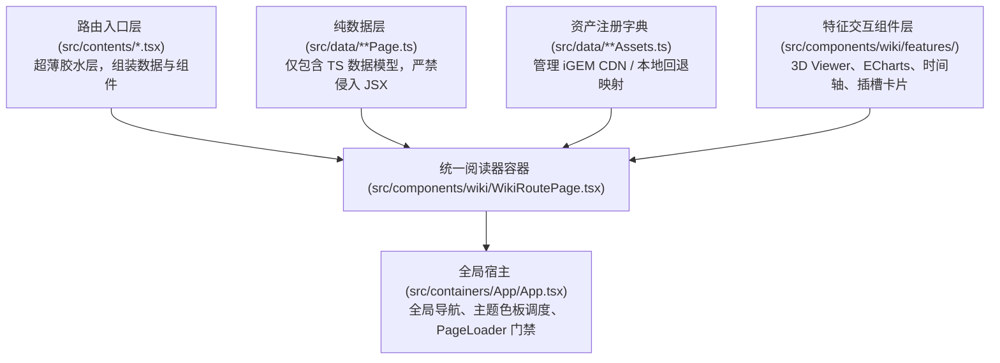
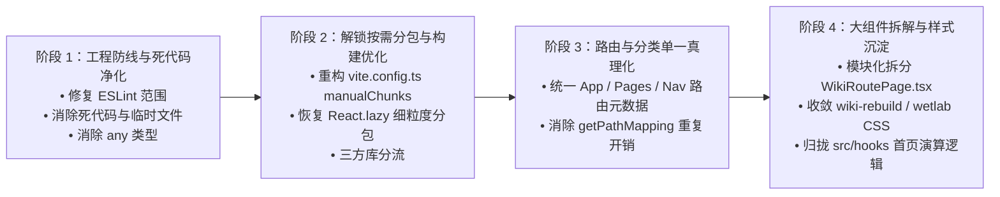

# CirCure Wiki 代码库架构评估与技术重构分析报告

> **编制人员**：资深前端架构师  
> **报告类型**：技术债务审计、架构拓扑诊断与渐进式重构指南  
> **工程基准**：代码库全量静态检查、Vite 打包链路审计、TypeScript 类型推导与规范对齐  
> **核心原则**：功能与视觉呈现 100% 保持不变，专注架构治理与质量提升

---

## 目录

- [一、 架构总结与数据流拓扑](#一-架构总结与数据流拓扑)
  - [1.1 技术栈基石与工程定位](#11-技术栈基石与工程定位)
  - [1.2 架构分层现状（四件套模型）](#12-架构分层现状四件套模型)
  - [1.3 全局数据流与核心中枢](#13-全局数据流与核心中枢)
- [二、 问题领域深度剖析](#二-问题领域深度剖析)
  - [2.1 结构性问题 (Structural Issues)](#21-结构性问题-structural-issues)
  - [2.2 重复代码与冗余资产 (Duplicate Code & Waste)](#22-重复代码与冗余资产-duplicate-code--waste)
  - [2.3 性能瓶颈与开销 (Performance Bottlenecks)](#23-性能瓶颈与开销-performance-bottlenecks)
  - [2.4 可维护性与工程风险 (Maintainability Risks)](#24-可维护性与工程风险-maintainability-risks)
- [三、 渐进式重构演进策略 (Refactoring Roadmap)](#三-渐进式重构演进策略-refactoring-roadmap)
- [四、 核心方案改进思路与范式参考](#四-核心方案改进思路与范式参考)
  - [4.1 方案一：修复打包分块策略，释放按需加载效能](#41-方案一修复打包分块策略释放按需加载效能)
  - [4.2 方案二：规范 ESLint 范围，恢复工程质量门禁](#42-方案二规范-eslint-范围恢复工程质量门禁)
  - [4.3 方案三：路由与分类单一真理源重构](#43-方案三路由与分类单一真理源重构)
  - [4.4 方案四：资产解析函数的泛型安全封装](#44-方案四资产解析函数的泛型安全封装)
  - [4.5 方案五：模块化拆解巨型组件 WikiRoutePage](#45-方案五模块化拆解巨型组件-wikiroutepage)
- [五、 现状技术评分与优先级矩阵](#五-现状技术评分与优先级矩阵)

---

## 一、 架构总结与数据流拓扑

### 1.1 技术栈基石与工程定位
* **核心框架**：React 19.2 + TypeScript 5.9 + Vite 7.0
* **业务定位**：面向 iGEM 2026 国际合成生物学大赛的学术展示型大型 Wiki 站点（涵盖 25+ 级学术内容页、多款网页交互微游戏、3D 分子可视化及交互式首页卷轴）。
* **UI 与动效**：GSAP 3.15（Core + ScrollTrigger + SplitText）、ECharts 6.1、Mol* 3D 结构渲染引擎、Tailwind CSS + Bootstrap 5.3 混合样式系统。

### 1.2 架构分层现状（四件套模型）
当前代码库遵循规范文档 `WIKI_ARCHITECTURE_SPEC.md` 中规划的标准分层设计：



1. **纯数据与文案层 (`src/data/`)**：学术正文与视图分离，页面文案以纯 TypeScript 对象结构（`WikiPageContent`）表达，通过块状模型（`prose`, `figure`, `table`, `feature`, `document`）解耦视图，杜绝 JSX 污染。
2. **资产字典层 (`src/data/**Assets.ts`)**：图片与 PDF 注册表，抹平 iGEM 静态 CDN 与本地离线调试的双轨路径。
3. **特征组件层 (`src/components/wiki/features/`)**：通过插槽机制（Feature Slots）解耦重型交互（如 `Trop2ComplexViewer`、`EpitopeStructuralValidationChart` 等）。
4. **路由组装层 (`src/contents/`)**：每个页面路由通常保持在 20~40 行以内，极简组装。
5. **门禁与测试保障**：具备完备的自定义图片预加载验证测试（`scripts/verify-page-image-loading.mjs`，41 项测试全部通过），确保页面切换时首屏图片无缝渲染。

### 1.3 全局数据流与核心中枢
* **应用入口**：`src/main.tsx` 挂载 `BrowserRouter`，由 `src/containers/App/App.tsx` 统筹全局状态。
* **主题系统**：通过 `route-palette-[module].css` 注入 5 大模块的 `--route-main` / `--route-soft` / `--route-base` 核心三色变量。
* **加载门禁**：通过 `src/utils/pageLoader.ts` 监听路由资源、字体、图片 `decode()` 与 SVG 解析，严格拦截 FOUC（页面样式闪烁）。

---

## 二、 问题领域深度剖析

### 2.1 结构性问题 (Structural Issues)

#### 1. 打包策略与代码分割彻底冲突（严重性能缺陷）
* **现状**：
  在 `src/contents/index.tsx` 中，全站通过 `React.lazy()` 实现了 25+ 个页面的细粒度路由懒加载：
  ```ts
  export const Description = lazy(() => import("./description").then(...));
  export const Model = lazy(() => import("./model").then(...));
  ```
  但在 `vite.config.ts` 的 `rollupOptions.output.manualChunks` 中硬编码了：
  ```ts
  manualChunks(id) {
    if (id.includes("node_modules")) return "vendor";
    if (id.includes("src/contents")) return "wiki-contents";
    if (id.includes("src/data")) return "wiki-data";
  }
  ```
* **问题本质**：
  `manualChunks` 的这一规则**完全抵消了 `React.lazy` 的代码拆分效果**。它强制把全站 25+ 个页面的组件全部压进 `wiki-contents.js`，全站数十万字的学术数据压进 `wiki-data.js`，所有三方库（包括大体量的 ECharts 和 Mol*）压进单体 `vendor.js`。即使访问最简单的页面，用户也必须全量下载整个站点的代码与文本。

#### 2. Monorepo 与单体工程边界混淆，破坏代码门禁
* **现状**：根目录下的 `games/bomb-cat/`、`games/breast-guardian/`、`virtual-lab/` 实际上是三个独立的工程，各自有独立的 `package.json` 和构建流，但未配置为 pnpm/yarn workspace。
* **问题本质**：根目录 `eslint.config.js` 仅忽略了 `dist`，执行 `npm run lint` 时会递归扫描这三个子项目，导致爆发 **26 个错误和 15 个警告**，直接导致构建流水线中的代码质量检查失败（退出码 1）。

#### 3. 核心单文件巨型化（Monolithic Files）
* `src/components/wiki/WikiRoutePage.tsx`：单文件长达 **1,459 行**。既负责目录结构渲染、阅读器状态机、ScrollSpy 计算，又内联处理了折叠列表、块类型分发、模态框、PDF 查看器。
* `src/contents/home-story.tsx`：长达 **1,290 行**，内含超过 50 条硬编码远程 CDN URL 映射字典。
* `src/hooks/` 目录职责泛滥：混杂了 20+ 个专用于首页 Canvas 粒子、墨水流体运动的底层算法（如 `createClinicalParticleMorph.ts`、`readingInk.ts`），破坏了 Hook 目录作为“通用状态逻辑抽象”的语义。

---

### 2.2 重复代码与冗余资产 (Duplicate Code & Waste)

#### 1. 遗留僵尸代码（Dead / Zombie Code）
* `src/contents/home.tsx`：保留了初版 iGEM 官方模板代码（151 行），但 `src/contents/index.tsx` 实际指向的是 `home-scene-01.tsx`。该文件完全处于失活状态。
* `src/contents/members.tsx`：仅 2 行，纯粹别名中转。
* `src/data/drylab/Untitled-1.md`：开发过程中的未命名临时备忘便签，遗留在源码树中。

#### 2. 多重影子文件与重定向层
* `src/data/descriptionAssets.ts` 与 `src/data/project/descriptionAssets.ts` 同时存在，前者仅是一行重导出。
* `src/data/softwarePage.ts` 与 `src/data/drylab/softwarePage.ts` 同样存在冗余代理。

#### 3. 路由分类定义的“三重多头维护”
在项目中有三处硬编码定义了路由组织：
1. `src/containers/App/App.tsx`：手动定义 `TEAM_ROUTES`、`PROJECT_ROUTES`、`WET_LAB_ROUTES` 等 5 个 `Set`。
2. `src/pages.ts`：用对象树（通过伪 `class Page/Folder`）重写了一套分类与路由。
3. `src/components/Navbar.tsx`：通过 `NAV_KEYS` 又对 `pages.ts` 做了一遍解析。
> **影响**：每增加或调整一个页面，开发者必须在三个不同地方手动同步，极易出现遗漏或不一致。

---

### 2.3 性能瓶颈与开销 (Performance Bottlenecks)

#### 1. 样式表严重叠床架屋（巨量未合并 CSS）
在 `WikiRoutePage.tsx` 顶部：
```tsx
import "../../styles/wiki-rebuild.css";          // 52.8 KB
import "../../styles/wetlab-editorial.css";      // 69.8 KB
import "../../styles/wiki-route-skin.css";       // 65.3 KB
import "../../styles/features/experiments-panels.css"; // 25.8 KB (甚至把湿实验专属样式提升到了全局模板！)
```
* 这导致**全站所有子页面**每次加载都会解析超过 **200 KB 的基础结构样式**，存在大量覆盖同名选择器（如 `.wiki-page`）的竞态风险；
* 规范文档 `WIKI_ARCHITECTURE_SPEC.md` 第六条明文指出了“需逐步淘汰 `wiki-rebuild.css` 和 `wetlab-editorial.css`”，但目前全局依然强力耦合。

#### 2. 无记忆化的重复路由计算
在 `App.tsx` 中：
```tsx
const pathMapping = getPathMapping();
```
`getPathMapping()` 是一个遍历全站页面的 `reduce` 操作，在 `App` 每次由于路由切换或上下文状态变动执行时，都会全量计算并生成新的对象引用，触发底层路由树的全量比对。

#### 3. 本地存储占用与非生产资源外溢
* `background/` 目录中存放了接近 **186 MB 的 Photoshop 原生源文件 (`.psd`)**；
* `public/` 目录高达 **614 MB**；
* `scripts/postbuild-slug.mjs` 在构建产物中又完整复制了一份 `dist/jlu-fbh`，导致打包产物膨胀至 **563 MB**。

---

### 2.4 可维护性与工程风险 (Maintainability Risks)

#### 1. TypeScript 类型断言退化 (`any` 泄漏)
在 `contributionAssets.ts`、`resultsAssets.ts`、`designAssets.ts` 及 `EpitopeStructuralValidationChart.tsx` 中多次出现：
```ts
const entry = (contributionAssets as Record<string, any>)[key];
formatter: (params: any) => { ... }
```
这导致类型防护破损，修改数据字段名时 IDE 无法推导关联错误。

#### 2. 页面架构规范执行存在孤岛
大多数页面规范接入了 `WikiRoutePage`，但 `src/contents/engineering.tsx` 脱离了该规范，单独手工拼接了 `EngineeringIntroduction` 和 `EngineeringJourney`，与统一阅读器体系形成隔离，增加了长期维护时的心智负担。

---

## 三、 渐进式重构演进策略 (Refactoring Roadmap)

在**保持现有所有功能、交互效果、学术文案和页面呈现 100% 不变**的前提下，建议采取四步渐进式重构路线：



---

## 四、 核心方案改进思路与范式参考

### 4.1 方案一：修复打包分块策略，释放按需加载效能

**现状问题**：`manualChunks` 粗暴合并，导致 25 个页面无法按需加载。  
**改进思路**：移除对 `src/contents` 与 `src/data` 的全局打包垄断，仅对重量级 `node_modules` 进行合理分片。

```typescript
// vite.config.ts 建议调整范式
export default () => {
  return defineConfig({
    build: {
      rollupOptions: {
        output: {
          manualChunks(id) {
            if (id.includes("node_modules")) {
              // 拆分超大独立依赖库，使各页面实现最大化长效缓存
              if (id.includes("molstar")) return "vendor-molstar";
              if (id.includes("echarts")) return "vendor-echarts";
              if (id.includes("gsap")) return "vendor-gsap";
              if (id.includes("react") || id.includes("react-dom") || id.includes("react-router")) {
                return "vendor-react";
              }
              return "vendor-common";
            }
            // 不再劫持 src/contents 与 src/data，交由 Vite 基于 import() 自动进行路由级分割！
          },
        },
      },
    },
  });
};
```

---

### 4.2 方案二：规范 ESLint 范围，恢复工程质量门禁

**现状问题**：`eslint .` 穿透扫描独立子项目，误报非根工程错误。  
**改进思路**：在 `eslint.config.js` 中隔离子项目与公共产物目录。

```javascript
// eslint.config.js 建议调整范式
export default tseslint.config(
  {
    // 忽略构建输出以及独立的子工程目录（子项目拥有自己的构建与 linter）
    ignores: [
      "dist",
      "games/**",
      "virtual-lab/**",
      "public/**",
      "scripts/**",
    ],
  },
  {
    extends: [js.configs.recommended, ...tseslint.configs.recommended],
    files: ["src/**/*.{ts,tsx}"],
    // ... 原有规则保持不变
  }
);
```

---

### 4.3 方案三：路由与分类单一真理源重构

**现状问题**：`App.tsx`、`pages.ts`、`Navbar.tsx` 三重重复定义路由分类。  
**改进思路**：在 `pages.ts` 中直接为每个页面标记所属模块（`module: "project" | "wet-lab" | ...`），派生出所有分类集合，并在模块顶层初始化映射表。

```typescript
// pages.ts 改进思路：在定义层赋予模块类别，一次定义，处处派生
export interface WikiPageMeta {
  name: string;
  title: string;
  path: string;
  component: React.ComponentType;
  lead?: string;
  module: "team" | "project" | "wet-lab" | "dry-lab" | "engagement" | "home";
}

// 模块级单例缓存，无需在 App.tsx 每次渲染时通过 reduce 重复生成
export const ROUTE_MAP: Record<string, WikiPageMeta> = Object.freeze(
  // 基于平铺数组一次性完成构建
);

export const MODULE_ROUTES = {
  team: new Set(Pages.filter(p => p.module === "team").map(p => p.path)),
  project: new Set(Pages.filter(p => p.module === "project").map(p => p.path)),
  // ...
};
```

---

### 4.4 方案四：资产解析函数的泛型安全封装

**现状问题**：各 `*Assets.ts` 中充斥 `(assets as Record<string, any>)[key]`。  
**改进思路**：抽取通用的泛型资产提取函数，既保证强类型约束，又杜绝重复手写。

```typescript
// 资产解析通用模式
export interface BaseAssetEntry {
  uploadUrl?: string;
  localSrc?: string;
  kind?: string;
}

export function resolveAssetUrl<T extends Record<string, BaseAssetEntry>>(
  catalog: T,
  key: keyof T
): string {
  const item = catalog[key];
  return item?.uploadUrl || item?.localSrc || "";
}
```

---

### 4.5 方案五：模块化拆解巨型组件 `WikiRoutePage`

**现状问题**：1,459 行巨型文件承载了过多的职责。  
**改进思路**：按职责下沉至独立子组件，保持主文件在 150 行以内的装配层级：

```text
src/components/wiki/
├── WikiRoutePage.tsx               # 主入口：专注 Layout 外壳与状态联动（< 150 行）
├── reader/
│   ├── BlockDispatcher.tsx        # 专注 block.type 分发 (prose, table, figure, card)
│   ├── ItemAccordionList.tsx      # 专注 section.items 手风琴折叠渲染
│   ├── ReaderHero.tsx             # 专注 Hero 区域与背景图
│   └── useReaderScrollSpy.ts      # 专注 IntersectionObserver 与 TOC 高亮监听
```

---

## 五、 现状技术评分与优先级矩阵

| 评估维度 | 当前现状评分 (1-10) | 主要风险点与技术债务 | 建议整改优先级 |
| :--- | :---: | :--- | :---: |
| **功能实现与视觉呈现** | **9.5** | 页面还原度高，动效丰富，图片加载测试用例扎实 | 保持现状 |
| **构建与打包性能** | **4.0** | `manualChunks` 锁死代码拆分，全站 JS/Data 捆绑为单体 | **高 (P0)** |
| **代码规范与 CI 门禁** | **5.5** | 子项目污染致 `npm run lint` 报错，多处 `any` 弱化类型 | **高 (P0)** |
| **模块解耦与目录整洁** | **6.0** | 样式表存在多代重叠，`src/hooks/` 混杂大量底层粒子运算 | **中 (P1)** |
| **可维护性与单一真理** | **6.5** | 路由三处重复定义，单文件膨胀超千行 | **中 (P1)** |

---

> **结语**：本项目底层基础相当扎实（完备的图片加载自测机制、深思熟虑的四件套规范），核心痛点集中在“**打包分块被手动配置反向卡死**”、“**样式经历了多代演进但历史层未完全收口**”以及“**部分单文件职责过重**”。遵循本报告中的演进路线，可在零业务侵入的前提下，显著释放加载性能并重塑代码库的可维护性。
