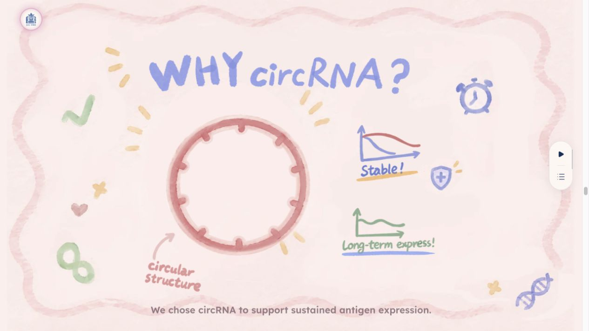
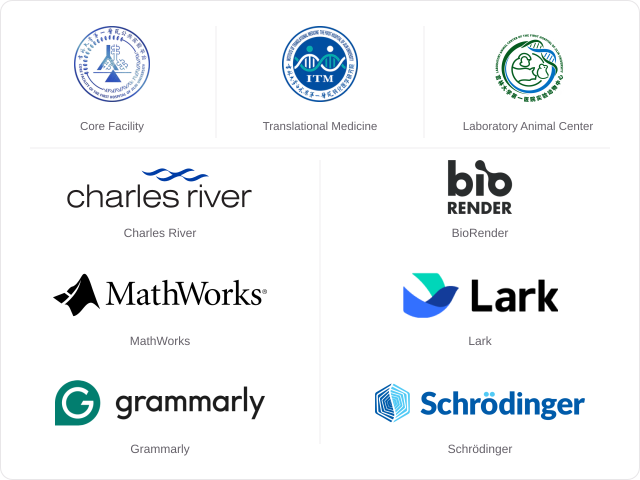

<p align="center">
  <a href="README.md" title="阅读中文版 · Read in Chinese">
    
  </a>
  &nbsp;
  <a href="README.en.md" title="Read the full README in English">
    
  </a>
  <br />
  <sub><a href="docs/README.md">中文文档</a> · <a href="docs/README.en.md">English documentation →</a></sub>
</p>

<p align="center">
  <a href="https://2026.igem.wiki/jlu-fbh/">
    
  </a>
</p>

<h1 align="center">JLU-FBH · iGEM 2026</h1>

<p align="center">
  <a href="https://teams.igem.org/6056">
    
  </a>
</p>

<p align="center">
  <strong>CirCure Official Wiki</strong><br />
  A circRNA vaccine research project for triple-negative breast cancer
</p>

<p align="center">
  <a href="https://2026.igem.wiki/jlu-fbh/" title="Visit the official CirCure Wiki">
    
  </a>
  <br />
  <sub><a href="https://2026.igem.wiki/jlu-fbh/">Open the official Wiki for the full project and interactive features ↗</a></sub>
</p>

<p align="center">
  <a href="#design-reference-for-future-igem-teams">Design lessons</a>
  &nbsp;·&nbsp;
  <a href="#site-modules-and-pages">Pages</a>
  &nbsp;·&nbsp;
  <a href="#quick-start">Quick start</a>
  &nbsp;·&nbsp;
  <a href="CONTRIBUTING.en.md">Contribute</a>
</p>

## Project overview

This is the official Wiki repository for **JLU-FBH** in the 2026 International Genetically Engineered Machine Competition (**iGEM**). It contains the website frontend, page content, design assets, and source code for the games and virtual laboratory.

**CirCure** explores an engineered circular RNA (**circRNA**) platform for a multi-target triple-negative breast cancer (**TNBC**) vaccine. The Wiki presents the project's design, experiments, and research findings through research articles, hand-drawn illustrations, scroll-driven storytelling, model visualizations, and science communication games.

Alongside the molecular mechanisms and experimental design, we want readers to see the patients behind the research: their worries about recurrence and their hopes for everyday life. We begin with a patient's question and give readers room to pause, compare, and explore the science at their own pace.

<p align="center">
  <strong>Project Promotion Video</strong><br />
  <a href="https://video.igem.org/w/m8LNK1BBUzt9hSXsHRqH16">
    
  </a>
  <br />
  <a href="https://video.igem.org/w/m8LNK1BBUzt9hSXsHRqH16"><strong>▶ Watch the promotion video · 2 min 03 sec ↗</strong></a><br />
  <sub>iGEM Video Universe · Click the cover or link to watch</sub>
</p>

<details>
<summary><strong>Preview the Wiki</strong> · Hand-painted circRNA scene</summary>

<p align="center">
  <a href="https://2026.igem.wiki/jlu-fbh/">
    
  </a>
  <br />
  <sub>Official homepage · Conceptual illustration · Open the complete Wiki</sub>
</p>

</details>

## Design reference for future iGEM teams

We kept sketches, interactive prototypes, revision notes, and source code throughout CirCure's design process. We hope these records help teams building their own Wiki understand what we tried, why we changed it, and how we built the final pages.

Start with the [interactive Visual Design page ↗](https://2026.igem.wiki/jlu-fbh/visual-design). [Section 8: Humanistic Care & Narrative Design](https://2026.igem.wiki/jlu-fbh/visual-design#human-centered-experience) explains how the patient's perspective shapes the scientific story. [Section 9: Our Wiki Contribution](https://2026.igem.wiki/jlu-fbh/visual-design#interaction-craft) covers artwork, motion, typography, and navigation. Try the demonstrations, then expand **Technical details** to read the design rationale and implementation notes.

The [English methods guide](docs/visual-design-guide.en.md) and its [Chinese edition](docs/visual-design-guide.md) collect case summaries and source paths for reading alongside the code on GitHub.

The [Design Folios: six studies and revisions ↗](https://2026.igem.wiki/jlu-fbh/visual-design#design-history-archive) near the end of the page preserve earlier designs and revision notes: image-led navigation, a pink thread and expanding emblem, three Human Practices timelines, and composition and RNA-ring transition comparisons. Try the five HTML demonstrations within the folios or choose **Open in full window**. The [folio source index](docs/visual-design-guide.en.md#design-folios-earlier-directions-and-interactive-studies) lists the files for each example.

### Section 9: from artwork to implementation

This section follows the production process: separate artwork into layers, plan reading pauses, lay out the article, then build navigation, the ending, and interaction checks.

| Section | Reusable approach |
| --- | --- |
| [9.1 Artwork and opening](https://2026.igem.wiki/jlu-fbh/visual-design#artwork-and-opening) | Separate layers by movement and use shared coordinates; load resources before connecting the title animation to the first scene. |
| [9.2 Motion and reading rhythm](https://2026.igem.wiki/jlu-fbh/visual-design#keyframes-and-reading-holds) | Establish complete readable states before transitions; retain the RNA ring's outline and offer pause, chapter selection, and reverse browsing. |
| [9.3 Sustained reading](https://2026.igem.wiki/jlu-fbh/visual-design#reading-surfaces) | Use subdued article backgrounds, typography, image edges, and white space to organize long-form content. |
| [9.4 Clear reading routes](https://2026.igem.wiki/jlu-fbh/visual-design#navigation-with-a-landmark) | Mark the navigation entry with the crest, distinguish current-page and hover states, and provide outlines, search, citation backlinks, and next-page links. |
| [9.5 Team photograph and letter](https://2026.igem.wiki/jlu-fbh/visual-design#photo-reveal-craft) | End with a gradual team photograph reveal and a letter readers can open; support reversing the animation and restore keyboard focus and reading position when the letter closes. |
| [9.6 Revision and documentation](https://2026.igem.wiki/jlu-fbh/visual-design#design-record) | Keep sketches, before-and-after comparisons, revision notes, and source code; check reverse scrolling, rapid reversal, window resizing, and reduced-motion settings. |

### All nine Visual Design sections

| Section | What to study |
| --- | --- |
| [1 · Brand Identity](https://2026.igem.wiki/jlu-fbh/visual-design#brand-identity) | Project logo, team crest, flag, and Lumi mascot connected to the research theme. |
| [2 · Cross-Module Palette Architecture](https://2026.igem.wiki/jlu-fbh/visual-design#color-system) | Five module palettes, heading hierarchy, and reading surfaces. |
| [3 · Interactive Aesthetics & Motion](https://2026.igem.wiki/jlu-fbh/visual-design#interactive-experience) | Mascot cursor, watercolor interfaces, molecular visualization, and animation. |
| [4 · Decoupled Web Engineering Architecture](https://2026.igem.wiki/jlu-fbh/visual-design#engineering-rigor) | Content, assets, interaction, and assembly layers; citations and media delivery. |
| [5 · Core Interfaces & Narrative Experience](https://2026.igem.wiki/jlu-fbh/visual-design#core-interfaces) | Loading screen and homepage narrative entry. |
| [6 · Wiki Subpage Illustration System](https://2026.igem.wiki/jlu-fbh/visual-design#subpage-illustrations) | Hand-painted page covers and a shared visual language across modules. |
| [7 · Educational Games & Hands-On Experience](https://2026.igem.wiki/jlu-fbh/visual-design#educational-games) | Science-communication games and virtual laboratory experiences. |
| [8 · Humanistic Care & Narrative Design](https://2026.igem.wiki/jlu-fbh/visual-design#human-centered-experience) | Connect a patient's question to scientific explanation, participation, and reader control. |
| [9 · Our Wiki Contribution](https://2026.igem.wiki/jlu-fbh/visual-design#interaction-craft) | Adaptable methods for layered artwork, reading rhythm, navigation, endings, and revision records. |

Research and reuse: [Methods and source map](docs/visual-design-guide.en.md) · [Design references](https://2026.igem.wiki/jlu-fbh/visual-design#design-references) · [Attribution, licensing, and suggested citation](docs/visual-design-guide.en.md#reuse-and-citation).

## Project links

**GitHub repository** · Development, design methods, and reusable source<br />[JLU-FBH / CirCure — xiangyupaiso/Official-wiki](https://github.com/xiangyupaiso/Official-wiki)

**Live Wiki** · Published site and project showcase<br />[https://2026.igem.wiki/jlu-fbh/](https://2026.igem.wiki/jlu-fbh/)

**Development preview** · Ongoing page, interaction, and design updates<br />[https://wiki.dayquay.com/jlu-fbh/](https://wiki.dayquay.com/jlu-fbh/)

**Project Promotion Video** · Hosted on the official iGEM video platform<br />[https://video.igem.org/w/m8LNK1BBUzt9hSXsHRqH16](https://video.igem.org/w/m8LNK1BBUzt9hSXsHRqH16)

**Official GitLab** · Official source and release history<br />[https://gitlab.igem.org/2026/jlu-fbh](https://gitlab.igem.org/2026/jlu-fbh)

**Team dashboard · Team 6056** · Team administration, uploads, and deliverables<br />[https://teams.igem.org/6056](https://teams.igem.org/6056)

Development and Pull Requests take place in this GitHub repository. See the [deployment guide](docs/deployment.en.md) for the roles of GitHub, official GitLab, and website releases.

### Preview and published versions

According to the [official iGEM 2026 calendar](https://competition.igem.org/about/calendar), the official Wiki entered the **Wiki Freeze on October 21, 2026, at 15:00 UTC (23:00 Beijing time, UTC+8)**. Editing is closed during the freeze and will reopen at the Wiki Thaw after the Grand Jamboree.

[`2026.igem.wiki/jlu-fbh/`](https://2026.igem.wiki/jlu-fbh/) preserves the frozen competition version. Later additions, restored materials, and page improvements are kept in this GitHub repository and appear on the [development preview at `wiki.dayquay.com`](https://wiki.dayquay.com/jlu-fbh/) after deployment. The two sites deploy independently.

As of 2026-10-22, the GitHub development version retains these additions relative to official GitLab:

- **Visual Design**: eleven initial sketches, four image-corner comparisons, explanations and complete screenshots of the gap between Next page and the footer, and additional ribbon and historical design studies.
- **Bomb Cat**: online room creation and joining, the lobby, connection state, and PeerJS networking source, together with rebuilt runtime assets.
- **Sustainability**: restored Tracker summaries overwritten by the October 21 emergency rollback, with separate counts for 66 participants, 38 source profiles, and 78 feedback records, and ten framework SDGs grouped into SET / DEVELOP / GROW.
- **Assets and engineering resources**: buildable game and virtual laboratory source, local assets, provenance, and bilingual development documentation.

See the [version comparison](docs/deployment.en.md#preview-and-official-gitlab-content-differences) for source paths, the rollback timeline, and deployment details.

## Start here

- Research iGEM Wiki design: [Visual Design methods guide](docs/visual-design-guide.en.md), with particular attention to Section 9
- Run the project: [Quick start](#quick-start)
- Develop, check, and build: [Development guide](docs/development.en.md)
- Find the right files: [Repository map](docs/repository-layout.en.md)
- Understand hosting environments: [Deployment guide](docs/deployment.en.md)
- Maintain images, manuscripts, CDN mappings, and upload batches: [Asset guide](docs/assets.en.md)
- Browse documentation: [Documentation index](docs/README.en.md)
- Prepare a contribution: [Contributing](CONTRIBUTING.en.md)

On this page: [Technology](#technology-and-core-dependencies) · [Architecture](#architecture-and-development-principles) · [Site map](#site-modules-and-pages) · [Features](#interaction-and-engineering-features) · [Repository structure](#repository-structure-and-build-boundaries) · [Editing guide](#common-editing-locations) · [Deployment](#continuous-integration-and-hosting) · [License](#license-and-attribution)

## Technology and core dependencies

The Wiki uses the technologies below. [package.json](package.json) declares dependencies and version ranges; lockfiles record installed versions. Standalone applications maintain their own dependencies.

| Area                         | Technology                                        | Version family                      | Purpose                                                                     |
| ---------------------------- | ------------------------------------------------- | ----------------------------------- | --------------------------------------------------------------------------- |
| Build tooling                | Vite                                              | 7.3.x                               | Local development, hot module replacement, and multiple HTML build entries  |
| Frontend                     | React + TypeScript                                | 19.2.x / 5.9.x                      | Components, type checking, and page data interfaces                         |
| Routing                      | React Router                                      | 7.x                                 | Routes, navigation, redirects, and reading entry points                     |
| Animation                    | GSAP + @gsap/react                                | 3.15.x / 2.1.x                      | Intro strokes, scroll scenes, timelines, and component animation lifecycles |
| Molecular visualization      | Mol\* (Molstar)                                   | 5.13.x                              | WebGL molecular viewers with a separately compiled, on-demand runtime       |
| Data visualization           | Apache ECharts                                    | 6.1.x                               | Charts, legends, range highlighting, and tooltips                           |
| Wiki styling                 | CSS custom properties (design tokens) + Bootstrap | Bootstrap 5.3.x                     | Themes, grids, the shared reader, and page layout                           |
| Laboratory styling and icons | Tailwind CSS + Lucide                             | Tailwind 3.4.x; root Lucide 0.562.x | Laboratory interfaces, icons, and separate styling                          |
| Interaction primitives       | Radix UI                                          | Root Dialog / Tabs 1.x              | Dialogs, tabs, and other basic interactions                                 |
| Engineering checks           | ESLint + Prettier + Node test scripts             | See configuration and lockfiles     | Static analysis, formatting, and focused regression checks                  |

The Wiki, two standalone games, and virtual laboratory have separate build entries. See [build boundaries](#build-boundaries).

## Architecture and development principles

### Page layers: data, assets, interaction, and assembly

The [page architecture specification](WIKI_ARCHITECTURE_SPEC.md) (Chinese) separates four responsibilities:

| Layer            | Typical location                         | Responsibility                                                                                                 |
| ---------------- | ---------------------------------------- | -------------------------------------------------------------------------------------------------------------- |
| Page content     | `src/data/[module]/[page]Page.ts`        | Describe text, sections, figures, and links with types such as `WikiPageContent`; keep JSX out of content data |
| Asset mapping    | `src/data/[module]/[page]Assets.ts`      | Connect local sources, images, attachments, and CDN URLs                                                       |
| Page interaction | `src/components/wiki/features/[module]/` | Implement charts, construct viewers, and specialized interactions through feature slots                        |
| Route assembly   | `src/contents/[page].tsx`                | Combine `WikiRoutePage`, page data, Hero artwork, and features in a small assembly layer                       |

New pages follow these four layers. Existing page data lives both at the root of `src/data/` and in module directories; follow imports to find the files for a page.

### Shared reader and maintenance entry points

Content pages reuse `WikiRoutePage` for blocks, images, citations, the outline, and chapter transitions. Shared reader dimensions and layout belong primarily in `src/styles/wiki-route-skin.css`. Module themes live in `route-palette-*.css`; specialized interactions and styles stay with their features.

Maintain page content and asset mappings separately to avoid duplicate sources of the same content. See [common editing locations](#common-editing-locations).

### Standalone applications and style isolation

The Wiki uses the shared reader, CSS themes, and Bootstrap. The virtual laboratory has its own Tailwind styles, dependencies, and build. A lazily loaded iframe embeds the official laboratory deployment, separating the two documents' styles and viewports.

The laboratory uses `window.postMessage` to request closing. The Wiki verifies both the message origin and the iframe window. The nine laboratory pages are split using `React.lazy` and dynamic `import()`; their code is built in the laboratory project.

### Shared image-readiness contract

Route changes use the shared loader. `WikiRoutePage` collects Hero and article images automatically. Declare images in dialogs or inactive tabs through `preloadImages` or `PageImagePreloads` so they are ready when the interaction opens.

New pages inherit the same behavior. See the [image-readiness contract](WIKI_ARCHITECTURE_SPEC.md#471-新页面接入) (Chinese). Run `yarn test:page-loading` after changes and inspect route transitions and interactions in the browser.

## Site modules and pages

Navigation consists of Home and five content groups, with 22 entries besides the homepage. This tree follows [src/pages.ts](src/pages.ts). Paths are relative to the website base `/jlu-fbh/`.

```text
CirCure Wiki
├── Home (/)                                      # Intro and scroll story
├── Team
│   ├── Roster (/roster)                           # Members, instructors, and advisors
│   ├── Attributions (/attributions)               # Contributions and support
│   └── Activities (/activities)                   # Activities and season records
├── Project
│   ├── Description (/description)                 # Background and design rationale
│   ├── Engineering (/engineering)                 # Design–Build–Test–Learn
│   ├── Results (/results)                         # Results and discussion
│   ├── Contribution (/contribution)               # Reusable resources and experience
│   ├── Visual Design (/visual-design)             # Identity, illustration, and interaction
│   ├── Notebook (/notebook)                       # Development and experiment records
│   └── Safety and Security (/safety-and-security)  # Safety and risk management
├── Wet Lab
│   ├── Design (/design)                           # Molecular constructs and experiments
│   ├── Experiments (/experiments)                 # Methods and protocols
│   ├── Measurement (/measurement)                 # Measurement and characterization
│   └── Alternative Platform (/alternative-platform)
├── Dry Lab
│   ├── Model (/model)                             # Models, assumptions, and computation
│   ├── Software (/software)                       # CircuForge and TorusFold
│   ├── Hardware (/hardware)                       # Instruments and hardware
│   └── Games (/games)                             # Interactive learning portal
│       ├── Virtual Laboratory                    # Nine molecular biology experiments
│       ├── Breast Guardian RPG                   # Breast-health narrative game
│       ├── Bomb Cat                              # circRNA strategy cards
│       └── Bio Memory Match                      # Biology memory matching
└── Engagement
    ├── Entrepreneurship (/entrepreneurship)       # Business case and adoption pathway
    ├── Human Practices (/human-practices)         # Stakeholder interviews and feedback
    ├── Education (/education)                    # Outreach, teaching, and exchange
    └── Sustainability (/sustainability)          # SDGs and impact assessment
```

`/team` redirects to `/roster`; `/attribution` is an alias for `/attributions`.

## Interaction and engineering features

### Opening sequence and scroll story

The homepage combines SVG strokes, Canvas particles, and GSAP timelines in the CirCure signature intro. The TNBC exploration map, antigen switcher, circRNA illustrations, and scene transitions guide readers from the problem to the design.

The implementation lives mainly in `src/components/home/`, homepage data in `src/data/`, and styles such as `src/styles/home-*.css`. Home has its own narrative layout; article routes use the shared reader and module themes.

### Hand-drawn Hero artwork and long-form reading

Pages use hand-drawn Hero artwork and an ink-wash watercolor visual style. When an illustration already includes its title, `hideHeroCopy` controls the visible text while retaining a semantic `h1` for assistive technologies.

The shared reader includes the marker-style `WikiLineSidebar`, section navigation, inline charts and citations, and the closing `WikiNextRecord` link. Deeper outline entries normally expand around the current reading position; some pages show the full outline.

Team, Project, Wet Lab, Dry Lab, and Engagement maintain their own palettes. Primary, soft, and base colors work alongside heading and marker tokens. See the [design and typography specification](文案集/Wiki-设计与排版规范.md) (Chinese).

### Virtual molecular biology laboratory

The [live laboratory](https://virtual-lab-208fd4.igem.wiki/) contains nine guided experiments, organized into Beginner, Intermediate, and Advanced levels. The Wiki retains the [complete laboratory source](virtual-lab/README.en.md) and embeds its official deployment. The [official software repository](https://gitlab.igem.org/2026/software/jlu-fbh/virtual-lab) manages that application's deployment.

| Level        | Experiment                                               | Learning topics                                              |
| ------------ | -------------------------------------------------------- | ------------------------------------------------------------ |
| Beginner     | 1 · Revival and activation of E. coli DH5α               | Frozen stock, aseptic technique, streaking, and culture      |
| Beginner     | 2 · Colony morphology and Gram staining                  | Smears, fixation, staining, decolorization, and microscopy   |
| Beginner     | 3 · pET-28a miniprep and agarose gel electrophoresis     | Plasmid extraction, column purification, and electrophoresis |
| Beginner     | 4 · GFP fragment gel extraction                          | Gel cutting, dissolution, binding, washing, and purification |
| Intermediate | 5 · GFP PCR and product verification                     | Reaction setup, thermal cycling, and gel verification        |
| Intermediate | 6 · Double digestion of pET-28a and GFP                  | Restriction digestion of vector and insert                   |
| Intermediate | 7 · Recombinant plasmid ligation                         | Vector-to-insert ratios and T4 DNA ligase                    |
| Advanced     | 8 · Competent cells and transformation                   | Competent cells, heat shock, and plate culture               |
| Advanced     | 9 · Colony PCR, GFP fluorescence, and protein expression | Clone screening, fluorescence, and protein detection         |

Equipment includes pipettes, centrifuges, thermal cyclers, electrophoresis, and imaging tools. StepIndicator, hints, and InfoPanel provide procedural, equipment, and reagent information. Experiment pages offer restart controls and landscape prompts on small portrait screens. Course content and viewport interactions remain in the standalone project.

### Science communication games

The `/games` portal groups the laboratory and three games, loading each experience when selected:

- **Breast Guardian RPG** introduces breast-health concepts through characters and situations across life stages.
- **Bomb Cat** is a circRNA-themed strategy card game with local bots, online rooms, and a rulebook.
- **Bio Memory Match** introduces biological concepts through specimen-card observation, recall, and matching.

Buildable source for Breast Guardian and Bomb Cat lives in `games/`. Bio Memory runs from `public/game-assets/bio-memory/`. See [games/README.en.md](games/README.en.md) for source provenance, version comparisons, and build instructions.

### Molecular and data visualization

The Model page uses Mol\* to display the Trop2 complex, with rotation, zoom, segment focus, surface visibility, and polar-contact controls. The molecular runtime and PDB load when the reader approaches the figure.

ECharts and related components display model data with legends, range highlighting, and interactive tooltips, so readers can explore the figures alongside the model analysis.

### Navigation, cursor, and reading tools

Shared features include responsive navigation, in-page search, back-to-top controls, the footer, and a sheep cursor. The cursor is enabled according to fine-pointer, hover, and reduced-motion settings, while applicable input areas retain native cursor behavior.

Changes to shared components should cover transitions between Home and article pages, narrow viewports, keyboard use, and reduced-motion preferences.

### Asset sources and official hosting

Published pages use official images, fonts, and attachments on `static.igem.wiki`. The repository also retains local assets, manuscripts, and source mappings. Use the relevant asset dictionary and registry, and retain official hosting entries for videos and standalone applications.

Upload copies and historical check records live in `delivery/uploads/`. When updating assets, follow the [asset guide](docs/assets.en.md) to check source files, CDN URLs, and page references.

## Repository structure and build boundaries

### Directory entry points

```text
.
├── src/                              # Wiki source
│   ├── assets/                       # Home, navigation, illustrations, and figures
│   ├── components/
│   │   ├── home/                     # Intro and homepage story
│   │   ├── wiki/                     # Shared reader and feature components
│   │   ├── VirtualLaboratory/         # Laboratory iframe integration
│   │   ├── BreastGuardianGame/        # RPG integration
│   │   ├── BombCatGame/               # Card game integration
│   │   └── BioMemoryGame/             # Memory game integration
│   ├── containers/App/               # App host, routes, and shared components
│   ├── contents/                     # Route assembly
│   ├── data/                         # Content, citations, sections, and asset mappings
│   ├── hooks/                        # Shared hooks
│   ├── styles/                       # Themes, reader, and page styles
│   ├── utils/                        # Loading, paths, and other utilities
│   ├── main.tsx                      # Application entry
│   └── pages.ts                      # Page and navigation groups
├── public/                           # Static files published at their existing paths
│   ├── assets/                       # Images, documents, and other static resources
│   ├── game-assets/                  # Game runtime files used by the Wiki
│   └── vendor/                       # Retained third-party runtimes
├── games/                            # Two independently buildable game projects
├── virtual-lab/                      # Standalone laboratory
│   ├── src/                          # Equipment, steps, catalog, and experiment pages
│   ├── public/                       # Course players and related static files
│   └── package.json / package-lock.json
├── 文案集/                            # Manuscripts, original attachments, and design sources
├── scripts/                          # Build, checks, imports, and asset processing
│   └── manual/                       # Environment-specific manual checks
├── docs/                             # Guides, content references, and historical reviews
├── delivery/                         # Delivery archives
│   └── uploads/                      # Upload batches and manifests
├── WIKI_ARCHITECTURE_SPEC.md          # Page specification and image-readiness contract
├── IGEM_ASSET_REGISTRY.md             # Asset registry
├── .gitlab-ci.yml                    # Official GitLab Pages pipeline
├── wrangler.json                     # Cloudflare static asset configuration
├── eslint.config.js                  # ESLint configuration
├── package.json / yarn.lock          # Root scripts, dependencies, and Yarn lockfile
├── package-lock.json                 # Retained npm lockfile
├── tsconfig.json / tsconfig.node.json
└── vite.config.ts                    # HTML entries, molecular runtime, and base path
```

The root files `index.html`, `visual-design-study.html`, `archive-navigation-study.html`, and `archive-recognition-study.html` are the four HTML build entries for the Wiki and design demonstrations.

`.env` contains existing team metadata and build inputs; keep secrets out of it. `.dockerignore` filters local build contexts. See the [repository map](docs/repository-layout.en.md) for other root files and migration records.

### Build boundaries

| Application                | Development entry                                    | Root build behavior                                                                   |
| -------------------------- | ---------------------------------------------------- | ------------------------------------------------------------------------------------- |
| Wiki                       | `src/`, `yarn dev`                                   | Type-check, build four HTML entries, and generate path mappings                       |
| Breast Guardian / Bomb Cat | [games/README.en.md](games/README.en.md)             | Publish checked-in files in `public/game-assets/`; game source is built separately    |
| Virtual Laboratory         | [virtual-lab/README.en.md](virtual-lab/README.en.md) | Embed the official laboratory deployment; build and release the laboratory separately |

Subprojects maintain their own dependencies, lockfiles, and licenses; their README files explain development and build steps. The laboratory deploys independently. After rebuilding a game, update its runtime files in the Wiki's `public/game-assets/`.

## Common editing locations

| Change                                  | Entry point                                                                        |
| --------------------------------------- | ---------------------------------------------------------------------------------- |
| Routes and navigation targets           | `src/pages.ts`, `src/contents/`                                                    |
| Text, sections, and figure descriptions | The relevant module in `src/data/`                                                 |
| Image and attachment mappings           | The relevant `*Assets.ts`, `src/data/assets/`                                      |
| Page-specific interactions and charts   | `src/components/wiki/features/`                                                    |
| Home story and animation                | `src/components/home/`, homepage data, and related `home-*.css`                    |
| Shared reader and article layout        | `src/components/wiki/`, `src/styles/wiki-route-skin.css`                           |
| Module palettes and heading colors      | `src/styles/route-palette-*.css`                                                   |
| Shared loading and image readiness      | `src/utils/`; follow the [page specification](WIKI_ARCHITECTURE_SPEC.md) (Chinese) |
| Asset sources and upload records        | [Asset guide](docs/assets.en.md), [delivery index](delivery/README.en.md)          |
| Tool purpose, inputs, and write effects | [scripts/README.en.md](scripts/README.en.md)                                       |

Before running importers or asset generators, read their documented write scope; these tools update content or indexes. Consult the content owner before changing scientific manuscripts, experimental parameters, formulas, or evaluation metrics.

## Quick start

### Environment and dependencies

For the Wiki, use Node.js 22.12+ within the 22.x release family and Yarn Classic 1.22.22, matching the official CI's Node 22 major version. `package.json` declares the package manager.

From the repository root:

```sh
yarn install --frozen-lockfile
yarn dev
```

Open the URL printed by the terminal, normally `http://localhost:5173/jlu-fbh/`.

The root npm lockfile is also retained. For npm, use `npm ci` and `npm run <script>`. Use one package manager per dependency directory and update its lockfile when upgrading dependencies.

### Check, build, and preview

```sh
yarn lint
yarn test:page-loading
yarn build
yarn preview
```

The build runs TypeScript checking, Vite, and `scripts/postbuild-slug.mjs`. Output in `dist/` includes Wiki and design-study HTML entries. The Mol\* runtime is compiled separately.

`yarn format` rewrites all matching files; format only relevant files during routine work. See the [development guide](docs/development.en.md) and [script index](scripts/README.en.md) for focused content and browser checks.

### Standalone projects

```sh
# Start the laboratory in a separate terminal.
cd virtual-lab
npm ci
npm run dev
```

The laboratory's production output goes into its ignored `virtual-lab/dist/`. The root development server serves the Wiki. Install and build the two games inside `games/breast-guardian/` and `games/bomb-cat/`, following their README files.

## Continuous integration and hosting

### GitHub collaboration and official GitLab releases

Contributors develop on their own working or feature branches, discuss and review changes through Pull Requests, and integrate them into the shared `main` branch. Branch naming follows contributor or module-team conventions.

GitHub supports everyday collaboration and code review. Official GitLab supports iGEM source delivery and Wiki releases. The release maintainer synchronizes reviewed versions to official GitLab according to the team's release plan, where the pipeline builds and publishes the site.

The current [.gitlab-ci.yml](.gitlab-ci.yml) runs on GitLab's default branch:

```text
Node 22
  → yarn install --frozen-lockfile
  → yarn lint
  → yarn test:page-loading
  → yarn build
  → copy dist/. into the CI public/ directory, generate SPA fallback, and publish
```

The pipeline copies build output into the deployment directory within the CI workspace. See the [deployment guide](docs/deployment.en.md) for the release process and source checks.

### Yarn Classic and installation consistency

`package.json` declares `yarn@1.22.22`; the official pipeline installs from the lockfile with `--frozen-lockfile`. Install dependencies separately in the Wiki and each subproject directory.

### One output tree and path mapping

`scripts/postbuild-slug.mjs` reads Vite's resolved base and generates Cloudflare `_redirects` inside a single `dist/` output tree. Core rules for the default team path are:

```text
/ /jlu-fbh/ 302
/jlu-fbh /jlu-fbh/ 301
/jlu-fbh/* /:splat 200
```

Additional rules canonicalize HTML and directory entries. Vite preview and official GitLab Pages mount output at the base path. [wrangler.json](wrangler.json) points Cloudflare at `./dist` with SPA fallback. An extra `dist/jlu-fbh/` copy is unnecessary.

When needed, the script generates `.assetsignore` so Cloudflare uploads skip files above 25 MiB. Use the corresponding CDN URLs when pages reference those resources.

GitHub Pages does not read Cloudflare's `_redirects`. Configure its mount path and deep-route fallback separately if using that host.

### TypeScript asset indexes and configuration

Asset dictionaries such as `contributionAssets.ts`, `resultsAssets.ts`, and `designAssets.ts` maintain page-to-resource references. Run TypeScript and build checks after changes to check index keys and resource paths.

`wrangler.json` configures Cloudflare; `.gitlab-ci.yml` controls official Wiki builds; `.dockerignore` filters Docker contexts. Maintain each configuration for its environment.

## Team and acknowledgements

We thank the university, clinical institutions, research platforms, and supporters who helped the team. See the Wiki's [Attributions](https://2026.igem.wiki/jlu-fbh/attributions) page for individual contributions and forms of support.

<p align="center">
  
</p>

<p align="center">
  <strong>Jilin University</strong><br />
  The First Bethune Hospital of Jilin University<br />
  The First Bethune Clinical Medical College of Jilin University
</p>

### Research platforms, tools, and other support

<p align="center">
  
</p>

- **Clinical and teaching units**: Department of Teaching, The First Bethune Clinical Medical College of Jilin University; Cancer Center, The First Bethune Hospital of Jilin University.
- **Research platforms**: Core Facility, Institute of Translational Medicine, and Laboratory Animal Center at the First Hospital of Jilin University.
- **Tools and other supporters**: Charles River, BioRender, MathWorks, Lark, Grammarly, and Schrödinger.
- **Competition and community**: iGEM.

## License and attribution

The root repository uses [CC BY 4.0](LICENSE). Retain the required attribution and license terms when using, sharing, or modifying the work. Third-party assets, dependencies, and standalone applications retain their own licensing requirements.

Preserve the shared footer's license notice and official GitLab repository link. AI-assisted work also follows [Contributing](CONTRIBUTING.en.md) and the [responsible-use guidance](.claude/RESPONSIBLE_AI_USE.en.md).
