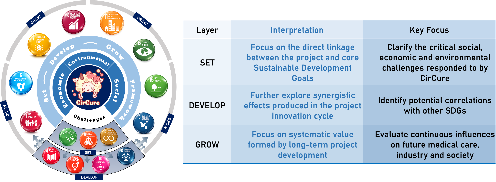
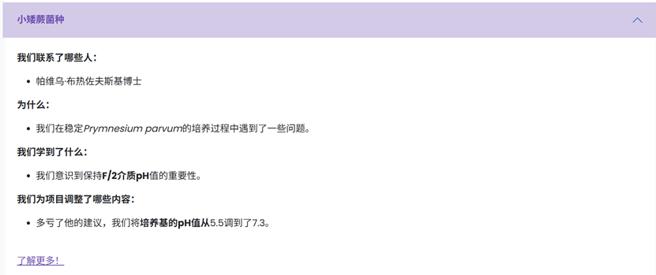

# Sustainability

"Sustainable development — development that does not destroy or undermine the ecological, economic, or social basis on which continued development depends — is the only viable pathway to a more secure and hopeful future for rich and poor alike\."

— Maurice Strong, Secretary\-General of the 1992 Rio Earth Summit

中文释义：可持续发展是不破坏长期发展所依赖的生态、经济与社会根基的发展，是无论贫富群体，通往更安全、更光明未来的唯一可行之路。

一级标题

二级标题

三级标题

# Overview

面对全球社会、经济与环境领域的可持续发展挑战，CirCure以联合国可持续发展目标（SDGs）为基础，结合项目特点，将**SDG 3**（Good Health and Well\-being）**、SDG 9（Industry, Innovation and Infrastructure）** 和 **SDG 12（Responsible Consumption and Production）**确立为项目可持续发展的核心目标，分别回应TNBC患者健康需求、生物医学创新转化以及医疗技术负责任发展的挑战。

为系统评估合成生物学项目对可持续发展的多维影响，我们提出SST\-QN（SDG Synergy–Trade\-off Quantification Network），用于分析不同SDGs之间的协同（Synergy）与权衡（Trade\-off）关系，为未来iGEM团队开展SDG影响评估提供可复用的方法框架。

（这个图片要改，用两次不行） 

基于SST\-QN分析结果，我们进一步拓展CirCure与17项SDGs之间的潜在关联，识别项目产生的直接、间接及长期影响，并构建Set–Develop–Grow Impact Framework（SDG Impact Framework），形成覆盖15项SDGs的可持续发展影响体系。

为确保项目发展能够持续回应真实社会需求，我们构建SCALE Framework，通过利益相关者识别、反馈整合和项目优化建立动态改进机制，并将来自xx名不同领域利益相关者的反馈纳入CirCure设计全过程。

# SDG Synergy–Trade\-off Quantification Network（**SST\-QN**）

可持续发展目标并非彼此独立。一个目标的推进可能进一步促进其他目标，也可能在不同实施路径和发展情境下对其他目标产生限制。因此，仅分别讨论项目与单个SDG之间的联系，难以完整反映可持续发展体系中真实存在的协同与权衡关系。基于这一认识，我们提出 **SST\-QN（SDG Synergy–Trade\-off Quantification Network）**，尝试从系统视角分析17项SDGs之间的相互作用，为进一步评估合成生物学项目的多维可持续影响建立统一的分析基础。

SST\-QN并不将SDG之间的联系简单视为对称的“相关关系”，而是构建具有方向性的相互作用网络。对于任意两个目标，SDGi→SDGj 与 SDGj→SDGi 被分别评价，因为二者可能具有不同的作用机制、时间尺度和证据基础。模型同时区分直接与间接作用、协同与权衡，以及在不同情境下可能发生方向变化的关系，使SDG之间复杂的相互作用能够以更加结构化的方式被描述。

为了避免将所有SDG联系简单解释为正向协同，我们首先依据现有机制与证据，将潜在的直接作用划分为 **Core（C）、Exploratory（E）、Conditional（±）和Excluded（0）** 四类。这一分类使SST\-QN不仅能够识别潜在的Synergy，也能够主动寻找可能被忽视的Trade\-off和不确定关系。

（图片）

Core代表具有较充分机制和证据支持的直接作用；Exploratory表示具有合理机制但当前证据仍有限的关系；Conditional表示作用方向可能随着实施方式或外部条件发生变化；Excluded则表示当前没有足够依据支持直接作用，但仍允许影响通过其他目标产生间接传播。 

在此基础上，我们进一步使用范围为 \[−1,1\] 的 **Evidence\-calibrated Directed Interaction Score** 描述不同SDG之间的作用方向和相对强度。其中，正值表示Synergy，负值表示Trade\-off，0表示当前未预注册直接作用路径。评分并非单纯依据主观判断，而是将相互作用类别与机制清晰度、跨情境重复性、因果证据以及数据兼容性等因素结合，对每一条作用关系的证据质量进行校准。 因此，这一数值并不是一个普适的Pearson相关系数，而是用于表达**方向、作用性质与证据强度**的结构性评分。

SST\-QN还进一步考虑了**可持续影响并不会停留在两个目标之间**。一个目标产生的变化可能通过中间目标继续传播，形成间接影响和反馈回路；部分作用也可能经过一定时间后才逐渐显现。因此，模型同时保留间接传播、反馈结构以及时间滞后的分析空间，从而使SDG相互作用能够从单条连接扩展到更完整的系统网络。

另一个重要考虑是，**Trade\-off往往并非来自SDG目标本身，而来自实现目标的具体路径。** 因此，SST\-QN进一步将implementation pathways纳入分析，关注产业扩张、资源消耗、污染以及不平等的技术扩散等过程可能形成的长期外部性。 这使模型不仅能够判断两个目标之间“是否存在联系”，还能够进一步讨论这种关系在怎样的条件下可能表现为协同，又可能在怎样的实施方式下转变为权衡。

为了使这一方法能够被进一步检验和复用，我们不仅保留最终的interaction matrix和network结果，也记录了作用分类、评分逻辑、证据评价和验证条件。模型采用独立证据评分和一致性检验，并保留结构化的edge registry及可重新生成评分矩阵与heatmap的分析流程。 因此，SST\-QN并不仅用于描述一组既定的SDG关系，而是为未来iGEM团队提供一个可以根据新的证据、数据和项目背景继续更新的分析框架。

[SDG 模型构建\.pdf](图片和附件/SDG%20模型构建.pdf)

**在建立这一SDG相互作用网络之后，我们进一步回到CirCure本身，将项目实际开展的工作、利益相关者反馈以及可能产生的直接、间接和长期影响纳入SDG体系，并据此构建我们的SDG Impact Framework。**

# SET\-DEVELOP\-GROW Impact Framework（SDG Impact Framework）

SDG Impact Framework描述了CirCure可持续影响由局部问题响应向系统价值拓展的过程。其中，SET层确定项目关注的核心SDGs，DEVELOP层分析项目产生的扩展影响及SDG关联，GROW层探索项目的长期可持续价值。

通过这一框架，CirCure的可持续发展路径由**核心问题响应（SET）**，逐步扩展至**多维影响拓展（DEVELOP）**，最终形成**长期系统价值（GROW）**，展示了生物医学创新项目如何从解决具体健康需求出发，进一步推动更广泛的可持续发展目标。

## SET：Addressing Core Challenges

WHO数据显示，In 2024, there were an estimated 2\.4 million women diagnosed with breast cancer and 694 000 deaths globally\. 三阴性乳腺癌（TNBC）因缺乏有效靶向治疗策略，仍面临治疗选择有限、复发风险高及长期预后不佳等挑战。面对这一未满足的临床需求，CirCure不仅关注新型免疫治疗策略的开发，也关注其在技术创新、临床转化以及负责任发展方面的长期影响。

基于可持续发展目标（SDGs）对全球环境、社会和经济挑战的行动号召，我们选择SDG 3（Good Health and Well\-being）、SDG 9（Industry, Innovation and Infrastructure）和SDG 12（Responsible Consumption and Production）作为SET框架的核心目标，分别回应健康福祉、创新转化和负责任发展的挑战。

为进一步明确CirCure所回应的核心可持续发展需求，我们邀请来自6个领域的43名利益相关者参与项目讨论，包括23名专家、4名患者以及16名社会公众。他们从疾病需求、技术创新、应用转化和社会影响等角度提供反馈，帮助我们识别项目与SDG3、SDG9和SDG12之间的关键联系。

值得特殊说明的是，由于不同SDGs之间存在相互关联，部分利益相关者的反馈可能同时涉及多个目标。为突出其主要贡献，我们按照其核心影响方向进行分类，并在SDG协同分析中进一步讨论其跨目标关联。

### SDG3: Good Health and Well\-being

可持续发展目标3（SDG 3），健康福祉，旨在确保健康生活并促进各年龄段人群的福祉。针对三阴性乳腺癌（TNBC）患者在治疗选择和长期健康获益方面的未满足需求，CirCure旨在开发一种基于circRNA的多表位疫苗治疗方案，探索癌症免疫治疗的新策略，并为精准医疗的发展提供新的可能。

#### S — Stakeholder Insights

为了从不同角度理解TNBC治疗领域的未满足需求，我们邀请了来自临床和患者群体的利益相关者参与交流。临床方面，我们咨询了湖南省长沙市第八医院肿瘤科医生李成丽，她长期参与肿瘤患者诊疗工作，为我们提供了一线临床视角。患者方面，我们采访TNBC患者及乳腺癌患者在疾病治疗过程中的真实经历，帮助我们了解患者在治疗选择和长期健康管理中的关注点。

**李成丽医生**

**Relevant Stakeholder**

**湖南省长沙市第八医院肿瘤科医生，一线参与肿瘤患者诊疗与决策。**

**Why We Engaged Her**

**从临床视角了解TNBC未满足需求，并评估CirCure的临床价值。**

****

**Stakeholder Feedback**

**TNBC患者更需要明确的治疗获益，降低复发风险和延长生存优先于单纯减少副作用。**

**Feedback Incorporated into CirCure**

**这一反馈纠正了我们过度强调副作用的倾向，使CirCure更加关注抗肿瘤疗效。**

**Project Improvement**

**将设计原则调整为“疗效优先，安全性优化”。**

**SDG Addressed**

**SDG 3 — Good Health and Well\-being：回应TNBC患者对有效治疗和长期生存获益的需求。**

****

TNBC Patients

**Relevant Stakeholder**

TNBC患者是CirCure未来最直接的潜在受益者。

**Why We Engaged Them**

直接了解患者真正关注的治疗需求与现实顾虑。

**Stakeholder Feedback** 
患者最关注治疗效果、复发风险和长期生存，同时也关心治疗费用。

**Feedback Incorporated into CirCure** 
我们进一步将抗肿瘤疗效、长期获益和治疗可及性纳入项目评价。

**Project Improvement** 
由技术性能评价扩展为疗效、长期获益与可及性的综合评估。

**SDG Addressed** 
 SDG 3 — Good Health and Well\-being：回应患者对有效治疗和长期生存的需求。

（李成丽详细）点击click more 后显示

临床上，我们咨询了湖南省长沙市第八医院肿瘤科医生李成丽。作为直接参与患者治疗决策的一线临床人员，她指出，不同阶段的TNBC患者面临着不同的治疗需求：术后患者更关注降低复发风险，而晚期及后线治疗患者则更需要有效控制疾病进展和新的治疗选择。相应地，临床疗效也应分阶段评价——术后重点关注复发率和无进展生存期（PFS），晚期患者则短期关注客观缓解率（ORR）及肿瘤变化，长期关注总生存期（OS）。

在交流过程中，李成丽医生纠正了我们此前对于创新治疗价值的一个潜在误区。我们曾倾向于认为，降低治疗副作用是提升患者接受度的重要方向。但她强调，在肿瘤治疗中，**明确的治疗效果始终是医生和患者选择治疗方案的首要依据**。在疗效确切的前提下，即使存在一定副作用，只要能够降低复发风险、控制肿瘤进展或延长生存时间，患者通常仍具有较高的接受意愿。

这一反馈促使我们重新调整CirCure的设计重点：相比首先强调circRNA疫苗潜在的安全性优势，我们更加关注其能否诱导有效且持久的抗肿瘤免疫反应，并进一步转化为真实的临床获益。在证明疗效的基础上，我们再进一步考虑安全性、患者接受度以及与现有治疗方式联合应用的可能性。

（患者详细）点击click more 后显示

患者层面，我们认真听取了TNBC患者及乳腺癌患者对于疾病治疗的真实感受和未来期待。作为治疗方案最直接的接受者和受益者，她们当中有人仍在受到复发和转移的困境。因此相比单纯增加新的治疗手段，她们更期待能够获得真正有效、并带来更长期生存获益的治疗选择。

在交流过程中，我们进一步了解到，患者，尤其是三阴性乳腺癌患者，首先关心的是疗效好不好，其次是术后的护理和措施能否降低复发和转移风险；与此同时，治疗费用也是患者非常现实的考虑。即使一种治疗方案具有较好的效果，如果价格过高、普通患者难以长期承担，其实际可及性和最终受益范围仍会受到限制。

同时，我们受到李成丽医生的启发，询问了患者她们如何看待治疗产生副作用的问题。患者表示，她们并非不担心副作用，但相比追求‘无副作用’，更看重治疗能否真正降低复发和转移风险、延长生存时间。对于能够带来明确治疗获益的方案，只要副作用处于可接受和可管理的范围内，她们仍愿意考虑接受治疗。

这些反馈促使我们进一步完善CirCure的项目评价维度：除了关注circRNA疫苗能否诱导有效的抗肿瘤免疫反应，我们也开始将长期临床获益、治疗可及性以及潜在经济负担纳入未来转化考量，使CirCure不仅追求“有效的治疗”，也进一步关注这种治疗能否真正被患者获得并长期受益。

基于来自临床实践和患者体验的反馈，我们进一步识别出当前TNBC治疗中三个亟待解决的问题：

- **有效治疗选择仍然有限（Limited effective treatment options）**
不同阶段患者面临不同治疗需求：术后患者需要进一步降低复发风险，而晚期及后线患者仍需要更有效的疾病控制和新的治疗选择。

- **长期疾病控制仍面临挑战（Challenges in long\-term disease control）**
疗效不仅意味着短期肿瘤控制，更需要转化为降低复发和转移风险、延长生存时间等长期获益。

- **治疗可及性仍需进一步关注（Treatment accessibility remains a concern）**
患者不仅关注疗效，也会考虑副作用是否可管理以及治疗费用是否能够承担；即使疗效明确，过高的治疗负担仍可能限制实际受益。

针对前期利益相关者交流中发现的TNBC治疗需求、患者获益和医疗可及性等问题，我们进一步咨询了多位医学、肿瘤学及公共健康领域的专家。老师们从疾病防治、临床治疗路径、肿瘤免疫、患者获益及医疗资源分配等角度提出了针对性建议。我们进一步将这些反馈转化为项目改进的依据，持续完善CirCure的治疗策略与临床应用设想，并将患者获益、健康公平和长期医疗价值纳入项目的可持续性评估，从而进一步分析CirCure对SDG 3的实际贡献及其与其他相关SDGs之间的协同影响。

**魏宇航副院长**
魏宇航副院长从公共健康和医疗资源分配角度提出，新的肿瘤治疗策略不仅要关注疗效，也应考虑不同患者获得治疗的机会。基于这一建议，我们在项目的可持续性分析中进一步加入了医疗可及性和健康公平相关内容，并关注CirCure未来可能对SDG 10产生的影响。

**刘雅文副院长**
刘雅文副院长从女性健康和疾病防治角度提出，乳腺癌防治不仅依赖治疗技术，也需要提高女性主动体检、定期筛查和早期发现的意识。受此启发，我们在关注TNBC治疗的同时，也将乳腺健康科普和体检筛查意识纳入项目的公众教育内容，使项目对SDG 3的回应不仅停留在治疗层面。

**贾琳老师**
贾琳老师结合乳腺癌的临床特点指出，项目设计应从TNBC目前真实存在的治疗需求出发，而不能只关注技术本身的创新性。因此，我们进一步梳理了TNBC现有治疗中的不足，并将临床需求和患者实际获益作为CirCure治疗策略设计与评价的重要依据。

**崔久嵬老师**
崔久嵬老师从肿瘤免疫治疗角度建议我们更加关注免疫治疗策略本身的有效性、安全性以及未来临床应用的可行性。根据这一建议，我们进一步完善了CirCure的免疫治疗设计思路，并在项目评价中增加了安全性、临床转化和负责任应用等方面的考虑。

**范志民老师**
范志民老师从乳腺癌临床治疗路径出发提出，新型治疗方式最终需要能够真正改善患者的治疗结果，并考虑其与现有治疗方案之间的衔接。基于这一建议，我们进一步将患者获益和临床应用场景纳入CirCure的设计与长期价值评估中。

#### C — Consequences

在利益相关者交流的基础上，我们进一步思考了一个更长期的问题：**如果 CirCure 未来真正走向临床转化，它可能为患者、医疗体系以及社会带来怎样的影响？**

我们认识到，一项面向健康福祉的技术，其价值不能仅由实验室中的技术性能决定。治疗能否改善患者长期健康、能否被不同群体公平获得，以及未来研发和生产过程中可能产生怎样的资源与环境负担，都会影响其对 SDG 3 的实际贡献。因此，我们从**社会、经济和环境三个维度**评估 CirCure 可能产生的长期影响，同时关注其中潜在的积极作用与可能出现的权衡。

#### A — Alignment

#### L — Legacy

#### E — Evidence

