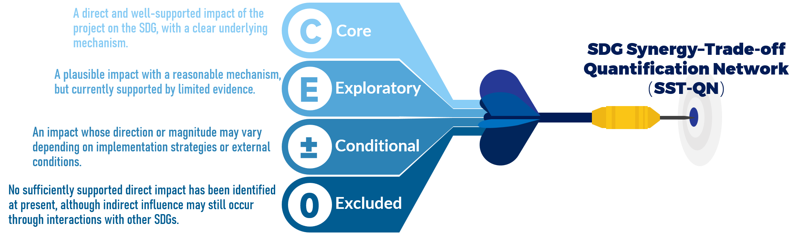

# Sustainability

"Sustainable development — development that does not destroy or undermine the ecological, economic, or social basis on which continued development depends — is the only viable pathway to a more secure and hopeful future for rich and poor alike\."

— Maurice Strong, Secretary\-General of the 1992 Rio Earth Summit

中文释义：可持续发展是不破坏长期发展所依赖的生态、经济与社会根基的发展，是无论贫富群体，通往更安全、更光明未来的唯一可行之路。

一级标题

二级标题

三级标题

# Overview

面对全球社会、经济与环境领域的可持续发展挑战，CirCure以联合国可持续发展目标（SDGs）为基础，结合项目特点，将**SDG 3**（Good Health and Well\-being）**、SDG 9（Industry, Innovation and Infrastructure）** 和 **SDG 12（Responsible Consumption and Production）**确立为项目可持续发展的核心目标，分别回应TNBC患者健康需求、生物医学创新转化以及医疗技术负责任发展的挑战。

为系统评估合成生物学项目对可持续发展的多维影响，我们提出SST\-QN（SDG Synergy–Trade\-off Quantification Network），用于分析不同SDGs之间的协同（Synergy）与权衡（Trade\-off）关系，为未来iGEM团队开展SDG影响评估提供可复用的方法框架。

基于SST\-QN分析结果，我们进一步拓展CirCure与17项SDGs之间的潜在关联，识别项目产生的直接、间接及长期影响，并构建Set–Develop–Grow Impact Framework（SDG Impact Framework），形成覆盖14项SDGs的可持续发展影响体系。

为确保项目发展能够持续回应真实社会需求，我们构建SCALE Framework，通过利益相关者识别、反馈整合和项目优化建立动态改进机制，并将来自xx名不同领域利益相关者的反馈纳入CirCure设计全过程。

# SDG Synergy–Trade\-off Quantification Network（**SST\-QN**）

可持续发展目标并非彼此独立。一个目标的推进可能进一步促进其他目标，也可能在不同实施路径和发展情境下对其他目标产生限制。因此，仅分别讨论项目与单个SDG之间的联系，难以完整反映可持续发展体系中真实存在的协同与权衡关系。基于这一认识，我们提出 **SST\-QN**，尝试从系统视角分析17项SDGs之间的相互作用，为进一步评估合成生物学项目的多维可持续影响建立统一的分析基础。

SST\-QN并不将SDG之间的联系简单视为对称的“相关关系”，而是构建具有方向性的相互作用网络。对于任意两个目标，SDGi→SDGj 与 SDGj→SDGi 被分别评价，因为二者可能具有不同的作用机制、时间尺度和证据基础。模型同时区分直接与间接作用、协同与权衡，以及在不同情境下可能发生方向变化的关系，使SDG之间复杂的相互作用能够以更加结构化的方式被描述。

为了避免将所有SDG联系简单解释为正向协同，我们首先依据现有机制与证据，将潜在的直接作用划分为 **Core（C）、Exploratory（E）、Conditional（±）和Excluded（0）** 四类。这一分类使SST\-QN不仅能够识别潜在的Synergy，也能够主动寻找可能被忽视的Trade\-off和不确定关系。

在此基础上，我们进一步使用范围为 \[−1,1\] 的 **Evidence\-calibrated Directed Interaction Score** 描述不同SDG之间的作用方向和相对强度。其中，正值表示Synergy，负值表示Trade\-off，0表示当前未预注册直接作用路径。评分并非单纯依据主观判断，而是将相互作用类别与机制清晰度、跨情境重复性、因果证据以及数据兼容性等因素结合，对每一条作用关系的证据质量进行校准。 因此，这一数值并不是一个普适的Pearson相关系数，而是用于表达**方向、作用性质与证据强度**的结构性评分。

SST\-QN还进一步考虑了**可持续影响并不会停留在两个目标之间**。一个目标产生的变化可能通过中间目标继续传播，形成间接影响和反馈回路；部分作用也可能经过一定时间后才逐渐显现。因此，模型同时保留间接传播、反馈结构以及时间滞后的分析空间，从而使SDG相互作用能够从单条连接扩展到更完整的系统网络。

另一个重要考虑是，**Trade\-off往往并非来自SDG目标本身，而来自实现目标的具体路径。** 因此，SST\-QN进一步将implementation pathways纳入分析，关注产业扩张、资源消耗、污染以及不平等的技术扩散等过程可能形成的长期外部性。 这使模型不仅能够判断两个目标之间“是否存在联系”，还能够进一步讨论这种关系在怎样的条件下可能表现为协同，又可能在怎样的实施方式下转变为权衡。

为了使这一方法能够被进一步检验和复用，我们不仅保留最终的interaction matrix和network结果，也记录了作用分类、评分逻辑、证据评价和验证条件。模型采用独立证据评分和一致性检验，并保留结构化的edge registry及可重新生成评分矩阵与heatmap的分析流程。 因此，SST\-QN并不仅用于描述一组既定的SDG关系，而是为未来iGEM团队提供一个可以根据新的证据、数据和项目背景继续更新的分析框架。

[SDG 模型构建\.pdf](图片和附件/SDG%20模型构建.pdf)

**在建立这一SDG相互作用网络之后，我们进一步回到CirCure本身，将项目实际开展的工作、利益相关者反馈以及可能产生的直接、间接和长期影响纳入SDG体系，并据此构建我们的SDG Impact Framework。**

# SET\-DEVELOP\-GROW Impact Framework（SDG Impact Framework）

SDG Impact Framework 描述了 CirCure 的可持续发展影响如何随着项目的发展，由**直接回应核心挑战**逐步拓展至**更广泛的可持续发展影响**，并进一步延伸至项目长期发展过程中可能推动的系统性价值。其中，**SET** 代表 CirCure 基于项目目标与利益相关者需求直接回应的核心 SDGs；**DEVELOP** 代表随着项目研发、转化及社会互动不断深入而产生的扩展影响，以及项目与其他 SDGs 之间逐渐形成的关联；**GROW** 则代表 CirCure 在未来长期研发、临床转化和规模化应用过程中，有潜力进一步推动的可持续发展目标。

通过这一框架，CirCure 的可持续发展路径由**核心挑战响应（SET）**，逐步拓展至**多维影响延伸（DEVELOP）**，最终走向**长期可持续价值（GROW）**。这一过程不仅关注项目当前能够直接回应的问题，也区分了已经形成的影响与需要长期发展才能实现的潜在贡献，从而避免对项目现阶段的可持续发展成效进行过度延伸。

## SET：Addressing Core Challenges

WHO数据显示，In 2024, there were an estimated 2\.4 million women diagnosed with breast cancer and 694 000 deaths globally\. 三阴性乳腺癌（TNBC）因缺乏有效靶向治疗策略，仍面临治疗选择有限、复发风险高及长期预后不佳等挑战。面对这一未满足的临床需求，CirCure不仅关注新型免疫治疗策略的开发，也关注其在技术创新、临床转化以及负责任发展方面的长期影响。

基于可持续发展目标（SDGs）对全球环境、社会和经济挑战的行动号召，我们在SET层将SDG 3（Good Health and Well\-being）、SDG 9（Industry, Innovation and Infrastructure）和SDG 12（Responsible Consumption and Production）确立为CirCure可持续发展的三个核心目标，分别回应健康福祉、创新转化和负责任发展的挑战。同时，我们将广泛的利益相关者参与作为SET层的重要基础，共纳入来自7个领域的94名利益相关者，包括23名专家、4名患者、16名社会公众和51位全球青年健康与可持续发展实践者。他们从疾病需求、技术研发、临床应用、责任治理及社会影响等不同角度持续为项目提供反馈，使三个核心目标不仅构成CirCure可持续发展分析的起点，也为后续项目设计、优化迭代及更深入的SDG影响分析建立了现实基础。

值得特殊说明的是，由于不同SDGs之间存在相互关联，部分利益相关者的反馈可能同时涉及多个目标。为突出其主要贡献，我们按照其核心影响方向进行分类，并在SDG协同分析中进一步讨论其跨目标关联。

### SDG3: Good Health and Well\-being

可持续发展目标3（SDG 3），健康福祉，旨在确保健康生活并促进各年龄段人群的福祉。针对三阴性乳腺癌（TNBC）患者在治疗选择和长期健康获益方面的未满足需求，CirCure旨在开发一种基于circRNA的多表位疫苗治疗方案，探索癌症免疫治疗的新策略，并为精准医疗的发展提供新的可能。

#### S — Stakeholder Insights

为了从不同角度理解TNBC治疗领域的未满足需求，我们邀请了来自临床和患者群体的利益相关者参与交流。临床方面，我们咨询了湖南省长沙市第八医院肿瘤科医生李成丽，她长期参与肿瘤患者诊疗工作，为我们提供了一线临床视角。患者方面，我们采访TNBC患者及乳腺癌患者在疾病治疗过程中的真实经历，帮助我们了解患者在治疗选择和长期健康管理中的关注点。

**李成丽医生**

**Relevant Stakeholder**

湖南省长沙市第八医院肿瘤科医生，一线参与肿瘤患者诊疗与决策。

**Why We Engaged Her**

从临床视角了解TNBC未满足需求，并评估CirCure的临床价值。

**Stakeholder Feedback**

TNBC患者更需要明确的治疗获益，降低复发风险和延长生存优先于单纯减少副作用。

**Feedback Incorporated into CirCure**

这一反馈纠正了我们过度强调副作用的倾向，使CirCure更加关注抗肿瘤疗效。

**Project Improvement**

将设计原则调整为“疗效优先，安全性优化”。

**SDG Addressed**

SDG 3 — Good Health and Well\-being：回应TNBC患者对有效治疗和长期生存获益的需求。

Click more

**TNBC Patients**

**Relevant Stakeholder**

TNBC患者是CirCure未来最直接的潜在受益者。

**Why We Engaged Them**

直接了解患者真正关注的治疗需求与现实顾虑。

**Stakeholder Feedback** 
患者最关注治疗效果、复发风险和长期生存，同时也关心治疗费用。

**Feedback Incorporated into CirCure** 
我们进一步将抗肿瘤疗效、长期获益和治疗可及性纳入项目评价。

**Project Improvement** 
由技术性能评价扩展为疗效、长期获益与可及性的综合评估。

**SDG Addressed** 
 SDG 3 — Good Health and Well\-being：回应患者对有效治疗和长期生存的需求。

Click more

（李成丽详细）点击click more 后显示

临床上，我们咨询了湖南省长沙市第八医院肿瘤科医生李成丽。作为直接参与患者治疗决策的一线临床人员，她指出，不同阶段的TNBC患者面临着不同的治疗需求：术后患者更关注降低复发风险，而晚期及后线治疗患者则更需要有效控制疾病进展和新的治疗选择。相应地，临床疗效也应分阶段评价——术后重点关注复发率和无进展生存期（PFS），晚期患者则短期关注客观缓解率（ORR）及肿瘤变化，长期关注总生存期（OS）。

在交流过程中，李成丽医生纠正了我们此前对于创新治疗价值的一个潜在误区。我们曾倾向于认为，降低治疗副作用是提升患者接受度的重要方向。但她强调，在肿瘤治疗中，**明确的治疗效果始终是医生和患者选择治疗方案的首要依据**。在疗效确切的前提下，即使存在一定副作用，只要能够降低复发风险、控制肿瘤进展或延长生存时间，患者通常仍具有较高的接受意愿。

这一反馈促使我们重新调整CirCure的设计重点：相比首先强调circRNA疫苗潜在的安全性优势，我们更加关注其能否诱导有效且持久的抗肿瘤免疫反应，并进一步转化为真实的临床获益。在证明疗效的基础上，我们再进一步考虑安全性、患者接受度以及与现有治疗方式联合应用的可能性。

（患者详细）点击click more 后显示

**患者 A｜疗效与复发风险**

“副作用我肯定会担心，但我更怕的是复发。如果一种治疗真的能降低复发风险、让我活得更久，只要副作用在能承受的范围内，我愿意接受。”

“如果是比较新的疫苗或者治疗方式，我会想知道它有没有经过充分验证。效果当然重要，但我也会担心有没有还没发现的长期副作用。”

**患者 B｜生活质量与获益权衡**

“我不觉得只要能延长生存时间就什么副作用都可以接受。如果治疗让我长期非常虚弱、疼痛，或者生活完全不能自理，我也会考虑这样的治疗到底值不值得。”

“我希望效果好，但副作用也不能太严重。对我来说不是简单选‘疗效’还是‘安全’，而是想知道到底能获得多大收益、又要承担多少风险。”

**患者 C｜经济负担与家庭责任**

“治疗结束以后最担心的就是不知道什么时候会不会再复发。如果新的治疗能明显降低复发和转移的可能，我对短期的一些副作用可能会更能接受。”

“除了副作用，我还会考虑这个药贵不贵。如果治疗效果很好，但费用高到家里承担不起，我也会放弃这种治疗方式。”

**患者 D｜新技术接受与治疗选择**

“如果副作用只是短期不舒服，我可能可以接受，但如果会让我长期不能工作、不能照顾孩子和家人，我就会特别在意。”

“如果本身能选的治疗就不多，只要新的治疗确实有效，我觉得很多和我一样的人都会愿意多承担一点风险。”

患者层面，我们认真听取了 TNBC 患者及乳腺癌患者对于疾病治疗的真实感受和未来期待。作为治疗方案最直接的接受者和受益者，她们普遍关注治疗能否真正控制疾病、降低复发和转移风险，并带来更长期的生存获益。但进一步交流也让我们认识到，患者对于“什么样的治疗才值得接受”并不存在完全一致的答案。

在4名患者的访谈中，疗效和复发风险始终是最核心的关注点，但不同患者对于副作用、生活质量和现实负担的权衡存在明显差异。有的患者愿意在获得明确治疗获益的前提下接受一定程度的副作用；有的患者则更加重视治疗后能否维持正常生活和工作；还有患者特别关注治疗费用、家庭负担以及新型治疗方式是否经过充分验证。因此，治疗价值并不能仅由单一的疗效指标决定，而需要结合患者能够获得的实际获益以及为此承担的身体、生活和经济成本综合判断。

受到李成丽医生“疗效优先”观点的启发，我们也进一步向患者询问她们如何看待疗效与副作用之间的关系。访谈结果并不是简单地支持“疗效高于一切”，而是进一步补充了这一判断的边界：**患者更看重明确的治疗获益，但这种获益需要建立在副作用可接受、生活质量不过度受损、经济负担可承担的基础上。**

这些反馈促使我们进一步完善 CirCure 的项目评价维度。除了关注 circRNA 疫苗能否诱导有效的抗肿瘤免疫反应，我们也将**复发风险、长期生存、安全性、生活质量、治疗费用和可及性**纳入未来转化考量，使项目评价从“技术是否有效”进一步转向“这种治疗能否为患者带来值得接受、能够获得并长期受益的实际价值”。

基于来自临床实践和患者体验的反馈，我们进一步识别出当前TNBC治疗中三个亟待解决的问题：

- **有效治疗选择仍然有限（Limited effective treatment options）**
不同阶段患者面临不同治疗需求：术后患者需要进一步降低复发风险，而晚期及后线患者仍需要更有效的疾病控制和新的治疗选择。

- **长期疾病控制仍面临挑战（Challenges in long\-term disease control）**
疗效不仅意味着短期肿瘤控制，更需要转化为降低复发和转移风险、延长生存时间等长期获益。

- **治疗可及性仍需进一步关注（Treatment accessibility remains a concern）**
患者不仅关注疗效，也会考虑副作用是否可管理以及治疗费用是否能够承担；即使疗效明确，过高的治疗负担仍可能限制实际受益。

针对前期利益相关者交流中发现的TNBC治疗需求、患者获益和医疗可及性等问题，我们进一步咨询了多位医学、肿瘤学及公共健康领域的专家。老师们从疾病防治、临床治疗路径、肿瘤免疫、患者获益及医疗资源分配等角度提出了针对性建议。我们进一步将这些反馈转化为项目改进的依据，持续完善CirCure的治疗策略与临床应用设想，并将患者获益、健康公平和长期医疗价值纳入项目的可持续性评估，从而进一步分析CirCure对SDG 3的实际贡献及其与其他相关SDGs之间的协同影响。

**魏宇航副院长**
魏宇航副院长从公共健康和医疗资源分配角度提出，新的肿瘤治疗策略不仅要关注疗效，也应考虑不同患者获得治疗的机会。基于这一建议，我们在项目的可持续性分析中进一步加入了医疗可及性和健康公平相关内容，并关注CirCure未来可能对SDG 10产生的影响。

**刘雅文副院长**
刘雅文副院长从女性健康和疾病防治角度提出，乳腺癌防治不仅依赖治疗技术，也需要提高女性主动体检、定期筛查和早期发现的意识。受此启发，我们在关注TNBC治疗的同时，也将乳腺健康科普和体检筛查意识纳入项目的公众教育内容，使项目对SDG 3的回应不仅停留在治疗层面。

**贾琳老师**
贾琳老师结合乳腺癌的临床特点指出，项目设计应从TNBC目前真实存在的治疗需求出发，而不能只关注技术本身的创新性。因此，我们进一步梳理了TNBC现有治疗中的不足，并将临床需求和患者实际获益作为CirCure治疗策略设计与评价的重要依据。

**崔久嵬老师**
崔久嵬老师从肿瘤免疫治疗角度建议我们更加关注免疫治疗策略本身的有效性、安全性以及未来临床应用的可行性。根据这一建议，我们进一步完善了CirCure的免疫治疗设计思路，并在项目评价中增加了安全性、临床转化和负责任应用等方面的考虑。

**范志民老师**
范志民老师从乳腺癌临床治疗路径出发提出，新型治疗方式最终需要能够真正改善患者的治疗结果，并考虑其与现有治疗方案之间的衔接。基于这一建议，我们进一步将患者获益和临床应用场景纳入CirCure的设计与长期价值评估中。

在医学、肿瘤学和公共健康专家的建议基础上，我们进一步将视角拓展至更广泛的青年与全球可持续发展实践。团队成员李泽村受邀参加 **2026全球青年发展项目周**，并参与“**健康与福祉**”主题组，与来自不同国家和不同可持续发展领域的青年实践者开展交流。通过健康议题与其他可持续发展议题之间的跨领域对话，我们不仅进一步理解了 CirCure 对 **SDG 3** 的潜在贡献，也获得了从更广泛视角审视其与**其他 SDGs 协同与关联影响**的新启发。

**全球青年健康与可持续发展实践者（20名）**
**Relevant Stakeholders**
 来自不同国家、不同专业与可持续发展领域的青年实践者。团队成员李泽村受邀参加 **2026全球青年发展项目周**，并参与“健康与福祉”主题组交流。

**Why We Engaged Them**
我们希望将CirCure带入更广泛的国际青年交流场景，与不同国家、不同组别和不同背景的青年实践者交流，从更多元的视角理解健康与可持续发展。

**Stakeholder Feedback**
李泽村介绍了团队在2025和2026年的iGEM工作，并与不同主题组成员围绕项目设计、社会价值和可持续发展展开讨论。跨文化交流和企业参访也让我们看到，科研项目还需要考虑现实应用和社会接受。

**Feedback Incorporated into CirCure**
这些交流促使我们在关注TNBC治疗价值之外，进一步思考CirCure的社会意义、应用场景，以及它与其他SDGs之间可能存在的联系。

**Project Improvement**
 我们进一步拓展了CirCure的SDG分析边界，使项目评价从单一健康目标延伸到更广泛的跨SDG影响和现实应用层面。

**SDG Addressed**
SDG 3 — Good Health and Well\-being：深化对健康与福祉价值的理解；同时通过跨领域青年交流，为分析 CirCure 与其他 SDGs 之间的协同关系提供更广泛的社会视角。

（click more）

2026年6月，团队成员李泽村前往**上海临港**参加由联合国主办的2026全球青年发展项目周，并加入“**健康与福祉**”主题组。项目周汇集了来自不同国家、不同文化背景和不同可持续发展主题方向的青年参与者，为我们提供了一个跳出单一专业和项目环境、从更广泛视角理解SDGs的交流机会。

活动期间，李泽村向来自不同国家和组别的青年伙伴介绍了自己参与的**2025年与2026年iGEM工作**，分享了团队如何从实际健康问题出发开展项目设计，以及如何尝试将可持续发展目标融入项目推进过程。与此同时，他也了解到其他青年围绕健康、教育、环境、创新、社会发展等不同议题开展的实践。不同项目之间的交流让我们更加直观地认识到，SDGs并不是彼此独立的目标：一个以健康为核心的项目，同样可能与创新、公平、社会参与和资源利用等议题产生联系。

除了青年之间的项目交流，我们还参与了**企业交流等实践活动**。这些经历让我们进一步看到，从科研设想到现实应用之间还存在技术转化、社会需求、应用场景和公众接受等多个环节。因此，当我们重新审视CirCure时，也开始更加主动地思考：除了TNBC治疗本身，它还可能产生哪些更广泛的社会影响，又会如何与其他SDGs发生联系。

这次项目周并没有直接改变CirCure的某一项实验设计，但它为我们的可持续发展分析提供了一个更真实的外部视角。我们由此进一步拓展了对项目价值的理解——**从“一个针对TNBC的健康项目”，逐步延伸到“一个需要同时考虑健康价值、社会影响、现实应用以及跨SDG关系的可持续发展实践”。**

#### C — Consequences

##### 短期影响

CirCure目前仍处于研究阶段，因此我们不会将实验室中的技术探索直接等同于已经实现的临床健康获益。现阶段，项目最明确的影响主要体现在**研究重点、评价标准和公众健康参与方式的改变**。

通过与临床医生和患者交流，我们认识到，对于TNBC患者而言，治疗价值首先体现在是否能够获得明确而持久的治疗获益，而不仅仅是副作用是否更低。这一反馈直接改变了CirCure的设计重点，使我们由原先较多强调circRNA疫苗潜在的安全性优势，进一步转向关注其能否诱导有效且持久的抗肿瘤免疫反应，并将项目设计原则调整为“**疗效优先，安全性优化**”。与此同时，我们将复发和转移风险、长期生存获益、安全性以及治疗可及性逐步纳入项目评价，使CirCure从单纯关注技术性能进一步转向更加贴近患者实际需求的治疗策略设计。

除项目设计本身的直接变化外，利益相关者交流也带来了一些间接影响。女性健康领域专家提出，乳腺癌防治不仅依赖新的治疗技术，也需要提高公众主动体检、定期筛查和早期发现的意识。因此，我们进一步将乳腺健康和筛查知识纳入公众教育活动，使项目在探索TNBC治疗策略的同时，也能够促进公众对乳腺健康和疾病防治的关注。

患者对于治疗费用和现实可及性的反馈也使我们意识到，一项治疗即使具有良好的疗效，如果患者难以承担或获得，其健康价值仍然难以真正实现。因此，CirCure在当前阶段已经开始将治疗可及性、潜在经济负担和患者现实需求纳入未来临床转化的考虑之中。

随着利益相关者交流不断深入，我们也逐渐发现，这些问题已经不再局限于SDG 3本身：患者可及性涉及健康公平，技术转化涉及创新与产业发展，而未来生产过程中的资源消耗和环境负担又进一步指向负责任生产与环境可持续性。**这也成为我们随后从SDG 3向更广泛SDGs拓展分析的起点。**

##### 长期影响

我们首先从SDG 3出发思考CirCure可能产生的长期影响。但随着患者、医学专家、青年实践者以及产业相关人员的交流不断深入，我们逐渐认识到，一项面向健康福祉的技术，其长期影响并不会停留在健康本身。治疗是否能够改善患者长期健康、能否被不同群体公平获得、是否具有现实的转化条件，以及未来研发和生产过程中可能产生怎样的资源与环境负担，都会影响其真正的可持续价值。

因此，我们进一步从**社会、经济和环境**三个维度分析CirCure可能产生的长期后果。这些后果既帮助我们更完整地评价项目对SDG 3的贡献，也逐渐揭示出CirCure与其他SDGs之间可能存在的联系。

###### 社会影响

CirCure最直接的长期社会影响将是为TNBC患者提供一种新的潜在免疫治疗选择。对于术后患者，这种治疗价值可能更多体现在降低复发和转移风险；对于晚期及后线治疗患者，则可能更多体现在控制疾病进展和增加新的治疗选择。

因此，CirCure所追求的长期健康价值并不仅是诱导免疫反应，而是希望这种作用最终能够逐步转化为更稳定的疾病控制、更低的复发和转移风险以及更长的患者生存时间。真正的临床价值仍需要在未来通过客观缓解率、无进展生存期、总生存期和复发率等指标进一步验证。

如果患者能够获得更稳定的疾病控制，其影响还可能进一步延伸到治疗之外，例如减轻长期疾病管理和家庭照护压力，并为患者恢复正常学习、工作和社会生活创造更多可能。同时，如果乳腺健康教育能够持续开展，其影响也可能由项目直接参与者进一步扩展到更多公众，促进乳腺健康、主动体检和早期发现意识的长期提升。

因此，CirCure潜在的社会影响既包括治疗策略本身可能带来的直接健康获益，也包括通过疾病管理和健康传播进一步产生的间接社会价值。

###### 经济影响

治疗费用是患者在交流中反复提到的现实问题。对于一种未来可能进入临床的新型治疗策略而言，其研发、生产、质量控制、临床验证、储存和运输都可能产生相应成本，因此治疗价格和患者可负担性将直接影响CirCure能否真正转化为患者健康获益。

如果未来治疗成本过高，即使CirCure具有良好的疗效，其实际受益范围仍可能受到限制。因此，我们认为，长期评价CirCure时不能只关注“治疗是否有效”，还需要进一步考虑患者是否能够承担并获得这种治疗。

另一方面，如果CirCure未来能够有效降低复发和转移风险、延长疾病控制时间，则可能间接减少部分患者因疾病进展、复发及后续多线治疗产生的持续医疗需求，从而在长期疾病管理中形成潜在的经济价值。

但目前CirCure尚没有临床数据或药物经济学证据证明其能够降低患者总体医疗支出，因此这一影响仍属于未来需要验证的潜在结果，而不是已经实现的项目成果。

###### 环境影响

相比健康和社会影响，CirCure目前仍处于研究阶段，其直接环境影响主要来自实验试剂、一次性耗材、生物医学废弃物以及实验设备运行所产生的资源和能源消耗。

在进一步思考这一问题时，我们还与一家从事**碳排放管理与核算平台**的企业进行了交流。交流使我们认识到，评价一项未来医疗技术的环境影响不能只关注实验室阶段的直接消耗，还需要将视角延伸到原材料、规模化生产、包装、储存运输以及废弃物处理等环节，从更完整的生命周期视角识别潜在的资源和碳排放来源。

这一认识改变了我们最初仅关注“实验耗材和医疗废弃物”的思路。如果CirCure未来进入规模化生产和临床应用，其环境负担可能随着生产规模扩大而增加，包括原材料使用、一次性生产耗材、能源需求、冷链或储运需求以及医疗废弃物等。因此，**生产效率、资源利用、运输方式和废弃物管理**都应成为未来评价CirCure可持续性的组成部分。

目前这些影响尚未大规模发生，我们不会将潜在的环境改善提前视为已经实现的成果。相反，这次交流使我们开始将环境影响作为未来技术转化过程中需要持续追踪和优化的变量，并进一步促使我们思考CirCure与**负责任生产、气候行动等其他可持续发展目标**之间可能存在的联系。

#### A — Alignment

对 Consequences 的分析使我们进一步认识到，CirCure 对 SDG 3 的回应会同时牵动技术创新、健康教育、医疗可及性、资源利用和多方合作等更广泛的问题。因此，我们从项目早期便基于 **SST\-QN** 识别这些跨 SDG 联系，并随着 CirCure 的推进，持续关注其中可能出现的协同、权衡及实施条件，将这些问题逐步纳入后续的项目设计、评价与转化考虑中。

**SDG 3 与 SDG 9 构成当前最明确的 Core Synergy。** CirCure 的技术开发直接来源于 TNBC 治疗选择有限、复发风险和长期疾病控制等健康需求，而 circRNA 疫苗设计、技术优化及未来临床转化又决定这些需求能否真正得到回应，形成清晰的双向路径：

**Health need → Biomedical innovation → Therapeutic feasibility → Potential health benefit**

这一作用路径明确、方向稳定，并已经体现在CirCure当前的项目设计中，因此构成SST\-QN中较为稳定的核心关系。

**SDG 3 与 SDG 4 同样形成了具有直接证据支持的 Core Synergy。**  通过融入相关利益者的反馈，Circure将乳腺健康、筛查和早期发现等内容纳入公众教育，并通过量化评估观察到参与者在相关健康知识理解和掌握方面的实际提升，使这一关系由单纯的“健康信息传播”进一步形成了可观察的“知识获取—教育成效”路径。现有证据支持其在项目周期内产生明确教育效果，因此归为Core。但受限于项目周期，目前尚未追踪长期知识保持或行为改变，因此结论仅限于短期教育成效。

相比之下，**SDG 3 与 SDG 10、SDG 12体现了两类典型的 Conditional relationships。** 对 SDG 10 而言，决定作用方向的关键是**价格、支付和医疗可及性**；对 SDG 12 而言，则更多取决于**生产方式、资源效率和环境管理**。同一项健康创新在不同实施条件下，既可能产生协同，也可能形成新的社会或环境权衡。

与碳排放管理平台相关企业的交流也使我们进一步意识到，未来规模化生产可能继续向**碳排放和气候影响**延伸。但目前这一作用链条仍主要通过生产与资源利用过程间接传递，因此我们暂不建立 SDG 3 与 SDG 13 的直接作用边，而将其作为经由 SDG 12 进一步传导的潜在影响。

对于 **SDG 17**，我们仍将其保留为 **Exploratory**。多方利益相关者的参与确实影响了项目的问题识别与设计优化，说明跨领域合作对项目过程具有积极作用。但目前证据仅支持“促进项目改进”，尚不足以证明其能够独立转化为稳定、可量化的长期健康结果，因此暂不纳入Core关系。

对于 **SDG 5**，我们选择将其归为 Excluded。尽管 CirCure 直接回应女性患者的健康需求，但我们认为“改善女性健康”并不等同于“促进性别平等”。在缺乏直接证据的情况下，我们不因疾病人群特征而人为建立正向关系。

SST\-QN 的分析表明，**SDG 3 并不是 CirCure 可持续影响的终点，而是整个影响网络的起点。**其中，部分关系已经表现出较明确的协同作用，部分则受到成本、资源利用和实施方式等现实条件影响，也有一些关系目前仍缺乏直接证据支持。这样的分析帮助我们更清楚地界定了 SDG 3 与其他 SDGs 之间关系的强弱、方向与边界，也为后续整合 SDG 9 和 SDG 12 的跨目标影响提供了依据。

#### L — Legacy

为了让后续 iGEM 团队能够在 CirCure 的 SDG 3 实践基础上继续开展自己的工作，我们不仅记录了项目的分析结果，也将实践过程中形成的**利益相关者访谈、反馈转化、SDG关联分析和影响记录方法**整理为可复用的指南、记录表与模板。

首先，我们整理了 **Stakeholder Interview Guide**。在实际交流过程中，我们发现，不同利益相关者能够提供的信息并不相同，因此访谈不应采用完全相同的问题框架。基于这些实践，我们保留了不同利益相关者的访谈问题、核心问题与追问方式，并记录了如何通过不同利益相关者之间的交叉询问进一步验证关键需求。

[Stakeholder Interview Guide\-Chinese\.pdf](图片和附件/Stakeholder%20Interview%20Guide-Chinese.pdf)

[Stakeholder Interview Guide\-English\.pdf](图片和附件/Stakeholder%20Interview%20Guide-English.pdf)

其次，我们形成了 **Stakeholder–SDG Mapping Guide**，根据利益相关者的实际反馈识别其 **Primary SDG** 与 **Related SDGs**，并记录相应的关联依据，用于更清晰地梳理不同反馈与SDGs之间的关系，避免重复分类，并为后续跨SDG协同与权衡分析提供基础。

[Stakeholder–SDG Mapping Guide\-Chinese\.pdf](图片和附件/Stakeholder–SDG%20Mapping%20Guide-Chinese.pdf)

[Stakeholder–SDG Mapping Guide\-English\.pdf](图片和附件/Stakeholder–SDG%20Mapping%20Guide-English.pdf)

为了让 CirCure 在 SDG 3 实践中形成的方法能够被后续 iGEM 团队直接复用，我们将项目中的经验整理为一套完整的工具体系，覆盖**利益相关者访谈、反馈转化、SDG 关联分析和影响记录**。这些工具不仅记录我们的实践过程，也为其他团队提供了可直接参考和使用的方法框架。

[Feedback\-to\-Action Record\-Chinese\.pdf](图片和附件/Feedback-to-Action%20Record-Chinese.pdf)

[Feedback\-to\-Action Record\-English\.pdf](图片和附件/Feedback-to-Action%20Record-English.pdf)

[SDG Impact Documentation Template\-Chinese\.pdf](图片和附件/SDG%20Impact%20Documentation%20Template-Chinese.pdf)

[SDG Impact Documentation Template\-English\.pdf](图片和附件/SDG%20Impact%20Documentation%20Template-English.pdf)

#### E — Evidence

**30 Stakeholders in 5 groups**

**4**

**Patient\-informed Priorities**

**4**

**Documented \& Reusable Tools**

**8**

**Traceable Project Improvements**

我们以**可量化、可追踪的结果**检验 CirCure 对 SDG 3 的实际回应。截至目前，SDG 3 相关工作共纳入 **30 名利益相关者**，覆盖 **5 类利益相关者群体**。来自不同视角的反馈被系统记录并持续纳入项目迭代，目前已推动 **8 类关键项目改进**。同时，我们将实践过程中形成的方法整理为 **4 项可复用工具**，进一步记录利益相关者参与、反馈转化及 SDG 影响分析过程。

**30 Stakeholders in 5 groups**

**30 名利益相关者覆盖5 类群体**，从患者真实需求、临床实践、公共健康及更广泛的可持续发展视角参与 CirCure 的项目评估，相关反馈进一步推动了项目设计、评价体系与未来应用考虑的具体调整。

除专业意见外，我们也记录了**患者家属基于真实照护经历所表达的担忧、期待与现实考量**。这些声音让我们看到，治疗价值不仅体现在疗效本身，也与家庭经济负担、复发焦虑、长期照护压力以及患者能否回归正常生活密切相关。

“只要真的有效，我们肯定愿意想办法治，但现实里也必须考虑费用。如果一种治疗需要长期用，而且价格特别高，对普通家庭来说可能不是想不想治的问题，而是真的能不能承担。”

“我们最希望的当然还是治疗有效，能少复发、让她活得更久。但作为家属，我们也会考虑治疗以后她还能不能正常生活。如果副作用特别严重，需要家里长期照顾，对整个家庭来说压力都会很大。”

“治疗结束以后其实家里人也一直会担心复发。每次复查前都会很紧张。如果有新的治疗能够真正把复发和转移的风险降下来，即使治疗过程麻烦一点，我们可能也愿意接受。

“她生病以后，影响的不只是她自己，我们整个家庭的生活也会跟着改变。我们当然最希望治疗有效、少复发，但也会担心副作用会不会影响她正常生活和工作。对家属来说，能把病控制住，也能让她尽量回到原来的生活，同样很重要。”

**4 Patient\-informed Priorities**

我们纳入 **4 名患者**的真实治疗体验与需求，重点了解她们对**疗效、复发与转移、长期生存、副作用、生活质量、治疗费用和可及性**的看法。访谈显示，不同患者对于疗效、安全性和现实负担的权衡并不完全一致，这使我们认识到，患者需求并不存在单一答案。因此，我们没有将“疗效优先”简单等同于忽视安全性，而是将**明确治疗获益与可接受的副作用、生活质量和经济负担**共同纳入 CirCure 的患者获益评价，推动项目从单纯关注技术性能进一步转向患者实际获益与现实可接受性。

**4 Documented \& Reusable Tools**

我们形成了 **4 项可供后续 iGEM 团队直接使用的工具**：

Stakeholder Interview Guide
Stakeholder–SDG Mapping Guide
Feedback\-to\-Action Record
SDG Impact Documentation Template

**8 Traceable Project Improvements**

目前，根据已经记录的利益相关者反馈，可以归纳出 **8 类关键项目改进**：

将项目原则调整为 **“疗效优先，安全性优化”**； 

增加复发、长期生存及阶段性临床获益的评价视角； 

将治疗费用和医疗可及性纳入项目评价； 

将乳腺健康、筛查和早期发现纳入公众教育； 

加入健康公平与医疗资源分配的考虑； 

将环境评价由实验室耗材拓展到生产、储运和废弃物等生命周期环节；

### SDG9：Industry, Innovation and Infrastructure

可持续发展目标9（SDG 9），产业、创新和基础设施，旨在建设具有韧性的基础设施，促进包容和可持续的工业化，并推动创新。围绕TNBC治疗中仍然存在的技术与转化挑战，CirCure以circRNA疫苗为核心，探索多表位抗原设计、circRNA构建与递送等技术的创新应用，并进一步关注其从实验室研究走向标准化生产、产业转化和实际应用的可行性，为生物医药创新及其可持续转化提供新的可能。

#### S — Stakeholder Insights

在最初的项目设计中，我们对“创新”的理解更多集中于circRNA本身的技术优势，例如更高的稳定性、持续抗原表达以及多表位疫苗设计的可能性。因此，在SDG9框架下，我们首先关注的是：这些技术优势能否真正回应TNBC治疗中的现实需求，并转化为具有功能意义的治疗价值。

围绕这一目标，CirCure最初希望解决三个核心问题：

1. **如何提高疫苗对TNBC异质性的覆盖能力**
TNBC具有较强的肿瘤异质性，单一抗原或单一表位可能难以形成充分的免疫覆盖。因此，我们希望通过多表位抗原设计，提高疫苗对不同肿瘤特征和患者免疫背景的适应性。

2. **如何获得更加稳定、持续的抗原表达**
核酸疫苗的作用依赖稳定而有效的抗原表达。CirCure选择circRNA作为表达载体，希望利用其环状结构提高RNA稳定性和表达持续时间，为持续诱导抗肿瘤免疫提供基础。

3. **如何将技术设计真正转化为有效的抗肿瘤免疫**
多表位设计和circRNA表达并不是技术开发的终点。我们希望进一步建立从抗原设计、circRNA表达与递送，到免疫激活和抗肿瘤功能验证的完整路径，使技术优势最终体现为具有实际意义的免疫效果。

然而，随着项目推进，我们逐渐意识到，仅回答这三个科学与技术问题，还不足以说明一种创新具有长期可持续价值。它不仅需要能够被可靠验证与稳定实现，还应具备进一步工程化、规模化与转化的潜力，并最终获得患者与社会的接受。基于这一认识，我们邀请了xx位不同领域的利益相关者参与讨论，并结合项目目标、现有条件与长期可持续价值对反馈进行评估，将可行建议纳入技术设计、评价体系与未来转化规划，而对暂不适用于当前阶段的意见则予以保留或不予采纳，使CirCure逐渐从解决三个核心技术问题，拓展到对技术验证、工程实现、产业转化与社会应用的系统性思考。

### **1\.管青天老师**

**Relevant Stakeholder**
计算免疫学与抗原设计相关领域研究者。

**Why We Engaged Him**
优化多表位抗原筛选，提高对TNBC异质性的潜在覆盖。

**Stakeholder Feedback**
多表位设计并非越多越好，还应考虑免疫原性、HLA结合和人群覆盖。

**Feedback Incorporated into CirCure**
我们部分采纳建议，将重点从增加表位数量转向筛选和优化表位组合。

**Project Improvement**
完善HLA预测和多表位筛选标准，提高抗原设计的合理性。

**SDG Addressed**
SDG 9 — 通过计算设计优化多表位疫苗，提高技术创新的针对性和可验证性。

### （click more）管青天老师访谈｜多表位并不是越多越好

TNBC具有较强的肿瘤异质性，因此在项目设计早期，我们希望通过多表位疫苗扩大抗原覆盖。最开始我们的想法比较直接：如果能够选择更多与TNBC相关的抗原表位，就有可能覆盖更多不同特征的肿瘤细胞，从而减少单一抗原带来的局限。

围绕这一问题，我们向管青天老师请教了抗原筛选、多表位设计以及HLA预测等方面的问题。

在交流中，管青天老师提醒我们，多表位疫苗并不是简单地把更多候选表位组合在一起。表位数量只是其中一个方面，更重要的是这些表位本身是否具有较好的免疫原性、能否与常见HLA分子有效结合，以及组合以后是否仍然具有合理的免疫效果。不同表位之间也可能存在差异，并不是每增加一个候选表位都一定能够带来更多收益。

这个建议让我们重新考虑了原先“通过增加表位提高覆盖”的想法。我们仍然认可多表位设计对于应对TNBC异质性的意义，但没有继续把“表位越多越好”作为优化目标，而是更加关注应该选择哪些表位，以及这些表位组合在一起是否合理。

因此，我们部分采纳了管青天老师的建议。在后续设计中，我们进一步关注候选表位的免疫原性和HLA结合情况，并利用HLA预测帮助筛选具有更好潜在人群覆盖的表位。相比单纯增加表位数量，我们更希望通过筛选获得一个相对合理、同时又能够进行后续实验验证的组合。

对于进一步扩大候选表位数量的思路，我们没有完全采用。一方面，过多表位会增加后续构建和验证的复杂程度；另一方面，在目前的项目条件下，我们也很难对大量候选表位逐一完成充分的实验验证。因此，我们选择在覆盖范围和实际可验证性之间进行权衡。

这次交流也让我们意识到，“多表位”本身并不是创新的终点。真正重要的是为什么选择这些表位、它们能够覆盖哪些人群，以及最终能否产生预期的免疫效果。对CirCure而言，这使我们的抗原设计从追求“更多”逐渐转向追求“更合适”。

### **2\.闫东梅教授**

**Relevant Stakeholder**
核酸疫苗与RNA研究领域专家。

**Why We Engaged Her**
评估circRNA疫苗的技术路线及免疫功能。

**Stakeholder Feedback**
持续表达并不等于更好的疫苗效果，关键在于能否诱导有效的抗肿瘤免疫。

**Feedback Incorporated into CirCure**
我们采纳这一建议，将评价重点从“持续表达”拓展到免疫功能验证。

**Project Improvement**
完善“circRNA表达—抗原产生—免疫激活”的验证链条。

**SDG Addressed**
SDG 9 — 推动circRNA技术从表达优势走向可验证的功能创新。

（click more）

### 闫东梅教授访谈｜从“稳定表达”到“真正有效”

在项目早期，我们选择circRNA作为疫苗的表达载体，一个很重要的原因就是它相比线性RNA更加稳定，也有希望维持更长时间的抗原表达。因此，我们一开始比较关注的是circRNA能不能稳定表达，以及这种持续表达能不能带来更好的疫苗效果。

带着这个问题，我们向闫东梅教授进行了请教。交流过程中，闫东梅教授首先提醒我们，**“表达得更久”并不能直接等同于“疫苗效果更好”**。对于治疗性肿瘤疫苗而言，circRNA最终承担的并不是单纯表达蛋白的任务，而是要让产生的抗原被免疫系统有效识别，并进一步诱导具有功能意义的抗肿瘤免疫反应。如果只证明circRNA具有更高稳定性或更长表达时间，却没有证明这些优势最终能够转化为免疫效果，那么这种技术优势仍然是不完整的。

这个观点对我们的影响比较大。我们原来会比较自然地认为，circRNA更稳定、表达更持久，那么疫苗效果应该也会更好。但闫东梅教授让我们意识到，这两者之间并不能直接画等号，**表达出来的抗原是否真正能够驱动有效的免疫反应才是关键。**

因此，闫东梅教授建议我们不要仅从RNA本身评价技术，而应把circRNA表达、抗原产生、免疫识别和后续免疫功能联系起来考虑。对于CirCure而言，真正需要回答的问题不只是“circRNA能否持续表达”，而是“这种持续表达是否最终产生了我们所期待的抗肿瘤免疫价值”。

这次交流也改变了我们对SDG9中“创新”的理解。对于CirCure而言，创新并不是简单地采用一种更新的RNA形式，也不是仅通过稳定性或表达时间证明技术先进，而是需要进一步证明这种创新能够解决真实的技术问题，并形成可靠、可验证的功能价值。

### **3\.张宇宁教授**

**Relevant Stakeholder**
纳米药物递送与制剂研究领域专家。

**Why We Engaged Her**
了解circRNA疫苗在递送和后续转化中可能面临的问题。

**Stakeholder Feedback**
RNA疫苗未来不仅要关注circRNA本身，还需要考虑LNP制剂的稳定性、重复性及进一步优化。

**Feedback Incorporated into CirCure**
该建议目前未直接采纳。现阶段我们使用成熟商业LNP，研究重点仍是验证circRNA疫苗本身的可行性和免疫效果。

**Project Improvement**
明确了当前研发边界，并将LNP制剂优化作为技术验证完成后的后续研究方向。

**SDG Addressed**
SDG 9 — 帮助我们认识从早期研发走向进一步技术转化仍需解决的递送问题。

（click more）

### 张宇宁教授访谈｜先证明疫苗有效，再讨论递送优化

在CirCure目前的研发阶段，我们的主要目标仍然是把circRNA疫苗做出来，并验证它能否稳定表达抗原、诱导预期的免疫反应。因此，我们在实验中采用已有的商业LNP完成RNA递送，并没有自行设计或制备LNP。

在与张宇宁教授交流时，我们进一步向她了解了RNA疫苗递送体系以及未来可能面临的问题。她提醒我们，对于真正进入后续开发的RNA药物而言，LNP并不只是将RNA送入细胞的工具。随着研究深入，制剂的粒径、包封率、稳定性、批次一致性以及储存条件等因素都会逐渐变得重要，并可能影响后续的重复实验和实际应用。

这些内容让我们意识到，circRNA本身设计完成并不意味着整个RNA疫苗已经解决了所有技术问题。即使未来证明CirCure具有良好的免疫效果，递送体系仍然可能成为后续需要专门优化的一部分。

不过，我们并未在现阶段进一步开展LNP配方优化和制剂工程研究。目前CirCure仍处于早期研发阶段，实验中采用成熟商业LNP完成circRNA递送，当前工作的重点仍是完成疫苗构建并验证其表达和免疫效果。

因此，张宇宁教授提出的制剂稳定性、批次一致性及后续递送优化等问题，我们暂未纳入当前实验，而是将其保留为后续研究中需要进一步考虑的内容。**只有在疫苗本身的功能得到充分验证后，这些与递送体系优化和制剂开发相关的问题才具有进一步研究的基础。**

这次交流虽然没有直接改变现阶段的实验方案，但帮助我们进一步明确了当前的研发重点与后续需要解决的问题。对现阶段的CirCure而言，首先需要完成核心技术和疫苗功能的验证；而LNP优化、制剂稳定性及进一步工程化，则应建立在这些基础得到充分验证之后。这样的判断也使我们对SDG9中的可持续创新有了更现实的认识：创新并不意味着在一个项目中同时解决所有问题，而是明确不同研发阶段的重点，并为后续技术发展保留清晰的方向。

### **4\.陈京涛主任**

**Relevant Stakeholder**
肿瘤免疫治疗与临床前评价相关专家。

**Why We Engaged Him**
评估CirCure现有实验结果与后续转化要求之间的差距。

**Stakeholder Feedback**
证明免疫激活和抗肿瘤作用并不等于具备转化条件，还需要进一步考虑长期疗效、安全性、剂量和给药方式。

**Feedback Incorporated into CirCure**
我们部分采纳建议，重新界定了当前实验能够支持的结论，并补充后续临床前研究需要回答的问题。

**Project Improvement**
区分科研验证与转化验证，避免对早期实验结果作过度解释。

**SDG Addressed**
SDG 9 — 明确从科研验证走向后续转化仍需补充的关键证据。

### 陈京涛主任访谈｜从科研结果到转化要求

随着项目实验设计逐渐完善，我们最初把“能否诱导有效的抗肿瘤免疫”看作一个非常重要的判断标准。对于一个治疗性肿瘤疫苗来说，如果能够证明抗原表达、免疫激活以及一定的抗肿瘤作用，我们当时已经倾向于认为，这可以较好地说明项目的技术可行性。

在与陈京涛主任交流时，我们进一步询问了这样一套实验结果距离真正的临床前研究还有多远。

他指出，科研阶段关注的很多指标确实能够证明一种技术“是否有效”，但这和它“是否适合进一步转化”并不是完全相同的问题。即使能够观察到免疫激活和抗肿瘤作用，后续仍然需要继续回答一些更加具体的问题，例如效果能够维持多久、不同剂量下的效果和风险如何、给药方式是否合理，以及是否存在需要进一步关注的安全性问题。

这让我们意识到，之前对于“项目做到什么程度算成功”的理解还是偏向科研视角。对当前阶段来说，证明CirCure能够产生预期的免疫效果已经非常重要，但这些结果并不能直接说明它已经接近一个成熟的治疗方案。

因此，我们采纳了陈京涛主任关于区分科研验证和转化验证的建议，并据此重新审视项目中的一些表述和评价标准。对于当前已经能够通过实验回答的问题，我们尽量用现有结果进行说明；而对于长期疗效、安全性、剂量设计和更完整的临床前评价，则明确作为后续仍需继续研究的内容。

与此同时，我们并没有在现阶段进一步开展完整的长期毒理、药代或系统性的临床前安全性研究。这些工作无论从时间、实验条件还是研究阶段来看，都超出了当前项目能够合理完成的范围。因此，我们没有为了强调“转化潜力”而强行把这些内容纳入现有实验，而是把它们作为后续开发必须继续回答的问题保留下来。

这次交流对我们的影响主要体现在对项目边界的重新判断上。CirCure目前能够回答的是一种circRNA肿瘤疫苗策略是否具有进一步研究的可能，而不是证明它已经具备临床应用条件。明确这一点，也让我们在讨论SDG9中的技术转化时更加谨慎：科研阶段的创新可以为后续开发提供基础，但真正走向应用，还需要更多长期、系统的证据支持。

### **5\.姜春来教授**

**Relevant Stakeholder**
生物医药产业与成果转化领域专家。

**Why We Engaged Him**
了解circRNA疫苗从早期研发走向后续产业开发需要考虑的问题。

**Stakeholder Feedback**
实验效果并不能直接代表产业价值，未来还需要考虑生产工艺、质量控制、成本和规模化等因素。

**Feedback Incorporated into CirCure**
我们认可这一建议，但由于CirCure目前仍处于早期研发阶段，暂未将相关内容纳入现阶段工作，而是作为后续开发需要重点考虑的问题予以保留。

**Project Improvement**
帮助我们明确了当前研发与未来产业转化之间仍存在的差距。

**SDG Addressed**
SDG 9 — 提前识别技术进一步走向产业应用时可能面临的关键问题。

（click more）

在CirCure的技术方案逐渐明确之后，我们开始思考一个此前并没有深入讨论的问题：如果这项技术在实验中能够取得预期效果，那么它未来真正走出实验室时，还需要面对什么？

带着这个问题，我们与姜春来教授进行了交流。相比前期更多围绕circRNA设计、抗原筛选和免疫效果展开的讨论，这次交流的重点并不在某一个具体实验，而是放在了技术后续发展的现实条件上。

姜春来教授指出，科研阶段最容易关注的是“能不能做出来”和“效果好不好”，但这并不是判断一项技术能否继续走向应用的全部标准。真正进入后续开发后，还会遇到生产工艺是否复杂、关键材料是否容易获得、不同批次能否保持一致、质量如何控制以及整体成本是否可接受等问题。对于生物医药技术来说，这些因素往往不会在早期实验中直接体现出来，却会在后续开发中逐渐成为限制条件。

这让我们意识到，我们此前对于“创新”的讨论仍然主要停留在技术本身。只要新的设计能够实现预期功能，我们就容易把它视为一次成功的创新；但从产业角度来看，技术是否具有继续开发的可能，还取决于很多实验室之外的条件。

不过，我们并没有因此调整现阶段的实验内容。CirCure目前仍然处于研发阶段，最基本的问题仍然是疫苗能否成功构建，并产生预期的表达和免疫效果。在这些问题尚未得到充分验证之前，进一步讨论生产放大、成本控制或产业化工艺还为时过早，而且这些工作也超出了当前项目能够完成的范围。

因此，对于姜春来教授提出的建议，我们的处理方式是**认可并保留，而不是在现阶段直接采纳**。我们没有将生产、成本和规模化指标加入当前实验，也没有因为未来可能存在产业需求而改变现有技术设计，而是将这些问题记录下来，作为CirCure在完成早期验证后需要重新评估的内容。

这次交流对项目最直接的影响，不是增加了新的实验，而是让我们对CirCure目前所处的位置有了更清楚的判断。现阶段，我们首先需要证明这项技术是否成立；如果这一基础得到验证，之后才有必要进一步讨论它能否被稳定生产、以怎样的成本实现，以及是否具有继续走向应用的条件。

对于SDG9而言，这也让我们认识到，产业创新并不是在项目早期就讨论“如何产业化”，而是在研发过程中知道未来还会有哪些问题，并在适当的阶段重新面对它们。

6月，我们前往上海临港新片区医疗器械创新公司开展实地调研，参观厂区并了解多种已进入临床使用的医疗设备。这让我们更直观地认识到，医疗创新最终需要回应真实临床需求并形成实际应用价值。与全球青年可持续发展实践者的交流，也进一步促使我们从长期社会价值角度重新审视CirCure。

### **上海临港产业实地调研**

**Industry \& Sustainability Field Visit**
参访医疗器械企业及厂区，并与全球青年可持续发展实践者交流。

**Why We Engaged**
了解已进入临床使用的医疗技术如何回应真实需求。

**Key Insights**
医疗创新不仅要“做出来”，更需要真正进入应用并产生实际价值。

**Impact on CirCure**
促使我们从技术研发进一步关注患者需求和未来应用。

**SDG Addressed**
SDG 9 — 从真实产业与临床应用理解医疗创新的长期价值。

（click more）

### 上海临港产业实地调研｜从技术创新到真实应用

6月，我们前往上海临港新片区医疗器械创新公司开展实地调研，参观企业厂区，并了解多种已经进入临床使用的医疗设备。此前，我们更多从科研人员和专家的角度讨论一项技术是否具有创新性，而这次参访让我们第一次近距离接触已经完成研发并进入实际应用的医疗产品。

这些产品给我们最直接的感受是，医疗创新最终需要落到真实需求中。技术本身的新颖性固然重要，但真正进入临床后，更需要回答它解决了什么问题、是否符合实际使用需求，以及最终能够为患者带来什么价值。也正是在这个过程中，我们开始重新思考CirCure未来的意义：除了验证circRNA疫苗本身是否可行，还需要关注它所回应的需求，以及这种技术未来是否具有进一步走向实际应用的价值。

调研期间，我们还与同行的全球青年可持续发展实践者进行了交流。来自不同领域的实践经历让我们看到，可持续创新并没有统一的实现方式，但都离不开对真实问题和实际需求的回应。这也进一步拓展了我们对SDG9的理解——创新不应只停留在“开发出一种新技术”，还需要关注技术最终能否被应用，并产生持续的实际价值。

因此，这次调研并没有直接改变CirCure当前的研发内容，而是改变了我们评价项目的视角。我们开始更加重视临床需求、患者价值和未来应用，并将这些因素作为判断CirCure长期发展意义的重要部分。

围绕最初提出的三个核心问题，我们通过与不同专家的交流不断修正和完善项目设计。随着讨论深入，我们也逐渐发现，CirCure需要考虑的并不只有抗原设计、circRNA表达和免疫效果本身，还包括递送、评价、后续转化以及实际应用等更广泛的问题。

因此，我们进一步扩大了交流范围，听取其他领域专家的补充意见，并将患者和社会公众纳入讨论。不同反馈经过评估后，被分别采纳、部分采纳或保留，也使我们对CirCure的认识从单一的技术研发逐渐延伸到其未来可能产生的实际价值。

**杨巍教授｜RNA免疫识别与自佐剂效应**
在进一步讨论circRNA诱导免疫反应的问题时，杨巍教授提醒我们，有效免疫并不意味着单纯追求更强的免疫激活。RNA自身的免疫识别可能产生一定的自佐剂效应，但过强的先天免疫刺激也可能影响RNA表达并带来额外的安全性问题。因此，我们采纳了这一建议，不再简单以免疫反应强度评价技术效果，而是更加关注抗原表达、免疫激活与安全性之间的平衡，使对circRNA疫苗效果的评价更加完整。

**张海红教授、胡老师｜建立可靠的实验验证体系**
在实验验证方面，张海红教授和胡老师进一步强调，仅凭单个实验结果很难充分说明一种技术是否真正成立，更重要的是设置合理的对照、保证实验重复性，并通过相互关联的实验结果形成可靠证据。我们采纳了这一建议，在后续实验设计中进一步完善对照和重复，并更加重视不同实验结果之间的相互验证，从而提高CirCure技术评价的可靠性。

### 患者｜疗效才是最直接的判断

在与患者交流时，我们发现，他们并不会因为circRNA是一种新技术就天然认可它。相比技术形式本身，患者更关心的是治疗是否真正有效，能否降低复发和转移风险，并带来更长期的生存获益。对患者而言，能够带来实际治疗效果的技术才具有真正的价值。这也提醒我们，CirCure的创新最终仍需要通过实际疗效来证明，而不能仅停留在技术新颖性上。

### 社会公众｜让新技术能够被理解

在面向社会公众的交流和科普活动中，我们注意到，circRNA、癌症疫苗等概念对非专业人群仍较为陌生。公众的反馈促使我们调整部分科普内容和表达方式，用更加直观的形式解释项目原理与应用目的，也让我们认识到，新技术未来能否被社会接受，不仅取决于科研结果，也离不开准确、充分的科学沟通。

#### C — Consequences

##### 短期影响

通过利益相关者参与，CirCure在当前研发阶段首先推动了项目技术路线和评价方式的实际调整。围绕多表位设计、circRNA表达和抗肿瘤免疫三个核心问题，我们整理并分析了来自SDG9相关专家的反馈，将其中具有可操作性的建议融入项目设计迭代中，并补充了更贴近实际研究流程的实验验证安排。同时，我们也根据反馈对研究目标进行了分层，将当前可完成的科研验证与未来临床前及产业转化工作区分开来，使整体路径更加清晰。

与此同时，患者和公众的参与使我们在技术评价之外，也开始关注疗效表达、可及性与社会理解，并据此对科普与公众沟通内容进行了调整。我们将原本偏技术导向的表述转化为更清晰、非专业背景也能够理解的语言，并在信息呈现中进一步明确治疗可能带来的实际意义以及当前研究阶段的安全性边界，从而提升整体信息传递的准确性与可理解性。

这些基于反馈的调整，使CirCure从一个以技术可行为核心的研究方案，逐步发展为同时兼顾科学验证、工程实现与社会应用的综合性研究路径。相关反馈整理与决策过程也被记录下来，为后续优化和其他团队参考提供基础。

##### 长期影响

###### 社会影响

如果CirCure未来在临床试验中进一步验证其疗效与安全性，并逐步推进临床转化与应用阶段，circRNA多表位疫苗可能为TNBC提供新的治疗选择，并通过多表位设计探索对肿瘤异质性的进一步应对。

但技术创新并不会自动转化为公平的健康收益。治疗价格、给药条件、医疗资源分布和公众对新型RNA技术的接受程度，都可能影响患者能否真正获得这一技术。因此，未来仍需要持续关注患者可及性、健康公平和公众参与，避免技术进步形成新的使用壁垒。

###### 经济影响

circRNA、多表位设计、LNP递送以及相应评价体系的发展，可能为核酸药物和肿瘤免疫领域提供新的技术储备，并推动相关研发和生物医药产业创新。

同时，在研发早期就关注稳定性、重复性、可制造性和质量控制，有助于提前识别可能阻碍后续开发的问题，减少技术进入下一阶段后的重复试错。

另一方面，更复杂的制剂体系、质量控制要求和储存运输条件也可能增加研发及生产成本。因此，长期经济价值需要在**技术性能、规模化能力、生产成本和患者可负担性**之间取得平衡。

###### 环境影响

由于 CirCure 目前仍处于研发阶段，尚未进入标准化和规模化生产，因此我们并不将潜在的资源节约视为已经实现的环境成果。相反，我们采用 **Scenario\-based Batch Failure Projection**，对未来工艺稳定性改善可能产生的环境影响进行情景预测。

该模型以获得 100 个成功生产批次为固定目标，并设置 20%、10% 和 5% 三种批次失败率情景。结果显示，当失败率分别为 20%、10% 和 5% 时，理论上需要生产 125\.0、111\.1 和 105\.3 个批次，对应约 25\.0、11\.1 和 5\.3 个失败批次。若以 20% 失败率作为早期生产情景，通过工艺优化将失败率降低至 10%，与失败批次相关的重复生产和资源浪费理论上可减少约 **55\.6%**；若进一步降低至 5%，理论减少幅度可达到 **78\.9%**。

这一结果并不代表 CirCure 已经实现了相同比例的环境减排，而是说明了一条潜在的作用路径：**工艺标准化与生产一致性提高 → 批次失败减少 → 重复生产减少 → 原材料、耗材及相关能源投入下降**。因此，未来技术优化不仅可能提升生产效率，也可能降低由失败批次造成的不必要资源消耗。

但这种潜在收益并不意味着技术放大必然产生净环境收益。RNA 制备、LNP 生产、制剂储存及冷链运输本身仍可能增加材料和能源需求。因此，在未来规模化阶段，还需要进一步评价原料利用效率、制剂稳定性、批次失败率、储存与运输条件以及废弃物管理等因素。基于现阶段证据，我们将其视为一种**具有潜在环境收益、但其实际方向和强度仍取决于未来真实工艺条件的长期影响**。

#### A — Alignment

在推动SDG9的过程中，技术创新并不会孤立地产生影响。CirCure的研发工作从抗原设计、circRNA构建到LNP递送体系优化，实际上是在不断连接“技术怎么做”和“它最终会带来什么影响”。我们根据 **SST\-QN**，从系统层面对SDG9与其他可持续发展目标之间的协同与权衡关系进行结构化分析，进一步判断技术创新在健康、公平、产业发展、资源利用和社会合作等方面可能产生的促进作用与潜在代价。

**SDG 9 与 SDG 3 构成当前最明确的 Core Synergy。** CirCure的技术创新直接来源于TNBC治疗中的现实健康需求，而多表位抗原设计、circRNA表达、LNP递送及后续技术优化，又决定这些需求能否进一步转化为具有实际意义的治疗可能，形成清晰的双向路径：
**Health need → Biomedical innovation → Technical validation → Potential health benefit**
这一作用路径明确、方向稳定，并已经体现在CirCure当前的研发过程中，因此构成SST\-QN中较为稳定的核心关系。

**SDG 17 与 SDG 9 同样形成了具有直接项目证据支持的 Core Synergy。** CirCure从抗原筛选、RNA免疫机制到递送体系、临床前评价和产业转化，持续引入不同领域利益相关者参与讨论。更重要的是，这些合作并未停留在单纯的信息获取，而是实际推动了部分技术设计、评价标准和未来发展方向的调整，形成了“跨领域参与—反馈评估—技术迭代”的直接路径。因此，我们认为合作已经成为推动CirCure创新的重要组成部分，而不仅是项目外围的支持活动。

相比之下，**SDG 9 与 SDG 10、SDG 12体现了两类典型的 Conditional relationships。** 对SDG 10而言，技术创新是否能够进一步促进公平，取决于**人群覆盖、治疗成本、支付能力和医疗可及性**。新的治疗技术可能扩大患者选择，但如果复杂生产和储存要求最终带来较高成本，也可能使技术首先集中于资源更加丰富的人群。对SDG 12而言，作用方向则更多取决于**生产效率、资源利用和储运方式**。更加稳定和标准化的技术流程可能减少失败批次和资源浪费，但RNA制备、LNP生产、一次性耗材及低温储运也可能带来新的能源和材料消耗。因此，同一项技术创新在不同实施条件下既可能形成协同，也可能产生新的社会或环境权衡。

这类资源与生产问题还可能进一步向**SDG 13的气候影响**传导。例如，未来规模化制造和低温储运可能带来额外能源需求和碳排放，但这一作用目前仍主要通过生产和资源利用环节间接发生。因此，我们暂不建立SDG 9与SDG 13之间的直接作用边，而将其视为经由SDG 12进一步传导的潜在影响。

对于 **SDG 4和SDG 8**，我们将其保留为 **Exploratory**。围绕circRNA、癌症疫苗和合成生物学开展的科普与公众交流，已经促进了新兴生物技术知识的传播，但现阶段证据主要支持项目周期内的短期理解与沟通效果，尚不足以证明其能够形成长期、稳定的教育影响。同样，circRNA、LNP递送及相关技术未来可能为核酸药物研发和生物医药产业提供新的技术储备，但CirCure目前仍处于早期研发阶段，我们尚不能据此证明项目已经直接带来产业增长、就业机会或明确经济收益，因此暂不将其提升为Core关系。

对于 **SDG 5**，我们选择将其归为 **Excluded**。尽管CirCure面向TNBC这一主要影响女性的疾病，但生物医药技术创新本身并不能直接改变性别机会、资源分配、决策权或社会参与。其可能产生的女性健康收益主要通过SDG 3传递，因此我们不因疾病人群特征而人为建立SDG 9与SDG 5之间的直接正向关系。

SST\-QN的分析表明，**SDG 9并不是单纯向外扩散正向影响的“创新节点”**。其中，SDG 3和SDG 17已经形成较明确的核心协同；SDG 10和SDG 12的作用方向受到成本、资源利用和实施方式等现实条件影响；SDG 4和SDG 8虽然存在合理的促进机制，但目前证据仍然有限；部分影响则需要通过其他SDGs进一步传导。这样的分析使我们能够更加清楚地界定技术创新能够创造什么价值、可能带来什么权衡，以及哪些影响目前仍然不能被项目证据直接支持。

#### L — Legacy

我们将SDG9实践总结为两项可复用方法：**Core Question Anchor** 用于明确并持续锚定项目的核心问题，避免研发方向在不断扩展中偏离主线；**Stakeholder Feedback Decision Protocol** 用于判断不同利益相关者建议应被采纳、部分采纳、保留或不予采纳。我们希望这两项方法能够帮助其他合成生物学团队更有序地吸收外部反馈、把握项目边界，并开展更加清晰、可追踪的SDG9实践。

[Core Question Anchor\-Chinese\.pdf](图片和附件/Core%20Question%20Anchor-Chinese.pdf)

[Core Question Anchor\-English\.pdf](图片和附件/Core%20Question%20Anchor-English.pdf)

[Stakeholder Feedback Decision Protocol\-Chinese\.pdf](图片和附件/Stakeholder%20Feedback%20Decision%20Protocol-Chinese.pdf)

[Stakeholder Feedback Decision Protocol\-English\.pdf](图片和附件/Stakeholder%20Feedback%20Decision%20Protocol-English.pdf)

**Anchor \& Decide Toolkit** 将 **Core Question Anchor** 与 **Stakeholder Feedback Decision Protocol** 整合为一套连续的项目决策工具。团队首先通过 Anchor 明确当前阶段最需要解决的核心问题，再利用 Decide 对利益相关者反馈进行评估与处理，从而将“问题识别—反馈判断—决策记录—项目迭代”连接起来，形成一条清晰、可解释且可追踪的决策链，为合成生物学及其他研发驱动型项目提供可复用的实践框架。

[Anchor \& Decide Toolkit\-Chinese\.pdf](图片和附件/Anchor%20&%20Decide%20Toolkit-Chinese.pdf)

[Anchor \& Decide Toolkit\-English\.pdf](图片和附件/Anchor%20&%20Decide%20Toolkit-English.pdf)

在合成生物学项目早期，规模化生产、资源消耗和废弃物产生等长期环境影响往往尚未真正发生，因此缺乏能够直接证明其环境效益的真实数据。为避免将尚未实现的影响作为当前成果，我们建立了Scenario\-based Batch Failure Projection Model，通过设置不同的生产失败率情景，预测工艺优化和标准化可能带来的失败批次减少及相关资源节约。与此同时，我们将模型假设、计算方法、结果解释及适用边界整理形成完整报告，使这一方法不仅能够用于 CirCure 的长期影响评估，也能够为后续 iGEM 或其他合成生物学团队在缺乏真实产业数据的早期阶段开展环境影响预测提供可复用的参考。

[Scenario\-Based Batch Failure Projection Model Report\-Chinese\.pdf](图片和附件/Scenario-Based%20Batch%20Failure%20Projection%20Model%20Report-Chinese.pdf)

[Scenario\-Based Batch Failure Projection Model Report\-English\.pdf](图片和附件/Scenario-Based%20Batch%20Failure%20Projection%20Model%20Report-English.pdf)

#### E — Evidence

在SDG9的工作中，我们共识别出 **7项具有明确处理结果的专家反馈**。其中，**71\.4%的专家反馈实际进入当前项目的设计或评价过程**。这些反馈进一步转化为 **5项可以明确识别的当前项目改进和2项建议被明确保留为未来研发重点**。利益相关者参与不仅改变了具体技术判断，也扩大了CirCure评价创新的范围。项目最初主要围绕 **3个核心技术问题**展开，随着项目推进，我们又进一步将递送体系、实验评价、后续转化和实际应用纳入讨论，使项目所考虑的技术与转化维度由最初的 **3项扩展至7项**。

其次，我们利用SST\-QN对SDG 9与其他SDGs之间的关系进行了量化整理。目前共评估 **7条直接关系**，其中，SDG 3与SDG 17已经形成具有直接证据支持的核心协同；SDG 4与SDG 8存在合理的正向作用机制，但目前证据仍然有限；SDG 10与SDG 12则可能同时产生协同和权衡，其方向取决于成本、资源利用、可及性和实施方式；对于SDG 5，我们没有因为TNBC主要影响女性就人为建立直接作用关系。除此之外，我们还识别出SDG 9可能通过SDG 12进一步向SDG 13传导环境影响，但没有在缺乏直接证据的情况下增加新的直接作用边。

我们采用同样的分析逻辑分析了 SDG 9 对项目的短期影响和社会、经济、环境三方面的长期影响。特殊的是，我们在环境维度采用 **Scenario\-based Batch Failure Projection** 对项目进行预测，通过设置不同批次失败率情景，估算工艺稳定性提升后可能减少的重复生产与资源消耗。该分析并不将潜在资源节约视为已经实现的环境成果，而是用于识别 **“工艺优化—批次失败减少—重复生产下降—资源投入降低”** 的潜在作用路径，同时进一步考虑 RNA 制备、LNP 生产、储存及冷链运输等环节可能带来的额外材料与能源需求，从而对未来规模化生产中的环境影响进行更加审慎的判断。

最后，我们将 SDG 9 实践中形成的方法与决策经验进一步整理为4个可复用成果。其中，**Core Question Anchor** 和 **Stakeholder Feedback Decision Protocol** 被整合形成 **Anchor \& Decide Toolkit**，分别用于锚定当前研发阶段的核心问题与项目边界，以及系统判断利益相关者建议应被采纳、部分采纳、保留至未来或不予采纳，从而形成从**明确研发主线、评估外部反馈到记录决策与推动项目迭代**的完整流程。同时，我们也将 **Scenario\-based Batch Failure Projection** 的模型假设、计算过程、结果解释与适用边界整理形成独立报告，使这一方法能够被后续团队直接参考和复用。通过这些工具与文档，我们希望为其他合成生物学团队开展更有依据、可追踪的项目决策与长期影响评估提供参考。

### SDG12：

SDG 12，负责任消费和生产，旨在确保可持续的消费和生产模式。对于生物医药创新而言，技术价值不仅取决于“能否实现”，也取决于研发、生产与未来应用过程中资源如何被使用，以及由此可能产生怎样的环境负担。

我们将SDG12纳入SET层，是因为iGEM所创造的不只是实验室中的结果，更可能成为未来真实世界中的技术。越是在研发早期，技术路线、材料选择和生产方式就越具有调整空间，也越有机会把可持续性真正写进创新本身。因此，我们希望从项目起点就开始思考并持续回答：**一项技术应该如何被负责任地研发、生产和使用？** 让可持续性从一开始就成为项目设计的重要原则，而不是技术成熟后的补充要求。

#### S — Stakeholder Insights

对于CirCure而言，项目目前仍处于研发阶段，尚未进入标准化和规模化生产，因此我们不将未来可能产生的资源节约视为已经实现的可持续成果。我们从当前研发过程中实际发生的资源投入与消耗出发，进一步关注未来生产过程中可能出现的批次失败、重复生产及额外资源投入，并逐步将分析延伸至原材料、储运和废弃物等环节。通过相关利益者反馈、情景预测与跨行业实践，我们希望识别CirCure在不同研发与生产阶段可能产生的资源责任，并明确当前能够改善、能够预测以及仍需未来验证的影响。

##### **1\.实验室管理 / EHS人员**

**Relevant Stakeholder** 

实验室资源管理与EHS相关人员。

**Why We Engaged Them** 

了解当前研发阶段真实存在的资源使用与环境责任。

**Stakeholder Feedback** 

试剂、一次性耗材、重复实验和实验废弃物都会带来额外资源消耗。

**Feedback Incorporated into CirCure** 

我们开始区分当前可以改善的资源使用问题与未来才能判断的环境影响。

**Project Improvement** 

明确当前研发阶段能够直接改善的资源责任。

**SDG Addressed** 

SDG 12 — 从研发阶段开始识别并减少不必要的资源投入和潜在浪费。

（click more）

CirCure目前仍处于研发阶段，所以我们首先希望回答一个更现实的问题：**在尚未进入规模化生产之前，我们现在的研发过程本身是否已经存在可以被识别和改进的资源责任？**

在与实验室管理及EHS相关人员交流时，我们重新梳理了circRNA制备、细胞实验和后续功能验证过程中涉及的资源投入。除RNA制备相关试剂外，大量离心管、枪头、培养皿等一次性耗材，以及细胞培养、设备运行和实验废弃物处理都会形成持续的资源消耗。尤其当实验条件尚未确定时，条件设置不合理或重复开展低信息量实验，会同时增加试剂、耗材和设备使用，而不仅仅意味着“多做了一次实验”。

因此，相关人员建议我们将**减少不必要的重复实验**作为当前阶段最现实的资源责任之一。在正式实验前尽可能明确实验目的和关键变量，通过小规模预实验筛选条件；合理安排实验组别和重复数量，避免因设计问题重新开展整组实验；同时按照实验室规范对生物废弃物、污染耗材及其他实验废物进行分类处理。

这些建议让我们首先明确了一个边界：当前阶段真正能够改善的，是已经实际发生的实验资源使用，而不是尚未发生的工业生产。由此，我们开始进一步思考，当CirCure进入新的研发和生产阶段后，资源责任是否也会随之发生变化。

##### **2\.王俊才｜CMC / 生产相关人员**

**Relevant Stakeholder**
 生物医药CMC与生产相关人员。

**Why We Engaged Him**
 了解CirCure未来生产阶段可能出现的资源责任。

**Stakeholder Feedback**
 工艺波动、批次失败和重复生产都可能带来额外的原材料与生产资源消耗。

**Feedback Incorporated into CirCure**
 我们将资源责任从当前研发阶段进一步扩展至未来生产及后续环节。

**Project Improvement**
 推动形成 **Resource Responsibility Map**，系统梳理不同发展阶段的资源责任。

**SDG Addressed**
 SDG 12 — 从项目发展全过程识别潜在资源浪费与责任边界。

（click more）

###### 王俊才｜CMC / 生产相关人员

在明确当前研发阶段的资源责任后，我们进一步向王俊才请教：如果CirCure未来进入生产阶段，哪些新的资源问题会逐渐出现？

他指出，对于RNA类产品而言，资源浪费并不只是“用了多少原材料”这么简单。真正进入生产阶段后，如果关键工艺参数不稳定，或者不同批次之间差异较大，就可能出现产品无法达到质量要求、批次报废甚至重新生产的情况。此时，已经投入的RNA原料、脂质材料、一次性耗材以及设备运行时间都可能被浪费。

这一建议让我们意识到，**资源责任并不是固定不变的，而会随着项目发展阶段不断变化。**当前研发阶段主要面对试剂、耗材、重复实验和实验废弃物；进入未来生产后，工艺稳定性、批次失败和重复生产会成为新的问题；进一步走向应用后，原材料、储运和末端处置又可能带来新的资源投入。

基于EHS人员和王俊才提供的两个不同阶段的视角，我们进一步形成了**Resource Responsibility Map**，用于梳理不同项目阶段中可能出现的资源责任，并区分哪些问题已经发生、哪些将在未来出现，以及哪些目前还缺少足够的数据进行判断。

王俊才的建议因此改变了我们观察资源责任的方式：**不再只看当前实验消耗，而是开始沿着项目的发展阶段思考资源责任如何逐步出现。**

在识别出不同研发与生产阶段可能出现的资源责任后，我们进一步希望了解：**真实产业中，这些资源消耗是如何被识别、减少并持续管理的。** 因此，我们将视角从生物医药拓展到其他行业，通过项目发展周中的企业交流与实地参访，学习不同产业在碳排放核算、生产过程优化和数据化管理方面的实践，并思考其中哪些经验能够为CirCure未来的负责任生产提供参考。

##### **3\.农产品碳排放相关企业**

**Relevant Stakeholder**
 农产品碳排放核算与管理相关企业。

**Why We Engaged Them**
 了解真实产业如何识别和评价生产过程中的环境影响。

**Stakeholder Feedback**
 局部资源消耗下降并不等于产品整体环境影响降低，评价结果需要明确数据范围和分析边界。

**Feedback Incorporated into CirCure**
 我们开始区分局部资源改善与整体环境影响，避免对预测结果作过度解释。

**Project Improvement**
 推动形成 **Sustainability Claim Boundary Protocol**，明确可持续性结论的证据边界。

**SDG Addressed**
 SDG 12 — 提高资源与环境影响评价的准确性和责任性。

###### 农产品碳排放相关企业｜从识别资源责任到明确评价边界

在识别出CirCure不同阶段可能存在的资源责任后，我们进一步希望了解：当企业开始讨论“资源减少”或“环境改善”时，这些结论究竟是如何被判断和证明的。

因此，在项目发展周期间，我们采访了一家从事农产品碳排放相关工作的企业。与前面的交流不同，这次我们关注的不再只是“哪里可能产生资源浪费”，而是进一步讨论：**当某一个环节的资源投入发生变化时，是否能够据此判断整个产品已经更加可持续。**

企业相关人员提醒我们，环境影响评价需要首先明确评价对象、分析边界和数据范围。对于农产品而言，生产过程往往涉及原料投入、能源使用、加工、储存和运输等多个环节。如果只观察其中一个环节的变化，就很难直接代表整个产品的环境表现。同样，一个局部指标有所改善，也不能自动推导出整体碳排放或环境负担已经下降。

这一点让我们重新审视CirCure中的可持续性表述。即使未来某一环节能够减少资源消耗，我们也需要先判断现有数据究竟覆盖了什么、没有覆盖什么，而不能直接将一个局部变化扩大为整体环境改善。这让我们开始更加明确地区分：哪些结论可以由当前数据直接支持，哪些只能作为情景预测，哪些必须等到未来获得真实生产和环境数据后才能验证。

基于这一认识，我们进一步形成了**Sustainability Claim Boundary Protocol**，用于检查每一项可持续性结论背后的证据范围，并避免将“可能改善”表述成“已经改善”。

这次跨行业交流让我们从“识别资源责任”进一步走向“限制可持续性声明的边界”。对CirCure而言，负责任地讨论SDG12不仅意味着寻找减少资源消耗的方法，也意味着避免把局部改善描述成尚未被证明的整体环境成果。

##### **4\.上汽集团｜新能源汽车与绿色制造实践**

**Relevant Stakeholder**
大型制造业与新能源汽车绿色生产实践企业。

**Why We Engaged Them**
了解成熟制造企业如何在实际生产中系统降低资源与环境负担。

**Stakeholder Feedback**
可持续生产不能只依赖单一工艺优化，还需要同时考虑能源、制造、供应链、物流及产品后续环节。

**Feedback Incorporated into CirCure**
我们开始从更加完整的生命周期视角审视CirCure未来可能产生的资源与环境影响。

**Project Improvement**
将分析从单一生产损耗进一步扩展至原材料、生产、储运和末端处置等不同环节。

**SDG Addressed**
SDG 12 — 从更完整的生命周期视角识别潜在资源与环境负担。

###### 上汽集团｜从单点资源优化到全生命周期责任

在农产品碳排放相关企业的交流中，我们已经意识到，可持续性评价不能只看一个局部指标。那么进一步的问题就是：**如果不能只看一个环节，真实制造企业会把可持续生产管理到什么范围？**

在参访上汽集团新能源汽车相关产业实践时，我们进一步观察了大型制造企业如何将资源与环境责任放到更完整的生产体系中考虑。相比单纯强调新能源汽车产品本身的低碳属性，上汽的相关实践还涉及生产能源、制造过程、供应链、物流以及产品生命周期等多个环节。这让我们看到，负责任生产并不是在某一道工序上“少用一点资源”，而是需要考虑不同环节之间可能产生的资源投入和环境负担。

这一点对CirCure很有启发。此前，我们更多关注研发耗材和未来生产损耗；但如果将视角继续向外扩展，circRNA疫苗未来还可能涉及RNA与脂质原料投入、生产设备运行、储存条件、冷链运输以及使用后的废弃物处理。

因此，我们开始不再把“减少某一环节的资源消耗”作为最终判断，而是分别审视不同阶段可能产生的新增投入和环境负担。对于目前尚未发生的环节，我们不提前给出环境结论，而是将其保留为未来进入相应阶段后需要继续评价的问题。

上汽集团的实践让我们进一步明确：对于仍处于研发阶段的CirCure，现在并不需要提前宣称已经解决完整生命周期中的环境问题，但需要尽早知道这些责任未来可能在哪里出现。这样，当项目进入新的研发和转化阶段时，我们才能继续补充数据并重新评价，而不是只用当前能够看到的一小部分资源变化代表整个产品的可持续性。

##### **5\.上海临港新片区跨境数据科技有限公司**

**Relevant Stakeholder**
 数据治理与供应链数字化相关企业。

**Why We Engaged Them**
 了解企业如何利用数据记录和过程追踪支持长期生产管理。

**Stakeholder Feedback**
 只有持续记录关键生产数据，资源消耗和生产改善才有可能被比较和验证。

**Feedback Incorporated into CirCure**
 我们进一步明确未来应关注原材料、批次、储运和废弃物等数据的持续记录。

**Project Improvement**
 为未来开展真实的资源效率评价和环境影响分析保留数据基础。

**SDG Addressed**
 SDG 12 — 通过持续、可追溯的数据支持更加可靠的负责任生产评价。

###### 上海临港新片区跨境数据科技有限公司｜让生产改善能够被验证

在前面的企业交流中，我们已经逐渐将关注范围从单一生产环节扩展到原材料、制造、储运和末端处理等不同阶段。但这也带来了一个更加现实的问题：**即使知道应该关注什么，如果没有连续的数据，又如何判断未来是否真的发生了改善？**

在参访上海临港新片区跨境数据科技有限公司时，我们接触到了数据治理、供应链信息管理和数据追踪等实践。这让我们意识到，企业能够持续优化生产过程，一个重要基础就是保留不同环节产生的数据，使生产变化能够被比较、追踪和重新评价。

对于CirCure而言，这意味着未来如果进入进一步开发，仅仅提出“减少资源浪费”的目标是不够的，还需要保留能够支撑这一判断的数据。例如原材料投入、批次成功与失败情况、关键质量信息、储存与运输条件以及废弃物产生情况，都可能成为后续评价的重要依据。目前CirCure尚未进入规模化生产，因此很多数据还无法获得。但这次参访让我们更加明确：对于暂时无法评价的问题，与其提前给出结论，不如明确未来需要记录哪些信息。

只有当这些数据能够被持续记录、比较和追踪时，我们才可能在未来真正判断生产过程是否实现了资源效率改善，并进一步开展碳足迹或生命周期相关评价。这也让我们对SDG12形成了更加完整的认识：负责任生产不仅意味着发现问题和提出改善方向，还需要让这些改善在未来能够被真实数据验证。

在通过实验室、CMC及产业相关利益相关者的交流逐步完善 CirCure 自身的资源责任分析后，我们也开始思考：**SDG 12 是否只能停留在项目研发和未来生产中？** 负责任消费与生产同样与每个人的日常选择有关。因此，我们进一步将这一理念带出实验室，与吉林大学大学生环境保护协会合作，通过更容易参与的生活实践，让更多学生亲自接触资源再利用和可持续生活。

##### 6\.Dorm Planting Education｜寝室植物种植教育活动

**Activity Type**
可持续生活与植物种植实践教育。

**Partner**
吉林大学大学生环境保护协会。

**Why We Conducted It**
通过植物种植和废旧容器再利用，让参与者在日常生活中理解资源利用、减少浪费与负责任消费。

**What We Did**
我们现场讲解并指导番茄、草莓等植物的种植与养护。参与者只需自带塑料瓶等可重复利用的容器即可参与，活动共发放 **194 份种植材料**。

**Impact**
将植物种植、废旧容器再利用与可持续生活教育结合，使参与者能够亲自实践资源循环利用，并将 SDG 12 从理念转化为日常行动。

**SDG Addressed**
SDG 12 — 促进资源再利用，并通过实践教育提升参与者对负责任消费和资源使用的认识。

###### Dorm Planting Education｜让负责任消费进入日常生活

除了从 CirCure 的研发和未来生产过程讨论资源责任，我们也希望把 SDG 12 带到学生能够直接参与的日常生活中。因此，我们与**吉林大学大学生环境保护协会**共同开展了寝室植物种植教育活动，以番茄、草莓等适合日常养护的植物为载体，让参与者通过亲手种植理解资源使用、物品再利用和负责任消费。

活动开始前，我们没有为参与者统一购买新的花盆，而是鼓励大家**自带塑料瓶等闲置容器**作为种植容器。这样的设计本身就是活动的一部分：原本可能被直接丢弃的塑料容器，可以通过简单再利用获得新的用途。相比单纯向参与者宣传“减少浪费”，我们希望让大家在真正开始种植之前，就先完成一次可以看见、可以操作的资源再利用实践。

在现场，我们不仅发放种植材料，还向参与者**讲解番茄、草莓等植物的基本种植和养护方法，并指导大家现场完成种植**。参与者可以带着自己的容器，在我们的指导下将材料真正转化为一份能够带回寝室继续养护的植物。整个活动共发放 **194 份种植材料**，也意味着这项活动并没有停留在一次性的知识讲解，而是让实际的种植实践继续延伸到活动结束之后。

我们希望通过这样一个很小的生活场景，让参与者意识到，SDG 12 所强调的“负责任消费和生产”并不只发生在工厂或大型产业体系中。一个塑料瓶是否被再次利用、一份种植材料是否被认真养护、日常使用的物品是否能够延长使用时间，都是资源责任在个人生活中的具体体现。通过与吉林大学大学生环境保护协会合作，我们将**植物种植、废旧容器再利用和可持续生活教育**结合起来，使 SDG 12 从抽象理念转化为参与者能够亲自完成并继续实践的日常行动。

#### C — Consequences

##### 短期影响

在当前研发阶段，CirCure 对 SDG 12 的影响主要体现在**资源责任意识与研发决策方式的改变**，而非已实现的规模化资源节约。通过实验室管理与 EHS 反馈，我们开始系统识别试剂、一次性耗材、重复实验、设备运行及废弃物等资源投入，并通过预实验优化、实验设计调整与规范化废弃物管理减少不必要的重复消耗。同时，CMC 与生产端的建议将视角延伸至未来生产环节，使我们意识到工艺波动、批次失败与重复生产同样可能构成重要资源浪费，据此形成 **Resource Responsibility Map**，用于区分已发生、潜在与暂不可评估的资源责任。

跨行业交流进一步推动我们建立 **Sustainability Claim Boundary Protocol**，明确区分当前证据能够支持的结果、潜在影响和仍需未来验证的结论。同时，我们与吉林大学大学生环境保护协会开展寝室植物种植教育活动，通过自带塑料瓶等闲置容器进行种植，并现场教授番茄、草莓等植物的种植与养护方法，共发放 **194 份种植材料**。因此，SDG 12 在当前阶段不仅进入了 CirCure 的研发决策，也通过资源再利用和实践教育延伸到了学生能够直接参与的日常生活中。

##### 长期影响

###### 社会影响

长期来看，我们希望 SDG 12 对社会层面的影响同时体现在**研发责任和公众实践**两个方面。在项目内部，资源责任划分、持续数据记录和可持续性声明边界能够帮助研发团队更加谨慎地评价资源利用和环境影响，避免将尚未得到充分证据支持的局部改善扩大为整体可持续成果。

在公众层面，寝室植物种植活动则提供了一种更容易参与的可持续生活实践。通过废旧塑料容器再利用、植物种植和持续养护，参与者能够在日常生活中直接接触资源再利用和负责任消费。未来，如果这类活动得到持续开展并扩大参与范围，其意义不仅在于传播 SDG 12 的概念，也在于帮助更多人将资源责任转化为可以实际执行的生活选择。

###### 经济影响

从长期生产角度看，工艺稳定性提升可能减少批次失败、重复生产以及由此产生的原材料、耗材、设备运行和人员投入，从而提高资源利用效率并降低潜在的生产损失。尤其对于 RNA、脂质材料及冷链等可能具有较高成本的生产环节，减少无效投入可能进一步改善未来生产体系的经济效率。

与此同时，持续记录原材料、批次、质量、储运和废弃物数据，也能够为企业识别高消耗环节、比较不同工艺方案以及优化供应链提供依据。但由于 CirCure 尚未进入规模化生产，目前这些经济效应仍属于**潜在长期影响**，需要未来真实生产成本、批次数据和供应链数据进一步验证，而不能被视为已经实现的经济收益。

###### 环境影响

长期来看，CirCure 的环境影响将不再局限于实验室中的试剂和耗材，而可能扩展至 RNA 与脂质原材料投入、生产能源、一次性生产材料、批次失败、储存、冷链运输以及使用后的废弃物处理等多个环节。若未来通过工艺优化降低批次失败率和重复生产，理论上可以减少与无效生产相关的材料与能源投入；但与此同时，规模化 RNA 制备、LNP 生产、储存和冷链运输本身也可能带来新的资源需求和环境负担。因此，我们不会依据单一环节的资源变化直接判断整体环境影响，而是随着真实生产数据逐步积累，对不同阶段的资源投入进行持续比较，并在条件允许时进一步开展碳足迹或生命周期相关评价。

与此同时，我们也通过寝室植物种植活动将资源再利用落实到日常生活场景中，鼓励参与者使用塑料瓶等闲置容器进行种植。我们将这一活动视为一个**已经实际发生的资源再利用实践**，而不是直接将其表述为显著的环境改善。对 CirCure 而言，SDG 12 的长期环境意义正在于：既持续关注技术发展可能带来的资源与环境负担，也坚持用与现有证据相匹配的方式评价已经发生和未来可能发生的影响。

#### **A — Alignment**

在推动 SDG 12 的过程中，资源利用和负责任生产同样不会孤立地产生影响。CirCure 从当前实验室中的试剂、一次性耗材和重复实验出发，进一步将视角延伸至未来可能出现的批次失败、原材料投入、生产能源、储运和废弃物处理，并通过 **Resource Responsibility Map** 与 **Sustainability Claim Boundary Protocol** 区分已经发生、可以预测以及仍需未来验证的资源与环境影响。

我们根据 **SST\-QN**，进一步分析 SDG 12 与其他可持续发展目标之间的协同与权衡关系，重点判断：**当项目试图减少资源浪费、提高生产效率时，这些改变会进一步促进哪些目标，又可能在哪些条件下产生新的代价。**

**SDG 17 与 SDG 12 被判定为 Core Synergy。** EHS、CMC以及碳排放、绿色制造和数据治理等不同领域利益相关者直接参与了 CirCure 对资源责任的判断，并进一步推动形成 **Resource Responsibility Map** 和 **Sustainability Claim Boundary Protocol**。这些合作已经实际改变了项目识别资源问题、界定评价边界和规划未来数据记录的方式，因此具有直接且明确的项目证据支持。

**SDG 9 与 SDG 12 被判定为 Conditional。** 更稳定的工艺和更高的批次一致性未来可能减少失败批次、重复生产和无效资源投入，但 circRNA 制备、LNP生产、一次性耗材以及低温储运本身也会增加材料和能源需求。因此，技术创新究竟改善还是增加资源负担，仍取决于未来真实的生产效率、生产规模和储运条件。

**SDG 3 与 SDG 12 被判定为 Conditional。** 减少设计不合理造成的重复实验和未来可能出现的失败批次，有助于降低不必要的资源消耗；但必要的实验重复、质量控制、无菌操作和一次性耗材又是保证实验可靠性、产品质量与安全的重要条件。因此，SDG 12所强调的并不是单纯“少用资源”，而是在健康与安全要求下减少没有必要产生的浪费。

**SDG 12 与 SDG 13 被判定为 Conditional。** 减少重复生产、失败批次以及不必要的材料和能源投入，未来可能降低相应碳排放，但规模化 RNA 制备、LNP生产、储存和冷链运输也可能带来新的能源需求。目前 CirCure 缺少真实生产能耗和碳排放数据，因此局部资源改善还不足以证明整体气候影响已经下降。

**SDG 12 与 SDG 8 被判定为 Exploratory Synergy。** 提高资源利用效率和减少失败批次未来可能降低原材料、设备运行和人员等无效投入，持续记录生产与供应链数据也可能帮助识别高消耗环节。但 CirCure 尚未进入规模化生产，目前缺少真实成本和生产数据，因此只能确认其具有潜在经济意义，尚不能证明已经产生实际经济收益。

**SDG 12 与 SDG 10 被判定为 Excluded。** 资源效率提升未来可能降低部分生产损失，但这并不意味着患者支付成本和医疗可及性会直接改善，其中还受到定价、医保和医疗资源配置等因素影响。目前缺少足够证据支持 SDG 12 对 SDG 10 的直接作用，因此我们暂不建立这一关系。

总体来看，SST\-QN 分析表明，**SDG 12 的影响并不只是“减少资源使用”。** 不同目标之间既可能产生协同，也可能因技术复杂度、质量要求、能源需求和现实实施条件产生权衡。因此，我们只对当前证据能够支持的关系作出明确判断，并将仍依赖未来生产数据的影响保留为 Conditional 或 Exploratory。

#### L — Legacy

我们把 SDG 12 相关的实践经验简单整理成三部分：Resource Responsibility Map、Sustainability Claim Boundary Protocol，以及 Sustainable Planting Education Guide。前两者主要帮助我们在项目中更清楚地看资源流向和可持续性表述的边界，第三个则是基于寝室植物种植活动整理出来的一些可操作做法，方便以后有类似活动的团队参考。

**Resource Responsibility Map**帮助团队从研发、生产、储运到后续处置等不同阶段识别资源投入与潜在浪费，并区分哪些问题已经发生、哪些可能在未来出现、哪些目前还无法评价。

[Resource Responsibility Map\-Chinese\.pdf](图片和附件/Resource%20Responsibility%20Map-Chinese.pdf)

[Resource Responsibility Map\-English\.pdf](图片和附件/Resource%20Responsibility%20Map-English.pdf)

**Sustainability Claim Boundary Protocol**帮助团队检查可持续性结论的证据边界，区分已经得到数据支持的结果、情景预测和仍需未来验证的影响，避免将局部改善过度表述为整体环境成果。

[Sustainability Claim Boundary Protocol\-Chinese\.pdf](图片和附件/Sustainability%20Claim%20Boundary%20Protocol-Chinese.pdf)

[Sustainability Claim Boundary Protocol\-English\.pdf](图片和附件/Sustainability%20Claim%20Boundary%20Protocol-English.pdf)

**Sustainable Planting Education Guide** 是我们为寝室植物种植活动专门设计的活动指南。我们将植物选择、废旧容器再利用、现场种植教学、材料准备和活动组织等环节整合其中，使参与者能够在实际种植过程中理解资源再利用与负责任消费，并为其他 iGEM 团队复制类似的 SDG 12 公众教育活动提供参考。

#### E — Evidence

围绕 SDG 12，我们从项目内部和公众实践两个层面记录实际成果。在项目层面，我们吸收了实验室管理/EHS、CMC，以及碳排放核算、绿色制造和数据治理等 **5 类利益相关者与产业实践主体**的反馈，并据此调整了对实验资源消耗、未来批次失败、生命周期责任、评价边界和数据追踪等问题的考虑。

相关实践进一步沉淀为 **3 项可复用成果**：**Resource Responsibility Map、Sustainability Claim Boundary Protocol 和 Sustainable Planting Education Guide**。

在公众实践层面，我们开展寝室植物种植教育活动，**共发放 194 份种植材料**，并鼓励参与者利用塑料瓶等闲置容器完成种植。通过现场讲解和种植指导，我们将资源再利用、减少浪费和负责任消费转化为参与者能够亲自完成的日常实践，使 SDG 12 的公众影响不仅体现在理念传播，也具有明确的参与规模和行动记录。

## GROW：

在 **SET** 层，我们围绕健康需求、技术创新与负责任发展建立了 CirCure 的核心可持续发展路径，并通过利益相关者参与、项目迭代和影响评估不断检验这些目标如何真正进入项目实践。随着这一过程持续推进，我们看到，项目所产生的改变并不会停留在最初设定的边界之内，而会通过知识传播、技术转化、资源责任、社会参与等不同路径继续向外传递。**因此，GROW 关注的不只是“项目还影响了什么”，而是这些已经发生的改变如何继续被连接、放大并沉淀为更长期的可持续影响，使 CirCure 从回应几个核心问题，进一步成长为一个能够持续产生更广泛价值的可持续发展实践。**

### SDG4：

SDG 4，优质教育，旨在确保包容和公平的优质教育，并促进全民终身学习机会。对于Circure而言，教育不仅意味着传播科学知识，更意味着帮助不同背景的人理解技术、形成判断，并获得参与科学与可持续发展讨论的能力。通过教育，我们将 SET 层形成的专业知识和可持续发展理念转化为更广泛人群能够理解、参与和继续传播的内容，使项目影响从“解决问题”进一步发展到“帮助更多人理解并参与这些问题”。

#### S — Stakeholder Insights

在开展教育实践的过程中，我们希望了解的不只是参与者“学到了多少”，也希望判断内容设计、表达方式和活动形式是否真正符合学习规律。因此，我们主动听取不同教育相关利益相关者的意见，从多种视角审视教育活动的设计与实际效果。作为教学过程最直接的设计者和实施者，教师和教育工作者具有丰富的教学实践经验，因此我们首先与他们进行交流，从实际教学经验出发了解不同学习者的需求、适宜的内容深度与参与方式，为后续教育活动的设计与开展建立整体思路。

##### **1\.教师与教育工作者**

**Teachers \& Educators** 从教学设计与学习效果角度，为我们的整体教育实践提供指导。

**Why We Engaged** 了解不同学习者需要怎样的内容深度、学习路径和参与方式。

**Key Insights** 教育不应只是知识传递，而应根据学习者基础进行分层设计，并通过提问、互动和实践形成双向学习过程。

**Impact on Our Education** 我们优化教育内容，增加实验、互动任务、虚拟实验室和游戏化学习，并同步记录教学材料和活动流程，提高教育资源的参与性与可复用性。

**SDG Addressed** SDG 4 — 通过更具参与性、适应性和可持续性的教育设计，让更多人能够理解、讨论并参与合成生物学。

###### 详细内容

教师和教育工作者帮助我们重新审视教育活动的设计：它们是否真正服务于学习，而不仅仅是在完成知识传递。他们的反馈主要集中在三个方面——根据学习者已有的知识基础调整内容，为双向交流创造空间，并通过活动设计让学生真正参与其中，而不是只作为信息的接受者。

他们指出，同样的科学内容不应以完全相同的方式呈现给所有学习者。讲解深度、术语使用和活动形式都需要与学生已有的知识基础和认知水平相匹配。基于这一反馈，我们开始按照渐进式学习路径重新组织教育材料，从直观认识逐步过渡到科学概念，再进一步延伸至合成生物学及其应用的讨论，使学习内容能够随着理解的深入逐层展开。

教师也鼓励我们将学生的提问和回应本身纳入学习过程。因此，我们在活动设计中更加重视讨论、反馈与互动。学生提出的问题不仅能够反映他们是否理解了相关内容，也能够帮助我们发现哪些解释仍不够清晰、哪些内容建立在未经说明的知识假设之上，以及合成生物学的哪些方面最能引起他们的兴趣。这样的交流使教育不再是单向的信息传递，而逐渐形成更加双向的学习过程，参与者与团队都能够在对话中不断调整和深化自己的理解。

这些反馈也进一步影响了我们对“参与”的设计。我们不再主要依赖课堂讲授，而是将实验体验、互动任务、虚拟实验室和游戏化学习融入教育活动。学生可以在过程中做出选择、观察结果，并将科学概念与具体操作联系起来。由此，参与合成生物学不再局限于已经具备实验室经验的学生，而可以从探索、讨论和决策开始，为更多学习者提供接触和参与合成生物学的入口。

最后，教师强调了教育实践可复用的重要性。基于这一建议，我们开始系统记录活动结构、教学材料、互动方式和学习资源，使这些内容能够被其他教育工作者、学生和 iGEM 团队进一步采用和调整。我们的目标也因此从开展彼此独立的科普活动，逐渐转向形成能够持续使用、不断适配，并支持更多人继续参与合成生物学的教育资源。

在与教师交流后，我们逐渐明确了两个需要继续深化的方向：一是如何让科学内容以更合适的方式进入公众传播场景，二是如何通过互动形式提升参与感和学习体验。围绕这两个方向，我们进一步联系了科学传播工作者和游戏教育技术人员，希望从传播设计和互动机制两个方面继续完善我们的教育实践。

##### **2\.科学传播工作者**

**Science Communication Professionals** 围绕公众号、小红书等线上科学传播形式进行交流。

**Why We Engaged** 了解专业科学内容如何更有效地面向非专业公众传播。

**Key Insights** 线上科普需要突出核心信息、降低理解门槛，同时保持科学表达的准确性，并重视公众反馈。

**Impact on Our Education** 优化线上内容的结构、语言和视觉表达，并根据公众回应持续调整后续科普内容。

**SDG Addressed** SDG 4 — 通过更易理解和参与的科学传播扩大公众获取合成生物学知识的机会。

###### 详细内容

在与科学传播工作者交流时，我们重点讨论了专业科学内容进入公众号、小红书等平台后面临的实际问题。他们指出，线上科普首先面对的并不是“内容够不够专业”，而是公众是否愿意点开、能否快速理解主题，并在有限的阅读时间内抓住真正重要的信息。过长的背景介绍、连续出现的专业术语以及缺少重点的文字结构，都容易让科学内容在真正被理解之前就失去受众。

他们建议我们重新考虑线上内容的组织方式：先明确每一篇内容最希望公众带走的核心信息，再围绕这一信息安排标题、开头、图片和正文，而不是将完整的专业知识直接压缩成一篇推文。对于较复杂的合成生物学内容，应拆分知识层级，用更直观的语言建立基本认识，再逐步补充机制和应用，同时保留必要的科学边界，避免为了获得传播效果而将仍处于研究阶段的技术描述成已经成熟的成果。

交流中，我们也进一步关注到线上传播与线下讲解的另一个区别：公众可以通过评论、提问和反馈直接表达自己的疑惑。我们因此不再把内容发布视为传播的终点，而是将受众的回应作为下一步调整内容的重要依据。哪些概念被反复询问、哪些表达容易产生误解、哪些议题能够引起进一步讨论，都帮助我们判断公众真正需要什么样的科学信息。

基于这些反馈，我们开始重新调整公众号、小红书等线上内容的结构和表达方式，使每一次发布不仅承担知识传播的功能，也成为团队与公众持续交流的入口。在扩大科学内容触达范围的同时，我们仍然把准确性和可理解性作为基本要求，希望让更多没有专业背景的人能够真正进入关于合成生物学的讨论，而不只是浏览一条科学信息。

##### **3\.游戏开发与互动设计相关人员**

**Game Development \& Interactive Design** 围绕虚拟实验室和游戏化教育工具的实际使用与推广进行交流。

**Why We Engaged** 了解互动教育工具在不同使用场景中如何真正做到易用、可获取和可持续使用。

**Key Insights** 教育工具需要明确目标人群、使用场景、组织方式和设备条件，并通过清晰的操作流程降低参与和组织门槛。

**Impact on Our Education** 我们从设备需求、资源获取、操作指引和使用流程等方面重新优化虚拟实验室与游戏化活动，使其更容易被不同学习者、教师和团队使用与复用。

**SDG Addressed** SDG 4 — 通过降低互动教育工具的使用门槛，为更多人参与合成生物学学习提供可及的入口。

###### 详细内容

在与游戏开发和互动设计相关人员交流时，他们首先关注的并不是游戏内容本身，而是这些教育工具在真实场景中**能不能被顺利使用**。在进一步讨论虚拟实验室和游戏化活动时，他们提出，开发前应先明确使用对象和使用场景：是学生独立体验，还是由教师组织课堂活动；是在线上个人完成，还是在线下多人参与。不同场景会直接影响操作方式、规则复杂度、提示数量以及活动时长。

他们还特别提醒我们关注设备和资源条件。虚拟实验室如果对电脑性能、网络环境或软件安装提出过高要求，就会限制能够真正使用它的人群；线下游戏如果需要大量特殊材料、复杂准备或持续由团队成员进行讲解，同样很难被其他学校和团队直接采用。因此，在设计过程中，不仅要考虑“功能能不能实现”，还要考虑参与者能否获得所需设备和材料、活动组织者需要准备什么，以及这些资源是否容易被复制和分发。

操作流程也是交流中的一个重点。对于第一次接触活动的参与者来说，他们不应该依赖开发者站在旁边解释每一步。游戏规则、任务目标、操作提示和结果反馈需要形成完整的引导，使参与者能够知道自己当前要做什么、为什么这样做，以及完成之后会得到什么反馈。对于教师和活动组织者，则需要提供更加清晰的活动流程和使用说明，降低他们重新学习和组织活动的成本。

基于这些建议，我们开始从**面向谁、由谁组织、需要什么、怎样开始、如何完成以及如何再次使用**这些实际问题重新检查虚拟实验室和游戏化教育内容。相比单纯追求更多功能和更复杂的玩法，我们更加关注降低设备、材料和操作门槛，使互动资源能够在不同教育条件下被获取、使用和再次开展。这样，游戏和虚拟实验室才不仅是团队展示的一次性成果，而能够真正成为更多人接触和参与合成生物学的教育入口。

通过交流与持续思考，我们逐步完善了整体教育思路，并进一步面向不同学习者开展合成生物学与 iGEM 教育实践。项目期间，我们的教育活动覆盖 **XX 个国家和地区、XX 所学校及 XXX 余名学生和社会公众**，将利益相关者的建议真正转化为更广泛的教育行动。

##### 小学生

吉大附小

##### 中学

寒假宣讲（5个）

吉林大学附属中学

Synbio classroom

##### 大学

Synbio classroom

植物活动

伦理辩论

##### 社会公众

杏花节、草地音乐节

健康跑

##### 乡村地区

翰翰支教

珉序支教

##### 寓教于乐

虚拟实验室\+操作视频

线上游戏

线下游戏

##### 科普

小红书

公众号

SDG

绘本

宣传册

剧本杀

#### C — Consequences

##### 短期影响

在利益相关者反馈的基础上，我们逐步形成了面向不同学习者、不同场景和不同媒介的教育实践。项目期间，我们将合成生物学、健康与可持续发展内容转化为课堂教学、实验体验、公众活动、虚拟实验室、线上与线下游戏、社交媒体科普、绘本和宣传材料等多种形式，并覆盖小学生、中学生、大学生、社会公众及乡村地区学习者。整体教育实践共覆盖 **XX 个国家和地区、XX 所学校及 XXX 余名学生和社会公众**。

相比单纯统计活动数量，我们更关注参与者在活动中的实际回应。课堂讨论、互动任务、游戏体验和线上反馈帮助我们持续判断知识难度、表达方式和参与机制是否合适，并据此调整后续教育内容。由此，教育过程逐渐从单向讲授转变为由学习者反馈持续推动的双向交流。

与此同时，我们开始将活动流程、教学材料、游戏规则、虚拟实验资源和科普内容进行整理和保存，使部分教育成果能够脱离单次活动继续使用，也为教师、学生和其他 iGEM 团队后续开展类似实践提供基础。

##### 长期影响

###### 社会影响

从长期来看，SDG 4 对项目最重要的社会意义在于扩大科学参与的入口。通过针对不同知识背景设计不同层次的内容，并将课堂学习、公众活动、数字工具和互动游戏结合起来，更多没有专业训练的人也能够逐步接触合成生物学，并参与健康、伦理、技术应用和可持续发展等相关讨论。

对于乡村地区和教育资源相对有限的学习者，低门槛、可共享的数字内容与标准化活动资源也提供了新的接触途径。其长期价值不只是增加知识覆盖，而是逐步扩大不同群体理解科学、表达观点并参与科学议题的机会。

###### 经济影响

SDG 4 的经济影响主要体现在教育资源的可复用性和获取成本上。虚拟实验室、数字科普材料、游戏化工具以及标准化活动流程能够减少部分教学活动对特定实验场地、设备和重复开发工作的依赖，并降低其他教师或团队重新设计同类教育项目所需要投入的时间和资源。

目前，我们尚未对这些潜在成本节约进行系统量化，因此不将其视为已经实现的经济成果。更合理的判断是，这些资源在被持续共享和再次使用后，具有降低教育组织成本、提高资源使用效率的潜力。

###### 环境影响

SDG 4 的环境影响主要通过教育内容和资源形式两条路径产生。一方面，我们将 SDGs、资源责任和可持续发展理念融入部分教育活动，使学习者在理解科学技术的同时，也开始关注技术发展与资源利用、生产方式和环境责任之间的关系。

另一方面，部分数字化教育资源可以减少对实体材料和现场条件的依赖，但其实际环境收益仍受到设备使用、能源消耗和具体应用场景的影响。由于目前缺少完整的资源消耗比较，我们不将数字化直接等同于环境改善，而将其视为未来需要进一步评估的潜在路径。

整体而言，SDG 4 的长期价值并不止于“传播更多知识”，而在于通过教育扩大参与、沉淀资源，并让更多人具备理解和讨论科学与可持续发展问题的能力。

#### **A — Alignment**

#### A — Alignment

SDG 4 在 CirCure 的 DEVELOP 层承担着连接项目核心目标与更广泛社会参与的作用。SET 层围绕健康需求、技术创新和负责任发展形成的内容，被进一步转化为课堂、实验体验、公众活动、虚拟实验室、游戏和线上科普，使专业知识能够被不同背景的学习者接触、理解和讨论。

因此，我们根据 **SST\-QN** 分析 SDG 4 与其他 SDGs 之间的协同与权衡，并进一步关注一个关键问题：**这些内容被转化为教育活动之后，是否真正被学习者理解、接受并形成参与。** 除教育活动本身外，我们还将结合受教育者的评分与反馈，对内容难度、学习体验、互动参与和实际收获进行评价，使关系判断不仅建立在“开展了教育”之上，也建立在学习者的实际回应之上。

**SDG 3 与 SDG 4 被判定为 Core Synergy。** CirCure 将健康需求进一步转化为面向公众的健康教育，使疾病与健康议题从项目研发背景进入实际学习过程。这一关系的核心不只是“传播了健康知识”，而在于学习者是否真正理解相关内容。后续受教育者的学习评价和反馈将作为这一协同关系的重要效果证据，用于判断健康教育是否真正实现了知识获取。

**SDG 9 与 SDG 4 被判定为 Core Synergy。** 合成生物学的专业内容通过课堂、实验体验、虚拟实验室和游戏化形式被重新组织，使学习者不再只接触最终的技术结论，而能够通过操作、选择和讨论理解技术背后的科学逻辑。受教育者对内容难度、互动体验和学习收获的评价，也将进一步帮助我们判断这种转化是否真正降低了参与门槛。

**SDG 12 与 SDG 4 被判定为 Core Synergy。** 可持续发展、资源责任和负责任消费等内容进一步进入公众教育，使 SDG 12 不再只作为团队内部评价项目的原则，也成为学习者能够理解和讨论的问题。教育由此成为 SET 层可持续发展理念向公众认知进一步延伸的重要途径。

**SDG 17 与 SDG 4 被判定为 Core Synergy。** 教师、科学传播工作者和游戏教育技术人员分别从学习规律、信息传播和互动使用三个角度参与教育设计，并实际推动了内容、形式和资源的调整。同时，学习者本身也通过提问、体验和后续评价继续参与这一过程，使教育逐渐形成从专业建议到实施、再到受众反馈的多方共创路径。

**SDG 4 对 SDG 10 被判定为 Exploratory Synergy。** 乡村支教、数字资源和低门槛互动内容为部分教育资源相对有限的学习者增加了接触科学教育的机会，但“能够接触”并不能直接等同于“教育公平已经改善”。未来还需要结合不同人群的实际参与情况、体验评价和持续使用情况进一步判断其长期作用。

**SDG 4 与 SDG 13 被判定为 Conditional。** 虚拟实验室、线上游戏和数字科普在部分场景中可以减少实体材料和现场活动需求，但数字工具本身同样需要设备、网络和能源支持。目前缺少完整资源和能耗数据，因此我们暂不将数字化教育直接视为环境改善，而保留其条件性判断。

总体来看，**SDG 4 在 DEVELOP 层承担了将 SET 层核心目标进一步转化为公众理解和参与的桥梁作用。** SDG 3、SDG 9 和 SDG 12 分别为教育提供了健康、创新和可持续发展的内容来源，SDG 17进一步推动这些内容被更合理地设计和传播；与此同时，教育公平和数字化带来的环境影响仍受到现实条件限制。我们不仅通过活动覆盖判断这种联系，也将进一步结合受教育者的实际评分和反馈验证教育是否真正产生效果，从而区分“内容已经被传播”与“学习和参与真正发生”。

#### L — Legacy

宣传手册：健康跑、乳腺癌、杏花节

绘本

植物Guide

寒假活动（5个PPT）

虚拟实验室

其余文件之后再整理，需要问柔姐和吉吉

#### E — Evidence

