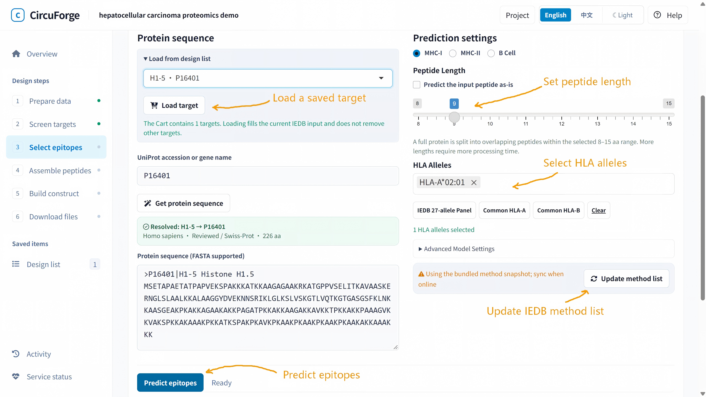
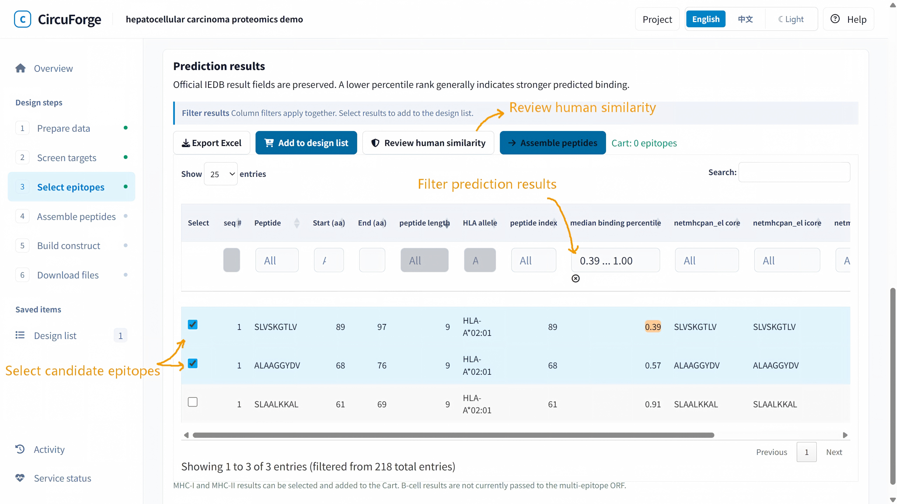
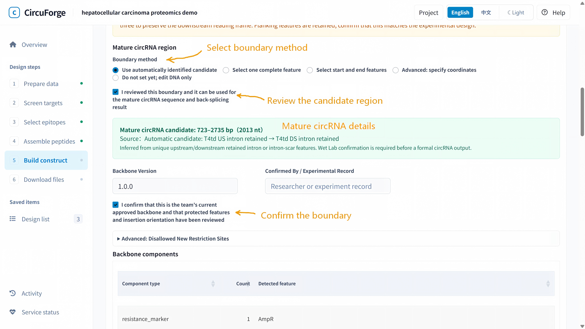
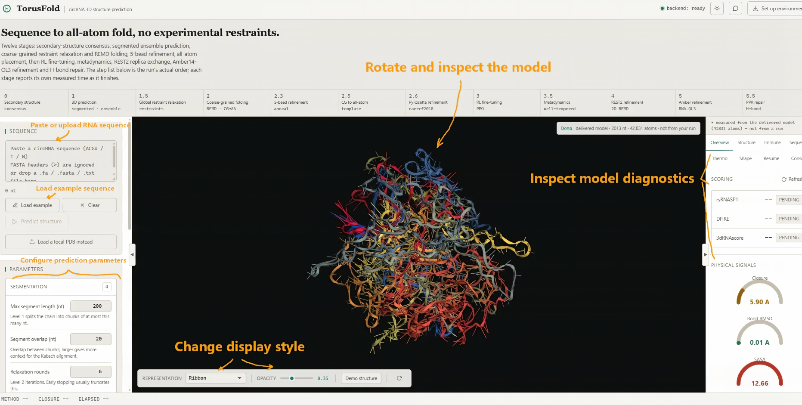
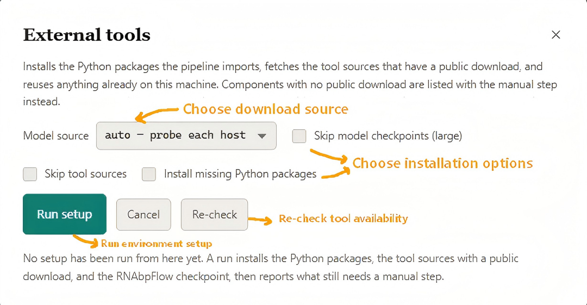
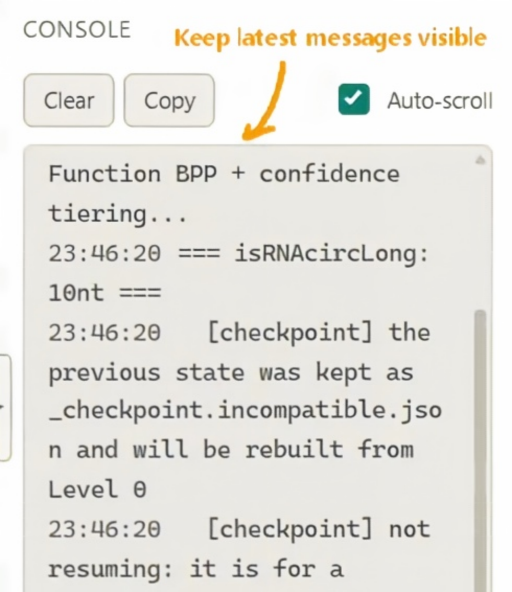
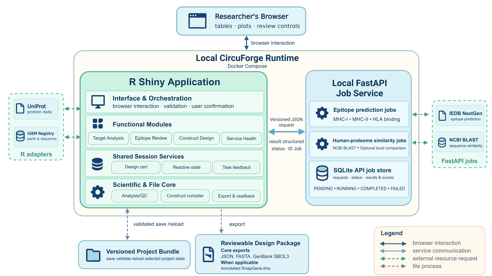
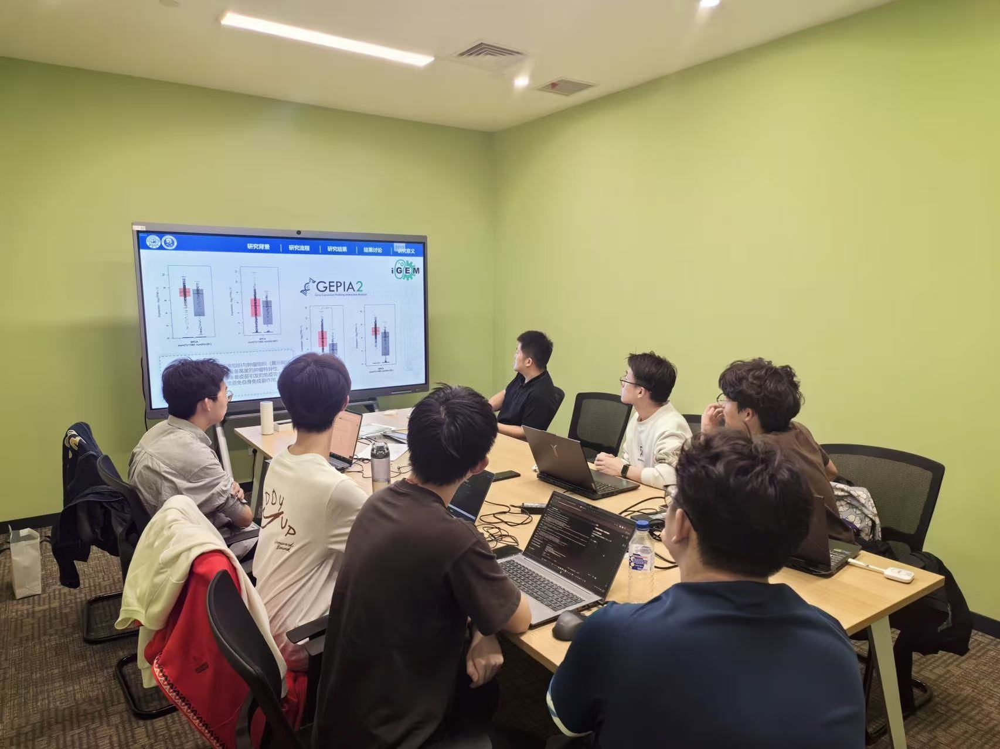
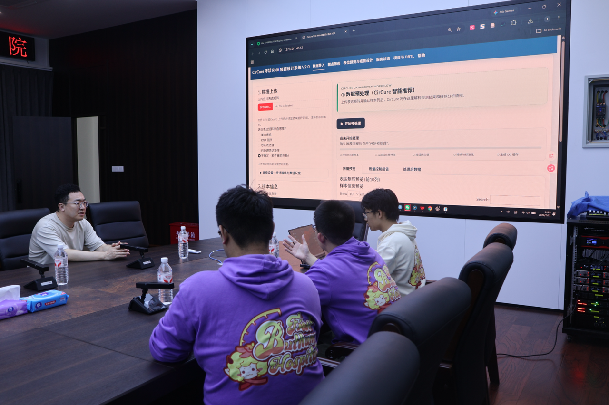
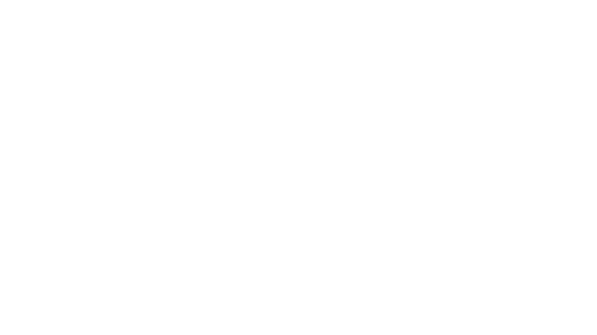

# Software\-Wiki\-CircuForge\-TorusFold\-English

# CircuForge and TorusFold

## 1\. Overview

Designing a circular RNA \(circRNA\) vaccine for triple\-negative breast cancer \(TNBC\) meant turning candidate targets and epitopes into constructs we could test in the lab\. Which epitopes should enter experiments? Should we also review the new peptides formed at the junctions when epitopes are combined? Answering these questions required us to connect target analysis, epitope prediction, sequence assembly, and experimental results\. The information was spread across different tools\. At each step, we needed to check where a candidate came from, record why we selected it, and make sure the sequence used downstream matched the team's design\.

We developed CircuForge so researchers could review candidates and design constructs in one browser\. Its Design Cart stores selected epitopes and their sources for human\-protein similarity review and open reading frame \(ORF\) assembly\. After assembly, the software checks peptides formed at the junctions and reads exported files back to verify them against the design\. We used this workflow in our vaccine experiments\. We reviewed 17 candidate epitopes, tested the 15 retained candidates as single\-epitope circRNAs, and then selected eight epitopes based on the experimental responses\. CircuForge helped us assemble these into the Combined design\.

Once the sequence was ready, we needed to examine the overall spatial structure of the mature circRNA\. Our sequence is 2,013 nt long, and the 3D predictors we selected could not model the entire sequence directly under our project configuration\. After predicting fragments, we still needed to recover their relative positions, join the RNA ends, and resolve fragment joins and steric clashes\. We developed TorusFold for these tasks\. It aligns fragment models through their overlapping regions, reconstructs and refines a full\-length circular model, and saves intermediate structures and geometric checks\. This lets our team inspect the arrangement of the whole molecule, its circular junction, and the joins between fragments, and compare structures before and after reconstruction and refinement\.

The mature circRNA sequence connects the two tools, allowing candidate selection, construct design, and structural inspection to continue from the same design\. Other teams can run the documented workflows with their own expression data, antigens, HLA backgrounds, and mature RNA sequences\. They can also modify external\-tool connections or add export formats\. We provide source code under the Apache License 2\.0, examples, and running instructions on iGEM GitLab so future teams can use and extend the software\.

First\-time visitors can open the TorusFold example viewer to rotate and inspect the saved 2,013 nt model\. To work with your own sequence, follow the usage guide below\.

- [Get the CircuForge source code](https://gitlab.igem.org/2026/software/jlu-fbh/circuforge)

- [Get the TorusFold source code](https://gitlab.igem.org/2026/software/jlu-fbh/torusfold-hybrid)


*Figure 1\. CircuForge generates a reviewed mature RNA sequence, which TorusFold uses for circular structure modeling\.*

## 2\. Judging Q\&A

### 2\.1 How compatible is the software with existing synthetic biology standards, such as SBOL, other RFCs, and data formats? Does it make full use of these standards?

CircuForge supports SBOL3, GenBank, FASTA, and JSON for saving and transferring reviewed construct designs\. SBOL3 preserves relationships between components and sequences\. GenBank and FASTA allow common sequence tools to read the design, while JSON stores the information needed to reconstruct it \(McLaughlin et al\., 2020\)\. Exported files are read back and checked against the source construct to reduce the risk of changes to sequences or annotations during transfer\.

TorusFold accepts mature RNA sequences and outputs PDB models and JSON diagnostic files\. Molecular viewers and analysis scripts can read these files, allowing researchers to continue inspecting and analyzing the structures\.

See [Verifiable design exports](#cf-verified-export) and [Integration and API](#integration-api)\.


### 2\.2 Has the software been validated experimentally?

We used CircuForge to review 17 candidate epitopes retrieved from IEDB, retained 15 after screening, and tested these candidates as single\-epitope circRNA constructs\. Based on the IFN\-γ ELISpot results, we selected the two strongest\-response epitopes from each antigen\. CircuForge organized and assembled these eight epitopes into the Combined design\. Subsequent sequencing, protein\-expression, and functional experiments tested the resulting software\-supported design\.

We checked TorusFold's refinement settings against the L1 ribozyme structure determined by X\-ray crystallography, PDB 2OIU \(Robertson and Scott, 2007\)\. After refinement starting from the crystal coordinates, the model had an RMSD of 1\.83 Å relative to the experimental structure\. This comparison provided a reproducible check for calibrating the refinement parameters\.

See [Validation](#validation)\.

### 2\.3 Can the software be applied to other projects?

Other teams can use their own expression data, antigens, HLA backgrounds, and backbones to run CircuForge's candidate\-review and construct\-design workflow\. They can rerun human\-protein similarity review and junction checks for their own peptide combinations\.

TorusFold can accept mature circRNA sequences from other design workflows, organize fragment predictions, and reconstruct circular models\. Teams can use either tool according to their inputs and research questions, or use them together by transferring the mature RNA file\.

See [User testing and community reuse](#community-reuse)\.

### 2\.4 How well does the software integrate with external tools or software applications, including APIs and packages?

CircuForge retrieves protein, epitope, alignment, and Part information from UniProt, IEDB, NCBI BLASTP, and the iGEM Registry for candidate and construct review \(Vita et al\., 2019, Altschul et al\., 1990\)\.

TorusFold uses ViennaRNA to predict possible base pairs and passes this information to later modeling stages as constraints \(Hofacker, 2003\)\. For 3D modeling, TorusFold can call RhoFold\+, trRosettaRNA2, and RNAbpFlow to generate models for overlapping RNA fragments \(Shen et al\., 2024, Wang et al\., 2026, Tarafder \& Bhattacharya, 2026\)\. It then aligns neighboring models through their overlaps, reconstructs the full\-length circular structure, and uses physical relaxation and refinement to resolve joins and steric clashes\.

The mature RNA exported by CircuForge can be used directly as TorusFold's sequence input\. Researchers can also use local APIs and standard files to bring designs and models into their own analysis workflows\.

See [Architecture and design choices](#architecture) and [Integration and API](#integration-api)\.

### 2\.5 Is the software easy to use?

CircuForge provides a built\-in example and a browser workflow organized around research tasks\. First\-time users can complete the design workflow without writing scripts\. Software recommendations, user confirmation, and task status are displayed separately, so users can see what they are deciding and what the program is doing\.

TorusFold's example viewer supports rotation, display changes, and circular\-junction marking, giving users a way to start by inspecting a structure\. They can then follow the usage guide to run a full prediction with their own sequence\.

See [Usage guide](#usage) and [User testing and community reuse](#community-reuse)\.

### 2\.6 How well is the software written and documented so future teams can extend and improve it?

CircuForge's architecture diagrams and module descriptions help future teams locate the implementations of candidate review, external connections, construct compilation, and export\. TorusFold documents external\-tool configuration, run entry points, checkpoints, and intermediate outputs so teams can modify individual stages and inspect their results\.

Repository examples, dependency records, running instructions, and test materials provide a starting point for reproducing results and checking changes\. Teams can first run the documented example, then use the module descriptions to identify the parts they need to modify\.

See [Architecture and design choices](#architecture), [Installation and API](#installation), and [Open source and reuse](#open-source)\.

## 3\. Workflow overview

Users first import project data, screen targets, and review candidate epitopes\. Confirmed candidates enter the Design Cart, and selected epitopes can undergo human\-protein similarity review before assembly\. Once the epitopes are assembled in the confirmed order, CircuForge checks newly formed junction peptides and inserts the payload into a reviewed backbone\. After annotation and export checks, researchers obtain the design files and mature RNA sequence\.

TorusFold takes this mature RNA as input, uses pairing information to guide modeling, and generates candidate structures for overlapping fragments\. Residues shared by neighboring fragments provide the references for alignment\. The program then reconstructs and refines the full\-length circular structure\. PDB models, diagnostic files, and intermediate structures are saved together so researchers can inspect the final result or revisit a specific computational stage\.


*Figure 2\. Candidates progress from data analysis and researcher review to assembly and export\.*


<a id="usage"></a>

## 4\. Usage guide

### 4\.1 CircuForge

<details class="usage-guide-pdf">
<summary>CircuForge User Guide</summary>
<p>Read the illustrated guide for installation, target and epitope review, construct design, exports, and troubleshooting.</p>
<p><a href="图片和附件/CircuForge-Usage-Guide.pdf" target="_blank" rel="noopener">Open PDF</a> or <a href="图片和附件/CircuForge-Usage-Guide.pdf" download="CircuForge-Usage-Guide.pdf">download the guide</a>.</p>
<iframe src="图片和附件/CircuForge-Usage-Guide.pdf#view=FitH" title="CircuForge user guide PDF" loading="lazy" style="width:100%;height:75vh;min-height:480px;border:0;"></iframe>
<p>If the preview is unavailable, use the links above.</p>
</details>

This walkthrough uses the built\-in **hepatocellular carcinoma proteomics demo**\. The sidebar has six steps: Prepare data, Screen targets, Select epitopes, Assemble peptides, Build construct, and Download files\. Selected targets and epitopes are saved in the **Design list** for use in later steps\.

If you already have a target protein or candidate peptides, choose the Target protein or Candidate peptides entry point on Overview\. The walkthrough below starts from expression data and completes a design workflow\.

#### Step 1\. Prepare data

Open **Prepare data** and click **Load demo data**, or upload your own Expression matrix\. The software accepts CSV and XLSX files\. To provide sample information, download the template and fill in SampleID and Group\. Paired analysis also requires Subject information\.

Check Assay type and the input settings, then click **Process data**\. Inspect the processing results and sample groups before continuing to Screen targets\.


*Figure 3\. Prepare data provides data\-upload controls, a sample\-information template, Load demo data, and Process data\.*

#### Step 2\. Screen and save targets

On **Screen targets**, check the comparison design\. This example uses **Unpaired**, with eight tumor samples and eight normal samples\. Click **Run Differential Analysis** first\. Once the analysis is complete, set the screening criteria\. In this example, select **Higher in tumor**, set the minimum `|log2FC|` threshold to **1** and the FDR threshold to **0\.05**, then click **Apply screening criteria**\.

Inspect the candidate table and the Evidence Card below it\. Check differential expression, GTEx annotations, UniProt status, and sequence information\. This example selects **P16401**\. Click **Add Selected Targets to Cart** to save it in the Design list\.


*Figure 4A\. Comparison design and screening criteria are set separately\. Run the differential analysis before applying screening criteria to the results\.*


*Figure 4B\. Selecting P16401 displays its information in the Evidence Card\. Add Selected Targets to Cart saves the selected target in the Design list\.*

#### Step 3\. Predict and review epitopes

Open **Select epitopes**, choose a saved target under **Load from design list**, and click **Load target**\. This example loads H1\-5 / P16401\. Check the Protein sequence\. You can also enter a UniProt accession or gene name and click Get protein sequence\.

Under Prediction settings, set the MHC class, Peptide Length, and HLA Alleles\. This example uses **MHC\-I, 9 aa, and HLA\-A\*02:01**\. Check the input that will be submitted to IEDB, then click **Predict epitopes**\.

When the prediction finishes, inspect fields such as Peptide, HLA allele, and **median binding percentile**\. Use the column filters to narrow the candidate list\. This example selects SLVSKGTLV and ALAAGGYDV\. Click **Add to design list** to save the selected epitopes for further review and ORF assembly\.



*Figure 5A\. After loading a target from the Design list, set the peptide length and HLA allele, then start epitope prediction\.*



*Figure 5B\. Two candidate epitopes are checked in this example\. They enter the Design list when the user clicks Add to design list\.*

Before assembly, you can click **Review human similarity** to review the selected peptides against human proteins\. Select **NCBI online human BLAST**, confirm consent to submit the selected peptides to NCBI, and click **Start review**\. Inspect the returned results and request records, then save the alignment evidence\. To check results later, use the saved job ID\.

#### Step 4\. Assemble peptides and check junctions

Open **Assemble peptides**, check the epitopes and their order in the current input list, enter an ORF Name, and choose the linkers\. This example keeps the **GSGGS** setting\. Click **Generate and check ORF** to generate and inspect the assembled sequence\.

Under **Review junction peptides**, select the HLA\-I alleles, confirm consent to submit the assembled ORF amino\-acid sequence to IEDB, and click **Run Junction MHC\-I Scan**\. The screenshot shows the settings and peptide windows before the scan\. If the status is `not run`, start the scan, then inspect the returned results and review any flagged junction peptides\.


*Figure 6A\. The two saved epitopes appear on the assembly page\. The user checks the input, ORF name, and linkers before generating the ORF\.*


*Figure 6B\. Junction review provides HLA settings, consent for external submission, and a list of peptide windows to scan\. The scan has not started in this screenshot\.*

#### Step 5\. Generate and review the construct

Open **Build construct** and import your team's backbone under **Upload and Read Backbone**\. You can use a SnapGene `.dna` file, GenBank file, or backbone JSON\. Once the file has been read, choose the insertion or replacement method under Feature Map and Editing Method\. Check the editing range, orientation, and reading frame\.

Under **Mature circRNA region**, check the Boundary method\. This example shows an automatically identified candidate region at **723 to 2735 bp, with a length of 2,013 nt**\. Check the boundary against your team's backbone records, confirm it, and fill in Backbone Version and Confirmed By / Experimental Record\.

After reviewing the backbone and editing settings, click **Apply ORF and Generate New DNA Construct**\. Inspect the construct\-check results under Construct and checks\.



*Figure 7\. Users check the candidate mature circRNA boundary and retain the backbone version and confirmation record for sequence export\.*

For Registry annotations, open **Registry review** and complete **Query, Compare, and Annotate** in order\. Check the DNA matches for candidate Parts, confirm the selected Registry IDs, and click **Write Selected IDs to Construct** to write the annotations\.

#### Step 6\. Download and save files

Open **Download files**\. After reviewing the construct checks, choose the files needed for your next task\.

|Download control|Use|
|---|---|
|Results workbook|Save result tables for further review|
|FASTA|Continue sequence analysis|
|GenBank, SBOL3|Transfer sequences and annotations to downstream design tools|
|JSON, Validation ZIP|Save construct records and verification materials|

For a native SnapGene DNA file, check the backbone's Native write\-back status first\. After completing Registry annotations, you can also download the corresponding Annotated files\.


*Figure 8\. Download files brings together downloads for construct sequences, annotations, result tables, and the validation package\.*

To save your current work, open **Design list** and click **Save project**\. To resume an existing project, choose the project file and click **Check and load**\. Activity shows result status for the current session\. Service status shows the status of computing services and external resources\.

### 4\.2 TorusFold

<details class="usage-guide-pdf">
<summary>TorusFold User Guide</summary>
<p>Read the illustrated guide for environment setup, prediction, checkpoint recovery, model inspection, exports, and troubleshooting.</p>
<p><a href="图片和附件/TorusFold-Usage-Guide.pdf" target="_blank" rel="noopener">Open PDF</a> or <a href="图片和附件/TorusFold-Usage-Guide.pdf" download="TorusFold-Usage-Guide.pdf">download the guide</a>.</p>
<iframe src="图片和附件/TorusFold-Usage-Guide.pdf#view=FitH" title="TorusFold user guide PDF" loading="lazy" style="width:100%;height:75vh;min-height:480px;border:0;"></iframe>
<p>If the preview is unavailable, use the links above.</p>
</details>

For a first look, open the example viewer\. Drag to rotate the saved model, change its colors and display style, and use the BSJ marking control to inspect the circular junction\. Clear the marker to return to the whole\-model view\.



*Figure 9\. The TorusFold example viewer with the 2,013 nt model loaded. Drag to rotate, change the display style and colouring, and use the BSJ control to mark the circular junction.*

A full prediction starts with sequence preparation\. Follow these six steps\.

#### Step 1\. Prepare the mature circRNA sequence

Prepare your own mature circRNA sequence or use the project's 2,013 nt example sequence\. Save it in the input file required by the runner\. For a sequence exported from CircuForge, retain the construct ID and sequence hash with it\.

#### Step 2\. Configure the prediction environment

Follow the installation guide to configure TorusFold, ViennaRNA, and the required external predictors\. Check predictor paths and model\-weight settings before starting the full calculation\.



*Figure 10\. One-click environment setup. The panel reports what it can install by itself and what has to be placed by hand, so an unavailable predictor is never reported as a failure.*

#### Step 3\. Start the prediction

Start the local service and submit the mature RNA, or use the sequence\-running script described in the documentation\. Check the job ID or run log to confirm that the calculation has started\.



*Figure 11\. Starting a run. The console names the job and streams the stages as the calculation proceeds, so progress is visible without watching the output directory.*

#### Step 4\. Monitor progress

Check progress through the local interface or status endpoint\. If a run is interrupted, follow the [reproduction guide](https://gitlab.igem.org/2026/software/jlu-fbh/torusfold-hybrid/-/blob/main/docs/REPRODUCTION_RESOURCES.md) to inspect the saved state and resume the calculation\.


*Figure 12\. Monitoring a run. The status panel reports the current stage and its own progress. If a run is interrupted, the saved state is what the resume path reads.*

#### Step 5\. Inspect the model

When the run finishes, open the final PDB in a molecular viewer\. Inspect the circular junction and the regions identified in the diagnostic files\. Use the pairing diagnostics and stage structures in the output directory to compare the reconstructed and refined models\.

#### Step 6\. Save and share the results

Save the input sequence, software version, run parameters, PDB model, and diagnostic files\. Include the construct ID and sequence hash when sharing the model so the recipient can find the original design\.


<a id="architecture"></a>

## 5\. Architecture and design choices

### 5\.1 CircuForge

CircuForge organizes statistical analysis, external\-data retrieval, candidate review, and sequence design around research tasks\. The Design Cart stores confirmed targets and epitopes, connecting analysis results to later assembly\.



*Figure 13\. CircuForge's modules follow research tasks\. The Design Cart transfers confirmed candidates at the relevant stages\.*

#### Choice 1\. A guided browser workflow

We chose Shiny to put analysis tables, plots, and design controls in a browser that researchers can use directly \(Chang et al\., 2026\)\. limma, edgeR, and the sequence\-handling and visualization packages support analysis, data processing, and result review \(Ritchie et al\., 2015, Chen et al\., 2025\)\.

The guided workflow reduces the need to write scripts\. We accepted the interface's limits on freely changing analysis steps to prioritize reviewing results and completing designs through research tasks\.

#### Choice 2\. Separating interactive analysis from longer tasks

Longer prediction jobs need status tracking, while interactive result review needs to remain responsive\. Shiny handles interactive analysis, and a local FastAPI service manages tasks that benefit from separate tracking\. Docker Compose starts both services together\. This makes jobs easier to track, but requires developers to maintain two runtime environments\.

#### Choice 3\. Transferring confirmed candidates through the Design Cart

Candidates need to retain their peptide sequences, HLA alleles, sources, and review records as they move to the next stage\. The Design Cart uses stable IDs, deduplication, and preserved order to transfer confirmed candidates\. Project Bundles support saving and restoring work across sessions\.

We keep user confirmation as a separate step so software recommendations and researchers' design decisions are recorded separately\. KEEP, REVIEW, and REJECT display QC recommendations\. Researchers confirm which candidates to use before proceeding to assembly\.

#### Choice 4\. Retaining sources and retrieval records

Candidate review draws on biological resources that return information in different formats\. Source adapters organize the required fields and retain available source identifiers, request states, and raw records\. Saved responses support later review, while retrieval times and refresh controls help users decide when to update the information\.


<a id="cf-verified-export"></a>

#### Choice 5\. Verifiable design exports

Other software must be able to read the sequence and features correctly after export\. CircuForge reads core export formats back and checks the information each format preserves against the source design\. Each format needs its own verification logic\. This extra work makes the outputs easier to pass to other researchers for continued use\.

### 5\.2 TorusFold

TorusFold organizes its modules around pairing information, fragment prediction, full\-length reconstruction, and refinement\. This lets long\-RNA modeling run and be checked one stage at a time\. Our reconstruction module uses fragment positions and shared residues to place local coordinates on the same circular RNA molecule\.


*Figure 14\. TorusFold passes pairing information and fragment structures into reconstruction and refinement, saving the results of each stage\.*

#### Choice 1\. Retaining full\-sequence pairing information during fragment modeling

We need to retain pairing information for the whole sequence when dividing it into fragments, so later stages can use it to model the full molecule\. We integrate ViennaRNA and configurable DivideFold\+ information, passing candidate base pairs and their supporting information into modeling \(Hofacker, 2003, Omnes et al\., 2026\)\. We retain the sources of the proposed pairs and records of which pairs were used\. Researchers can compare suggestions from different sources and inspect the modeling settings\.

#### Choice 2\. Using overlapping fragments as alignment references

To let 3D prediction tools process a long input, we divide the sequence into overlapping fragments and use their overlaps as alignment references\. The example run uses fragments of up to 200 nt with 30 nt overlaps\. Configured predictors generate candidate structures for these fragments\.

The overlaps add some repeated computation, but give neighboring fragments shared residues that the program can use to recover their relative positions\.

#### Choice 3\. Repairing joins and refining the reconstructed structure

Joining fragment models requires us to handle fragment boundaries, circular closure, and steric clashes\. TorusFold aligns shared residues and reconstructs full\-length coordinates\. It then uses structural constraints and physical refinement to repair joins and resolve clashes\.

We save the reconstructed coordinates and their check results so researchers can locate joins and compare structures before and after repair\.

#### Choice 4\. Saving stage results and checkpoints

Long\-RNA modeling has several time\-consuming stages\. Researchers need to monitor progress and reuse completed results after an interruption\. TorusFold saves intermediate structures, diagnostic files, and checkpoints to support stage comparisons and run recovery\. We allocate additional storage and file management for these records so future teams can inspect or modify individual stages\.

### 5\.3 Continuing from construct design to structural modeling

Researchers pass the mature RNA file exported by CircuForge to TorusFold to model the same construct\. Saving the construct ID and sequence hash with the sequence links the model and its run records to the original design\.

## 6\. Engineering iterations

### 6\.1 CircuForge

V1\.0 brought data import, target screening, and epitope prediction into one application\. When testing it with project data, we found that the prediction table did not clearly distinguish software recommendations from final selections\.


*Figure 15\. CircuForge's candidate\-review and running workflow changed through a software exchange and two consultations\.*

#### Iteration 1\. Improving candidate review through an iGEM software exchange

After a software exchange involving five teams, we added stage\-specific IDs and Evidence Cards to display candidate identities and supporting information\. KEEP, REVIEW, and REJECT summarize QC recommendations, while researchers confirm which candidates they will continue to use\.


*Figure 16\. The team presented V1\.0 at an iGEM software exchange and discussed how users could review candidate results\.*

#### Iteration 2\. Adding the Design Cart

Associate Professor Qingtian Guan suggested saving selected records before taking further action\. In the second iteration, we added the Design Cart so users could compare candidates, remove duplicates, and pass them to assembly in a confirmed order\.



*Figure 17\. The team presented software and discussed with AssoProf\.Qingtian Guan\.*

#### Iteration 3\. Revising module responsibilities and task management

Professor Xiangyu Meng then recommended clarifying module responsibilities, displaying the status of long\-running jobs, and providing a reproducible runtime environment\. We separated interactive operations from task services and added status records, container startup, and export checks\.



*Figure 18\. An in\-person software engineering discussion led to changes in module responsibilities and task management\.*

### 6\.2 TorusFold

#### Iteration 1\. Preparing long sequences for fragment prediction

With a 2,013 nt mature circRNA, our first obstacle was that the local predictors could not process the complete input directly\. We added overlapping segmentation and recorded fragment positions so prediction could run on the fragments and provide references for later reconstruction\.

#### Iteration 2\. Correcting coordinate reconstruction

When joining fragment results, we found that missing templates and alignment references affected coordinate reconstruction\. We corrected the anchors, rebuilt local coordinate frames, and retained pairing information throughout full\-length reconstruction\.

#### Iteration 3\. Calibrating refinement settings

During refinement, we checked the scale of the base\-pair guiding forces and adjusted `K_BPP` from 600 to 13\.4\. We then checked the refinement settings against the experimental PDB 2OIU structure, testing the parameter changes and structural comparison in the same engineering iteration\.

These changes are recorded in the [engineering repair log](https://gitlab.igem.org/2026/software/jlu-fbh/torusfold-hybrid/-/blob/main/docs/timeline.md)\. The structure\-comparison result is described in the Judging Q\&A\.


<a id="community-reuse"></a>

## 7\. User testing and community reuse

### 7\.1 CircuForge user testing

After completing CircuForge V2\.0, we invited five independent participants: two wet\-lab researchers, two students with limited bioinformatics experience, and one experienced computational user\. Each participant completed seven representative tasks: importing a dataset, reviewing a candidate target, screening and selecting epitopes, running NCBI BLASTP review, inspecting a linker\-junction scan, compiling a circRNA construct, and exporting a validation package\.

In the first round, the five participants completed 29 of 35 tasks without help, with a median completion time of 27 minutes\. The most common difficulty was NCBI BLASTP review\. Some users could not immediately distinguish a submitted query from a result still being processed or a completed result ready for review and export\.

Based on this feedback, we replaced the separate submission, status\-checking, and download controls with a guided panel divided into three stages\. The revised interface presents query submission, processing status, and result review in a fixed order\. It also provides clearer status messages and a direct option to export alignment evidence\.

In a second round with three participants, users completed 20 of 21 tasks without help, and the median completion time fell to 19 minutes\. All three independently completed BLASTP review and found the exported evidence file\.



*Figure 19\. CircuForge user testing (image placeholder).*

### 7\.2 TorusFold user testing

We invited five users who had not previously participated in TorusFold development for independent testing\. Their backgrounds matched the composition of the CircuForge user\-test group: two wet\-lab researchers, two students with limited bioinformatics experience, and one user with a computational background\. The test covered the full TorusFold workflow from input preparation to result inspection, including interaction with the generated RNA model\.

Participants used the project's 2,013 nt mature circRNA example\. They followed the documentation to prepare the sequence and check the prediction environment, then started a prediction and monitored its status\. After completion, they located the final PDB model, rotated it and changed the structural display in the viewer, and located the back\-splice junction \(BSJ\)\. They also used stage structures and diagnostic files to compare the full\-length reconstruction with the refined structure\. Finally, they located and saved the model, diagnostic files, and corresponding construct and sequence information\. We recorded whether users completed each step independently and where they paused, returned to the documentation, or asked for help\.

The main difficulty was finding and understanding the outputs after prediction\. TorusFold saves the reconstructed model, refined model, final PDB, diagnostics, and several intermediate results\. Experienced computational users could use these files to inspect individual stages, but first\-time users found their relationships unclear\. They had to determine which file represented the final structure and then locate the corresponding diagnostics before comparing reconstruction and refinement\. The software had generated the information they needed, but users still had to understand the output directory's organization\.

We reorganized the result controls by computational stage, clearly separating Final model, Reconstructed model, Refined model, and Diagnostics\. The results page prioritizes the final model while retaining stage structures for further inspection\. We also placed BSJ inspection within the final\-model viewing workflow\. Users could then move from a completed task to inspecting the final model and locating the circular junction without first learning the internal file structure\.

After these changes, participants checked the prediction results again with the same goals\. The retest focused on whether they could answer three practical questions: where to find the final model, what changed between reconstruction and refinement, and where the circular junction was\. We retained all intermediate structures and diagnostics, but changed the order in which first\-time users encountered them\. This kept the full computational record available and made the main results easier to find\.


*Figure 20\. TorusFold user testing (image placeholder).*

### 7\.3 Getting started as another team

The official iGEM GitLab repositories provide source code, pinned dependency records, Docker configuration, automated tests, example inputs, result schemas, and detailed README instructions\. Other teams can first reproduce a documented run and then adapt the workflow to their own project\.

Teams can replace example inputs with compatible data, inspect recorded parameters and decisions, and continue working on the resulting designs through the standard files described above\. They can rerun BLASTP review for their own candidate peptides and rescan the linker contexts produced by their own ORF order\. The BLASTP Evidence ZIP and construct validation package retain the corresponding requests, results, file inventories, and checksums\. Recipients can verify the transferred evidence before reviewing or modifying a design\.


<a id="validation"></a>

## 8\. Validation

Using CircuForge, we reviewed 17 candidate epitopes retrieved from IEDB and retained 15 after bioinformatic screening\. We also carried out an AlphaFold\-based structural review\. The 15 retained candidates were then tested as single\-epitope circRNA constructs\. IFN\-γ ELISpot detected responses of different magnitudes across the candidates, supporting the practical use of the screening workflow in our experimental vaccine design\.

We used the experimental ranking to select the two strongest\-response epitopes from each antigen\. CircuForge organized these eight epitopes, retained their source information, and supported their assembly into the Combined design\. This step focused the final construct on the stronger candidates while keeping the selection records and assembly order available for review\.

We then tested the software\-supported design through construction and expression experiments\. Sanger sequencing confirmed that the Combined plasmid matched the intended sequence\. BSJ sequencing recovered the expected head\-to\-tail RNA junction, and anti\-FLAG Western blot detected the encoded fusion protein\. Second\-round ELISpot and target\-cell killing assays further tested the biological function of the resulting construct\.

TorusFold extends this workflow to structural examination of mature circRNA\. It reconstructs a full\-length circular model and saves intermediate structures and geometric checks so researchers can inspect the circular junction and fragment joins\. CircuForge supports candidate selection and construct design, while TorusFold provides a structural view of the mature RNA\. Other teams can follow the documented workflow with their own candidates and sequences\.

See the [Results page](https://2026.igem.wiki/jlu-fbh/results) for the experimental results\.


<a id="installation"></a>

## 9\. Installation and API

### 9\.1 Before installation

Check that you have the browser, container tools, or environment needed for your chosen workflow\. The example viewer requires only a browser\. A new TorusFold prediction requires Python, external predictors, and the corresponding computing resources\.

|Workflow|Requirements|Entry point after startup|
|---|---|---|
|CircuForge container deployment|Docker and Docker Compose|Browser interface and local API|
|TorusFold example viewer|Modern browser|Saved 2,013 nt model|
|New TorusFold prediction|Python environment, ViennaRNA, configured external predictors, and model weights|Local prediction interface or sequence\-running script|

### 9\.2 CircuForge

Clone the [official CircuForge repository](https://gitlab.igem.org/2026/software/jlu-fbh/circuforge)\. In the repository directory, copy the environment configuration and start the services using the commands for your operating system\.

On Windows PowerShell:

```PowerShell
Copy-Item .env.example .env
docker compose up --build
```

On macOS and Linux:

```Bash
cp .env.example .env
docker compose up --build
```

After startup, open these addresses and use the example workflow to check the installation\.

- CircuForge interface: `http://localhost:3838`

- FastAPI documentation: `http://localhost:8000/docs`

- OpenAPI specification: `http://localhost:8000/openapi.json`


### 9\.3 TorusFold

Clone the [official TorusFold repository](https://gitlab.igem.org/2026/software/jlu-fbh/torusfold-hybrid), create a Python environment, and install the core package and ViennaRNA from the repository directory\.

```Bash
pip install -e .
conda install -c conda-forge viennarna
```

Follow the [deployment guide](https://gitlab.igem.org/2026/software/jlu-fbh/torusfold-hybrid/-/blob/main/docs/DEPLOY_EXTERNAL.md) to configure the required predictors, model weights, and paths\. First check that the package imports successfully, then follow the usage guide to run the example or your own mature RNA sequence\.

```Bash
python -c "import torusfold; print(torusfold.__file__)"
```

Start the local prediction service, then open `http://127.0.0.1:8877` in your browser\.

```Bash
python serve.py
```

The documented 2,013 nt runner uses `sequence.txt` as its input file\. Start it with:

```Bash
python run_2013nt.py
```


<a id="integration-api"></a>

### 9\.4 Integration and API

CircuForge's local API supports construct compilation and junction\-window checks\. The OpenAPI documentation describes the request fields\.

|Software|Endpoint|Purpose|
|---|---|---|
|CircuForge|`POST /v1/constructs/compile`|Compile a peptide cassette or construct|
|CircuForge|`POST /v1/constructs/junction-windows`|Generate junction\-spanning peptide windows|
|TorusFold|`POST /api/predict`|Submit a mature RNA prediction job|
|TorusFold|`GET /api/status`|Check job progress and completion status|

The following CircuForge request uses two demo peptides\.

```Bash
curl -X POST http://localhost:8000/v1/constructs/compile \
  -H "Content-Type: application/json" \
  -d '{"project_id":"demo-project","construct_name":"TROP2_demo","epitopes":[{"id":"EPI-001","sequence_aa":"SLYNTVATL","mhc_class":"I"},{"id":"EPI-002","sequence_aa":"KLTQDLFL","mhc_class":"II"}],"linkers":{"mhci":"AAY","mhcii":"GPGPG"}}'
```

The demo request does not include a backbone, so it returns a peptide cassette with the status `CASSETTE_ONLY_BACKBONE_NOT_PROVIDED`\. To request a complete construct, add the backbone fields defined in `http://localhost:8000/docs`\.

TorusFold's prediction endpoint accepts mature RNA and returns a job ID\. Use the status endpoint to monitor progress\. After running `python serve.py`, the following short request demonstrates job submission\.

```Bash
curl -X POST http://127.0.0.1:8877/api/predict \
  -H "Content-Type: application/json" \
  -d '{"sequence":"AUGCUAGCUAGCUAGCUAGC"}'
```

See the [server implementation](https://gitlab.igem.org/2026/software/jlu-fbh/torusfold-hybrid/-/blob/main/serve.py) for request fields and status handling\.

### 9\.5 Network modes and service status

CircuForge's network mode and Service Status page show which functions are available and which local or external resources they need\. Before startup, set `CIRCURE_NETWORK_MODE` to `auto`, `online`, or `offline`\. The default is `auto`\. In `offline` mode, new NCBI and IEDB requests are disabled\. Users can check the currently available dependencies and functions on Service Status\.

## 10\. Planned improvements

In the next round, we will expand CircuForge's task testing and invite independent users to test TorusFold's viewing and installation tasks\. We will improve BLASTP job recovery and later result queries to reduce the effect of public\-queue waiting times on users' work\.

For TorusFold, we will compare different long\-range pairing and cross\-fragment reconstruction strategies and record how parameter changes affect structures at each stage\. We also plan to add a transfer command between the two tools that checks the sequence hash and saves the construct ID\.


<a id="open-source"></a>

## 11\. Open source and reuse

The source code for each tool is stored in the team's iGEM GitLab software repository\. Each README explains the software's purpose, intended users, installation, operation, and how to reproduce the main results\. The code is released under the Apache License 2\.0, with the license file included alongside the source\.

|Software|Source code|Usage and running instructions|License|
|---|---|---|---|
|CircuForge|[iGEM GitLab](https://gitlab.igem.org/2026/software/jlu-fbh/circuforge)|[README](https://gitlab.igem.org/2026/software/jlu-fbh/circuforge/-/blob/main/README.md)|[Apache License 2\.0](https://gitlab.igem.org/2026/software/jlu-fbh/circuforge/-/blob/main/LICENSE)|
|TorusFold|[iGEM GitLab](https://gitlab.igem.org/2026/software/jlu-fbh/torusfold-hybrid)|[README](https://gitlab.igem.org/2026/software/jlu-fbh/torusfold-hybrid/-/blob/main/README.md)|[Apache License 2\.0](https://gitlab.igem.org/2026/software/jlu-fbh/torusfold-hybrid/-/blob/main/LICENSE)|

CircuForge uses committed R and Python dependency records to restore its environment and provides container build and startup commands\. TorusFold's installation, predictor\-configuration, and result\-reproduction instructions help future teams prepare new runs\.

Third\-party predictors and weights must be obtained under their own terms\. Future teams can provide compatible inputs or develop new adapters to continue using and improving the relevant modules\.

## References

Altschul et al\., 1990\. Altschul SF, Gish W, Miller W, Myers EW, Lipman DJ\. Basic local alignment search tool\. *Journal of Molecular Biology*\. 1990;215:403–410\. https://doi\.org/10\.1016/S0022\-2836\(05\)80360\-2

Chang et al\., 2026\. Chang W, Cheng J, Allaire JJ, et al\. *shiny: Web Application Framework for R*\. R package documentation\. https://doi\.org/10\.32614/CRAN\.package\.shiny

Chen et al\., 2025\. Chen Y, Chen L, Lun ATL, Baldoni PL, Smyth GK\. edgeR v4: powerful differential analysis of sequencing data with expanded functionality and improved support for small counts and larger datasets\. *Nucleic Acids Research*\. 2025;53:gkaf018\. https://doi\.org/10\.1093/nar/gkaf018

Hofacker, 2003\. Hofacker IL\. Vienna RNA secondary structure server\. *Nucleic Acids Research*\. 2003;31:3429–3431\. https://doi\.org/10\.1093/nar/gkg599

McLaughlin et al\., 2020\. McLaughlin JA, Beal J, Mısırlı G, et al\. The Synthetic Biology Open Language \(SBOL\) Version 3: Simplified Data Exchange for Bioengineering\. *Frontiers in Bioengineering and Biotechnology*\. 2020;8:1009\. https://doi\.org/10\.3389/fbioe\.2020\.01009

Omnes et al\., 2026\. Omnes L, Angel E, Tahi F\. DivideFold\+: an AI\-based tool for RNA secondary structure prediction with subdomains identification and visualization and data augmentation\. *Journal of Molecular Biology*\. 2026;438\(18\):169865\. https://doi\.org/10\.1016/j\.jmb\.2026\.169865

Ritchie et al\., 2015\. Ritchie ME, Phipson B, Wu D, et al\. limma powers differential expression analyses for RNA\-sequencing and microarray studies\. *Nucleic Acids Research*\. 2015;43:e47\. https://doi\.org/10\.1093/nar/gkv007

Robertson and Scott, 2007\. Robertson MP, Scott WG\. The structural basis of ribozyme\-catalyzed RNA assembly\. *Science*\. 2007;315:1549–1553\. https://doi\.org/10\.1126/science\.1136231

Shen et al\., 2024\. Shen T, Hu Z, Sun S, et al\. Accurate RNA 3D structure prediction using a language model\-based deep learning approach\. *Nature Methods*\. 2024;21:2287–2298\. https://doi\.org/10\.1038/s41592\-024\-02487\-0

Tarafder \& Bhattacharya, 2026\. Tarafder S, Bhattacharya D\. RNAbpFlow: base pair\-augmented SE\(3\) flow matching for conditional RNA 3D structure generation\. *Nature Methods*\. 2026;23:1349–1358\. https://doi\.org/10\.1038/s41592\-026\-03128\-4

Vita et al\., 2019\. Vita R, Mahajan S, Overton JA, et al\. The Immune Epitope Database \(IEDB\): 2018 update\. *Nucleic Acids Research*\. 2019;47:D339–D343\. https://doi\.org/10\.1093/nar/gky1006

Wang et al\., 2026\. Wang W, Peng Z, Yang J\. Predicting RNA 3D structure and conformers using a pre\-trained secondary structure model and structure\-aware attention\. *Nature Machine Intelligence*\. 2026;8:722–734\. https://doi\.org/10\.1038/s42256\-026\-01223\-x

