# CircuForge and TorusFold

<a id="judging"></a>

## Judging Criteria

### How compatible is the software with existing synthetic biology standards, such as SBOL, other RFCs, and data formats? Does it make full use of these standards?

CircuForge supports **SBOL3, GenBank, FASTA, and JSON** for saving and transferring reviewed construct designs. SBOL3 records components, sequences, and their relationships; GenBank carries sequence features for downstream design tools; FASTA provides sequence input for further analysis; and JSON retains the application's design record. For formats that support annotations, CircuForge can also include researcher-confirmed iGEM Registry Part IDs (**iGEM Foundation, n.d.**). Format-specific readback checks compare the exported sequences and supported annotations with the source design before users continue their work.

TorusFold accepts mature RNA sequences and outputs **PDB models and JSON diagnostics**. Molecular viewers and analysis scripts can read these files, allowing researchers to inspect the structures, compare modeling stages, and continue analysis in their preferred tools.

See [Verifiable design exports](#cf-verified-export) and [Integration and API](#integration-api).

### How well was the software validated (e.g., through experimental work, test data, or benchmarking)?

CircuForge was evaluated against the experimentally tested Combined design from our TNBC project. Project screening narrowed 17 reviewed candidates to 15 retained epitopes. Wet Lab merged two overlapping pairs into continuous sequences, producing 13 coding designs that covered all 15 epitopes. IFN-γ ELISpot results guided the selection of two coding segments from each antigen source for Combined. CircuForge turned the eight experimentally selected coding segments into **a sequence-checked Combined construct design**. It assembled the segments in the researcher-confirmed order with GSGGS linkers, generated the corresponding DNA, and replaced the epitope-coding region within the supplied backbone while preserving the surrounding backbone sequence. It then verified the encoded peptide sequence and checked the exported files against the generated design. This demonstrated CircuForge's ability to carry experimentally informed selections through sequence assembly, backbone integration, and verified export.

We evaluated TorusFold using the project's 2,013 nt mature circRNA. We checked that ten overlapping fragments covered the complete sequence and retained their original positions. For a 200 nt test fragment, we compared the initial structure, an intermediate repair stage, and the final refined structure. Unusually close contacts between backbone phosphorus atoms decreased from 8 to 4 to 3, showing fewer crowded positions in the tested backbone. We separately retained a full-length computational model for inspection of the circular junction and fragment joins. We checked TorusFold's refinement settings against the L1 ribozyme structure determined by X-ray crystallography, PDB 2OIU (Robertson and Scott, 2007). After **refinement starting from the crystal coordinates**, the model had a phosphorus-atom RMSD of 1.83 Å relative to the experimental structure. This indicates that the refined model remained close to the experimental structure, demonstrating **good preservation of the known RNA backbone during refinement**.

See [Validation](#validation) for the experimental selection, reference reconstruction, and structure checks.

### Can the software be applied to other projects?

Other teams can use **their own expression data, antigens, HLA settings, and backbones** in CircuForge. They can begin with expression-based target screening, a known protein, or reviewed peptides, then retain candidate sources and confirmed choices through assembly and export. For their own peptide combinations, they can inspect junction-spanning windows and request binding predictions through the configured IEDB service.

TorusFold can take mature circRNA sequences from other design workflows and use overlapping fragment predictions to reconstruct circular models. Teams can use either tool independently or connect them by transferring the mature RNA sequence file. This lets them adopt the parts of the workflow that fit their research question and available inputs.

See [Usage guide](#usage) and [User guidance and community reuse](#community-reuse).

### How well does the software integrate with external tools or software applications, including APIs and packages?

CircuForge connects **UniProt, IEDB, and the iGEM Registry** to candidate and construct review. UniProt supplies protein sequences and source records; IEDB supplies epitope predictions; and Registry review compares construct DNA with Part records and writes researcher-confirmed IDs into construct annotations. These connections carry source information into the design rather than leaving it in separate search results.

TorusFold uses ViennaRNA pairing information to guide later modeling stages. It can call configured **RhoFold+, trRosettaRNA2, and RNAbpFlow** predictors to generate structures for overlapping fragments. TorusFold then aligns shared regions, reconstructs the full-length circular model, and applies physical relaxation and refinement to address fragment joins and steric clashes.

Users can export mature RNA from CircuForge and provide that sequence as TorusFold input. Local APIs also expose construct compilation, junction-window enumeration, prediction submission, and job status, while standard files connect both tools to downstream applications.

See [Architecture and design choices](#architecture), [External tools and models](#external-models), and [Integration and API](#integration-api).

### Is the software easy to use?

CircuForge provides a built-in example and **a six-step browser workflow** from data preparation to downloads. Researchers can review candidates, confirm their Design Cart, assemble a payload, and generate and export a construct without writing analysis scripts. Source records, user confirmations, and task status remain visible throughout the workflow. Saved project files allow users to keep their selections and return to the design later.

TorusFold's example viewer lets users rotate a saved model, change its display, and mark the circular junction without installing the prediction environment. For a new calculation, the usage guide explains sequence preparation, configuration, and run controls. Logs, stage outputs, and checkpoint information help users follow the calculation and inspect its progress.

See [Usage guide](#usage) and [User guidance and community reuse](#community-reuse).

### How well is the software written and documented so future teams can extend and improve it?

CircuForge separates the browser interface, analysis functions, external-resource adapters, construct compiler, and exporters. Architecture diagrams and module descriptions help future teams locate the code for the capability they want to change. TorusFold documents **external-tool configuration, run entry points, checkpoints, and intermediate outputs**, allowing developers to inspect individual modeling stages and adapt their interfaces.

Both projects provide source code under the Apache License 2.0, with repository examples, dependency records, running instructions, and test materials. The Wiki adds an illustrated walkthrough, API request and response examples, and downloadable reference-case files. Teams can begin with a documented example, identify the relevant module, and use the corresponding checks to assess their changes.

See [Architecture and design choices](#architecture), [Installation and API](#installation), and [Open source and reuse](#open-source).

<a id="overview"></a>

## 2. Overview

Designing a circular RNA (circRNA) vaccine for triple-negative breast cancer (TNBC) meant turning candidate targets and epitopes into constructs we could test in the lab. Which targets should proceed to epitope screening, and which epitopes should enter experiments? When epitopes are combined, should we also **review the new peptides formed at their junctions**? How can we ensure that the final construct sequence matches the design we have reviewed and confirmed? The information needed to answer these questions was spread across different tools. We needed to **connect target analysis, epitope prediction, sequence assembly, and experimental results**, while keeping track of each candidate’s source and the reasons for its selection.

We developed CircuForge to help researchers **review candidates and turn confirmed selections into construct designs in one browser**. Its Design Cart retains selected epitopes, their sources, and the assembly order confirmed by the researcher. After combining epitopes into an open reading frame (ORF), users can check newly formed junction peptides. CircuForge then supports construct generation and export. CircuForge can also compare construct sequences with iGEM Registry Parts and add researcher-confirmed Part IDs to the construct annotations before export. For supported export formats, it reads the files back to check that the preserved sequences and annotations match the source design. In our TNBC vaccine project, this workflow provides a way to organize candidate review and reconstruct the selected coding segments of the **Combined design**.

Because RNA folding can influence translation initiation, we wanted to explore the three-dimensional organization of our mature circRNA after sequence design ([Chen et al., 2021](https://doi.org/10.1016/j.molcel.2021.07.042)). Direct full-length modeling of our 2,013 nt sequence was not feasible with the prediction workflow available to us. We therefore developed TorusFold to **reconstruct and refine a full-length circular RNA model** from overlapping fragment predictions. It aligns the fragments through their shared regions and saves **intermediate structures and geometric diagnostics**, allowing researchers to inspect the modeled circular junction, fragment joins, and steric clashes, and compare structures across modeling stages.

**The mature RNA sequence file connects the two tools**: users export it from CircuForge and provide it as input to TorusFold. Other teams can use either tool independently or follow this workflow with their own candidates and sequences. Both tools are released under the Apache License 2.0, with source code and running instructions available on iGEM GitLab.

Source code: [CircuForge](https://gitlab.igem.org/2026/software/jlu-fbh/circuforge) · [TorusFold](https://gitlab.igem.org/2026/software/jlu-fbh/torusfold-hybrid)

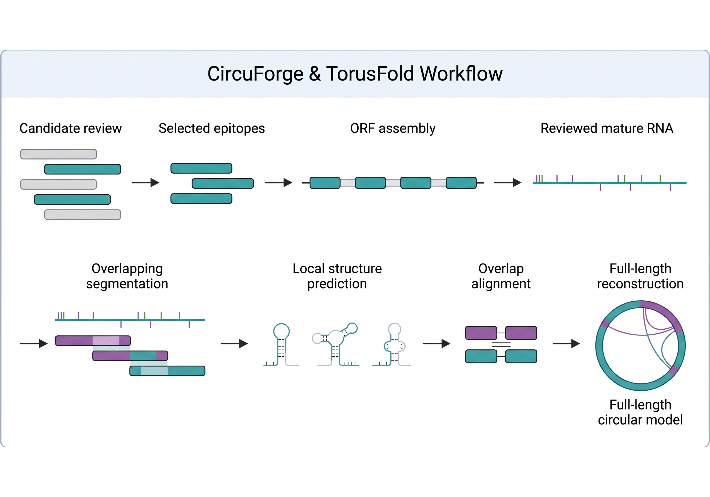

*Figure 1. CircuForge supports reviewed sequence design; TorusFold supports circular structure modeling. The sequence passes between the programs as a user-transferred file.*

<a id="usage"></a>

## 3. Usage guide

### 3.1 CircuForge

<iframe title="JLU-FBH: CircuForge Usage Guide (2026) [English]" src="https://video.igem.org/videos/embed/dpwGrMSSQS3dK8xeZXsYkT?subtitle=en" allow="fullscreen" sandbox="allow-same-origin allow-scripts allow-popups allow-forms" loading="lazy"></iframe>

<details class="usage-guide-pdf">
<summary>CircuForge User Guide</summary>
<p>Read the illustrated guide for installation, target and epitope review, construct design, exports, and troubleshooting.</p>
<p><a href="../../../../public/assets/docs/software/circuforge-usage-guide.pdf" target="_blank" rel="noopener">Open PDF</a> or <a href="../../../../public/assets/docs/software/circuforge-usage-guide.pdf" download="CircuForge-Usage-Guide.pdf">download the guide</a>.</p>
<iframe src="../../../../public/assets/docs/software/circuforge-usage-guide.pdf#view=FitH" title="CircuForge user guide PDF" loading="lazy" style="width:100%;height:75vh;min-height:480px;border:0;"></iframe>
<p>If the preview is unavailable, use the links above.</p>
</details>

This walkthrough uses the built-in **hepatocellular carcinoma proteomics demo**, a small processed subset of the public proteomics dataset (**Ng et al., 2022**) prepared for a lightweight demonstration. The sidebar has six steps: Prepare data, Screen targets, Select epitopes, Assemble peptides, Build construct, and Download files. Selected targets and epitopes are saved in the **Design list** for use in later steps.

If you already have a target protein or candidate peptides, choose the **Target protein or Candidate peptides** entry point on Overview. The walkthrough below starts from expression data and completes a design workflow.

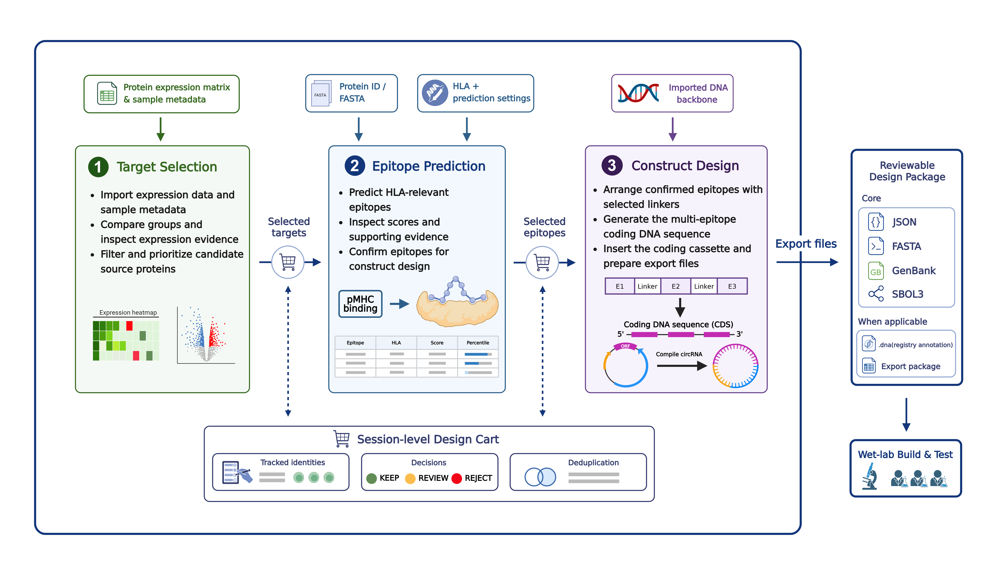

**FIG. 2** *CircuForge connects target screening, epitope selection, and construct design through the Design Cart.*

#### Step 1. Prepare data

Open **Prepare data** and click **Load demo data**, or upload your own **Expression matrix**. The software accepts CSV and XLSX files. To provide sample information, download the template and fill in **SampleID** and **Group**. Paired analysis also requires **Subject** information.

Check **Assay type** and the input settings, then click **Process data**. Inspect the processing results and sample groups before continuing to Screen targets.


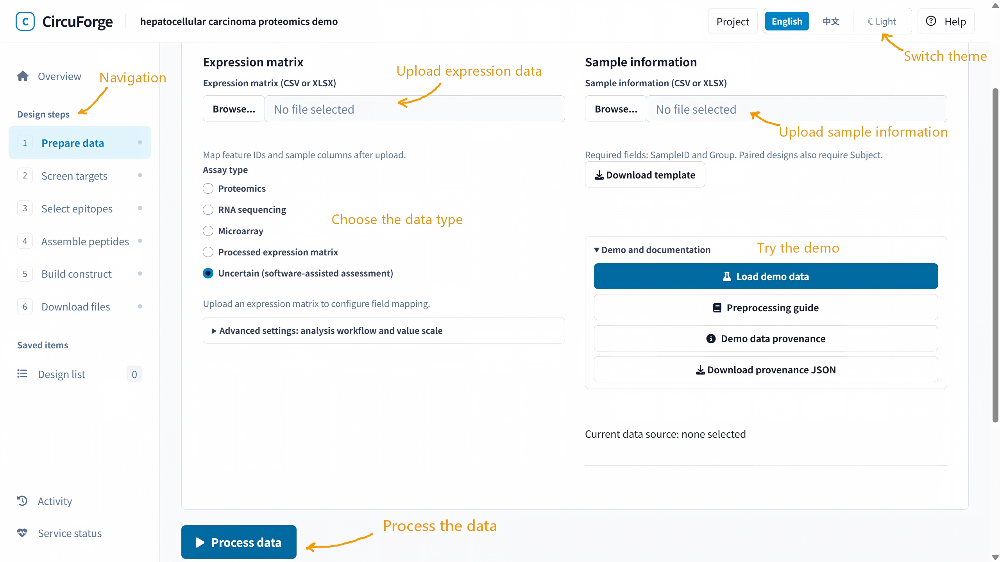

*Figure 3. Prepare data provides data-upload controls, a sample-information template, Load demo data, and Process data.*

#### Step 2. Screen and save targets

On **Screen targets**, check the comparison design. This example uses **Unpaired**, with eight tumor samples and eight normal samples. Click **Run Differential Analysis** first. Once the analysis is complete, set the screening criteria. In this example, select **Higher in tumor**, set the minimum `|log2FC|` threshold to **1** and the FDR threshold to **0.05**, then click **Apply screening criteria**.

Inspect the candidate table and the **Evidence Card** below it. Check differential expression, GTEx annotations, UniProt status, and sequence information. This example selects **P16401**. Click **Add Selected Targets to Cart** to save it in the Design list.

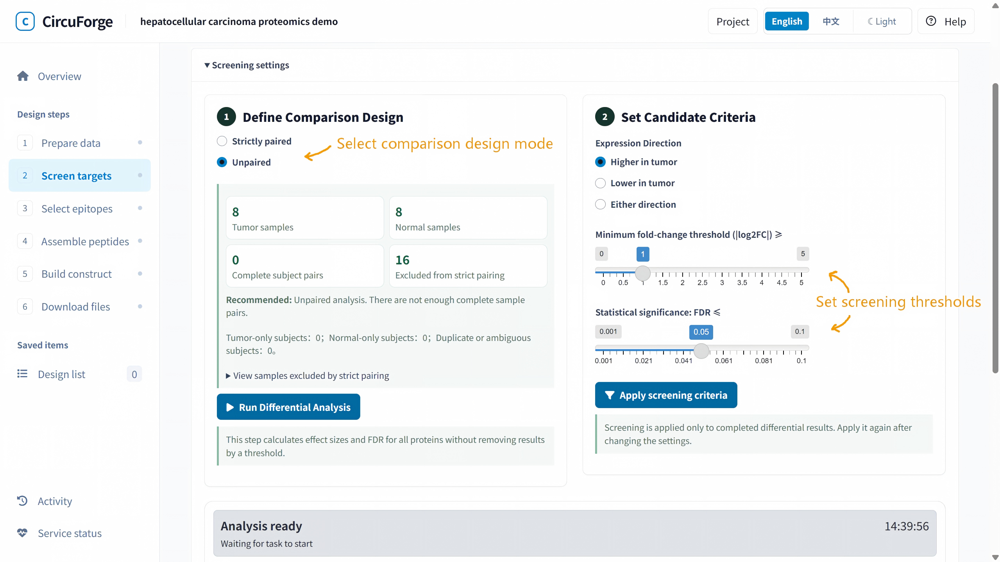

*Figure 4A. Comparison design and screening criteria are set separately. Run the differential analysis before applying screening criteria to the results.*

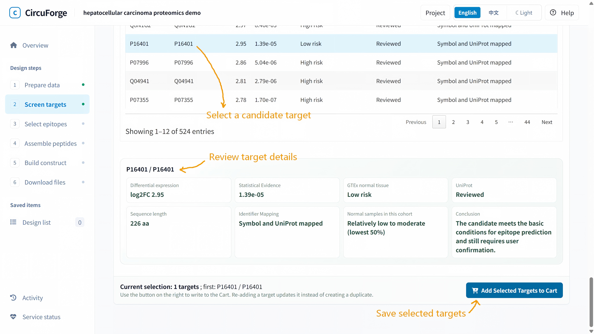

*Figure 4B. Selecting P16401 displays its information in the Evidence Card. Add Selected Targets to Cart saves the selected target in the Design list.*

#### Step 3. Predict and review epitopes

Open **Select epitopes**, choose a saved target under **Load from design list**, and click **Load target**. This example loads H1-5 / P16401. Check the **Protein sequence**. You can also enter a UniProt accession or gene name and click **Get protein sequence**.

Under **Prediction settings**, set the MHC class, **Peptide Length**, and **HLA Alleles**. This example uses **MHC-I, 9 aa, and HLA-A\*02:01**. Check the input that will be submitted to IEDB, then click **Predict epitopes**.

When the prediction finishes, inspect fields such as Peptide, HLA allele, and **median binding percentile**. Use the column filters to narrow the candidate list. This example selects **SLVSKGTLV and ALAAGGYDV**. Click **Add to design list** to save the selected epitopes for further review and ORF assembly.


*Figure 5A. After loading a target from the Design list, set the peptide length and HLA allele, then start epitope prediction.*


*Figure 5B. Two candidate epitopes are checked in this example. They enter the Design list when the user clicks Add to design list.*

Before assembly, you can click **Review human similarity** to review the selected peptides against human proteins. Select **NCBI online human BLAST**, **confirm consent to submit the selected peptides to NCBI**, and click **Start review**. Inspect the returned results and request records, then save the alignment evidence. To check results later, use the saved job ID.

#### Step 4. Assemble peptides and check junctions

Open **Assemble peptides**, check the epitopes and their order in the current input list, enter an **ORF Name**, and choose the linkers. This example keeps the **GSGGS** setting. Click **Generate and check ORF** to generate and inspect the assembled sequence.

Under **Review junction peptides**, select the HLA-I alleles, **confirm consent to submit the assembled ORF amino-acid sequence to IEDB**, and click **Run Junction MHC-I Scan**. The screenshot shows the settings and peptide windows before the scan. If the status is `not run`, start the scan, then inspect the returned results and review any flagged junction peptides.

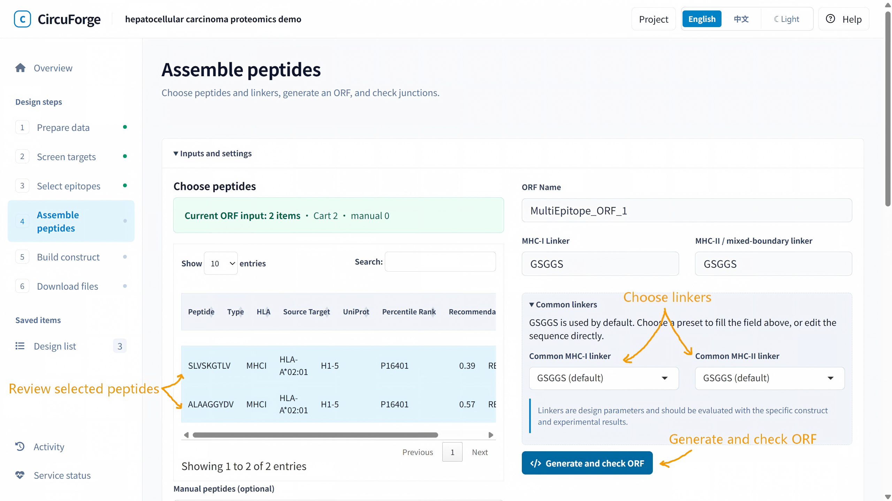

*Figure 6A. The two saved epitopes appear on the assembly page. The user checks the input, ORF name, and linkers before generating the ORF.*

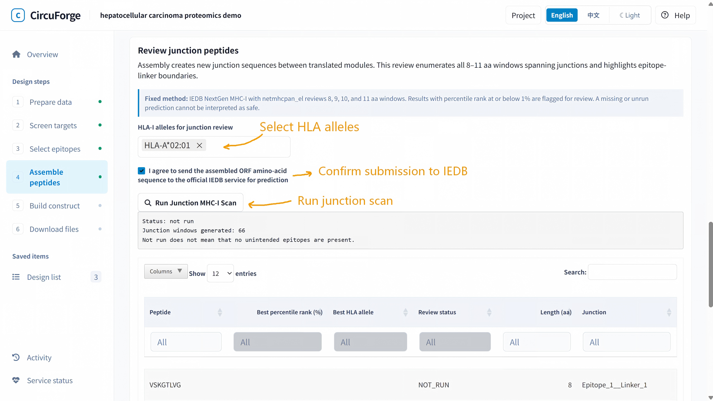

*Figure 6B. Junction review provides HLA settings, consent for external submission, and a list of peptide windows to scan. The scan has not started in this screenshot.*

#### Step 5. Generate and review the construct

Open Build construct and import your team’s backbone under Upload and Read Backbone. CircuForge accepts SnapGene `.dna`, GenBank, and backbone JSON files. Inspect the DNA construct map and choose an insertion or replacement method under Feature Map and Editing Method. Check the target feature or coordinates, strand orientation, and reading frame.

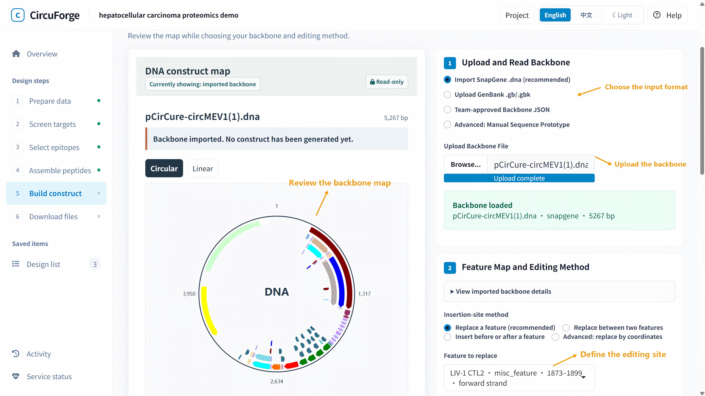

**FIG. 7A** *Users import a backbone, inspect its feature map, and select the editing method and target region.*

Click **Apply ORF and Generate New DNA Construct**, then inspect the results under Construct and checks. Review and confirm the mature circRNA region against your team’s backbone records, and retain the backbone version and confirmation record.

For Registry annotations, open Registry review to query candidate Parts and compare their DNA sequences with the construct. Review the matches, confirm the selected Part IDs, and click **Write Selected IDs to Construct** to add the annotations before export.


<p><a href="https://static.igem.wiki/teams/6056/wiki/files/pages/dry-lab/software/figure-07b-registry-matching.webp" target="_blank" rel="noopener">Open animation</a> · <a href="https://static.igem.wiki/teams/6056/wiki/files/pages/dry-lab/software/figure-07b-registry-matching.webp" download="figure-07b-registry-matching.webp">Download animation</a></p>

**FIG. 7B** *Users review Registry DNA matches and confirm the Part IDs to write into construct annotations.*

#### Step 6. Download and save files

Open **Download files**. After reviewing the construct checks, choose the files needed for your next task.

|Download control|Use|
|---|---|
|Results workbook|Save result tables for further review|
|FASTA|Continue sequence analysis|
|GenBank, SBOL3|Transfer sequences and annotations to downstream design tools|
|JSON, Validation ZIP|Save construct records and verification materials|

For a native SnapGene DNA file, check the backbone's **Native write-back** status first. After completing Registry annotations, you can also download the corresponding Annotated files.

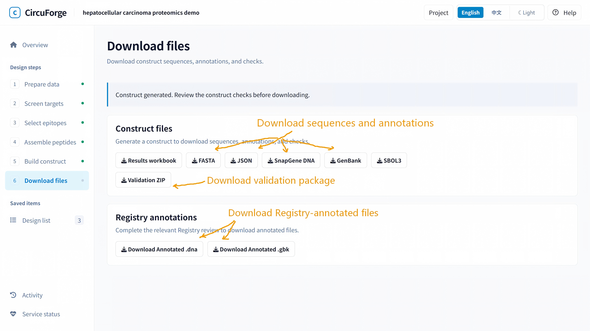

*Figure 8. Download files brings together downloads for construct sequences, annotations, result tables, and the validation package.*

To save your current work, open **Design list** and click **Save project**. To resume an existing project, choose the project file and click **Check and load**. **Activity** shows result status for the current session. **Service status** shows the status of computing services and external resources.

### 3.2 TorusFold

<details class="usage-guide-pdf">
<summary>TorusFold User Guide</summary>
<p>Read the illustrated guide for environment setup, prediction, checkpoint recovery, model inspection, exports, and troubleshooting.</p>
<p><a href="../../../../public/assets/docs/software/torusfold-usage-guide.pdf" target="_blank" rel="noopener">Open PDF</a> or <a href="../../../../public/assets/docs/software/torusfold-usage-guide.pdf" download="TorusFold-Usage-Guide.pdf">download the guide</a>.</p>
<iframe src="../../../../public/assets/docs/software/torusfold-usage-guide.pdf#view=FitH" title="TorusFold user guide PDF" loading="lazy" style="width:100%;height:75vh;min-height:480px;border:0;"></iframe>
<p>If the preview is unavailable, use the links above.</p>
</details>

For a first look, open the **example viewer**. Drag to rotate the saved model, change its colors and display style, and use the BSJ marking control to inspect the circular junction. Clear the marker to return to the whole-model view.

<div id="software-torusfold-model" data-software-model></div>

**FIG. 9** *Users rotate the saved model, adjust its display, and mark the circular junction.*

A full prediction starts with sequence preparation. Follow these six steps.

#### Step 1. Prepare the mature circRNA sequence

Prepare your own mature circRNA sequence or use the project's 2,013 nt example sequence. Save it in the input file required by the runner. For a sequence exported from CircuForge, retain the **construct ID and sequence hash** with it.

#### Step 2. Configure the prediction environment

Follow the installation guide to configure TorusFold, ViennaRNA, and the required external predictors. Check **predictor paths and model-weight settings** before starting the full calculation.


**FIG. 10** *Users review installation options and external-tool requirements before starting a prediction.*

#### Step 3. Start the prediction

Start the local service and submit the mature RNA, or use the sequence-running script described in the documentation. Check the **job ID or run log** to confirm that the calculation has started.


**FIG. 11** *Users follow stage messages and execution details in the run console.*

#### Step 4. Monitor progress

Check progress through the local interface or status endpoint. If a run is interrupted, follow the [reproduction guide](https://gitlab.igem.org/2026/software/jlu-fbh/torusfold-hybrid/-/blob/main/docs/REPRODUCTION_RESOURCES.md) to **inspect the saved state and resume the calculation**.

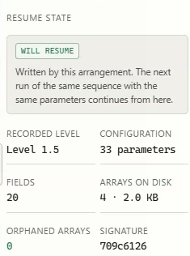

**FIG. 12** *Users inspect the saved stage, configuration, and checkpoint files.*

#### Step 5. Inspect the model

When the run finishes, open the **final PDB** in a molecular viewer. Inspect the circular junction and the regions identified in the diagnostic files. Use the pairing diagnostics and stage structures in the output directory to compare the reconstructed and refined models.

#### Step 6. Save and share the results

Save the **input sequence, software version, run parameters, PDB model, and diagnostic files**. Include the construct ID and sequence hash when sharing the model so the recipient can find the original design.

<a id="architecture"></a>

## 4. Architecture and design choices

### 4.1 CircuForge

CircuForge organizes statistical analysis, external-data retrieval, candidate review, and sequence design around research tasks. The **Design Cart stores confirmed targets and epitopes**, connecting analysis results to later assembly.


**FIG. 13** *CircuForge’s task-based modules transfer confirmed candidates through the Design Cart.*

#### Choice 1. A guided browser workflow

We chose Shiny to put analysis tables, plots, and design controls in a browser that researchers can use directly ([Shiny documentation](https://shiny.posit.co/r/getstarted/shiny-basics/lesson1/)). limma, edgeR, and the sequence-handling and visualization packages support analysis, data processing, and result review ([Ritchie et al., 2015](https://doi.org/10.1093/nar/gkv007); [Chen et al., 2025](https://doi.org/10.1093/nar/gkaf018)).

The guided workflow **reduces the need to write scripts**. We prioritized a defined sequence of research tasks so users can review results, confirm selections, and carry a design through assembly and export in one interface.

#### Choice 2. Separating interactive analysis from longer tasks

Longer prediction jobs need status tracking, while interactive result review needs to remain responsive. Shiny handles interactive analysis, and a local FastAPI service manages tasks that benefit from separate tracking. Docker Compose starts both services together. This makes jobs easier to track, while requiring developers to maintain two runtime environments.

#### Choice 3. Transferring confirmed candidates through the Design Cart

Candidates need to retain their peptide sequences, HLA alleles, sources, and review records as they move to the next stage. The Design Cart uses **stable IDs, deduplication, and preserved order** to transfer confirmed candidates. Project Bundles support saving and restoring work across sessions.

We keep user confirmation as a separate step so software recommendations and researchers’ design decisions are recorded separately. KEEP, REVIEW, and REJECT display QC recommendations. Researchers confirm which candidates to use before proceeding to assembly.

#### Choice 4. Retaining sources and retrieval records

Candidate review draws on biological resources that return information in different formats. Source adapters organize the required fields and retain available source identifiers, request states, and raw records. Saved responses support later review, while retrieval times and refresh controls help users decide when to update the information.

<a id="cf-verified-export"></a>

#### Choice 5. Verifiable design exports

Other software must be able to read the sequence and features correctly after export. CircuForge **reads core export formats back** and checks the information each format preserves against the source design. Format-specific verification checks sequences and supported annotations, giving researchers checked files to pass to downstream tools and collaborators.

### 4.2 TorusFold

TorusFold organizes its modules around pairing information, fragment prediction, full-length reconstruction, and refinement. This lets long-RNA modeling run and be checked one stage at a time. Our reconstruction module uses fragment positions and shared residues to place local coordinates on the same circular RNA molecule.

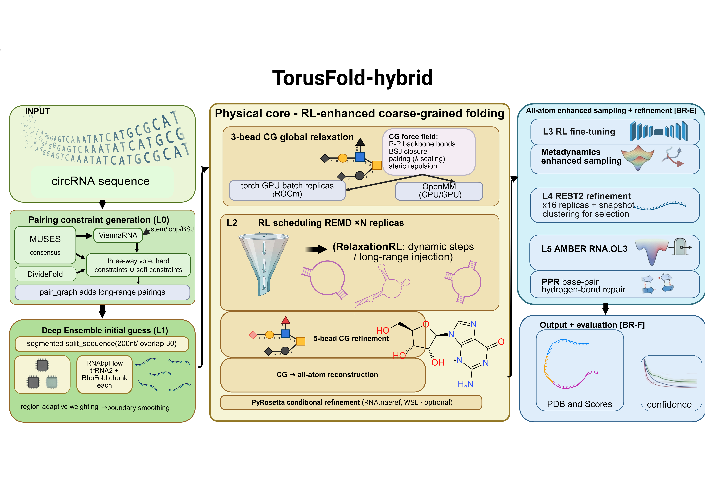

**FIG. 14** *TorusFold connects pairing information, fragment prediction, reconstruction, and refinement, saving outputs at each stage.*

#### Choice 1. Retaining full-sequence pairing information during fragment modeling

TorusFold retains **pairing information for the whole sequence** when dividing it into fragments, so later stages can use it to model the full molecule. We integrate ViennaRNA and configurable DivideFold+ information, passing candidate base pairs and their supporting information into modeling ([Hofacker, 2003](https://doi.org/10.1093/nar/gkg599); [Omnes et al., 2026](https://doi.org/10.1016/j.jmb.2026.169865)). We retain the sources of the proposed pairs and records of which pairs were used. Researchers can compare suggestions from different sources and inspect the modeling settings.

#### Choice 2. Using overlapping fragments as alignment references

To let 3D prediction tools process a long input, we divide the sequence into **overlapping fragments** and use their overlaps as alignment references. The documented example runner uses a 200 nt segment setting with 30 nt overlaps. Configured predictors generate candidate structures for these fragments.

The overlaps give neighboring fragments shared residues that the program uses to recover their relative positions. This alignment information comes at the cost of some repeated prediction work in the overlapping regions.

#### Choice 3. Repairing joins and refining the reconstructed structure

Joining fragment models requires handling fragment boundaries, circular closure, and steric clashes. TorusFold aligns shared residues and reconstructs full-length coordinates. It then uses structural constraints and physical refinement to repair joins and reduce steric clashes.

We save the reconstructed coordinates and their check results so researchers can locate joins and compare structures before and after repair.

#### Choice 4. Saving stage results and checkpoints

Long-RNA modeling has several time-consuming stages. Researchers need to monitor progress and reuse completed results after an interruption. TorusFold saves **intermediate structures, diagnostic files, and checkpoints** to support stage comparisons and recovery from saved checkpoints. We allocate additional storage and file management for these records so future teams can inspect or modify individual stages.

### 4.3 Continuing from construct design to structural modeling

Researchers pass the mature RNA file exported by CircuForge to TorusFold to model the corresponding RNA sequence. Saving the construct ID and sequence hash with the sequence links the model and its run records to the original design.

<a id="engineering"></a>

## 5. Engineering iterations

### 5.1 CircuForge: carrying project decisions into construct design

CircuForge V1.0 brought data import, target screening, and epitope prediction into one application. As our project moved from candidate analysis to construct design, we needed selected records, supporting evidence, and researcher decisions to remain connected through assembly and export. The following iterations turned that requirement into the V2.0 workflow.

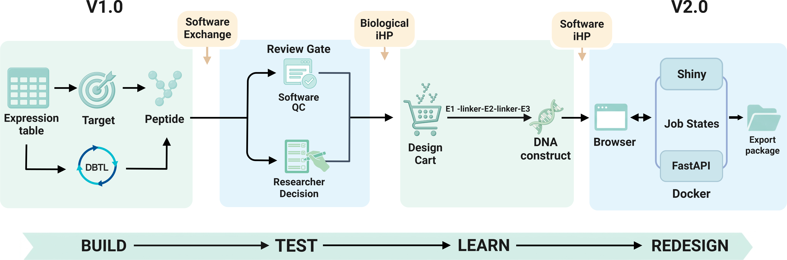

**FIG. 15** *CircuForge evolved from analysis modules into a connected candidate-review and construct-design workflow.*

#### Iteration 1. Making candidate identity and researcher decisions explicit

We presented V1.0 at an online exchange involving five iGEM teams. The exchange prompted us to reflect on how to distinguish software recommendations from researchers’ final selections. We added **stage-specific IDs and Evidence Cards** to connect candidate identities with their supporting information. KEEP, REVIEW, and REJECT present software QC recommendations, while a separate confirmation step records which candidates the researcher selects for continued design.

<details class="implementation-snippet" id="implementation-1" markdown="1">
<summary>Implementation 1 · Linking candidate identity, evidence, and researcher confirmation</summary>

A stage-specific epitope ID combines sequence, prediction mode, HLA, and target identity. The selection handler records the QC recommendation separately from the researcher’s decision and saves the candidate evidence with the selected entry.

```r
design_cart_epitope_id <- function(peptide, mode, allele, target_symbol, target_accession) {
  paste(
    "EPITOPE", toupper(trimws(peptide)), toupper(trimws(mode)),
    toupper(trimws(allele)), toupper(trimws(target_accession)),
    toupper(trimws(target_symbol)), sep = ":"
  )
}
```

```r
chosen$QCRecommendation <- chosen$FinalDecision %||% chosen$DisplayDecision
chosen$UserDecision <- "SELECTED_FOR_ORF_REVIEW"
chosen$ConfirmedAt <- format(Sys.time(), "%Y-%m-%d %H:%M:%S")
```

```r
chosen$EvidenceJSON <- vapply(seq_len(nrow(chosen)), function(i) {
  as.character(jsonlite::toJSON(
    as.list(chosen[i, , drop = FALSE]), auto_unbox = TRUE, null = "null", na = "null"
  ))
}, character(1))
chosen$Source <- paste0("IEDB ", toupper(input$pred_mode))
design_cart$add_epitopes(chosen)
```

*Source: `utils/utils_design_cart.R` · `adf4013c` · lines 54–60; `modules/mod_epitope.R` · `adf4013c` · lines 2304–2306; `modules/mod_epitope.R` · `adf4013c` · lines 2313–2319.*

</details>


**FIG. 16** *Participants share software-development experience at an online exchange involving five iGEM teams.*

#### Iteration 2. Preserving confirmed selections in the Design Cart

Associate Professor Qingtian Guan suggested saving selected records before taking further action. We implemented the **Design Cart** to retain confirmed targets and epitopes, compare entries, remove duplicates, and preserve their assembly order. Project Bundles save these records across sessions, allowing researchers to continue a design with its sources and confirmed selections intact.

<details class="implementation-snippet" id="implementation-2" markdown="1">
<summary>Implementation 2 · Retaining selected records across design stages and sessions</summary>

The Cart merges entries by ID while retaining the incoming row order. Project Bundle serialization saves target selections, epitope selections, and the review state for later restoration.

```r
merge_rows <- function(old, incoming) {
  if (!nrow(incoming)) return(old)
  combined <- rbind(old[!old$CartID %in% incoming$CartID, , drop = FALSE], incoming)
  rownames(combined) <- NULL
  combined
}
```

```r
project_bundle_write_csv(record$targets, file.path(bundle_dir, "targets.csv"))
project_bundle_write_csv(record$epitopes, file.path(bundle_dir, "epitopes.csv"))
project_bundle_write_json(record$epitope_review %||% list(), file.path(bundle_dir, "epitope_review.json"))
```

*Source: `utils/utils_design_cart.R` · `adf4013c` · lines 68–73; `utils/utils_project_bundle.R` · `adf4013c` · lines 253–255.*

</details>


**FIG. 17** *The team discusses the software workflow with Associate Professor Qingtian Guan.*

#### Iteration 3. Connecting task management, deployment, and checked exports

Professor Xiangyu Meng’s software-engineering feedback informed the separation of module responsibilities, visible status tracking for longer jobs, and runtime documentation. We separated interactive analysis from task services, provided Docker Compose startup, and added export readback checks. Task records show how requests progress, while format-specific checks verify the sequences and supported annotations delivered to downstream tools.

<details class="implementation-snippet" id="implementation-3" markdown="1">
<summary>Implementation 3 · Testing sequence-preserving exports</summary>

The SBOL3 round-trip test writes a design, reads it back, and compares both its component identity and DNA sequence with the source manifest.

```r
testthat::test_that("SBOL3 RDF/XML round-trip preserves component and DNA sequence", {
  manifest <- build_construct_manifest(make_export_construct(), make_export_registry_hits())
  path <- tempfile(fileext = ".rdf")
  on.exit(unlink(path), add = TRUE)
  write_construct_sbol3(manifest, path)
  restored <- read_construct_sbol3(path)
  testthat::expect_equal(restored$component_id, manifest$construct_id)
  testthat::expect_equal(restored$sequence, manifest$dna_template$sequence)
})
```

*Source: `tests/testthat/test-construct-exports.R` · `cd4d2b35` · lines 88–96.*

</details>


**FIG. 18** *The team discusses module responsibilities, task management, and software deployment.*

V2.0 combines these changes into a guided workflow from candidate review to construct export. The [reference-case evaluation](#reference-case) demonstrates how confirmed coding segments become an assembled, sequence-checked design in a supplied backbone.

### 5.2 TorusFold: connecting fragment prediction, reconstruction, and refinement

#### Iteration 1. Preparing the project sequence for fragment prediction

Our 2,013 nt mature circRNA required a modeling route that could use the predictors and computing resources available to us. We implemented **overlapping segmentation with recorded sequence positions**, allowing local predictions to retain their relationship to the complete RNA. Shared residues between neighboring fragments supply the alignment references for reconstruction.

#### Iteration 2. Establishing consistent reconstruction coordinates

Full-length reconstruction requires local predictions to share a consistent coordinate system. We corrected reconstruction anchors, rebuilt local coordinate frames, and passed pairing information through the reconstruction steps. These changes connected fragment positions, alignment references, and structural constraints in the assembled model. Saved stage structures allow researchers to inspect fragment joins and compare coordinates across reconstruction and repair.

<details class="implementation-snippet" id="implementation-4" markdown="1">
<summary>Implementation 4 · Aligning reconstruction anchors</summary>

Four target anchors connect the template to the phosphate trace; Kabsch alignment places the template atoms in the reconstructed coordinates.

```python
c1_dst = p_coords[i] + b * _C1_ALONG + r * _C1_PERP
c4_dst = p_coords[i] + b * _C4_ALONG + r * _C4_PERP
o3_dst = nxt - b * 1.6  # O3'[i] consistent with the geometry of P[i+1]
dst_anchors = np.stack([p_coords[i], c1_dst, c4_dst, o3_dst])

# Kabsch superposition (4-point least squares; one more O3' constraint than the 3-point version)
aligned = _kabsch_align(src_anchors, dst_anchors, tcoords)
```

*Source: `src/torusfold/scheme2/aform_from_template.py` · `4f55c167` · lines 178–184.*

</details>

<details class="implementation-snippet" id="implementation-5" markdown="1">
<summary>Implementation 5 · Orienting atoms in a local coordinate frame</summary>

The subsequent frame revision uses backbone, perpendicular, and normal directions to position the sugar anchors in three dimensions.

```python
n_axis = np.cross(b, r)  # r is already orthogonal to b and unit
_o1, _o4 = _ANCHOR_OFFSETS["C1'"], _ANCHOR_OFFSETS["C4'"]
c1_dst = p_coords[i] + b * _o1[0] + r * _o1[1] + n_axis * _o1[2]
c4_dst = p_coords[i] + b * _o4[0] + r * _o4[1] + n_axis * _o4[2]
o3_dst = nxt - b * 1.6  # O3'[i] consistent with the geometry of P[i+1]
dst_anchors = np.stack([p_coords[i], c1_dst, c4_dst, o3_dst])

# Kabsch superposition (4-point least squares; one more O3' constraint than the 3-point version)
aligned = _kabsch_align(src_anchors, dst_anchors, tcoords)
```

*Source: `src/torusfold/scheme2/aform_from_template.py` · `c0ed20f0` · lines 188–196.*

</details>

<details class="implementation-snippet" id="implementation-6" markdown="1">
<summary>Implementation 6 · Carrying base pairs into reconstruction and refinement</summary>

The same pair list enters all-atom reconstruction and Amber refinement, connecting pairing guidance across the two stages.

```python
_structure_5 = reconstruct_all_atom(best_coords, sequence, pairs=pairs)
# amber_refine: C1'-C1' pair restraints (K=100 kJ/mol/nm²) + A-form torsions
_refined_coords_5, _e0_5, _e1_5, _info_5 = _amber_refine_full(
    _structure_5, pairs,
    platform_name="CPU",
    max_iterations=3000,
)
```

*Source: `src/torusfold/scheme2/isrnaclong.py` · `ea423897` · lines 2117–2123.*

</details>

#### Iteration 3. Evaluating refinement through structural measurements

We revised the base-pair guidance parameter `K_BPP` from 600 to 13.4. A separate 200 nt fragment test recorded **a reduction in non-adjacent phosphorus-atom close-contact pairs from eight to three** across reconstruction, PPR, and Amber refinement. The 2OIU comparison checked refinement starting from crystal coordinates against the known experimental structure.

<details class="implementation-snippet" id="implementation-7" markdown="1">
<summary>Implementation 7 · Calibrating the base-pair guidance strength</summary>

The calibration script derives a force-scale criterion from observed base-pair distance variation; the corresponding revision sets the guidance coefficient to 13.4.

```python
nn = np.array(nn)
sigma = float(nn.std())
crit = 0.6 * B.KBT / sigma
print(f"{len(structs)} structures, {len(nn)} pairs")
print(f"observed N-N distance: mean {nn.mean():.3f} nm, sd {sigma:.3f}")
print(f"criterion: K_BPP = 0.6 * kBT / sigma = 0.6 * {B.KBT} / {sigma:.3f} = {crit:.1f}")
```

```python
K_BPP = 13.4        # BPP soft constraint (0.6 * kBT / sigma_NN; was 600.0)
```

*Source: `scripts/calibrate_bpp.py` · `99ab8508` · lines 52–57; `src/torusfold/scheme2/torch_cgsim.py` · `99ab8508` · lines 147–147.*

</details>

<a id="community-reuse"></a>

## 6. User testing and community reuse

We conducted **internal task-based user testing** of CircuForge and TorusFold. Participants were mainly team members with limited bioinformatics experience, including students from our Wet Lab and Human Practices (HP) groups. They worked through representative design and model-inspection tasks, allowing us to identify where task states, result organization, and guidance needed to be clearer. Their feedback informed the following improvements.

### 6.1 CircuForge user testing

The CircuForge sessions followed the design workflow: importing data, reviewing a target, selecting epitopes, checking assembly order and junction peptides, generating a construct, and locating the exported files. Participants used the browser interface and Design list to carry their selections between stages.


**FIG. 19** *Team members test CircuForge’s candidate-review and construct-design workflow.*

Participants needed clearer answers to two questions: had a submitted request finished, and which files should they save after generating a construct? We revised **task-status messages and export guidance** to distinguish submission, processing, and result review, and to connect the generated design with its downloadable files. The implementation provides job IDs and status retrieval and construct export packages with readback checks.

<details class="implementation-snippet" id="implementation-8" markdown="1">
<summary>Implementation 8 · Returning a trackable task</summary>

Submission returns a job ID, its state, and a status endpoint while the prediction runs in a background task.

```python
service = request.app.state.epitope_service
job = service.enqueue(payload)
background_tasks.add_task(service.run, job["job_id"])
return {
    "job_id": job["job_id"],
    "status": job["status"],
    "status_url": f"/v1/jobs/{job['job_id']}",
}
```

*Source: `api/app/routers/epitopes.py` · `ed398cf0` · lines 19–26.*

</details>

<details class="implementation-snippet" id="implementation-9" markdown="1">
<summary>Implementation 9 · Packaging the design with its verification record</summary>

The export writer generates four formats from one manifest, checks their readback, and saves the check table with the export files.

```r
write_construct_json(manifest, json_path)
write_construct_fasta(manifest, fasta_path)
write_construct_genbank(manifest, gbk_path)
write_construct_sbol3(manifest, sbol_path)
checks <- verify_construct_roundtrip(manifest, json_path, fasta_path, gbk_path, sbol_path)
write.csv(checks, file.path(bundle_dir, "roundtrip_checks.csv"), row.names = FALSE)
```

*Source: `utils/utils_construct_exports.R` · `cd4d2b35` · lines 265–270.*

</details>

Follow-up sessions revisited these tasks, focusing on continuing through the workflow, identifying the returned results, and locating the corresponding exports. The V2.0 workflow keeps confirmed selections in the Design Cart and brings sequence files and validation materials together at the download step.

### 6.2 TorusFold user testing

TorusFold testing followed the user journey from sequence preparation and task monitoring to model inspection and output retrieval. Participants worked with the project example, located model and diagnostic files, rotated the RNA structure, changed its display, and inspected the back-splice junction. Stage structures provided material for comparing reconstruction and refinement.

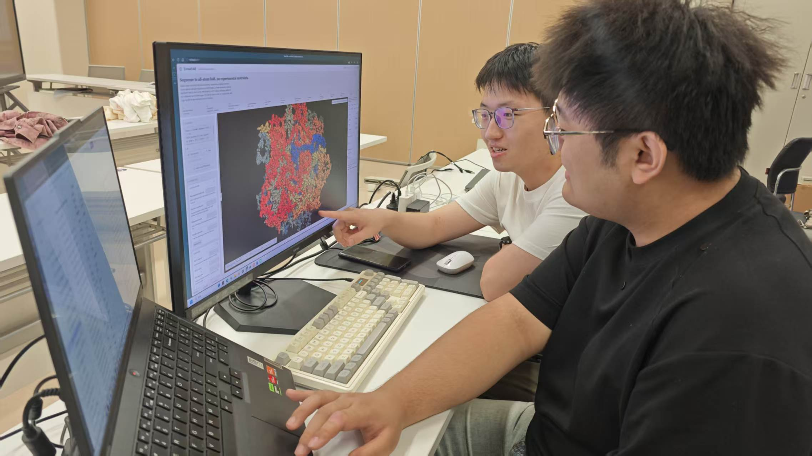

**FIG. 20** *Team members inspect the RNA model and review TorusFold’s result-viewing workflow.*

Participants needed a clearer connection between the model on screen, its computational stage, and the files used for further inspection. We improved **stage-aware model viewing and progress information**: the interface displays saved stage structures and identifies the stage being viewed, while progress and checkpoint controls help users follow the calculation. The corresponding changes include stage-model display and viewer, progress, and checkpoint improvements. A dedicated demo-view control also gives first-time users a direct entry to the project model.

<details class="implementation-snippet" id="implementation-10" markdown="1">
<summary>Implementation 10 · Keeping the viewer label tied to its stage</summary>

The viewer keys updates by stage file and modification time, keeping the displayed level and description tied to the selected computational stage.

```javascript
var key = stage.name + '|' + stage.mtime;
if (key === shownStructure) return;
shownStructure = key;

if (labelEl) {
  labelEl.hidden = false;
  if (levelEl) levelEl.textContent = 'Level ' + stage.level;
  if (descEl) descEl.textContent = stage.desc || stage.name;
}
```

*Source: `src/torusfold/web/app.js` · `52ecff7a` · lines 617–625.*

</details>

<details class="implementation-snippet" id="implementation-11" markdown="1">
<summary>Implementation 11 · Updating progress from the running job</summary>

Each server heartbeat refreshes the run state and maps the active level to its progress entry, keeping the interface aligned with the calculation.

```javascript
EventBus.on('sse:heartbeat', function (data) {
  applyRunState(data);
  if (data.current_level != null) updateProgress(levelNameAt(data.current_level), 'running');
});
```

*Source: `src/torusfold/web/app.js` · `94582d03` · lines 1286–1289.*

</details>

Follow-up testing focused on finding the final model, identifying the structures used for reconstruction–refinement comparison, and locating the circular junction. We aligned the result guidance with these tasks so users could move from model viewing to stage comparisons and diagnostic files.

### 6.3 Getting started as another team

The official iGEM GitLab repositories provide source code, installation instructions, example inputs, and test materials for [CircuForge](https://gitlab.igem.org/2026/software/jlu-fbh/circuforge) and [TorusFold](https://gitlab.igem.org/2026/software/jlu-fbh/torusfold-hybrid). The [Usage guide](#usage) illustrates the browser workflows, and [Installation and API](#installation) provides the execution paths and programmatic interfaces.

Teams can begin CircuForge with compatible expression data, a known protein, or reviewed peptides, then supply their own backbone for construct design. TorusFold’s [saved-model viewer](#software-torusfold-model) provides an immediate starting point for structure inspection; teams can then configure the prediction environment for their own mature RNA sequences.

Both tools can be used independently or connected through the mature RNA file. Keeping the construct ID, software version, parameters, and sequence hash with the outputs preserves the link between the reviewed design and the subsequent analysis. Standard-format exports, diagnostic files, and the [reference-case materials](#reference-case) support continued inspection, transfer, and adaptation by other researchers.

<a id="validation"></a>

## 7. Validation


We evaluated CircuForge against the experimentally tested Combined design and checked TorusFold through a crystal-started refinement comparison and verification of its delivered model. Together, these checks connect **experimentally informed selection, sequence-checked assembly, and inspectable computational outputs**.

<a id="project-selection"></a>

### 7.1 From candidate epitopes to the Combined design

Clinical and multi-omics evidence supported four antigen sources: TROP2, B7-H4, Nectin-4, and LIV-1. The project screened their candidate epitopes for HLA-A*02:01 using predicted BA IC50 below 500 nM and an IEDB immunogenicity score above zero. Researchers then reviewed peptide coordinates against UniProt signal-peptide and transmembrane annotations. A separate AlphaFold 3 structural assessment completed the shortlist for first-round coding.

| Stage | TROP2 | B7-H4 | Nectin-4 | LIV-1 | Total and unit |
|---|---:|---:|---:|---:|---|
| All overlapping nine-amino-acid windows | 315 | 274 | 502 | 747 | 1,838 candidate windows |
| Predicted BA IC50 below 500 nM | 17 | 13 | 15 | 38 | 83 candidate windows |
| IEDB immunogenicity score above zero | 9 | 10 | 10 | 22 | 51 candidate windows |
| Manual source-protein review | 4 | 2 | 6 | 5 | 17 candidate epitopes |
| Separate structural review | 4 | 2 | 4 | 5 | 15 retained epitopes |
| Overlapping pairs encoded as continuous segments | 3 | 2 | 3 | 5 | 13 first-round constructs |
| Modules selected for Combined | 2 | 2 | 2 | 2 | 8 coding segments, covering 9 predicted epitopes |

Structural review excluded `HILHVSFLA` and `FLAEASVRG` from first-round coding.

These structure-derived measurements document the project’s candidate-review decisions. Researchers performed the AlphaFold 3 analysis separately; the experimentally selected coding segments then provide the inputs for CircuForge’s assembly evaluation below.

<div class="validation-gallery" id="validation-structure-gallery" data-validation-gallery aria-label="Candidate structural review">
<div class="vg-controls">
<button type="button" data-gallery-prev aria-label="Previous figure">←</button>
<div class="vg-tabs" role="tablist" aria-label="Candidate structural review"><button type="button" role="tab" id="validation-structure-gallery-tab-0" aria-controls="validation-structure-gallery-slide-0" aria-selected="false" data-gallery-index="0">Terminal anchor</button><button type="button" role="tab" id="validation-structure-gallery-tab-1" aria-controls="validation-structure-gallery-slide-1" aria-selected="false" data-gallery-index="1">Position-by-position</button></div>
<span class="vg-count" data-gallery-count aria-live="polite"></span>
<button type="button" data-gallery-next aria-label="Next figure">→</button>
</div>
<figure id="validation-structure-gallery-slide-0" role="tabpanel" aria-labelledby="validation-structure-gallery-tab-0" data-gallery-slide>
<a href="图片和附件/figure-21-epitope-structural-review.png" target="_blank" rel="noopener">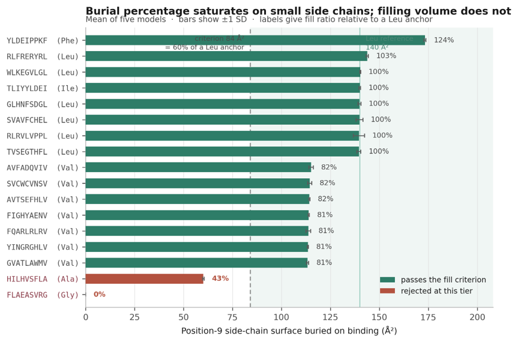</a>
<figcaption><strong>FIG. 21A</strong> <em>Position-9 side-chain burial in AlphaFold 3 models supported the 17-to-15 candidate selection.</em></figcaption>
</figure>
<figure id="validation-structure-gallery-slide-1" role="tabpanel" aria-labelledby="validation-structure-gallery-tab-1" data-gallery-slide>
<a href="图片和附件/figure-21b-epitope-position-burial.png" target="_blank" rel="noopener">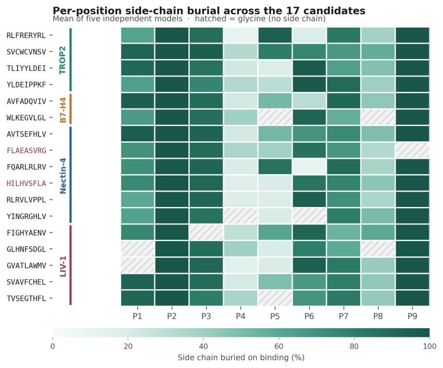</a>
<figcaption><strong>FIG. 21B</strong> <em>Per-position side-chain burial complements terminal-anchor review across the 17 candidate peptide models.</em></figcaption>
</figure>
</div>

Wet Lab then encoded two overlapping epitope pairs as continuous segments, **preserving all 15 retained epitopes in 13 constructs**.

| Coding segment | Original predicted epitopes | Shared residues | Encoded sequence | Length |
|---|---|---|---|---:|
| TROP2 CTL3 | `TLIYYLDEI` and `YLDEIPPKF` | `YLDEI` | `TLIYYLDEIPPKF` | 13 aa |
| Nectin4 CTL1 | `FQARLRLRV` and `RLRVLVPPL` | `RLRV` | `FQARLRLRVLVPPL` | 14 aa |

Within each antigen group, first-round IFN-γ ELISpot counts provided a within-run ranking for selecting two coding segments for Combined. The resulting eight-segment design includes the merged Nectin4 CTL1 sequence and therefore covers nine original predicted epitopes. Sequencing, protein-expression, and subsequent functional assays provided biological evidence for the Wet Lab Combined construct. CircuForge carried the selected coding design through the assembly, backbone-integration, and export checks described below.

[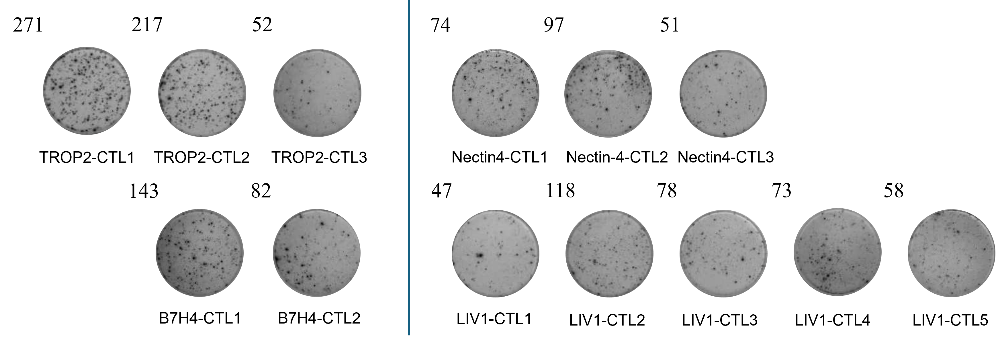](图片和附件/figure-22-first-round-elispot.png)

**FIG. 22** *First-round IFN-γ ELISpot counts guided selection of two coding segments per antigen for Combined.*

The [candidate-to-coding index](../../../../public/assets/docs/software/evidence/candidate-to-coding-index.csv) records source coordinates, peptide identities, sequence hashes, and the documented construct assignments. The [Combined reference fragments](../../../../public/assets/docs/software/evidence/combined-reference-fragments.csv) identify the eight selected segments and their order in the supplied reference. Scientific selection and experimental procedures are described on our [Model](https://2026.igem.wiki/jlu-fbh/model), [Engineering](https://2026.igem.wiki/jlu-fbh/engineering), [Experiments](https://2026.igem.wiki/jlu-fbh/experiments), and [Results](https://2026.igem.wiki/jlu-fbh/results) pages.

<a id="reference-case"></a>

### 7.2 Sequence-checked assembly and export of Combined

CircuForge turned the eight selected coding segments into **an assembled, sequence-checked construct in the supplied backbone**. Using the 5,267 bp Combined reference plasmid, the compiler joined the segments in their recorded order with seven GSGGS linkers, generated the coding DNA, and replaced the 336 bp antigen-cassette interval at bases 1606–1941 (one-based, inclusive). The checks confirmed the payload translation, linker arrangement, surrounding backbone, and exported design files.

| Check | Recorded result | What this establishes |
|---|---|---|
| Segment identity and order | All eight segment translations and their order match | The selected coding design is retained at protein level |
| Payload and linkers | 336 nt; 112 aa, including seven GSGGS linkers | Coding length and linker arrangement match the reference |
| Surrounding backbone | 4,931 bp outside the edited interval unchanged | The edit is confined to the designated cassette |
| Full fusion translation | Matches the reference; no internal stop reported | The recorded fusion coding frame is retained |
| DNA generation | 54 synonymous codon changes; 67 nucleotide differences | Recoding preserves the encoded protein |
| JSON, FASTA, GenBank, and SBOL3 readback | Eight recorded DNA-export checks passed | The tested sequence and identity fields survive export and readback |
| Native SnapGene file readback | DNA and 15 generated segment/linker features passed | The generated sequence and feature locations are retained in the file |
| Evidence archive | Eleven packaged files match their SHA-256 inventory | The downloadable evidence files retain their recorded identities |

The DNA reference-case records identify compiler `CIRCURE-CONSTRUCT-2.3.0`, exporter `CIRCURE-EXPORT-2.2.0`, and R 4.5.3. The local compiler call took 1.61 s. The resulting design preserves the selected protein sequence while generating a synonymous DNA realization; further codon-optimization options are discussed in [Future improvements](#future-improvements).

The downloadable [reference-case evidence](../../../../public/assets/docs/software/evidence/reference-case-evidence.zip) contains reference and generated sequences, comparison tables, and a standalone archived-file verifier. These materials let other teams inspect the edit and check the recorded sequence relationships directly.

#### Biological evidence for the reference design

The molecular and functional results below characterize the **Wet Lab Combined reference whose selected coding design CircuForge reconstructed**. BSJ sequencing identifies the circular RNA junction, and anti-FLAG immunoblotting detects protein expression. These assays establish the biological context of the reference design; the sequence comparison and export checks above measure the software’s reconstruction of that design.

<div class="validation-gallery" id="validation-molecular-gallery" data-validation-gallery aria-label="Combined reference molecular evidence">
<div class="vg-controls">
<button type="button" data-gallery-prev aria-label="Previous figure">←</button>
<div class="vg-tabs" role="tablist" aria-label="Combined reference molecular evidence"><button type="button" role="tab" id="validation-molecular-gallery-tab-0" aria-controls="validation-molecular-gallery-slide-0" aria-selected="false" data-gallery-index="0">BSJ sequence</button><button type="button" role="tab" id="validation-molecular-gallery-tab-1" aria-controls="validation-molecular-gallery-slide-1" aria-selected="false" data-gallery-index="1">Protein expression</button></div>
<span class="vg-count" data-gallery-count aria-live="polite"></span>
<button type="button" data-gallery-next aria-label="Next figure">→</button>
</div>
<figure id="validation-molecular-gallery-slide-0" role="tabpanel" aria-labelledby="validation-molecular-gallery-tab-0" data-gallery-slide>
<a href="图片和附件/figure-23a-combined-bsj.png" target="_blank" rel="noopener">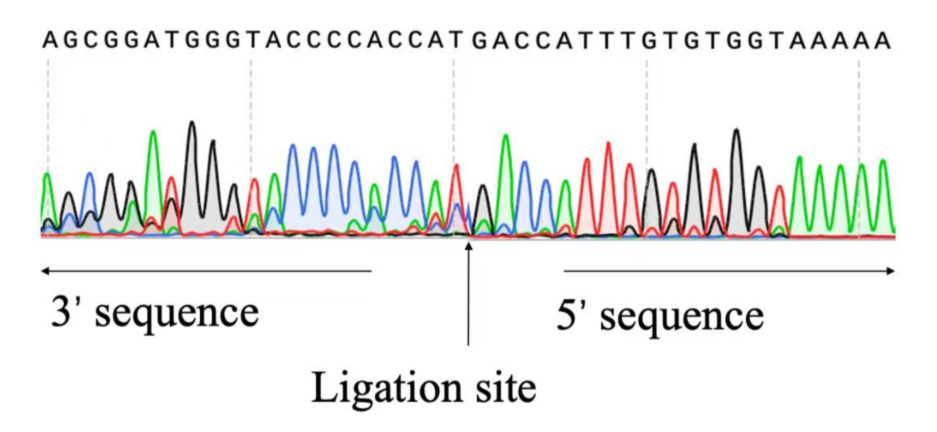</a>
<figcaption><strong>FIG. 23A</strong> <em>BSJ sequencing identifies the ligation junction in the experimentally tested Combined RNA.</em></figcaption>
</figure>
<figure id="validation-molecular-gallery-slide-1" role="tabpanel" aria-labelledby="validation-molecular-gallery-tab-1" data-gallery-slide>
<a href="图片和附件/figure-23b-combined-expression.png" target="_blank" rel="noopener">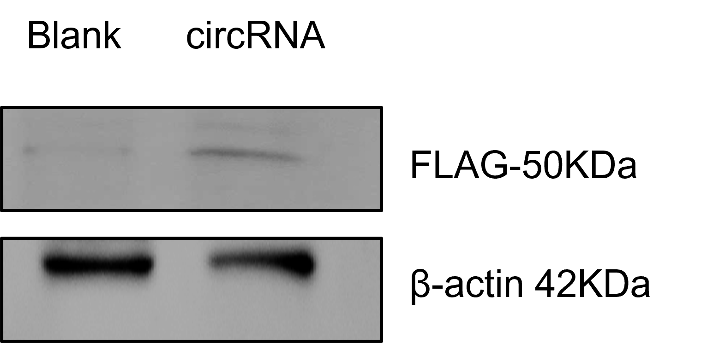</a>
<figcaption><strong>FIG. 23B</strong> <em>Anti-FLAG immunoblotting detects expression from the Wet Lab construct, with β-actin as the loading control.</em></figcaption>
</figure>
</div>

Second-round IFN-γ ELISpot and MDA-MB-231 killing assays connect the selected multi-segment reference design to immune and target-cell responses. The figures retain the Blank, single-segment, dual-segment, and Combined comparisons used to evaluate that experimental design.

<div class="validation-gallery" id="validation-functional-gallery" data-validation-gallery aria-label="Combined reference functional evidence">
<div class="vg-controls">
<button type="button" data-gallery-prev aria-label="Previous figure">←</button>
<div class="vg-tabs" role="tablist" aria-label="Combined reference functional evidence"><button type="button" role="tab" id="validation-functional-gallery-tab-0" aria-controls="validation-functional-gallery-slide-0" aria-selected="false" data-gallery-index="0">IFN-γ ELISpot</button><button type="button" role="tab" id="validation-functional-gallery-tab-1" aria-controls="validation-functional-gallery-slide-1" aria-selected="false" data-gallery-index="1">Target-cell killing</button></div>
<span class="vg-count" data-gallery-count aria-live="polite"></span>
<button type="button" data-gallery-next aria-label="Next figure">→</button>
</div>
<figure id="validation-functional-gallery-slide-0" role="tabpanel" aria-labelledby="validation-functional-gallery-tab-0" data-gallery-slide>
<a href="图片和附件/figure-24a-combined-elispot.png" target="_blank" rel="noopener">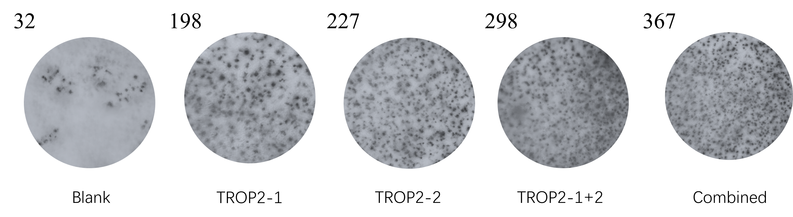</a>
<figcaption><strong>FIG. 24A</strong> <em>Second-round IFN-γ ELISpot compares Combined with Blank, single-segment, and dual-segment designs.</em></figcaption>
</figure>
<figure id="validation-functional-gallery-slide-1" role="tabpanel" aria-labelledby="validation-functional-gallery-tab-1" data-gallery-slide>
<a href="图片和附件/figure-24b-combined-target-killing.png" target="_blank" rel="noopener">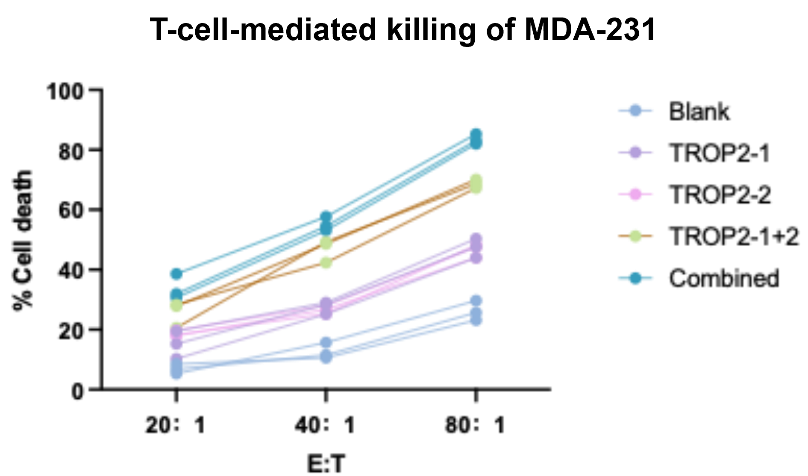</a>
<figcaption><strong>FIG. 24B</strong> <em>Vaccine-primed T-cell killing of MDA-MB-231 cells was measured across three effector-to-target ratios.</em></figcaption>
</figure>
</div>

### 7.3 Linking the reference construct to the RNA-model input

We compared reference plasmid bases 723–2735 with TorusFold’s saved 2,013 nt input. After removing whitespace, uppercasing, and converting T to U, the two sequences **matched exactly**, with zero position differences and no rotation or reversal. Both have the normalized RNA SHA-256:

```text
c7836a9fbef98d66e97d72286b6b788055679e06fe6c23bbd18c51f94ab73753
```

The [comparison record](../../../../public/assets/docs/software/evidence/handoff-sequence-comparison.json) and [reference-region FASTA](../../../../public/assets/docs/software/evidence/reference-mature-region.fasta) establish the sequence correspondence between the supplied reference plasmid region and the saved model input. This check identifies the RNA sequence represented by that model. Any recoded design must be linked to its own RNA sequence and model run.

<a id="torusfold-validation"></a>

### 7.4 TorusFold refinement and delivered-model verification

**Crystal-started refinement check.** We checked TorusFold’s refinement settings against the L1 ribozyme structure determined by X-ray crystallography, PDB 2OIU ([Robertson and Scott, 2007](https://doi.org/10.1126/science.1136231)). After refinement starting from the crystal coordinates, the repository reports an RMSD of **1.83 Å** relative to the experimental structure. This refinement preservation check provides a reference for calibrating the settings against a known starting structure.

**Inspectable model delivery.** The repository supplies the 2,013 nt input sequence, PDB coordinates, an interactive viewer, and provenance records for the saved PPR-repaired stage. Researchers can inspect the model, locate the circular junction, and relate the coordinates to the recorded sequence and computational stage.

We verified the delivered artifacts with NumPy 2.3.5. The original-LF sequence reproduced 20/32 checks; the Windows-CRLF sequence reproduced 19/32.

| Sequence-file representation | Checks reproduced | Failed assertions | Exit status |
|---|---:|---:|---:|
| Original LF bytes | 20/32 | 12 | 1 |
| Windows-converted CRLF bytes | 19/32 | 13 | 1 |

The extra CRLF failure is the file-byte hash; the normalized nucleotide sequence is unchanged. The twelve shared failures concern the recorded `intra_pc` statistic across twelve runs. The [verification log](../../../../public/assets/docs/software/evidence/torusfold-headline-LF.log) retains those failures and the additional coordinate diagnostics, while the [resource notes](../../../../public/assets/docs/software/evidence/torusfold-resource-notes.md) identify the saved measurements. Metric reconciliation and sequence-to-structure benchmarking are priorities in [Future improvements](#future-improvements).

### 7.5 Software checks and measured execution

The recorded evaluation yielded **32/32 passing CircuForge API tests** and **17/17 passing archived-file consistency checks**. The API suite exercised local API behavior in an isolated Python 3.13.7 environment using offline fixtures and test doubles. The archived-file check independently examined the supplied sequences, coding relationships, archive integrity, and reference-to-model input match. These are separate evaluations with their own recorded scopes.

| Evaluation | Recorded result | Evidence |
|---|---|---|
| CircuForge API behavior | 32 passed; 0 failed | [Verification summary](../../../../public/assets/docs/software/evidence/wiki-verification-summary.json) |
| Archived reference-file consistency | 17 passed; 0 failed | [File-check results](../../../../public/assets/docs/software/evidence/reference-file-verification.json) |
| TorusFold delivered-artifact verification | Original LF: 20 reproduced; 12 failed | [Full verification log](../../../../public/assets/docs/software/evidence/torusfold-headline-LF.log) |

| Task | Recorded measurement | Measurement scope |
|---|---|---|
| CircuForge reference-case compilation | 1.61 s; R 4.5.3 on the recorded Windows environment | One local compiler call; import, external prediction, Registry access, export, and browser interaction are outside this timing |
| TorusFold recorded CPU run | Approximately 7 h; approximately 30 GB peak RAM on AMD Ryzen AI MAX 395 | Repository-reported saved run with its recorded low-configuration settings |
| TorusFold recorded GPU path | Approximately 60 GB peak unified memory on the reference APU | Repository-reported hardware-specific resource measurement |

Run versions, environments, and check results are retained in the [verification summary](../../../../public/assets/docs/software/evidence/wiki-verification-summary.json) and [reference-case provenance](../../../../public/assets/docs/software/evidence/reference-case-provenance.json). Current-version end-to-end benchmarking is included in the improvement plan below.

<a id="installation"></a>

## 8. Installation and API

### 8.1 Choose the task first

| Task | What is needed | Starting point |
|---|---|---|
| Use CircuForge locally | Docker and Docker Compose, or the documented R/Python environments | Browser interface at port 3838; local API at port 8000 |
| Inspect the existing TorusFold model | A modern browser | Download and open the [self-contained viewer](../../../../public/assets/docs/software/torusfold-example-viewer.html) |
| Verify TorusFold artifacts | Python and NumPy | `python scripts/verify_headline.py`; known failures are documented in Validation |
| Compute a new TorusFold model | Python 3.11+, ViennaRNA, OpenMM, configured predictors and weights; path-specific compute resources | Local server or sequence runner |

### 8.2 CircuForge

Clone the [official repository](https://gitlab.igem.org/2026/software/jlu-fbh/circuforge). In its directory, start the services.

Windows PowerShell:

```powershell
git clone https://gitlab.igem.org/2026/software/jlu-fbh/circuforge.git
Set-Location circuforge
Copy-Item .env.example .env
docker compose up --build
```

macOS or Linux:

```bash
git clone https://gitlab.igem.org/2026/software/jlu-fbh/circuforge.git
cd circuforge
cp .env.example .env
docker compose up --build
```

Open [CircuForge](http://localhost:3838), the [API documentation](http://localhost:8000/docs) or the [OpenAPI specification](http://localhost:8000/openapi.json). Load the demo and follow the illustrated steps to check the interface. Service startup, remote prediction and construct approval are separate states. Docker startup was not independently exercised during this document revision.

CircuForge commits `renv.lock` and `api/requirements.lock`. Restore the matching environment for a source installation rather than mixing package versions from another run. The API lock pins its listed packages; it does not by itself freeze all transitive packages or container images.

### 8.3 TorusFold

The saved viewer needs no prediction installation. For a new run, follow the repository’s [deployment guide](https://gitlab.igem.org/2026/software/jlu-fbh/torusfold-hybrid/-/blob/b6c4171ee2a4d68ff69954eee90144542e5f0569/docs/DEPLOY_EXTERNAL.md) in a dedicated Python 3.11+ environment.

For the core package and secondary-structure extra, the following command applies the committed constraints to the packages it installs:

```bash
git clone https://gitlab.igem.org/2026/software/jlu-fbh/torusfold-hybrid.git
cd torusfold-hybrid
python -m pip install -c requirements.lock -e ".[ss]"
python -m pip check
```

This prepares only that dependency layer; it does not install every predictor, optional stage or model weight. The lock records NumPy 2.4.3, SciPy 1.17.1, OpenMM 8.5.2 and ViennaRNA 2.7.2, but its GPU entries are specific to the reference ROCm/APU environment. `pyproject.toml` still leaves NumPy and SciPy unversioned, so `pip install -e .` alone does not reproduce the locked environment. Portable CPU/GPU installation profiles remain an improvement item.

Configure the external paths and weights, then start the local interface:

```bash
python serve.py
```

Open [the local interface](http://127.0.0.1:8877), inspect tool availability and parameter settings, and then submit a sequence. For the committed sequence-running example:

```bash
python run_2013nt.py
```

The runner uses a local `sequence.txt` when supplied, otherwise the committed `artifacts/2013nt/sequence.txt`. Full-run configuration and resource costs differ from simply starting the web server. Successful submission or creation of an output file is not proof that all predictors or refinement stages completed. Very short debugging sequences can produce noncircular outputs; they are not reliable circular-model test cases.

<a id="integration-api"></a>

### 8.4 Integration and API

| Tool | Endpoint | Purpose |
|---|---|---|
| CircuForge | `POST /v1/constructs/compile` | Compile a peptide cassette, or a construct when the required backbone is supplied |
| CircuForge | `POST /v1/constructs/junction-windows` | Enumerate cross-boundary windows; this endpoint does not perform a remote binding prediction |
| CircuForge | `GET /openapi.json` | Retrieve request and response schemas |
| TorusFold | `GET /api/schema` | Inspect supported parameters and defaults |
| TorusFold | `POST /api/predict` | Submit a sequence to the configured prediction environment |
| TorusFold | `GET /api/status` | Inspect current progress and result/error state |

#### CircuForge: successful cassette request

This request uses two demonstration peptides; it is unrelated to the TNBC experimental shortlist. The endpoint chooses the linker for the adjacent MHC classes, as described in its schema.

```bash
curl -X POST http://localhost:8000/v1/constructs/compile \
  -H "Content-Type: application/json" \
  -d '{"project_id":"demo-project","construct_name":"TROP2_demo","epitopes":[{"id":"EPI-001","sequence_aa":"SLYNTVATL","mhc_class":"I"},{"id":"EPI-002","sequence_aa":"KLTQDLFL","mhc_class":"II"}],"linkers":{"mhci":"AAY","mhcii":"GPGPG"}}'
```

The no-backbone example returns HTTP 200 and `release_status: "CASSETTE_ONLY_BACKBONE_NOT_PROVIDED"`. Its `orf_aa` is `SLYNTVATLGPGPGKLTQDLFL`. This is a cassette response, not an approved complete plasmid. Supply the backbone fields described in OpenAPI to request construct compilation.

#### CircuForge: rejected input

```bash
curl -X POST http://localhost:8000/v1/constructs/compile \
  -H "Content-Type: application/json" \
  -d '{"project_id":"demo-project","construct_name":"invalid-demo","epitopes":[{"id":"bad","sequence_aa":"SLYNTVAX","mhc_class":"I"}]}'
```

The invalid amino-acid letter causes HTTP 422 with `error.code: "REQUEST_VALIDATION_FAILED"`. Save the full response rather than interpreting an absent construct as a completed design. The [API example files](../../../../public/assets/docs/software/evidence/api-examples.json) retain requests and observed response summaries for this revision.

#### TorusFold: inspect and submit

Inspect `/api/schema` before building a request. A configured `/api/predict` request takes a plain mature RNA string in `sequence` and returns a job ID with `status: "started"` when accepted. Poll `/api/status`; acceptance is not completion. An empty request returns HTTP 400 with `{"error":"No sequence provided"}`. This error path can be inspected without launching an expensive prediction.

The [server source](https://gitlab.igem.org/2026/software/jlu-fbh/torusfold-hybrid/-/blob/b6c4171ee2a4d68ff69954eee90144542e5f0569/serve.py) defines the exact behavior. In this revision, schema retrieval and idle-status retrieval returned HTTP 200, and the empty request returned HTTP 400 as described; [the check record](../../../../public/assets/docs/software/evidence/torusfold-api-checks.json) identifies the scope. No new prediction was submitted, and a short arbitrary sequence is not presented as a successfully validated circRNA model.

### 8.5 Network modes

CircuForge’s `CIRCURE_NETWORK_MODE` accepts `auto`, `online` or `offline`; the default is `auto`. Offline mode disables new IEDB and NCBI requests. Saved data and local compilation have different prerequisites from fresh remote results. Check Service status and retain the run’s request, model settings and returned output. A timeout, missing prediction or queued job is not a negative biological result.

<a id="future-improvements"></a>

## 9. Future improvements

Our next steps focus on helping researchers turn reviewed vaccine designs into experimental constructs and explore RNA structure with clearer guidance. Building on our project experience and internal user feedback, we plan to develop the following features.

**Optimize codons for the intended expression host.** We plan to let researchers choose their expression host and optimize the DNA encoding their selected peptide combination while keeping the amino-acid sequence unchanged. CircuForge would consider codon preferences, GC content, and restriction sites specified by the user. Researchers could compare the original and optimized sequences before choosing the DNA for their experiments.

**Review epitopes in their biological context.** We plan to show each peptide’s position on its source protein alongside signal-peptide and transmembrane regions. Researchers could inspect these regions while choosing epitopes and save the reason for each selection or exclusion. Saved screening conditions would also make it easier to repeat a defined selection procedure with another antigen or HLA background.

**Improve NCBI searches for human-protein similarity review.** We plan to improve how CircuForge submits NCBI BLASTP searches and retrieves their results, reducing repeated requests and making long waits easier to follow. Users would see whether a search has been submitted, is still running, or has finished, and could reopen saved matches without submitting the same search again. Clearer handling of interruptions and timeouts would help researchers continue reviewing peptide similarities to human proteins without restarting every step.

**Make RNA structures easier to assess.** We plan to give clearer explanations of fragment joins, close contacts between atoms, proposed base pairs, and changes during refinement. Measurements in the viewer and downloadable reports would use consistent definitions and be checked against the saved structures. We also plan to test predictions on RNAs with experimentally determined structures, allowing researchers to assess how closely the predicted models match those structures. This would extend the current check of how refinement preserves a known starting structure.

**Help more teams run and use the tools.** We plan to provide simpler installation options, more small examples, and a complete demonstration from input preparation to result interpretation. For TorusFold, measurements across RNA lengths and computers would help teams estimate the time and memory needed for their own sequences. Further testing with researchers who have limited bioinformatics experience will cover installation, construct design, viewing saved models, and running new predictions. Their feedback will help us improve the steps that most affect practical use.

<a id="open-source"></a>

## 10. Open source and reuse

CircuForge and TorusFold are released under **Apache License 2.0**, making their source code available for other teams to use, modify, and extend under the license terms. The official iGEM GitLab repositories provide the code, README, installation instructions, examples, and test materials needed to begin. Teams can use either tool independently or connect construct design with RNA modeling through the mature RNA sequence file.

| Tool | Source and documentation | License |
|---|---|---|
| CircuForge | [Repository and README](https://gitlab.igem.org/2026/software/jlu-fbh/circuforge) · [Setup and use](#installation) | [Apache-2.0](https://gitlab.igem.org/2026/software/jlu-fbh/circuforge/-/blob/main/LICENSE) |
| TorusFold | [Repository and README](https://gitlab.igem.org/2026/software/jlu-fbh/torusfold-hybrid) · [Setup and use](#installation) | [Apache-2.0](https://gitlab.igem.org/2026/software/jlu-fbh/torusfold-hybrid/-/blob/main/LICENSE) |

**Adapt the workflow to another biological project.** Researchers can begin CircuForge with the built-in example, then work with their own candidate proteins, reviewed peptides, and construct backbones. Teams extending the code can add another biological resource, change candidate-selection rules, or introduce another export format. The separate candidate-review, assembly, and export modules provide clear places to make those changes.

**Build on the RNA-modeling workflow.** TorusFold connects fragment predictions, full-length reconstruction, refinement, and result inspection through separate stages. Teams can configure supported predictors, examine intermediate structures, and modify the stages relevant to their research question. The [saved-model viewer](#software-torusfold-model) offers an immediate starting point for structure inspection; the [installation guide](#installation) describes the tools and computing setup for running new sequences.

<a id="external-models"></a>

### External tools, models and attribution

Our software connects established biological resources and prediction tools with the candidate-review and reconstruction methods developed by our team. The resources below support data retrieval, configurable RNA prediction, refinement, and visualization.

| Resource | Contribution to the workflow | Source and reuse information |
|---|---|---|
| **IEDB, UniProt and iGEM Registry** | Epitope predictions, source-protein annotations, and Part records | Follow each resource’s data and service terms; retain available source identifiers and search settings |
| [ViennaRNA](https://www.tbi.univie.ac.at/RNA/) | Proposes RNA base-pairing information | Reference environment: 2.7.2; distributed under its upstream terms |
| [OpenMM](https://openmm.org/) | Relaxes structures using physical restraints | Reference environment: 8.5.2; keep the computing platform and settings with each run |
| [RhoFold+](https://github.com/ml4bio/RhoFold) | Predicts structures for RNA fragments | Code and pretrained model files are obtained from the upstream project |
| [trRosettaRNA2](https://yanglab.qd.sdu.edu.cn/trRosettaRNA/download/) | Predicts structures for RNA fragments | Uses the corresponding upstream code, model files, and terms |
| [RNAbpFlow](https://github.com/Bhattacharya-Lab/RNAbpFlow) | Generates RNA structures using supplied conditions | Pretrained model files and their terms are provided by the upstream project |
| [PyRosetta](https://www.pyrosetta.org/) and other optional stages | Additional structural refinement | Optional installation under the applicable upstream license |
| [3Dmol.js](https://3dmol.org/) and [pako](https://github.com/nodeca/pako) | Displays saved RNA structures and decompresses viewer data | The viewer is accompanied by the [3Dmol](../../../../public/assets/docs/software/evidence/third-party/3Dmol-LICENSE.txt) and [pako](../../../../public/assets/docs/software/evidence/third-party/pako-LICENSE.txt) notices |

Third-party software, datasets, and pretrained model files retain their own licenses. TorusFold integrates upstream predictors with our reconstruction and refinement stages; predictor authorship and training-data sources are attributed to the corresponding upstream projects. The [resource notes](../../../../public/assets/docs/software/evidence/torusfold-resource-notes.md) provide the available source information for the delivered example. We plan to extend future run records with the exact predictor versions and pretrained model files used for each result.

CircuForge’s Registry client acknowledges the request-cooldown approach used by the [iGEM Munich 2025 Registry client](https://github.com/igem-munich/igem_registry_api). The [upstream license and copyright notice](../../../../public/assets/docs/software/evidence/third-party/igem-munich-registry-LICENSE.txt) accompany this acknowledgement.

We welcome other teams to test the examples, adapt the tools to their own projects, and share improvements through the repositories. Begin with the [Usage guide](#usage), keep the input sequence and software version with the results, and use the repository issue trackers to report problems or suggest features. The official project page is [2026.igem.wiki/jlu-fbh/software](https://2026.igem.wiki/jlu-fbh/software).

## References

**[1]** iGEM Foundation. iGEM Registry of Standard Biological Parts. n.d. Accessed 19 October 2026. [Official website](https://registry.igem.org/).

**[2]** Robertson MP, Scott WG. The structural basis of ribozyme-catalyzed RNA assembly. *Science*. 2007;315(5818):1549–1553. [doi:10.1126/science.1136231](https://doi.org/10.1126/science.1136231).

**[3]** IEDB. Immune Epitope Database. [Official website](https://www.iedb.org/).

**[4]** UniProt. [Official website](https://www.uniprot.org/).

**[5]** The UniProt Consortium. UniProt: the Universal Protein Knowledgebase in 2025. *Nucleic Acids Research*. 2025;53(D1):D609–D617. [doi:10.1093/nar/gkae1010](https://doi.org/10.1093/nar/gkae1010).

**[6]** Vita R, Mahajan S, Overton JA, et al. The Immune Epitope Database (IEDB): 2018 update. *Nucleic Acids Research*. 2019;47(D1):D339–D343. [doi:10.1093/nar/gky1006](https://doi.org/10.1093/nar/gky1006).

**[7]** ViennaRNA. [Official website](https://www.tbi.univie.ac.at/RNA/).

**[8]** Lorenz R, Bernhart SH, Höner zu Siederdissen C, et al. ViennaRNA Package 2.0. *Algorithms for Molecular Biology*. 2011;6:26. [doi:10.1186/1748-7188-6-26](https://doi.org/10.1186/1748-7188-6-26).

**[9]** RhoFold+. [Source code](https://github.com/ml4bio/RhoFold).

**[10]** trRosettaRNA2. [Official website](https://yanglab.qd.sdu.edu.cn/trRosettaRNA/download/).

**[11]** RNAbpFlow. [Source code](https://github.com/Bhattacharya-Lab/RNAbpFlow).

**[12]** Shen T, Hu Z, Sun S, et al. Accurate RNA 3D structure prediction using a language model-based deep learning approach. *Nature Methods*. 2024;21:2287–2298. [doi:10.1038/s41592-024-02487-0](https://doi.org/10.1038/s41592-024-02487-0).

**[13]** Wang W, Peng Z, Yang J. Predicting RNA 3D structure and conformers using a pre-trained secondary structure model and structure-aware attention. *Nature Machine Intelligence*. 2026;8:722–734. [doi:10.1038/s42256-026-01223-x](https://doi.org/10.1038/s42256-026-01223-x).

**[14]** Tarafder S, Bhattacharya D. RNAbpFlow: base pair-augmented SE(3) flow matching for conditional RNA 3D structure generation. *Nature Methods*. 2026;23(7):1349–1358. [doi:10.1038/s41592-026-03128-4](https://doi.org/10.1038/s41592-026-03128-4).

**[15]** Chen CK, Cheng R, Demeter J, et al. Structured elements drive extensive circular RNA translation. *Molecular Cell*. 2021;81(20):4300–4318.e13. [doi:10.1016/j.molcel.2021.07.042](https://doi.org/10.1016/j.molcel.2021.07.042).

**[16]** Ng CKY, Dazert E, Boldanova T, et al. Integrative proteogenomic characterization of hepatocellular carcinoma across etiologies and stages. *Nature Communications*. 2022;13:2436. [doi:10.1038/s41467-022-29960-8](https://doi.org/10.1038/s41467-022-29960-8).

**[17]** GTEx Consortium. The GTEx Consortium atlas of genetic regulatory effects across human tissues. *Science*. 2020;369(6509):1318–1330. [doi:10.1126/science.aaz1776](https://doi.org/10.1126/science.aaz1776).

**[18]** Sehnal D, Bittrich S, Deshpande M, et al. Mol* Viewer: modern web app for 3D visualization and analysis of large biomolecular structures. *Nucleic Acids Research*. 2021;49(W1):W431–W437. [doi:10.1093/nar/gkab314](https://doi.org/10.1093/nar/gkab314).

**[19]** Posit Software, PBC. Welcome to Shiny. *Shiny for R documentation*. Accessed 19 October 2026. [Official documentation](https://shiny.posit.co/r/getstarted/shiny-basics/lesson1/).

**[20]** Ritchie ME, Phipson B, Wu D, et al. limma powers differential expression analyses for RNA-sequencing and microarray studies. *Nucleic Acids Research*. 2015;43(7):e47. [doi:10.1093/nar/gkv007](https://doi.org/10.1093/nar/gkv007).

**[21]** Chen Y, Chen L, Lun ATL, Baldoni PL, Smyth GK. edgeR v4: powerful differential analysis of sequencing data with expanded functionality and improved support for small counts and larger datasets. *Nucleic Acids Research*. 2025;53(2):gkaf018. [doi:10.1093/nar/gkaf018](https://doi.org/10.1093/nar/gkaf018).

**[22]** Omnes L, Angel E, Tahi F. DivideFold+: an AI-based tool for RNA secondary structure prediction with subdomains identification and visualization and data augmentation. *Journal of Molecular Biology*. 2026;438(18):169865. [doi:10.1016/j.jmb.2026.169865](https://doi.org/10.1016/j.jmb.2026.169865).

**[23]** Calis JJA, Maybeno M, Greenbaum JA, et al. Properties of MHC Class I Presented Peptides That Enhance Immunogenicity. *PLoS Computational Biology*. 2013;9(10):e1003266. [doi:10.1371/journal.pcbi.1003266](https://doi.org/10.1371/journal.pcbi.1003266).

**[24]** Abramson J, Adler J, Dunger J, et al. Accurate structure prediction of biomolecular interactions with AlphaFold 3. *Nature*. 2024;630:493–500. [doi:10.1038/s41586-024-07487-w](https://doi.org/10.1038/s41586-024-07487-w).

**[25]** OpenMM. [Official website](https://openmm.org/).

**[26]** Eastman P, Galvelis R, Peláez RP, et al. OpenMM 8: Molecular Dynamics Simulation with Machine Learning Potentials. *The Journal of Physical Chemistry B*. 2024;128(1):109–116. [doi:10.1021/acs.jpcb.3c06662](https://doi.org/10.1021/acs.jpcb.3c06662).

**[27]** PyRosetta. [Official website](https://www.pyrosetta.org/).

**[28]** 3Dmol.js. [Official website](https://3dmol.org/).

**[29]** pako. [Source code](https://github.com/nodeca/pako).

**[30]** iGEM Munich. igem_registry_api: A high-level Python interface for the new iGEM Registry REST API (2025 Beta). 2025. GitHub repository. Accessed 19 October 2026. [Source code](https://github.com/igem-munich/igem_registry_api).
