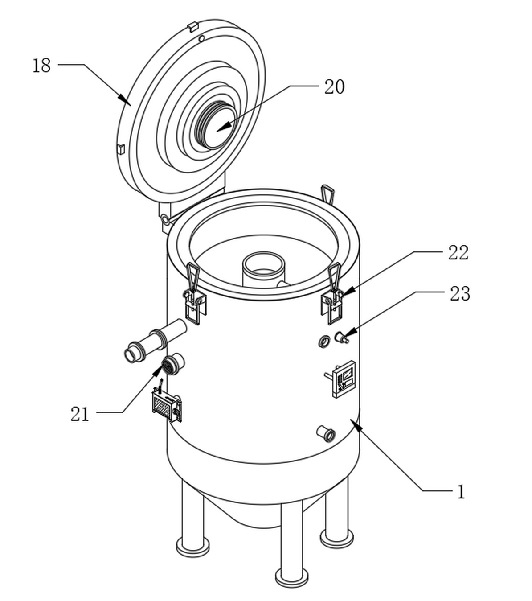
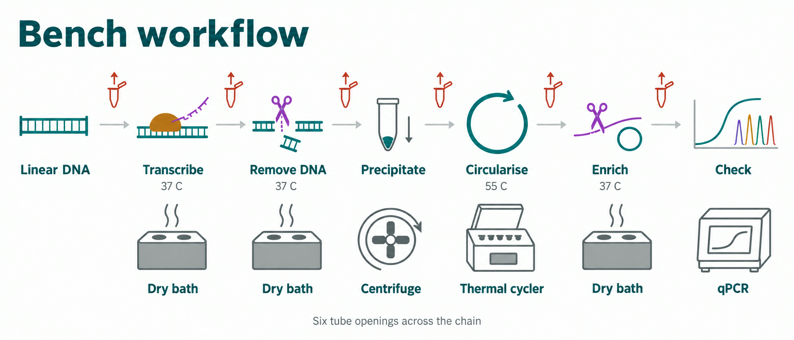
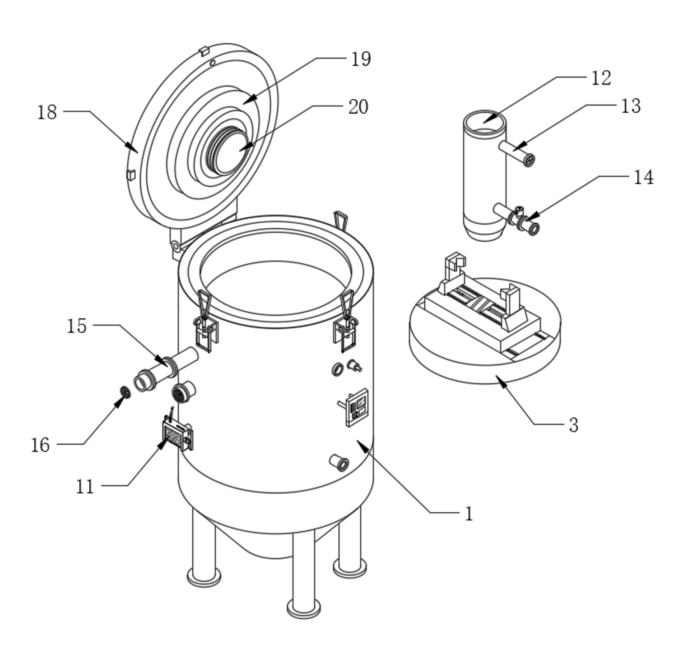
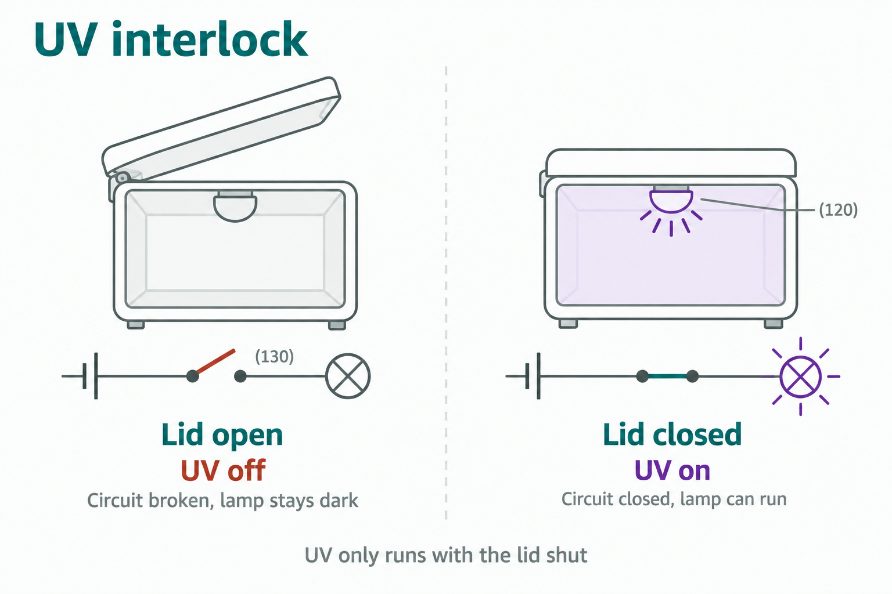
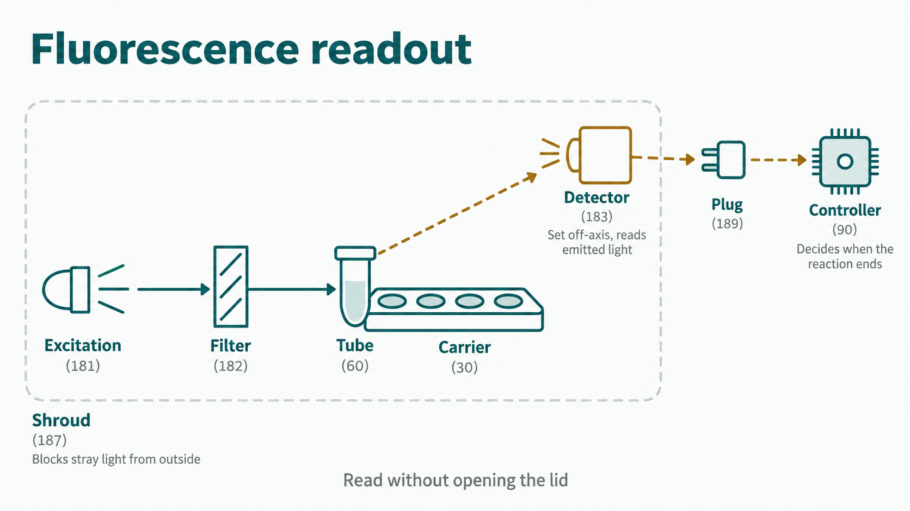
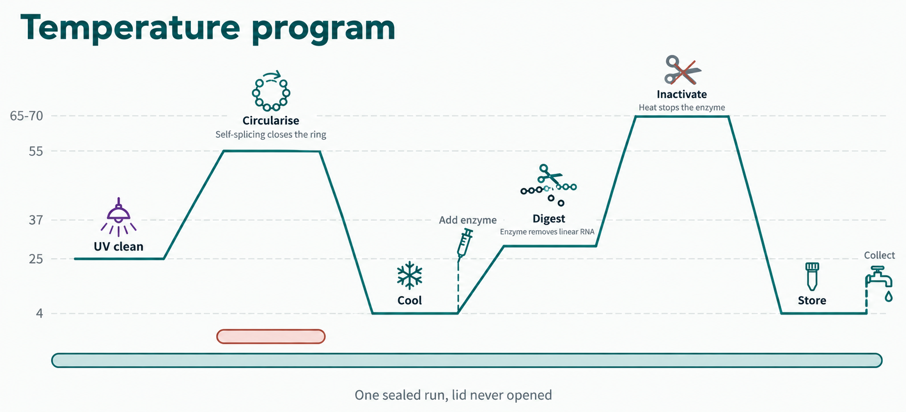

# Hardware

CirCore: an integrated reaction device for the circularisation step of circRNA vaccine manufacture\.

## 1\. Overview

### 1\.1 What CirCore is

CirCore is a reaction device built around one step of circRNA vaccine manufacture: closing a linear RNA precursor into a covalent circle, and the RNase R enrichment that follows it\[1\]\. Both are held in a single sealed chamber that controls temperature, mixes the sample and can be opened to it without breaking the seal, so the reaction does not have to be carried between instruments while it is running\.

Figure 1 \| First\-generation device, overall structure\.

### 1\.2 A note on component numbers

The two generations carry separate numbering schemes, taken from their own design documents\. Numbers 1 to 23 in Section 3 belong to the first generation; numbers 10 to 189 in Section 5 belong to the second\. A number in one section does not refer to the same part in the other\.

## 2\. The need

### 2\.1 What the circularisation step demands

Our pipeline circularises RNA by permuted intron and exon \(PIE\) self\-splicing using the T4 *td* group I intron, one of the established routes to covalently closed RNA in vitro\[2\]\. The reaction depends on GTP and Mg²⁺, and we run it at 55 °C for 10 to 15 minutes in 2 mM GTP and 10 mM MgCl₂ \(50 mM Tris\-HCl, pH 7\.5\)\. Three properties of that chemistry set the requirements for an instrument\.

How completely the precursor closes is governed by the temperature and ionic conditions it is held under\[3\]\. A departure from the intended temperature, or drift in Mg²⁺ concentration, costs yield\. Thermal uniformity across the liquid is therefore a determinant of the result\.

The product has to be enriched afterwards\. Self\-splicing leaves a mixture of circle and residual linear precursor, and RNase R digestion is the standard way to remove the linear fraction, although highly structured linear species can survive it\[4\]\. We digest with 2 U of RNase R per 2\.0 µg of RNA in 20 µL at 37 °C, then heat\-inactivate the enzyme\[5\]\. Every enrichment step lengthens the chain and costs material\.

At a few tens of microlitres held for tens of minutes at 55 °C, evaporation and condensation on the tube wall above the liquid change the effective concentration of the reaction, including the Mg²⁺ concentration the reaction is sensitive to\. This is the reason a thermal cycler heats its inner lid: heating it prevents condensation forming inside the vessel, and the lid also presses the vessel closed against evaporation\[6\]\. Evaporation control was in our requirement set from the start for the same reason\.

### 2\.2 What our own circularisation record asks for

Our circularisation chain runs from linearised plasmid through T7 in vitro transcription at 37 °C, DNase I template removal and LiCl precipitation, then circularisation at 55 °C, then RNase R enrichment, and finally RT\-qPCR with divergent and convergent primers, with back\-splice junction sequencing as direct confirmation of closure\. The protocol lists a thermal cycler, a dry bath and a water bath among its equipment: three incubations at three temperatures on three instruments, with the enrichment following immediately from the reaction it cleans up\.

Three properties of that record, rather than of the literature, set the specification\.

Characterisation does not scale with the batch\. Round 1 produced thirteen single\-epitope constructs\. Circularity was quantified on TROP2\-CTL1 as the representative of the batch, since the thirteen share one backbone and differ only in a short cassette of near\-identical length\. Measuring a preparation costs material and instrument time, and at one tube per run that cost is multiplied by the size of the batch\.

The reaction has no readout while it runs\. Our circular fractions, 96 to 97% for the Round 1 representative and 99\.3% for the Combined batch, were measured on RNase R purified material by off\-line RT\-qPCR\. During the incubation itself, nothing reports how far closure has gone, so the reaction runs to a clock and is assessed days later\.

Condition optimisation needs parallel positions\. Mg²⁺ concentration and reaction temperature both act on how completely the precursor closes, and RNase R amount and digestion time both act on the integrity of the product, since excess enzyme or over\-long digestion can degrade loosely structured circular RNA\[4\]\. Optimising any of these means running a gradient, and a gradient means parallel positions held under identical conditions with a readout to compare them by\.

Figure 2 \| The circularisation process chain, with instrument changes and open\-tube operations marked\.

Each transition in that chain means opening a tube, moving the sample and interrupting the thermal condition\. The count of open\-tube operations is the count of opportunities for RNase contamination of a material we handle carefully precisely because it is nuclease\-sensitive\.

### 2\.3 What existing equipment covers

The table below sets the instruments available to us against the requirement set of the circularisation step\. Entries come from the published specifications of these instrument classes\[6\]\[7\]\. A triangle marks a capability that is present on some models only, or present in part\.

|**Requirement**|**Dry bath**|**Thermal cycler**|**Thermomixer**|**CirCore Gen 1**|**CirCore Gen 2**|
|---|---|---|---|---|---|
|Precise temperature control|✓|✓|✓|✓|✓|
|Active cooling|✗|✓|△|✗|✓|
|Active mixing during incubation|✗|✗|✓|✓|✓|
|Evaporation suppression|✗|✓|△|✓|✓|
|Sealed addition and withdrawal|✗|✗|✗|✓|✓|
|Pressure equalisation with filtration|✗|✗|✗|✓|✓|
|In\-situ decontamination|✗|✗|✗|✓|✓|
|Multi\-diameter tube compatibility|△|✗|△|✓|✓|
|Batch throughput|✓|✓|✓|✗|✓|
|In\-process monitoring|✗|△|✗|✗|✓|

Table 1 \| Capability matrix\.

No single row here is beyond existing equipment\. The difficulty is that no single instrument covers the set, so the reaction runs as a relay, and the relay is what introduces the transfers, the thermal interruptions and the exposure events described above\.

### 2\.4 Prior art, and where it stops

We surveyed three categories before committing to a design: general\-purpose instruments on our own bench, commercial instruments that already integrate more than one of the functions we needed, and the patent literature\.

Among general\-purpose instruments, a dry bath holds temperature and does nothing else\. A thermal cycler holds temperature well, cools actively and carries a heated lid\[6\], but it is built around a closed block that cannot be agitated and cannot be opened to the sample mid\-run\. An orbital shaker mixes without controlling temperature closely\.

The closest existing answer is the thermomixer\. The class combines a temperature\-controlled block with controlled mixing of small volumes, and better models add an optional heated lid that prevents condensation on tube caps and a control range that reaches below ambient temperature\[7\]\. On the two requirements we started from, temperature and mixing, a thermomixer is a capable instrument and we make no claim to improve on it\. Its block is open to the room, so every addition and withdrawal means opening a tube\. It has no filtered pressure path, because it does not need one\. It offers no in\-situ decontamination, and no way of observing the reaction it runs\. Those four requirements arise only once the sample is required to stay in the chamber, and they are what CirCore addresses\.

In the patent literature we found one document with a similar title\. CN212942949U discloses a circularisation reaction device comprising a vapour\-phase evaporation tank, a vapour collection unit, an internal flow\-guiding assembly and a heat exchanger with a circulating liquid loop\[8\]\. Despite the shared term, it is directed at scaled production of glycolide and lactide\. Its architecture is a circulating bulk reactor optimised for material recovery, and it does not address microvolume nucleic\-acid reactions\. We record it because it is the nearest prior document by name, and because the distinction matters for the scope of our own claims\.

The survey left three deficiencies to design against: clamping arrangements that do not accommodate tubes of differing diameter and can loosen under agitation; low functional integration, which forces the chamber to be opened repeatedly during a run; and weak provision for in\-situ decontamination and operator safety in an enclosed, heated space\.

## 3\. First\-generation design

### 3\.1 System overview

The device is organised around a reaction chamber \(1\) containing a chamber base \(2\), closed by a lid \(18\) hinged at the top of the chamber and held down by quick\-release fasteners \(22\)\. Inside, a support carriage \(4\) slides on the base and carries the reaction tube \(12\)\. One motor drives the carriage in oscillation and a second drives the tube clamp\. Five functional groups follow\.

Figure 3 \| Exploded view of the first\-generation device\.

### 3\.2 Module A, self\-adaptive clamping

A push\-pull assembly \(5\) sits inside the support carriage: a rotating frame \(501\) driven by a motor \(17\), with connecting rods \(502\) at both ends\. It drives a clamp seat \(6\) carrying clamp blocks \(7\), each cut with a V\-groove\. Two guide blocks \(8\) on the underside of the clamp seat run in matching slots on the carriage to keep the motion square\.

The V\-groove is the design decision here\. One geometry seats tubes of different diameter on two contact lines rather than one face, so a single clamp covers the common tube sizes without interchangeable jaws, and the seating tightens as the clamp closes instead of slackening\.

### 3\.3 Module B, linear oscillation mixing

An eccentric wheel \(303\), driven by its own motor \(17\), acts through a connecting rod \(302\) on a link bar \(301\) that slides along the top of the chamber base, reciprocating the support carriage \(4\) on guide strips \(9\) that run in guide grooves in the base\. The tube therefore moves in a linear reciprocating path during incubation\.

We chose linear reciprocation over magnetic stirring because a stir bar in a microvolume reaction adds a surface, a cleaning burden and a contamination route\. We chose it over orbital shaking because the reciprocating mechanism shares a base with the clamping mechanism, which keeps the moving assembly compact\.

### 3\.4 Module C, thermal core

Heat is applied from two directions\. An electric heating and heat\-conducting plate \(10\) at the centre of the support carriage heats the tube from below, regulated by a thermoelectric temperature\-control element \(11\)\. On the inner face of the lid, a heating element \(19\) warms an elastic pressing hot lid \(20\) that bears on the top of the tube\.

The lower element holds the reaction at its setpoint\. The upper element keeps the headspace above the liquid warmer than the liquid, which suppresses wall condensation and the concentration drift that follows from it, on the principle a thermal cycler's heated lid works by\[6\]\. The elastic pressing lid also holds the tube seated against the heating plate\.

### 3\.5 Module D, sealed fluid path

The reaction tube \(12\) carries a sterile injection port \(13\) at the top and a drain port \(14\) at the bottom, so reagent can be added and product withdrawn without opening the chamber\. A sealed chamber whose contents are heated will otherwise build or lose pressure, so the chamber wall carries a vent channel \(15\) closed by a hydrophobic microporous filter membrane \(16\)\. The membrane passes gas to equalise pressure while blocking droplets and aerosol\. That pairing is what allows the chamber to be sealed and thermally cycled at the same time\.

### 3\.6 Module E, decontamination and safety interlock

A UV source \(23\) on the chamber irradiates the empty chamber before a run\. A lid\-closure detection switch on the inner wall of the lid \(18\) is wired in series with the UV supply circuit, so opening the lid removes power from the source\. We made this a hardware interlock rather than a software lockout so that operator protection does not depend on the controller behaving correctly\. Heat generated during a run leaves through a cooling duct \(21\) with a fan\.

Figure 4 \| UV interlock logic\.

### 3\.7 Operating sequence

From standby, the empty chamber is UV decontaminated\. The tube is loaded and clamped, the lid is closed and fastened, and the chamber ramps to setpoint and holds temperature with oscillation\. Sampling runs through the sealed ports\. The chamber then cools passively and the product is drained\.

This covers the circularisation incubation\. The RNase R enrichment that follows is outside its range, which is one of the four shortcomings the second generation answers \(click to see Chapter 5\)\.

## 4\. How the design was derived

### 4\.1 From requirement to architecture

We did not begin from a device concept\. We began from the requirement set in Section 2 and asked what would have to be true of an instrument that met it\.

Reaction consistency depends on temperature, on mixing and on evaporation control, so an instrument needs all three\. If the three are supplied by three instruments, the sample must move between them, and moving the sample interrupts the conditions those instruments are maintaining\. The benefit is spent on the transfers\. The three therefore have to be held in one chamber\.

Enclosing them raised requirements that did not exist before enclosure\. A sealed chamber under thermal load needs a pressure path, and an unfiltered pressure path is a contamination path, which gives the vent channel with a hydrophobic membrane\. A chamber that is not opened between steps needs a way to add reagent and remove product, which gives the septum port and the drain port\. A small enclosed volume handling nuclease\-sensitive material invites in\-situ decontamination, which gives the UV source, and a UV source inside an openable chamber is an exposure hazard, which gives the lid interlock\. Modules D and E both follow from the decision to integrate\.

### 4\.2 Design decisions and the alternatives considered

For mixing we considered magnetic stirring, orbital shaking and linear reciprocation, and chose linear reciprocation for the two reasons given in 3\.3\. For tube adaptation in the first generation we considered interchangeable jaws, a spring clamp and a single V\-groove, and chose the V\-groove because one geometry seats several diameters and tightens under load\. The second generation reverses this decision and moves diameter adaptation to a consumable bushing, for reasons given in 5\.2\.

For heating we considered a bottom plate alone against a bottom plate with a heated lid, and chose the latter because holding the headspace above the liquid temperature suppresses wall condensation\. For pressure we considered a fully rigid sealed chamber, an open vent and a filtered vent, and chose the filtered vent\. For UV safety we considered a software lockout against a hardware interlock, and chose the interlock\. For endpoint control in the second generation we considered a fixed timer against in\-process monitoring, and chose monitoring so that a finished reaction is not held at temperature\.

## 5\. Design iteration, the second generation

### 5\.1 What the first generation could not do

Working the process with the first\-generation design in hand exposed four shortcomings, three from use and the fourth following from the second\.

It holds one tube, which cannot support condition screening, replicates or batch preparation\. It heats without cooling, which confines it to a single incubation, since any subsequent step at a lower temperature requires the sample to leave the chamber\. It runs to a preset time, so whether the reaction has reached its endpoint at that moment is unknown to the device\. And it covers circularisation alone, leaving the enrichment outside the chamber\. The second generation answers all four, and Table 2 sets out the full comparison\.

### 5\.2 Carrier module and bushings

The single V\-groove clamp is replaced by a removable tube\-carrier module \(30\) presenting a 4, 8 or 16 position array of mounting holes \(31\)\. Diameter adaptation moves from the clamp geometry to a removable bushing \(32\) seated in a stepped bore \(31a\) and located by a flange \(321\)\. The bushing is split along its axis \(322\) so that it grips elastically, and carries an O\-ring groove \(323\) on its outer face\.

Tube compatibility is now a consumable choice rather than a mechanism, which also means a user can add a tube format by printing a bushing instead of modifying the device\.

### 5\.3 Thermoelectric stack and active cooling

The heating plate is replaced by a thermoelectric stack\. A heat\-conducting member \(51\) is in thermal contact with the chamber wall or the carrier module, a thermoelectric element \(52\) sits against it, and a heat\-sink assembly \(53\) with fins \(531\) and a fan \(532\) takes heat away\. Through\-bolts \(54\) with spring washers \(55\) clamp the three together and hold contact pressure across the interfaces as the stack expands and contracts, which is the part of the arrangement that keeps thermal contact stable over repeated cycling\.

The conducting member wraps the chamber wall instead of sitting under the tube alone, so heat reaches the liquid column along its full height\. A temperature sensor \(91\) thermally coupled to the conducting member or the carrier module closes the control loop to the controller \(90\)\.

Active cooling to 4 °C is what makes the rest of the second generation possible, because every step after circularisation runs below it\.

### 5\.4 In\-process monitoring and endpoint control

A removable fluorescence detection assembly \(180\) attaches to the machine base by a quick\-release fitting \(188\) and connects to the controller \(90\) through a plug \(189\)\. Its optical path runs from an excitation source \(181\) through a filter assembly \(182\) to the tube position, with a photodetector \(183\) collecting the emitted signal\. A shroud or labyrinth baffle \(187\) encloses the detection region to suppress ambient light\.

What matters is what the controller does with the signal\. The controller is designed to fit the accumulating signal over the course of the reaction and to trigger cooling once the fitted curve reaches 90% of its plateau value, rather than when a preset time expires\. For a product whose degradation is itself temperature and time dependent, that is the difference between holding a finished reaction at 55 °C and cooling it as soon as it is done\.

This threshold is a design setpoint\. Section 6 states what would have to be shown before the control decision rests on measurement\.

Figure 5 \| Optical path and electrical connections of the second generation\.

### 5\.5 The full sequence inside one chamber

With active cooling and a septum port both present, the chamber can hold the enrichment as well as the reaction\. The intended sequence runs as follows\.

The empty chamber is UV decontaminated and the membrane seating is checked\. Tubes are loaded into the carrier module, the lid is closed and tightened circumferentially so that the annular seal \(24\) is compressed\. Circularisation is held at 55 °C, with fluorescence monitoring enabled or not\. The chamber cools to 4 °C\. RNase R is injected by needle through the self\-resealing elastic septum \(611\) without breaking the seal\. Digestion runs at 37 °C with oscillation, followed by enzyme inactivation at 65 to 70 °C and a return to 4 °C\. The product leaves through the bottom drain valve \(632\)\.

The chamber is not opened at any point between loading and withdrawal, so across the stretch of the process chain in Figure 2 that the device covers, the count of exposure events falls to the loading step alone\. The temperatures and durations here are the standard conditions for these reactions as run in our own protocol\[5\], used as design setpoints\.

Figure 6 \| Second\-generation temperature programme and process coverage\.

### 5\.6 Two configurations from one platform

Because the fluorescence assembly attaches through a quick\-release fitting, it defines two configurations of the same machine\. With the assembly fitted, the device records signal during the run, for condition screening and process characterisation\. With it omitted, the base retains the mounting provision and the device runs as a sealed, temperature\-controlled, mixed reactor\.

A development run wants observability; a production run wants a fixed, maintainable configuration with fewer parts to qualify\. Fitting or omitting one module meets both without building two machines\.

### 5\.7 What this iteration drew on

|Both generations are designs\. The second generation exists as a written specification, and no physical build of either generation has been made, so we call this a design iteration rather than a design\-build\-test\-learn cycle\.|
|---|

The iteration drew on four things\. We wrote out the first\-generation patent claims component by component, which exposed interfaces left undefined in the concept drawings\. We checked the design against the requirement set in Section 2 item by item\. And we walked the process chain through the device on paper, which is where the throughput and process\-closure shortcomings became visible\.

### 5\.8 Generation comparison

|**Dimension**|**Gen 1, patent filed**|**Gen 2, specification**|**Reason for the change**|
|---|---|---|---|
|Tube holding|V\-groove clamp, single tube|Removable carrier module, 4, 8 or 16 position array with split elastic bushings|Single\-tube operation cannot support condition screening, replicates or batch preparation|
|Temperature control|Electric heating plate, heating only|Preloaded thermoelectric stack, active cooling to 4 °C|Without cooling, any lower\-temperature step requires the sample to leave the chamber|
|Heat path|Bottom plate plus heated lid|Conducting member wrapping the chamber wall, plus heated lid|Heating the liquid column along its full height rather than from below|
|Process monitoring|None|Removable fluorescence assembly with shrouded optical path|The device could not tell whether the reaction had reached its endpoint|
|Control logic|Open loop, preset duration|Closed loop, cooling triggered at 90% of the fitted plateau \(design setpoint\)|Stopping on the endpoint rather than the clock limits thermal exposure of the product|
|Process coverage|Circularisation only|Circularisation, cooling, RNase R digestion, inactivation, withdrawal|Enrichment outside the chamber reintroduces the transfers the device exists to remove|
|Configurations|Single|Development with fluorescence fitted, production without|Development and production runs have different priorities|
|Chamber openings per run|Loading, plus transfer to the next instrument|Loading only|Each opening is an opportunity for RNase contamination|

Table 2 \| First generation against second generation, and the reason for each change\.

## 6\. Limitations and next steps

### 6\.1 What the designs do not yet establish

Both generations are designs, so every performance property of the device remains a design intent\.

Specifically open: thermal uniformity along the tube and across the carrier array; the mixing efficiency of the oscillation mechanism at microvolume; the sealing reliability of the chamber and of the septum across repeated punctures and thermal cycles; the sensitivity and dynamic range of the fluorescence assembly; and the thermal and UV compatibility of candidate materials over a service life\.

The fluorescence assembly carries the most weight in the second\-generation design and the least supporting evidence\. Whether a plateau in an in\-tube fluorescence trace tracks reaction completion, at this scale and in this geometry, is an empirical question, and until it is answered the closed\-loop endpoint control in 5\.4 is a design intent\.

### 6\.2 Next steps

The order we would follow is to complete the second\-generation drawings, then build a single\-module functional prototype of the carrier and oscillation mechanism, which is the cheapest way to test the assumptions behind the design\. Then the thermoelectric stack, then the fluorescence assembly, tested against RNase R digested and undigested controls before it drives anything, then integration, and finally a run against a real circularisation reaction with off\-line RT\-qPCR as the reference\. The measurement that would close the gap in 2\.2 is a comparison of the device's in\-process trace against the RT\-qPCR circular fraction on the same preparation\.

### 6\.3 A downstream interface rather than a bigger machine

A circRNA vaccine does not end at purified RNA; it ends at a formulated particle\. The obvious next unit operation is lipid nanoparticle encapsulation, and the obvious question is whether it belongs in this chamber\.

Our view is that it does not\. LNP formation depends on rapid microfluidic mixing, with an ethanolic lipid phase and an aqueous RNA phase brought together in a channel on a millisecond timescale, where particle size distribution is set by the flow ratio and the mixing geometry\[9\]\. That is a continuous\-flow operation at a scale several orders of magnitude below a macroscopic batch chamber under oscillation\. The two do not share a working volume, and putting them in one housing would give two devices in one housing\.

The bottom drain valve of the second generation is therefore intended as a standard downstream interface\. A microfluidic LNP module could be coupled to it to form a continuous circularisation\-to\-formulation workflow, with each unit operation kept at the scale it works at\.

## References

1. Gong Z, Hu W, Zhou C, Guo J, Yang L, Wang B\. Recent advances and perspectives on the development of circular RNA cancer vaccines\. *npj Vaccines\.* 2025;10:41\. doi:10\.1038/s41541\-025\-01097\-x

2. Petkovic S, Müller S\. RNA circularization strategies in vivo and in vitro\. *Nucleic Acids Res\.* 2015;43\(4\):2454\-2465\. PMID: 25662225\. doi:10\.1093/nar/gkv045

3. Wesselhoeft RA, Kowalski PS, Anderson DG\. Engineering circular RNA for potent and stable translation in eukaryotic cells\. *Nat Commun\.* 2018;9:2629\. PMID: 29980667\. [https://pubmed\.ncbi\.nlm\.nih\.gov/29980667/](https://pubmed.ncbi.nlm.nih.gov/29980667/)

4. Xiao MS, Wilusz JE\. An improved method for circular RNA purification using RNase R that efficiently removes linear RNAs containing G\-quadruplexes or structured 3′ ends\. *Nucleic Acids Res\.* 2019;47:8755\-8769\. PMID: 31269210\. [https://academic\.oup\.com/nar/article/47/16/8755/5527976](https://academic.oup.com/nar/article/47/16/8755/5527976)

5. LGC Biosearch Technologies \(Epicentre/Lucigen\)\. *Ribonuclease R \(RNase R\) Manual* \(NRR07250\)\. [https://biosearchtech\.a\.bigcontent\.io/v1/static/manual\_RNR07250\_RNase\-R](https://biosearchtech.a.bigcontent.io/v1/static/manual_RNR07250_RNase-R)

6. Bio\-Rad Laboratories\. *T100™ Thermal Cycler Instrument Guide* \(Catalog \#1861096\)\. [https://www\.bio\-rad\.com/sites/default/files/2021\-08/10000145577\.pdf](https://www.bio-rad.com/sites/default/files/2021-08/10000145577.pdf)

7. Eppendorf\. *Eppendorf ThermoMixer® C: Features, Options, Applications*, White Paper No\. 11\. [https://www\.eppendorf\.com/product\-media/doc/en/47808/Sample\-Preparation\_White\-Paper\_011\_ThermoMixer\-C\_Eppendorf\-ThermoMixerTM\-C\-Features\_Options\_Applications\.pdf](https://www.eppendorf.com/product-media/doc/en/47808/Sample-Preparation_White-Paper_011_ThermoMixer-C_Eppendorf-ThermoMixerTM-C-Features_Options_Applications.pdf)

8. CN212942949U\. A circularisation reaction device \(utility model, People's Republic of China\)\.

9. Hou X, Zaks T, Langer R, Dong Y\. Lipid nanoparticles for mRNA delivery\. *Nat Rev Mater\.* 2021;6\(12\):1078\-1094\. PMID: 34394960\.

