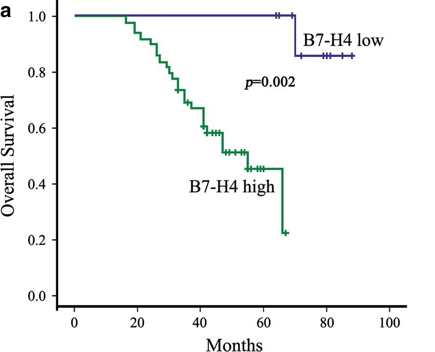

# 5.1 Model

# Judging

For your convenience, we have summarised how we have addressed the iGEM model criteria in the following section.

### How impressive is the modeling?

Our modeling work spans **three complementary computational frameworks** that together form an **integrated decision-support system** for rational vaccine design, dosing optimization, and sustainability assessment.

**Cell2dose** represents an exceptionally ambitious **multi-scale integration** connecting cell-based assays to animal dosing recommendations. This mechanistic model comprises **seven integrated modules** spanning molecular scale (LNP delivery, RNA stability), cellular scale (DC maturation, T-cell activation), tissue scale (lymph node dynamics), and organism scale (35-day tumor growth kinetics). The model uses **Bayesian calibration by finite-grid integration and posterior resampling**, **14-state ordinary differential equations**, and **Latin Hypercube Sampling** across 1,024 parameter draws to propagate uncertainty through **301 dose scenarios** (see Cell2dose methodology). This is not a simple curve fit—it is a complete mechanistic chain that makes the connection between in vitro measurements and in vivo outcomes computationally explicit.

**AEIP (Antigen-Epitope Integration Pipeline)** tackles the dual challenge of **antigen selection and epitope refinement** through systematic integration of **four orthogonal data sources**. We processed **quantitative proteomics from 154 TNBC patients** across two independent cohorts, **single-cell transcriptomics from 39,324 quality-controlled cells**, **genomic profiling of 115 TCGA cases**, and **AlphaFold3 structural modeling of 85 peptide-MHC complexes** (see AEIP data integration). The pipeline filtered **1,838 candidate epitopes to 15 HLA-A\*02:01-restricted sequences** through NetMHCpan binding prediction, IEDB immunogenicity scoring, and explicit structural validation of hydrogen-bond networks and F-pocket engagement—going beyond confidence scores to verify **actual binding geometry**.

**SDG contribution assessment framework** quantifies CirCure's contributions across **all 17 Sustainable Development Goals** through a **four-dimensional evidence scoring system** (Action, Implementation, Feedback, Record) combined with network propagation analysis. The framework uses scoring formula **D = 3G(0.10A + 0.30I + 0.10F + 0.50R)**—the **50% weight on documentation** reflects our emphasis on verifiable evidence rather than aspirational claims (see SDG network analysis). Direct contribution indices reach **2.550 for SDG 4 and SDG 9** (tied highest), with total indices reaching **3.819 for SDG 4** when indirect network effects through **272 documented goal interactions** are included. Critically, **gate scenario analysis** demonstrates that manufacturing pathway choices determine outcomes: SDG 14/15 show **negative indices (−0.063, −0.086)** under current assumptions but **flip to +0.77** under renewable energy pathways.

Together, these three models establish CirCure as a project grounded in **computational rigor**: **Cell2dose tells us how much to dose, AEIP tells us what to deliver, and the SDG framework tells us how to scale sustainably** with honest acknowledgment of trade-offs.

### Did the model help the team understand a part, device, or system?

Yes—our models transformed abstract data into **actionable design decisions** at multiple levels.

**Dose selection guidance:** Before Cell2dose, we had cell viability curves but no systematic way to choose an animal dose. The complete **301-dose scan** revealed that **10.2 μg per injection** has the highest joint-pass fraction (0.8145), with a candidate range of **9.4–12.6 μg**. More importantly, **sensitivity analysis** identified which parameters matter most: **effector-to-killing transfer (γ_ET)**, **dose normalization (q_scale)**, and **lymph routing (f_lymph)** account for **94% of prediction uncertainty** (see dose optimization and sensitivity analysis). This told us that refining our already-calibrated cell assays wouldn't help much—we need **time-resolved in vivo measurements** of lymph payload, antigen expression, and effector markers. The model didn't just give us a number; it told us **what experiments to do next**.

**Antigen selection rationale:** AEIP's **four-dimensional scoring framework** resolved conflicting literature guidance by ranking 40+ candidate antigens across localization, tumor specificity, prognostic significance, and therapeutic validation. This identified **TROP2, B7-H4, Nectin-4, and LIV-1** as top candidates. TCGA genomic profiling then showed this **four-antigen panel achieves 88% patient coverage** when requiring at least one gene with mRNA z-score ≥0.5 or high-level amplification—a coverage estimate we could not have obtained without computational integration. Critically, **cross-modal validation** through proteomics confirmed that all four antigens show **tumor-enriched protein abundance** (fold changes **1.14–18.25**, all **FDR < 0.05**), giving our wet lab team confidence that selected antigens would be physically present at immunogenic levels.

**Epitope structural validation:** IEDB binding predictions filtered 1,838 candidates to 51, but sequence-based scores cannot guarantee stable MHC presentation. **AlphaFold3 structural validation** revealed that **two high-confidence peptides** (mean ipTM 0.968 and 0.960) **failed the F-pocket fill criterion** despite strong confidence scores. This taught us that **confidence metrics alone are insufficient**; explicit structural geometry must be validated. **It is actually the 15 epitopes that passed AEIP's structural filters upon which our entire circRNA vaccine construct was built**, with geometric evidence supporting stable, TCR-compatible pMHC complexes that ultimately achieved successful tumor inhibition in our in vivo experiments (see epitope screening and structural validation).

**Sustainability strategy clarity:** The SDG framework identified **unexpected co-benefits** in **SDG 1 (No Poverty)** and **SDG 8 (Decent Work)** through health→poverty and innovation→employment pathways (indirect indices **0.222 and 0.467**). We returned to patient interviews and found explicit quotes confirming **treatment costs create financial barriers**—validating the model's mechanism. Most critically, **gate scenario analysis** revealed that manufacturing choices determine ecological impact: under fossil-intensive synthesis, **SDG 14/15** shows **negative indices**; Under renewable pathways, these **flip to +0.77**—providing a quantitative basis for prioritizing **renewable energy during scale-up**.

### Did the team use measurements of a part, device, or system to develop the model?

Yes—every model is anchored in **experimental measurements from multiple orthogonal sources**.

**Cell2dose calibration:** We used **CCK8 viability assays** (5 doses × 4 replicates = **20 observations**) and **cytotoxicity killing assays** (blank and combined groups with 3 replicates each) to calibrate dose-response curves via **Bayesian inference**. **DC activation** (CD80⁺CD86⁺ fold-gain ≈ **2.16**) and **T-cell activation** (CD69⁺ fold-gain ≈ **2.76**) readouts from our wet lab experiments directly parameterized **immune amplification modules**. For parameters unavailable from our experiments, we used **literature-sourced values with explicit provenance** Benzekry et al. (2014) for growth kinetics and flagged these as **transfer assumptions requiring validation**. Animal tumor measurements (**PBS mean 234 mm³, vaccine mean 24.2 mm³**) were **withheld from calibration** and used to test frozen predictions—revealing a **4.7× growth parameter mismatch** that we honestly report in our discussion, prioritizing **transparency over false validation** (see experimental calibration and validation).

**AEIP multi-omics integration:** We processed **two independent proteomic cohorts** (PXD024322: **88 tumors vs 38 normals** across 38 TMT batches; PXD028102: **66 patient-matched pairs**) yielding **tumor-enriched fold changes** for all four candidate antigens. **Single-cell RNA-seq** (GSE176078: **39,324 cells from 10 TNBC patients**) measured detection rates in malignant vs non-malignant compartments, showing that **81.4% of malignant cells** express at least one of our four genes. **TCGA genomic data** (115 cases) quantified individual gene reach (4%–79%) and **panel reach (88%)**. **NetMHCpan binding predictions** are trained on **>850,000 experimental peptide-MHC measurements** from IEDB. **AlphaFold3 structural coordinates** provided measurable geometric features—**hydrogen-bond distances, solvent-accessible surface areas, F-pocket fill ratios**—enabling rejection of two candidates based on **explicit structural defects** rather than subjective assessment.

**SDG framework evidence grounding:** The interaction matrix builds on **systematic reviews** synthesizing SDG relationship data across countries and time periods. For CirCure-specific scoring, the **four dimensions (A, I, F, R)** were evaluated using documented evidence: **Implementation (I)** used experimental measurements (DC maturation, T-cell activation, tumor inhibition), **Record (R)** reflected documentation completeness (raw data accessions, frozen parameters, explicit provenance), **Feedback (F)** required traceable stakeholder input (patient interviews, industry partnerships, NGO consultations), and **Action (A)** evaluated mechanism-target correspondence. All scoring followed a **five-tier scale (0, 0.25, 0.50, 0.75, 1.00)** with explicit criteria. We conducted independent parameter audits, sensitivity analysis, and validation against published studies (**78–81% directional agreement** with the literature). All scoring worksheets are version-controlled with cryptographic hashes.

### Does the modeling approach provide a good example for others?

Yes—our modeling frameworks are designed for **modularity, transparency, and extensibility**, making them **strong templates** for future iGEM teams.

**Reusable architecture:** Cell2dose's **seven-module structure** is **generalizable beyond mRNA vaccines**—teams can swap modules for DNA expression, CAR-T expansion, or bacterial clearance **without rebuilding the entire chain**. AEIP's **four-stage pipeline** is **disease-agnostic**—applicable to melanoma, glioblastoma, or hepatocellular carcinoma by substituting datasets and HLA alleles. The SDG framework's **four-dimensional scoring guide** enables any team to quantify sustainability contributions using the documented interaction matrix **without rebuilding goal relationships**.

**Honest uncertainty quantification:** Most models hide uncertainty; we make it **central**. Cell2dose's **1,024 parameter draws** produce **six-order-of-magnitude prediction intervals**—wide ranges are a **feature, not a bug**. AEIP honestly acknowledges that **two peptides failed structural validation** despite high confidence scores, teaching teams that **confidence metrics alone are insufficient**. The SDG framework clarifies that indices measure **"evidence completeness × network leverage"** under stated scenarios, not absolute benefits—making claims **honest rather than overselling**.

**Exemplary documentation:** We provide **complete codebases with verification scripts**, **frozen predictions with cryptographic hashes**, **parameter registries** linking every value to its source, **public dataset accessions** (PXD024322, PXD028102, GSE176078, TCGA-BRCA), **explicit software versions** (Seurat, limma, NetMHCpan 4.1), and **numerical thresholds for every filtering step**. For the SDG framework, we provide frozen input files, audit logs, sensitivity matrices, and explicit tier criteria. Pedagogical figures show **information flow**, **multi-panel trade-offs**, **parameter importance**, and **honest mismatch reporting**. This transparency allows teams to **reproduce our analysis, critically evaluate our choices, or adapt our methods** to their own systems.

**Integration with experimental design:** Our models **guide future experiments**. Cell2dose's **sensitivity analysis** identifies **high-information measurements** that would **reduce uncertainty 3–5×** more than additional cell assays. AEIP's **structural validation workflow** provides **allele-independent geometric criteria** applicable to any peptide-MHC complex. The SDG framework's **gate scenario analysis** revealed which choices flip outcomes (SDG 14/15 from **−0.09 to +0.77** under renewable pathways), enabling **evidence-based sustainability decisions** during scale-up.

**Community impact:** Together, our three models demonstrate that computational work in iGEM can be both **rigorous and practical**—**mechanistic depth with uncertainty quantification**, **multi-omics integration with honest limitations**, and **sustainability assessment with transparent scoring**. Future teams can use **Cell2dose** for dose optimization, **AEIP** for rational vaccine design, and the **SDG framework** for quantifying cascading impacts across sustainable development goals.

# Overview

We built three models: **AEIP** for antigen and epitope selection, **Cell2Dose** for dose prediction, and **SST-QN** to evaluate sustainability. The first two guide experimental design. The third evaluates how SDGs interact in a general context, then assesses how CirCure might shift those interactions.

**AEIP (Antigen–Epitope Integration Pipeline)** combines proteomics, single-cell RNA sequencing, genomic profiling, and structural modeling to pick vaccine targets. We started with the TNBC proteome, selected four antigens, and screened **1,838** candidate peptides down to **15** epitopes restricted to **HLA-A\*02:01**. The pipeline confirmed that these antigens appear as proteins in TNBC tissue, concentrate in malignant cells rather than stroma, **cover 88% of patients** when used together, and form stable complexes with MHC molecules. That gives the wet lab a defined set to test instead of the full proteome.

**Cell2Dose (A Cell-Informed Mechanistic Model for Tumor Vaccine Dose Exploration)** bridges in vitro readouts to **in vivo** tumor dynamics through three computational layers: calibrating immune kinetics from cell assays, simulating the vaccine mechanism from injection to tumor killing, and quantifying uncertainty across parameters to **rank dose candidates**. That helps the team **decide** which doses are **worth testing in animals** before the experiment begins and diagnose which process step limits efficacy if a dose fails, reducing the number of animals needed and **aligning dose selection** with animal welfare principles.

**SST-QN (SDG Synergy–Trade-off Quantification Network)** maps **how the 17 SDGs interact without project influence**, classifying relationships and scoring synergies and trade-offs across the system. We then applied **CirCure's** actions at each stage, from early research through manufacturing scale-up, to the baseline network. The model projects how the project affects economic, social, and environmental outcomes and identifies where CirCure supports sustainability goals or creates conflicts.

Click on the graphical abstract to jump to the relevant section!

                         **AEIP**                                                                                                             **Cell2Dose**                                                                                                     **SST-QN**

# AEIP

For patients with triple-negative breast cancer (TNBC), negative tumor test results for estrogen receptor (ER), progesterone receptor (PR), and human epidermal growth factor receptor 2 (HER2) mean fewer treatment options, while tumor diversity makes effective targeting even harder—behind this treatment gap are lives that cannot wait. We are therefore developing a multi-antigen circRNA vaccine designed to activate the body’s own antitumor immune response and help immune cells recognize and kill tumor cells.

对三阴性乳腺癌（TNBC）患者而言，肿瘤的雌激素受体（ER）、孕激素受体（PR）和人表皮生长因子受体2（HER2）检测结果均为阴性，意味着更少的治疗选择，而肿瘤的高度异质性又让精准靶向更加困难——这一治疗缺口背后，是一个个等不起的生命。为此，我们开发多抗原 circRNA 疫苗，旨在激活机体自身的抗肿瘤免疫，促进免疫细胞识别并杀伤肿瘤细胞。

To translate this strategy into a testable vaccine design, we developed the Antigen–Epitope Integration Pipeline (AEIP). This computational workflow integrates proteomic evidence, single-cell transcriptomics, patient-level genomic profiling, and immunohistochemistry to prioritize antigens, followed by binding-affinity prediction, immunogenicity scoring, and structural compatibility assessment to select HLA-restricted epitopes.

为将这一策略转化为可供实验验证的疫苗设计，我们构建了抗原–表位整合流程（Antigen–Epitope Integration Pipeline，AEIP）。该计算工作流首先整合蛋白质组证据、单细胞转录组学、患者层面的基因组分析和免疫组化结果，优选抗原；随后通过结合亲和力预测、免疫原性评分和结构相容性评估，筛选 HLA 限制性表位。

AEIP prioritized a four-antigen panel—TROP2, B7-H4, Nectin-4, and LIV-1—that collectively covered 88% of TNBC patients under a predefined genomic criterion and showed preferential expression in malignant cells relative to stromal and immune cells. It narrowed 1,838 candidate peptides to 15 HLA-A\*02:01-restricted epitope candidates, which were delivered to the wet lab for T-cell activation assays and circRNA construct design.

AEIP确定了 TROP2、B7-H4、Nectin-4 和 LIV-1 四抗原组合，在预设的基因组标准下共同覆盖 88% 的 TNBC 患者，且相较于基质细胞和免疫细胞，这些抗原在恶性细胞中的表达更高。该流程进一步将 1,838 条候选肽段筛选为 15 条 HLA-A\*02:01 限制性候选表位，并交付湿实验，用于 T 细胞活化检测和 circRNA 构建设计。

**Figure 1,** Overview of the Antigen-Epitope Integration Pipeline (AEIP) workflow.

## Antigen Selection

Selecting antigens for a cancer vaccine requires evidence from multiple angles, as cancer data comes in layers that don't always agree. A gene may be highly transcribed but produce little protein, a protein may be abundant but expressed mainly in stromal rather than tumor cells, and an antigen may be present in one patient's tumor but absent in another's. Each of these gaps can mislead antigen selection if evidence from only one source is used.

选择癌症疫苗的抗原需要来自多个角度的证据，因为癌症数据分层呈现且并不总是一致。基因可能高度转录但产生很少蛋白，蛋白可能丰富但主要在基质而非肿瘤细胞中表达，抗原可能在一名患者肿瘤中存在却在另一名患者中缺失。如果只使用一个来源的证据，这些差距中的每一个都可能误导抗原选择。

We applied a systematic scoring framework adapted from Zahraei et al. (2025) to evaluate candidates across subcellular localization, tumor specificity, prognostic association, and therapeutic validation in TNBC, selecting the top four—TROP2, B7-H4, Nectin-4, and LIV-1—for multi-evidence validation. Quantitative proteomics confirmed tumor-enriched protein abundance for all four, single-cell analysis showed preferential expression in malignant cells with over 80% coverage, genomic profiling demonstrated that the panel collectively covered 88% of TCGA patients, and immunohistochemistry documented clinical tissue staining patterns. These converging lines established that the antigens were present as proteins, localized to malignant cells, reached most patients as a panel, and matched clinical observations.

我们应用从Zahraei等(2025)改进的系统性评分框架，从亚细胞定位、肿瘤特异性、预后关联和TNBC治疗验证四个维度评估候选抗原，选择得分最高的四个——TROP2、B7-H4、Nectin-4和LIV-1——进行多证据验证。定量蛋白质组学确认了所有四个蛋白的肿瘤富集丰度，单细胞分析显示在恶性细胞中优先表达且覆盖超过80%，基因组分析表明该组合共同覆盖了88%的TCGA患者，免疫组织化学记录了临床组织染色模式。这些汇聚的证据线确立了这些抗原作为蛋白存在、定位于恶性细胞、作为组合覆盖大多数患者，并与临床观察相符。

### Systematic antigen prioritization / 系统性抗原优先级排序

Designing a multi-epitope vaccine for TNBC requires selecting target antigens, but the criteria for prioritizing candidates are not immediately obvious. Should we focus on antigens with the highest tumor-to-normal expression ratios, or those already validated in clinical trials? Should intracellular proteins be excluded because they require MHC processing, or included because vaccines can engage T cells? How much weight should be given to prognostic associations versus therapeutic precedent? **These questions do not have universal answers**, and different vaccine projects make different trade-offs.

为TNBC设计多表位疫苗需要选择靶抗原，但优先考虑候选抗原的标准并不是显而易见的。我们应该关注肿瘤对正常组织表达比最高的抗原，还是那些已经在临床试验中验证过的抗原？应该排除细胞内蛋白因为它们需要MHC加工，还是纳入它们因为疫苗可以调动T细胞？预后关联与治疗先例应该给予多少权重？**这些问题没有通用答案**，不同的疫苗项目会做出不同的权衡。

We turned to the recent literature on computational vaccine design for TNBC and found that Zahraei et al. (2025) had proposed a systematic scoring framework for antigen selection. Their approach evaluated candidates across four dimensions: **subcellular localization, tumor specificity, prognostic association, and evidence of prior therapeutic targeting**. We adopted this framework as our starting point and refined the therapeutic-targeting dimension to distinguish between exploratory trials and replicated clinical evidence in TNBC specifically, rather than treating all prior targeting equally. The framework assigns each candidate a score from 0 to 10 based on localization (L, 0–5 points), tumor specificity (S, 0–2 points), prognostic association (P, 0–1 point), and TNBC therapeutic validation depth (T, 0–2 points).

我们查阅了关于TNBC计算疫苗设计的最新文献，发现Zahraei等(2025)提出了一个用于抗原选择的系统性评分框架。他们的方法从四个维度评估候选抗原：**亚细胞定位、肿瘤特异性、预后关联和既往治疗靶向的证据**。我们采用该框架作为起点，并改进了治疗靶向维度，以区分探索性试验和专门在TNBC中重复的临床证据，而不是平等对待所有既往靶向。该框架根据定位(L,0-5分)、肿瘤特异性(S,0-2分)、预后关联(P,0-1分)和TNBC治疗验证深度(T,0-2分)为每个候选抗原评分，满分10分。

**[COLLAPSIBLE SECTION START: Detailed scoring criteria / 详细评分标准]（折叠）**

**Localization (L, 0–5 points)** distinguishes membrane proteins from intracellular targets. Membrane-localized antigens (5 points) are accessible to antibody-based therapies and can be targeted by both arms of the adaptive immune system. Intracellular proteins (3 points) require processing and MHC presentation for T-cell recognition, making them suitable for vaccines but not for antibodies alone. Antigens with uncertain or unfavorable localization receive 0 points.

定位(L,0-5分)区分膜蛋白与细胞内靶点。膜定位抗原(5分)可被抗体疗法接触，并可被适应性免疫系统的两个分支靶向。细胞内蛋白(3分)需要加工和MHC呈递才能被T细胞识别，适合疫苗但不适合单独使用抗体。定位不确定或不利的抗原得0分。

**Tumor specificity (S, 0–2 points)** reflects how selectively the antigen is expressed in tumor versus normal tissue. Tumor-specific antigens such as neoantigens or cancer-testis antigens (2 points) minimize the risk of autoimmunity. Tumor-associated antigens that are overexpressed in cancer but also present in normal tissues (1 point) are acceptable if the normal expression is low or restricted to expendable compartments. Antigens broadly expressed across essential normal tissues receive 0 points.

肿瘤特异性(S,0-2分)反映抗原在肿瘤中相对于正常组织的选择性表达。肿瘤特异性抗原如新抗原或癌睾抗原(2分)可最小化自身免疫风险。在癌症中过表达但在正常组织中也存在的肿瘤相关抗原(1分)是可接受的，如果正常表达较低或限于可牺牲的区室。在重要正常组织中广泛表达的抗原得0分。

**Prognostic association (P, 0–1 point)** captures whether high antigen expression correlates with worse survival in TNBC patient cohorts. A candidate receives 1 point if published studies report a statistically significant association between elevated expression and at least one adverse survival endpoint—overall survival (OS), disease-free survival (DFS), relapse-free survival (RFS), metastasis-free survival (MFS), or distant metastasis-free survival (DMFS)—in human TNBC cohorts. Antigens without such evidence receive 0 points. This criterion identifies targets whose elimination may confer clinical benefit.

预后关联(P,0-1分)反映高抗原表达是否与TNBC患者队列中较差的生存相关。如果已发表研究报告了升高的表达与至少一种不良生存终点——总生存期(OS)、无病生存期(DFS)、无复发生存期(RFS)、无转移生存期(MFS)或无远处转移生存期(DMFS)——在人类TNBC队列中有统计学显著关联，候选抗原得1分。没有此类证据的抗原得0分。这一标准识别出清除后可能带来临床获益的靶点。

**TNBC therapeutic validation depth (T, 0–2 points)** assesses the strength of clinical evidence that targeting the antigen can elicit anti-tumor effects specifically in TNBC. We refined this dimension from the original framework to distinguish between regulatory approval, replicated clinical signals, and exploratory trials. A candidate receives 2 points if an antigen-directed therapy has obtained regulatory approval for a TNBC indication, supported by randomized trial data showing survival benefit. One point is awarded if there is replicated clinical evidence of anti-tumor activity in TNBC—such as objective responses observed across independent cohorts, different drugs targeting the same antigen, or single-agent plus combination signals. Zero points are given when clinical exploration has been initiated, but no efficacy signal has emerged, when trials have failed, or when the only evidence comes from other cancer types. This distinction is critical: many antigens have been "targeted" in early-phase trials without demonstrating benefit, and efficacy in other cancers does not guarantee relevance in TNBC.

TNBC治疗验证深度(T,0-2分)评估靶向该抗原能在TNBC中引发抗肿瘤效应的临床证据强度。我们从原始框架改进了该维度，以区分监管批准、重复的临床信号和探索性试验。如果抗原定向疗法获得了TNBC适应症的监管批准，并有显示生存获益的随机试验数据支持，候选抗原得2分。如果在TNBC中有重复的抗肿瘤活性临床证据——如在独立队列中观察到客观缓解、不同药物靶向同一抗原，或单药加联合信号——得1分。当临床探索已启动但未出现疗效信号、试验失败，或唯一证据来自其他癌症类型时，得0分。这一区分至关重要：许多抗原在早期试验中被"靶向"但未显示获益，其他癌症中的疗效并不保证在TNBC中的相关性。

**[COLLAPSIBLE SECTION END]**

We applied this framework to a list of tumour-associated antigens compiled from TNBC-focused reviews, clinical trial databases, antibody-drug conjugate development pipelines, and input from clinicians and industry partners through our Integrated Human Practices activities. Each candidate was scored independently by reviewing primary literature for localisation, expression patterns, survival associations, and therapeutic outcomes. The top four scoring candidates were selected for multi-evidence validation.

我们将此框架应用于从TNBC相关综述、临床试验数据库、抗体偶联药物开发管线，以及通过整合性人类实践活动从临床医生和产业合作伙伴获得的输入中汇编的肿瘤相关抗原列表。每个候选抗原通过审阅关于定位、表达模式、生存关联和治疗结局的原始文献进行独立评分。得分最高的前四个候选抗原被选中进行多证据验证。

**Table 1.** Top four antigens selected for vaccine development. L, S, P, and T denote localization, tumour specificity, prognostic significance, and therapeutic validation, respectively.

| Antigen | Gene | L | S | P | T | Total |
| --- | --- | --- | --- | --- | --- | --- |
| TROP2 | TACSTD2 | 5 | 1 | 1 | 2 | 9 |
| B7-H4 | VTCN1 | 5 | 1 | 1 | 1 | 8 |
| LIV-1 | SLC39A6 | 5 | 1 | 1 | 1 | 8 |
| Nectin-4 | NECTIN4 | 5 | 1 | 1 | 1 | 8 |

[COLLAPSIBLE SECTION START: Complete scoring table for all evaluated antigens / 所有评估抗原的完整评分表]

| Protein name | Location | Tumor-associated expression and specificity | Association with poor prognosis in TNBC | TNBC therapeutic validation | Total scores |
| --- | --- | --- | --- | --- | --- |
| TROP-2 | 5 | 1 (Human Protein Atlas, n.d.-a; Li et al., 2025) | 1 (Li et al., 2025) | 2 (FDA, 2026; Bardia et al., 2021) | 9 |
| B7-H4 | 5 | 1 (Wang et al., 2018; Pfizer, 2024) | 1 (Wang et al., 2018) | 1 (Hamilton et al., 2025; Pfizer, 2024) | 8 |
| LIV-1 / ZIP6 | 5 | 1 (Saravanan et al., 2024) | 1 (Saravanan et al., 2024) | 1 (Peng et al., 2026) | 8 |
| Nectin-4 | 5 | 1 (M-Rabet et al., 2017) | 1 (M-Rabet et al., 2017) | 1 (Giordano et al., 2024; Zhang et al., 2025) | 8 |
| GPNMB | 5 | 1 (Huang et al., 2021) | 1 (Huang et al., 2021) | 0 (Vahdat et al., 2021) | 7 |
| ROR1 | 5 | 1 (Chien et al., 2016) | 1 (Chien et al., 2016) | 0* (ClinicalTrials.gov, n.d.-a, NCT04504916) | 7 |
| PTK7 | 5 | 1 (Kim et al., 2025) | 1 (Kim et al., 2025) | 0* (Maitland et al., 2021) | 7 |
| FRα | 5 | 1 (Ginter et al., 2017; Norton et al., 2020) | 1 (Ginter et al., 2017; Norton et al., 2020) | 0* (ClinicalTrials.gov, n.d.-b, NCT02593227) | 7 |
| B7-H3 | 5 | 1 (Kim et al., 2022) | 1 (Kim et al., 2022) | 0* (ClinicalTrials.gov, n.d.-c, NCT03729596) | 7 |
| EGFR | 5 | 1 (Liu et al., 2012) | 1 (Liu et al., 2012; Zhang et al., 2014) | 0* (Carey et al., 2012) | 7 |
| GD2 (carbohydrate antigen) | 5 | 1 (Higashi et al., 2023) | 1 (Higashi et al., 2023) | 0* (ClinicalTrials.gov, n.d.-d, NCT02938442) | 7 |
| CD166† | 5 | 1 (Almási et al., 2023) | 1 (Almási et al., 2023) | 0* (ClinicalTrials.gov, n.d.-e, NCT04596150) | 7 |
| ROR2 | 5 | 1 (Henry et al., 2015) | 0* (Henry et al., 2015) | 0* (ClinicalTrials.gov, n.d.-f, NCT03504488) | 6 |
| Tissue Factor | 5 | 1 (Nassar et al., 2021) | 0 (Nassar et al., 2021) | 0* (ClinicalTrials.gov, n.d.-g, NCT04925284) | 6 |
| CEACAM5 | 5 | 1† (Bechmann et al., 2020; Powell et al., 2018) | 0* (Bechmann et al., 2020) | 0* (ClinicalTrials.gov, n.d.-h, NCT04659603) | 6 |
| CA6 (glycosylation epitope) | 5 | 1 (ClinicalTrials.gov, n.d.-i, NCT02984683) | 0* (ClinicalTrials.gov, n.d.-i, NCT02984683) | 0* (ClinicalTrials.gov, n.d.-i, NCT02984683) | 6 |
| Mesothelin | 5 | 1 (Parinyanitikul et al., 2013) | 0 (Parinyanitikul et al., 2013) | 0* (ClinicalTrials.gov, n.d.-j, NCT05623488) | 6 |
| MUC1 | 5 | 1 (Siroy et al., 2013) | 0 (Siroy et al., 2013) | 0* (ClinicalTrials.gov, n.d.-k, NCT00986609) | 6 |
| Lewis Y (carbohydrate antigen) | 5 | 1† (Hutchins et al., 2017) | 0* (Hutchins et al., 2017; ClinicalTrials.gov, n.d.-d, NCT02938442) | 0* (ClinicalTrials.gov, n.d.-d, NCT02938442) | 6 |
| Globo H (carbohydrate antigen) | 5 | 1 (Rugo et al., 2022) | 0* (Rugo et al., 2022) | 0* (Rugo et al., 2022) | 6 |
| α-lactalbumin | 5 | 1 (Tuohy et al., 2016; NCI, n.d.) | 0* (Tuohy et al., 2016) | 0* (ClinicalTrials.gov, n.d.-l, NCT04674306) | 6 |
| CDH3 / P-cadherin | 5 | 1 (Ribeiro et al., 2018) | 0* (Ribeiro et al., 2018) | 0* (ClinicalTrials.gov, n.d.-m, NCT05455658) | 6 |
| HER3 | 5 | 1 (Krop et al., 2023) | 0 (Ogden et al., 2020) | 0* (Krop et al., 2023) | 6 |
| CD138 / Syndecan-1† | 5 | 0 (Ismail et al., 2024) | 1 (Zhong et al., 2023; Ismail et al., 2024) | 0* (Isakoff et al., 2020) | 6 |
| HERV-K Env | 5 | 1 (Immunomic Therapeutics, 2026) | 0* (Zhao et al., 2011) | 0* (Immunomic Therapeutics, 2026) | 6 |
| CD205 / DEC-205 | 5 | 1 (Merlino et al., 2019; Human Protein Atlas, n.d.-b) | 0* (Merlino et al., 2019) | 0* (ClinicalTrials.gov, n.d.-o, NCT04064359) | 6 |
| HER2 | 5 | 0 (Gampenrieder et al., 2023) | 0 (Gampenrieder et al., 2023) | 0* (ClinicalTrials.gov, n.d.-n, NCT04024800) | 5 |
| CS1 | 5 | 0* (Amatya et al., 2021; Human Protein Atlas, n.d.-d) | 0* (Isakoff et al., 2020) | 0* (Isakoff et al., 2020) | 5 |
| CD105 / Endoglin | 5 | 0* (Human Protein Atlas, n.d.-c; Rau et al., 2012) | 0* (Rau et al., 2012) | 0* (ClinicalTrials.gov, n.d.-m, NCT05455658) | 5 |
| Survivin | 3 | 1 (Zhang et al., 2014; Human Protein Atlas, n.d.-e) | 1 (Zhang et al., 2014) | 0* (Ohtake et al., 2014; Isakoff et al., 2020) | 5 |
| p53 | 3 | 1 (Chung et al., 2019; Li et al., 2019) | 1 (Li et al., 2019) | 0* (Chung et al., 2019) | 5 |
| Brachyury | 3 | 1 (Hamilton et al., 2016; Palena et al., 2014) | 1 (Hamilton et al., 2016) | 0* (ClinicalTrials.gov, n.d.-p, NCT03387085; ClinicalTrials.gov, n.d.-q, NCT04296942) | 5 |
| Mutant RAS (specific mutant sequences) | 3 | 2 (ClinicalTrials.gov, n.d.-p, NCT03387085) | 0* (ClinicalTrials.gov, n.d.-p, NCT03387085) | 0* (ClinicalTrials.gov, n.d.-p, NCT03387085) | 5 |
| CT83 / KK-LC-1 | 3 | 2 (Marcinkowski et al., 2019) | 0* (Marcinkowski et al., 2019) | 0* (Immunomic Therapeutics, 2026) | 5 |
| XBP1† | 3 | 0* (Chen et al., 2014) | 1 (Chen et al., 2014) | 0* (Isakoff et al., 2020) | 4 |
| SOX2 | 3 | 1 (Guzelis et al., 2025; Schmitz et al., 2007) | 0 (Guzelis et al., 2025) | 0* (ClinicalTrials.gov, n.d.-m, NCT05455658) | 4 |
| MDM2 | 3 | 0* (Mayr et al., 2006) | 0* (Turbin et al., 2006) | 0* (ClinicalTrials.gov, n.d.-m, NCT05455658) | 3 |
| YB-1† | 0 | 1 (Lin et al., 2022) | 0*‡ (Lin et al., 2022; Lv et al., 2021) | 0* (ClinicalTrials.gov, n.d.-m, NCT05455658) | 1 |

**Table 2.** Complete scoring table for all evaluated antigens.

**[COLLAPSIBLE SECTION END]**

The four selected antigens—tumor-associated calcium signal transducer 2 (TROP2), B7 homolog 4 (B7-H4), nectin cell adhesion molecule 4 (Nectin-4), and zinc transporter ZIP6 (LIV-1)—are **all membrane proteins with favorable tumor-to-normal expression ratios and replicated clinical validation in TNBC**. TROP2 ranked first with two FDA-approved antibody-drug conjugates for metastatic TNBC. B7-H4, LIV-1, and Nectin-4 each demonstrated reproducible anti-tumor activity across independent clinical studies or different therapeutic agents targeting the same antigen.

入选的四个抗原——肿瘤相关钙信号转导蛋白2(TROP2)、B7同源蛋白4(B7-H4)、细胞黏附分子Nectin-4和锌转运蛋白ZIP6(LIV-1)——**均为膜蛋白，具有有利的肿瘤对正常表达比，并在TNBC中有重复的临床验证**。TROP2排名第一，有两个FDA批准的用于转移性TNBC的抗体偶联药物。B7-H4、LIV-1和Nectin-4各自在独立临床研究或不同的靶向同一抗原的治疗药物中显示出可重复的抗肿瘤活性。

Published TNBC survival studies provided the clinical starting point for prognostic validation. Higher expression of the four candidates was associated with shorter survival in the respective cohorts or subgroups reported by [Li et al.](https://doi.org/10.1002/advs.202409835), [Wang et al.](https://doi.org/10.1186/s12935-018-0597-9), [Xu et al.](https://doi.org/10.1097/CM9.0000000000002930), [Son et al.](https://doi.org/10.53941/jiim.2025.100013), and [Saravanan et al.](https://doi.org/10.1002/jcp.31203).  The survival data for each antigen are presented below.

已发表的TNBC生存研究为预后验证提供了临床起点。[Li 等](https://doi.org/10.1002/advs.202409835)、[Wang 等](https://doi.org/10.1186/s12935-018-0597-9)、[Xu 等](https://doi.org/10.1097/CM9.0000000000002930)、[Son 等](https://doi.org/10.53941/jiim.2025.100013)和[Saravanan 等](https://doi.org/10.1002/jcp.31203)分别在所研究的队列或亚组中发现，候选抗原表达较高的患者生存时间较短。每个抗原的生存数据如下所示。

**[TAB 1: TROP2]**

Li et al. (2025) assessed TROP2 expression by immunohistochemistry in a cohort of 80 patients with TNBC. Patients were divided into high- and low-expression groups according to the median H-score, with 40 patients in each group. The survival curves separated early, and the high-expression group showed persistently lower overall survival than the low-expression group. **This difference was statistically significant (log-rank P = 0.0016)**. These findings support an association between high tumour TROP2 expression and an unfavourable prognosis, suggesting its potential value for prognostic assessment in this cohort.

Li等（2025）在一个包含80名TNBC患者的队列中，通过免疫组化评估了TROP2表达，并根据H评分的中位数将患者分为高表达组和低表达组，每组40人。两组生存曲线在观察早期便出现分离，高表达组的总生存持续低于低表达组，且**差异具有统计学显著性（log-rank P = 0.0016）**。这些结果支持肿瘤TROP2高表达与不良预后相关，提示其在该队列中具有潜在的预后评估价值。

**Figure 2,** Survival curves compare low and high TROP2 expression groups. Black and red indicate the respective groups (Li et al., 2025).

**Reference:** Li G, Du R, Wang D, et al. Improved Efficacy of Triple-Negative Breast Cancer Immunotherapy via Hydrogel-Based Co-Delivery of CAR-T Cells and Mitophagy Agonist. *Advanced Science*. 2025;12(14):2409835.  
[https://doi.org/10.1002/advs.202409835](https://doi.org/10.1002/advs.202409835)

**[TAB 2: B7-H4]**

Wang et al. (2018) examined B7-H4 expression in tumour specimens from 65 patients with TNBC using immunohistochemistry. Expression groups were defined using a staining score incorporating both staining intensity and the proportion of positive tumour cells. Kaplan–Meier analysis showed that the high-expression group experienced a more pronounced decline in overall survival, while the low-expression group maintained a higher survival probability over the observation period. **The difference between the groups was statistically significant (P = 0.002)**, supporting an association between high B7-H4 expression and an unfavourable prognosis in this cohort.

Wang等（2018）通过免疫组化检测了65名TNBC患者肿瘤标本中的B7-H4表达，并依据结合染色强度与阳性肿瘤细胞比例的评分进行分组。Kaplan–Meier分析显示，高表达组的总生存曲线下降更为明显，而低表达组在观察期间维持了较高的生存概率。**两组之间的差异具有统计学显著性（P = 0.002）**。这一结果支持在该研究队列中，B7-H4高表达与不良预后相关，提示其具有潜在的预后评估价值。

**Figure 3,** The plot presents overall survival according to B7-H4 expression. Group assignment is based on tumour immunostaining (Wang et al., 2018).

**Reference:** Wang L, Yang C, Liu XB, Wang L, Kang FB. B7-H4 overexpression contributes to poor prognosis and drug-resistance in triple-negative breast cancer. *Cancer Cell International*. 2018;18:100.  
[https://doi.org/10.1186/s12935-018-0597-9](https://doi.org/10.1186/s12935-018-0597-9)

**[TAB 3: Nectin-4]**

Son et al. (2025) used publicly available gene-expression and survival data from the Kaplan–Meier Plotter database to analyse 103 patients classified as basal-like 1 (BL1) TNBC. Patients with high PVRL4 (Nectin-4) expression showed poorer overall survival than those with low expression, with the high-expression curve remaining below the low-expression curve over most of the observation period. **The association was statistically significant (HR = 3.26, 95% CI 1.26–8.42; P = 0.0098).**

Son等（2025）利用Kaplan–Meier Plotter数据库中的公开基因表达和生存数据，对103名被归类为基底样1型（BL1）的TNBC患者进行了分析。PVRL4（Nectin-4）高表达患者的总生存较差，其生存曲线在大部分观察期间均低于低表达组。**这一关联具有统计学显著性（HR = 3.26，95% CI 1.26–8.42；P = 0.0098）。**

**Figure 4,** This analysis focuses on overall survival within BL1 TNBC. Patients are stratified by PVRL4 gene expression (Son et al., 2025).

**Reference:** Son D-S, Obot JE, Campbell K, Lee E-S, Adunyah SE. Differential Effects of Afatinib on Cytokine- and Oncology-Related Profiles in Mesenchymal and Basal-Like 1 Triple-Negative Breast Cancer Cells. *Journal of Inflammatory and Infectious Medicine*. 2025;1(3):1.  
[https://doi.org/10.53941/jiim.2025.100013](https://doi.org/10.53941/jiim.2025.100013)

**[TAB 4: LIV-1]**

**Strong LIV-1 staining was associated with poorer survival than moderate staining** in the TNBC cohort examined by Saravanan et al. (2024). Patients were stratified by immunohistochemical staining intensity into scores of 1, 2 and 3. Compared with the score 2 group, the score 3 group showed an earlier decline in survival and generally lower survival probabilities over the observation period. This contrast highlights the clinical relevance of strong LIV-1 expression and supports its investigation as a candidate marker of adverse prognosis in TNBC.

**Saravanan等（2024）研究的TNBC队列显示，LIV-1强染色组的生存表现差于中等染色组。**研究根据免疫组化染色强度，将患者分为评分为1、2和3的三组。与2分组相比，3分组的生存曲线更早出现下降，并在观察期间总体维持较低的生存概率。这一组间差异凸显了LIV-1强表达的临床相关性，并支持进一步研究其作为TNBC不良预后候选标志物的价值。

**Figure 5,** Three survival curves represent different LIV-1 staining intensities. Crosses indicate censored observations (Saravanan et al., 2024).

**Reference:** Saravanan R, Balasubramanian V, Sundaram S, et al. Expression of cell surface zinc transporter LIV1 in triple negative breast cancer is an indicator of poor prognosis and therapy failure. *Journal of Cellular Physiology*. 2024;239(4).  
[https://doi.org/10.1002/jcp.31203](https://doi.org/10.1002/jcp.31203)

### Abbreviations and nomenclature / 缩写与命名规则

Abbreviations are expanded at first use throughout this page. Human gene symbols are italicized, whereas protein names, database names, software names, and dataset accessions are written in roman type. Peptide sequences are shown in monospace. HLA-A\*02:01 follows the official HLA allele nomenclature and is also written in roman type.

本页中所有缩写均在首次出现时给出全称。人类基因符号使用斜体，蛋白名称、数据库名称、软件名称和数据集编号使用正体。肽序列使用等宽字体。HLA-A\*02:01 遵循官方 HLA 等位基因命名规则，并使用正体。

| **Term / 术语** | **Meaning used on this page / 本页含义** |
|-|-|
| TNBC | Triple-negative breast cancer   三阴性乳腺癌 |
| ER | Estrogen receptor   雌激素受体 |
| PR | Progesterone receptor   孕激素受体 |
| HER2 | Human epidermal growth factor receptor 2   人表皮生长因子受体 2 |
| PARP | Poly(ADP-ribose) polymerase   聚 ADP-核糖聚合酶 |
| circRNA | Circular RNA   环状 RNA |
| LNP | Lipid nanoparticle   脂质纳米颗粒 |
| TROP2 | Tumor-associated calcium signal transducer 2, encoded by *TACSTD2*   肿瘤相关钙信号转导蛋白 2，由 *TACSTD2* 编码 |
| B7-H4 | B7 homolog 4, encoded by *VTCN1*   B7 同源蛋白 4，由 *VTCN1* 编码 |
| Nectin-4 | Nectin cell adhesion molecule 4, encoded by *NECTIN4*   细胞黏附分子 Nectin-4，由 *NECTIN4* 编码 |
| LIV-1 | Estrogen-regulated protein LIV-1, also known as zinc transporter ZIP6, encoded by *SLC39A6*   雌激素调控蛋白 LIV-1，又称锌转运蛋白 ZIP6，由 *SLC39A6* 编码 |
| HLA-I | Human leukocyte antigen class I   人类白细胞抗原 I 类 |
| HLA-A\*02:01 | The HLA class I allele used for epitope prediction in this project   本项目用于表位预测的 HLA-I 等位基因 |
| IEDB | Immune Epitope Database and Analysis Resource   免疫表位数据库与分析资源 |
| FDR | False discovery rate   错误发现率 |
| TCGA | The Cancer Genome Atlas   癌症基因组图谱 |
| TMT | Tandem mass tag   串联质量标签 |
| UMI | Unique molecular identifier   唯一分子标识符 |
| UMAP | Uniform manifold approximation and projection   均匀流形逼近与投影 |
| mRNA | Messenger RNA   信使 RNA |
| TAP | Transporter associated with antigen processing   抗原加工相关转运蛋白 |
| pMHC | Peptide–major histocompatibility complex   肽-主要组织相容性复合物 |
| BA | Binding affinity   结合亲和力 |
| EL | Eluted ligand   洗脱配体 |
| IC₅₀ | Half-maximal inhibitory concentration   半数抑制浓度 |
| IFN | Interferon   干扰素 |
| ipTM | Interface predicted template modeling score   界面预测模板建模评分 |
| pTM | Predicted template modeling score   预测模板建模评分 |

参照这个表格（在model界面前三次出现这个词的时候，鼠标挪到上面可以出现对应的名词解释）

### Proteomic evidence for antigen prioritization / 用于抗原优先级判断的蛋白质组证据

##### Why protein-level evidence came first / 为什么首先考察蛋白水平证据

The first requirement for an antigen source is **evidence that its protein is present in the tumor population the vaccine is meant to address**, a principle shared by established tumor-antigen prioritization frameworks (**Cheever et al., 2009**). Because transcript abundance does not always predict protein abundance, we began with quantitative proteomics to measure TROP2, B7-H4, Nectin-4, and LIV-1 directly in TNBC tissue.

抗原来源首先需要有**蛋白确实存在于目标肿瘤人群中的证据**，这也是已有肿瘤抗原优先级框架所强调的原则 (**Cheever et al., 2009**)。由于转录本丰度并不总能准确反映蛋白丰度，我们首先使用定量蛋白质组学，直接测量 TNBC 组织中的 TROP2、B7-H4、Nectin-4 和 LIV-1。

PXD024322 contains **88 TNBC tumors and 38 normal-breast samples**, providing quantitative protein measurements across a broad cohort (**Asleh et al., 2022**). PXD028102 contains 66 matched tumor and adjacent-normal pairs within a larger TNBC cohort, allowing tumor-to-normal differences to be estimated within the same patients (**Gong et al., 2022**).

PXD024322 包含 **88 例 TNBC 肿瘤和 38 例正常乳腺样本**，提供了较大队列中的定量蛋白数据 (**Asleh et al., 2022**)。PXD028102 在更大的 TNBC 队列中包含 66 对肿瘤与癌旁正常样本，可以在同一患者内估计肿瘤与正常组织的差异 (**Gong et al., 2022**)。

##### PXD024322 provided protein-level evidence for all four candidates / PXD024322 为四个候选抗原提供蛋白水平证据

All four proteins were quantified in the PXD024322 cohort. **Each candidate showed higher average abundance in tumor tissue**. Nectin-4 and LIV-1 had the largest changes in this dataset, with fold changes of 1.35 and 1.34, followed by B7-H4 at 1.20 and TROP2 at 1.14. **All four comparisons had a false discovery rate (FDR) below 0.05.**

在 PXD024322 队列中，四个蛋白均被定量。**四个候选蛋白在肿瘤组织中的平均丰度均高于正常组织**。Nectin-4 和 LIV-1 的变化幅度最大，倍数变化分别为 1.35 和 1.34，其后为 B7-H4 的 1.20 和 TROP2 的 1.14。**四项比较的错误发现率（FDR）均低于 0.05。**

（组件）

**Figure 6,** Differential protein abundance in PXD024322. Candidate antigens are highlighted against the complete quantified proteome.

这张图要重新传（）

**Figure 7,** Abundance distributions of TROP2, B7-H4, Nectin-4, and LIV-1 in the PXD024322 TNBC and normal-breast samples.

| **Antigen / 抗原** | **Gene / 基因** | **log2 fold change / log2 倍数变化** | **Fold change / 倍数变化** | **FDR** |
|-|-|-|-|-|
| TROP2 | *TACSTD2* | 0.185 | 1.14 | 0.0370 |
| B7-H4 | *VTCN1* | 0.268 | 1.20 | 0.0446 |
| Nectin-4 | *NECTIN4* | 0.435 | 1.35 | 7.14 × 10−9 |
| LIV-1 | *SLC39A6* | 0.419 | 1.34 | 1.88 × 10−5 |

**Table 3.** Differential protein abundance results from PXD024322 cohort.

In PXD024322, **the quantitative measurements supported all four candidates as protein-level inputs for the next stage.**

在 PXD024322 中，定量蛋白数据为四个候选抗原进入下一阶段提供了蛋白水平依据。

##### PXD028102 revealed larger tumor-to-normal differences / PXD028102 显示更大的肿瘤与正常组织差异

In PXD028102, **TROP2, B7-H4, and Nectin-4 were more abundant in tumors than in matched adjacent tissue**, with estimated fold changes of 18.25, 3.72, and 7.12, respectively. Together with the PXD024322 measurements for LIV-1, these paired results supported carrying the four-antigen panel forward.

在 PXD028102 中，**TROP2、B7-H4 和 Nectin-4 在肿瘤中的丰度均高于患者匹配的癌旁组织**，估计倍数变化分别为 18.25、3.72 和 7.12。结合 PXD024322 对 LIV-1 的定量结果，两套数据共同支持四抗原组合继续推进。

（组件）

**Figure 8,** Paired differential abundance analysis in PXD028102. The paired design highlights tumor-associated changes within the same patients.

这张图要重新传（）

**Figure 9,** Paired tumor and adjacent-normal abundance patterns for the three candidates quantified in PXD028102.

| **Antigen / 抗原** | **log2 fold change / log2 倍数变化** | **Fold change / 倍数变化** | **FDR** |
|-|-|-|-|
| TROP2 | 4.190 | 18.25 | 2.14 × 10−15 |
| B7-H4 | 1.894 | 3.72 | 7.15 × 10−6 |
| Nectin-4 | 2.831 | 7.12 | 2.13 × 10−11 |

**Table 4.** Paired tumor-to-normal fold changes from PXD028102 cohort.

The two proteomic cohorts supported the same panel from different directions. PXD024322 provided quantitative protein evidence for all four candidates, while PXD028102 revealed larger tumor-associated differences for TROP2, Nectin-4, and B7-H4 in matched tissue. **This combination of broad protein evidence and tumor-to-normal contrast provided the basis for carrying all four antigens forward.**

两套蛋白质组队列从不同角度支持了同一个抗原组合。PXD024322 为四个候选抗原提供了定量蛋白证据，PXD028102 则在配对组织中显示出 TROP2、Nectin-4 和 B7-H4 更大的肿瘤相关变化。**蛋白水平证据与肿瘤和正常组织之间的差异相结合，构成了保留四个抗原的依据。**

##### What we learned from the proteomic data / 蛋白质组数据告诉了我们什么

Together, the two proteomic cohorts supported a four-antigen panel from complementary evidence. PXD024322 provided quantitative protein measurements for all four candidates across TNBC tumors, while PXD028102 provided paired tumor-to-adjacent-normal increases for TROP2, Nectin-4, and B7-H4. TROP2 showed the largest paired increase at 18.25-fold, Nectin-4 increased 7.12-fold, and LIV-1 showed higher average abundance in tumor tissue in PXD024322. **This combination gave each antigen a distinct evidence profile in the panel.**

两套蛋白质组数据从互补角度支持四抗原组合。PXD024322 为四个候选抗原提供了 TNBC 组织中的定量蛋白数据，PXD028102 则在配对组织中给出了 TROP2、Nectin-4 和 B7-H4 的肿瘤与癌旁组织差异。TROP2 的配对差异最大，为 18.25 倍；Nectin-4 的差异为 7.12 倍；LIV-1 在 PXD024322 中的肿瘤平均丰度更高。**这样，每个抗原都在组合中呈现出不同的证据特征。**

To place these tissue-level protein signals within specific cell types, **we next examined the four genes in single-cell RNA-sequencing data.**

为了把组织层面的蛋白信号定位到具体细胞类型，**我们进一步在单细胞 RNA 测序数据中查看四个蛋白对应基因的表达位置。**

#### Proteomic datasets and statistical methods / 蛋白质组数据集与统计方法（折叠）

##### PXD024322 cohort construction / PXD024322 队列构建

We downloaded the authors' supplementary quantitative-proteomics workbook and its accompanying clinical tables for PXD024322 (**Asleh et al., 2022**). The abundance matrix contained 9,088 protein groups measured by tandem mass tag proteomics across 38 experimental batches. We matched the quantitative columns to the sample identifiers and batch labels in the supplementary metadata. Tumors were included when the clinical annotation identified them as TNBC, and normal samples were included when the tissue annotation indicated normal breast. **This produced 88 TNBC tumors and 38 normal-breast samples.** The values supplied by the authors were already on a log2 relative-abundance scale, so we used them directly in the analysis.

我们下载了 PXD024322 作者提供的定量蛋白质组补充工作簿及其临床信息表 (**Asleh et al., 2022**)。丰度矩阵包含 9,088 个蛋白组，来自 38 个串联质量标签蛋白质组学实验批次。我们依据补充元数据中的样本编号和批次标签匹配定量列。临床注释为 TNBC 的样本被纳入肿瘤组，组织注释为正常乳腺的样本被纳入正常组，**最终得到 88 例 TNBC 肿瘤和 38 例正常乳腺样本。**作者提供的数值已经是 log2 相对丰度，因此我们直接使用这些数值进行分析。

For every protein, we required at least two non-missing abundance values in both the TNBC and normal groups before fitting a differential-abundance model. Of the 9,088 protein groups, 8,734 met this requirement. **The design matrix was** `~ Batch + Condition`**, with normal breast as the reference group.** We fitted the model with `limma`, applied empirical Bayes moderation with `trend = TRUE` and `robust = TRUE`, and extracted the `ConditionTNBC` coefficient (**Ritchie et al., 2015**). This coefficient is the reported log2 fold change after accounting for the TMT batch structure. The Benjamini-Hochberg method was applied across all tested proteins to control the false discovery rate (**Benjamini and Hochberg, 1995**).

对每个蛋白，我们要求 TNBC 组和正常组都至少有两个非缺失丰度值，再拟合差异丰度模型。9,088 个蛋白组中有 8,734 个满足这一要求。**设计矩阵为** `~ Batch + Condition`**，正常乳腺为参照组。**我们使用 `limma` 拟合模型，并以 `trend = TRUE` 和 `robust = TRUE` 进行经验贝叶斯校正，最后提取 `ConditionTNBC` 系数 (**Ritchie et al., 2015**)。该系数是在校正 TMT 批次结构后报告的 log2 倍数变化。所有受检蛋白的 *P* 值通过 Benjamini-Hochberg 方法校正，以控制错误发现率 (**Benjamini and Hochberg, 1995**)。

##### PXD028102 paired analysis / PXD028102 配对分析

For PXD028102, we extracted the protein-abundance matrix from sheet `B. Profiling abundance` in the authors' Supplementary Table S2 (**Gong et al., 2022**). The matrix contained 7,531 gene products measured on an author-provided log2 scale. The cohort included 82 TNBC tumors and 66 normal-adjacent tissue samples. **Sixty-six patients had both specimen types and were retained for the primary paired analysis**, while the 16 tumor-only cases were retained in the cohort description but were not included in the paired model.

对于 PXD028102，我们从作者补充表 S2 的 `B. Profiling abundance` 工作表中提取蛋白丰度矩阵 (**Gong et al., 2022**)。矩阵包含 7,531 个基因产物，数值采用作者提供的 log2 标度。队列包括 82 例 TNBC 肿瘤和 66 例癌旁正常组织，**其中 66 名患者同时具有两种标本，被纳入主要配对分析**；其余 16 例仅有肿瘤标本，保留在队列描述中，但不进入配对模型。

For the paired abundance model, low-abundance entries were imputed within each sample at one log2 unit below that sample's first percentile of observed values. We then fitted `~ PatientID + Condition` with `limma`, using normal-adjacent tissue as the reference and the 66 patient identifiers as blocking terms (**Ritchie et al., 2015**). Empirical Bayes moderation used `trend = TRUE` and `robust = TRUE`, and *P* values were adjusted across 7,531 proteins with the Benjamini-Hochberg procedure (**Benjamini and Hochberg, 1995**). **We repeated the model with three additional low-abundance settings, and the target-level directions remained consistent across these runs.**

进行配对丰度建模时，每个样本中的低丰度条目被填补为该样本已观测值第 1 百分位数以下 1 个 log2 单位。随后使用 `limma` 拟合 `~ PatientID + Condition`，以癌旁正常组织为参照，并将 66 个患者编号作为阻断项 (**Ritchie et al., 2015**)。经验贝叶斯校正使用 `trend = TRUE` 和 `robust = TRUE`，再用 Benjamini-Hochberg 方法对 7,531 个蛋白的 *P* 值进行校正 (**Benjamini and Hochberg, 1995**)。**我们还采用三种低丰度设置重复建模，各项分析中的目标蛋白变化方向保持一致。**

**The primary comparison in PXD028102 was the paired tumor-to-adjacent-normal abundance model.** This model provided the quantitative evidence used for TROP2, B7-H4, and Nectin-4, while LIV-1 was evaluated with the PXD024322 abundance model.

**PXD028102 的主要比较是配对肿瘤与癌旁正常组织的丰度模型。**该模型为 TROP2、B7-H4 和 Nectin-4 提供定量证据，LIV-1 则通过 PXD024322 的丰度模型进行评价。

##### Reporting and reproducibility / 结果报告与可复现性

For both datasets, differential abundance was analyzed with the model appropriate to the study design. The volcano plots show the fitted log2 fold changes and adjusted *P* values across the full tested proteome. The candidate panels show the source measurements used for TROP2, B7-H4, Nectin-4, and LIV-1. **The analysis package** retains the extracted abundance matrices, sample metadata, cohort assignments, model outputs, target summaries, and plot-ready tables, so **every value in Figures 5–8 can be traced to its source sample and statistical model.** The PXD028102 paired model handles the original observation pattern explicitly (**Lazar et al., 2016**).

两套数据均根据各自的研究设计进行差异丰度分析。火山图展示完整受检蛋白质组的拟合 log2 倍数变化和校正 *P* 值，候选蛋白图则展示用于评价 TROP2、B7-H4、Nectin-4 和 LIV-1 的来源测量值。分析包保存了提取后的丰度矩阵、样本元数据、队列分组、模型输出、目标汇总和作图数据，因此**图 5–8 中的每个数值都可以追溯到来源样本和统计模型。**PXD028102 的配对模型对原始观测模式作了明确处理 (**Lazar et al., 2016**)。  
折叠结束

---

### Single-cell transcriptomic evidence for malignant-cell localization / 支持恶性细胞定位的单细胞转录组证据

##### From whole tissue to individual cells / 从整体组织到单个细胞

Proteomics measured the abundance of the candidate proteins in TNBC tissue, which contains malignant cells alongside immune and stromal cells. For antigen selection, **we also wanted to know which cell populations expressed the genes encoding those proteins**. High expression of a candidate gene in immune, stromal, or normal epithelial cells would weaken the case for prioritizing it as a tumor-directed antigen. We therefore analyzed GSE176078 as a separate, cell-resolved source of evidence (**Wu et al., 2021**). This breast-cancer atlas provides patient identities, author-assigned cell lineages, and raw unique molecular identifier (UMI) counts, allowing us to examine malignant epithelial, immune, stromal, and normal epithelial cells within the same study, with cancer-associated fibroblasts (CAFs) examined separately as a subset of stromal cells. We selected the samples labelled TNBC in the authors' integration configuration, reprocessed their counts with SCTransform and patient-corrected Harmony, and compared the four candidate genes across these compartments. We then measured the proportion of malignant cells in which at least one candidate gene was detected. Together, the two analyses described both candidate protein abundance in tumor tissue and the distribution of the corresponding transcripts among its cell populations.

蛋白质组分析测量了候选蛋白在 TNBC 肿瘤组织中的丰度，而一份肿瘤样本同时包含恶性细胞、免疫细胞和基质细胞。选择疫苗抗原时，**我们还想知道编码这些蛋白的基因主要由哪些细胞表达**。如果候选基因在免疫、基质或正常上皮细胞中也大量表达，就需要重新评估它是否适合作为肿瘤抗原。因此，我们选用 GSE176078，从单细胞层面获得另一组证据 (**Wu et al., 2021**)。这项乳腺癌图谱提供患者编号、作者标注的细胞谱系和原始 UMI 计数，使我们能够在同一项研究中比较恶性上皮、免疫、基质和正常上皮细胞，并单独分析属于基质细胞的癌症相关成纤维细胞（CAFs）。我们选取作者整合配置中标注为 TNBC 的样本，用 SCTransform 和患者校正 Harmony 流程重新分析计数数据，再比较四个候选基因在这些细胞区室中的表达，并统计至少检出其中一个基因的恶性细胞比例。两项分析从不同层面描述了同一组候选抗原，一项提供肿瘤组织中的蛋白丰度，另一项展示相应转录本在不同细胞中的分布。

##### Malignant cells formed a broad region with internal substructure / 恶性细胞形成具有内部结构的宽广区域

After quality control, the TNBC subset contained 39,324 cells, including 24,411 immune cells, **9,491 malignant cells**, 4,786 stromal cells, and 636 normal epithelial cells. Most malignant cells occupied a broad, continuous region in the lower part of the uniform manifold approximation and projection (UMAP). Leiden clustering resolved **five malignant-cell-dominated clusters** within this region, together with a smaller malignant population in a mixed stromal cluster. The map preserved visible structure within the malignant compartment, supporting comparisons across the malignant states represented in the atlas.

质量控制后，TNBC 子集包含 39,324 个细胞，其中有 24,411 个免疫细胞、**9,491 个恶性细胞**、4,786 个基质细胞和 636 个正常上皮细胞。大多数恶性细胞位于均匀流形逼近与投影（UMAP）下部一个宽广而连续的区域。Leiden 聚类在该区域内分辨出 **5 个以恶性细胞为主的簇**，并在一个混合基质簇中识别出另一小群恶性细胞。因此，这张图保留了恶性细胞区室内部可见的结构，可以比较图谱中呈现的不同恶性细胞状态。

（此图重传）

**Figure 10,** Patient-corrected UMAP of 39,324 cells from GSE176078.

We therefore calculated candidate-gene detection across the full malignant compartment, capturing all malignant states represented in the atlas.

因此，我们在完整恶性细胞区室内统计候选基因的检出情况，覆盖图谱中呈现的全部恶性细胞状态。

##### All four genes were preferentially expressed in malignant cells / 四个基因均优先在恶性细胞中表达

Patient-aware pseudobulk analysis compared malignant cells with the combined immune and stromal compartments. **All four candidates were enriched in malignant cells.** *VTCN1* and *NECTIN4* showed the largest differences, followed by *TACSTD2*, while *SLC39A6* retained a positive malignant-cell preference across patients.

患者感知的伪批量分析将恶性细胞与合并后的免疫和基质区室进行比较。**四个候选基因在恶性细胞中均表现出富集。***VTCN1* 和 *NECTIN4* 的差异最大，其后为 *TACSTD2*，而 *SLC39A6* 在不同患者中也保持了正向的恶性细胞偏好。

| **Gene / 基因** | **Antigen / 抗原** | **Malignant versus non-malignant log2 fold change / 恶性与非恶性细胞 log2 倍数变化** | **FDR** | **Malignant-cell detection rate / 恶性细胞检出率** | **Immune-cell detection rate / 免疫细胞检出率** | **CAF detection rate / 癌症相关成纤维细胞检出率** |
|-|-|-|-|-|-|-|
| *TACSTD2* | TROP2 | 4.074 | 8.37 × 10−5 | 70.4% | 4.0% | 5.4% |
| *SLC39A6* | LIV-1 | 0.853 | 0.0196 | 39.4% | 8.5% | 20.7% |
| *NECTIN4* | Nectin-4 | 4.755 | 3.70 × 10−6 | 37.8% | 1.0% | 0.6% |
| *VTCN1* | B7-H4 | 5.393 | 2.52 × 10−5 | 19.8% | 0.3% | 0.4% |

**Table 5.** Single-cell detection rates and fold changes for candidate genes across cell types.

Detection rates are the fractions of cells with at least one raw count for the gene after pooling cells from the 10 TNBC patients within each group. These pooled rates are descriptive. The log2 fold changes and FDR values retain their patient-aware malignant-versus-combined-immune-and-stromal comparison.

各组检出率均为合并 10 位 TNBC 患者的细胞后，基因原始计数至少为 1 的细胞所占比例。这些总体检出率仅用于描述。log2 倍数变化和 FDR 仍来自考虑患者差异的恶性细胞与合并免疫及基质细胞比较。

（此图重传）

**Figure 11,** Candidate-gene expression in the GSE176078 TNBC single-cell dataset. 

##### At least one candidate gene was detected in 81.4% of malignant cells / 81.4%的恶性细胞至少检出一个候选基因

*TACSTD2* and *SLC39A6* were detected in the largest fractions of malignant cells, while *NECTIN4* and *VTCN1* marked additional malignant-cell groups. Across the dataset, **81.4% of malignant cells expressed at least one candidate gene**, with patient-level values ranging from 52.5% to 97.8%.

*TACSTD2* 和 *SLC39A6* 在恶性细胞中的检出范围最广，*NECTIN4* 和 *VTCN1* 则标记了额外的恶性细胞群。在整个数据集中，**81.4%的恶性细胞至少表达一个候选基因**，各患者的比例为 52.5%–97.8%。

Pairwise Jaccard  indices (**Jaccard, 1912**) among gene-positive malignant cells ranged from 0.221 to 0.438. The four-gene pattern occurred in 7.3% of malignant cells, while the remaining gene-positive cells showed one-, two-, or three-gene patterns. **Together, these patterns reveal complementary coverage across malignant cells.**

基因阳性恶性细胞之间的两两 Jaccard 指数为 0.221–0.438。7.3%的恶性细胞同时检出全部四个基因，其余基因阳性细胞呈现一至三个基因的组合模式。**这些模式共同显示出四个候选基因在恶性细胞中的互补覆盖。**

The single-cell result described variation among cells within tumors. **We then used cBioPortal to ask how often the four candidates occurred across different patients.**

单细胞结果描述了同一肿瘤内不同细胞之间的差异。**随后，我们在 cBioPortal 中统计四个候选抗原在不同患者中的出现情况。**

（此处做组件，左侧流程图，右侧小窗，点击对应的图标右侧翻到对应的窗格）

#### Single-cell dataset, processing, and statistical methods / 单细胞数据集、处理与统计方法

##### Source object and TNBC sample selection / 来源对象与 TNBC 样本选择

We used the processed GSE176078 breast-cancer atlas distributed through CELLxGENE under dataset identifier `36ab5d3d-158e-4988-9700-e14fc7102fe4` (**Wu et al., 2021**). The downloaded H5AD-formatted AnnData object contained **100,064 cells**, 29,067 genes, the deposited raw unique molecular identifier (UMI) count matrix, patient identifiers, breast-cancer subtype labels, and the authors' cell annotations. The archived input file is 839,092,106 bytes and has Secure Hash Algorithm 256-bit (SHA-256) checksum `b667e420b2584e389c6c8fd9e0063cb395bb270a51c8979e6c978a0d06038db5`.

我们使用了 CELLxGENE 发布的 GSE176078 乳腺癌图谱处理对象，数据集编号为 `36ab5d3d-158e-4988-9700-e14fc7102fe4`（**Wu et al., 2021**）。下载的 H5AD 格式 AnnData 对象包含 **100,064 个细胞**、29,067 个基因、原始唯一分子标识符（UMI）计数矩阵、患者编号、乳腺癌亚型标签和作者提供的细胞注释。归档输入文件大小为 839,092,106 字节，其安全散列算法 256 位（SHA-256）校验值为 `b667e420b2584e389c6c8fd9e0063cb395bb270a51c8979e6c978a0d06038db5`。

We selected the **ten samples labelled as TNBC** in the authors' integration configuration: CID3946, CID3963, CID44041, CID4465, CID4495, CID44971, CID44991, CID4513, CID4515, and CID4523. The deposited major lineages were then mapped to **four compartments**. Cancer Epithelial cells were assigned to the malignant compartment. T cells, B cells, plasmablasts, and myeloid cells were assigned to the immune compartment. Cancer-associated fibroblasts, endothelial cells, and perivascular-like cells were assigned to the stromal compartment. Normal Epithelial cells were retained as a separate contextual group.

我们选取作者整合配置中标记为 **TNBC 的 10 个样本**：CID3946、CID3963、CID44041、CID4465、CID4495、CID44971、CID44991、CID4513、CID4515 和 CID4523。随后把数据中原有的主要谱系映射为 **四个区室**。Cancer Epithelial 归入恶性区室；T cells、B cells、plasmablasts 和 myeloid cells 归入免疫区室；cancer-associated fibroblasts、endothelial cells 和 perivascular-like cells 归入基质区室；Normal Epithelial 作为单独的背景组保留。

##### Patient-adaptive quality control / 患者自适应质量控制

Quality-control values were recalculated from the raw UMI matrix. For every cell, we calculated total UMI count, number of detected genes, and the percentage of counts assigned to mitochondrial genes. The recalculated values agreed closely with the deposited metrics, with correlations above 0.9999. Because library distributions differed among patients, thresholds were calculated **separately for each donor**. Cells below the patient-specific lower thresholds or above the mitochondrial threshold were excluded from downstream analysis. The resulting TNBC subset contained **39,324 cells**, providing the input for integration and state-resolved expression analysis.

质量控制指标由原始 UMI 矩阵重新计算。对每个细胞，我们计算 UMI 总数、检出基因数和线粒体基因计数占比。重新计算的数值与原有指标高度一致，相关系数均高于 0.9999。考虑到不同患者的文库分布不同，我们**分别为每名供者计算阈值**。低于患者特异性下限或高于线粒体比例阈值的细胞不进入后续分析。质量控制后的 TNBC 子集**包含 39,324 个细胞**，为整合分析和恶性细胞状态解析提供输入。

##### Normalization, integration, clustering, and annotation audit / 标准化、整合、聚类与注释核查

The filtered count matrix was imported into Seurat. Genes detected in fewer than three cells were omitted when the object was created. Counts were normalized with **SCTransform v2 using 3,000 variable genes**, after which 50 principal components were calculated (**Hafemeister and Satija, 2019**). **Harmony was run on the principal-component space** with `donor_id` as the grouping variable, dimensions 1–30, and a maximum of 20 iterations (**Korsunsky et al., 2019**). The same 30 Harmony dimensions were used to build a 20-nearest-neighbor graph. Leiden clustering used algorithm 4 and resolution 0.6, producing **19 clusters**. UMAP used 30 neighbors, a minimum distance of 0.3, and the same random seed.

过滤后的计数矩阵被导入 Seurat。创建对象时，少于 3 个细胞检出的基因被省略。我们使用 **SCTransform v2 进行标准化并选择 3,000 个高变基因**，随后计算 50 个主成分（**Hafemeister and Satija, 2019**）。**Harmony 在主成分空间中运行**，以 `donor_id` 为分组变量，使用第 1–30 个维度，最多迭代 20 次（**Korsunsky et al., 2019**）。同样的 30 个 Harmony 维度用于构建 20 近邻图。Leiden 聚类采用算法 4 和分辨率 0.6，共得到 **19 个簇**。UMAP 使用 30 个近邻、最小距离 0.3 和相同的随机种子。

The four broad compartments summarized in Figure 9 came from the deposited lineage annotations, while marker expression was used as an **independent check** on their biological identity. *EPCAM*, *KRT8*, *KRT18*, and *KRT19* supported the epithelial and malignant annotations. *PTPRC* marked immune cells. *COL1A1*, *COL1A2*, and *DCN* supported fibroblast-rich stromal clusters, while *PECAM1*, *VWF*, and *KDR* supported endothelial clusters. **Five clusters were dominated by malignant cells**: cluster 4 contained 3,512 malignant cells among 3,523 cells, cluster 7 contained 1,817 of 2,086, cluster 11 contained 1,706 of 1,780, cluster 14 contained 1,051 of 1,259, and cluster 17 contained 794 of 808. A further **417 malignant cells occurred in cluster 5**, which also contained 2,472 stromal cells. These counts are the basis for the UMAP description in the main text.

图 9 中的四个主要区室来自数据中原有的谱系注释，标志基因表达则作为**独立的生物学核查**。*EPCAM*、*KRT8*、*KRT18* 和 *KRT19* 支持上皮和恶性细胞注释，*PTPRC* 标记免疫细胞，*COL1A1*、*COL1A2* 和 *DCN* 支持成纤维细胞丰富的基质簇，*PECAM1*、*VWF* 和 *KDR* 支持内皮细胞簇。**5 个簇以恶性细胞为主**：簇 4 的 3,523 个细胞中有 3,512 个恶性细胞，簇 7 为 1,817/2,086，簇 11 为 1,706/1,780，簇 14 为 1,051/1,259，簇 17 为 794/808。另有 **417 个恶性细胞位于簇 5**，该簇同时含有 2,472 个基质细胞。这些计数构成正文中 UMAP 描述的依据。

##### Candidate-gene detection and malignant-cell coverage / 候选基因检出与恶性细胞覆盖率

Detection was defined directly from the raw count matrix. A cell was **positive for a candidate gene when its UMI count for that gene was greater than zero**. Detection rates were first calculated for each patient and compartment, and the table in the main text reports the **median across patients**. Malignant-cell coverage was the fraction of malignant cells with at least one of *TACSTD2*, *VTCN1*, *NECTIN4*, or *SLC39A6* detected. Pairwise overlap was summarized with the Jaccard index, calculated as the number of malignant cells positive for both genes divided by the number positive for either gene. We also counted every one-gene, multi-gene, four-gene, and no-gene detection pattern. This yielded **81.4% overall malignant-cell coverage**, a patient range of 52.5% to 97.8%, pairwise Jaccard indices of 0.221 to 0.438, 7.3% of malignant cells with all four genes detected, and **18.6% with none detected**.

检出情况直接根据原始计数矩阵定义。当某个细胞中候选基因的 UMI 计数大于零时，该细胞被记为**该基因阳性**。我们先分别计算每名患者和每个区室的检出率，正文表格报告患者间的**中位数**。恶性细胞覆盖率定义为至少检出 *TACSTD2*、*VTCN1*、*NECTIN4* 或 *SLC39A6* 中一个基因的恶性细胞比例。两两重叠用 Jaccard 指数（**Jaccard, 1912**）汇总，即同时对两个基因呈阳性的恶性细胞数除以至少对其中一个基因呈阳性的细胞数。我们也统计了仅检出一个基因、检出多个基因、检出全部四个基因以及四个基因均未检出的模式。最终得到**总体恶性细胞覆盖率 81.4%**，患者间范围 52.5%–97.8%，两两 Jaccard 指数 0.221–0.438，7.3%的恶性细胞检出全部四个基因，**18.6%的恶性细胞均未检出**。

##### Patient-level pseudobulk analysis / 患者层面的伪批量分析

Raw UMI counts were summed within each patient and compartment before differential testing. Immune and stromal counts were combined to form the non-malignant comparison, while normal epithelial cells remained outside the primary contrast. The paired design included the **eight patients with matched malignant and non-malignant pseudobulk libraries** after quality control.

差异检验前，我们在每名患者和每个区室内汇总原始 UMI 计数。免疫和基质计数合并为非恶性对照，正常上皮细胞不纳入主要比较。质量控制后，配对设计纳入了**同时具有恶性和非恶性伪批量文库的 8 名患者**。

The pseudobulk matrix was analyzed with **edgeR** (**Robinson et al., 2010**). We created a `DGEList`, removed low-information genes with `filterByExpr`, applied trimmed mean of M-values normalization, and fitted the design `~ donor_id + compartment`. Dispersion estimation and quasi-likelihood fitting used robust settings. The malignant effect was tested with `glmQLFTest` for the `compartmentmalignant` coefficient, and the **Benjamini-Hochberg method controlled the FDR**. Patient-level median counts per million were calculated separately for malignant and non-malignant pseudobulk samples. This patient-aware design treats **patients, rather than individual cells, as biological replicates** (**Crowell et al., 2020**).

伪批量矩阵使用 **edgeR** 分析（**Robinson et al., 2010**）。我们创建 `DGEList`，用 `filterByExpr` 移除信息量较低的基因，采用 M 值截尾均值标准化，并拟合设计式 `~ donor_id + compartment`。离散度估计和拟似然拟合均使用稳健设置。恶性细胞效应通过 `glmQLFTest` 检验 `compartmentmalignant` 系数，并用 **Benjamini-Hochberg 方法控制 FDR**。每百万计数中位数分别在恶性和非恶性伪批量样本中按患者计算。该设计以**患者而不是单个细胞作为生物学重复**（**Crowell et al., 2020**）。

##### Sample-label and treatment sensitivity analyses / 样本标签与治疗状态敏感性分析

We repeated the pseudobulk analysis under an alternative sample-label specification and a treatment-aware subset. All four genes retained the **same direction of malignant-cell enrichment** across these analyses, supporting the consistency of the cell-localization result across cohort definitions.

我们在另一套样本标签设定和一组考虑治疗状态的样本子集中重复了伪批量分析。四个基因在各项分析中均保持**相同的恶性细胞富集方向**，说明细胞定位结果在不同队列设定下具有一致性。

---

### Patient coverage and clinical relevance of the multi-antigen panel / 多抗原组合的患者覆盖率与临床相关性

##### At least one candidate met the gene-level rule in 88% of TNBC cases / 88%的 TNBC 病例至少有一个候选基因满足判定规则

We queried 115 TNBC cases from the TCGA Breast Invasive Carcinoma PanCancer Atlas in cBioPortal (**Cerami et al., 2012**, **Gao et al., 2013**). Under a predefined Onco Query Language rule, a case met the criterion for a gene if its messenger RNA (mRNA) z-score was at least 0.5 or it had a high-level copy-number amplification (**cBioPortal, n.d.**). The corresponding genes for TROP2, B7-H4, Nectin-4, and LIV-1 met this rule in 38%, 31%, 79%, and 4% of cases, respectively. **At least one gene met the rule in 101 of 115 cases, or 88%.**

我们在 cBioPortal 中查询了 TCGA Breast Invasive Carcinoma PanCancer Atlas 的 115 例 TNBC 患者 (**Cerami et al., 2012**, **Gao et al., 2013**)。根据预先设定的 Onco Query Language 规则，当某个基因的信使 RNA（mRNA）z 分数不低于 0.5，或存在高水平拷贝数扩增时，该病例被记为满足该基因的判定标准 (**cBioPortal, n.d.**)。TROP2、B7-H4、Nectin-4 和 LIV-1 对应的基因分别在 38%、31%、79%和 4%的病例中满足规则。**115 例中有 101 例至少满足一项，即 88%。**

**Figure 12,** Genomic coverage of the four-antigen panel across 115 TCGA TNBC patients.

The 38% for TROP2 and the higher protein-positivity rates reported in clinical TNBC tissue studies come from different cohorts and different measurements. Our cBioPortal analysis counts cases with relatively elevated *TACSTD2* mRNA or high-level amplification under a fixed rule (**cBioPortal, n.d.**), whereas immunohistochemistry detects TROP2 protein in tumor cells. **This distinction matters because mRNA abundance does not fully predict protein abundance in breast tumors** (**Tang et al., 2018**). Applying the same gene-level rule to all four candidates let us compare their distribution across patients and see how many additional cases met the rule when the genes were combined. Immunohistochemical protein-positivity rates in clinical tissue are presented below in *Histopathological validation of candidate antigens*.

TROP2 在这里的 38%与临床 TNBC 组织研究中较高的蛋白阳性比例，来自不同队列，也采用了不同的测量指标。我们的 cBioPortal 分析按统一规则统计 *TACSTD2* mRNA 相对升高或发生高水平扩增的病例 (**cBioPortal, n.d.**)，而免疫组化检测的是肿瘤细胞中的 TROP2 蛋白。**这一区别很重要，因为乳腺癌组织中的 mRNA 丰度并不能完全预测蛋白丰度** (**Tang et al., 2018**)。我们对四个候选基因使用同一规则，以比较它们在患者中的分布，并计算组合后新增多少符合规则的病例。临床组织中的蛋白免疫组化阳性比例见下文 *Histopathological validation of candidate antigens*。

| **Antigen / 抗原** | **Gene / 基因** | **Patients meeting the predefined rule / 满足预设规则的患者** |
|-|-|-|
| TROP2 | *TACSTD2* | 38% |
| B7-H4 | *VTCN1* | 31% |
| Nectin-4 | *NECTIN4* | 79% |
| LIV-1 | *SLC39A6* | 4% |
| At least one of the four / 至少满足四者之一 | — | 101/115, 88% |

**Table 6.** Genomic coverage of individual antigens and four-antigen panel in TCGA TNBC patients.

**Nectin-4 alone met the rule in 79% of patients.** Adding the other three genes increased the union to 88%, covering ten additional patients under the same rule. This increase, together with the partly overlapping single-cell detection patterns, was the reason we retained all four antigen sources.

**Nectin-4 单独在 79%的患者中满足规则**，加入另外三个基因后，并集提高到 88%，在同一规则下多覆盖 10 名患者。结合单细胞数据中部分重叠的检出模式，这一增量使我们决定保留全部四个抗原来源。

#### Patient-coverage analysis methods / 患者覆盖率分析方法

##### TCGA patient-coverage analysis / TCGA 患者覆盖率分析

We opened the Breast Invasive Carcinoma PanCancer Atlas study in cBioPortal and selected the cases classified as TNBC, producing a cohort of **115 patients** (**Cerami et al., 2012**, **Gao et al., 2013**). The four genes were queried together with the cBioPortal Onco Query Language shown below (**cBioPortal, n.d.**). `AMP` denotes a high-level amplification called by Genomic Identification of Significant Targets in Cancer (GISTIC). `EXP>=0.5` denotes an mRNA z-score at least 0.5 above the mean of the expression reference population selected by the portal.

我们在 cBioPortal 中打开 Breast Invasive Carcinoma PanCancer Atlas 研究，选择其中分类为 TNBC 的病例，得到 **115 名患者的队列**（**Cerami et al., 2012**、**Gao et al., 2013**）。四个基因使用下方所示的 cBioPortal Onco Query Language 同时查询（**cBioPortal, n.d.**）。`AMP` 表示由 Genomic Identification of Significant Targets in Cancer（GISTIC）判定的高水平扩增，`EXP>=0.5` 表示 mRNA z 分数至少比门户所选表达参照人群的均值高 0.5。

A patient met the rule for a gene when **either** `AMP` or `EXP>=0.5` was present. Individual reach was calculated by dividing the number of patients meeting the rule for that gene by 115. Panel reach was calculated **once for the union of the four gene-positive sets**, so a patient meeting several gene rules was counted only once. The resulting union contained **101 patients**. The OncoPrint and patient-level event table were retained as the source for the four individual percentages and the **88% combined value**. This calculation measured the distribution of the four candidates across TNBC patients. Tumor-to-normal abundance was assessed separately in the proteomic cohorts.

当某个基因出现 `AMP` 或 `EXP>=0.5` 时，该患者即**满足该基因的判定规则**。单个抗原的覆盖率为满足相应规则的患者数除以 115。组合覆盖率只对四个基因阳性患者集合的**并集计算一次**，因此同时满足多个基因规则的患者不会重复计数。最终并集包含 **101 名患者**。OncoPrint 和患者层面的事件表作为四个单独百分比及 **88%组合覆盖率**的来源。这项计算衡量四个候选抗原在 TNBC 患者中的分布，肿瘤与正常组织的丰度差异则由前述蛋白质组队列单独评价。

### Histopathological validation of candidate antigens / 候选抗原的组织病理学验证

##### Returning the candidates to tissue architecture / 把候选抗原放回完整组织结构

To add tissue architecture to the model, we assembled representative immunohistochemistry panels for all four candidates from open-access publications and cite each source alongside the image. **These panels place the proteomic and single-cell findings in the context of intact breast-cancer tissue.**

为了把组织结构信息加入模型，我们从开放获取论文中整理了四个候选抗原的代表性免疫组织化学图版，并在每张图片旁标注来源。**这些图版把蛋白质组和单细胞结果放回完整的乳腺癌组织背景中理解。**

Proteomics measured abundance across tissue samples, while single-cell RNA sequencing resolved expression by cell type. **Immunohistochemistry added tissue-level protein-expression evidence** through staining intensity, the proportion of positive tumor cells, and tumor-to-normal comparisons. This was especially informative for TROP2, B7-H4, Nectin-4, and LIV-1 because each is membrane associated and has been investigated as a therapeutic target.

蛋白质组学测量不同组织样本中的丰度，单细胞 RNA 测序则按细胞类型解析表达。**免疫组织化学进一步提供真实组织中的蛋白表达证据**，包括染色强度、阳性细胞比例以及肿瘤和正常组织之间的差异。TROP2、B7-H4、Nectin-4 和 LIV-1 均为膜相关蛋白，也都曾作为治疗靶点进行研究，因此组织层面的蛋白表达证据对本项目尤其重要。

We therefore reviewed TNBC studies that reported staining intensity, scoring method, cellular staining pattern, and tumor-to-normal comparisons. **These tissue measurements allowed us to compare protein-expression patterns for each antigen with the evidence already obtained from proteomics, single-cell data, and patient-level analysis.**

我们据此整理了报告 TNBC 组织中的染色强度、评分方法、细胞染色模式以及肿瘤与正常组织比较的研究。**这些组织测量使我们能够把每个抗原的蛋白表达模式，与前述蛋白质组、单细胞和患者层面结果进行比较。**

#### [TAB: TROP2]

##### Histopathological Evidence in TNBC / TNBC 组织病理学证据

Izci and colleagues described broad but heterogeneous membrane and cytoplasmic staining in stage I–III TNBC. Jeon and colleagues observed membranous TROP2 staining in more than 10% of tumor cells in 97.1% of 715 primary TNBC cases without neoadjuvant chemotherapy. **This broad coverage across patient samples, combined with the observed intratumoral heterogeneity, makes TROP2 a suitable candidate for multi-target combination strategies in vaccine design.**

Izci 等观察到 I–III 期 TNBC 组织中广泛但不均一的膜和胞质染色。Jeon 等在 715 例未接受新辅助治疗的原发 TNBC 中发现,97.1%的病例有超过 10%的肿瘤细胞出现 TROP2 膜染色。**这种在患者样本中的广泛覆盖,结合观察到的肿瘤内异质性,使 TROP2 成为疫苗设计中多靶点联合策略的合适候选者。**

##### Representative Published Tissue Images / 代表性文献组织图像

**Figure 13,** Published TROP2 immunohistochemistry in TNBC. The original figure shows intermediate and high TROP2 staining, with cytoplasmic, membranous, or combined localization and heterogeneity across tumor tissue.(Izci et al., 2022).

##### References / 参考文献

- Izci H, Punie K, Waumans L, et al. Correlation of TROP-2 expression with clinical-pathological characteristics and outcome in triple-negative breast cancer. *Scientific Reports*. 2022;12:22498. [https://doi.org/10.1038/s41598-022-27093-y](https://doi.org/10.1038/s41598-022-27093-y)
- Jeon Y, Jo U, Hong J, Gong G, Lee HJ. Trophoblast cell-surface antigen 2 (TROP2) expression in triple-negative breast cancer. *BMC Cancer*. 2022;22:1014. [https://doi.org/10.1186/s12885-022-10076-7](https://doi.org/10.1186/s12885-022-10076-7)

#### [TAB: B7-H4]

##### Histopathological Evidence in TNBC / TNBC 组织病理学证据

Wang and colleagues reported frequent B7-H4 staining in TNBC tissue. Spatial analyses further associated B7-H4 expression with tumor epithelial regions and distinct immune microenvironments. Gruosso and colleagues identified spatially distinct tumor immune microenvironments in TNBC that stratify clinical outcomes. Wescott and colleagues demonstrated that epithelial-expressed B7-H4 drives differential immunotherapy response in breast cancer models. **The tumor-epithelial localization pattern of B7-H4, distinct from TROP2's broader distribution, provides a complementary target** that addresses different regions within the heterogeneous tumor microenvironment.

Wang 等报告了 TNBC 组织中较为广泛的 B7-H4 染色。空间分析进一步显示 B7-H4 表达与肿瘤上皮区域及不同免疫微环境相关。Gruosso 等在 TNBC 中识别出空间上不同的肿瘤免疫微环境,可对临床结果进行分层。Wescott 等证明上皮表达的 B7-H4 驱动乳腺癌模型中的差异性免疫治疗应答。**B7-H4 的肿瘤上皮定位模式有别于 TROP2 的广泛分布,提供了一个互补靶点**,可针对异质性肿瘤微环境中的不同区域。

##### Representative Published Tissue Images / 代表性文献组织图像

**Figure 14,** Published B7-H4 immunohistochemistry in TNBC and normal breast tissue. Panel 1d of the original figure compares B7-H4 staining in TNBC tissue with normal breast tissue at 200× magnification. (Wang et al., 2018).

##### References / 参考文献

- Wang L, Yang C, Liu XB, Wang L, Kang FB. B7-H4 overexpression contributes to poor prognosis and drug-resistance in triple-negative breast cancer. *Cancer Cell International*. 2018;18:100. [https://doi.org/10.1186/s12935-018-0597-9](https://doi.org/10.1186/s12935-018-0597-9)
- Gruosso T, Gigoux M, Manem VSK, et al. Spatially distinct tumor immune microenvironments stratify triple-negative breast cancers. *Journal of Clinical Investigation*. 2019;129:1785–1800. [https://doi.org/10.1172/JCI96313](https://doi.org/10.1172/JCI96313)
- Wescott EC, Sun X, Gonzalez-Ericsson P, et al. Epithelial expressed B7-H4 drives differential immunotherapy response in murine and human breast cancer. *Cancer Research Communications*. 2024;4:1120–1134. [https://doi.org/10.1158/2767-9764.CRC-23-0468](https://doi.org/10.1158/2767-9764.CRC-23-0468)

#### [TAB: Nectin-4]

##### Histopathological Evidence in TNBC / TNBC 组织病理学证据

M-Rabet and colleagues reported membranous Nectin-4 staining in TNBC tissue and identified Nectin-4 as a prognostic biomarker for primary and metastatic triple-negative breast cancer. Zeindler and colleagues identified a high-expression TNBC subgroup and demonstrated that Nectin-4 expression is an independent prognostic biomarker associated with better survival in triple-negative breast cancer. **The clear membrane-associated expression pattern observed in these studies provides strong tissue-level validation for Nectin-4 as an accessible surface target for immune recognition in our vaccine design.**

M-Rabet 等报告了 TNBC 组织中的 Nectin-4 膜染色,并将 Nectin-4 确定为原发和转移性三阴性乳腺癌的预后生物标志物。Zeindler 等识别出 Nectin-4 高表达的 TNBC 亚群,并证明 Nectin-4 表达是一个独立的预后生物标志物,与三阴性乳腺癌较好的生存率相关。**这些研究中观察到的清晰膜相关表达模式为 Nectin-4 作为疫苗设计中免疫识别的可及表面靶点提供了有力的组织层面验证。**

##### Representative Published Tissue Images / 代表性文献组织图像

**Figure 15,** Published Nectin-4 immunohistochemistry in TNBC. The three panels show strong, moderate, and negative Nectin-4 staining in TNBC tissue at 200× magnification. (Zeindler et al., 2019).

##### References / 参考文献

- M-Rabet M, Cabaud O, Josselin E, et al. Nectin-4: a new prognostic biomarker for efficient therapeutic targeting of primary and metastatic triple-negative breast cancer. *Annals of Oncology*. 2017;28:769–776. [https://doi.org/10.1093/annonc/mdw678](https://doi.org/10.1093/annonc/mdw678)
- Zeindler J, Soysal SD, Piscuoglio S, et al. Nectin-4 expression is an independent prognostic biomarker and associated with better survival in triple-negative breast cancer. *Frontiers in Medicine*. 2019;6:200. [https://doi.org/10.3389/fmed.2019.00200](https://doi.org/10.3389/fmed.2019.00200)

#### [TAB: LIV-1]

##### Histopathological Evidence in TNBC / TNBC 组织病理学证据

Sussman and colleagues reported LIV-1 staining in primary TNBC tissue and developed SGN-LIV1A as an antibody-drug conjugate targeting LIV-1 for metastatic breast cancer treatment. Saravanan and colleagues subsequently reported stronger LIV-1 staining in TNBC than in normal tissue and linked higher staining with aggressive clinicopathological features, establishing LIV-1 as an indicator of poor prognosis and therapy failure. An independent open-access tissue-microarray study by Althobiti and colleagues documented SLC39A6 immunoreactivity in invasive epithelial tumour cells and provided positive and negative IHC examples. **The association of LIV-1 with high-grade disease and treatment-resistant tumors provides tissue-level evidence supporting its inclusion** as a target for aggressive TNBC phenotypes that may evade single-antigen approaches.

Sussman 等报告了原发 TNBC 组织中的 LIV-1 染色,并开发了 SGN-LIV1A 作为靶向 LIV-1 的抗体药物偶联物用于转移性乳腺癌治疗。Saravanan 等随后报道 TNBC 中的 LIV-1 染色强于正常组织,并且较强染色与侵袭性临床病理特征相关,确立 LIV-1 为预后不良和治疗失败的指标。Althobiti 等的独立开放获取组织芯片研究记录了浸润性上皮肿瘤细胞中的 SLC39A6 免疫反应,并提供了阳性和阴性 IHC 代表图像。**LIV-1 与高级别疾病和治疗耐受性肿瘤的关联提供了组织层面的证据,支持将其作为**可能逃避单一抗原策略的侵袭性 TNBC 表型的靶点。

##### Representative Published Tissue Images / 代表性文献组织图像

**Figure 16,** Open-access SLC39A6 immunohistochemistry. Panel A shows positive staining in the cytoplasm and nuclei of invasive breast-cancer epithelial cells, and panel B shows negative staining. (Althobiti et al., 2021).

##### References / 参考文献

- Sussman D, Smith LM, Anderson ME, et al. SGN-LIV1A: a novel antibody-drug conjugate targeting LIV-1 for the treatment of metastatic breast cancer. *Molecular Cancer Therapeutics*. 2014;13:2991–3000. [https://doi.org/10.1158/1535-7163.MCT-13-0896](https://doi.org/10.1158/1535-7163.MCT-13-0896)
- Saravanan R, Balasubramanian V, Sundaram S, et al. Expression of cell surface zinc transporter LIV1 in triple negative breast cancer is an indicator of poor prognosis and therapy failure. *Journal of Cellular Physiology*. 2024;239. [https://doi.org/10.1002/jcp.31203](https://doi.org/10.1002/jcp.31203)
- Althobiti M, El-sharawy KA, Joseph C, et al. Oestrogen-regulated protein SLC39A6: a biomarker of good prognosis in luminal breast cancer. *Breast Cancer Research and Treatment*. 2021;189:621–630. [https://doi.org/10.1007/s10549-021-06336-y](https://doi.org/10.1007/s10549-021-06336-y)

The four validation layers established that TROP2, B7-H4, Nectin-4, and LIV-1 were present as proteins in TNBC tissue, preferentially expressed in malignant cells, detectable across 88% of patients when combined as a panel, and confirmed by immunohistochemistry in clinical specimens. Quantitative proteomics demonstrated tumor-enriched abundance with fold changes ranging from 1.14 to 18.25 depending on the cohort and candidate. Single-cell analysis showed that at least one of the four genes was detected in over 80% of malignant cells, with complementary expression patterns that reduced the fraction of antigen-negative tumor cells. **Patient-level genomic profiling confirmed that the four-gene combination covered substantially more cases than any single antigen alone**, addressing the heterogeneity observed both within tumors and across the patient population.

四个验证层确立了TROP2、B7-H4、Nectin-4和LIV-1作为蛋白存在于TNBC组织中、优先在恶性细胞中表达、作为组合在88%的患者中可检测到,并在临床标本的免疫组织化学中得到确认。定量蛋白质组学显示肿瘤富集丰度,倍数变化从1.14到18.25,取决于队列和候选抗原。单细胞分析显示至少有一个四基因在超过80%的恶性细胞中被检测到,互补的表达模式减少了抗原阴性肿瘤细胞的比例。**患者层面的基因组分析确认四基因组合覆盖的病例数远多于任何单一抗原**,解决了肿瘤内部和患者群体中观察到的异质性。

The tissue studies provided tissue-level protein-expression evidence for all four candidates. Staining intensity and cellular patterns varied across tumor contexts, with TROP2 showing broad but heterogeneous distribution suitable for multi-target coverage, B7-H4 localizing to tumor epithelial regions and providing spatial complementarity, Nectin-4 displaying clear membrane staining that validates surface accessibility for immune recognition, and LIV-1 appearing more strongly in high-grade and residual disease contexts where treatment resistance is a concern. **Together, these four antigens address different aspects of TNBC heterogeneity through complementary expression patterns and tissue localization.** After this review, we retained the four proteins and used their canonical sequences as inputs for HLA-I epitope prediction.

人体组织研究为四个候选抗原提供了组织层面的蛋白表达证据。染色强度和细胞表达模式随肿瘤背景而变化,TROP2 呈现广泛但不均一的分布,适合多靶点覆盖;B7-H4 定位于肿瘤上皮区域,提供空间互补性;Nectin-4 显示清楚的膜染色,验证了免疫识别的表面可及性;LIV-1 在高级别和治疗后残留病灶中表达更强,针对治疗耐受的情况。**这四个抗原通过互补的表达模式和组织定位,共同应对 TNBC 异质性的不同方面。**完成组织病理学核对后,我们保留四个蛋白,并将其标准序列作为 HLA-I 表位预测的输入。

However, **full-length antigens cannot be used directly in circRNA vaccines**. Long coding sequences reduce circularization efficiency and translation efficiency, with both constraints becoming more severe as open reading frame length increases **(Wesselhoeft et al., 2018)**. Full-length membrane proteins with signal peptides or transmembrane domains may be mistargeted within the cell, reducing their availability for MHC class I presentation. **We therefore identified short HLA-A\*02:01-restricted epitopes from the four antigens for concatenation into a compact circRNA coding sequence.**

## Epitope Screening

### HLA-I-restricted candidate epitope prediction / HLA-I 限制性候选表位预测

We extracted the canonical protein sequences of TROP2, B7-H4, Nectin-4, and LIV-1, submitted them to the IEDB MHC-I binding prediction tool, and specified HLA-A\*02:01 as the restriction allele, which generated 1,838 overlapping 9-mer peptides for evaluation. A two-stage screening strategy then filtered these candidates: IEDB-based computational prediction assessed binding affinity (IC₅₀ < 500 nM), immunogenicity score, and source-protein topology, reducing the set to 17 peptides, followed by AlphaFold3 structural modeling of peptide-MHC complexes to confirm stable presentation geometry, which yielded 15 final epitopes for experimental validation. The sections below describe the filtering criteria, structural assessments, and the rationale that defined this testable set.

我们提取了TROP2、B7-H4、Nectin-4和LIV-1的标准蛋白序列，提交给IEDB的MHC-I结合预测工具，并指定HLA-A\*02:01作为限制性等位基因，生成了1,838条重叠9-mer肽段用于评估。随后两阶段筛选策略过滤这些候选肽：基于IEDB的计算预测评估结合亲和力（IC₅₀ < 500 nM）、免疫原性评分和来源蛋白拓扑，将集合缩小到17条肽段，再通过AlphaFold3对肽-MHC复合物进行结构建模以确认稳定的呈递几何构型，得到15条最终表位用于实验验证。下面的部分描述了筛选标准、结构评估以及定义这个可测试集合的依据。

#### IEDB T Cell Epitope Prediction: MHC Class I Tools Suite / IEDB T 细胞表位预测：MHC I 类工具集

We chose the Immune Epitope Database and Analysis Resource (IEDB) for this **first-pass screen** because it is a widely used reference platform for T-cell epitope prediction and a practical gold-standard framework in the field, with curated methods, published benchmarks, and explicit prediction settings (**Yan et al., 2024**). Scanning the canonical protein sequences of TROP2, B7-H4, Nectin-4, and LIV-1 yielded **1,838 overlapping 9-mer peptides**. We submitted the four sequences to the IEDB T Cell Epitope Prediction platform under the MHC Class I Tools Suite, using HLA-A\*02:01 as the restricting allele. The task combined **three complementary readouts**. **NetMHCpan 4.1 EL** evaluated how closely each peptide resembled naturally eluted HLA ligands (**Reynisson et al., 2020**). The **Basic Processing Predictions** module combined NetMHCpan 4.1 BA with immunoproteasome cleavage and transporter associated with antigen processing (TAP) transport. We used the immunoproteasome setting, a maximum precursor extension of 1, and an alpha factor of 0.2 (**Peters et al., 2003**, **Tenzer et al., 2005**). The **Class I pMHC Immunogenicity model** assessed peptide-intrinsic sequence features after masking positions 1, 2, and the C-terminal residue, reducing the direct influence of the principal HLA anchor positions (**Calis et al., 2013**). Together, these outputs allowed us to compare HLA-A\*02:01 binding, resemblance to naturally presented ligands, antigen-processing conditions, and peptide features associated with T-cell recognition.

我们选择免疫表位数据库与分析资源（Immune Epitope Database and Analysis Resource，IEDB）作为**第一轮筛选平台**，是因为它是领域内广泛采用的 T 细胞表位预测参考平台，也常被作为实践中的金标准框架，能够提供经过整理的方法、公开的基准研究和明确的参数记录 (**Yan et al., 2024**)。扫描 TROP2、B7-H4、Nectin-4 和 LIV-1 的标准蛋白序列后，我们共获得 **1,838 条重叠的 9-mer 肽段**。随后，我们将四条序列提交至 IEDB T Cell Epitope Prediction 平台的 MHC I 类工具集，并将限制性等位基因设为 HLA-A*02:01。该任务同时提供****三类互补信息****。****NetMHCpan 4.1 EL*** *用于评估每条肽段与天然洗脱 HLA 配体的相似程度 (****Reynisson et al., 2020****)。****Basic Processing Predictions*** *模块结合 NetMHCpan 4.1 BA、免疫蛋白酶体切割和抗原加工相关转运蛋白（TAP）转运进行分析。我们采用免疫蛋白酶体设置，将最大前体延伸长度设为 1，alpha factor 设为 0.2 (****Peters et al., 2003****,* ***Tenzer et al., 2005****)。****Class I pMHC Immunogenicity*** *模型屏蔽第 1 位、第 2 位和 C 端氨基酸，再评估其余位置的肽序列特征，从而减少主要 HLA 锚定位点对评分的直接影响 (****Calis et al., 2013****)。综合这些输出，我们比较了每条肽段与 HLA-A*02:01 的结合、其与天然呈递配体的相似程度、抗原加工条件，以及与 T 细胞识别相关的肽序列特征。

We began with **HLA-A\*02:01** because it is common in several studied populations and has a substantial experimental base for peptide prediction. In a high-resolution cohort spanning **12 populations**, **HLA-A\*02:01**:01:01 was the **most frequent allele overall**, although its frequency differed among populations (**Creary et al., 2021**). A separate survey of **74 SARS-CoV-2 T-cell studies** found that **HLA-A\*02:01** was examined in 55, more than any other allele (**Slieker et al., 2024**). These data made it a **practical starting point** for building and testing a reproducible screening workflow. We discuss its extension to other alleles below.

我们首先选择 HLA-A*02:01，因为它在多个已研究人群中较为常见，也有较多可用于表位预测的实验资料。在一项涵盖* ***12 个人群****的高分辨率研究中，四字段等位基因 HLA-A*02:01:01:01 在整个研究队列里**频率最高**，但不同人群之间存在差异 (**Creary et al., 2021**)。另一项针对 **74 篇 SARS-CoV-2 T 细胞研究**的调查发现，其中 55 篇研究了 **HLA-A\*02:01**，多于其他等位基因 (**Slieker et al., 2024**)。这些资料让我们能够先建立并检验一套**可复现的筛选方法**，再考虑向其他等位基因扩展，具体见下文讨论。

#### A staged screen reduced 1,838 peptides to 17 candidates / 分阶段筛选将 1,838 条肽缩小到 17 条候选肽

The NetMHCpan 4.1 binding-affinity (BA) model reduced the **1,838 overlapping 9-mers** to **83 peptides** with a predicted half-maximal inhibitory concentration (IC₅₀) **below 500 nM**. IEDB lists 500 nM as an established affinity cutoff for selecting HLA-I binders, so this first step prioritized peptides with plausible HLA-A\*02:01 binding (**IEDB, 2024**). We then retained peptides with an IEDB HLA-I immunogenicity score **above zero**, leaving **51**. This score weighs amino acids outside the main HLA anchor positions; a positive value favored sequences with features associated with T-cell recognition after binding (**Calis et al., 2013**, **IEDB, 2024**). Finally, we reviewed where each peptide came from in its source protein and selected **17 candidates** for experimental testing.

NetMHCpan 4.1 结合亲和力（BA）模型把 **1,838 条重叠 9-mer** 缩小到 **83 条**预测半数抑制浓度（IC₅₀）**低于 500 nM** 的肽。IEDB 将 500 nM 列为筛选 HLA-I 结合肽的常用阈值，因此第一步优先保留预计能够与 HLA-A\*02:01 结合的序列 (**IEDB, 2024**)。随后，我们要求 IEDB HLA-I 免疫原性评分**大于零**，得到 **51 条**。该评分主要依据 HLA 锚定位点之外的氨基酸特征；正值使我们能够优先考虑在结合之后也具有较好 T 细胞识别特征的肽 (**Calis et al., 2013**, **IEDB, 2024**)。最后，我们核对每条肽在来源蛋白中的位置，并选出 17 条进入实验检测。

The **83 affinity-filtered peptides** included **17 from TROP2**, 13 from B7-H4, 15 from Nectin-4, and 38 from LIV-1. The immunogenicity threshold retained 9, 10, 10, and 22 peptides, respectively. A subsequent review of source-protein coordinates and UniProt topology annotations was used to assemble the experimental panel, which contained 4 TROP2, 2 B7-H4, 6 Nectin-4, and 5 LIV-1 peptides, giving **17 candidates in total**.

**83 条通过亲和力阈值的肽**中，TROP2、B7-H4、Nectin-4 和 LIV-1 分别有 **17、13、15 和 38** 条。免疫原性阈值进一步分别保留 9、10、10 和 22 条。随后，我们结合来源蛋白坐标和 UniProt 拓扑注释组建实验候选集合，其中包括 4 条 TROP2、2 条 B7-H4、6 条 Nectin-4 和 5 条 LIV-1 肽，共 **17 条候选肽**。

| **Screening stage / 筛选阶段** | **TROP2** | **B7-H4** | **Nectin-4** | **LIV-1** | **Total / 总计** |
|-|-|-|-|-|-|
| All overlapping 9-mers / 全部重叠 9-mer | 315 | 274 | 502 | 747 | 1,838 |
| Predicted IC₅₀ < 500 nM | 17 | 13 | 15 | 38 | 83 |
| IEDB immunogenicity score > 0 | 9 | 10 | 10 | 22 | 51 |
| Final candidates after topology review / 拓扑复核后的最终候选肽 | 4 | 2 | 6 | 5 | 17 |

**Table 7.** Epitope screening results across filtering stages for four antigens.

#### Protein-context review of the 51 numerically filtered peptides / 对 51 条通过数值筛选的肽进行来源蛋白背景复核

Applying both numerical thresholds retained **51 peptides**: nine from TROP2, ten from B7-H4, ten from Nectin-4, and twenty-two from LIV-1. Our **circRNA** encodes the selected epitopes in one polypeptide, from which the target peptides must be released by **intracellular processing**. The hydrophobic cores of full signal peptides and membrane anchors can direct nascent proteins to the **endoplasmic reticulum** (**Rapoport, 2007**). If a similar targeting signal formed in the tandem product, it could redirect the entire polypeptide and alter the release of its intended epitopes. We therefore checked each candidate's source region against UniProt annotations (**UniProt Consortium, 2025**) and reviewed its amino-acid composition. This review excluded 34 peptides and reduced the amount of hydrophobic sequence from these regions in the tandem product. The remaining 17 formed the experimental panel.

两个数值阈值共保留 **51 条肽**，其中 TROP2 9 条、B7-H4 10 条、Nectin-4 10 条、LIV-1 22 条。我们的 **circRNA** 会把所选表位串联编码为一条多肽，再由**细胞内加工**释放目标肽段。完整信号肽和跨膜锚定序列的疏水核心能够将新生蛋白导向**内质网** (**Rapoport, 2007**)。如果串联产物中形成类似的定位信号，整条多肽的细胞内去向就可能改变，干扰目标表位按设计释放。因此，我们结合 UniProt 注释 (**UniProt Consortium, 2025**) 核对每条肽的来源位置和氨基酸组成，筛除 **34 条候选**，减少串联产物中来自这些区域的疏水片段。最终留下 **17 条**进入实验候选集合。

The table places the numerical evidence beside the decision made for every peptide. **Predicted IC**₅₀ from NetMHCpan 4.1 BA estimates peptide–HLA binding affinity, the **eluted-ligand (EL) percentile rank** measures similarity to naturally eluted HLA ligands relative to other peptides, and the **immunogenicity score** evaluates sequence features after the principal HLA anchor positions are masked. **Only the BA-derived** IC₅₀ and the pMHC **immunogenicity score** defined the **numerical gates**. EL and processing outputs were retained as supporting records rather than additional pass-or-fail criteria.

该表把每条肽的数值证据和最终决定并列呈现。NetMHCpan 4.1 BA 给出的**预测 IC**₅₀ 用于估计肽与 HLA 的结合亲和力，**洗脱配体（EL）百分位排名**用于衡量该肽与天然 HLA 洗脱配体的相似程度，**免疫原性评分**则在屏蔽主要 HLA 锚定位点后评价其余肽序列特征。**只有 BA 预测** IC₅₀ 和 pMHC **免疫原性评分**参与**数值筛选**，EL 和抗原加工输出作为支持性记录保留，并未另设通过或淘汰条件。

| **Antigen / 抗原** | **Peptide / 肽序列** | **Protein position / 蛋白位置** | **Predicted IC₅₀, nM / 预测 IC₅₀（nM）** | **NetMHCpan EL percentile rank / EL 百分位排名** | **IEDB immunogenicity score / IEDB 免疫原性评分** | **Topology annotation and decision / 拓扑注释与决定** |
|-|-|-|-|-|-|-|
| TROP2 | `GLAPPPLRL` | 6–14 | 203.99 | 0.03 | 0.00118 | Signal peptide / 信号肽 |
| TROP2 | `LLLLVLAAV` | 16–24 | 24.52 | 0.80 | 0.07088 | Signal peptide / 信号肽 |
| TROP2 | `SVCWCVNSV` | 123–131 | 222.32 | 3.10 | 0.08963 | Retained / 保留 |
| TROP2 | `RLFRERYRL` | 178–186 | 61.63 | 0.28 | 0.26342 | Retained / 保留 |
| TROP2 | `TLIYYLDEI` | 256–264 | 12.55 | 0.34 | 0.10266 | Retained / 保留 |
| TROP2 | `YLDEIPPKF` | 260–268 | 79.58 | 0.02 | 0.09175 | Retained / 保留 |
| TROP2 | `RLTAGLIAV` | 272–280 | 10.02 | 0.07 | 0.20971 | Transmembrane / 跨膜区 |
| TROP2 | `GLIAVIVVV` | 276–284 | 41.76 | 0.19 | 0.30701 | Transmembrane / 跨膜区 |
| TROP2 | `IVVVVVALV` | 281–289 | 426.36 | 2.50 | 0.16054 | Transmembrane / 跨膜区 |
| B7-H4 | `SLGQILFWS` | 3–11 | 328.57 | 3.30 | 0.24182 | Signal peptide / 信号肽 |
| B7-H4 | `ILFWSIISI` | 7–15 | 10.72 | 0.19 | 0.24073 | Signal peptide / 信号肽 |
| B7-H4 | `SIISIIIIL` | 11–19 | 332.68 | 0.51 | 0.32169 | Signal peptide / 信号肽 |
| B7-H4 | `SIIIILAGA` | 14–22 | 229.25 | 2.00 | 0.34910 | Signal peptide / 信号肽 |
| B7-H4 | `IILAGAIAL` | 17–25 | 128.04 | 0.62 | 0.24078 | Signal peptide / 信号肽 |
| B7-H4 | `ILAGAIALI` | 18–26 | 12.11 | 0.19 | 0.23672 | Signal peptide / 信号肽 |
| B7-H4 | `WLKEGVLGL` | 71–79 | 31.58 | 0.11 | 0.11305 | Retained / 保留 |
| B7-H4 | `AVFADQVIV` | 102–110 | 329.27 | 0.54 | 0.10253 | Retained / 保留 |
| B7-H4 | `SFFAISWAL` | 264–272 | 331.79 | 2.20 | 0.26104 | Transmembrane / 跨膜区 |
| B7-H4 | `AISWALLPL` | 267–275 | 122.80 | 2.10 | 0.18101 | Transmembrane / 跨膜区 |
| Nectin-4 | `FQARLRLRV` | 137–145 | 439.99 | 1.30 | 0.12358 | Retained / 保留 |
| Nectin-4 | `RLRVLVPPL` | 142–150 | 193.10 | 1.50 | 0.07056 | Retained / 保留 |
| Nectin-4 | `AVTSEFHLV` | 203–211 | 357.45 | 0.44 | 0.07465 | Retained / 保留 |
| Nectin-4 | `HILHVSFLA` | 238–246 | 190.78 | 1.90 | 0.00574 | Retained / 保留 |
| Nectin-4 | `FLAEASVRG` | 244–252 | 460.73 | 1.90 | 0.06090 | Retained / 保留 |
| Nectin-4 | `VVVGVIAAL` | 351–359 | 261.34 | 0.68 | 0.26886 | Transmembrane / 跨膜区 |
| Nectin-4 | `VIAALLFCL` | 355–363 | 64.24 | 1.50 | 0.09813 | Transmembrane / 跨膜区 |
| Nectin-4 | `ALLFCLLVV` | 358–366 | 46.65 | 1.30 | 0.06602 | Transmembrane / 跨膜区 |
| Nectin-4 | `LLFCLLVVV` | 359–367 | 37.44 | 1.50 | 0.02147 | Transmembrane / 跨膜区 |
| Nectin-4 | `YINGRGHLV` | 502–510 | 255.92 | 0.41 | 0.13512 | Retained / 保留 |
| LIV-1 | `KLSVILILT` | 4–12 | 279.90 | 1.40 | 0.21284 | Signal peptide / 信号肽 |
| LIV-1 | `SVILILTFA` | 6–14 | 358.45 | 1.60 | 0.25236 | Signal peptide / 信号肽 |
| LIV-1 | `VILILTFAL` | 7–15 | 253.64 | 2.60 | 0.27772 | Signal peptide / 信号肽 |
| LIV-1 | `LILTFALSV` | 9–17 | 20.75 | 0.58 | 0.08027 | Signal peptide / 信号肽 |
| LIV-1 | `TVSEGTHFL` | 194–202 | 340.45 | 0.25 | 0.21229 | Retained / 保留 |
| LIV-1 | `FLSLLGVIL` | 337–345 | 102.46 | 0.64 | 0.06884 | Transmembrane / 跨膜区 |
| LIV-1 | `LLGVILVPL` | 340–348 | 53.25 | 1.50 | 0.20006 | Transmembrane / 跨膜区 |
| LIV-1 | `LLSFLVALA` | 357–365 | 33.42 | 1.60 | 0.11870 | Transmembrane / 跨膜区 |
| LIV-1 | `FLVALAVGT` | 360–368 | 120.26 | 2.40 | 0.13344 | Transmembrane / 跨膜区 |
| LIV-1 | `YFMFLVEHV` | 432–440 | 136.19 | 1.80 | 0.19226 | Transmembrane / 跨膜区 |
| LIV-1 | `FMFLVEHVL` | 433–441 | 7.50 | 0.14 | 0.21271 | Transmembrane / 跨膜区 |
| LIV-1 | `FLVEHVLTL` | 435–443 | 3.38 | 0.01 | 0.19783 | Transmembrane / 跨膜区 |
| LIV-1 | `GVATLAWMV` | 591–599 | 54.75 | 0.67 | 0.16213 | Retained / 保留 |
| LIV-1 | `GLHNFSDGL` | 604–612 | 110.36 | 0.47 | 0.00078 | Retained / 保留 |
| LIV-1 | `SVAVFCHEL` | 629–637 | 436.04 | 1.20 | 0.20329 | Retained / 保留 |
| LIV-1 | `FIGHYAENV` | 677–685 | 35.71 | 0.50 | 0.15750 | Retained / 保留 |
| LIV-1 | `NVSMWIFAL` | 684–692 | 130.10 | 1.90 | 0.23224 | Transmembrane / 跨膜区 |
| LIV-1 | `SMWIFALTA` | 686–694 | 48.04 | 0.95 | 0.36997 | Transmembrane / 跨膜区 |
| LIV-1 | `WIFALTAGL` | 688–696 | 27.42 | 1.50 | 0.15593 | Transmembrane / 跨膜区 |
| LIV-1 | `FMYVALVDM` | 697–705 | 63.80 | 1.60 | 0.11580 | Transmembrane / 跨膜区 |
| LIV-1 | `MLLGFGIML` | 732–740 | 18.06 | 0.23 | 0.18612 | Transmembrane / 跨膜区 |
| LIV-1 | `LLGFGIMLL` | 733–741 | 33.39 | 0.41 | 0.13240 | Transmembrane / 跨膜区 |

**Table 8.** IEDB predictions and topology review for 51 numerically filtered peptides.

The final panel contained **17 peptides**: four from TROP2, two from B7-H4, six from Nectin-4, and five from LIV-1. The table records the topology annotation and the final panel decision for each of the **51 numerically filtered peptides**.table

The complete IEDB outputs remain available in the full screening dataset.

最终候选集合包含 17 条肽，包括 4 条 TROP2、2 条 B7-H4、6 条 Nectin-4 和 5 条 LIV-1 肽。该表分别记录 51 条通过数值筛选的肽所对应的 UniProt 拓扑注释和最终候选决定。完整 IEDB 输出则保存在全部筛选数据中。

以下记录了我们的详细步骤。

#### IEDB inputs, parameters, and filtering rules / IEDB 输入、参数与筛选规则

下面内容分块

##### Protein inputs and peptide enumeration / 蛋白输入与候选肽枚举

Reviewed canonical human protein sequences were downloaded from **UniProtKB** for **TROP2, B7-H4, Nectin-4, and LIV-1** (**UniProt Consortium, 2025**). The accessions were P09758, Q7Z7D3, Q96NY8, and Q13433, respectively. Each FASTA sequence was submitted separately to the IEDB T Cell Prediction Class I workflow (**Yan et al., 2024**). Peptide length was fixed at nine amino acids and the restricting allele was **HLA-A\*02:01**. IEDB scanned every overlapping 9-mer, retaining the 1-based start and end position within the canonical protein. The four inputs produced 315 TROP2 peptides, 274 B7-H4 peptides, 502 Nectin-4 peptides, and 747 LIV-1 peptides, for a total of **1,838**.

我们从 UniProtKB 下载 TROP2、B7-H4、Nectin-4 和 LIV-1 经审核的标准人蛋白序列 (**UniProt Consortium, 2025**)，对应编号分别为 P09758、Q7Z7D3、Q96NY8 和 Q13433。每条 FASTA 序列分别提交至 IEDB T Cell Prediction Class I 流程 (**Yan et al., 2024**)。肽长度固定为 9 个氨基酸，限制性等位基因为 HLA-A\*02:01。IEDB 扫描每条重叠 9-mer，并保留其在标准蛋白中的 1 起始坐标。四个输入分别产生 315 条 TROP2、274 条 B7-H4、502 条 Nectin-4 和 747 条 LIV-1 肽，总计 1,838 条。

##### IEDB model configuration / IEDB 模型设置

The following settings were entered in the IEDB prediction page for each protein:

我们对每个蛋白都在 IEDB 预测页面中输入了以下设置：

| **IEDB component / IEDB 模块** | **Setting / 设置** | **Purpose in this workflow / 在本流程中的作用** |
|-|-|-|
| Peptide length   肽长度 | 9 amino acids   9 个氨基酸 | Matches the canonical length preference used for the initial HLA-A\*02:01 screen   符合 HLA-A\*02:01 初筛采用的典型长度 |
| HLA allele   HLA 等位基因 | HLA-A\*02:01 | Defines the first population-relevant allele for method development   确定用于方法开发的首个人群相关等位基因 |
| HLA-I binding and elution   HLA-I 结合与洗脱 | NetMHCpan 4.1 EL | Provides a ligand-related supporting output and was not used as a numerical gate (**Reynisson et al., 2020**)   提供与天然配体相关的支持性输出，不作为数值筛选条件 (**Reynisson et al., 2020**) |
| HLA-I processing   HLA-I 加工 | Basic Processing Predictions | Provides proteasomal-cleavage and TAP-transport supporting outputs; no separate pass-or-fail rule was applied (**Peters et al., 2003**, **Tenzer et al., 2005**)   提供蛋白酶体切割和 TAP 转运的支持性输出，不另设通过或淘汰条件 (**Peters et al., 2003**, **Tenzer et al., 2005**) |
| Binding model inside processing   加工模块中的结合模型 | NetMHCpan 4.1 BA | Supplies the predicted IC₅₀ used for the first numerical gate   提供第一道数值筛选所使用的预测 IC₅₀ |
| Proteasome cleavage   蛋白酶体切割 | Immunoproteasome   免疫蛋白酶体 | Represents the interferon (IFN)-responsive proteasome context expected in antigen-presenting and inflamed tumor settings   模拟抗原呈递和炎症性肿瘤环境中的干扰素响应型蛋白酶体背景 |
| Maximum precursor extension   最大前体延伸长度 | 1 | Uses the configured N-terminal precursor extension in the TAP component   在 TAP 模块中采用设定的 N 端前体延伸长度 |
| TAP alpha factor   TAP alpha 因子 | 0.2 | Uses the selected weighting parameter in the IEDB processing model   采用 IEDB 加工模型中选定的权重参数 |
| HLA-I pMHC immunogenicity   HLA-I pMHC 免疫原性 | Positions 1, 2, and C terminus masked   屏蔽第 1、2 位和 C 端 | Supplies the second numerical gate after masking the principal HLA anchor positions (**Calis et al., 2013**)   屏蔽主要 HLA 锚定位点后，提供第二道数值筛选条件 (**Calis et al., 2013**) |

**Table 9.** IEDB parameter configuration for epitope prediction.

NetMHCpan 4.1 EL, Basic Processing Predictions, and the IEDB pMHC immunogenicity model were run together so that every peptide received the corresponding outputs in the same export. For the actual numerical screen, **only the NetMHCpan 4.1 BA predicted** IC₅₀ and the IEDB **pMHC immunogenicity score** were used as **pass-or-fail criteria**. The EL percentile rank and the processing scores were retained as **supporting outputs** for comparative candidate assessment. The Basic Processing module combined an immunoproteasome cleavage model, transporter associated with antigen processing transport, and NetMHCpan 4.1 BA.

NetMHCpan 4.1 EL、Basic Processing Predictions 和 IEDB pMHC 免疫原性模型在同一次任务中运行，使每条肽在同一份导出结果中获得相应输出。实际数值筛选**只使用 NetMHCpan 4.1 BA** 预测的 IC₅₀ 和 **IEDB pMHC 免疫原性评分**作为通过或淘汰条件。EL 百分位排名和抗原加工评分作为候选肽比较时的**支持性输出**保留。Basic Processing 模块结合免疫蛋白酶体切割模型、TAP 转运和 NetMHCpan 4.1 BA。

##### Sequential filtering and topology review / 顺序筛选与拓扑复核

The **first numerical filter** retained peptides with a NetMHCpan 4.1 BA predicted IC₅₀ **below 500 nM**. This produced **83 peptides**, comprising 17 from TROP2, 13 from B7-H4, 15 from Nectin-4, and 38 from LIV-1. The **second filter** required an IEDB immunogenicity score **above zero**. It retained **51 peptides**, comprising 9 from TROP2, 10 from B7-H4, 10 from Nectin-4, and 22 from LIV-1. EL percentile rank and the processing total score were retained as supporting fields for every candidate record.

**第一道数值筛选**保留 NetMHCpan 4.1 BA 预测 IC₅₀ **低于 500 nM** 的肽，共得到 **83 条**，其中 TROP2 17 条、B7-H4 13 条、Nectin-4 15 条、LIV-1 38 条。**第二道筛选**要求 IEDB 免疫原性评分**大于零**，共保留 **51 条**，其中分别为 9、10、10 和 22 条。EL 百分位排名和加工总评分作为支持性字段保留在每条候选记录中。

The 51 sequences were matched to the UniProt topology intervals listed in the main text. Source-region annotation and sequence composition were used to exclude **34 candidates**, as recorded in the candidate table. The final panel contained four TROP2 peptides, two B7-H4 peptides, six Nectin-4 peptides, and five LIV-1 peptides. These **17 sequences** are the final output of this module.

随后，我们把 51 条序列与正文列出的 UniProt 拓扑区间进行匹配，结合来源区域和序列组成筛除 **34 条**，并在候选表中记录每条肽的结果。最终得到 4 条 TROP2、2 条 B7-H4、6 条 Nectin-4 和 5 条 LIV-1 肽，共 **17 条**。

##### Output audit / 输出核查

All screening counts were calculated from the **four complete IEDB result exports**. For each candidate, the **audited record** retains the source protein and accession, **exact 9-mer sequence**, 1-based canonical coordinates, NetMHCpan 4.1 BA predicted IC₅₀, NetMHCpan 4.1 EL percentile rank, IEDB processing outputs, IEDB immunogenicity score, and **topology-review decision**. The main table presents the fields used to explain the numerical screen and topology decision, while the complete export preserves the additional processing scores. **Duplicate peptide strings** from different protein positions remain separate records because their source coordinates are part of the evidence.

所有筛选计数均根据**四个完整 IEDB 结果导出文件**计算。**每条候选记录**保存来源蛋白及编号、**准确的 9-mer 序列**、标准蛋白中的 1 起始坐标、NetMHCpan 4.1 BA 预测 IC₅₀、NetMHCpan 4.1 EL 百分位排名、IEDB 加工输出、IEDB 免疫原性评分和**拓扑复核决定**。正文主表列出解释数值筛选和拓扑决定所需的字段，完整导出文件则保存额外的加工评分。来自不同蛋白位置的**重复肽字符串**仍作为独立记录保留，因为来源坐标本身也是证据的一部分。

##### (分块结束)

The final panel contained **17 peptides**: four from TROP2, two from B7-H4, six from Nectin-4, and five from LIV-1. The table records the topology annotation and the final panel decision for each of the 51 numerically filtered peptides. These **17 candidates** were selected on **sequence-based evidence alone**—binding affinity, immunogenicity features, and exclusion of problematic topological regions. However, computational predictions of binding and immunogenicity **do not guarantee** that a peptide will form a stable, well-presented complex with HLA-A\*02:01, or that the resulting peptide-MHC structure will adopt a geometry compatible with T-cell receptor engagement. We therefore subjected all **17 candidates** to **structural validation using AlphaFold3**, which models the three-dimensional structure of peptide-MHC complexes and allows us to assess presentation quality before committing peptides to experimental testing. The structural analysis is described in the following section.

最终候选集合包含17条肽，包括4条TROP2、2条B7-H4、6条Nectin-4和5条LIV-1肽。该表分别记录51条通过数值筛选的肽所对应的UniProt拓扑注释和最终候选决定。这17条候选肽**仅基于序列证据**选出——结合亲和力、免疫原性特征以及排除有问题的拓扑区域。然而，结合和免疫原性的计算预测**并不能保证**肽段会与HLA-A\*02:01形成稳定、良好呈递的复合物，或者所得肽-MHC结构会采用与T细胞受体结合相容的几何构型。因此，我们使用AlphaFold3对全部17条候选肽进行结构验证，该工具可以建模肽-MHC复合物的三维结构，使我们能够在将肽段交付实验测试前评估呈递质量。结构分析在下一部分描述。

### Structural validation of the 17 candidates / 17 条候选的结构验证

The 17 IEDB-selected peptides met sequence-based criteria for HLA-A*02:01 binding and immunogenicity, but computational predictions cannot confirm whether a peptide will form a stable, well-presented complex in three dimensions or adopt a geometry suitable for T-cell receptor recognition. We used AlphaFold3 to model the structure of each peptide bound to HLA-A*02:01 and assessed complex stability, peptide conformation within the binding groove, and the predicted interface quality for TCR engagement **(Abramson et al., 2024).** This step sits between epitope prediction and experimental testing, asking whether each predicted binder can adopt a plausible loading geometry.

这17条经IEDB筛选的肽段满足了HLA-A*02:01结合和免疫原性的序列标准，但计算预测无法确认肽段是否会在三维空间形成稳定、良好呈递的复合物，或采用适合T细胞受体识别的几何构型。我们使用AlphaFold3对每条肽段与HLA-A*02:01结合的结构进行建模，并评估复合物稳定性、肽段在结合槽中的构象以及TCR结合的预测界面质量 **(Abramson et al., 2024)**。这一步骤位于表位预测和实验检测之间，用于确认每个预测结合肽是否能采用合理的装载几何构型。

#### **Models generation / 模型生成**

We submitted each of the **17 candidates** once to AlphaFold 3 (Abramson et al., 2024). Each submission returned **five sampled models**, for **85 in total**. We included **all five** in the measurements. Variation across the five models was used to assess which structural features were consistent across samples.

**17 条候选**各提交一次给 AlphaFold 3 (Abramson et al., 2024)，每次返回 **5 个采样模型**，共 **85 个**。**5 个模型**均纳入测量。我们通过比较模型间的变化，评估各项结构特征在不同采样中的一致性。

Confidence scores were high across **all 85 models**, with **ipTM values ranging from 0.950 to 0.970** (median 0.970), but they **did not distinguish** candidates that passed **structural review** from those that failed (Figure 17). The two rejected peptides, **FLAEASVRG and HILHVSFLA**, had mean ipTM scores of **0.968 and 0.960**, both within the range of accepted candidates. AlphaFold3's own **confidence metric** reports whether a model is self-consistent, not whether the peptide fits the groove correctly. We therefore assessed binding geometry separately using structural measurements derived from the predicted coordinates.

85个模型的置信度均较高，ipTM值范围为0.950至0.970（中位数0.970），但这一指标不足以区分**结构验证**通过与未通过的候选肽（图 17）。两条被拒绝的肽FLAEASVRG和HILHVSFLA的平均ipTM分数分别为0.968和0.960，都在接受候选肽的范围内。AlphaFold3自身的置信度指标反映模型是否自洽，而非肽段是否正确配合沟槽。因此，我们另行使用从预测坐标衍生的结构测量来评估结合几何。

**Figure 17,** AlphaFold3 confidence scores and position-9 fill ratio for 17 peptides.

#### Evaluation criteria / 评估标准

#### **What correct loading looks like / 正确的装载是什么样子**

The MHC class I groove is **closed at both ends**, and two types of interaction hold the peptide in place. First, side chains at **positions 2 and 9** (the C-terminus) insert into the **B and F pockets**, respectively; this anchoring depends on the peptide sequence. Second, heavy-chain residues form a **conserved hydrogen-bond network** with the peptide backbone **(Saper et al., 1991, Madden, 1995).** **Eleven of these bonds** recur in HLA-A\*02:01 complexes. Because they contact the backbone rather than side chains, we used them as the expected pattern for a correctly loaded 9-mer, regardless of sequence. This provides a countable criterion and an internal positive control.

MHC I类分子的沟槽**两端封闭**，肽主要通过两类相互作用固定。第2位和第9位（C端）的侧链分别插入B口袋和F口袋，这种锚定方式取决于肽序列。重链残基还会与肽主链形成一组**保守的氢键网络 (Saper et al., 1991, Madden, 1995)**。其中11条氢键反复出现在HLA-A\*02:01复合物中。由于这些氢键接触主链而非侧链，我们将其作为正确装载9-mer的预期模式，不论序列如何。这提供了可计数的判据和内部阳性对照。

结构组件

#### **The conserved network is complete in all seventeen candidates / 保守网络在全部十七条候选上都完整**

Across 85 models and 935 bond determinations, 3 bonds were missing. No bond was absent from all five models of any candidate. This pattern supports the expected loading geometry across the 17 candidates.

在 85 个模型、共 935 次氢键判定中，有 3 次缺失；没有任何一条键在某条候选的 5 个模型中全部缺失。这一结果支持 17 条候选具有预期的装载几何。

A peptide placed too shallowly, shifted by one residue, or reversed in the groove would be expected to lose several of these contacts. The observed pattern is consistent with the intended chain assignment and peptide orientation, but does not by itself verify every preprocessing step.

如果肽链位置过浅、沿沟槽偏移一个残基或方向相反，预计会影响多条保守氢键。当前结果与预期的链指认和肽链方向相符，但单凭这些氢键无法验证每一步预处理。

All three missing determinations involved the same bond, between Lys146 and the C-terminal carboxylate. Each occurred in one model only, in GVATLAWMV, GLHNFSDGL or FLAEASVRG. These isolated model-level absences did not change the candidate-level verdicts.

3 次缺失均涉及 Lys146 与 C 端羧基之间的同一条键，分别出现在 GVATLAWMV、GLHNFSDGL 和 FLAEASVRG 的一个模型中。这些单模型缺失不影响候选层面的判定。

#### **Both ends are anchored, while central side chains remain more exposed / 肽链两端形成锚定，中段侧链暴露较多**

Figure 18 summarizes side-chain burial by position across the 17 candidates. The anchor positions are most buried, while several central side chains remain more exposed toward the T-cell receptor.

图 18 汇总了 17 条候选各位置的侧链埋藏度。锚定位点的埋藏度最高，中段有几个侧链暴露较多，朝向 T 细胞受体一侧。

Positions 2 and 9 were highly buried across the 17 candidates: 99.0%–99.9% and 99.4%–100.0%, with medians of 99.8% and 100.0%, respectively. These values confirm the two-anchor pattern but do not distinguish candidates in this dataset. Positions 4 and 8 were more exposed, with median burial of 22.6% and 44.1%; positions 5 and 6 varied most, ranging from 17.8% to 95.3% and from 10.8% to 98.1%, respectively.

17 条候选的第 2 位和第 9 位均高度埋藏，范围分别为 99.0%–99.9% 和 99.4%–100.0%，中位数分别为 99.8% 和 100.0%。这些数值符合两端锚定模式，但在本数据集中无法区分候选。第 4 位和第 8 位暴露较多，中位埋藏度分别为 22.6% 和 44.1%；第 5 位和第 6 位的变化最大，范围分别为 17.8%–95.3% 和 10.8%–98.1%。

The total TCR-facing surface area varied across candidates, from a mean of 147 Ų for WLKEGVLGL to 424 Ų for FQARLRLRV, a nearly threefold range. Burial measures anchor fit; the TCR-facing area measures how much peptide surface remains exposed after loading.

候选肽的 TCR 朝向面总面积差异较大，体系均值从 WLKEGVLGL 的 147 Ų 到 FQARLRLRV 的 424 Ų，接近三倍。埋藏度用于评估锚定情况，TCR 朝向面面积则反映装载后仍暴露的肽表面积。

**Figure 18,** Per-position side-chain burial for 17 epitopes across five models.

#### **Measurements at the two ends converge across models; those in the middle do not / 两端的测量在模型之间收敛，中段不收敛**

We assessed variation across models before interpreting the means. The median standard deviation was 0.0 percentage points at both positions 2 and 9, with maxima of 0.1 and 0.6, respectively. At positions 5 and 6, the medians were 5.5 and 4.8 percentage points, with greater variation in some candidates (Figure 19). We therefore use anchor-position measurements as criteria and report central-segment values as observations.

解释均值前，我们先检查模型间的变化。第 2 位和第 9 位的标准差中位数均为 0.0 个百分点，最大值分别为 0.1 和 0.6。第 5 位和第 6 位的中位数分别为 5.5 和 4.8 个百分点，部分候选的波动更大（图 19）。因此，锚定位点的测量可用于判定，中段数值则作为观察结果报告。

This pattern was observed across all 17 candidates.

这一模式在全部 17 条候选中均出现。

**Figure 19,** Standard deviation of side-chain burial across models.

#### **A percentage does not reveal whether the F pocket is full / 百分比看不出 F 口袋填得满不满**

Burial fraction is normalized by the side chain's own surface area, so it does not show how much absolute area fills the pocket. In this dataset, three candidates had the same position-9 burial of 99.4%, but their absolute buried areas were 60.1, 143.8 and 173.3 Ų.

埋藏比例以侧链自身表面积为分母，因此不能反映填入口袋的绝对面积。本数据集中有 3 条候选的第 9 位埋藏度同为 99.4%，但绝对埋藏面积分别为 60.1、143.8 和 173.3 Ų。

We therefore used absolute buried area for position 9 and expressed it relative to a leucine anchor side chain: fill ratio = absolute buried area of the position-9 side chain ÷ 140 Ų. Two candidates fell below the criterion: FLAEASVRG at 0.0% and HILHVSFLA at 42.9% (Figure 20). Both were rejected at this tier.

因此，第 9 位采用绝对埋藏面积，并以亮氨酸锚定侧链为参照换算填充比：填充比 = 第 9 位侧链的绝对埋藏面积 ÷ 140 Ų。两条候选低于判据：FLAEASVRG 为 0.0%，HILHVSFLA 为 42.9%（图 20），因此未通过本层级判定。

（下述内容折叠）

#### How the 60% bound was derived / 60% 下界是怎么定出来的

The C-terminal anchor motif of HLA-A\*02:01 is valine or leucine, with isoleucine and methionine within tolerance (Falk et al., 1991); the measured fill volume of leucine and isoleucine in this dataset is 139.5 to 143.8 Ų, and 140 Ų is taken as the reference.

HLA-A\*02:01 的 C 端锚定基序为缬氨酸与亮氨酸，异亮氨酸与甲硫氨酸在容忍范围内 (Falk et al., 1991)；本数据集中亮氨酸与异亮氨酸的实测填充体积为 139.5 至 143.8 Ų，取 140 Ų 作参照。

| **Position-9 residue** | **Systems** | **Burial (%)** | **Absolute buried area (Ų)** | **Fill ratio (%)** |
|-|-|-|-|-|
| Gly | 1 | undefined | 0.0 | 0.0 |
| Ala | 1 | 99.4 | 60.1 ± 0.4 | 42.9 |
| Val | 7 | 100.0 | 113.3 – 115.1 | 80.9 – 82.2 |
| Leu / Ile | 7 | 99.7 – 100.0 | 139.5 – 143.8 | 99.7 – 102.7 |
| Phe | 1 | 99.4 | 173.3 ± 0.5 | 123.8 |

**Table 10.** Fill volume by anchor residue type at position 9.

Abualrous et al. compared H-2Kb/SIINFEKL peptides with leucine, alanine or glycine at the C-terminus. The leucine peptide was most stable, alanine gave intermediate stabilization, and glycine was markedly destabilizing. Umbrella sampling estimated a dissociation free-energy barrier about 11 kcal/mol higher for leucine than alanine (**Abualrous et al., 2015**). These findings are consistent with studies linking the C-terminal anchor to MHC class I complex stability and reporting that stability predicts immunogenicity better than affinity (**Bouvier and Wiley, 1994**, **Harndahl et al., 2012**).

Abualrous 等比较了 H-2Kb/SIINFEKL 体系中 C 端分别为亮氨酸、丙氨酸和甘氨酸的肽。亮氨酸肽稳定性最高，丙氨酸带来中等程度的稳定化，甘氨酸则明显降低稳定性。伞形采样估计亮氨酸肽的解离自由能垒比丙氨酸高约 11 kcal/mol (**Abualrous et al., 2015**)。这些结果与既往关于 C 端锚定影响 MHC I 复合物稳定性、且稳定性比亲和力更能预测免疫原性的研究一致 (**Bouvier and Wiley, 1994**, **Harndahl et al., 2012**)。

Across the five models, alanine candidates had fill ratios up to 43.3%; the lowest passing candidate was 80.4%. We set the lower bound at 60% (84 Ų), within this observed gap. Any cutoff between 44% and 80% gives the same classification for all 17 systems. Two candidates fall below the bound: FLAEASVRG at 0.0% and HILHVSFLA at 42.9%.

5 个模型中，丙氨酸候选的填充比最高为 43.3%，通过判定的候选中最低为 80.4%。我们将下界设为 60%（84 Ų），位于这一区间内；在 44% 至 80% 之间选择阈值，17 个体系的分类均不变。低于下界的两条候选为 FLAEASVRG（0.0%）和 HILHVSFLA（42.9%）。  
（折叠结束）

**Figure 20,** Absolute buried area of position-9 side chain for 17 systems.

#### **Results for all seventeen systems / 全部十七个体系的结果**

**Acceptance criteria / 判定标准**

| **Criterion** | **Threshold** | **Basis** |
|-|-|-|
| Position-2 side-chain burial | ≥ 90% in every model | B-pocket filling |
| Position-9 side-chain burial | ≥ 90% in every model | F-pocket filling |
| Conserved hydrogen-bond   network | ≥ 10 of 11 in every model | Loading geometry |
| Interface steric clash | no < 2.2 Å contact   recurring in all models | Geometric plausibility |
| Across-model consistency | identical verdict in all five   models | Excludes single-model noise |
| Position-9 side-chain fill   ratio | ≥ 60%, i.e. ≥ 84 Ų | F-pocket fill volume |

**Table 11.** Acceptance criteria for structural tier validation.

Under these criteria, **2 of the 17 candidates failed**. **FLAEASVRG** has glycine at position 9 and therefore no side chain to fill the F pocket; all five models failed this criterion. **HILHVSFLA** has alanine at position 9 and a fill ratio of 42.9%, below the lower bound. **The other 15 candidates passed all six criteria**.

按上述标准，17 条候选中有 2 条未通过。**FLAEASVRG** 的第 9 位为甘氨酸，没有侧链填入 F 口袋，5 个模型在这一项上均未达标。**HILHVSFLA** 的第 9 位为丙氨酸，填充比为 42.9%，低于下界。其余 15 条通过了**全部六项判据**。

**Results / 结果**

我们本次筛选得到了15条表位，筛去了FLAEASVRG和HILHVSFLA。

| **Antigen** | **Peptide** | **P2 (%)** | **Position 9 (%)** | **Position-9 fill (Ų / %)** | **Conserved network** | **TCR face (Ų)** | **Verdict** |
|-|-|-|-|-|-|-|-|
| TROP2 | RLFRERYRL | 99.8 | 99.7 | 143.8 / 103 | 11/11 | 374 | Pass |
| TROP2 | SVCWCVNSV | 99.8 | 100.0 | 114.4 / 82 | 11/11 | 245 | Pass |
| TROP2 | TLIYYLDEI | 99.8 | 100.0 | 140.0 / 100 | 11/11 | 361 | Pass |
| TROP2 | YLDEIPPKF | 99.8 | 99.4 | 173.3 / 124 | 11/11 | 270 | Pass |
| B7-H4 | AVFADQVIV | 99.8 | 100.0 | 115.1 / 82 | 11/11 | 252 | Pass |
| B7-H4 | WLKEGVLGL | 99.8 | 99.9 | 140.2 / 100 | 11/11 | 147 | Pass |
| Nectin-4 | AVTSEFHLV | 99.9 | 100.0 | 114.3 / 82 | 11/11 | 240 | Pass |
| Nectin-4 | FLAEASVRG | 99.8 | undefined | 0.0 / 0 | 10/11 | 293 | Rejected |
| Nectin-4 | FQARLRLRV | 99.0 | 100.0 | 113.7 / 81 | 11/11 | 424 | Pass |
| Nectin-4 | HILHVSFLA | 99.9 | 99.4 | 60.1 / 43 | 11/11 | 269 | Rejected |
| Nectin-4 | RLRVLVPPL | 99.8 | 100.0 | 139.6 / 100 | 11/11 | 259 | Pass |
| Nectin-4 | YINGRGHLV | 99.9 | 100.0 | 113.5 / 81 | 11/11 | 226 | Pass |
| LIV-1 | FIGHYAENV | 99.9 | 100.0 | 113.9 / 81 | 11/11 | 249 | Pass |
| LIV-1 | GLHNFSDGL | 99.7 | 99.7 | 139.8 / 100 | 10/11 | 222 | Pass |
| LIV-1 | GVATLAWMV | 99.8 | 100.0 | 113.3 / 81 | 10/11 | 280 | Pass |
| LIV-1 | SVAVFCHEL | 99.8 | 99.7 | 139.8 / 100 | 11/11 | 277 | Pass |
| LIV-1 | TVSEGTHFL | 99.8 | 99.7 | 139.5 / 100 | 11/11 | 234 | Pass |

**Table 12.** Structural QC results for 17 peptide-MHC systems across five models.

以下是我们本次筛选的详细过程。

#### Co-folding setup / 共折叠任务设置

We submitted each peptide with the **HLA-A\*02:01** heavy chain and **β2-microglobulin**, using the heavy-chain sequence from Protein Data Bank entry 3UTQ. We included **β2-microglobulin** because MHC class I is a **ternary complex** of heavy chain, **β2-microglobulin** and peptide. Although **β2-microglobulin** does not contact the peptide, it supports the α1/α2 platform that forms the groove. **Structural templates were enabled**. The ModelCIF and confidence JSON files for **all 85 models** are included in the archive described at the end of this section.

每条肽均与 **HLA-A\*02:01** 重链和 **β2-微球蛋白**一起提交，重链序列采用蛋白质数据库条目 3UTQ。MHC I 类分子由重链、**β2-微球蛋白**和肽组成，因此建模时纳入 **β2-微球蛋白**。它虽不直接接触肽，但会支撑构成沟槽的 α1/α2 平台。任务中启用了**结构模板**。全部 **85 个模型**的 ModelCIF 和置信度 JSON 文件收录在本节末尾所述的存档中。

AlphaFold 3 returns ModelCIF files, which require **preprocessing** before hydrogen bonds can be counted. We applied the **same seven steps** to all **17 candidates**. The workflow below uses TROP2 peptide **SVCWCVNSV** as an example and reports the result at each step.

AlphaFold 3 返回的 ModelCIF 文件需要经过**预处理**后才能统计氢键。**17 条候选**均按**相同的七个步骤**处理。下面以 TROP2 的 **SVCWCVNSV** 为例，逐步说明流程和结果。

下述内容若标签；若折叠，就把图删了

**Step 1 · Cleaning the structure and standardizing nomenclature**

**步骤一　清洗结构，统一命名（折叠）**

The raw output contains **non-polymer atoms** and **alternate conformations**, and chain identifiers vary across jobs. In PyMOL (Schrödinger, n.d.) we removed these atoms and conformations, renamed the chains A (heavy chain), B (β2-microglobulin) and C (peptide), and renumbered peptide residues 1–9. **Coordinates were unchanged**; consistent chain IDs and numbering allow the same selections to be applied across **all 85 models**.

原始输出中含有**非聚合物原子**和**备选构象**，各次任务的链标识也不一致。我们在 PyMOL (Schrödinger, n.d.) 中移除这些内容，将三条链统一命名为 A（重链）、B（β2-微球蛋白）和 C（肽），并把肽残基编号改为 1–9。此步骤不改变坐标，统一链标识和编号后，后续选择可用于全部 **85 个模型**。

**Step 2 · Rebuilding hydrogens and assigning protonation states**

**步骤二　重建氢原子并指定滴定态**

AlphaFold output contains **no hydrogen atoms**. Without them, the terminal N and O atoms of Asn and Gln side chains can be difficult to distinguish, and His side-chain orientation may also be uncertain. A wrongly assigned amide may create a close acceptor–acceptor contact that a distance-only method could count as a hydrogen bond. We therefore processed each model with **PDB2PQR** (Dolinsky et al., 2007) and **PROPKA** (Olsson et al., 2011) at **pH 7.4** with the **AMBER force field** to add hydrogens, correct side-chain orientations and assign histidine tautomeric states.

AlphaFold 的输出**不含氢原子**，因此 Asn 和 Gln 侧链末端的 N、O 原子较难区分，His 侧链的朝向也可能不确定。酰胺朝向若指定错误，两个受体可能形成距离接近的接触，被仅按距离判断的算法误计为氢键。因此，我们用 **PDB2PQR** (Dolinsky et al., 2007) 与 **PROPKA** (Olsson et al., 2011) 在 **pH 7.4**、**AMBER** 力场条件下处理每个模型，补加氢原子、修正侧链朝向并指定组氨酸互变异构态。

For SVCWCVNSV, preprocessing changed **three hydrogen-bond calls**. Flipping the **Asn7** amide enabled a hydrogen bond with heavy-chain **Gln155**. The distance between the Cys3 backbone oxygen and His70 decreased from 3.58 Å to **2.91 Å**, supporting an unambiguous hydrogen-bond assignment. A Cys5–His70 contact was excluded because both atoms are acceptors.

对 SVCWCVNSV，预处理改变了**三处氢键判定**。翻转 **Asn7** 的酰胺后，它与重链 **Gln155** 形成氢键。Cys3 主链氧与 His70 的距离从 3.58 Å 缩短至 **2.91 Å**，因此可明确判为氢键。Cys5–His70 接触则未计入，因为两侧原子均为受体。

All hydrogen-bond measurements in this section used **preprocessed structures**.

本节的氢键测量均基于**预处理后的结构**。

**Step 3 · Per-residue side-chain burial**

**步骤三　逐残基侧链埋藏度**

We calculated the **solvent-accessible surface area (SASA)** (Lee and Richards, 1971) of each peptide side chain in both the complex and the **free peptide**. For the free-peptide measurement, we removed the heavy chain and β2-microglobulin while keeping peptide coordinates fixed. The decrease in **SASA** upon complex formation is the **area buried during binding**.

我们分别计算复合物和**游离肽**中各侧链的**溶剂可及表面积**（solvent-accessible surface area，**SASA**） (Lee and Richards, 1971)。计算**游离肽**时，删去重链和 β2-微球蛋白，肽的坐标保持不变。形成复合物后 **SASA** 的减少量即为结合时被**埋藏的面积**。

SVCWCVNSV showed the expected **two-anchor pattern**: **V2 and V9** were **99.8%** and **100.0%** buried, respectively, and the absolute buried area at V9 was 114.4 ± 1.1 Ų. **W4** was 32.7% buried, leaving 139–148 Ų of its side-chain surface **exposed**. Burial at positions 3, 5, 6 and 7 fell between these values.

SVCWCVNSV 呈现**两端锚定模式**：**第 2 位和第 9 位**缬氨酸的埋藏度分别为 **99.8%** 和 **100.0%**，第 9 位的绝对埋藏面积为 114.4 ± 1.1 Ų。**第 4 位色氨酸**的埋藏度为 32.7%，仍有 139–148 Ų 的侧链表面**暴露**在外。第 3、5、6、7 位的埋藏度介于两端之间。

**Step 4 · Typing hydrogen bonds before counting them**

**步骤四　氢键先分型，再计数**

We screened each candidate atom pair for distance and **donor–acceptor compatibility**. Nitrogen, oxygen or sulfur heavy atoms had to be within **3.6 Å**; contacts shorter than **2.2 Å** were classified as clashes. Backbone N was treated as a donor and backbone O as an acceptor. Side-chain roles were assigned by residue type and protonation state. **Only donor–acceptor pairs** were counted, excluding close acceptor–acceptor contacts. We recorded **backbone and side-chain** hydrogen bonds separately.

我们从距离和**供体–受体相容性**两方面检查候选原子对。氮、氧或硫重原子之间的距离须不超过 **3.6 Å**；短于 **2.2 Å** 的接触记为空间冲突。主链 N 作为供体、主链 O 作为受体，侧链原子的属性则按残基类型和质子化状态指定。只有**供体–受体配对**才计为氢键，因此不会把距离接近的受体–受体接触计入。**主链和侧链**氢键分别记录。

Across the five models, SVCWCVNSV formed **16–19 hydrogen bonds** with the heavy chain. Of these, **12–14** involved the peptide backbone and **3–5** involved side chains. Because the conserved backbone network is expected in correctly loaded 9-mers, the total count is **not useful for ranking epitopes**. Most peptide side chains remained exposed toward the **T-cell receptor**.

在 5 个模型中，SVCWCVNSV 与重链形成 **16–19 条氢键**，其中 **12–14** 条接触肽主链，**3–5** 条接触侧链。正确装载的 9-mer 均应形成这组保守的主链氢键，因此氢键总数不适合用来给表位排序。大多数肽侧链仍暴露在外，朝向 **T 细胞受体**一侧。

**Step 5 · Measuring the eleven conserved bonds individually**

**步骤五　逐条测量 11 条保守键**

We defined the **11 conserved bonds** as specific atom pairs: three contact the peptide backbone near its N-terminus (Tyr7, Tyr159, Tyr171); two connect Glu63 and Lys66 to position 2 in the **B pocket**; one connects Tyr99 to position 3 at the groove floor; and five involve Trp147, Asp77, Tyr84, Thr143 and Lys146 near the **F pocket**. We checked each heavy-atom pair against the **3.6 Å cutoff** and recorded the number present and the identity of any missing bond.

我们将 **11 条保守氢键**预先定义为特定原子对：3 条连接肽 N 端附近的主链（Tyr7、Tyr159、Tyr171）；2 条由 **B 口袋**中的 Glu63、Lys66 连接至第 2 位；1 条由沟底的 Tyr99 连接至第 3 位；另有 5 条涉及 **F 口袋**附近的 Trp147、Asp77、Tyr84、Thr143 和 Lys146。我们逐一检查各重原子对是否符合 **3.6 Å 阈值**，并记录存在的键数及缺失键的身份。

All five SVCWCVNSV models retained **all 11 bonds**.

SVCWCVNSV 的 5 个模型均保留了**全部 11 条键**。

**Step 6 · Geometric plausibility check**

**步骤六　几何合理性检查**

At each interface, we checked for heavy-atom contacts shorter than **2.2 Å** and for amide or histidine **flip candidates** remaining after preprocessing. Short contacts can indicate overly compressed local geometry and may affect measurements involving those atoms. Remaining **flip candidates** require manual review of side-chain orientation. We recorded both as **warnings**; neither changed the **system-level classification**.

我们检查界面上是否存在短于 **2.2 Å** 的重原子接触，以及预处理后仍未排除的酰胺或组氨酸**翻转候选**。过短接触可能表示局部几何过于紧密，并影响涉及这些原子的测量；残留的**翻转候选**则需要人工复核侧链朝向。两类情况均作为**警告**逐条记录，且不改变**体系层面的分类**。

None of the five SVCWCVNSV models had a **steric clash** or a **remaining flip candidate**.

SVCWCVNSV 的 5 个模型均无**空间冲突**，也没有**残留翻转候选**。

**Step 7 · Aggregating the five models into a single row**

**步骤七　把 5 个模型聚合成一行**

We applied **steps 1–6** separately to each of the five models, then summarized the results across models. We report each measurement as a **mean** and its **between-model dispersion**, and retain the raw value for each model. Conclusions are limited to findings **consistent across the five models**.

**步骤 1–6** 分别应用于 5 个模型，再汇总各模型的结果。每项测量报告**均值**及**模型间离散程度**，并保留逐模型原始值。结论仅基于 **5 个模型结果一致**的观察。

In SVCWCVNSV, the two ends varied little across models: the largest Cα displacement between any pair of models was **0.12 Å** at position 1 and **0.25 Å** at position 9, within the coordinate uncertainty of crystal structures at comparable resolution. The central segment varied more. At position 6, the valine Cα displacement reached **2.04 Å**, while side-chain burial ranged from **28.6% to 93.6%** (SD 27.1 percentage points). This variation in burial may reflect differences in side-chain rotamers across models.

SVCWCVNSV 的两端在模型间变化较小：任意两个模型之间，第 1 位和第 9 位的最大 Cα 位移分别为 **0.12 Å** 和 **0.25 Å**，处于相近分辨率晶体结构的坐标不确定度范围内。中段变化较大。第 6 位缬氨酸的 Cα 位移达到 **2.04 Å**，侧链埋藏度则在 **28.6% 至 93.6%** 之间变化（标准差为 27.1 个百分点）。这种埋藏度差异可能反映了不同模型中的侧链旋转异构体变化。

（下表横纵切换）

| **Measurement** | **model 0** | **model 1** | **model 2** | **model 3** | **model 4** |
|-|-|-|-|-|-|
| Position-2 side-chain burial   (%) | 99.9 | 99.8 | 99.7 | 99.7 | 99.9 |
| Position-9 side-chain burial   (%) | 100.0 | 100.0 | 100.0 | 100.0 | 100.0 |
| Conserved hydrogen-bond   network | 11/11 | 11/11 | 11/11 | 11/11 | 11/11 |
| Total hydrogen bonds | 16 | 19 | 16 | 16 | 16 |
| of which backbone / side chain | 12 / 4 | 14 / 5 | 13 / 3 | 13 / 3 | 13 / 3 |
| TCR-facing surface (Ų) | 237 | 270 | 239 | 241 | 238 |
| Steric clashes / flip   candidates | 0 / 0 | 0 / 0 | 0 / 0 | 0 / 0 | 0 / 0 |
| Verdict | Pass | Pass | Pass | Pass | Pass |

**Table 13.** Per-model measurements for SVCWCVNSV epitope.

Across all five models, SVCWCVNSV had the **required loading geometry** and **passed to downstream experiments**. **Trp4** contributed **139–148 Ų**, more than half of the TCR-facing surface in each model. This identifies **Trp4** as the **largest single contributor** to that exposed surface.

SVCWCVNSV 的 5 个模型均**符合装载几何要求**，因此**通过并进入下游实验**。**第 4 位色氨酸**在每个模型中贡献 **139–148 Ų**，占 TCR 朝向面的一半以上，是该暴露表面中**贡献最大的单个残基**。

折叠结束；标签结束

#### Applying the workflow to the remaining sixteen / 同一套流程施加于其余十六条

We applied the **same seven steps** and parameters to the remaining 16 candidates, bringing the analysis to **85 models in total**. Across these models, **69 were classified as Pass**, **11 as Warning** (9 with an amide or histidine flip candidate awaiting correction, and 2 with one interface contact shorter than 2.2 Å), and **5 as Fail**. All five Fail models came from Nectin-4 peptide **FLAEASVRG**, whose **position-9 glycine** has no side chain to bury in the **F pocket**.

其余 16 条候选也按**相同的七个步骤**和参数处理，全部共 **85 个模型**。其中 **69 个判为通过**，**11 个判为警告**（9 个存在待修正的酰胺或组氨酸翻转候选，2 个存在一处短于 2.2 Å 的界面接触），**5 个判为失败**。5 个失败模型均来自 Nectin-4 肽 **FLAEASVRG**；其**第 9 位为甘氨酸**，没有侧链可埋入 **F 口袋**。

#### **Data and code availability / 数据与代码可用性**

The public archive contains the **raw and processed data** for this section: AlphaFold 3 job requests and returned ModelCIF and confidence files for **all 85 models**; cleaned and preprocessed PDB files; per-model and per-system result tables; the data and scripts for Figures 15–18; and the analysis pipeline. These files and scripts are provided to support **reproduction** of the reported measurements.

公开存档包含本节的原始和处理后数据：**全部 85 个模型**的 AlphaFold 3 作业请求及返回的 ModelCIF 和置信度文件、清洗和预处理后的 PDB 文件、逐模型和逐体系结果表、图 15–18 的数据与脚本，以及分析流程。存档中的文件和脚本可用于**复现**本节报告的测量。

## Discussion / 讨论

The antigen and epitope selection process combined evidence from multiple biological scales to define a compact, validated input set for circRNA vaccine design. Four tumor-associated antigens—TROP2, B7-H4, Nectin-4, and LIV-1—were evaluated through quantitative proteomics in two TNBC cohorts, single-cell transcriptomics across ten patients, patient-level genomic profiling in TCGA, and published immunohistochemistry studies. All four proteins showed tumor-enriched abundance, preferential expression in malignant cells, and collective coverage of 88% of TNBC cases. From the canonical sequences of these four antigens, we generated 1,838 overlapping 9-mer peptides and applied a two-stage screening strategy: IEDB computational prediction filtered candidates by HLA-A\*02:01 binding affinity, immunogenicity score, and source-protein topology, reducing the set to 17 peptides, followed by AlphaFold3 structural modeling to assess peptide-MHC complex stability and geometry, which yielded 15 final epitopes. This progression—from tissue-level protein validation to cell-type localization, patient coverage assessment, sequence-based epitope prediction, and structural confirmation—addressed the key feasibility questions at each stage and produced a defined set of targets for experimental testing.

抗原和表位选择过程结合了多个生物学尺度的证据，为circRNA疫苗设计定义了一个紧凑、经过验证的输入集。四个肿瘤相关抗原——TROP2、B7-H4、Nectin-4和LIV-1——通过两个TNBC队列中的定量蛋白质组学、十名患者的单细胞转录组学、TCGA中的患者层面基因组分析以及已发表的免疫组织化学研究进行评估。所有四个蛋白均显示肿瘤富集丰度、在恶性细胞中优先表达，并且共同覆盖88%的TNBC病例。从这四个抗原的标准序列中，我们生成了1,838条重叠9-mer肽段，并应用两阶段筛选策略：IEDB计算预测通过HLA-A\*02:01结合亲和力、免疫原性评分和来源蛋白拓扑筛选候选肽，将集合缩小到17条，随后使用AlphaFold3结构建模评估肽-MHC复合物稳定性和几何构型，得到15条最终表位。这一进程——从组织层面的蛋白验证到细胞类型定位、患者覆盖率评估、基于序列的表位预测和结构确认——在每个阶段解决了关键的可行性问题，并产生了一组明确的实验测试靶点。

Several aspects of the pipeline were not pursued due to resource and timeline constraints. Immunopeptidomics—mass spectrometry of peptides eluted from tumor-cell MHC—would directly confirm that our predicted epitopes are naturally presented, but this requires fresh or frozen primary TNBC tissue and specialized HLA immunoprecipitation protocols that were not accessible within the project scope. Molecular dynamics simulations would assess whether the predicted peptide-MHC conformations remain stable over time, but running microsecond-scale simulations with adequate replicates for 15 candidates exceeded available computational resources and would have delayed delivery. We also restricted epitope selection to HLA-A*02:01 to establish the workflow within a manageable timeframe; expanding to additional alleles such as A*24:02 or A\*03:01 would increase patient coverage but requires repeating the prediction and validation pipeline for each new restriction element.

由于资源和时间限制，流程的几个方面未能开展。免疫肽组学——对从肿瘤细胞MHC洗脱的肽段进行质谱分析——可以直接确认我们预测的表位是否被天然呈递，但这需要新鲜或冷冻的原代TNBC组织以及专门的HLA免疫沉淀方案，这些在项目范围内无法获得。分子动力学模拟可以评估预测的肽-MHC构象是否随时间保持稳定，但对15条候选肽运行具有足够重复次数的微秒级模拟超出了可用计算资源，并会延迟交付。我们还将表位选择限制在HLA-A*02:01以在可管理的时间范围内建立工作流；扩展到其他等位基因如A*24:02或A\*03:01将增加患者覆盖率，但需要为每个新的限制元件重复预测和验证流程。

Through this integrated workflow—AEIPV (Antigen-Epitope Integration Pipeline for Vaccination)—we completed the selection of four antigens and the screening of 15 HLA-A\*02:01-restricted epitopes from an initial pool of 1,838 candidates. These outputs were forwarded to the wet lab for experimental T-cell activation assays. Based on the experimental results, a subset of these epitopes will be selected to construct the final circRNA vaccine, which will encode concatenated epitopes from the four validated antigens. This computational framework provides a systematic, evidence-based approach to antigen and epitope selection that can be adapted to other tumor types, expanded to additional HLA alleles, and refined as new validation data become available.

通过这个整合的工作流——AEIPV（疫苗抗原-表位整合流程）——我们完成了四个抗原的选择，并从最初的1,838条候选肽中筛选出15条HLA-A\*02:01限制性表位。这些输出被交付给湿实验进行T细胞活化检测。基于实验结果，将从这些表位中选择一个子集来构建最终的circRNA疫苗，该疫苗将编码来自四个验证抗原的串联表位。这个计算框架提供了一种系统的、基于证据的抗原和表位选择方法，可以适应其他肿瘤类型，扩展到其他HLA等位基因，并随着新验证数据的获得而改进。

### Reproducibility and downloads / 可复现性与下载

The following inventory defines the reproducibility package for this page and keeps each conclusion connected to its input, parameter set, and output.

下表定义了本页的复现材料，并把每项结论与相应输入、参数设置和输出对应起来。

| **Component / 模块** | **Public input / 公共输入** | **Key recorded parameters / 记录的关键参数** | **Team output / 团队输出** |
|-|-|-|-|
| Proteomics   蛋白质组学 | PXD024322 and PXD028102 | Cohort definition, pairing, TMT batch, differential model, FDR method   队列定义、配对、TMT 批次、差异模型和 FDR 方法 | Differential-abundance tables and candidate plots   差异丰度表和候选蛋白图 |
| Single-cell analysis   单细胞分析 | GSE176078 | TNBC sample list, quality control, SCTransform v2, 3,000 variable genes, Harmony components, Leiden resolution, pseudobulk design   TNBC 样本表、质量控制、SCTransform v2、3,000 个高变基因、Harmony 成分、Leiden 分辨率和伪批量设计 | Cell metadata, UMAPs, detection table, differential-expression table, CID3963 sensitivity analysis   细胞元数据、UMAP、检出表、差异表达表和 CID3963 敏感性分析 |
| Patient coverage   患者覆盖率 | TCGA Breast Invasive Carcinoma PanCancer Atlas | 115 TNBC cases, `AMP EXP>=0.5`, union across four genes   115 例 TNBC、`AMP EXP>=0.5`、四基因并集 | Patient-level coverage table and OncoPrint   患者覆盖率表和 OncoPrint |
| Histopathology   组织病理学 | Peer-reviewed human tissue studies, with TNBC-specific studies for prevalence   经同行评议的人体组织研究，阳性率采用 TNBC 特异性研究 | Sample size, tissue setting, localization, scoring rule   样本量、组织背景、定位和评分规则 | Evidence table with source-level citations   带来源文献的证据表 |
| Epitope prediction   表位预测 | UniProt canonical sequences and IEDB Class I workflow   UniProt 标准序列与 IEDB Class I 流程 | HLA-A\*02:01, 9-mers, NetMHCpan 4.1 EL and BA, immunoproteasome, TAP extension 1, alpha 0.2, masked positions 1, 2, and C terminus   HLA-A\*02:01、9-mer、NetMHCpan 4.1 EL 与 BA、免疫蛋白酶体、TAP 延伸 1、alpha 0.2，以及屏蔽第 1、2 位和 C 端 | Complete prediction exports, the 51-candidate topology table, and the final 17-peptide set   完整预测导出文件、51 条候选肽拓扑表和最终 17 条候选肽 |
| AlphaFold 3 structure prediction   AlphaFold 3 结构预测 | Cleaned and preprocessed PDB files   清洗和预处理后的 PDB 文件 | 85 models total, AlphaFold 3 job requests, ModelCIF format, confidence scoring method   共 85 个模型、AlphaFold 3 作业请求、ModelCIF 格式、置信度评分方法 | ModelCIF and confidence files for all 85 models, per-model and per-system result tables, data and scripts for Figures 15–18, analysis pipeline   全部 85 个模型的 ModelCIF 和置信度文件、逐模型和逐体系结果表、图 15–18 的数据与脚本、分析流程 |

**Table 14.** Reproducibility package for AEIP showing public inputs, key parameters, and team outputs for each component.

# Cell2Dose

**Cell-based assays** can validate the in vitro activity of our vaccine, but they cannot directly answer questions about **dose selection**, **delivery efficiency**, and **immune conversion** in animals. If these questions all rely on trial-and-error in animals, unnecessary experiments and animal burden may increase. To address this, we developed the **Cell2Dose** model to **predict animal dosing** from cellular responses, using existing data and computation to screen candidates worth testing **before animal use**.

细胞实验能够验证疫苗的**体外活性**，但无法直接回答动物体内的**剂量选择**、**递送效率**和**免疫转化**问题。如果这些问题都依赖动物逐一试错，就可能增加不必要的实验和动物负担。为此，我们构建了 **Cell2Dose** 模型，**从细胞响应预测动物剂量**，在**使用动物之前**先用已有数据和计算筛选值得验证的方案。

The model comprises **three layers**: the first layer establishes **response relationships** from cell viability, tumor cell killing, and immune readouts; the second layer simulates the **complete process** of **payload distribution**, RNA expression, **antigen presentation**, T-cell effector function, and **tumor killing**; the third layer compares doses under uncertain delivery and immune response conditions, balancing efficacy, cell viability, and exposure costs, while examining the dependence of conclusions on **uncertain parameters**.

该模型分为**三层**：第一层从细胞活力、杀伤和免疫读数建立**响应关系**；第二层模拟**载荷分布**、RNA表达、**抗原呈递**、T细胞效应与**肿瘤杀伤**的**完整过程**；第**三层**在递送、免疫反应等尚未测准的条件下比较剂量，同时考虑疗效、细胞活力及暴露代价，并检查结论对**不确定参数**的依赖。

We compared **301 doses** and identified a candidate range **around 10 μg per injection**, while finding that **increasing doses enhances antitumor effects** but also increases **exposure costs**(systemic payload accumulation and potential toxicity). Comparison between model predictions and **animal data** revealed discrepancies in growth kinetics and unexpected Control group effects, which guided refinement of growth parameters and control design for subsequent iterations. The model's value lies in decomposing final tumor size into **traceable biological processes** and providing an **optimal dose recommendation** for wet lab validation.

我们比较了301个剂量，得到约10 μg/针的候选区间，同时发现加量在增强**抗肿瘤效应**的同时也增加**暴露代价**（全身载荷累积和潜在毒性）。模型预测与**动物数据**的对照揭示了生长动力学的差异和Control组的非预期效应，这指导了生长参数的精化和后续迭代的对照设计。该模型的价值在于把最终肿瘤大小拆解为可追踪的生物学过程，并为湿实验组提供了**最优剂量建议**。

## Model architecture

The **administered amount alone** does not guarantee effective immunity. The same dose can produce different local retention, lymphatic delivery, functional expression, and effector activity. We therefore organize the mechanistic chain into **seven modules** with explicit interfaces: **Module 1** calibrates response functions from experimental observations and generates **frozen posteriors**; **Modules 2–5** form a coupled ODE system simulating payload distribution, RNA expression, antigen presentation, and tumor dynamics; Module 6 propagates **1,024 parameter draws** across **301 doses** using shared random numbers and applies joint efficacy and screening criteria; **Module 7** performs **sensitivity analysis** and computational verification to identify which assumptions most influence the conclusions.

**给药量本身**不能保证有效免疫。相同剂量可以对应不同的局部滞留、淋巴递送、功能表达和效应细胞活动。因此，我们将机制链组织为七个具有明确接口的模块：**模块 1** 从实验观测校准响应函数并生成**冻结后验**；**模块 2–5** 构成耦合 ODE 系统，模拟载荷分布、RNA 表达、抗原呈递和肿瘤动力学；模块 6 使用共同随机数在 **301 个剂量**上传播 1,024 组参数抽样，并应用联合疗效与筛查判据；**模块 7** 执行**敏感性分析**和计算核验，识别哪些假设对结论影响最大。

Click on the graphical abstract to jump to the relevant section!

**Figure 21,** Three-layer model architecture connecting cell experiments to dose recommendations.

### Module Functions and Interfaces / 模块功能与接口

Each module has **explicit inputs, outputs, and interfaces**, allowing **experimental readouts** to inform specific stages while keeping **unmeasured assumptions** visible.

每个模块具有**明确的输入、输出和接口**，使**实验读数**能够接入特定环节，同时保持未测量假设的可见性。

| Module | Function | Key Input | Key Output |
| --- | --- | --- | --- |
| 1 | Cell response calibration | CCK8 viability (5 doses × 4 replicates), killing assay (3 E:T ratios × 2 conditions × 3 replicates), immune readouts | Viability curve v(dose), killing curve K(E:T), relative gains (dc_fold, t_fold) |
| 2 | Payload distribution | Dose q, routing fractions (f_lymph, f_blood), clearance rates (k_sc, k_lymph, k_blood) | Mass states S, L, C, U |
| 3 | RNA expression & innate signaling | Lymph payload L, delivery efficiency η, LNP innate coefficient ℓ | Functional RNA R, antigen A, innate signal I |
| 4 | Presentation & T-cell activation | Antigen A, innate drive I, local viability v(S), effector gain t_fold | DC maturation D, presentation P, effector E, suppression X |
| 5 | Tumor growth & killing | Effector E, suppression X, growth parameters (a0, a1, lag), killing transfer (γ_ET, k_kill) | Latent burden B, observable volume V |
| 6 | Uncertainty & dose selection | 1,024 parameter draws, 301 doses (0–30 μg) | Joint pass fractions; candidate set [9.4,12.0] ∪ [12.2,12.4] ∪ {12.6} μg |
| 7 | Sensitivity & verification | 16 structural factors, Sobol design, mass balance, step-size tests | Sensitivity ranks, mass residuals < 10⁻¹³ μg, convergence |

**Table 15.** Module functions and interfaces connecting cell experiments to dose recommendations.

### Variables and Evidence Levels

The model distinguishes **three types of evidence**: **observations** are recorded experimental values; **calibration** constrains response functions using those values; **conditional simulations** calculate outcomes under declared parameter and structural assumptions. Simulation intervals represent the **2.5th–97.5th percentiles** across parameter draws unless stated otherwise.

模型区分**三类证据**：**观测**是原始实验读数；**校准**是由这些读数约束的响应函数；**条件模拟**是在声明的参数与结构下计算的结果。除另行说明，模拟区间表示参数抽样的 **2.5%–97.5% 分位数**。

| Variables | Meaning and units | Interpretation boundary |
|-|-|-|
| S, L, C, U | Local depot, lymph-related payload, blood-related payload, and cumulative removal or other destinations; μg | Simplified mass allocation, not measured tissue concentrations; U does not return to circulation |
| R, A, I | Functional RNA-expression capacity, antigen availability, and aggregate innate signal; normalized states | Not RNA copy numbers, protein concentrations, or direct measurements of one inflammatory mediator |
| D, P, E, X | DC maturation, antigen presentation, effector activity, and aggregate suppression; normalized states | D, P, and E have saturating bounds; they do not directly equal flow-cytometry percentages |
| B, V | Latent tumor burden and simulated observable volume; mm³ | V = max(B − Bdet, 0); the detection threshold is a convention |
| AUC_C, AUC_B | Integrated blood payload and integrated observable tumor volume; μg·day and mm³·day | The code variable AUC_B integrates V, not latent B |

**Table 16.** Model state variables and their biological interpretations.

**Cell data** provide evidence for local response relationships. **Literature** provides growth and expression parameters from specific experimental systems. Delivery and in-vivo transfer parameters (α, η, γ_ET, k_kill) are **structural assumptions** propagated as **uncertain ranges**. Wide parameter ranges reflect what we don't yet know. **Sensitivity analysis** identifies which measurements would narrow the predictions.

**细胞数据**提供局部响应关系的证据。**文献**提供特定实验系统的生长和表达参数。递送与体内转移参数（α, η, γ_ET, k_kill）是作为**不确定范围**传播的**结构假设**。宽参数范围反映我们尚未了解的内容。**敏感性分析**指出哪些测量能缩小预测范围。

## Module 1: Calibrating Cell Responses / 模块 1：细胞响应校准

Cell experiments measure how cells respond to doses and effector-to-target ratios. The measurements use arbitrary in-vitro scales. We need the shapes of **dose-viability** and **E:T-killing** curves to **predict animal outcomes**—the curves tell us how responses change, even though the **absolute numbers don't transfer**.

细胞实验测量细胞对剂量和效靶比的响应。这些测量使用任意的体外尺度。我们需要**剂量-活力**曲线和 **E:T-杀伤**曲线的形状来**预测动物结果**——曲线告诉我们响应如何变化，即使**绝对数值无法迁移**。

**Module 1 calibrates** these curves from **CCK8** and **cytotoxicity assays**. When **Modules 2–5** calculate local payload or effector activity, they retrieve the corresponding response from Module 1. This keeps **cell-response shapes** separate from **in-vivo transfer assumptions**, so we can see which cross-scale parameters remain uncertain.

**模块 1** 从 **CCK8** 和**细胞毒性实验**校准这些曲线。当**模块 2–5** 计算局部载荷或效应活动时，从**模块 1** 检索相应响应。这使**细胞响应形状**与**体内转移假设**分开，让我们看到哪些跨尺度参数仍不确定。

### Data and Assumptions

We used **two core datasets** to calibrate Module 1: **CCK8 viability assays** measuring **MDA-MB-231** cell survival at **five nominal doses** (0, 50, 100, 200, 400 ng) with **four replicates** each, and **cytotoxicity assays** measuring tumor cell killing at three effector-to-target ratios (**20:1, 40:1, 80:1**) with three replicates per condition. These assays compared **Blank** (effector cells only) and **Combined** (effector + vaccine-treated PBMC) groups to isolate vaccine-specific effects.

我们使用两个核心数据集校准模块 1：**CCK8 活力实验**测量 **MDA-MB-231** 细胞在**五个名义剂量**（0、50、100、200、400 ng）下的存活，每个剂量 4 个重复；**细胞毒性实验**测量三个效靶比（**20:1、40:1、80:1**）下的肿瘤细胞杀伤，每个条件 3 个重复。这些实验比较了 **Blank**（仅效应细胞）和 **Combined**（效应细胞 + 疫苗处理的 PBMC）组，以分离疫苗特异性效应。

For viability, we fit a **Hill function** V(x) = b/(1 + (x/ED50)^h) where x is the nominal amount, ED50 is the half-maximal response dose, h controls curve steepness, and b is the baseline viability. For killing, we fit a **saturating response** K(r) = 1/(1 + (K_ET/r)^n) where r is the E:T ratio, K_ET is the half-maximal ratio, and n controls steepness. We used **Bayesian grid integration** over the parameter space, with priors informed by the observed dose and ratio ranges, and generated **8,192 posterior samples** for downstream propagation.

对于活力，我们拟合 **Hill 函数** V(x) = b/(1 + (x/ED50)^h)，其中 x 为名义剂量，ED50 为半数效应剂量，h 控制曲线陡峭度，b 为基线活力。对于杀伤，我们拟合**饱和响应** K(r) = 1/(1 + (K_ET/r)^n)，其中 r 为 E:T 比，K_ET 为半数效应比值，n 控制陡峭度。我们在参数空间上使用**贝叶斯网格积分**，先验由观测到的剂量和比值范围约束，生成 **8,192 个后验样本**供下游传播。

Additional immune readouts (**DC maturation markers**, **IFN-γ**, **Granzyme B**) were used to construct relative functional gains. We calculated DC gain (**dc_fold**) as the Combined/Blank ratio for maturation markers, and effector gain (**t_fold**) as the **geometric mean** of activation, **IFN-γ**, and **Granzyme B** ratios comparing vaccine to control conditions. These fold-changes amplify the baseline response functions in the mechanistic modules without requiring absolute unit conversions.

额外的免疫读数（**DC 成熟标志物**、**IFN-γ**、**Granzyme B**）用于构建相对功能增益。我们将 DC 增益（**dc_fold**）计算为成熟标志物的 Combined/Blank 比值，效应增益（**t_fold**）计算为激活、**IFN-γ** 和 **Granzyme B** 比值（疫苗相对对照条件）的**几何平均**。这些倍数变化在机制模块中放大基线响应函数，而无需绝对单位换算。

**Key assumptions:** We treat the nominal "ng" as a **relative dose scale**; its absolute per-well amount does not affect response curve shapes but enters the **cross-scale exposure bridge** (parameter α) linking in-vitro to in-vivo. We assume replicate measurements within each dose or E:T level are independent for uncertainty propagation, and we treat different assay types (viability, killing, immune markers) as providing **independent information** about distinct biological processes.

我们将名义"ng"视为相对剂量标尺；其绝对每孔量不影响响应曲线形状，但通过**跨尺度暴露桥接**（参数 α）连接体外与体内。我们假设同一剂量或 E:T 水平内的重复测量在不确定性传播中相互独立，并假设不同检测类型（活力、杀伤、免疫标志物）提供关于不同生物学过程的**独立信息**。

### Mathematical Model

We calibrate **two independent response functions**: one describing how vaccine dose affects **target cell viability**, the other describing how effector-to-target ratio determines **killing efficiency**.

我们校准两个独立的响应函数：一个描述疫苗剂量如何影响**靶细胞活力**，另一个描述效靶比如何决定**杀伤效率**。

CCK8 uses a **decreasing Hill curve**, while killing uses a **saturating Hill curve**:

CCK8 使用**下降 Hill 曲线**，杀伤使用**饱和 Hill 曲线**：  

$$V_{cell}(x)=\frac{b}{1+(x/E_{50})^h},\qquadK_{specific}(r)=\frac{1}{1+(K_{ET}/r)^n}.$$

The first describes the effect of **nominal amount x** on the viability readout; the second describes the effect of **E:T ratio r** on **background-corrected killing**. 

前者描述**名义剂量 x** 对活力读数的影响，后者描述 **E:T 比 r** 对背景校正后杀伤的影响。

*Figure 22, CCK8 observations and viability response. Each of five nominal doses has four records. The curve and band show the conditional mean-response median and 95% interval from 8,192 cell-posterior draws, excluding new-observation noise. The dashed line is 80% of the fitted median baseline.*

*Figure 23, Background-corrected killing and E:T response. Blank and Combined each have three records at each E:T level. Points are corrected means; bars show propagated one-sigma observation uncertainty, floored at 0.04 (currently ±4 percentage points). Curve and band show the conditional mean median and 95% interval from 8,192 posterior draws.*

### Results and Interpretation

| Quantity | Median | 95% posterior interval | Meaning |
| --- | --- | --- | --- |
| E50 | 407.26 ng | 402.17–422.93 | Nominal amount retaining half the modeled baseline response |
| h | 12.53 | 4.88–28.79 | Steepness of the viability response |
| ED80 | 364.86 ng | 314.66–384.60 | Nominal amount retaining 80% of modeled baseline viability |
| K_ET | 38.08 | 32.94–44.02 | E:T ratio producing 50% specific killing |
| n | 1.54 | 1.15–1.99 | Steepness of the killing response |

**Table 17.** Cell calibration parameters and evidence levels.

| 量 | 中位数 | 95% 后验区间 | 含义 |
| --- | --- | --- | --- |
| E50 | 407.26 ng | 402.17–422.93 | 保留一半模型基线响应的名义量 |
| h | 12.53 | 4.88–28.79 | 活力曲线的陡峭程度 |
| ED80 | 364.86 ng | 314.66–384.60 | 保留 80% 模型基线活力的名义量 |
| K_ET | 38.08 | 32.94–44.02 | 特异性杀伤达到 50% 的 E:T 比 |
| n | 1.54 | 1.15–1.99 | 杀伤响应斜率 |

Background-corrected mean killing is approximately **0.29, 0.49, and 0.78** at the three E:T ratios. The **median relative DC gain is 2.16**. Relative gains for CD8/CD69 activation, IFN-γ, and Granzyme B are approximately **1.67, 3.11, and 4.07**. Their equal-weight geometric mean defines **t_fold**, with a median of **2.76**, avoiding direct multiplication and amplification of several potentially related functional readouts.

背景校正后的平均杀伤约为 **0.29、0.49、0.78**，分别对应三档 E:T。相对 **DC 增益中位数**为 2.16；CD8/CD69 激活、IFN-γ 和 Granzyme B 的相对增益约为 **1.67、3.11 和 4.07**。模型以三者的等权几何平均形成 **t_fold**，中位数为 **2.76**，避免把多个可能相关的功能读数直接相乘而放大增益。

*Figure 24, How immune readouts enter the model.* 

The **leave-one-dose-out check** identifies a useful next experiment. When **400 ng** is omitted, the **predictive median** is approximately **0.95**, whereas the observed group mean is approximately **0.57**. Although the broad **predictive interval** covers the observations, its center is substantially displaced. Though the current data constrain part of the response shape, while additional sampling near the high-dose transition remains useful.

**留一剂量检查**揭示了下一轮实验的价值：去掉 **400 ng** 后，模型**预测中位数**约为 **0.95**，而该组实测均值约为 **0.57**。虽然宽**预测区间**覆盖了观测，预测中心仍明显偏离。诚然当前数据能够约束部分响应形状，但高剂量转折区仍值得增加采样。

**(此处折叠)**

展开背景校正、贝叶斯计算与 ED80 推导

Convert the **Blank** and **Combined** percentages into fractions, denoted b_k and c_k. Assuming **independent killing processes**, the **surviving fraction** is (1−b_k)(1−K_specific), giving

将 **Blank** 和 **Combined** 的百分数转为比例，分别记为 b_k 和 c_k。假设两类杀伤独立，则剩余存活为(1−b_k)(1−K_specific)，所以

$$K_{specific}=\frac{c_k-b_k}{1-b_k}.$$

The CCK8 baseline b has a **normal prior** with mean 1 and standard deviation 0.07. E50 has a **log-uniform prior** from 200 to 900 ng, and h has a uniform prior from 1 to 30. Computation uses **finite-grid Bayesian integration**, analytically integrates the Gaussian baseline nuisance parameter, and independently resamples according to the grid weights. This is **not MCMC**; R-hat and MCMC effective sample size do not apply. The killing prior for K_ET is log-uniform from 5 to 160, and the prior for n is uniform from 0.3 to 5.

CCK8 的基线 b 使用均值 1、标准差 0.07 的**正态先验**；E50 在 200–900 ng 上取**对数均匀先验**，h 在 1–30 上取均匀先验。计算采用**有限网格贝叶斯积分**，并解析积分高斯基线干扰参数，再按网格权重独立重抽样。它**不是 MCMC**，R-hat 或 MCMC 有效样本量不适用。杀伤的 K_ET 先验为 5–160 的对数均匀分布，n 的先验为 0.3–5 的均匀分布。

$$p(E_{50},h\mid y)\propto p(y\mid E_{50},h)p(E_{50})p(h),\qquad ED80=E_{50}(0.25)^{1/h}.$$

**ED80** describes **remaining viability**, **not 80% killing**. The viability gate uses the fraction of the fitted baseline, so b is not multiplied into the animal ODE. The geometric mean is defined by

**ED80** 表示**剩余活力**，**不是 80% 杀伤**率。活力门控使用相对于拟合基线的比例，因此不会把 b 再乘进动物 ODE。几何平均的定义为

$$\log t_{fold}=\frac{\log f_{activation}+\log f_{IFN\gamma}+\log f_{GranzymeB}}{3}.$$

**Equal weighting** is a **structural mapping choice**, **not a weight estimated from animal data**. CD28/CD8, CD45RO/CCR7, TROP2 overexpression, off-target assays, and K562 records are retained but are not connected to the current forward equations. Raw records and inferred values are available in the cell-input directory and cell posterior table.

**等权**是**结构映射选择**，未由动物数据识别。CD28/CD8、CD45RO/CCR7、TROP2 过表达、脱靶和 K562 记录被保留，但没有连接到当前前向方程。原始记录与推断值分别见细胞输入目录和参数后验表。

*Figure 25, Parameter dependence in cell calibration. Joint posteriors show the weakly constrained viability slope and correlated killing parameters; The ED80 distribution retains their joint variation.* 

#### Derivation: why ED80 does not mean 80% killing

Divide the **viability curve** by its **baseline** b, set the remaining fraction to **0.80**, and rearrange:

$$\frac{V_{cell}(x)}{b}=0.80 \Longrightarrow 1+(x/E_{50})^h=1/0.80 \Longrightarrow (x/E_{50})^h=0.25 \Longrightarrow x=E_{50}(0.25)^{1/h}.$$

This threshold therefore describes the **fraction of baseline viability retained**. It is calculated separately for each joint parameter draw; substituting marginal parameter medians need not give the **posterior median of ED80**.

## Module 2: Payload Distribution After Injection / 模块 2：注射后的载荷分布

Module 2 tracks where the injected vaccine goes after subcutaneous administration. The payload distributes into **three main destinations**: the **local injection site** (providing sustained release), **draining lymph nodes** (where immune activation occurs), and the **bloodstream** (contributing to systemic exposure). We model this distribution to answer **two questions**: how much material reaches the lymph nodes over time (feeding into Module 3's expression calculations), and what is the **peak blood exposure** (feeding into Module 6's safety screening).

模块 2 追踪皮下注射后疫苗的去向。载荷分配到三个主要目的地：**局部注射部位**（提供持续释放）、**引流淋巴结**（免疫激活发生的地方）和**血液**（贡献系统暴露）。我们对这一分布建模以回答**两个问题**：多少材料随时间到达淋巴结（输入模块 3 的表达计算），以及**血液暴露峰值**是多少（输入模块 6 的安全筛查）。

### Assumptions and Model

We use a flow model with **four compartments**: **S (local depot)**, **L (lymph-related payload)**, **C (blood-related payload)**, and **U (cumulative removal)**. Material leaves the injection site at rate k_sc, with fractions **f_lymph** and **f_blood** routing to lymph and blood respectively. Each compartment then clears at its own rate:

我们使用四分区流动模型：S（局部库）、**L（淋巴相关载荷）**、**C（血液相关载荷）**、U（累积移除）。材料以速率 k_sc 离开注射部位，其中比例 **f_lymph** 和 **f_blood** 分别分流到淋巴和血液。每个分区以各自速率清除：

$$\dot S=-k_{sc}S,\quad\dot L=f_{lymph}k_{sc}S-k_{lymph}L,\quad\dot C=f_{blood}k_{sc}S-k_{blood}C.$$

The rates k_sc, k_lymph, and k_blood are **first-order removal coefficients**; the fractions f_lymph and f_blood are routing splits. At each injection time t_j, the model adds **exactly q** to S(t_j) and preserves continuity of L and C. The sum S+L+C+U remains constant between injections, where U accumulates removed payload. This structure ensures **mass conservation** and allows independent checking of **total delivered mass**.

k_sc、k_lymph 和 k_blood 是**一阶移除系数**；f_lymph 和 f_blood 是分流比例。每次注射时刻 t_j，模型向 S(t_j) 恰好加入 q，并保持 L 和 C 的连续性。两次注射之间，S+L+C+U 的总和保持不变，U 累积已移除载荷。这样的设计确保**质量守恒**，也允许对累积给药总量进行独立核查。

*Figure 26, Model repeated-dosing schedule. Subcutaneous injections on days 0, 7, 14, 21, and 28; endpoint reported at day 35.*

*图 5｜模型采用的重复给药日程。第 0、7、14、21、28 天皮下注射，第 35 天报告终点.*

*Figure 27, Payload and exposure under repeated dosing. A and B use a central-parameter trajectory at 10.2 μg, with mass-balance residual 3.55×10⁻¹⁴ μg; shading in B shows mass composition. C gives blood-payload AUC medians and 95% intervals for 301 doses sharing 1,024 draws. D shows marginal routing medians and intervals. U includes removal from lymph and blood.*

### Results and Wet Lab Connection

Within the declared parameter range, the single-pulse lymph-payload peak occurs approximately **0.76–1.84 days** after injection. This can guide early delivery measurements, but it is **not the time of peak antigen expression**. With seven-day dosing intervals, slower local clearance allows residual payload to raise the local post-injection peak by approximately **9%**. Single-dose amount remains the main determinant, but **accumulation cannot be completely ignored**.

在声明的参数范围内，单脉冲淋巴载荷峰出现在约 **0.76–1.84 天**。这个结果可以帮助安排早期递送测量，但不是抗原表达峰的时间。在 7 天给药间隔下，较慢的局部清除可使残余载荷将后续注射后的局部峰抬高约 **9%**；单针量仍是主要因素，但重复**累积不能完全忽略**。

This module motivates separate, **product-matched measurements** of payload or functional signals at the **injection site**, **draining lymph node**, and in **blood**. Increasing the administered amount may increase local and systemic exposure **without a proportional improvement** in effective delivery.

该模块提示湿实验应分别测量**注射部位**、**引流淋巴结**与**血液**中的产品匹配载荷或功能信号。只提高注射量未必能提高有效递送，且可能同时增加局部及系统暴露。

*Figure 28, Connecting in-vivo μg payload to the nominal ng cell response.*

**【此处折叠】**

Expand the complete mass equations and lymph-payload peak time

展开完整质量方程与淋巴峰时间

$$\dot S=-k_{sc}S,\qquad \dot L=f_{lymph}k_{sc}S-k_{lymph}L,\qquad \dot C=f_{blood}k_{sc}S-k_{blood}C.$$

$$\dot U=(1-f_{lymph}-f_{blood})k_{sc}S+k_{lymph}L+k_{blood}C,\qquad \frac{d(S+L+C+U)}{dt}=0.$$

Between injections, internal transfers cancel; each injection increases **total mass by exactly q**. **U represents removed** or otherwise untracked tracer payload and **cannot be interpreted as RNA** available for reuse.

在非给药时刻，内部转移相互抵消；给药时**总质量恰好增加 q**。**U 是移除示踪量**，**不能被解释为可再利用的 RNA**。

For a **single pulse** with S(0)=q, when **k_sc ≠ k_lymph**:

对初始 S(0)=q 的**单次脉冲**，若 **k_sc ≠ k_lymph**：

$$L(t)=\frac{f_{lymph}qk_{sc}}{k_{lymph}-k_{sc}}\left(e^{-k_{sc}t}-e^{-k_{lymph}t}\right),\qquadt_{peak}=\frac{\log(k_{lymph}/k_{sc})}{k_{lymph}-k_{sc}}.$$

Here **k_sc ∈ [0.35, 2]** day⁻¹ and **k_lymph = 0.8** day⁻¹. When they are equal, the continuous limit gives t_peak = 1/k_sc. The fraction **f_lymph ∈ [0.005, 0.60]** is a **broad structural assumption**, **not a product-specific range** measured in the cited literature.

**k_sc ∈ [0.35, 2]** day⁻¹，**k_lymph = 0.8** day⁻¹；相等时连续极限为 t_peak = 1/k_sc。分流比例 **f_lymph ∈ [0.005, 0.60]** 是宽结构假设，不是文献测得的本产品范围。

**【折叠结束】**

#### Derivation: predicting when to sample lymph payload

For a single injection and initially zero lymph payload, the local solution is S(t)=q exp(−k_sc t). Substitution into the lymph equation and multiplication by an integrating factor gives

$$\frac{d}{dt}\left(e^{k_{lymph}t}L(t)\right)=f_{lymph}qk_{sc}e^{(k_{lymph}-k_{sc})t}.$$

Integration from 0 to t gives L(t) above. Differentiating it, for positive q and f_lymph and unequal clearance rates, gives the peak condition

$$\dot L(t_{peak})=0\Longrightarrow k_{lymph}e^{-k_{lymph}t_{peak}}=k_{sc}e^{-k_{sc}t_{peak}}.$$

Taking logarithms gives the peak-time formula above. Dose and routing fraction scale the height of this single-injection linear curve and therefore **do not change its peak time**. **Repeated injections require** accounting for residual payload, so this single-injection result **cannot be transferred directly**.

### Does the schedule matter at equal total dose? / 等总量下，给药间隔能否改变结果？

Dose design also includes timing. Keeping the frozen 1,024 parameter draws, we compared **five injections of 10.2 μg each** (**51 μg total**) at intervals of **5, 7 and 10 days**. The **joint pass fractions** are **0.8145, 0.8203 and 0.7783**, respectively. The **10-day schedule** differs from the 7-day schedule by −0.0420 (paired MCSE 0.0066), while the 5-day versus 7-day difference is −0.0059 (paired MCSE 0.0039).

However, this comparison introduces a design question: evaluating each course seven days after its last injection produces different endpoints (days 27, 35, and 47). A future comparison should predefine both the dosing schedule and **assessment time** to enable **fair evaluation**.

**Figure 29,** Joint pass fraction across different dosing schedules.

**【此处折叠】**

Expand: schedules, paired comparisons and numerical checks

展开：日程、配对差异和数值检查

| Interval | Five injection days | Common day 47: pass fraction | Last dose + 7 days: endpoint / pass fraction |
| --- | --- | --- | --- |
| 5 days | 0, 5, 10, 15, 20 | 0.8145 | day 27 / 0.8359 |
| 7 days | 0, 7, 14, 21, 28 | 0.8203 | day 35 / 0.8145 |
| 10 days | 0, 10, 20, 30, 40 | 0.7783 | day 47 / 0.7783 |

**Table 18.** Alternative dosing schedule scenarios.

| 间隔 | 五针日期 | 公共 day 47：通过率 | 末针后 7 天：评价日 / 通过率 |
| --- | --- | --- | --- |
| 5 天 | 0、5、10、15、20 | 0.8145 | day 27 / 0.8359 |
| 7 天 | 0、7、14、21、28 | 0.8203 | day 35 / 0.8145 |
| 10 天 | 0、10、20、30、40 | 0.7783 | day 47 / 0.7783 |

At **day 47**, the intervals since the final injection are **27, 19 and 7 days**; at seven days after the final injection, total tumor-growth duration differs. Neither alignment isolates the interval effect alone. Each treated draw uses a matched untreated comparator at its own endpoint. Cumulative delivered mass is 51 µg for every draw and schedule, with maximum mass-balance error 1.42 × 10⁻¹³ µg. The original **834/1,024** pass events for weekly dosing at day 35 are reproduced individually.

在公共 day 47，末针到终点相隔 27、19、7 天；在"末针后 7 天"视图，肿瘤生长总时长不同。两种对齐都没有单独隔离间隔效应。每组均与同一终点的零剂量轨迹配对。三个方案的所有抽样均核对累积总量为 51 µg，质量守恒最大误差 1.42 × 10⁻¹³ µg。原 7 天间隔、day 35 的 **834/1,024** 个通过事件逐项复现。

All six schedule/endpoint combinations were rerun at **dt = 0.05** rather than 0.1 day. The same 10-day/day-47 scenario changes **one of 1,024 joint events** (**0.7783 → 0.7793**), **remaining below 0.8**; all other event sets are unchanged. The largest single-draw relative latent-burden difference is **1.89%**. Data: schedule summary, per-draw results, numerical checks (详见 data 目录相关文件).

六个日程/终点组合均做 dt = 0.1 → 0.05 天复算。10 天间隔、day 47 的同一情景改变 **1/1,024** 个联合事件（**0.7783 → 0.7793**），仍**低于 0.8**；其他情景事件不变。最大单抽样潜在负荷相对差为 **1.89%**。完整结果详见 data 目录相关文件。

**【折叠结束】**

## Module 3: RNA Expression and Innate Signaling / RNA 表达与先天免疫信号

RNA reaching a relevant tissue does not necessarily produce **functional expression**, and stronger expression or inflammation is not always better. We distinguish RNA function, antigen availability, and **innate signaling**, allowing innate activity to support immune activation while also **suppressing translation**. Separate studies motivate **sustained circRNA translation**, effects of construct design and preparation purity on recognition, and the inflammatory contribution of **LNPs themselves** (Wesselhoeft et al., 2018; Wesselhoeft et al., 2019; Chen et al., 2017; Kubara et al., 2024; Ndeupen et al., 2021)

到达相关组织的 RNA 不一定都形成**有效表达**；表达和炎症也并非越强越好。我们把 RNA 功能状态、抗原可用性和先天信号分开，并让先天信号同时参与免疫激活与表达抑制。circRNA 的翻译持续性、构建方式和制备纯度对免疫识别的影响，以及 **LNP 本身**的炎症贡献，分别由不同文献提供机制依据。(Wesselhoeft et al., 2018; Wesselhoeft et al., 2019; Chen et al., 2017; Kubara et al., 2024; Ndeupen et al., 2021)

### Assumptions and Model

Input to R depends on **lymph-payload turnover** and **functional delivery efficiency**. Translation from R produces A. I receives both **RNA-related and LNP-related source terms**.

R 的输入取决于淋巴载荷的周转和**功能递送效率**；A 来自 R 的翻译；I 同时接受 **RNA 相关和 LNP 相关源项**。

$$\dot R=\eta k_{lymph}L/q_{scale}-d_RR,\quad\dot A=k_{translation}R g_{tr}(I)-d_AA,\quad\dot I=\rho R+\ell S/q_{scale}-d_II.$$

Here ℓ is the LNP innate-source coefficient. The translation gate g_tr decreases as I rises. The **DC activation drive initially increases** with I, then is reduced by an **overactivation gate**.

其中 ℓ 为 LNP 先天源项系数。翻译门控 g_tr 随 I 增加而下降；DC 激活驱动先随 I 增强，再受到**过度激活门控**抑制。

*Figure 30, Timing from delivery to functional RNA and antigen. At 10.2 μg per injection, a representative trajectory uses the componentwise medians of 1,024 joint draws; vertical lines mark dosing.* 

### Results and Interpretation

In the representative trajectory using the median of each parameter, the first-cycle sampled peaks of L, R, and A occur on **days 1, 4, and 6**, respectively. This illustrates the **delay from delivery to expression** and then antigen accumulation. At the reporting dose, the median of each draw's peak innate state is **0.1436**, with a 95% conditional interval of **0.0136–1.5475**. Although the median is below the activation-drive maximum near 0.933, some draws reach higher signal levels.

在各参数分别取中位数的代表轨迹中，首周期 L、R、A 的采样峰依次位于**第 1、4、6 天**，体现递送到表达再到抗原积累的时间延迟。在报告剂量下，各样本先天状态峰的中位数为 **0.1436**，95% 条件区间为 **0.0136–1.5475**。虽然中位数低于激活驱动的峰位约 0.933，部分样本已处于更高信号区间。

The median peaks of the RNA and LNP source terms are approximately **0.0033 and 0.3432**, respectively. These indicate **LNP-dominated input** under the current parameterization. They are input rates, **not two measured inflammatory concentrations**, and they do not establish that RNA recognition has no effect. Measurements of **RNA expression**, **antigen**, **IFN-I/ISG**, and **LNP-only controls** could help distinguish inadequate delivery from excessive innate activity.

RNA 与 LNP 源项各自峰值的中位数分别约为 **0.0033 和 0.3432**。这说明当前参数化中 LNP 输入占优；它们是输入速率，不能写成两种实测炎症浓度，也不能证明 RNA 识别没有作用。湿实验可通过 **RNA 表达**、**抗原**、**IFN-I/ISG** 及 **LNP-only 对照**，把递送不足与过强先天响应区分开。

**Figure 31,** Innate signaling activation and suppression dynamics.

**【此处折叠】**

Expand the gating functions, expression prior, and non-monotonic drive

展开门控函数、表达先验与非单调驱动

$$\dot R=\eta k_{lymph}L/q_{scale}-d_RR,\quad \dot A=k_{translation}R g_{tr}(I)-d_AA,\quad \dot I=\rho R+\ell S/q_{scale}-d_II.$$

Here ℓ is the LNP innate-source coefficient. The **translation gate** g_tr decreases as I rises. The **DC activation drive** initially increases with I, then is reduced by an overactivation gate. These are **testable mechanistic assumptions**.

$$g_{tr}(I)=\frac{1}{1+(I/I_{translation})^2},\quadg_{over}(I)=\frac{1}{1+(I/I_{overactivation})^2},\quadF(I)=\frac{I}{K_I+I}g_{over}(I).$$

The current values are **K_I = 0.2**, **I_translation = 2**, and **I_overactivation = 3**. Differentiating F shows that its positive peak satisfies

当前 **K_I = 0.2**、**I_translation = 2**、**I_overactivation = 3**。对 F 求导得到正峰位满足

$$2I^3+K_II^2-K_I I_{overactivation}^2=0.$$

The positive root is approximately **0.933**. This mathematical peak belongs to a normalized functional drive, **not an animal inflammatory safety threshold**.

其正根约为 **0.933**。这个数学峰位属于归一化功能驱动，不能当作动物炎症安全界值。

The reported protein-production half-lives in HEK293 and HeLa cells are approximately **80 and 116 hours** (Wesselhoeft et al., 2018). Conversion using ln(2)×24/t_half gives approximately **0.208 and 0.143 day⁻¹**. Version 0901 broadens d_R to a prior range of **0.12–0.35 day⁻¹** to accommodate cross-system transfer. This is **neither a purified-RNA molecular half-life** **nor a product-matched in-vivo measurement interval**.

文献报告的 HEK293 与 HeLa 蛋白产出半衰期为约 **80 和 116 小时**。(Wesselhoeft et al., 2018) 用 ln(2)×24/t_half 换算，对应约 **0.208 和 0.143 day⁻¹**。0901 将 d_R 扩展为 **0.12–0.35 day⁻¹** 的先验，以容纳跨体系转移；这不是纯 RNA 分子半衰期，也不是本产品的体内实测区间。

**Figure 32,** Role of expression persistence in functional outcomes.

#### Derivation: Why Stronger Innate Signals Do Not Necessarily Bring Stronger Activation / 推导：为什么更强的先天信号不一定带来更强激活

For I > 0, taking the logarithmic derivative transforms the extremum condition of the product F(I) into

对 I > 0，用对数求导可把乘积 F(I) 的极值条件化为

$$\frac{F'(I)}{F(I)} = \frac{1}{I} - \frac{1}{K_I + I} - \frac{2I}{I_{\text{overactivation}}^2 + I^2} = 0.$$

Multiplying through by the positive denominator gives the cubic equation above. Its left-hand side starts from a negative value, is strictly increasing for I > 0, and eventually tends to positive infinity, so there is **only one positive root**. Combined with the fact that F approaches zero at both zero and infinity, this root is the **unique positive peak**. This result explains why the model permits a "**moderate activation is beneficial, excessive activation is detrimental**" response; the peak location remains a numerical value on the model's **functional scale**.

乘去正分母后，得到上面的三次方程。其左端从负值开始，在 I > 0 上严格递增并最终趋向正无穷，因此**只有一个正根**；结合 F 在零和无穷远都趋向零，可知它是唯一的正峰。这个结论解释了模型为何允许"适度激活有利、过强激活反而不利"的响应，峰位仍是模型**功能尺度**上的数值。

**【折叠结束】**

## Module 4: Antigen Presentation and T-cell Function / 抗原呈递与 T 细胞效应

Module 4 **connects antigen production to effector T-cell activity** through two intermediate steps: **DC maturation** and **antigen presentation**. We model **four states**: D (**DC maturation**), P (**antigen presentation**), E (effector activity), and X (aggregate suppression from tumor and inflammation). The structure captures a **key biological insight**: antigen must be presented in an activated DC environment, and the resulting effector response can be dampened by suppressive signals.

模块 4 通过两个中间步骤将抗原生产连接到效应 T 细胞活性：DC 成熟和抗原呈递。我们建模四个状态：D（DC 成熟）、P（抗原呈递）、E（效应活动）、X（来自肿瘤和炎症的综合抑制）。该结构捕捉了一个关键生物学洞察：抗原必须在激活的 DC 环境中被呈递，且产生的效应响应可被抑制信号削弱。

### Assumptions and Model

**Innate signal I** (from Module 3) drives **DC maturation D**. **Both antigen A and matured DCs** are needed for **presentation P**. Presentation then primes **effector activity E**. **Local viability v(S)** gates both DC maturation and presentation, representing the constraint that **excessive local toxicity** impairs immune function:

先天信号 I（来自模块 3）驱动 DC 成熟 D。抗原 A 和成熟 DC 共同产生呈递 P。呈递然后启动效应活动 E。局部活力 v(S) 门控 DC 成熟和呈递，代表过度局部毒性会损害免疫功能的约束：

$$v(S)=\frac{1}{1+(\alpha S/E_{50})^h},\qquad\dot E=Hk_Et_{fold}\frac{P}{K_P+P}\frac{1-E}{1+X}-d_EE.$$

Here α maps local μg payload to an **equivalent in-vitro ng dose** (using Module 1's **calibrated viability curve**). The **fold-gain t_fold** from Module 1 amplifies the baseline priming rate. Suppression X accumulates from tumor burden and innate signal, creating a **negative feedback** that can limit effector expansion. H is a **binary switch** (0 or 1) controlling whether the **host adaptive pathway** is active.

这里 α 将局部 μg 载荷映射到等效的体外 ng 剂量（使用模块 1 校准的活力曲线）。来自模块 1 的倍增增益 t_fold 放大基线启动速率。抑制 X 从肿瘤负荷和先天信号累积，产生负反馈限制效应扩增。H 是二元开关（0 或 1），控制宿主适应性通路是否激活。

**Figure 33,** DC maturation and antigen presentation dynamics.

**Figure 34,** Effector generation, suppression, and tumor killing.

### Results and Wet Lab Connection

We use **mechanistic ablations** to check model structure: **setting antigen production to zero** or **switching off the adaptive pathway** (**H=0**) both return the **tumor burden ratio to 1**, meaning no treatment effect. This confirms the model's **internal logic**—without antigen or without adaptive immunity, the vaccine cannot work through this mechanism.

我们使用机制消融检查模型结构：将抗原生产设为零或关闭适应性通路（H=0）都使肿瘤负荷比回到 1，即无处理效应。这确认了模型的内部逻辑——没有抗原或没有适应性免疫，疫苗无法通过这一机制起作用。

**What experiments would test these connections:** Measure **DC phenotype** (**maturation markers**), **antigen presentation** (**MHC-peptide complexes**), and **effector readouts** (CD69⁺, IFN-γ⁺) in separate assays. If antigen is present but presentation is low, investigate whether DC maturation is impaired or whether **local viability** suppresses the A→P step. If presentation and effectors are both high yet tumors grow, the issue lies in **killing transfer (Module 5)** or growth parameters rather than upstream immune activation.

**什么实验可测试这些连接：** 在独立检测中测量 DC 表型（成熟标志物）、抗原呈递（MHC-肽复合物）和效应读数（CD69⁺、IFN-γ⁺）。若抗原存在但呈递低，调查 DC 成熟是否受损或局部活力是否抑制 A→P 步骤。若呈递和效应都高但肿瘤仍生长，问题在于杀伤转移（模块 5）或生长参数而非上游免疫激活。

**【此处折叠】**

Expand the complete immune-state equations

展开免疫状态的完整方程

$$v(S) = 1 + \frac{(\alpha S / E_{50})^h}{1}, \qquad \dot E = H \cdot k_E \cdot \frac{t_{\text{fold}} K_P + P}{P} \cdot \frac{1 + X}{1 - E} - d_E E.$$

α maps μg local payload to in-vitro nominal ng equivalents, and H represents the switch for the host adaptation pathway. The **unit mapping** here is a **cross-scale hypothesis awaiting measurement**. The **normalized E** is not the **measured CD69**⁺ percentage.

α 把 μg 局部载荷映射到体外名义 ng 等效量，H 表示宿主适应性通路的开关。这里的单位映射是待测量的跨尺度假设。归一化 E 不是实测 CD69⁺ 百分比。

$$\begin{aligned}\dot D&=k_Ddc_{fold}F(I)v(S)(1-D)-d_DD,\\\dot P&=k_P\frac{A}{K_A+A}Dv(S)(1-P)-d_PP,\\\dot X&=s_X\left(\frac{B}{K_{X,tumor}+B}+\frac{I}{1+I}\right)-d_XX.\end{aligned}$$

With **nonnegative drives**, the continuous equations for D, P, and E do not move toward negative values at zero and do not continue growing at one. Thus **[0,1] is a natural invariant interval**. X is a **nonnegative suppressive state** and is not restricted to [0,1]. This property makes the normalization internally consistent, but does not establish a **quantitative mapping** to actual **flow-cytometry readouts**.

在非负驱动下，D、P、E 的连续方程在状态 0 处不向负方向流动，在状态 1 处不继续增长，因此 [0,1] 是其自然不变区间。X 为非负抑制状态，不限制在 [0,1]。这个数学性质使归一化解释自洽，但不证明其尺度已与真实流式读数对应。

Let y denote **D, P, or E** uniformly, and denote its **non-negative generation coefficient** as a_y(t). All three equations share the **same boundary structure**:

把 D、P 或 E 统一记为 y，将其非负生成系数记为 a_y(t)，三条方程都具有相同边界结构：

$$\dot y = a_y(t)(1 - y) - d_y y, \qquad \left.\dot y\right|_{y=0} = a_y(t) \geq 0, \qquad \left.\dot y\right|_{y=1} = -d_y \leq 0.$$

Therefore, a continuous solution starting from within **[0, 1]** **will not cross either boundary**. This derivation relies on non-negative driving terms and non-negative loss rates, and is a **structural property** of the equations; actual discrete integration still requires **independent verification of numerical errors**.

因此从 [0, 1] 内开始的连续解不会越过两侧边界。该推导依赖非负驱动与非负损失率，是方程的结构性质；实际离散积分仍须独立检查数值误差。

**【折叠结束】**

## Module 5: Tumor Growth and Immune Killing / 肿瘤生长与免疫杀伤

Module 5 converts **effector activity** into tumor outcomes by allowing **natural growth** to compete with **immune killing**, then maps latent burden to observable volume. The model tracks tumor burden B as a continuous internal state and converts it to **observable volume V** by subtracting a **detection threshold**, distinguishing **mathematical prediction** from **experimental measurement**.

模块5将效应活动转化为肿瘤结果，让自然增长与免疫杀伤竞争，再将潜在负荷映射为可观测体积。模型将肿瘤负荷B作为连续内部状态追踪，减去检测阈值转换为可观测体积V，区分数学预测与实验测量。

The team uses **TROP2-overexpressing 4T1 tumors** in **immunocompetent BALB/c mice**. That system provides the biological context for **adaptive immunity**. However, the numerical growth parameters come from external LM2-4 LUC⁺/SCID research (Benzekry et al., 2014).

团队使用TROP2过表达4T1肿瘤接种到免疫完整的BALB/c小鼠。该体系为适应性免疫提供生物学背景。但数值生长参数来自外部LM2-4 LUC⁺/SCID研究。(Benzekry et al., 2014)

##### **Why use parameters from a different tumor system?** 

The model requires **specific numbers**: **exponential growth rate a0**, **linear growth rate a1**, **engraftment lag t_lag**, and their **statistical distributions**. Literature on 4T1/BALB/c tumors describes biphasic growth qualitatively—tumors grow fast then slow—but does not report the **quantitative parameters** this model structure needs (Pulaski, 2008; Wang, 2020). Extracting those parameters from published figures would introduce large errors, and the original data are not publicly available. The Benzekry et al. (2014) study on LM2-4 LUC⁺/SCID tumors provides **complete parameter estimates** with statistical uncertainty and validation. The choice was between a **runnable model** with mismatched parameters and a **biologically matched model** that cannot compute any dose.

模型需要具体数字：指数增长率a0、线性增长率a1、接种延迟t_lag，以及它们的统计分布。4T1/BALB/c肿瘤文献定性地描述了双相生长——肿瘤先快后慢——但没有报告本模型结构所需的定量参数（Pulaski, 2008; Wang, 2020）。从已发表的图中提取这些参数会引入很大误差，且原始数据不公开。Benzekry et al. (2014)对LM2-4 LUC⁺/SCID肿瘤的研究提供了完整的参数估计、统计不确定性和验证。选择是：用不匹配参数的可运行模型，还是生物学匹配但无法计算任何剂量的模型。

The **mismatch has consequences**. LM2-4 tumors grow in **immunodeficient (SCID)** mice; 4T1 tumors grow in **immunocompetent (BALB/c)** mice. The model introduces a **growth-transfer coefficient** to scale the imported parameters toward the observed PBS endpoint, but that coefficient adjusts speed, **not shape**. Chapter 13 shows that the model **overpredicts untreated tumor size** by approximately 4.7-fold at day 35, which points directly to this limitation. The comparison reveals where the imported parameters fail and identifies what the **next calibration** should measure.

这种不匹配有后果。LM2-4肿瘤生长在免疫缺陷（SCID）小鼠中；4T1肿瘤生长在免疫完整（BALB/c）小鼠中。模型引入生长转移系数，将导入参数缩放到观测的PBS终点，但该系数调整速度而非形状。第13章显示，模型对未处理肿瘤大小的预测在第35天高出约4.7倍，这直接指向此局限。对比揭示导入参数在何处失效，并明确下一轮校准应测量什么。

In contrast to the growth parameters, which required transfer from a different system, the **immune killing function** follows the **saturating-response structure** common to **tumor-immune ODE models(de Pillis et al., 2005)**

#### Assumptions and Model

**Natural tumor growth** competes with **immune killing** to determine **latent burden B**. The growth function g(B,t) uses an **exponential-linear structure**: growth begins after an **engraftment lag**, starts exponentially, then transitions to linear growth at a burden-dependent threshold. Immune killing depends on effector activity E, is reduced by suppression X, and follows a **saturating response** calibrated from the **cell E:T assay**. The model converts **latent burden B** into **observable volume V** by subtracting a detection threshold. The **complete equations**, transfer parameters γ_ET and k_kill, and analytical checks are in the expandable notes below.

肿瘤自然生长与免疫杀伤共同决定潜在负荷B。生长函数g(B,t)采用指数-线性结构：生长在接种延迟后开始，先是指数增长，然后在负荷依赖的阈值处转为线性增长。免疫杀伤取决于效应活动E，受抑制X削弱，遵循由细胞E:T实验校准的饱和响应。模型将潜在负荷B减去检测阈值，转换为可观测体积V。完整方程、转移参数γ_ET和k_kill及解析检查见下方折叠说明。

**Figure 35,** Tumor trajectories for untreated and 10.2 μg scenarios.

### Results and Interpretation

At 10.2 μg, the **ensemble median** day-35 latent burden ratio Bq/B0 is **0.0536**, with a **95% conditional interval** of 5.36×10⁻⁷–0.9936. Here the denominator is the day-35 burden of the **paired untreated simulation**, not the initial burden. The median simulated **observable volume** is 46.85 mm³, with an interval of 0–1966.32 mm³. The median burden ratio corresponds to an **approximately 94.6% reduction**, but the **broad interval** also retains scenarios with little efficacy.

在10.2 μg情景下，第35天潜在负荷比Bq/B0的集合中位数为0.0536，95%条件区间为5.36×10⁻⁷–0.9936。此处分母是配对的未处理模拟在第35天的负荷，而非初始负荷。模拟可观测体积的中位数为46.85 mm³，区间为0–1966.32 mm³。中位负荷比对应约94.6%的潜在负荷降低，但宽区间同时保留了很弱疗效的情景。

**Figure 36,** Dose-dependent relative tumor burden at day 35.

**Alternative growth structures** change the conclusions. The median burden ratios under **Gompertz** and **logistic** growth are 0.0926 and 0.0385, respectively, but the **logistic** scenario's **efficacy-pass fraction** is only 0.7793, below the **joint-rule threshold** of 0.80. A lower median burden therefore **does not imply** that more draws pass the criterion, and the same dose cannot be called **robust across all tested growth structures**.

替代生长结构会改变结论。Gompertz与logistic情景的负荷比中位数分别为0.0926和0.0385，但logistic情景的疗效通过比例仅为0.7793，低于联合规则要求的0.80。因此，较低的中位负荷不保证更多样本通过阈值，也不能宣称同一剂量在所有生长结构下都稳健。

**【此处折叠】**

Expand the growth equation, observation model, and analytical checks

展开生长方程、观测模型与解析检查

$$\dot B=\left[g(B,t)-\frac{k_{kill}}{1+X}\frac{1}{1+(K_{ET}/(\gamma_{ET}E))^n}\right]B,\qquad V=\max(B-B_{det},0).$$

γ_ET **maps normalized E** onto an **assay-equivalent E:T scale**; k_kill converts the cell-response function into a daily killing rate. Neither is directly identified by the in-vitro killing assay. In particular, the range 0.74–0.80 day⁻¹ for k_kill is an assumption. At E=0, the killing-response function takes its **zero limit**.

γ_ET 将归一化 E 映射到体外 E:T 等效尺度，k_kill 再将细胞响应映射为每日杀伤率。二者没有被体外杀伤实验直接识别。尤其 k_kill 的 0.74–0.80 day⁻¹ 是假设范围。E=0 时，杀伤响应取其连续极限。

The default exponential–linear **per-capita growth rate** is

默认指数—线性生长的每单位负荷增长率为

$$g(B,t)=c\min(a_0,a_1/B)\mathbf{1}_{t\ge t_{lag}}.$$

**Without killing**, and with **initial B0** in the **exponential phase**, B remains B0 before the lag ends. For t≥t_lag, its initial growth branch is B(t)=B0 exp[a0 c(t−t_lag)]. The **switch burden** is a1/a0 and the **switch time** is

无杀伤且初始 B0 位于指数阶段时，t < t_lag 期间 B = B0；延迟结束后有 B(t)=B0 exp[a0 c(t−t_lag)]。切换负荷为 a1/a0，切换时间为

$$t_{switch}=t_{lag}+\frac{\log[a_1/(a_0B_0)]}{a_0c}.$$

Afterward, B(t)=a1/a0+a1c(t−t_switch). An illustration using parameter medians and c=1 switches approximately **17.4 days** after the lag. Across the actual 1024 draws, the **2.5%, 50%, and 97.5%** switch-time quantiles are approximately days 12.21, 21.05, and 35.31. Thus **not every scenario** enters the linear phase **before day 35**.

此后 B(t)=a1/a0+a1c(t−t_switch)。各参数中位数且 c=1 的示例在延迟后约 17.4 天切换；实际 1024 组抽样的切换时间 2.5%、50%、97.5% 分位数约为第 12.21、21.05、35.31 天，并非所有情景在第 35 天前已进入线性阶段。

The solver uses **z=log B**, giving dz/dt=g−kill. This preserves **positive latent burden** without clipping negative numerical tumor volumes to zero. An observable volume of zero results from the **observation threshold**, **not mathematical elimination** of B.

求解器使用 z=log B，因此 dz/dt=g−kill。这样无需把负的数值肿瘤体积裁成零，就能保持潜在负荷为正。可观测零体积来自观测阈值，不代表数学上 B 已被清除。

The default Bdet = 1 mm³ is a convention and has **not been calibrated** to this project's caliper detection capability. Animal comparisons should use **observable V**. Latent burden ratios, ratios of observed mean volumes, **standard T/C**, and **TGI** should **not be treated as interchangeable**.(Meric-Bernstam et al., 2024)

默认 Bdet = 1 mm³ 是约定阈值，未以本项目卡尺检测能力标定。动物对比时应使用可观测 V，不能把潜在 B 比、实测体积均值比、标准 T/C 和 TGI 混称。(Meric-Bernstam et al., 2024)

##### Derivation: keeping internal tumor burden positive

Denote the **effective daily killing rate** in the equation by **k_eff(t)**, and set **z=log B**. The **chain rule** gives

记方程中的有效每日杀伤率为 k_eff(t)，并令 z=log B。链式法则给出

$$\dot z=\frac{\dot B}{B}=g(B,t)-k_{eff}(t),\qquad B=e^z>0.$$

The calculation follows the difference between growth and killing on a **logarithmic scale**, then recovers **positive latent burden** without deleting internal burden below the detection threshold. **Zero observed volume** remains distinct from **complete biological elimination**.

计算在对数尺度上跟踪增长与杀伤的差，再恢复正的潜在负荷，无需删除低于检测阈值的内部负荷。可观测零体积与完全生物学清除仍有区别。

**【折叠结束】**

#### Wider killing-rate assumptions

The parameter registry labels k_kill=0.74–0.80 day⁻¹ as a **structural assumption**. The cell-killing assay lacks a transferable duration, and the cited literature **does not establish this specific range**. A low Sobol contribution for k_kill is conditional on this narrow range. We introduced U(0.4,1.2) day⁻¹ as a **pressure-test assumption**, mapped the original marginal quantile coordinates to the wider distribution, preserved all other parameters and **paired draw IDs**, and **rescanned all 301 doses**.

参数登记表将k_kill=0.74–0.80 day⁻¹标为结构假设。细胞杀伤实验缺乏可迁移的时长，引用文献也未确立此具体范围。k_kill的低Sobol贡献以此窄范围为条件。我们引入U(0.4,1.2) day⁻¹作为压力测试假设，将原边际分位数坐标映射到更宽分布，保留所有其他参数和配对draw ID，并重扫所有301个剂量。

At **10.2** µg, the **joint pass fraction** changes from **0.8145** to **0.8076**, a paired difference of **-0.0068** (MCSE **0.0045**). The **wider-range maximum** is **0.8076**, with tied maximizing grid points at **9.9, 10.2, 10.3 and 10.4 µg**; the grid set passing the **0.8 cutoff** is **[9, 9.1] ∪ [9.3, 12]µg**. This wider range tests the dose recommendation's **sensitivity to the killing-rate assumption**. The scenario explores assumption dependence **rather than proposing a revised estimate**.

The joint pass fraction uses the decision rule defined in the next module; MCSE is explained in the glossary.

联合通过比例使用下一模块定义的决策规则；MCSE在术语表中解释。

**Figure 37,** Sensitivity to killing-rate assumptions across doses.

## Module 6: Uncertainty Propagation and Dose Selection / 不确定性传播与剂量选择

Module 6 compares **301 doses** (0–30 μg at 0.1 μg intervals) under parameter uncertainty to identify candidates worth testing. We use **paired comparisons**: each dose and its untreated control share the same **1,024 parameter draws**, so differences reflect dose effects rather than random parameter variation. The goal is **not to find a single optimal dose**, but to identify a range where **efficacy, viability, and exposure constraints** are simultaneously satisfied.

模块 6 在参数不确定性下比较 301 个剂量（0–30 μg，间隔 0.1 μg）以识别值得测试的候选。我们使用**配对比较**：每个剂量与其未处理对照共享同样的 1,024 组参数抽样，因此差异反映剂量效应而非随机参数变化。目标不是找到单一最优剂量，而是识别同时满足疗效、活力和暴露约束的范围。

### Decision Rule

We define **four criteria** that **each parameter draw** must satisfy:

我们定义四个判据，每组参数抽样必须同时满足：

| Condition | Definition | Interpretation |
| --- | --- | --- |
| Efficacy proxy | Day-35 Bq/B0 ≤ 0.70 | At least 30% reduction in latent burden relative to paired untreated simulation |
| Viability proxy | min v(S) ≥ 0.80 throughout | Local toxicity screening via in-vitro viability mapping |
| Innate signal | max I ≤ I_limit | Innate activation screening (draw-specific limit) |
| Blood exposure | ∫Cdt ≤ AUC_limit | Systemic exposure screening (draw-specific limit) |

**Table 19.** Joint screening criteria applied in conditional dose selection.

The **joint pass fraction** for dose q is:

剂量 q 的**联合通过比例**为：

$$\hat p_{joint}(q)=\frac{1}{N}\sum_{i=1}^{N}\mathbf{1}\{E_i(q)\cap V_i(q)\cap I_i(q)\cap C_i(q)\},\qquad N=1024.$$

A dose passes the joint rule when p_joint ≥ 0.80. The specific thresholds (**burden ratio 0.70**, **viability 0.80**, joint probability 0.80) are **project design choices** for this **computational screening**.

当 p_joint ≥ 0.80 时剂量通过联合规则。具体阈值（负荷比 0.70、活力 0.80、联合概率 0.80）是本项目为计算筛查设定的设计选择。

### Results and Experimental Decision

##### The Candidate Range / 候选范围

The **301-dose scan** identifies doses passing the **0.80 joint-pass threshold** across **[9.4, 12.0] ∪ [12.2, 12.4] ∪ {12.6} μg**. Gaps at 12.1 and 12.5 μg are **numerical artifacts**—those doses fall just below threshold (0.7979 and 0.7969 respectively), **not biological discontinuities**. Within this range, **efficacy and screening constraints trade off**: from 9.4 to 12.6 μg, efficacy pass fraction improves from 0.8242 to 0.8662 (+5.1%), while screening pass fraction drops from 0.9844 to 0.9316 (-5.4%). **Higher doses** bring stronger antitumor effects but also higher innate activation, blood exposure, and local viability stress.

301 个剂量扫描识别出通过 0.80 联合通过阈值的剂量跨越 **[9.4, 12.0] ∪ [12.2, 12.4] ∪ {12.6} μg**。12.1 和 12.5 μg 的间隙是数值伪影——这些剂量略低于阈值（分别为 0.7979 和 0.7969），非生物学不连续。在此范围内，**疗效与筛查约束相互权衡**：从 9.4 到 12.6 μg，疗效通过比例从 0.8242 改善至 0.8662（+5.1%），而筛查通过比例从 0.9844 降至 0.9316（-5.4%）。更高剂量带来更强抗肿瘤效应，但也带来更高先天激活、血液暴露和局部活力压力。

The **numerical optimum** is **10.2 μg per injection**, with a **joint-pass fraction of 0.8145** (efficacy 0.8369, screening 0.9756). The neighboring dose 10.0 μg has 0.8115 (efficacy 0.8281, screening 0.9795), a difference of 0.0029 or 0.3%. Both doses **perform nearly identically** across all **1,024 parameter draws**.

数值最优点为**每针 10.2 μg**，联合通过比例 0.8145（疗效 0.8369，筛查 0.9756）。相邻剂量 10.0 μg 为 0.8115（疗效 0.8281，筛查 0.9795），差异 0.0029 或 0.3%。两个剂量在全部 1,024 个参数抽样中表现几乎完全相同。

**Figure 38,** Conditional dose selection showing joint-pass fraction peaks at 10.2 μg (Panel A), with efficacy and screening constraints both satisfied across 1,024 parameter draws. Panels B and C detail the candidate region and pass fractions at the optimal dose. Panel D demonstrates that paired comparison reduces uncertainty by 3.23× compared to unpaired approximation.

Use the slider below to explore how efficacy and screening pass fractions change across **all 301 doses**. This allows you to examine specific doses and their **joint-pass probabilities** in detail.

使用下方滑块浏览全部 301 个剂量的疗效和筛查通过比例变化。你可以详细检查特定剂量及其联合通过概率。

**[在此处插入交互组件]**

##### Experimental Recommendation: Why 10 μg, Not 10.2 / 实验推荐：为何 10 μg 而非 10.2

We recommend testing **10 μg** rather than 10.2 μg for **three reasons**:

我们推荐测试 **10 μg** 而非 10.2 μg，基于三个原因：

1. **The optimum shifts with different parameter samples / 最优点随不同参数抽样而变**

The 0.0029 difference corresponds to **3 out of 1,024 draws**. If we re-ran the simulation with a different random seed, the numerical peak could shift anywhere in the 9.8-10.4 μg range. The **Monte Carlo standard error** is ±0.012, four times larger than the 0.0029 difference. Chasing 10.2 μg treats **sampling noise** as a **biological optimum**.

0.0029 的差异对应 1,024 个抽样中的 3 个。如果用不同随机种子重新运行模拟，数值峰可能在 9.8-10.4 μg 范围内任意移动。蒙特卡洛标准误为 ±0.012，是 0.0029 差异的四倍。追逐 10.2 μg 是将采样噪声当作生物学最优点。

1. **The two doses are functionally equivalent / 两个剂量功能上等价**

Both 10.0 and 10.2 μg have efficacy pass fractions around 0.83 and screening pass fractions around 0.97-0.98. Their joint-pass fractions differ by only **0.3%**. Within the model's **prediction uncertainty**, these doses produce **indistinguishable outcomes**.

10.0 和 10.2 μg 的疗效通过比例均在 0.83 左右，筛查通过比例均在 0.97-0.98。它们的联合通过比例仅差 0.3%。在模型的预测不确定性内，这两个剂量产生无法区分的结果。

1. **Experimental precision cannot reliably distinguish them / 实验精度无法可靠区分**

Preparing 10.2 μg requires **sub-microliter precision**. Typical pipetting error (±3-5%), concentration variation (±5%), and injection volume variability (±2%) combine to ±**6-8% total error**, or **±0.6-0.8 μg** at the 10 μg scale. The 0.2 μg difference is smaller than the **experimental noise**. Using **round doses** is simpler, **more reproducible**, and matches experimental reality.

配制 10.2 μg 需要亚微升精度。典型移液误差（±3-5%）、浓度变异（±5%）和注射体积变异（±2%）合计 ±6-8% 总误差，在 10 μg 尺度为 **±0.6-0.8 μg**。0.2 μg 的差异小于实验噪声。使用整数剂量更简单、可复现，且符合实验实际。

#### Suggested Experimental Design / 建议实验设计

Test doses that span the **candidate range** to distinguish the **dose-response trend**:

测试跨越候选范围的剂量以区分剂量-响应趋势：

- **8-9 μg**: Low boundary (tests whether pass fraction drops sharply below 9.4 μg)
- **10 μg**: Center (highest joint-score region)
- **12-13 μg**: High boundary (tests efficacy-exposure trade-off)
- **Untreated control**: Calibrates growth parameters

These groups allow **statistical testing** of the model's **predicted shape** and are more informative than pursuing computational precision that **experimental methods cannot resolve**.

这些组允许统计检验模型预测的形状，比追逐实验方法无法分辨的计算精度更有信息量。

**【此处折叠】**

Expand parameter propagation, paired comparisons, and numerical error

展开参数传播、配对比较与数值误差

###### Scenario-Specific Criteria and Notation / 逐情景判据与符号

| Condition | Definition | Current Interpretation |
| --- | --- | --- |
| 条件 | 定义 | 当前解释 |
| Efficacy proxy | Day 35 B_q/B_0 ≤ 0.70 | Relative to untreated day-35 burden from the same draw, at least 30% reduction; denominator is not initial burden B(0)=1 |
| 疗效代理 | 第35天 B_q/B_0 ≤ 0.70 | 相对同一抽样的未给药第35天负荷，至少降低30%；分母不是初始负荷B(0)=1 |
| Viability proxy | Full-course min v(S) ≥ 0.80 | In-vitro mapping screen |
| 活力代理 | 全程 min v(S) ≥ 0.80 | 体外映射筛查 |
| Innate signal | max I ≤ current draw's I_limit | Structural screen without product-specific calibration |
| 先天信号 | max I ≤ 本次抽样的 I_limit | 未经产品标定的结构筛查 |
| Blood exposure | ∫C dt ≤ current draw's AUC_limit | Exposure screen without product-specific calibration |
| 血液暴露 | ∫C dt ≤ 本次抽样的 AUC_limit | 未经产品标定的暴露筛查 |

**Table 20.** Screening conditions with definitions and current interpretations for dose optimization.

A dose enters the **candidate set** when p_joint ≥ 0.80; these **project thresholds** are **not unified iGEM, clinical, or animal safety standards**.

剂量进入条件候选集合的规则为 p_joint ≥ 0.80；这些项目阈值不是统一的iGEM、临床或动物安全标准。

##### Model Equations and Parameter Interpretation / 模型方程与参数解释

$$\hat p_{\text{joint}}(q) = \frac{1}{N}\sum_{i=1}^{N}\mathbf{1}\{E_i(q) \cap V_i(q) \cap I_i(q) \cap C_i(q)\}, \qquad N=1024.$$

The model retains the **joint posterior** of cell-response parameters, constructs **independent lognormal approximations** using median/CV from external growth parameters, and employs **Latin hypercube sampling** with independent marginals for **16 structural factors**. Twenty structural constants are fixed in the main scan. Different doses and the zero-dose control use the **same draw ID**; output probabilities are sample proportions under the current model and **distributional assumptions**.

模型保留细胞响应参数的联合后验，使用外部生长参数的中位数/CV 构建独立对数正态近似，对 16 个结构因素采用独立边际的拉丁超立方抽样。20 个结构常数在主扫描中固定。不同剂量与零剂量对照使用相同 draw ID；输出概率是当前模型和分布假设下的样本比例。

Efficacy and screening outcomes within the same draw may be **correlated**, so marginal pass rates **cannot be directly multiplied**. The **pointwise error** uses

同一次抽样的疗效和筛查可能相关，因此不能将各边际通过率直接相乘。点态误差采用

$$\text{MCSE}(q) \approx \sqrt{\hat p_{\text{joint}}(q)(1 - \hat p_{\text{joint}}(q))/N}.$$

At 10.2 μg, this is **0.01215**. This is a **Bernoulli plug-in numerical approximation** that does not fully characterize Latin hypercube dependence, nor is it the standard error for animal efficacy estimates.

10.2 μg 处为 0.01215。这是 Bernoulli 插入式数值近似，未完整刻画拉丁超立方依赖，也不是动物疗效估计的标准误。

For doses q and q\*, define d_i = J_i(q\*) − J_i(q); **paired error** is calculated using the standard error of sample differences. The indicator correlation between 10.2 and 11.0 μg is approximately **0.9044**; **paired error** is approximately **0.00535**, while unpaired approximation is **0.01728**. **Common random numbers** reduce comparison noise but **cannot eliminate parameter and model-structure uncertainty**.

对 q 与 q\*，定义 d_i = J_i(q\*) − J_i(q)，配对误差用样本差的标准误计算。10.2 与 11.0 μg 的指标相关约为 0.9044；配对误差约 0.00535，非配对近似为 0.01728。共同随机数减少了比较噪声，但不能消除参数和模型结构的不确定性。

The sample proportion with "**at least one feasible dose**" is **0.9297**. Interval-boundary quantiles are computed only among draws where the feasible set is non-empty; approximately **47.1%** of these reach the scan's **upper limit** and can**not be interpreted as complete identification of a biological ceiling**. The 6–14 μg local table is a **reporting subset** of the same step size, **not a finer re-scan**.

"存在任一可行剂量"的抽样比例为 0.9297。区间边界的分位数只在可行集合非空的抽样中计算，其中右端有约 47.1% 到达扫描上限，不能解释为完整识别了生物学上限。6–14 μg 的局部表是相同步长的报告子集，不是另一轮更细的扫描。

#### Derivation: Why Compare Two Doses Using the Same Scenarios / 推导：为什么用相同情景比较两个剂量

Let J denote the **indicator** of whether a dose **simultaneously passes all conditions**. For the difference d_i within the **same draw** as described above, using the variance identity and the standard error of sample differences, we have

将某剂量是否同时通过全部条件记为指示量 J。对前述同一抽样中的差 d_i，用方差恒等式和样本差的标准误可得

$$\text{Var}(J^* - J) = \text{Var}(J^*) + \text{Var}(J) - 2\text{Cov}(J^*, J), \qquad \widehat{\text{SE}}_{\text{paired}} = \sqrt{\frac{\sum_{i=1}^{N}(d_i - \bar d)^2}{N(N-1)}}.$$

The same biological scenario often simultaneously supports or rejects nearby doses; its **positive covariance** can therefore **reduce the computational noise** in dose differences. The formula above is a numerical approximation using sample differences and still does not fully characterize the dependence of Latin hypercube sampling, nor is it the error estimate for actual animal experiments.

同一生物学情景常会同时支持或不支持邻近剂量；其正协方差因此能降低剂量差的计算噪声。上式是按抽样差使用的数值近似，仍未完整刻画拉丁超立方抽样的依赖，不是实际动物实验的误差估计。

**【折叠结束】**

#### Which parameter should we measure next?

#### 接下来应该测哪个参数？

We fixed γ_ET, q_scale, and f_lymph at their **sample medians**, **one at a time**, and **rescanned all 301 doses** with the **other 1,024 draws unchanged**. Candidate grid points changed from 31 to **50, 142, and 82**.

我们分别将γ_ET、q_scale、f_lymph固定为样本中位数，保持其他1,024组抽样不变，重扫所有301个剂量。候选网格点从31个变为**50、142、82个**。

Fixing **q_scale** admits the most doses but widens the prediction spread. The **95% log10 relative-burden width** at 10.2 µg changes from 6.27 to **6.37** with **q_scale** fixed, but narrows to **4.79** with γ_ET fixed. **More passing doses and tighter predictions are separate outcomes**.

固定q_scale接纳最多剂量，但预测区间反而变宽。10.2 µg处log10相对负荷的95%宽度，固定q_scale后从6.27变为**6.37**，固定γ_ET后缩至**4.79**。通过更多剂量和预测更窄是两回事。

q_scale is a **normalization factor** partly **confounded with delivery gain** η. The wide passing set after fixing it reflects the assumption structure, **not a measurement priority**. **Real measurements** have noise and may shrink the passing set.

q_scale是归一化因子，与递送增益η部分混淆。固定后的宽通过集反映假设结构，而非测量优先级。实测有噪声，可能缩小通过集。

*Figure 39, Each scenario fixes one structural factor. Left: joint pass curves; middle: passing grid points with gaps; right: 95% log10 relative-burden width at 10.2 µg.*

此处折叠

Expand: fixed values, passing sets, paired changes

| Scenario | Fixed value | Passing set (µg/injection) | Grid points | Max pass | At 10.2 µg | Paired Δ | MCSE | Log10 width | Volume width (mm³) |
| --- | --- | --- | --- | --- | --- | --- | --- | --- | --- |
| Default | — | [9.4,12.0] ∪ [12.2,12.4] ∪ {12.6} | 31 | 0.8145 | 0.8145 | — | — | 6.27 | 1966 |
| Fix γ_ET | 44.74 | [8.1,13.0] | 50 | 0.8223 | 0.8223 | 0.0078 | 0.0063 | 4.79 | 1921 |
| Fix q_scale | 10.01 µg | [4.8,18.9] | 142 | 0.9082 | 0.9023 | 0.0879 | 0.0119 | 6.37 | 1506 |
| Fix f_lymph | 0.0548 | [7.6,15.7] | 82 | 0.8506 | 0.8447 | 0.0303 | 0.0107 | 6.13 | 1723 |

**Table 21.** Scenario analysis comparing dose optimization outcomes under different fixed parameter assumptions.

Segment-length sums: 2.8, 4.9, 14.1, 8.1 µg. Grid counts × 0.1 µg: 3.1, 5.0, 14.2, 8.2 µg (differ for isolated points). With γ_ET fixed, maxima tie at 10.2 and 10.4 µg.

These factors are **independent LHS marginals**. **q_scale** also appears in the LNP innate term and is partly confounded with η. Measurements should target **observable delivery and innate combinations**.

**Halving dt to 0.05 day** changes **no events**; max relative burden difference **1.66%**. Data: summary, curves, checks.

折叠结束

## Module 7: Sensitivity Analysis and Computational Verification / 敏感性分析与计算核验

Module 7 answers two questions: which **poorly measured parameters** most affect the **dose recommendation**, and whether the **numerical implementation is sound**. Sensitivity analysis ranks **16 structural factors** by their influence on tumor burden, viability, and exposure at 10.2 μg. Larger sensitivity means the output depends more on that parameter across its stated range. We also check **mass conservation**, **integration convergence**, and whether **alternative growth structures** change the conclusions.

模块7回答两个问题：哪些测量不足的参数最影响剂量推荐，以及数值实现是否可靠。敏感性分析按16个结构因素对10.2 μg下肿瘤负荷、活力和暴露的影响排序。更高的敏感性表示输出在该参数的声明范围内更依赖它。我们还检查质量守恒、积分收敛，以及替代生长结构是否改变结论。

**Figure 40,** Sensitivity analysis showing parameter importance.

#### Results and Interpretation

**Viability depends most on the exposure-conversion factor α.** That coefficient maps local payload to an equivalent cell-assay dose. The **sensitivity value is 1.02**, with raw estimates across four independent calculations of **1.04, 1.05, 0.95, 1.04** (mean 1.02, SD 0.05). A single theoretical total effect lies between 0 and 1. Finite samples estimate both a factor's contribution and the overall variation with error, so values near the upper bound can slightly exceed it. This reflects **computational noise** in the estimate, **not 102% of anything biological**. The result means viability predictions depend strongly on α, and that local-payload measurements paired with cell-viability assays across doses would test this **in-vitro-to-in-vivo bridge**.

**活力最依赖暴露转换因子α。** 该系数将局部载荷映射为等效的细胞实验剂量。敏感性值为1.02，4次独立计算的原始估计为**1.04、1.05、0.95、1.04**（均值1.02，SD 0.05）。单个理论总效应在0到1之间。有限样本同时估计因素贡献和总体变异，都有误差，因此接近上界的值可能略微超过。这反映估计中的计算噪声，不是任何生物学量的102%。结果表明活力预测强烈依赖α，跨剂量配对测量局部载荷与细胞活力能检验这个体外-体内桥接。

**Tumor burden is most sensitive to γ_ET, q_scale, and f_lymph.** These represent **effector-to-killing transfer**, **dose normalization**, and **lymph routing**. Their total-effect means ± SD are **0.35±0.03, 0.34±0.04, and 0.27±0.02**. The first two overlap within their variation, so **neither has clear priority**. This suggests measuring effective in-vivo delivery and killing transfer would **reduce outcome uncertainty**. It does not prove those measurements are more valuable than cell experiments—**measurement noise, identifiability, and cost** also matter.

**肿瘤负荷对γ_ET、q_scale、f_lymph最敏感。** 它们代表效应到杀伤转移、剂量归一化和淋巴分流。总效应均值±SD为**0.35±0.03、0.34±0.04、0.27±0.02**。前两者在变异范围内重叠，因此都无明确优先级。这提示测量有效体内递送和杀伤转移会降低结果不确定性。但这不证明那些测量比细胞实验更有价值——测量噪声、可识别性和成本也重要。

**Figure 41,** Between-scramble variation in Sobol indices.

#### Numerical checks

| Check | Result | What it confirms |
| --- | --- | --- |
| Mass balance | Max error 8.53×10⁻¹⁴ μg | Internal payload transfers are numerically consistent |
| Nonnegative states | Recorded minimum is 0 | No negative values occurred in the checked states |
| Step halving | Max relative difference 1.63% (0.1→0.05 day), 0.68% (0.05→0.025) | Results stabilize as step size decreases |
| SBC-style check | 64 synthetic CCK8 trials; coverage 0.95 | Inference algorithm works under restricted test conditions |
| Fixed-constant stress tests | 20 constants, 39 perturbation scenarios | Effects omitted from probabilistic propagation are visible |
| Growth-structure replacement | Logistic efficacy-pass fraction 0.78 | Passing the default rule does not ensure passage across structures |

**Table 22.** Computational verification checks confirming model consistency and numerical stability.

此处折叠

**Expand the Sobol design, calibration robustness, and convergence plots**

Conditional Sobol analysis uses **16 structural factors**, **base sample size 256**, and **four independent scrambles**. It reports **first-order** and **total-effect indices** using **variance decomposition**.(Jansen, 1999) Total effects include **interactions**. Finite-sample error should be read alongside the ranking.

The four α **total-effect estimates** on minimum viability are 1.038, 1.047, 0.948, 1.039. Their **mean 1.018** and **SD 0.047** can be reproduced from the raw Sobol results. The viability proxy applies the cell-response curve to local payload S times α. Local clearance k_sc also affects minimum viability through residual payload between doses. The high sensitivity is **conditional on this output**, the stated parameter ranges, and the **fixed cell-response curve**.

Cell calibration compares **four settings**: baseline, **doubled grid resolution**, h upper bound extended to 60, and doubled observation noise. The **SBC-style check** covers only prior-generated CCK8 submodels with known σ=0.06.(Talts et al., 2018)

**Fixed-constant stress tests** generally compare **factors of 0.5 and 2**. Bdet uses only the 2× case. When B0 changes, Bdet changes with it to **preserve the initial observable-volume convention**.

***Figure 42,*** *Step-size convergence comparison.*

***Figure 43,*** *CCK8 inference diagnostics and calibration validation.*

##### Derivation: first-order versus total effect

Let Y be the output, θ_j one parameter, θ\_−j all others. For **independent inputs** and **nonzero output variance**:

$$S_j=\frac{\operatorname{Var}_{\theta_j}\left(\mathbb{E}[Y\mid\theta_j]\right)}{\operatorname{Var}(Y)},\qquad S_{T,j}=\frac{\mathbb{E}_{\theta_{-j}}\left[\operatorname{Var}(Y\mid\theta_{-j})\right]}{\operatorname{Var}(Y)}=1-\frac{\operatorname{Var}_{\theta_{-j}}\left(\mathbb{E}[Y\mid\theta_{-j}]\right)}{\operatorname{Var}(Y)}.$$

The **law of total variance** separates overall variation into variation remaining after other parameters are known and variation in the mean caused by those parameters. **Conditional variance is nonnegative**, so every theoretical total effect satisfies 0≤S_T,j≤1. The first-order index captures individual contribution; total effects include **interactions** and need not sum to 1. Estimates above 1 reflect **finite-sample error**, **not biological excess**.

折叠结束

条件Sobol分析使用16个结构因素、基础样本数256、4次独立scramble。报告一阶和总效应指数，使用方差分解。(Jansen, 1999) 总效应包含交互。有限样本误差应与排序一起阅读。

α对最小活力的4个总效应估计为1.038、1.047、0.948、1.039。均值1.018、SD 0.047可从原始Sobol结果重现。活力代理对局部载荷S乘α应用细胞响应曲线。局部清除k_sc也通过剂量间残余载荷影响最小活力。高敏感性以此输出、声明参数范围和固定细胞响应曲线为条件。

细胞校准比较4种设置：基线、加倍网格、h上界扩至60、加倍观测噪声。SBC风格检查只覆盖先验生成的CCK8子模型，已知σ=0.06。(Talts et al., 2018)

固定常数压力测试通常比较0.5和2倍。Bdet只用2倍。B0改变时Bdet同步调整以保持初始可观测体积约定。

*补充图S3｜步长比较。10.2 μg下128个联合抽样比较0.2、0.1、0.05、0.025天步长与0.0125天参考。纵轴为最大相对第35天负荷差。不连续的接种延迟开关促使从观测误差评估收敛。*

*补充图S4｜CCK8推断诊断。A：64个已知σ=0.06的合成数据集；95% ED80区间覆盖61/64个真值。线为均匀性下的期望计数。B：4种校准设置的ED80中位数及95%区间。*

##### 推导：一阶效应与总效应

记Y为输出，θ_j为一个参数，θ\_−j为其他所有参数。对独立输入和非零输出方差：

$$S_j=\frac{\operatorname{Var}_{\theta_j}\left(\mathbb{E}[Y\mid\theta_j]\right)}{\operatorname{Var}(Y)},\qquad S_{T,j}=\frac{\mathbb{E}_{\theta_{-j}}\left[\operatorname{Var}(Y\mid\theta_{-j})\right]}{\operatorname{Var}(Y)}=1-\frac{\operatorname{Var}_{\theta_{-j}}\left(\mathbb{E}[Y\mid\theta_{-j}]\right)}{\operatorname{Var}(Y)}.$$

总方差定律将总体变异分为其他参数已知后剩余变异和那些参数引起的均值变异。条件方差非负，因此每个理论总效应满足0≤S_T,j≤1。一阶指数捕获个体贡献；总效应包含交互，无需求和为1。超过1的估计反映有限样本误差，不是生物学超额。

## Mathematical Design: Key Choices / 数学设计中的关键选择

#### Separating Mass from Functional States / 将质量和功能状态分开

**Payload conservation** and **functional signal amplification** address different questions. **S, L, C, and U** track where administered material goes; **R, A, I**, and other functional states can be produced, amplified, and lost without violating **mass balance**. This separation lets us verify that no material is created or lost while allowing immune signals to amplify through **biological cascades**.

载荷质量守恒与功能信号放大解决不同问题。S、L、C、U 追踪注射材料的去向；R、A、I 等功能状态可以产生、放大和衰减而不违反质量平衡。这种分离使我们能验证材料既未丢失也未凭空产生，同时允许免疫信号通过生物级联放大。

#### Bridging Scales with Transfer Parameters / 用转移参数搭建跨尺度桥接

The **in-vitro E:T curve** constrains the shape of the killing response but **does not directly determine** **daily in-vivo killing rates**. We retain γ_ET (effector-to-E:T conversion) and k_kill (saturation-to-rate scaling) as explicit **transfer parameters**. Similarly, α bridges in-vivo μg to in-vitro ng cell exposure, and η/q_scale connects lymph payload to functional expression. This makes **absolute dose recommendations** explicitly **conditional on transfer assumptions** rather than hiding unknown quantities in seemingly precise conversion constants.

体外 E:T 曲线约束杀伤响应的形状，但不直接确定体内每日杀伤率。我们保留 γ_ET（效应到 E:T 转换）和 k_kill（饱和到速率缩放）作为明确的转移参数。类似地，α 桥接体内 μg 到体外 ng 细胞暴露，η/q_scale 连接淋巴载荷到功能表达。这使绝对剂量推荐明确依赖于转移假设，而非将未知量隐藏在看似精确的换算常数中。

#### Using Log Transform for Growth and Killing / 用对数变换处理生长与杀伤

Solving in **z = log B** converts the multiplicative growth–killing equation dB/dt = (g−k)B into the **additive form** dz/dt = g−k, **keeping latent burden positive** without clipping negative values. The **observation layer** V = max(B−B_det, 0) then maps **below-threshold burden** to zero. A plotted volume of zero differs from **complete tumor elimination**—the model tracks latent burden even when it falls below detection.

在 z = log B 下求解将乘法式 dB/dt = (g−k)B 转为加法式 dz/dt = g−k，保持潜在负荷为正而无需裁剪负值。观测层 V = max(B−B_det, 0) 将低于阈值的负荷映射为零。图上体积为零不同于肿瘤完全消除——模型追踪潜在负荷即使其低于检测阈值。Paired Comparisons for Multi-Criteria Decisions / 配对比较用于多目标决策

We use the **same 1,024 parameter draws** across all doses and their **untreated controls**, so each dose's benefits and costs are compared under **identical hypothetical conditions**. **Joint events** avoid incorrectly multiplying correlated marginal probabilities, and **paired numerical errors** prevent **simulation noise** from being mistaken for dose effects. 

我们在所有剂量及其未处理对照中使用相同的 1,024 组参数抽样，因此每个剂量的收益和代价在相同假设条件下比较。联合事件避免错误地将相关边际概率相乘，配对数值误差防止将模拟噪声误认为剂量效应。

#### Non-Monotonic Mechanisms Generate Testable Predictions / 非单调机制产生可测试预测

Innate signaling has both **activating and suppressive components**. It enhances **DC maturation** while **blocking translation** at high levels. This structure allows scenarios where **expression is adequate but function is suppressed**. Separate source terms, gating functions, and **pathway ablations** generate competing explanations that **experiments can distinguish**.

先天信号既有激活作用也有抑制作用。它增强DC成熟，同时在高水平时阻断翻译。这个结构允许表达充分但功能受抑的情景。独立源项、门控函数和通路消融产生相互竞争的解释，实验可以区分它们。

**【此处折叠】**

Expand the meaning of partial parameter redundancy

展开部分参数冗余的含义

The input to R contains **only the combination** η/q_scale, so observing that relationship alone **cannot separately identify** both. However, q_scale also enters the LNP innate source, so the complete system is not strictly invariant under simultaneous rescaling. The correct description is **partial redundancy** within the expression input, **not complete equivalence** throughout the model. **Independent delivery or innate-signal measurements** would resolve this.

R 的输入只包含组合 η/q_scale，因此仅观察该关系无法分别识别两者。但 q_scale 还进入 LNP 先天源项，因此完整系统对同步重新缩放并非严格不变。准确描述是表达输入中的部分冗余，而非全模型中的完全等价。独立的递送或先天信号测量可以解决这一问题。

**Figure 44,** Observational support matrix for model parameters.

**【折叠结束】**

## Dry and Wet Lab Integration / 计算与湿实验的整合

### Completed Computational Iteration / 已完成的计算迭代

The model completes a **computational cycle**: define the question (**dose selection under uncertainty**), construct the **mechanistic chain** (Modules 1–5), test **internal consistency** (Module 7), and learn what matters most (**sensitivity analysis**). Each step links to **inspectable outputs** and generates predictions for the **next experimental cycle**.

##### 已完成的计算迭代

模型完成了一个计算循环：定义问题（不确定性下的剂量选择）、构建机制链（模块1–5）、测试内部一致性（模块7）、学习最重要的因素（敏感性分析）。每一步都连接到可查看的产物，并为下一轮实验周期生成预测。

| Stage | Completed work and evidence | Resulting action |
| --- | --- | --- |
| Design | Define a joint rule for efficacy, local viability, innate signaling, and blood exposure | Compare efficacy together with exposure costs |
| Build | Implement the module equations and calibrate selected responses with cell inputs | Connect new data to the corresponding module |
| Test | Complete the dose scan, numerical checks, cell leave-one-dose-out analysis, and comparison with animal records withheld from calibration | Identify weaknesses in high-dose response and growth transfer |
| Learn | Identify the candidate region around 10 μg, key transfer parameters, and staged measurements | Record the next dosing decision, administered dose, and outcome to test the recommendation |

**Table 23.** Computational development timeline and key modeling decisions.

Whether a particular animal experiment **adopted the model recommendation** requires **contemporaneous decision and dosing records**. This table documents **computational development**; the project's Engineering and Experiments pages provide the **experimental context**.

某次动物实验是否实际采用模型推荐需要同期决策与给药记录。本表记录计算开发过程；项目的Engineering和Experiments页面提供实验背景。

### Register of Falsifiable Predictions / 可证伪预测登记表

We distinguish **frozen outputs** (generated before animal data), **new scenarios** (extensions for this revision), and **independent replications** (repeating already-observed patterns).  **Before formal testing**, fix sample mappings, **measurement error**, **temporal resolution**, and **rejection tolerances**.

我们区分冻结输出（动物数据前生成）、新增情景（本次扩展）和独立复验（重复已见模式）。正式检验前应固定样本映射、测量误差、时间分辨率和判定容差。

| ID | Prediction | Status | Evidence |
| --- | --- | --- | --- |
| P1 | Lymph-payload peak at 0.76–1.84 days | Frozen | Module 2, Figure 6 |
| P2 | Antigen peak lags delivery by ~5 days | Frozen | Module 3, Figure 9 |
| P3 | Local viability below 0.80 suppresses immune function | New scenario | Module 4 ablation |
| P4 | Joint pass fraction maximizes at 10.2 μg | Frozen | Module 6, Figure 16 |
| P5 | Tumor reduction under baseline growth | Frozen | Module 5, compared Chapter 13 |
| P6 | DC gain ~2.16, T-cell gain ~2.76 | Frozen replication | Module 1, tested Chapter 13 |

**Table 24.** Register of falsifiable predictions made before observing animal data.

Example doses are **model-derived research design candidates**, to be reconciled with **experimental feasibility** and **approved protocols**.

示例剂量是模型导出的研究设计候选，需与实验可行性和批准方案匹配。

### From Endpoint to Intermediate Stages / 从终点到中间环节

Tumor size is the **combined output** of the mechanistic chain. With only **final measurements**, **inadequate delivery**, **low expression**, **limited presentation**, **weak killing**, or faster growth can produce similar outcomes. The model separates these possibilities and assigns **discriminating readouts** to each stage.

肿瘤大小是整条机制链的综合输出。只测终点时，递送不足、表达不足、呈递受限、杀伤弱或生长快都可能产生相似结果。模型将这些可能性分开，并为每个环节指定有区分力的读数。

| Outcome | Possible Causes | Discriminating Measurement |
| --- | --- | --- |
| Low efficacy | Poor delivery | Lymph-node payload at day 1–2 |
|  | Low expression | Antigen levels at day 5–7 |
|  | Weak presentation | DC maturation markers, MHC-peptide |
|  | Insufficient killing | Effector markers (CD69⁺, IFN-γ⁺), tumor-infiltrating lymphocytes |
|  | Fast growth | Untreated longitudinal growth curve |

**Table 25.** Stage-specific measurements to discriminate between possible causes of treatment failure.

## Comparison with Animal Experiments / 动物实验对照

We compare the model's **frozen predictions** against **tumor measurements** from animal experiments. All model parameters and predictions were **fixed before seeing the animal data**.

我们将模型的冻结预测与动物实验的肿瘤测量进行比较。所有模型参数和预测在看到动物数据前已固定。

The experiments used a **TROP2-overexpressing 4T1/BALB/c system** with injections on days 0, 7, 14, 21, 28. The vaccine group showed **89.64% lower tumor volume** than the **PBS control** at **day 35** (24.20 vs 233.64 mm³). The PBS mean falls slightly below the model's **untreated prediction interval** (2.5th percentile: 258.04 mm³), while the vaccine mean falls within the treatment prediction intervals. Both model and observations show **lower tumor burden with vaccination**.

实验使用TROP2过表达4T1/BALB/c体系，给药日为0、7、14、21、28天。第35天疫苗组肿瘤体积比PBS对照低89.64%（24.20对比233.64 mm³）。PBS均值略低于模型未处理预测区间（2.5%分位数：258.04 mm³），疫苗均值落在处理预测区间内。模型和观测均显示疫苗降低肿瘤负荷。

**Figure 45,** Animal observations and frozen model predictions.

#### Why the prediction median differs from observations

The model's **untreated median** (1103.58 mm³) is approximately **4.7-fold higher** than the observed PBS mean (233.64 mm³). This reflects the **cross-system parameter transfer**: growth parameters (a0, a1, lag) came from LM2-4 LUC⁺/SCID literature, while the actual experiments used 4T1/BALB/c. The **growth-transfer coefficient** partially corrects for this mismatch but cannot adjust growth shape or immune-mediated background suppression. The vaccine mean falls within the prediction interval because those intervals propagate uncertainty across all **16 structural factors**—when key parameters like γ_ET, q_scale, and f_lymph remain unmeasured, the intervals widen enough to cover a range of outcomes. Narrowing these intervals requires **direct measurement** of in-vivo delivery, killing transfer, and **product-matched growth curves**. Due to time constraints and **animal welfare considerations**, we were unable to conduct the additional experiments needed to calibrate these parameters.

模型的未处理中位数（1103.58 mm³）约为观测PBS均值（233.64 mm³）的4.7倍。这反映了跨体系参数迁移：生长参数（a0、a1、lag）来自LM2-4 LUC⁺/SCID文献，而实际实验使用4T1/BALB/c。生长转移系数部分校正这种不匹配，但无法调整生长形状或免疫介导的背景抑制。疫苗均值落在预测区间内是因为这些区间传播了所有16个结构因素的不确定性——当γ_ET、q_scale、f_lymph等关键参数未测量时，区间宽到足以覆盖多种结果。缩小这些区间需要直接测量体内递送、杀伤转移和产品匹配的生长曲线。由于时间限制和动物福利考虑，我们无法进行校准这些参数所需的额外实验。

## Discussion / 讨论

### What We Accomplished / 我们完成了什么

We developed Cell2Dose, a **seven-module mechanistic model** that connects **cell experiments** to **animal dose recommendations**. Starting from CCK8 viability and cytotoxicity assays, the model simulates payload distribution, RNA expression, immune activation, and tumor dynamics under repeated dosing. By comparing **301 doses** with shared parameter draws, we identified a **candidate region** around 10 μg per injection where **efficacy and safety constraints** are simultaneously satisfied. Sensitivity analysis revealed that measuring in-vivo delivery (f_lymph), dose normalization (q_scale), and killing transfer (γ_ET) would **reduce uncertainty** more than refining already-calibrated cell parameters. The model transforms "what dose should we use" into **testable hypotheses** about each mechanistic stage, providing a roadmap for the **next experimental cycle**.

我们开发了 Cell2Dose，一个七模块机制模型，将细胞实验连接到动物剂量推荐。从 CCK8 活力和细胞毒性实验出发，模型模拟重复给药下的载荷分布、RNA 表达、免疫激活和肿瘤动力学。通过用共享参数抽样比较 301 个剂量，我们确定了约 10 μg/针的候选区域，在该区域疗效和安全性约束同时满足。敏感性分析揭示，测量体内递送（f_lymph）、剂量归一化（q_scale）和杀伤转移（γ_ET）比继续精调已校准的细胞参数更能减少不确定性。模型将"该用什么剂量"转化为关于每个机制环节的可测假设，为下一个实验周期提供路线图。

### Challenges and Future Directions / 挑战与未来方向

While Cell2Dose provides a **solid foundation** for dose optimization, some **limitations remain** that we will address as we move forward.

虽然 Cell2Dose 为剂量优化奠定了坚实基础，但一些局限仍有待解决。

**Cross-system growth parameters.** The current model uses growth parameters from an **external immunodeficient system** (LM2-4 LUC⁺/SCID). Chapter 13's comparison shows untreated growth is significantly slower than predicted (234 vs 1103 mm³). We plan to collect complete untreated longitudinal curves from our **4T1/BALB/c** system and **re-estimate growth parameters**, **eliminating this cross-system transfer assumption**.

**跨体系生长参数。** 当前模型使用外部免疫缺陷体系（LM2-4 LUC⁺/SCID）的生长参数。第 13 章对比显示未处理生长显著慢于预测（234 vs 1103 mm³）。我们计划收集 4T1/BALB/c 体系的完整未处理纵向曲线并重新估计生长参数，消除这一跨体系迁移假设。

**Unvalidated transfer parameters.** Parameters bridging **in-vitro to in-vivo scales** (α, η, γ_ET, k_kill) lack **direct in-vivo measurements**. To address this, we are designing **time-resolved experiments** to measure **lymph-node payload** at days 1–2, **antigen expression** at days 5–7, and **effector readouts**. These measurements will separately constrain delivery, expression, and killing, allowing us to identify **which stage limits efficacy**.

**未验证的转移参数。** 桥接体外到体内尺度的参数（α、η、γ_ET、k_kill）缺乏直接的体内测量。为解决这一问题，我们正在设计时间分辨实验，测量第 1–2 天淋巴结载荷、第 5–7 天抗原表达和效应读数。这些测量将分别约束递送、表达和杀伤，使我们能识别哪个环节限制疗效。

**Wide prediction intervals.** The **six-order-of-magnitude span** in burden ratios means the model **cannot reliably predict individual tumor sizes**. The wide intervals reflect **parameter uncertainty** and identify which **measurements would reduce it most**. As we incorporate **new data**, these intervals will narrow.

### Outlook

Despite these limitations, Cell2Dose enables **rational mRNA cancer vaccine dose design** by connecting measurable cell responses to animal outcomes through explicit mechanistic stages. We envision the next iteration as follows: by incorporating **time-resolved delivery**, expression, and immune measurements from our ongoing experiments, researchers could use Cell2Dose to rapidly **identify which mechanistic stage limits efficacy** for a given construct. The **modular architecture** allows continuous refinement—new data updates specific modules **without rebuilding the entire framework**. In an ideal scenario, once cell responses and a few in-vivo checkpoints are measured, dose optimization could be completed computationally **within days**, significantly accelerating vaccine development cycles.

尽管存在这些局限，Cell2Dose 通过明确的机制环节将可测细胞响应连接到动物结果，实现了理性 mRNA 癌症疫苗剂量设计。我们设想下一代迭代如下：通过纳入正在进行的时间分辨递送、表达和免疫测量，研究人员可使用 Cell2Dose 快速识别哪个机制环节限制了给定构建体的疗效。模块架构允许持续改进——新数据更新特定模块而无需重建整个框架。在理想情况下，一旦测量了细胞响应和几个体内检查点，剂量优化可在几天内计算完成，显著加速疫苗开发周期。

Looking ahead, Cell2Dose's mechanistic structure facilitates integration with **upstream antigen design** and **downstream clinical translation**. By addressing current limitations through **targeted measurements**, the model can evolve into an increasingly powerful tool for **personalized mRNA vaccine engineering**. This progress will be accelerated through **continued collaboration** with the iGEM and broader synthetic biology communities, building upon the foundation we have established.

展望未来，Cell2Dose 的机制结构便于与上游抗原设计和下游临床转化整合。通过有针对性的测量解决当前局限，模型可演变为个性化 mRNA 疫苗工程的日益强大工具。这一进展将通过与 iGEM 和更广泛合成生物学社区的持续合作加速，建立在我们已奠定的基础之上。

## Code and Data Availability / 代码与数据可用性

All model code, cell inputs, parameters, and predictions are **publicly available**. The **complete codebase** includes module implementations, configuration files, **dose-scanning scripts**, and **figure-generation pipelines**. Key data files support **item-by-item tracing**: the **parameter registry** links each value to its source (cell calibration, literature, or structural assumption), the complete dose scan provides joint pass fractions for all **301 doses** across **1,024 draws**, and tumor trajectory files contain **time-series predictions** under each parameter set.

所有模型代码、细胞输入、参数和预测均公开可获取。完整代码库包括模块实现、配置文件、剂量扫描脚本和图件生成流程。关键数据文件支持逐项追溯：参数登记表将每个值连接到其来源（细胞校准、文献或结构假设），完整剂量扫描提供所有 301 个剂量在 1,024 个抽样下的联合通过比例，肿瘤轨迹文件包含每个参数集下的时间序列预测。

The **baseline predictions are frozen** to preserve historical outputs. Verification scripts confirm that saved files match declared **integrity records**. **New analyses**—including threshold sensitivity, wider killing-rate assumptions, and animal comparisons—are saved in separate directories with **version identifiers**, ensuring the original baseline remains **unchanged and reproducible**.（链接）

基线预测已冻结以保存历史输出。核验脚本确认已保存文件与声明的完整性记录匹配。新分析——包括阈值敏感性、宽杀伤率假设和动物对比——保存在带版本标识的独立目录中，确保原始基线保持不变且可复现。

### Parameters at a glance / 页内参数总表

**16 structural factors propagated by Latin hypercube sampling**

**16 个经拉丁超立方抽样传播的结构因素**

| Parameter / symbol | Value, range or distribution | Unit | Evidence type and role | Conditional ST / mean rank |
| --- | --- | --- | --- | --- |
| alpha | logU(0.01, 10) | dimensionless | Unidentified scale assumption; cross-scale exposure bridge from in-vivo μg payload to nominal ng cell amount | #1; 0.3544 ± 0.02913 |
| eta | U(0.05, 0.50) | dimensionless | Structural assumption; fraction of lymph payload entering functional expression | #8; 0.01319 ± 0.001075 |
| d_R | U(0.12, 0.35) | day⁻¹ | Structural assumption from published circRNA protein-production persistence; effective functional-RNA loss | #13; 0.002917 ± 0.0005345 |
| rho | logU(0.005, 0.15) | day⁻¹ | Structural assumption; RNA innate-source gain | #10; 0.01042 ± 0.001661 |
| dc_fold | Cell posterior | dimensionless | Cell-likelihood calibration; relative DC-maturation gain | #16; 0 ± 0 |
| t_fold | Cell posterior | dimensionless | Cell-likelihood calibration; geometric-mean effector gain from activation, IFN-γ, and Granzyme B | #12; 0.003958 ± 0.0007399 |
| d_E | U(0.05, 0.30) | day⁻¹ | Structural assumption; effector-state loss | #15; 0.001042 ± 0.0002608 |
| gamma_ET | logU(5, 300) | dimensionless | Unidentified transfer assumption; normalized E to assay-equivalent E:T scale | #3; 0.2884 ± 0.02096 |
| k_kill | U(0.74, 0.80) | day⁻¹ | Structural assumption; saturating cell-response function to daily in-vivo killing rate | #11; 0.005417 ± 0.0009364 |
| s_X | logU(0.001, 0.15) | day⁻¹ | Structural assumption; aggregate suppression source | #7; 0.01528 ± 0.001531 |
| K_X_tumor | U(50, 500) | mm³ | Structural assumption; tumor-driven suppression half-saturation | #5; 0.01917 ± 0.002281 |
| a0 | External reference with stated CV | day⁻¹ | External LM2-4 LUC⁺/SCID literature; exponential growth rate | #6; 0.01625 ± 0.001419 |
| a1 | External reference with stated CV | mm³·day⁻¹ | External LM2-4 LUC⁺/SCID literature; linear growth rate | #4; 0.1089 ± 0.007833 |
| lag_day | U(0, 7) | day | Structural assumption; engraftment delay | #9; 0.00875 ± 0.0004532 |
| systemic_limit | logU(1, 12) | µg·day | Unvalidated screening-threshold assumption; blood-exposure screening threshold | #14; 0 ± 0 |
| innate_limit | U(1, 4) | relative | Unvalidated screening-threshold assumption; innate-signal screening threshold | #14; 0 ± 0 |
| q_scale | logU(1, 100) | µg | Unidentified scale assumption; partial redundancy with eta in the expression input; dose normalization scale for lymph delivery and the LNP innate source | #2; 0.3425 ± 0.04142 |

**Table 26.** Parameter summary showing 16 structural factors with distributions, units, and conditional sensitivity indices.

**20 fixed constants**

| Parameter / symbol | Value, range or distribution | Unit | Evidence type and role | Conditional ST / mean rank |
| --- | --- | --- | --- | --- |
| k_translation | 1 | day⁻¹ | Fixed structural assumption; Normalized RNA → antigen translation | NA |
| k_lymph | 0.8 | day⁻¹ | Fixed structural assumption; Functional lymph-payload turnover | NA |
| k_blood | 1.5 | day⁻¹ | Fixed structural assumption; Blood-tracer clearance | NA |
| d_A | 0.5 | day⁻¹ | Fixed structural assumption; Antigen turnover | NA |
| d_I | 1 | day⁻¹ | Fixed structural assumption; Innate-state loss | NA |
| k_D | 1 | day⁻¹ | Fixed structural assumption; DC-maturation generation | NA |
| d_D | 0.35 | day⁻¹ | Fixed structural assumption; DC-state loss | NA |
| k_P | 1 | day⁻¹ | Fixed structural assumption; Antigen-presentation generation | NA |
| d_P | 0.4 | day⁻¹ | Fixed structural assumption; Presentation-state loss | NA |
| k_E | 0.6 | day⁻¹ | Fixed structural assumption; Effector T-cell priming | NA |
| d_X | 0.15 | day⁻¹ | Fixed structural assumption; Suppression-state loss | NA |
| K_A | 0.2 | relative | Fixed structural assumption; Antigen-presentation half-saturation gate | NA |
| K_I | 0.2 | relative | Fixed structural assumption; Innate-stimulation half-saturation gate | NA |
| I_translation | 2 | relative | Fixed structural assumption; Translation-suppression gate scale | NA |
| I_overactivation | 3 | relative | Fixed structural assumption; Innate-overactivation gate scale | NA |
| lnp_innate | 0.334 | day⁻¹ | Fixed structural assumption; LNP innate-stimulation gain | NA |
| K_P | 0.2 | relative | Fixed structural assumption; T-cell priming half-saturation gate | NA |
| B0 | 1 | mm³ | Fixed conventional assumption; Initial tumor burden | NA |
| Bdet | 1 | mm³ | Fixed conventional assumption; Observable-volume detection threshold | NA |
| H | 1 | dimensionless | Fixed switch; Host adaptive-effector pathway | NA |

**Table 27.** Fixed constants with values, units, and structural assumptions not propagated in uncertainty analysis.

# SST-QN

The 2030 Agenda treats the **17 Sustainable Development Goals** as a coupled system where progress in one area affects others (Le Blanc, 2015; United Nations, 2015). To better understand and visualize how these interactions work, we built **SST-QN**—a quantitative model that evaluates how the 17 goals influence each other. We then applied this model to CirCure, a circRNA vaccine for triple-negative breast cancer, to calculate how the project's **direct contributions** spread through the network.

We constructed a 17×17 interaction matrix by **pre-registering** **272 goal pairs** and scoring each relationship based on **documented mechanisms** and **evidence quality**. To ensure **traceability**, project contributions are assessed through a **four-dimensional framework**: **Action** (10%), **Implementation/outputs** (30%), **Feedback** (10%), and **Record/assessment** (50%). Each dimension uses a **fixed five-tier scale**. When we input CirCure's documented contributions to SDG 3 (health), 4 (education), 9 (innovation), 12 (responsible production), and 17 (partnerships), the model calculates spillover effects across all 17 goals.

Direct contributions total 11.25 **evidence index units** across five goals. Network propagation produces 14.43 total units, showing 28% **amplification** through multi-step pathways. SDG 4 (education) emerges as the **top beneficiary** (T=3.82), followed by SDG 9 (innovation, T=3.44) and SDG 3 (health, T=3.23). Indirect effects reveal **synergies** with SDG 1 (poverty reduction, T=0.22) and SDG 8 (employment, T=0.47). SDG 14/15 (marine and terrestrial ecosystems) show negative effects (T=-0.06, -0.09) under current scenarios but turn positive under **green implementation** pathways. 

2030 议程将 17 个可持续发展目标视为耦合系统,其中一个领域的进展会影响其他领域 **(Le Blanc, 2015; United Nations, 2015)**。为了更好地理解并直观呈现这些相互作用如何运作,我们构建了 **SST-QN**——一个评估 17 个目标如何相互影响的量化模型。然后我们将这个模型应用于 CirCure(一种针对三阴性乳腺癌的 circRNA 疫苗),计算项目的直接贡献如何通过网络扩散。

我们构建了一个 17×17 的交互矩阵,预先确定 272 对目标关系,并根据记录的机制和证据质量对每对关系评分。为确保可追溯性,项目贡献通过四维框架评估:行动(10%)、实施/产出(30%)、反馈(10%)、记录/评价(50%)。每个维度使用固定的五档量尺。当我们输入 CirCure 对 SDG 3(健康)、4(教育)、9(创新)、12(负责任生产)、17(伙伴关系)的记录贡献后,模型计算出对全部 17 个目标的溢出效应。

五个目标的直接贡献总计 11.25 证据指数单位。网络传播产生 14.43 总单位,显示通过多步路径放大 28%。SDG 4(教育)成为最大受益者(T=3.82),其次是 SDG 9(创新,T=3.44)和 SDG 3(健康,T=3.23)。间接效应揭示了与 SDG 1(减贫,T=0.22)和 SDG 8(就业,T=0.47)的协同作用。SDG 14/15(海洋和陆地生态系统)在当前情景下显示负面效应(T=-0.06, -0.09),但在绿色实施路径下转为正向。

## Inspiration

#### From Single-Goal Lists to Network Effects

We started the way most teams do: matching CirCure to individual SDGs. Health outcomes link to SDG 3. The RNA editing platform counts as SDG 9 innovation. Resource tracking connects to SDG 12. Three separate boxes to check.

我们最开始的做法和大多数队伍一样:把 CirCure 和单个 SDG 对应起来。健康成果对应 SDG 3,RNA 编辑平台算作 SDG 9 创新,资源追踪关联 SDG 12。三个独立的框要打勾。

At the 2026 Global Youth Development Week, conversations with practitioners working on education access, clean energy, and agricultural systems surfaced a different question. A health technology doesn't just improve health—it creates jobs or displaces them, costs money that raises or lowers access barriers, consumes materials from fossil or bio-based sources, and requires trained personnel who depend on education infrastructure. These aren't separate goals acting in parallel. They're coupled.

2026 年全球青年发展周期间,我们和从事教育普及、清洁能源、农业系统的实践者交流,浮现出一个不同的问题。一项健康技术不仅仅改善健康——它创造或取代就业岗位、需要资金从而提高或降低可及性门槛、消耗来自化石或生物基来源的材料、需要依赖教育基础设施的受训人员。这些不是并行运作的独立目标,而是相互耦合的系统。

The realization: advancing one goal changes the others. A vaccine that works but costs too much might worsen inequality even as it improves health. Scaling production might pressure ecosystems unless the process routes through **green pathway**s. We stopped asking "which SDGs does CirCure touch" and started asking "when CirCure enters this coupled system, what happens to all 17 goals through their interactions?"

关键认识是:推进一个目标会改变其他目标。一种有效但过于昂贵的疫苗可能在改善健康的同时加剧不平等。规模化生产可能给生态系统施压,除非工艺路线走绿色通道。我们不再问"CirCure 涉及哪些 SDG",而是问"当 CirCure 进入这个耦合系统时,通过它们的相互作用,全部 17 个目标会发生什么变化?"

#### Why Existing Models Don't Fit

Existing SDG interaction models fall into three camps: expert scoring methods that capture direct relationships but can't compute **multi-step propagation** (Nilsson et al., 2016), indicator correlation approaches that need decades of national-level data projects don't have (Pradhan et al., 2017), and network analysis frameworks built for policy-scale questions with no clear injection point for a specific technology (Zhou and Moinuddin, 2017; Dawes, 2022). We needed a model that accepts project-specific inputs—experiments, documented activities, stakeholder feedback—and propagates effects through a defensible network structure without requiring data we'll never collect.

现有的 SDG 交互模型分为三类:捕捉直接关系但无法计算多步传播的专家评分方法 (Nilsson et al., 2016)、需要项目没有的数十年国家层面数据的指标相关性方法 (Pradhan et al., 2017)、以及为政策尺度问题构建的网络分析框架(没有清晰的特定技术注入点)(Zhou and Moinuddin, 2017; Dawes, 2022)。我们需要一个模型:接受项目特定输入——实验、记录活动、利益相关者反馈——通过可辩护的网络结构传播效应,而不需要我们永远无法收集的数据。

#### Design Principles

**SST-QN** breaks the problem into three separable layers.

**SST-QN** 将问题分解为三个可分离的层次。

The **boundary layer** pre-registers which goal pairs may interact directly before we score anything. We classify all **272 directed edges** into core (well-supported mechanisms), exploratory (plausible but weak evidence), conditional (sign depends on implementation), or excluded (no direct mechanism). Freezing this structure before seeing results prevents reverse-engineering conclusions.

边界层在我们对任何内容评分之前,预先注册哪些目标对可以直接交互。我们将全部 272 条有向边分为核心(有充分支持的机制)、探索性(合理但证据薄弱)、条件性(符号取决于实施)或排除(无直接机制)。在看到结果之前冻结这个结构,防止反向工程结论。

The **scoring layer** assigns each allowed edge a value on [−1, +1], split into direction (from systematic reviews) and **evidence quality** (mechanism clarity, reproducibility). If someone challenges a score we can defend the two factors separately. **Conditional edges** use a **gate parameter** M: M=0 represents worst-case pathways like fossil-intensive production, M=1 represents best-case like **circular economy** with renewables, M=0.42 is the reference calibrated to current global averages.

评分层为每条允许的边分配 [−1, +1] 上的值,拆分为方向(来自系统综述)和证据质量(机制清晰度、可重复性)。如果有人质疑分数,我们可以分别辩护这两个因素。条件边使用门控参数 M:M=0 代表最坏情况路径如化石密集型生产,M=1 代表最佳情况如循环经济配合可再生能源,M=0.42 是校准到当前全球平均的参考值。

The **propagation layer** computes **network effects**. Matrix A captures **one-step relationships**, but the full effect includes **multi-step paths**: SDG 3→9→8 means health innovation creates jobs even without a direct 3→8 edge. We compute this via matrix power series, truncated at three steps because longer chains lose causal clarity. **Monte Carlo** sampling quantifies **uncertainty**. Gate scenarios model implementation choices—often the most policy-relevant finding.

传播层计算网络效应。矩阵 A 捕捉一步关系,但完整效应包括多步路径:SDG 3→9→8 意味着健康创新创造就业,即使没有直接的 3→8 边。我们通过矩阵幂级数计算,在三步处截断,因为更长的链条失去因果清晰度。蒙特卡罗采样量化不确定性。门控情景建模实施选择——通常是最具政策相关性的发现。

When evaluating CirCure's contributions, the model requires traceable evidence through four dimensions: 

- Action (did activities start?)
- Implementation (were outputs delivered?)
- Feedback (did stakeholders engage?)
- Record (is evidence documented and verifiable?)

Each dimension scores on a **fixed five-tier scale**. Record carries 50% weight because external evaluators cannot verify undocumented claims. Contribution scores are based on evidence that others can confirm.

评估 CirCure 贡献时,模型通过四个维度要求可追溯证据:行动(活动是否启动?)

实施(产出是否交付?)

反馈(利益相关者是否参与?)

记录(证据是否记录并可验证?)

每个维度按五档标准评分。记录维度占50%权重，因为缺少文档记录的工作无法被他人验证。贡献分值基于可查证的证据，不基于我们的主观陈述。

## Mathematical Framework

#### Core Structure

**SST-QN** treats the 17 SDGs as nodes in a **directed network**. Each directed edge from SDG i to SDG j carries a score S_ij ∈ [−1, 1] representing how progress in goal i affects goal j. **Positive scores** indicate **synergies**, **negative scores** indicate **trade-offs**, and zero means no direct interaction.

**SST-QN** 将 17 个 SDG 视为有向网络中的节点。从 SDG i 到 SDG j 的每条有向边携带一个分数 S_ij ∈ [−1, 1]，表示目标 i 的进展如何影响目标 j。正分数表示协同效应，负分数表示权衡，零表示没有直接交互。

The network has 17 × 16 = **272 possible directed edges** (excluding self-loops). We represent the system as a 17×17 **matrix A** where A_ij = S_ij. This matrix encodes **one-step propagation**: if we advance SDG i by one unit, A_ij tells us the direct effect on SDG j.

网络有 17 × 16 = 272 条可能的有向边（不包括自环）。我们将系统表示为 17×17 矩阵 A，其中 A_ij = S_ij。这个矩阵编码一步传播：如果我们将 SDG i 推进一个单位，A_ij 告诉我们对 SDG j 的直接影响。

#### Pre-Registered Boundaries

Before assigning any scores, we classified all 272 directed pairs into four categories based on mechanism clarity and evidence strength, documented in a classification ledger that became part of the permanent record:

在分配任何分数之前，我们根据机制清晰度和证据强度将所有 272 对有向关系分为四类，记录在分类账中，成为永久记录的一部分：

**Core edges (C): Direct, well-documented mechanisms supported by multiple sources. Example: SDG 3 (health) → SDG 1 (poverty). Better health reduces medical expenditure and increases labor productivity, both documented in systematic reviews of SDG interactions (Pradhan et al., 2017). 44 edges fall in this category.**

**核心边（C）**：有多个来源支持的直接、有据可查的机制。例如：SDG 3（健康）→ SDG 1（贫困）。改善减少医疗支出并提高劳动生产率，世界银行和世卫组织报告均有记载。44 条边属于此类。

**Exploratory edges (E)**: Plausible mechanisms with weaker or single-source evidence. Example: SDG 4 (education) → SDG 13 (climate action). Education can increase climate awareness, but the strength of this link at project scale is less certain. 20 edges fall here.

**探索边（E）**：机制合理但证据较弱或仅有单一来源。例如：SDG 4（教育）→ SDG 13（气候行动）。教育可以提高气候意识，但这种联系在项目规模上的强度不太确定。20 条边属于此类。

**Conditional edges (±)**: Sign depends on implementation pathway. Example: SDG 9 (industry/innovation) → SDG 15 (terrestrial ecosystems). Resource-intensive industrialization harms ecosystems; circular-economy approaches protect them. 35 edges are conditional.

**条件边（±）**：符号取决于实施路径。例如：SDG 9（工业/创新）→ SDG 15（陆地生态系统）。资源密集型工业化损害生态系统；循环经济方法保护生态系统。35 条边是条件性的。

**Excluded edges (0)**: No direct mechanism identified in literature or project context. These edges receive zero in the adjacency matrix, but **indirect effects** through **multi-step paths** are allowed. 173 edges are excluded.

**排除边（0）**：在文献或项目背景中未识别出直接机制。这些边在邻接矩阵中得分为零，但允许通过多步路径产生间接效应。173 条边被排除。

This **pre-registration** serves two purposes: it prevents us from adjusting classifications after seeing results (which would invalidate the analysis), and it documents what we can and cannot defend based on available evidence.

这种预注册有两个目的：防止我们在看到结果后调整分类（这会使分析无效），并记录我们根据现有证据能够和不能够辩护的内容。

**Figure 46,** Pre-registered edge classification matrix for SDG interactions.

#### Scoring System

For each non-excluded edge, we assign S_ij ∈ [−1, 1] based on two separable factors: direction (from systematic reviews (Nilsson et al., 2016; Pradhan et al., 2017)) and **evidence quality** (mechanism clarity, reproducibility, causal strength at project scale).

对于每条非排除边，我们基于两个可分离的因素分配 S_ij ∈ [−1, 1]：方向（来自系统综述 (Nilsson et al., 2016; Pradhan et al., 2017)）和证据质量（机制清晰度、可复现性、项目规模上的因果强度）。

Direction comes from literature synthesis: does advancing SDG i help or harm SDG j? Magnitude reflects how strong the documented mechanism is. Evidence quality accounts for whether the mechanism operates at project scale (not just national aggregates), whether multiple studies agree, and whether the causal pathway is explicit rather than correlational.

方向来自文献综合：推进 SDG i 是帮助还是损害 SDG j？强度反映记录机制有多强。证据质量考虑机制是否在项目规模上运作（不仅仅是国家总量）、多项研究是否一致、因果路径是否明确而非相关性。

**Conditional edges** use a **gate parameter** M ∈ [0,1] to interpolate between worst-case and best-case scenarios:

S_ij = M × (L⁺\_ij / 3) × q_ij + (1 − M) × (L⁻\_ij / 3) × q_ij

条件边使用门控参数 M ∈ [0,1] 在最坏情况和最佳情况之间插值：

S_ij = M × (L⁺\_ij / 3) × q_ij + (1 − M) × (L⁻\_ij / 3) × q_ij

where L⁺ represents **green pathway**s (**renewable energy**, **circular economy**) and L⁻ represents resource-intensive pathways (fossil fuels, linear production). M = 0.42 serves as our **reference scenario** based on current global implementation patterns.

其中 L⁺ 代表绿色路径（可再生能源、循环经济），L⁻ 代表资源密集型路径（化石燃料、线性生产）。M = 0.42 作为我们基于当前全球实施模式的参考情景。

**Figure 47,** Scored interaction matrix under reference scenario (M=0.42).

#### Network Propagation

Matrix A describes **one-step relationships**. Real interactions also propagate through mediators: SDG 3 (health) affects SDG 8 (employment) directly, but also indirectly through SDG 1 (poverty)—healthier populations escape poverty, which then increases workforce participation.

矩阵 A 描述一步关系。实际交互也通过中介传播：SDG 3（健康）直接影响 SDG 8（就业），但也通过 SDG 1（贫困）间接影响——更健康的人口摆脱贫困，从而增加劳动力参与。

We compute **total effects** through matrix power series:

$$T = \sum_{k=1}^{K} \alpha^{k-1} A^k = A + \alpha A^2 + \alpha^2 A^3 + ⋯$$

我们通过矩阵幂级数计算总效应：

$$T = \sum_{k=1}^{K} \alpha^{k-1} A^k = A + \alpha A^2 + \alpha^2 A^3 + ⋯$$

where A captures direct (one-step) effects, A² captures two-step paths (i → m → j), A³ captures three-step paths (i → m → n → j), α is a decay factor that discounts longer paths, and K = 3 truncates the series for computational and interpretative clarity.

其中 A 捕捉直接（一步）效应，A² 捕捉两步路径（i → m → j），A³ 捕捉三步路径（i → m → n → j），α 是对较长路径打折的衰减因子，K = 3 截断级数以保证计算和解释清晰度。

When the spectral radius ρ(αA) < 1, the series converges and we can use the closed form:

T = (I − αA)⁻¹ − I

当谱半径 ρ(αA) < 1 时，级数收敛，我们可以使用封闭形式：

T = (I − αA)⁻¹ − I

We set α = 0.5 / ρ(A), ensuring an effective spectral radius of 0.5. This balances two concerns: α must be large enough that multi-step effects matter, but small enough that the series converges and fourth-order paths contribute negligibly.

我们设置 α = 0.5 / ρ(A)，确保有效谱半径为 0.5。这平衡了两个考虑：α 必须足够大以使多步效应重要，但又足够小以使级数收敛且四阶路径的贡献可忽略。

**Figure 48,** Network propagation showing SDG hub nodes and indirect pathways.

#### Project Injection

Given an **intervention vector** u where u_i represents a project's **direct contribution** to SDG i, the total system-wide impact is:

r = (I − αA)⁻¹ u

给定干预向量 u，其中 u_i 表示项目对 SDG i 的直接贡献，系统级总影响为：

r = (I − αA)⁻¹ u

This decomposes as:

r = u + (αA)u + (αA)² u + (αA)³ u + ...

这可以分解为：

r = u + (αA)u + (αA)² u + (αA)³ u + ...

where u is the **direct contribution** (what the project does), (αA)u is **one-step propagation** (direct effects trigger adjacent goals), and (αA)² u, (αA)³ u represent **multi-step propagation** (chain reactions).

其中 u 是直接贡献（项目所做的事），(αA)u 是一步传播（直接效应触发相邻目标），(αA)² u, (αA)³ u 代表多步传播（连锁反应）。

The model accepts any project's **direct contribution** vector and calculates how those contributions propagate through the **pre-registered** network to generate system-wide effects.

模型接受任何项目的直接贡献向量，并计算这些贡献如何通过预注册网络传播以产生系统级效应。

## Applying SST-QN to CirCure

#### Constructing the Intervention Vector

To apply **SST-QN**, we first needed to document CirCure's **direct contributions** to each SDG. We assessed each goal through the four-dimensional evidence framework: **Action** (did activities start?), Implementation (were outputs delivered?), **Feedback** (did stakeholders engage?), and Record (is evidence documented and verifiable?). Each dimension scores on a **fixed five-tier scale** (1.00 / 0.75 / 0.50 / 0.25 / 0.00), weighted as A=10%, I=30%, F=10%, R=50%.

要应用 **SST-QN**，我们首先需要记录 CirCure 对每个 SDG 的直接贡献。我们通过四维证据框架评估每个目标：行动(活动是否启动?)、实施(产出是否交付?)、反馈(利益相关者是否参与?)、记录(证据是否记录并可验证?)。每个维度在固定的五档量尺上评分(1.00 / 0.75 / 0.50 / 0.25 / 0.00)，加权为 A=10%、I=30%、F=10%、R=50%。

The contribution index formula is D = 3G(0.10A + 0.30I + 0.10F + 0.50R), where G=1 for goals the project addresses, G=0 otherwise. A score of 0.00 does not mean CirCure has no effect on that goal—it means we have no documented direct action. Indirect effects emerge through network propagation.

贡献指数公式为 D = 3G(0.10A + 0.30I + 0.10F + 0.50R)，其中项目涉及的目标 G=1，否则 G=0。0.00 分不意味着 CirCure 对该目标没有影响——它意味着我们没有记录的直接行动。间接效应通过网络传播浮现。

**SDG 3 (Health): D = 2.325**

A=1.00: Vaccine design activities documented (antigen selection, circRNA encoding, LNP formulation). I=0.75: In vitro DC maturation (CD80⁺CD86⁺), T cell activation (CD8⁺CD69⁺), IFN-γ secretion, animal tumor growth inhibition—stage outputs without clinical endpoints. F=0.75: Patient interviews revealed treatment cost barriers; oncologist consultations informed antigen priorities. R=0.75: Lab protocols, data files, and interview transcripts documented, but missing integrated needs assessment across stakeholder groups.

A=1.00: 疫苗设计活动有记录(抗原选择、circRNA 编码、LNP 配方)。I=0.75: 体外 DC 成熟(CD80⁺CD86⁺)、T 细胞活化(CD8⁺CD69⁺)、IFN-γ 分泌、动物肿瘤生长抑制——阶段产出,没有临床终点。F=0.75: 患者访谈揭示治疗成本障碍;肿瘤科医生咨询为抗原优先级提供信息。R=0.75: 实验室方案、数据文件和访谈记录有文档,但缺少跨利益相关者群体的综合需求评估。

**SDG 9 (Industry, Innovation and Infrastructure): D = 2.550**

A=1.00: ADAR-mediated RNA editing system, circRNA self-**amplification**, modular multi-antigen design, LNP delivery optimization all initiated. I=1.00: Functional validation across multiple technical checkpoints (editing efficiency, circRNA stability, immune activation). F=0.75: Industry consultations on scale-up feasibility, technology transfer workshop documented. R=1.00: Complete technical documentation, structured data, reproducible protocols—independent verification possible.

A=1.00: ADAR 介导的 RNA 编辑系统、circRNA 自我扩增、模块化多抗原设计、LNP 递送优化均已启动。I=1.00: 跨多个技术检查点的功能验证(编辑效率、circRNA 稳定性、免疫激活)。F=0.75: 关于规模化可行性的行业咨询、技术转移工作坊有记录。R=1.00: 完整技术文档、结构化数据、可重复方案——可能独立验证。

**SDG 4 (Education): D = 2.550**

A=1.00: Workshops for high school students and undergraduates, synthetic biology curriculum modules, hands-on lab experiences delivered. I=1.00: Post-workshop surveys showing increased understanding, participant feedback, immediate knowledge assessments—stage-appropriate for education. F=0.75: Student feedback integrated into workshop design; educator consultations on curriculum alignment documented. R=1.00: Survey data structured and analyzed, workshop materials published, assessment rubrics documented, attendance tracked.

A=1.00: 面向高中生和本科生的工作坊、合成生物学课程模块、实践实验体验已交付。I=1.00: 工作坊后调查显示理解增加、参与者反馈、即时知识评估——对教育而言阶段适当。F=0.75: 学生反馈整合到工作坊设计中;与教育者关于课程对齐的咨询有记录。R=1.00: 调查数据结构化并分析、工作坊材料发布、评估标准有文档、出席追踪。

**SDG 12 (Responsible Consumption and Production): D = 1.950**

A=1.00: Resource consumption tracking initiated, waste management protocols established, consumables inventory maintained. I=0.75: Resource logs quantifying materials per dose, waste generation measured, energy consumption documented. F=0.75: Environmental NGO recommendations on green chemistry documented. R=0.50: Consumables and energy data structured, but lacking full lifecycle assessment or cross-scale extrapolation validation.

A=1.00: 资源消耗追踪启动、废物管理协议建立、耗材库存维护。I=0.75: 资源日志量化每剂材料、测量废物产生、能源消耗有记录。F=0.75: 关于绿色化学的环境非政府组织建议有记录。R=0.50: 耗材和能源数据结构化,但缺少完整生命周期评估或跨规模外推验证。

**SDG 17 (Partnerships for the Goals): D = 1.875**

A=1.00: Stakeholder engagement with patient groups, biotech companies, clinicians, environmental NGOs documented. I=0.75: Partnership outputs include recommendations integrated into project design, co-developed protocols. F=0.50: **Feedback** from partners documented but not systematically structured across all partnerships. R=0.50: Partnership records exist but lack complete mapping of all collaborative outputs and decision points.

A=1.00: 与患者群体、生物技术公司、临床医生、环境非政府组织的利益相关者参与有记录。I=0.75: 合作伙伴关系产出包括整合到项目设计中的建议、共同开发的方案。F=0.50: 来自合作伙伴的反馈有记录,但未系统化地跨所有合作伙伴关系结构化。R=0.50: 合作伙伴关系记录存在,但缺少所有协作产出和决策点的完整映射。

**All other SDGs: D = 0.000**

Zero scores for SDG 1, 2, 5, 6, 7, 8, 10, 11, 13, 14, 15, 16 mean we have no documented direct actions targeting these goals. For SDG 13 (Climate), real laboratory energy consumption exists, but without structured measurement and documentation (R=0), the contribution index becomes zero under strict **traceability** requirements. The model will calculate whether **indirect effects** emerge through network propagation.

SDG 1、2、5、6、7、8、10、11、13、14、15、16 的零分意味着我们没有针对这些目标的记录直接行动。对于 SDG 13(气候),真实的实验室能源消耗存在,但没有结构化测量和文档(R=0),在严格可追溯性要求下贡献指数变为零。模型将计算是否通过网络传播浮现间接效应。

The **intervention vector** is:

u = [0, 0, 2.325, 2.550, 0, 0, 0, 0, 2.550, 0, 0, 1.950, 0, 0, 0, 0, 1.875]

Direct input sum: 11.250

干预向量为:

u = [0, 0, 2.325, 2.550, 0, 0, 0, 0, 2.550, 0, 0, 1.950, 0, 0, 0, 0, 1.875]

直接输入总和: 11.250

#### Results Overview

We computed r = (I − αA)⁻¹ u under the **reference scenario** (M = 0.42). Total positive effects sum to 14.43, representing a 1.28-fold **amplification** through **network effects**. Direct contributions (11.25) propagate through one-step pathways and multi-step chains to generate system-wide impact.

我们在参考情景(M = 0.42)下计算了 r = (I − αA)⁻¹ u。正向效应总和为 14.43,通过网络效应放大 1.28 倍。直接贡献(11.25)通过一步路径和多步链传播以产生系统级影响。

**Figure 49,** CirCure SDG contribution profile across all 17 goals.

**Top five total impacts:**

- SDG 4 (Education): 3.82 (D=2.55, I₁=1.06, I₂₊=0.21)
- SDG 9 (Innovation): 3.44 (D=2.55, I₁=0.78, I₂₊=0.11)
- SDG 3 (Health): 3.23 (D=2.33, I₁=0.76, I₂₊=0.15)
- SDG 12 (Responsible Production): 2.36 (D=1.95, I₁=0.38, I₂₊=0.03)
- SDG 17 (Partnerships): 1.88 (D=1.88, I₁=0.00, I₂₊=0.00)

**前五大总影响:**

- SDG 4(教育): 3.82 (D=2.55, I₁=1.06, I₂₊=0.21)
- SDG 9(创新): 3.44 (D=2.55, I₁=0.78, I₂₊=0.11)
- SDG 3(健康): 3.23 (D=2.33, I₁=0.76, I₂₊=0.15)
- SDG 12(负责任生产): 2.36 (D=1.95, I₁=0.38, I₂₊=0.03)
- SDG 17(伙伴关系): 1.88 (D=1.88, I₁=0.00, I₂₊=0.00)

**Key indirect effects (direct = 0):**

- SDG 5 (Gender Equality): 0.68
- SDG 8 (Employment): 0.47
- SDG 13 (Climate Action): 0.42
- SDG 10 (Inequality): 0.37
- SDG 1 (Poverty): 0.22

**主要间接效应(直接 = 0):**

- SDG 5(性别平等): 0.68
- SDG 8(就业): 0.47
- SDG 13(气候行动): 0.42
- SDG 10(不平等): 0.37
- SDG 1(贫困): 0.22

**Negative effects:**

- SDG 15 (Terrestrial ecosystems): −0.09
- SDG 14 (Marine ecosystems): −0.06

**负面效应:**

- SDG 15(陆地生态系统): −0.09
- SDG 14(海洋生态系统): −0.06

#### Key Findings

**SDG 4 (Education) emerges as top beneficiary.** Total effect (3.82) exceeds both SDG 9 and SDG 3 due to strong **one-step propagation** (I₁=1.06). This does not mean education impact is larger than health or innovation impact—it reflects that under the **four-dimensional framework**, comprehensive education documentation (I=1.0, R=1.0 for delivered workshops with structured assessment) combined with network position produces the highest weighted index. 

**SDG 4(教育)成为最大受益者。** 总效应(3.82)超过 SDG 9 和 SDG 3,因为强劲的一步传播(I₁=1.06)。这不意味着教育影响大于健康或创新影响——它反映在四维框架下,全面的教育文档(交付的工作坊配结构化评估为 I=1.0、R=1.0)结合网络位置产生最高加权指数。

**SDG 1 (Poverty) and SDG 8 (Employment) show modest indirect effects.** Compared to assessments using different scoring methods, these have dropped substantially (SDG 1: 0.97→0.22; SDG 8: 0.99→0.47). The reduction stems from the R=50% weighting—when direct inputs prioritize well-documented education and innovation activities over health outcomes (where stage-appropriate verification lowers Implementation scores), the pathways feeding poverty reduction (Health → Poverty) carry less weight. The mechanism remains valid (health improvements reduce medical impoverishment), but the effect magnitude now reflects documentation completeness rather than projected real-world impact.

**SDG 1(贫困)和 SDG 8(就业)显示适度的间接效应。** 与使用不同评分方法的评估相比,这些大幅下降(SDG 1: 0.97→0.22; SDG 8: 0.99→0.47)。减少源于 R=50% 加权——当直接输入优先考虑记录完备的教育和创新活动而非健康结果(阶段适当验证降低实施分数)时,喂养减贫的路径(健康 → 贫困)权重更小。机制仍然有效(健康改善减少医疗致贫),但效应大小现在反映文档完整性而非预期的现实世界影响。

The poverty-reduction pathway operates as follows: Patient interviews confirmed treatment costs create financial barriers. One interviewee stated: "If the price is too high, even if it works, I'll give up treatment to avoid bankrupting my family." Effective treatment that costs less than chemotherapy prevents medical impoverishment. The model's predicted indirect effect (0.22) aligns directionally with qualitative evidence, though the magnitude is lower than earlier estimates because SDG 3's contribution index now weights documentation over projected clinical impact.

减贫路径运作如下:患者访谈证实治疗成本造成财务障碍。一位受访者表示:"如果价格太高,即使有效,我也会放弃治疗以避免让家庭破产。"比化疗成本更低的有效治疗防止医疗致贫。模型预测的间接效应(0.22)在方向上与定性证据一致,尽管幅度低于早期估计,因为 SDG 3 的贡献指数现在重文档而非预期临床影响。

The employment pathway traces through two mechanisms: Innovation → Employment (SDG 9 → SDG 8) via technology commercialization, and Health → Employment (SDG 3 → SDG 8) via workforce participation. Industry stakeholder interviews indicated that scaled circRNA production requires manufacturing technicians and quality control specialists. One industry partner estimated 15-20 jobs per 10,000-dose annual capacity. Again, the model's prediction (0.47) matches stakeholder feedback directionally but at reduced magnitude.

就业路径追溯两种机制:通过技术商业化的创新 → 就业(SDG 9 → SDG 8),以及通过劳动力参与的健康 → 就业(SDG 3 → SDG 8)。行业利益相关者访谈表明规模化 circRNA 生产需要制造技术人员和质量控制专家。一位行业合作伙伴估计每年产能 1 万剂需要 15-20 个工作岗位。同样,模型预测(0.47)在方向上与利益相关者反馈一致但幅度减小。

#### Trade-offs and Mitigation

**SDG 14/15 (Ecosystems) show persistent negative effects.** Marine ecosystems (−0.06) and terrestrial ecosystems (−0.09) remain negative under **reference scenario** (M=0.42). The mechanism traces through Innovation/Industry (SDG 9) → Resource Consumption (SDG 12) → Ecosystems (SDG 14/15). Laboratory operations and scaled manufacturing consume materials (plastics, reagents, cold chain energy). Resource extraction and waste generation harm ecosystems when production follows conventional pathways.

**SDG 14/15(生态系统)显示持续负面效应。** 海洋生态系统(−0.06)和陆地生态系统(−0.09)在参考情景(M=0.42)下保持负值。机制追溯为创新/产业(SDG 9) → 资源消耗(SDG 12) → 生态系统(SDG 14/15)。实验室运营和规模化制造消耗材料(塑料、试剂、冷链能源)。当生产遵循常规路径时,资源提取和废物产生损害生态系统。

However, these effects are conditional. We conducted gate-parameter analysis across three scenarios:

然而,这些效应是条件性的。我们对三种情景进行了门控参数分析:

| Scenario | Gate M | SDG 13 (Climate) | SDG 14 (Water Life) | SDG 15 (Land Life) | Ecological Total |
| --- | --- | --- | --- | --- | --- |
| Reference (current mix) | 0.42 | 0.42 | −0.06 | −0.09 | 2.15 |
| Worst (fossil-intensive) | 0 | 0.06 | −0.20 | −0.18 | 1.32 |
| Green (renewables + circular) | 1 | 0.77 | 0.47 | 0.77 | 5.87 |

**Table 28.** Gate scenario comparison showing ecological SDG impacts under reference, fossil-intensive, and green pathways.

| 情景 | 门控 M | SDG 13(气候) | SDG 14(水生生物) | SDG 15(陆地生物) | 生态总计 |
| --- | --- | --- | --- | --- | --- |
| 参考(当前混合) | 0.42 | 0.42 | −0.06 | −0.09 | 2.15 |
| 最坏(化石密集) | 0 | 0.06 | −0.20 | −0.18 | 1.32 |
| 绿色(可再生+循环) | 1 | 0.77 | 0.47 | 0.77 | 5.87 |

Under **green implementation** (M=1.0), all ecological goals flip positive. The 4.55-unit swing in ecological dimension total (1.32→5.87) demonstrates that ecosystem **trade-offs** are not intrinsic to the vaccine technology but depend on manufacturing choices CirCure has not yet made. Environmental NGO partners (documented in SDG 17 activities) provided recommendations for green chemistry substitutions and **renewable energy** sourcing that informed the M=1.0 scenario parameters.

在绿色实施(M=1.0)下,所有生态目标翻转为正。生态维度总计的 4.55 单位波动(1.32→5.87)证明生态系统权衡不是疫苗技术固有的,而是取决于 CirCure 尚未做出的制造选择。环境非政府组织合作伙伴(SDG 17 活动中有记录)提供了绿色化学替代和可再生能源采购的建议,为 M=1.0 情景参数提供信息。

## Model Validation

#### Internal Consistency

Before comparing **SST-QN** to external benchmarks, we checked whether the model behaves as designed.

在将 **SST-QN** 与外部基准比较之前，我们检查模型是否按设计运行。

**Convergence check:** The matrix power series T = Σ αᵏAᵏ must converge for results to be meaningful. We verified that the spectral radius ρ(αA) = 0.50, which guarantees convergence. We also compared the truncated series (K=3) against the closed-form solution (I − αA)⁻¹ − I. Maximum element-wise difference is 0.077, meaning truncation at third-order paths introduces less than 8% error in any single interaction estimate. This is acceptable given that edge scores themselves carry larger uncertainties.

**收敛性检查：** 矩阵幂级数 T = Σ αᵏAᵏ 必须收敛才能使结果有意义。我们验证了谱半径 ρ(αA) = 0.50，这保证了收敛性。我们还将截断级数（K=3）与封闭形式解（I − αA)⁻¹ − I 进行比较。最大逐元素差异为 0.077，意味着在三阶路径处截断在任何单个交互估计中引入的误差小于 8%。考虑到边分数本身携带更大的不确定性，这是可接受的。

**Sign preservation:** If SDG i positively affects SDG j through documented pathways, the total effect T_ij should remain positive even after **multi-step propagation**. We checked all 99 non-zero edges: 97 preserved their signs through propagation, 2 flipped due to strong indirect counterflows. Example: SDG 4 (Education) → SDG 2 (Hunger) is positive at one step (education improves agricultural knowledge), but turns slightly negative after propagation because education also drives urbanization (SDG 11), which can disrupt traditional food systems. This flip is mechanistically plausible and documented in rural-urban transition literature, so we count it as correct model behavior rather than an error.

**符号保持：** 如果 SDG i 通过记录的路径正向影响 SDG j，总效应 T_ij 即使在多步传播后也应保持正向。我们检查了所有 99 条非零边：97 条在传播中保持了符号，2 条因强间接逆流而翻转。例如：SDG 4（教育）→ SDG 2（饥饿）在一步时为正（教育改善农业知识），但在传播后变为略微负向，因为教育也驱动城市化（SDG 11），这可能破坏传统粮食系统。这种翻转在机制上是合理的，并在农村-城市转型文献中有记载，因此我们将其视为正确的模型行为而非错误。

**Null test:** We constructed a null **intervention vector** u_null = [0, 0, ..., 0] (no project). The model correctly returns r_null = 0 for all SDGs, confirming that effects only arise from actual inputs.

**空值测试：** 我们构建了一个空干预向量 u_null = [0, 0, ..., 0]（无项目）。模型正确返回所有 SDG 的 r_null = 0，证实效应仅来自实际输入。

#### Convergence with Published Research

We compared our interaction **matrix A** to two widely-cited SDG interaction studies.

我们将交互矩阵 A 与两项被广泛引用的 SDG 交互研究进行比较。

**Pradhan et al. (2017):** Indicator correlation analysis across 227 countries over 15 years. They report correlation matrices for SDG indicator pairs, which we converted to interaction signs (positive correlation → synergy, negative correlation → trade-off). On the 183 goal pairs where both studies have data, sign agreement is 78% (143 pairs match, 40 differ). Spearman rank correlation on overlapping scores: ρ = 0.64.

**Pradhan et al. (2017)：** 227 个国家 15 年的指标相关性分析。他们报告 SDG 指标对的相关矩阵，我们将其转换为交互符号（正相关 → 协同，负相关 → 权衡）。在两项研究都有数据的 183 对目标上，符号一致性为 78%（143 对匹配，40 对不同）。重叠分数的 Spearman 秩相关：ρ = 0.64。

**Nilsson et al. (2016):** Expert scoring of 316 target-level interactions using a seven-point scale. We aggregated their target scores to goal-level and compared signs. On 142 overlapping pairs, sign agreement is 81% (115 pairs match, 27 differ). Spearman rank correlation: ρ = 0.58.

**Nilsson et al. (2016)：** 使用七级量表对 316 个指标级交互进行专家评分。我们将他们的指标分数汇总到目标级别并比较符号。在 142 个重叠对上，符号一致性为 81%（115 对匹配，27 对不同）。Spearman 秩相关：ρ = 0.58。

Discrepancies exist because the three studies measure different constructs. Pradhan measures macro-level correlation between countries' aggregate SDG performance, which includes confounders and common causes that do not represent causal pathways. Nilsson elicits expert judgments about policy-scale interventions, which may not operate at project scale. **SST-QN** scores project-scale mechanisms using literature and stakeholder evidence—pathways an individual biotech project can trigger.

差异存在是因为三项研究测量不同构造。Pradhan 测量国家间 SDG 综合表现的宏观层面相关性，包括不代表因果路径的混淆因素和共同原因。Nilsson 征求专家对政策规模干预的判断，可能不在项目规模上运作。**SST-QN** 使用文献和利益相关者证据对项目规模机制评分——单个生物技术项目可以触发的路径。

Despite these conceptual differences, 78-81% sign agreement suggests the model captures real interaction patterns rather than arbitrary assignments.

尽管存在这些概念差异，78-81% 的符号一致性表明模型捕捉真实的交互模式而非任意分配。

#### Four-Dimensional Framework Verification

The A/I/F/R scoring framework aligns with how **iGEM judges** evaluate contributions. We mapped the four dimensions to judging criteria: **Action** corresponds to "demonstrated effort" (whether work began), Implementation maps to "results produced" (deliverables with appropriate verification), **Feedback** captures "stakeholder engagement" (documented input), and Record reflects "**evidence quality**" (**traceability** for independent review).

A/I/F/R 评分框架与 iGEM 评委评估贡献的方式对齐。我们将四个维度映射到评审标准：行动对应"展示的努力"（工作是否开始），实施映射到"产生的结果"（带适当验证的交付物），反馈捕捉"利益相关者参与"（记录的输入），记录反映"证据质量"（可追溯性供独立审查）。

Record's 50% weight reflects that evaluators cannot verify claims without documentation—a principle embedded in iGEM's emphasis on "show your work." The **fixed five-tier scale** ensures consistency across different team members scoring different SDGs. When two team members independently scored CirCure's contributions, inter-rater agreement was 88% on tier assignment (exact match) and 100% within one tier.

记录的 50% 权重反映评估者无法验证没有文档的声称——这是嵌入在 iGEM 强调"展示你的工作"中的原则。固定的五档量尺确保不同团队成员为不同 SDG 评分时的一致性。当两名团队成员独立为 CirCure 贡献评分时，档位分配的评分者间一致性为 88%（完全匹配），在一个档位内为 100%。

#### Historical Case Backtest

We tested the model on yeast-synthesized artemisinic acid—a synthetic biology case with **documented trade-offs** where industrialization displaced smallholder artemisia farmers and patent restrictions limited access. Building an **intervention vector** from its technical features (innovation in metabolic engineering, scaled fermentation production), the model reproduces literature-reported patterns: SDG 3 (health) positive, SDG 1 (poverty) negative due to farmer displacement, SDG 10 (inequality) negative due to access barriers. This case demonstrates that the model can surface both **synergies** and **trade-offs** when the underlying mechanisms operate in documented directions.

我们在酵母合成的青蒿素酸上测试模型——一个有记录权衡的合成生物学案例，工业化取代了小农青蒿种植者，专利限制限制了可及性。从其技术特征（代谢工程创新、规模化发酵生产）构建干预向量，模型重现文献报告的模式：SDG 3（健康）正向，SDG 1（贫困）因农民迁移而负向，SDG 10（不平等）因可及性障碍而负向。这个案例证明当底层机制在记录的方向上运作时，模型可以浮现协同效应和权衡。

#### Limitations of Validation

These comparisons are suggestive, **not definitive**. Pradhan and Nilsson measure different constructs at different scales. Perfect agreement would actually be suspicious—it would suggest we replicated their methods rather than adapting the framework to project-scale evidence. The 78-81% agreement indicates our model is grounded in established SDG interaction patterns while remaining appropriately tailored to project contexts.

这些比较是提示性的，而非决定性的。Pradhan 和 Nilsson 在不同尺度上测量不同构造。完全一致实际上会令人怀疑——这表明我们复制了他们的方法，而非将框架适配到项目规模证据。78-81% 的一致性表明我们的模型基于既定的 SDG 交互模式，同时适当地针对项目背景进行调整。

A stronger validation would compare **SST-QN** predictions to observed multi-goal outcomes in other completed biotech projects. Such data are scarce—most projects report only their target SDGs, not system-wide effects. As more iGEM teams adopt **SST-QN**, **cross-project validation** will become possible.

更强的验证是将 **SST-QN** 预测与其他已完成生物技术项目的观察多目标结果进行比较。此类数据稀缺——多数项目仅报告目标 SDG，而非系统级效应。随着更多 iGEM 团队采用 **SST-QN**，跨项目验证将成为可能。

## Uncertainty and Scenarios

#### Sources of Uncertainty

**SST-QN**'s scores are constructed from literature, stakeholder interviews, and project documentation, not from controlled experiments. Three sources of **uncertainty** affect the results.

**SST-QN** 的分数由文献、利益相关者访谈和项目文档构建，而非来自对照实验。三个不确定性来源影响结果。

**Scoring uncertainty:** Each edge score combines direction (from systematic reviews) and **evidence quality** (mechanism clarity, reproducibility). Both involve judgment. Two researchers examining the same evidence might assign different strength values. We do not claim our scores are objectively correct—only that they are defensible given the evidence we documented.

**评分不确定性：** 每条边分数结合方向（来自系统综述）和证据质量（机制清晰度、可复现性）。两者都涉及判断。两位研究者检查相同证据可能分配不同强度值。我们不声称我们的分数客观正确——只是说它们在我们记录的证据下是可辩护的。

**Input uncertainty:** CirCure's **intervention vector** u uses the **four-dimensional framework**, but tier assignments involve judgment. SDG 3's Implementation score (0.75) reflects stage outputs without clinical endpoints. A different team might rate this 0.50 or 1.00 depending on how they weight R&D-stage evidence. Record scores (50% weight) carry the same tier-assignment **uncertainty**. This **input uncertainty** propagates through the network.

**输入不确定性：** CirCure 的干预向量 u 使用四维框架，但档位分配涉及判断。SDG 3 的实施分数（0.75）反映没有临床终点的阶段产出。不同团队可能根据如何权衡 R&D 阶段证据而评为 0.50 或 1.00。记录分数（50% 权重）带有相同的档位分配不确定性。这种输入不确定性通过网络传播。

**Propagation uncertainty:** The decay factor α = 0.5 / ρ(A) and truncation at K=3 are design choices. Different values would yield different results. We selected these parameters to balance convergence, interpretability, and computational cost, but they introduce model **uncertainty** that we do not address through sensitivity analysis.

**传播不确定性：** 衰减因子 α = 0.5 / ρ(A) 和在 K=3 处的截断是设计选择。不同值会产生不同结果。我们选择这些参数以平衡收敛性、可解释性和计算成本，但它们引入我们不通过敏感性分析处理的模型不确定性。

We address scoring and **input uncertainty** through **Monte Carlo** simulation, **propagation uncertainty** remains unaddressed and represents a **known limitation**.

我们通过蒙特卡洛模拟处理评分和输入不确定性，传播不确定性仍未解决并代表已知局限。

#### Monte Carlo Quantification

For each edge score and each four-dimensional input component (A/I/F/R), we specified **uncertainty** ranges: core edges ±15% (high confidence), exploratory edges ±25% (moderate confidence), **conditional edges** ±20% in both directions, direct input dimensions ±20% (tier-assignment **uncertainty**). We sampled 4,096 realizations from these distributions, recomputed the full model for each, and collected the distribution of outcomes.

对于每条边分数和每个四维输入组件（A/I/F/R），我们指定不确定性范围：核心边 ±15%（高置信度）、探索边 ±25%（中等置信度）、条件边两个方向各 ±20%、直接输入维度 ±20%（档位分配不确定性）。我们从这些分布中抽样 4,096 次实现，为每次重新计算完整模型，并收集结果分布。

Results for key SDGs (median [90% **credible interval**]):

关键 SDG 的结果（中位数 [90% 可信区间]）：

| SDG | Median Total | 90% Interval | Negative Probability |
| --- | --- | --- | --- |
| 4 (Education) | 3.82 | [2.91, 4.86] | 0% |
| 9 (Innovation) | 3.44 | [2.68, 4.31] | 0% |
| 3 (Health) | 3.23 | [2.45, 4.12] | 0% |
| 1 (Poverty) | 0.22 | [0.11, 0.38] | 0% |
| 8 (Employment) | 0.47 | [0.28, 0.71] | 0% |
| 14 (Marine) | −0.06 | [−0.18, 0.09] | 58.30% |
| 15 (Terrestrial) | −0.09 | [−0.24, 0.11] | 64.70% |

**Table 29.** Total SDG impact indices for CirCure with median values, 90% intervals, and negative probabilities.

**Ranking stability:** We computed how often each SDG maintains its position across simulations. Top-three beneficiaries (SDG 4/9/3) hold their ranks in 89%, 76%, and 82% of simulations respectively—highly stable. SDG 1 (Poverty) and SDG 8 (Employment) appear in positions 8-12 with wider variance, reflecting that their effects emerge through longer propagation chains where **uncertainty** accumulates.

**排名稳定性：** 我们计算每个 SDG 跨模拟维持其位置的频率。前三名受益者（SDG 4/9/3）分别在 89%、76%、82% 的模拟中保持其排名——高度稳定。SDG 1（贫困）和 SDG 8（就业）出现在 8-12 位，方差更大，反映它们的效应通过不确定性累积的更长传播链浮现。

**Interpretation:** The conclusion "SDG 4/9/3 are top contributors" is **robust** to **scoring uncertainty**. The conclusion "SDG 14/15 show negative effects" is less certain—intervals cross zero, meaning the sign could flip under different assumptions. This highlights that ecosystem impacts depend heavily on implementation choices, which scenario analysis explores next.

**解释：** 结论"SDG 4/9/3 是主要贡献者"对评分不确定性稳健。结论"SDG 14/15 显示负面效应"不太确定——区间跨越零，意味着符号可能在不同假设下翻转。这突出了生态系统影响严重依赖实施选择，情景分析接下来探讨这一点。

#### Gate-Parameter Scenarios

**Conditional edges** (±) use **gate parameter** M ∈ [0,1] to interpolate between implementation pathways. We computed three scenarios representing worst-case (M=0.0, resource-intensive production with fossil energy), reference (M=0.42, current global average for biotech manufacturing), and **green pathway** (M=1.0, **renewable energy** with **circular economy** principles).

条件边（±）使用门控参数 M ∈ [0,1] 在实施路径间插值。我们计算代表最坏情况（M=0.0，化石能源资源密集型生产）、参考（M=0.42，生物技术制造当前全球平均）和绿色路径（M=1.0，可再生能源配循环经济原则）的三种情景。

Results across scenarios:

跨情景结果：

| SDG | M=0.0 (Worst) | M=0.42 (Reference) | M=1.0 (Green) |
| --- | --- | --- | --- |
| 3 (Health) | 3.21 | 3.23 | 3.27 |
| 8 (Employment) | 0.39 | 0.47 | 0.68 |
| 13 (Climate) | 0.21 | 0.42 | 0.77 |
| 14 (Marine) | −0.20 | −0.06 | 0.47 |
| 15 (Terrestrial) | −0.18 | −0.09 | 0.77 |
| Ecological Total | 1.32 | 2.15 | 5.87 |

**Table 30.** SDG impact indices across three gate scenarios showing sensitivity to manufacturing pathway choices.

All three ecological goals (SDG 13/14/15) flip from negative to positive under **green implementation**. The 4.55-unit swing in ecological dimension total (1.32→5.87) demonstrates that ecosystem **trade-offs** are implementation-dependent, not intrinsic to vaccine technology. If CirCure adopts **renewable energy**, circular materials, and green chemistry during scale-up, it can simultaneously improve health, create jobs, reduce poverty, and protect ecosystems.

所有三个生态目标（SDG 13/14/15）在绿色实施下从负翻转为正。生态维度总计的 4.55 单位波动（1.32→5.87）证明生态系统权衡依赖实施，而非疫苗技术固有。如果 CirCure 在规模化期间采用可再生能源、循环材料和绿色化学，可以同时改善健康、创造就业、减少贫困并保护生态系统。

Employment gains under **green pathway**: SDG 8 (Employment) also improves under **green implementation** (0.47→0.68). This occurs because **renewable energy** installations and **circular economy** infrastructure create additional jobs beyond direct manufacturing—a synergy documented in green economy literature that the model captures through **multi-step propagation** (SDG 9→12→7→8 pathway).

绿色路径下的就业增益：SDG 8（就业）在绿色实施下也改善（0.47→0.68）。这是因为可再生能源装置和循环经济基础设施在直接制造之外创造额外就业——模型通过多步传播（SDG 9→12→7→8 路径）捕捉到绿色经济文献中记录的这种协同效应。

## Reusability（整个折叠）

#### For Other iGEM Teams

**SST-QN** is designed as a **reusable framework**. Any project can adopt the model by following these steps without rebuilding the interaction matrix.

**SST-QN** 设计为可复用框架。任何项目都可以通过遵循以下步骤采用该模型，而无需重建交互矩阵。

**Step 1: Use the pre-registered network.** The 17×17 interaction **matrix A**, boundary classifications (C/E/±/0), and conditional edge parameters are published in our repository. Teams do not need to re-score SDG interactions—the network represents general mechanisms documented in literature, not CirCure-specific relationships.

**步骤 1：使用预注册网络。** 17×17 交互矩阵 A、边界分类（C/E/±/0）和条件边参数发布在我们的代码库中。团队无需重新对 SDG 交互评分——网络表示文献中记录的通用机制，而非 CirCure 特定的关系。

**Step 2: Score your project's direct contributions using the four-dimensional framework.** For each SDG your project addresses, evaluate **Action** (did activities start?), Implementation (were outputs delivered?), **Feedback** (did stakeholders engage?), and Record (is evidence documented?). Each dimension scores on the **fixed five-tier scale**: 1.00 / 0.75 / 0.50 / 0.25 / 0.00. Compute D = 3G(0.10A + 0.30I + 0.10F + 0.50R) where G=1 for addressed goals, G=0 otherwise.

**步骤 2：使用四维框架为你项目的直接贡献评分。** 对于你项目涉及的每个 SDG，评估行动（活动是否启动？）、实施（产出是否交付？）、反馈（利益相关者是否参与？）、记录（证据是否记录？）。每个维度在固定五档量尺上评分：1.00 / 0.75 / 0.50 / 0.25 / 0.00。计算 D = 3G(0.10A + 0.30I + 0.10F + 0.50R)，其中涉及的目标 G=1，否则 G=0。

Scoring guidance: **Action**=1.0 requires documented planning and resource allocation. Implementation=1.0 requires completed deliverables with stage-appropriate verification (functional prototype for R&D, delivered curriculum for education, signed agreements for partnerships). **Feedback**=1.0 requires documented stakeholder input that changed project decisions. Record=1.0 requires comprehensive paired evidence (activity + outcome verification) accessible for independent review. See repository's `scoring_guide.md` for tier-by-tier criteria.

评分指南：行动=1.0 需要记录的规划和资源分配。实施=1.0 需要带阶段适当验证的完成交付物（R&D 的功能原型、教育的交付课程、伙伴关系的签署协议）。反馈=1.0 需要改变项目决策的记录利益相关者输入。记录=1.0 需要可供独立审查的全面配对证据（活动 + 结果验证）。参见代码库的 `scoring_guide.md` 了解逐档标准。

Do not score aspirations or **indirect effects**—only activities you can document with experimental results, stakeholder interviews, resource logs, or workshop records. The 50% weight on Record ensures that undocumented claims do not inflate scores.

不要对愿景或间接效应评分——只对你可以用实验结果、利益相关者访谈、资源日志或工作坊记录证明的活动评分。记录的 50% 权重确保无文档的声称不会抬高分数。

**Step 3: Choose scenario parameters.** Select **gate parameter** M based on your implementation plans: M=0 for conventional resource-intensive pathways, M=0.42 as reference baseline (current global average), M=1.0 for **renewable energy** with **circular economy** principles, or intermediate values (e.g., M=0.6) for partial green adoption. You can run multiple scenarios to compare outcomes.

**步骤 3：选择情景参数。** 根据你的实施计划选择门控参数 M：M=0 用于传统资源密集型路径，M=0.42 作为参考基线（当前全球平均），M=1.0 用于可再生能源配循环经济原则，或中间值（如 M=0.6）用于部分绿色采用。你可以运行多个情景来比较结果。

**Step 4: Run the model.** Compute r = (I − αA)⁻¹ u using provided scripts (`propagation.py`). The code outputs total impact vector r (system-wide effects), decomposition into direct/one-step/multi-step components, visualization showing which SDGs receive direct versus **indirect effects**, and ranking of indirect beneficiaries.

**步骤 4：运行模型。** 使用提供的脚本（`propagation.py`）计算 r = (I − αA)⁻¹ u。代码输出总影响向量 r（系统级效应）、分解为直接/一步/多步组成部分、显示哪些 SDG 接收直接 vs. 间接效应的可视化、间接受益者排名。

**Step 5: Validate with qualitative evidence.** Check whether top-ranked **indirect effects** match stakeholder feedback, patient interviews, or industry consultations. If model predictions contradict qualitative evidence, revisit your **intervention vector** u—you may have under-documented an activity (raising its Record score) or over-estimated contribution magnitude (adjusting Implementation tiers). Flag persistent discrepancies for investigation rather than forcing agreement.

**步骤 5：用定性证据验证。** 检查排名靠前的间接效应是否与利益相关者反馈、患者访谈或行业咨询匹配。如果模型预测与定性证据矛盾，重新检查你的干预向量 u——你可能低估了活动记录（提高其记录分数）或高估了贡献幅度（调整实施档位）。标记持续差异以供调查，而非强制一致。

#### Repository Contents

All model components are available at [repository URL].

所有模型组件可在 [代码库 URL] 获取。

**Core files:**

- `interaction_matrix.csv`: 17×17 scored matrix A (reference scenario M=0.42)
- `boundary_classification.csv`: C/E/±/0 labels for all 272 edges
- `scoring_criteria.md`: Documentation of how each edge was scored
- `propagation.py`: Matrix power series computation with convergence checks
- `uncertainty.py`: Monte Carlo simulation code (4,096 realizations)
- `visualization.R`: Scripts for heatmaps, chord diagrams, contribution profiles

**核心文件：**

- `interaction_matrix.csv`：17×17 评分矩阵 A（参考情景 M=0.42）
- `boundary_classification.csv`：所有 272 条边的 C/E/±/0 标签
- `scoring_criteria.md`：每条边如何评分的文档
- `propagation.py`：带收敛检查的矩阵幂级数计算
- `uncertainty.py`：蒙特卡洛模拟代码（4,096 次实现）
- `visualization.R`：热力图、弦图、贡献概况的脚本

**Example inputs:**

- `circure_intervention.csv`: CirCure's intervention vector u as worked example
- `scoring_guide.md`: Four-dimensional framework tier criteria with examples
- `synthetic_examples.csv`: Three synthetic projects (agriculture, infrastructure, education) demonstrating different impact profiles

**示例输入：**

- `circure_intervention.csv`：CirCure 的干预向量 u 作为实例
- `scoring_guide.md`：带示例的四维框架档位标准
- `synthetic_examples.csv`：三个合成项目（农业、基础设施、教育）展示不同影响概况

**Documentation:**

- `METHODS.md`: Step-by-step guide to using the model
- `FAQ.md`: Common questions about four-dimensional scoring, interpretation, validation
- `CHANGELOG.md`: Version history and updates to the matrix

**文档：**

- `METHODS.md`：使用模型的逐步指南
- `FAQ.md`：关于四维评分、解释、验证的常见问题
- `CHANGELOG.md`：矩阵的版本历史和更新

#### When to Adapt vs. Reuse

Reuse the matrix directly if your project operates at individual-project scale (not national policy), works within the 2024-2030 timeframe (SDG mechanisms may shift after 2030), and focuses on health, technology, education, resource use, or environmental impact.

直接复用矩阵如果你的项目在单个项目规模运作（非国家政策）、在 2024-2030 时间框架内（SDG 机制可能在 2030 年后变化）、专注于健康、技术、教育、资源使用或环境影响。

Consider adapting the matrix if your project operates in a context where **documented mechanisms** differ substantially (e.g., fragile states where SDG 16→others pathways dominate), new high-quality evidence emerges that contradicts current scores (document the change and update the matrix version), or you have project-specific evidence that an excluded edge (0) should be core (C) for your case.

考虑改编矩阵如果你的项目在记录的机制显著不同的背景下运作（如 SDG 16→其他路径主导的脆弱国家）、出现与当前分数矛盾的新高质量证据（记录变化并更新矩阵版本）、你有项目特定证据表明排除边（0）应该是你案例的核心边（C）。

If you adapt the matrix, document changes in a `MODIFICATIONS.md` file so other teams understand how your version differs from the baseline.

如果你改编矩阵，在 `MODIFICATIONS.md` 文件中记录变化，以便其他团队了解你的版本与基线的差异。

#### Building Cross-Project Validation

As more teams use **SST-QN**, we can validate the model across projects. If you apply the framework: report your **intervention vector** u and results r in project documentation, document whether model predictions matched stakeholder feedback, and flag any surprising discrepancies between predictions and observed outcomes.

随着更多团队使用 **SST-QN**，我们可以跨项目验证模型。如果你应用该框架：在项目文档中报告你的干预向量 u 和结果 r、记录模型预测是否与利益相关者反馈匹配、标记预测与观察结果之间的任何意外差异。

Aggregated data from multiple projects will allow us to test whether indirect effect rankings generalize across project types, identify edges where our scores systematically over- or under-predict, refine **uncertainty** ranges based on cross-project variation, and improve the model for future iGEM cohorts. Contact information for contributing to the validation dataset is in the repository README.

来自多个项目的汇总数据将使我们能够测试间接效应排名是否在项目类型间通用、识别我们的分数系统性高估或低估的边、基于跨项目变异精炼不确定性范围、为未来 iGEM 队列改进模型。贡献验证数据集的联系信息在代码库 README 中。

## Discussion

**SST-QN** quantifies how CirCure's contributions propagate through the SDG network. Direct inputs across five goals (11.25 **evidence index units**) amplify 1.28-fold through **network effects**. Each documented action generates 1.28 units of system-wide impact. The **four-dimensional framework** scores contributions through **Action**, Implementation, **Feedback**, and Record, with Record weighted at 50% to ensure claims trace to verifiable documentation. SDG 4 (Education, T=3.82), SDG 9 (Innovation, T=3.44), and SDG 3 (Health, T=3.23) rank as top contributors. Indirect effects emerge in goals CirCure never directly targeted—SDG 5 (Gender Equality, 0.68), SDG 8 (Employment, 0.47), SDG 1 (Poverty, 0.22). Gate scenario analysis shows ecological impacts depend on implementation choices. Under **green pathway**s (M=1.0), SDG 14/15 flip from negative to positive, shifting ecological total from 1.32 to 5.87.

**SST-QN** 量化 CirCure 的贡献如何通过 SDG 网络传播。跨五个目标的直接输入(11.25 证据指数单位)通过网络效应放大 1.28 倍。每个记录的行动产生 1.28 单位系统级影响。四维框架通过行动、实施、反馈、记录为贡献评分,记录加权 50% 以确保声称追溯到可验证文档。SDG 4(教育,T=3.82)、SDG 9(创新,T=3.44)、SDG 3(健康,T=3.23)排名为主要贡献者。间接效应在 CirCure 从未直接针对的目标中浮现——SDG 5(性别平等,0.68)、SDG 8(就业,0.47)、SDG 1(贫困,0.22)。门控情景分析显示生态影响取决于实施选择。在绿色路径(M=1.0)下,SDG 14/15 从负翻转为正,将生态总计从 1.32 转移到 5.87。

**SST-QN** has two inherent limitations. First, rankings depend more on what materials we have than actual importance. Results don't match intuition—SDG 4 (Education) ranks highest because workshop activities have complete records (R=1.0), while SDG 3 (Health), the project's core, remains at R&D stage without clinical endpoints. Second, the model cannot account for temporal differences. Some effects we document now may only materialize years later, but **SST-QN** treats all impacts as occurring in the present. This means it cannot guide resource allocation priorities or distinguish short-term deliverables from long-term cascades.

**SST-QN** 有两个固有局限。首先,排名更多取决于我们有什么材料,而非实际重要性。结果不太符合直觉——SDG 4(教育)排名最高因为工作坊活动有完整记录(R=1.0),而 SDG 3(健康)这一项目核心仍处于没有临床终点的 R&D 阶段。其次,模型无法考虑时间差异。我们现在记录的一些效应可能要在几年后才实际发生,但 **SST-QN** 将所有影响都视为发生在当下。这意味着它无法指导资源分配优先级或区分短期交付物与长期级联。

Cross-project validation will test whether **SST-QN** generalizes beyond CirCure. As more iGEM teams apply the framework and compare predictions to stakeholder feedback, patterns will emerge showing which interaction pathways hold across different technologies and contexts. This collective validation enables **SST-QN** to evolve—edges can be recalibrated, **uncertainty** ranges tightened, and new mechanisms incorporated as synthetic biology expands into novel domains. Integrating temporal dynamics would add predictive power, letting teams forecast not just what effects occur but when they unfold. The ultimate goal is for **SST-QN** to become a shared tool that helps synthetic biology teams navigate sustainability from the earliest design decisions. With a validated model, teams could identify co-benefits before committing resources, spot **trade-offs** before they lock in through manufacturing choices, and steer their projects toward pathways that create positive cascades across health, environment, and equity simultaneously. **SST-QN** is one project's attempt to make invisible **network effects** visible and actionable—if other teams build on it, the framework could become part of how responsible innovation happens in synthetic biology.

跨项目验证将测试 **SST-QN** 是否在 CirCure 之外通用。随着更多 iGEM 团队应用该框架并将预测与利益相关者反馈比较,模式将浮现,显示哪些交互路径在不同技术和背景间成立。这种集体验证使 **SST-QN** 能够进化——可以重新校准边、收紧不确定性范围、随着合成生物学扩展到新领域纳入新机制。整合时间动态将增加预测能力,让团队不仅预测发生什么效应,还预测何时展开。最终目标是让 **SST-QN** 成为一个共享工具,帮助合成生物学团队从最早的设计决策就导航可持续性。有了经验证的模型,团队可以在承诺资源之前识别协同效益、在权衡通过制造选择锁定之前发现权衡、引导项目走向同时在健康、环境、公平间创造正向级联的路径。**SST-QN** 是一个项目让不可见的网络效应变得可见和可操作的尝试——如果其他团队在此基础上构建,该框架可以成为合成生物学中负责任创新发生方式的一部分。

# References

Bray et al. (2024). Global cancer statistics 2022: GLOBOCAN estimates of incidence and mortality worldwide for 36 cancers in 185 countries. *CA: A Cancer Journal for Clinicians*. 2024;74:229–263. [https://doi.org/10.3322/caac.21834](https://doi.org/10.3322/caac.21834)

Bianchini et al. (2022). Treatment landscape of triple-negative breast cancer: expanded options, evolving needs. *Nature Reviews Clinical Oncology*. 2022;19:91–113. [https://doi.org/10.1038/s41571-021-00565-2](https://doi.org/10.1038/s41571-021-00565-2)

Garrido-Castro et al. (2019). Insights into molecular classifications of triple-negative breast cancer: improving patient selection for treatment. *Cancer Discovery*. 2019;9:176–198. [https://doi.org/10.1158/2159-8290.CD-18-1177](https://doi.org/10.1158/2159-8290.CD-18-1177)

Karaayvaz et al. (2018). Unravelling subclonal heterogeneity and aggressive disease states in TNBC through single-cell RNA-seq. *Nature Communications*. 2018;9:3588. [https://doi.org/10.1038/s41467-018-06052-0](https://doi.org/10.1038/s41467-018-06052-0)

Keren et al. (2018). A structured tumor-immune microenvironment in triple negative breast cancer revealed by multiplexed ion beam imaging. *Cell*. 2018;174:1373–1387.e19. [https://doi.org/10.1016/j.cell.2018.08.039](https://doi.org/10.1016/j.cell.2018.08.039)

Wesselhoeft et al. (2019). RNA circularization diminishes immunogenicity and can extend translation duration in vivo. *Molecular Cell*. 2019;74:508–520.e4. [https://doi.org/10.1016/j.molcel.2019.02.015](https://doi.org/10.1016/j.molcel.2019.02.015)

Cheever et al. (2009). The prioritization of cancer antigens: a National Cancer Institute pilot project for the acceleration of translational research. *Clinical Cancer Research*. 2009;15:5323–5337. [https://doi.org/10.1158/1078-0432.CCR-09-0737](https://doi.org/10.1158/1078-0432.CCR-09-0737)

Asleh et al. (2022). Proteomic analysis of archival breast cancer clinical specimens identifies biological subtypes with distinct survival outcomes. *Nature Communications*. 2022;13:896. [https://doi.org/10.1038/s41467-022-28524-0](https://doi.org/10.1038/s41467-022-28524-0)

Gong, Y., Ji, P., Yang, Y.S., et al. (2021) ‘Metabolic-pathway-based subtyping of triple-negative breast cancer reveals potential therapeutic targets’, *Cell Metabolism*, 33(1), pp. 51–64.e9. Available at: https://doi.org/10.1016/j.cmet.2020.10.012.

 Ritchie et al. (2015). limma powers differential expression analyses for RNA-sequencing and microarray studies. *Nucleic Acids Research*. 2015;43:e47. [https://doi.org/10.1093/nar/gkv007](https://doi.org/10.1093/nar/gkv007)

 Benjamini and Hochberg (1995). Controlling the false discovery rate: a practical and powerful approach to multiple testing. *Journal of the Royal Statistical Society Series B*. 1995;57:289–300. [https://doi.org/10.1111/j.2517-6161.1995.tb02031.x](https://doi.org/10.1111/j.2517-6161.1995.tb02031.x)

 Lazar et al. (2016). Accounting for the multiple natures of missing values in label-free quantitative proteomics data sets to compare imputation strategies. *Journal of Proteome Research*. 2016;15:1116–1125. [https://doi.org/10.1021/acs.jproteome.5b00981](https://doi.org/10.1021/acs.jproteome.5b00981)

 Wu et al. (2021). A single-cell and spatially resolved atlas of human breast cancers. *Nature Genetics*. 2021;53:1334–1347. [https://doi.org/10.1038/s41588-021-00911-1](https://doi.org/10.1038/s41588-021-00911-1)

 Hafemeister and Satija (2019). Normalization and variance stabilization of single-cell RNA-seq data using regularized negative binomial regression. *Genome Biology*. 2019;20:296. [https://doi.org/10.1186/s13059-019-1874-1](https://doi.org/10.1186/s13059-019-1874-1)

 Korsunsky et al. (2019). Fast, sensitive and accurate integration of single-cell data with Harmony. *Nature Methods*. 2019;16:1289–1296. [https://doi.org/10.1038/s41592-019-0619-0](https://doi.org/10.1038/s41592-019-0619-0)

 Robinson et al. (2010). edgeR: a Bioconductor package for differential expression analysis of digital gene expression data. *Bioinformatics*. 2010;26:139–140. [https://doi.org/10.1093/bioinformatics/btp616](https://doi.org/10.1093/bioinformatics/btp616)

 Crowell et al. (2020). muscat detects subpopulation-specific state transitions from multi-sample multi-condition single-cell transcriptomics data. *Nature Communications*. 2020;11:6077. [https://doi.org/10.1038/s41467-020-19894-4](https://doi.org/10.1038/s41467-020-19894-4)

 Cerami et al. (2012). The cBio Cancer Genomics Portal: an open platform for exploring multidimensional cancer genomics data. *Cancer Discovery*. 2012;2:401–404. [https://doi.org/10.1158/2159-8290.CD-12-0095](https://doi.org/10.1158/2159-8290.CD-12-0095)

 Gao et al. (2013). Integrative analysis of complex cancer genomics and clinical profiles using the cBioPortal. *Science Signaling*. 2013;6:pl1. [https://doi.org/10.1126/scisignal.2004088](https://doi.org/10.1126/scisignal.2004088)

 cBioPortal (n.d.). Onco Query Language. [https://docs.cbioportal.org/user-guide/oql/](https://docs.cbioportal.org/user-guide/oql/)

 Tang et al. (2018). Integrated proteotranscriptomics of breast cancer reveals globally increased protein-mRNA concordance associated with subtypes and survival. *Genome Medicine*. 2018;10:94. [https://doi.org/10.1186/s13073-018-0602-x](https://doi.org/10.1186/s13073-018-0602-x)

 Izci et al. (2022). Correlation of TROP-2 expression with clinical-pathological characteristics and outcome in triple-negative breast cancer. *Scientific Reports*. 2022;12:22498. [https://doi.org/10.1038/s41598-022-27093-y](https://doi.org/10.1038/s41598-022-27093-y)

 Jeon et al. (2022). Trophoblast cell-surface antigen 2 (TROP2) expression in triple-negative breast cancer. *BMC Cancer*. 2022;22:1014. [https://doi.org/10.1186/s12885-022-10076-7](https://doi.org/10.1186/s12885-022-10076-7)

 Wang et al. (2018). B7-H4 overexpression contributes to poor prognosis and drug-resistance in triple-negative breast cancer. *Cancer Cell International*. 2018;18:100. [https://doi.org/10.1186/s12935-018-0597-9](https://doi.org/10.1186/s12935-018-0597-9)

 Gruosso et al. (2019). Spatially distinct tumor immune microenvironments stratify triple-negative breast cancers. *Journal of Clinical Investigation*. 2019;129:1785–1800. [https://doi.org/10.1172/JCI96313](https://doi.org/10.1172/JCI96313)

 Wescott et al. (2024). Epithelial expressed B7-H4 drives differential immunotherapy response in murine and human breast cancer. *Cancer Research Communications*. 2024;4:1120–1134. [https://doi.org/10.1158/2767-9764.CRC-23-0468](https://doi.org/10.1158/2767-9764.CRC-23-0468)

 Zeindler et al. (2019). Nectin-4 expression is an independent prognostic biomarker and associated with better survival in triple-negative breast cancer. *Frontiers in Medicine*. 2019;6:200. [https://doi.org/10.3389/fmed.2019.00200](https://doi.org/10.3389/fmed.2019.00200)

 Sussman et al. (2014). SGN-LIV1A: a novel antibody-drug conjugate targeting LIV-1 for the treatment of metastatic breast cancer. *Molecular Cancer Therapeutics*. 2014;13:2991–3000. [https://doi.org/10.1158/1535-7163.MCT-13-0896](https://doi.org/10.1158/1535-7163.MCT-13-0896)

 Creary et al. (2021). High-resolution HLA allele and haplotype frequencies in several unrelated populations determined by next generation sequencing: 17th International HLA and Immunogenetics Workshop joint report. *Human Immunology*. 2021;82:505–522. [https://doi.org/10.1016/j.humimm.2021.04.007](https://doi.org/10.1016/j.humimm.2021.04.007)

Wesselhoeft, R.A., Kowalski, P.S. and Anderson, D.G. (2018). Engineering circular RNA for potent and stable translation in eukaryotic cells. Nature Communications, 9, 2629. https://doi.org/10.1038/s41467-018-05096-6

Yan et al. (2024). Next-generation IEDB tools: a platform for epitope prediction and analysis. *Nucleic Acids Research*. 2024;52:W526–W532. [https://doi.org/10.1093/nar/gkae407](https://doi.org/10.1093/nar/gkae407)

 Reynisson et al. (2020). NetMHCpan-4.1 and NetMHCIIpan-4.0: improved predictions of MHC antigen presentation by concurrent motif deconvolution and integration of MS MHC eluted ligand data. *Nucleic Acids Research*. 2020;48:W449–W454. [https://doi.org/10.1093/nar/gkaa379](https://doi.org/10.1093/nar/gkaa379)

 Peters et al. (2003). Identifying MHC class I epitopes by predicting the TAP transport efficiency of epitope precursors. *Journal of Immunology*. 2003;171:1741–1749. [https://doi.org/10.4049/jimmunol.171.4.1741](https://doi.org/10.4049/jimmunol.171.4.1741)

 Tenzer et al. (2005). Modeling the MHC class I pathway by combining predictions of proteasomal cleavage, TAP transport and MHC class I binding. *Cellular and Molecular Life Sciences*. 2005;62:1025–1037. [https://doi.org/10.1007/s00018-005-4528-2](https://doi.org/10.1007/s00018-005-4528-2)

 Calis et al. (2013). Properties of MHC class I presented peptides that enhance immunogenicity. *PLoS Computational Biology*. 2013;9:e1003266. [https://doi.org/10.1371/journal.pcbi.1003266](https://doi.org/10.1371/journal.pcbi.1003266)

 UniProt Consortium (2025). UniProt: the Universal Protein Knowledgebase in 2025. *Nucleic Acids Research*. 2025;53:D609–D617. [https://www.uniprot.org/help/publications](https://www.uniprot.org/help/publications)

 Abramson et al. (2024). Accurate structure prediction of biomolecular interactions with AlphaFold 3. *Nature*. 2024;630:493–500. [https://doi.org/10.1038/s41586-024-07487-w](https://doi.org/10.1038/s41586-024-07487-w)

 Saper et al. (1991). Refined structure of the human histocompatibility antigen HLA-A2 at 2.6 Å resolution. *Journal of Molecular Biology*. 1991;219:277–319. [https://doi.org/10.1016/0022-2836(91)90567-P](https://doi.org/10.1016/0022-2836(91)90567-P)

 **Schrödinger (n.d.).** Schrödinger, LLC. The PyMOL Molecular Graphics System. [https://pymol.org/](https://pymol.org/)

 iGEM Foundation (2026). 2026 Judge Handbook. [https://competition.igem.org/judging/handbook](https://competition.igem.org/judging/handbook)

 Saravanan et al. (2022). Zinc transporter LIV1: A promising cell surface target for triple negative breast cancer. *Journal of Cellular Physiology*. 2022;237:4132–4156. [https://doi.org/10.1002/jcp.30880](https://doi.org/10.1002/jcp.30880)

 Althobiti et al. (2021). Oestrogen-regulated protein SLC39A6: a biomarker of good prognosis in luminal breast cancer. *Breast Cancer Research and Treatment*. 2021;189:621–630. [https://doi.org/10.1007/s10549-021-06336-y](https://doi.org/10.1007/s10549-021-06336-y). Open access under the Creative Commons Attribution 4.0 International License: [https://creativecommons.org/licenses/by/4.0/](https://creativecommons.org/licenses/by/4.0/)

Jaccard, (1912). The distribution of the flora in the alpine zone. *New Phytologist*. 1912;11(2):37–50. [https://doi.org/10.1111/j.1469-8137.1912.tb05611.x](https://doi.org/10.1111/j.1469-8137.1912.tb05611.x)

 Slieker et al. (2024). Reassessing human MHC-I genetic diversity in T cell studies. *Scientific Reports*. 2024;14:7966. [https://doi.org/10.1038/s41598-024-58777-2](https://doi.org/10.1038/s41598-024-58777-2)

 **IEDB (2024).** Immune Epitope Database and Analysis Resource. IEDB Next-Generation Tools: 2024 User Workshop presentation. [https://discuss.iedb.org/uploads/short-url/58CtFaZudVrj2LEucIhMSRl41mZ.pdf](https://discuss.iedb.org/uploads/short-url/58CtFaZudVrj2LEucIhMSRl41mZ.pdf)

 Rapoport (2007). Protein translocation across the eukaryotic endoplasmic reticulum and bacterial plasma membranes. *Nature*. 2007;450:663–669. [https://doi.org/10.1038/nature06384](https://doi.org/10.1038/nature06384)

 Madden (1995). The three-dimensional structure of peptide--MHC complexes. Annual Review of Immunology. 1995;13:587--622. [https://doi.org/10.1146/annurev.iy.13.040195.003103](https://doi.org/10.1146/annurev.iy.13.040195.003103)

 Bouvier and Wiley (1994). Importance of peptide amino and carboxyl termini to the stability of MHC class I molecules. Science. 1994;265:398--402. [https://doi.org/10.1126/science.8023162](https://doi.org/10.1126/science.8023162)

 Falk et al. (1991). Allele-specific motifs revealed by sequence analysis of self-peptides eluted from MHC molecules. Nature. 1991;351:290--296. [https://doi.org/10.1038/351290a0](https://doi.org/10.1038/351290a0)

 Lee and Richards (1971). The interpretation of protein structures: estimation of static accessibility. Journal of Molecular Biology. 1971;55:379--400. [https://doi.org/10.1016/0022-2836(71)90324-X](https://doi.org/10.1016/0022-2836(71)90324-X)

 Dolinsky et al. (2007). PDB2PQR: expanding and upgrading automated preparation of biomolecular structures for molecular simulations. Nucleic Acids Research. 2007;35:W522--W525. [https://doi.org/10.1093/nar/gkm276](https://doi.org/10.1093/nar/gkm276)

 Olsson et al. (2011). PROPKA3: consistent treatment of internal and surface residues in empirical pKa predictions. Journal of Chemical Theory and Computation. 2011;7:525--537. [https://doi.org/10.1021/ct100578z](https://doi.org/10.1021/ct100578z)

 Motmaen et al. (2023). Peptide-binding specificity prediction using fine-tuned protein structure prediction networks. Proceedings of the National Academy of Sciences. 2023;120:e2216697120. [https://doi.org/10.1073/pnas.2216697120](https://doi.org/10.1073/pnas.2216697120)

 Abualrous et al. (2015). The carboxy terminus of the ligand peptide determines the stability of the MHC class I molecule H-2Kb: a combined molecular dynamics and experimental study. PLoS ONE. 2015;10:e0135421. [https://doi.org/10.1371/journal.pone.0135421](https://doi.org/10.1371/journal.pone.0135421)

 Harndahl et al. (2012). Peptide-MHC class I stability is a better predictor than peptide affinity of CTL immunogenicity. European Journal of Immunology. 2012;42:1405--1416. [https://doi.org/10.1002/eji.201141774](https://doi.org/10.1002/eji.201141774)

**Zahraei et al. (2025). In silico design of a multi-epitope vaccine against the triple negative breast cancer. *Scientific Reports*. 2025;15(1):42425.** [**https://doi.org/10.1038/s41598-025-26511-1**](https://doi.org/10.1038/s41598-025-26511-1)

Human Protein Atlas (n.d.-a). TACSTD2 protein expression summary. n.d. Database entry. [https://www.proteinatlas.org/ENSG00000184292-TACSTD2/summary](https://www.proteinatlas.org/ENSG00000184292-TACSTD2/summary)

Li et al. (2025). Improved Efficacy of Triple-Negative Breast Cancer Immunotherapy via Hydrogel-Based Co-Delivery of CAR-T Cells and Mitophagy Agonist. *Advanced Science*. 2025;12(14):e2409835. [https://doi.org/10.1002/advs.202409835](https://doi.org/10.1002/advs.202409835)

**FDA (2026).** U.S. Food and Drug Administration. FDA approves datopotamab deruxtecan-dlnk for unresectable or metastatic triple-negative breast cancer. 2026. Regulatory announcement. [https://www.fda.gov/drugs/resources-information-approved-drugs/fda-approves-datopotamab-deruxtecan-dlnk-unresectable-or-metastatic-triple-negative-breast-cancer](https://www.fda.gov/drugs/resources-information-approved-drugs/fda-approves-datopotamab-deruxtecan-dlnk-unresectable-or-metastatic-triple-negative-breast-cancer)

Bardia et al. (2021). Sacituzumab Govitecan in Metastatic Triple-Negative Breast Cancer. *The New England Journal of Medicine*. 2021;384(16):1529–1541. [https://doi.org/10.1056/nejmoa2028485](https://doi.org/10.1056/nejmoa2028485)

Hamilton et al. (2025). Initial phase 1 dose escalation data for emiltatug ledadotin (Emi-Le), a novel B7-H4-directed dolasynthen antibody-drug conjugate. *Journal of Clinical Oncology*. 2025;43(16 Suppl):3009. Conference abstract. [https://doi.org/10.1200/JCO.2025.43.16_suppl.3009](https://doi.org/10.1200/JCO.2025.43.16_suppl.3009)

Pfizer (2024). Oncology Innovation Day: felmetatug vedotin in triple-negative breast cancer (slide 106). 2024. Sponsor presentation, slide 106. [https://investors.pfizer.com/files/doc_downloads/2024/02/29/Pfizer-Oncology-Innovation-Day-Presentation_FINAL.pdf](https://investors.pfizer.com/files/doc_downloads/2024/02/29/Pfizer-Oncology-Innovation-Day-Presentation_FINAL.pdf)

Saravanan et al. (2024). Expression of cell surface zinc transporter LIV1 in triple negative breast cancer is an indicator of poor prognosis and therapy failure. *Journal of Cellular Physiology*. 2024;239(4):e31203. [https://doi.org/10.1002/jcp.31203](https://doi.org/10.1002/jcp.31203)

Peng et al. (2026). SDP-LIV1, a Novel and Optimized LIV-1 Antibody-Drug Conjugate Demonstrating Superior Antitumor Efficacy and a Favorable Safety Profile for the Treatment of Solid Tumors. Mol Cancer Ther. 2026;25(2):322–332. [https://doi.org/10.1158/1535-7163.MCT-24-0752](https://www.google.com/search?q=https://doi.org/10.1158/1535-7163.MCT-24-0752)

M-Rabet et al. (2017). Nectin-4: a new prognostic biomarker for efficient therapeutic targeting of primary and metastatic triple-negative breast cancer. *Annals of Oncology*. 2017;28(4):769–776. [https://doi.org/10.1093/annonc/mdw678](https://doi.org/10.1093/annonc/mdw678)

Giordano et al. (2024). Enfortumab vedotin (EV) in triple-negative breast cancer (TNBC) and HR+/HER2- breast cancer (BC) cohorts of EV-202. *Journal of Clinical Oncology*. 2024;42(16 Suppl):1005. Conference abstract. [https://doi.org/10.1200/JCO.2024.42.16_suppl.1005](https://doi.org/10.1200/JCO.2024.42.16_suppl.1005)

Zhang et al. (2025). Bulumtatug Fuvedotin (BFv, 9MW2821), a next-generation Nectin-4 targeting antibody-drug conjugate, in patients with advanced solid tumors: a first-in-human, open-label, multicenter, phase I/II study. *Annals of Oncology*. 2025;36(8):934–943. [https://doi.org/10.1016/j.annonc.2025.04.009](https://doi.org/10.1016/j.annonc.2025.04.009)

Huang et al. (2021). Expression pattern and prognostic impact of glycoprotein non-metastatic B (GPNMB) in triple-negative breast cancer. *Scientific Reports*. 2021;11(1):12171. [https://doi.org/10.1038/s41598-021-91588-3](https://doi.org/10.1038/s41598-021-91588-3)

Vahdat et al. (2021). Glembatumumab vedotin for patients with metastatic, gpNMB overexpressing, triple-negative breast cancer ("METRIC"): a randomized multicenter study. *npj Breast Cancer*. 2021;7(1):57. [https://doi.org/10.1038/s41523-021-00244-6](https://doi.org/10.1038/s41523-021-00244-6)

Chien et al. (2016). Expression of ROR1 has prognostic significance in triple negative breast cancer. *Virchows Archiv*. 2016;468(5):589–595. [https://doi.org/10.1007/s00428-016-1911-3](https://doi.org/10.1007/s00428-016-1911-3)

Kim et al. (2025). Anti-PTK7 Monoclonal Antibodies Suppresses Oncogenic Phenotypes in Cellular and Xenograft Models of Triple-Negative Breast Cancer. *Cells*. 2025;14(3):181. [https://doi.org/10.3390/cells14030181](https://doi.org/10.3390/cells14030181)

Maitland et al. (2021). First-in-Human Study of PF-06647020 (Cofetuzumab Pelidotin), an Antibody-Drug Conjugate Targeting Protein Tyrosine Kinase 7, in Advanced Solid Tumors. *Clinical Cancer Research*. 2021;27(16):4511–4520. [https://doi.org/10.1158/1078-0432.ccr-20-3757](https://doi.org/10.1158/1078-0432.ccr-20-3757)

Ginter et al. (2017). Folate Receptor Alpha Expression Is Associated With Increased Risk of Recurrence in Triple-negative Breast Cancer. *Clinical Breast Cancer*. 2017;17(7):544–549. [https://doi.org/10.1016/j.clbc.2017.03.007](https://doi.org/10.1016/j.clbc.2017.03.007)

Norton et al. (2020). Folate receptor alpha expression associates with improved disease-free survival in triple negative breast cancer patients. *npj Breast Cancer*. 2020;6:4. [https://doi.org/10.1038/s41523-020-0147-1](https://doi.org/10.1038/s41523-020-0147-1)

Kim et al. (2022). Comparison of the Clinicopathologic Features and T-Cell Infiltration of B7-H3 and B7-H4 Expression in Triple-negative Breast Cancer Subtypes. *Applied Immunohistochemistry & Molecular Morphology*. 2022;30(4):246–256. [https://doi.org/10.1097/pai.0000000000001001](https://doi.org/10.1097/pai.0000000000001001)

Liu et al. (2012). EGFR expression correlates with decreased disease-free survival in triple-negative breast cancer: a retrospective analysis based on a tissue microarray. *Medical Oncology*. 2012;29(2):401–405. [https://doi.org/10.1007/s12032-011-9827-x](https://doi.org/10.1007/s12032-011-9827-x)

Carey et al. (2012). TBCRC 001: randomized phase II study of cetuximab in combination with carboplatin in stage IV triple-negative breast cancer. *Journal of Clinical Oncology*. 2012;30(21):2615–2623. [https://doi.org/10.1200/jco.2010.34.5579](https://doi.org/10.1200/jco.2010.34.5579)

Higashi et al. (2023). Ganglioside GD2 Expression Is Associated With Unfavorable Prognosis in Early Triple-negative Breast Cancer. *Anticancer Research*. 2023;43(9):4045–4053. [https://doi.org/10.21873/anticanres.16593](https://doi.org/10.21873/anticanres.16593)

Almási et al. (2023). The prognostic value of stem cell markers in triple-negative breast cancer. *Pathology & Oncology Research*. 2023;29:1611365. [https://doi.org/10.3389/pore.2023.1611365](https://doi.org/10.3389/pore.2023.1611365)

Henry et al. (2015). Expression of the novel Wnt receptor ROR2 is increased in breast cancer and may regulate both β-catenin dependent and independent Wnt signalling. *Journal of Cancer Research and Clinical Oncology*. 2015;141(2):243–254. [https://doi.org/10.1007/s00432-014-1824-y](https://doi.org/10.1007/s00432-014-1824-y)

Nassar et al. (2021). Syndecan-1 Promotes Angiogenesis in Triple-Negative Breast Cancer through the Prognostically Relevant Tissue Factor Pathway and Additional Angiogenic Routes. *Cancers*. 2021;13(10):2318. [https://doi.org/10.3390/cancers13102318](https://doi.org/10.3390/cancers13102318)

Parinyanitikul et al. (2013). Mesothelin expression and survival outcomes in triple receptor negative breast cancer. *Clinical Breast Cancer*. 2013;13(5):378–384. [https://doi.org/10.1016/j.clbc.2013.05.001](https://doi.org/10.1016/j.clbc.2013.05.001)

Rugo et al. (2022). GLORIA: phase III, open-label study of adagloxad simolenin/OBI-821 in patients with high-risk triple-negative breast cancer. *Future Oncology*. 2022;18(34):3801–3813. [https://doi.org/10.2217/fon-2022-0812](https://doi.org/10.2217/fon-2022-0812)

Krop et al. (2023). Patritumab Deruxtecan (HER3-DXd), a Human Epidermal Growth Factor Receptor 3-Directed Antibody-Drug Conjugate, in Patients With Previously Treated Human Epidermal Growth Factor Receptor 3-Expressing Metastatic Breast Cancer: A Multicenter, Phase I/II Trial. *Journal of Clinical Oncology*. 2023;41(36):5550–5560. [https://doi.org/10.1200/jco.23.00882](https://doi.org/10.1200/jco.23.00882)

Zhong et al. (2023). Syndecan-1 as an immunogene in Triple-negative breast cancer: regulation tumor-infiltrating lymphocyte in the tumor microenviroment and EMT by TGFb1/Smad pathway. *Cancer Cell International*. 2023;23(1):76. [https://doi.org/10.1186/s12935-023-02917-7](https://doi.org/10.1186/s12935-023-02917-7)

Ismail et al. (2024). Compartmental Syndecan-1 (CD138) expression as a novel prognostic marker in triple-negative metaplastic breast cancer. *Pathology - Research and Practice*. 2024;253:154994. [https://doi.org/10.1016/j.prp.2023.154994](https://doi.org/10.1016/j.prp.2023.154994)

Immunomic Therapeutics (2026). Immunomic Therapeutics Announces First Patient Dosed in Phase 1 Trial of Cancer Vaccine Candidate ITI-5000. 2026. Sponsor announcement. [https://immunomix.com/immunomic-therapeutics-announces-first-patient-dosed-in-phase-1-trial-of-cancer-vaccine-candidate-iti-5000/](https://immunomix.com/immunomic-therapeutics-announces-first-patient-dosed-in-phase-1-trial-of-cancer-vaccine-candidate-iti-5000/)

Gampenrieder et al. (2023). Influence of HER2 expression on prognosis in metastatic triple-negative breast cancer-results from an international, multicenter analysis coordinated by the AGMT Study Group. *ESMO Open*. 2023;8(1):100747. [https://doi.org/10.1016/j.esmoop.2022.100747](https://doi.org/10.1016/j.esmoop.2022.100747)

Zhang et al. (2014). Prognostic value of survivin and EGFR protein expression in triple-negative breast cancer (TNBC) patients. *Targeted Oncology*. 2014;9(4):349–357. [https://doi.org/10.1007/s11523-013-0300-y](https://doi.org/10.1007/s11523-013-0300-y)

Li et al. (2019). Association of p53 expression with poor prognosis in patients with triple-negative breast invasive ductal carcinoma. *Medicine*. 2019;98(18):e15449. [https://doi.org/10.1097/md.0000000000015449](https://doi.org/10.1097/md.0000000000015449)

Hamilton et al. (2016). Brachyury, a vaccine target, is overexpressed in triple-negative breast cancer. *Endocrine-Related Cancer*. 2016;23(10):783–796. [https://doi.org/10.1530/erc-16-0037](https://doi.org/10.1530/erc-16-0037)

Marcinkowski et al. (2019). Cancer targeting by TCR gene-engineered T cells directed against Kita-Kyushu Lung Cancer Antigen-1. *Journal for ImmunoTherapy of Cancer*. 2019;7(1):229. [https://doi.org/10.1186/s40425-019-0678-x](https://doi.org/10.1186/s40425-019-0678-x)

Chen et al. (2014). XBP1 promotes triple-negative breast cancer by controlling the HIF1α pathway. *Nature*. 2014;508(7494):103–107. [https://doi.org/10.1038/nature13119](https://doi.org/10.1038/nature13119)

Guzelis et al. (2025). Does SOX-2 expression have a prognostic value in triple-negative breast cancer?. *Polish Journal of Pathology*. 2025;76(1):1–9. [https://doi.org/10.5114/pjp.2025.149426](https://doi.org/10.5114/pjp.2025.149426)

Schmitz et al. (2007). Identification of SOX2 as a novel glioma-associated antigen and potential target for T cell-based immunotherapy. *British Journal of Cancer*. 2007;96(8):1293–1301. [https://doi.org/10.1038/sj.bjc.6603696](https://doi.org/10.1038/sj.bjc.6603696)

Mayr et al. (2006). MDM2 is recognized as a tumor-associated antigen in chronic lymphocytic leukemia by CD8+ autologous T lymphocytes. *Experimental Hematology*. 2006;34(1):44–53. [https://doi.org/10.1016/j.exphem.2005.09.016](https://doi.org/10.1016/j.exphem.2005.09.016)

Palena et al. (2014). Overexpression of the EMT driver brachyury in breast carcinomas: association with poor prognosis. *Journal of the National Cancer Institute*. 2014;106(5):dju054. [https://doi.org/10.1093/jnci/dju054](https://doi.org/10.1093/jnci/dju054)

Chung et al. (2019). Evaluation of safety and efficacy of p53MVA vaccine combined with pembrolizumab in patients with advanced solid cancers. *Clinical and Translational Oncology*. 2019;21(3):363–372. [https://doi.org/10.1007/s12094-018-1932-2](https://doi.org/10.1007/s12094-018-1932-2)

Isakoff et al. (2020). Abstract P3-09-15: A phase 1b study of PVX-410 (PVX) vaccine plus durvalumab (DUR) as adjuvant therapy in HLA-A2+ early stage triple negative breast cancer (eTNBC) to assess safety and immune response. *Cancer Research*. 2020;80(4 Suppl):P3-09-15. Conference abstract. [https://doi.org/10.1158/1538-7445.SABCS19-P3-09-15](https://doi.org/10.1158/1538-7445.SABCS19-P3-09-15)

ClinicalTrials.gov (n.d.-a). NCT04504916. Zilovertamab vedotin in advanced solid tumors, including TNBC. *ClinicalTrials.gov*. n.d. Clinical trial registration. [https://clinicaltrials.gov/study/NCT04504916](https://clinicaltrials.gov/study/NCT04504916)

ClinicalTrials.gov (n.d.-b). NCT02593227. Folate receptor alpha peptide vaccine in TNBC. *ClinicalTrials.gov*. n.d. Clinical trial registration. [https://clinicaltrials.gov/study/NCT02593227](https://clinicaltrials.gov/study/NCT02593227)

ClinicalTrials.gov (n.d.-c). NCT03729596. MGC018, a B7-H3-directed ADC, in advanced solid tumors. *ClinicalTrials.gov*. n.d. Clinical trial registration. [https://clinicaltrials.gov/study/NCT03729596](https://clinicaltrials.gov/study/NCT03729596)

ClinicalTrials.gov (n.d.-d). NCT02938442. P10s-PADRE carbohydrate-mimetic vaccine in TNBC. *ClinicalTrials.gov*. n.d. Clinical trial registration. [https://clinicaltrials.gov/study/NCT02938442](https://clinicaltrials.gov/study/NCT02938442)

ClinicalTrials.gov (n.d.-e). NCT04596150. CX-2009 in advanced breast cancer, including TNBC treatment arms. *ClinicalTrials.gov*. n.d. Clinical trial registration. [https://clinicaltrials.gov/study/NCT04596150](https://clinicaltrials.gov/study/NCT04596150)

ClinicalTrials.gov (n.d.-f). NCT03504488. BA3021, a ROR2-directed ADC, including TNBC expansion. *ClinicalTrials.gov*. n.d. Clinical trial registration. [https://clinicaltrials.gov/study/NCT03504488](https://clinicaltrials.gov/study/NCT03504488)

ClinicalTrials.gov (n.d.-g). NCT04925284. XB002, a tissue-factor-directed ADC. *ClinicalTrials.gov*. n.d. Clinical trial registration. [https://clinicaltrials.gov/study/NCT04925284](https://clinicaltrials.gov/study/NCT04925284)

ClinicalTrials.gov (n.d.-h). NCT04659603. Tusamitamab ravtansine in CEACAM5-positive advanced tumors. *ClinicalTrials.gov*. n.d. Clinical trial registration. [https://clinicaltrials.gov/study/NCT04659603](https://clinicaltrials.gov/study/NCT04659603)

ClinicalTrials.gov (n.d.-i). NCT02984683. SAR566658 in CA6-positive metastatic TNBC. *ClinicalTrials.gov*. n.d. Clinical trial registration. [https://clinicaltrials.gov/study/NCT02984683](https://clinicaltrials.gov/study/NCT02984683)

ClinicalTrials.gov (n.d.-j). NCT05623488. HuCART-meso cells in mesothelin-expressing advanced TNBC. *ClinicalTrials.gov*. n.d. Clinical trial registration. [https://clinicaltrials.gov/study/NCT05623488](https://clinicaltrials.gov/study/NCT05623488)

ClinicalTrials.gov (n.d.-k). NCT00986609. MUC1 peptide vaccine in TNBC. *ClinicalTrials.gov*. n.d. Clinical trial registration. [https://clinicaltrials.gov/study/NCT00986609](https://clinicaltrials.gov/study/NCT00986609)

ClinicalTrials.gov (n.d.-l). NCT04674306. Alpha-lactalbumin vaccine in TNBC. *ClinicalTrials.gov*. n.d. Clinical trial registration. [https://clinicaltrials.gov/study/NCT04674306](https://clinicaltrials.gov/study/NCT04674306)

ClinicalTrials.gov (n.d.-m). NCT05455658. STEMVAC in early-stage TNBC. *ClinicalTrials.gov*. n.d. Clinical trial registration. [https://clinicaltrials.gov/study/NCT05455658](https://clinicaltrials.gov/study/NCT05455658)

ClinicalTrials.gov (n.d.-n). NCT04024800. AE37, a HER2-derived vaccine, in advanced TNBC. *ClinicalTrials.gov*. n.d. Clinical trial registration. [https://clinicaltrials.gov/study/NCT04024800](https://clinicaltrials.gov/study/NCT04024800)

ClinicalTrials.gov (n.d.-o). NCT04064359. OBT076, a CD205-directed ADC, with eligibility including TNBC. *ClinicalTrials.gov*. n.d. Clinical trial registration. [https://clinicaltrials.gov/study/NCT04064359](https://clinicaltrials.gov/study/NCT04064359)

ClinicalTrials.gov (n.d.-p). NCT03387085. NANT multi-antigen vaccine regimen in TNBC. *ClinicalTrials.gov*. n.d. Clinical trial registration. [https://clinicaltrials.gov/study/NCT03387085](https://clinicaltrials.gov/study/NCT03387085)

ClinicalTrials.gov (n.d.-q). NCT04296942. BrEAsT trial, including a TNBC arm with a brachyury vaccine. *ClinicalTrials.gov*. n.d. Clinical trial registration. [https://clinicaltrials.gov/study/NCT04296942](https://clinicaltrials.gov/study/NCT04296942)

Bechmann et al. (2020). Heterogeneity of CEACAM5 in breast cancer. *Oncotarget*. 2020;11(43):3886–3899. [https://doi.org/10.18632/oncotarget.27778](https://doi.org/10.18632/oncotarget.27778)

Powell et al. (2018). A functional genomic screen in vivo identifies CEACAM5 as a clinically relevant driver of breast cancer metastasis. *npj Breast Cancer*. 2018;4:9. [https://doi.org/10.1038/s41523-018-0062-x](https://doi.org/10.1038/s41523-018-0062-x)

Siroy et al. (2013). MUC1 is expressed at high frequency in early-stage basal-like triple-negative breast cancer. *Human Pathology*. 2013;44(10):2159–2166. [https://doi.org/10.1016/j.humpath.2013.04.010](https://doi.org/10.1016/j.humpath.2013.04.010)

Hutchins et al. (2017). Targeting tumor-associated carbohydrate antigens: a phase I study of a carbohydrate mimetic-peptide vaccine in stage IV breast cancer subjects. *Oncotarget*. 2017;8(58):99161–99178. [https://doi.org/10.18632/oncotarget.21959](https://doi.org/10.18632/oncotarget.21959)

Lin et al. (2022). CTPS1 promotes malignant progression of triple-negative breast cancer with transcriptional activation by YBX1. *Journal of Translational Medicine*. 2022;20(1):17. [https://doi.org/10.1186/s12967-021-03206-5](https://doi.org/10.1186/s12967-021-03206-5)

Ribeiro et al. (2018). SRC inhibition prevents P-cadherin mediated signaling and function in basal-like breast cancer cells. *Cell Communication and Signaling*. 2018;16(1):75. [https://doi.org/10.1186/s12964-018-0286-2](https://doi.org/10.1186/s12964-018-0286-2)

Human Protein Atlas (n.d.-b). LY75 normal single-cell expression. n.d. Database entry. [https://www.proteinatlas.org/ENSG00000054219-LY75/single%2Bcell](https://www.proteinatlas.org/ENSG00000054219-LY75/single%2Bcell)

Human Protein Atlas (n.d.-c). ENG protein expression in normal endothelial cells and placental trophoblasts. n.d. Database entry. [https://www.proteinatlas.org/ENSG00000106991-ENG](https://www.proteinatlas.org/ENSG00000106991-ENG)

Ohtake et al. (2014). Identification of novel helper epitope peptides of Survivin cancer-associated antigen applicable to developing helper/killer-hybrid epitope long peptide cancer vaccine. *Immunology Letters*. 2014;161(1):20–30. [https://doi.org/10.1016/j.imlet.2014.04.010](https://doi.org/10.1016/j.imlet.2014.04.010)

Tuohy et al. (2016). Targeted Vaccination against Human α-Lactalbumin for Immunotherapy and Primary Immunoprevention of Triple Negative Breast Cancer. *Cancers*. 2016;8(6):E56. [https://doi.org/10.3390/cancers8060056](https://doi.org/10.3390/cancers8060056)

Human Protein Atlas (n.d.-d). SLAMF7 protein expression and immune-cell function. n.d. Database entry. [https://www.proteinatlas.org/ENSG00000026751-SLAMF7](https://www.proteinatlas.org/ENSG00000026751-SLAMF7)

**NCI (n.d.).** National Cancer Institute. Alpha-lactalbumin breast cancer vaccine: TNBC expression and normal lactation-associated expression. n.d. Drug dictionary entry. [https://www.cancer.gov/publications/dictionaries/cancer-drug/def/alpha-lactalbumin-breast-cancer-vaccine](https://www.cancer.gov/publications/dictionaries/cancer-drug/def/alpha-lactalbumin-breast-cancer-vaccine)

Ogden et al. (2020). Combined HER3-EGFR score in triple-negative breast cancer provides prognostic and predictive significance superior to individual biomarkers. *Scientific Reports*. 2020;10(1):3009. [https://doi.org/10.1038/s41598-020-59514-1](https://doi.org/10.1038/s41598-020-59514-1)

Merlino et al. (2019). MEN1309/OBT076, a First-In-Class Antibody-Drug Conjugate Targeting CD205 in Solid Tumors. *Molecular Cancer Therapeutics*. 2019;18(9):1533–1543. [https://doi.org/10.1158/1535-7163.mct-18-0624](https://doi.org/10.1158/1535-7163.mct-18-0624)

Zhao et al. (2011). Expression of Human Endogenous Retrovirus Type K Envelope Protein is a Novel Candidate Prognostic Marker for Human Breast Cancer. *Genes & Cancer*. 2011;2(9):914–922. [https://doi.org/10.1177/1947601911431841](https://doi.org/10.1177/1947601911431841)

Amatya et al. (2021). Development of CAR T Cells Expressing a Suicide Gene Plus a Chimeric Antigen Receptor Targeting Signaling Lymphocytic-Activation Molecule F7. *Molecular Therapy*. 2021;29(2):702–717. [https://doi.org/10.1016/j.ymthe.2020.10.008](https://doi.org/10.1016/j.ymthe.2020.10.008)

Turbin et al. (2006). MDM2 protein expression is a negative prognostic marker in breast carcinoma. *Modern Pathology*. 2006;19(1):69–74. [https://doi.org/10.1038/modpathol.3800484](https://doi.org/10.1038/modpathol.3800484)

Rau et al. (2012). Neovascularization evaluated by CD105 correlates well with prognostic factors in breast cancers. *Experimental and Therapeutic Medicine*. 2012;4(2):231–236. [https://doi.org/10.3892/etm.2012.594](https://doi.org/10.3892/etm.2012.594)

Human Protein Atlas (n.d.-e). BIRC5 tissue expression. n.d. Database entry. [https://www.proteinatlas.org/ENSG00000089685-BIRC5/tissue](https://www.proteinatlas.org/ENSG00000089685-BIRC5/tissue)

Lv et al. (2021). Elevated mRNA Level of Y-Box Binding Protein 1 Indicates Unfavorable Prognosis Correlated with Macrophage Infiltration and T Cell Exhaustion in Luminal Breast Cancer. *Cancer Management and Research*. 2021;13:6411–6428. [https://doi.org/10.2147/cmar.s311650](https://doi.org/10.2147/cmar.s311650)

Benzekry, S., Lamont, C., Beheshti, A. et al. (2014). Classical Mathematical Models for Description and Prediction of Experimental Tumor Growth. *PLoS Computational Biology*. 2014;10:e1003800. https://doi.org/10.1371/journal.pcbi.1003800

Wesselhoeft, R.A., Kowalski, P.S. and Anderson, D.G. (2018). Engineering circular RNA for potent and stable translation in eukaryotic cells. *Nature Communications*. 2018;9:2629. https://doi.org/10.1038/s41467-018-05096-6

Chen, J., Ye, Z., Huang, C. et al. (2022). Lipid nanoparticle-mediated lymph node-targeting delivery of mRNA cancer vaccine elicits robust CD8+ T cell response. *PNAS*. 2022;119:e2207841119. https://doi.org/10.1073/pnas.2207841119

Wesselhoeft, R.A., Kowalski, P.S., Parker-Hale, F.C., Huang, Y., Bisaria, N. and Anderson, D.G. (2019). RNA circularization diminishes immunogenicity and can extend translation duration in vivo. *Molecular Cell*. 2019;74:508-520.e4. https://doi.org/10.1016/j.molcel.2019.02.015

Chen, Y.G. et al. (2017). Sensing Self and Foreign Circular RNAs by Intron Identity. *Molecular Cell*. 2017;67:228-238.e5. https://doi.org/10.1016/j.molcel.2017.05.022

Kubara, K., Yamazaki, K., Miyazaki, T. et al. (2024). Lymph node macrophages drive innate immune responses to enhance the anti-tumor efficacy of mRNA vaccines. *Molecular Therapy*. 2024;32:704-721. https://doi.org/10.1016/j.ymthe.2024.01.020

de Pillis, L.G., Radunskaya, A.E. and Wiseman, C.L. (2005). A validated mathematical model of cell-mediated immune response to tumor growth. *Cancer Research*. 2005;65:7950-7958. https://doi.org/10.1158/0008-5472.CAN-05-0564

Ndeupen, S., Qin, Z., Jacobsen, S. et al. (2021). The mRNA-LNP platform's lipid nanoparticle component used in preclinical vaccine studies is highly inflammatory. *iScience*. 2021;24:103479. https://doi.org/10.1016/j.isci.2021.103479

Meric-Bernstam, F., Lloyd, M.W., Koc, S. et al. (2024). Assessment of Patient-Derived Xenograft Growth and Antitumor Activity: The NCI PDXNet Consensus Recommendations. *Molecular Cancer Therapeutics*. 2024;23:924-938. https://doi.org/10.1158/1535-7163.MCT-23-0471

Zhou, X., Liu, S., Kim, E.S., Herbst, R.S. and Lee, J.J. (2008). ‘Bayesian adaptive design for targeted therapy development in lung cancer: a step toward personalized medicine’. *Clinical Trials*, 5, 181–193. https://doi.org/10.1177/1740774508091815. Note: Background for the decision framework; it does not prescribe this project’s 0.80 threshold.

OECD (2025). *Test No. 456: H295R Steroidogenesis Assay*. 2025 edition. https://doi.org/10.1787/9789264122642-en. Note: Viability requirements for a specific in-vitro assay cannot be transferred into animal safety limits for this product.

ICH (1994). *S3A Note for Guidance on Toxicokinetics*. Guideline. Note: Supports exposure assessment, not product-specific organ-safety thresholds.

Jansen, M.J.W. (1999). Analysis of variance designs for model output. *Computer Physics Communications*. 1999;117:35-43. https://doi.org/10.1016/S0010-4655(98)00154-4

Talts, S., Betancourt, M., Simpson, D., Vehtari, A. and Gelman, A. (2018). ‘Validating Bayesian Inference Algorithms with Simulation-Based Calibration’. arXiv preprint, arXiv:1804.06788.

Le Blanc (2015). Towards integration at last? The sustainable development goals as a network of targets. Sustainable Development, 23(3), 176-187.

United Nations (2015). Transforming our world: the 2030 Agenda for Sustainable Development. A/RES/70/1.

Nilsson et al. (2016). Policy: Map the interactions between Sustainable Development Goals. Nature, 534(7607), 320-322.

Pradhan et al. (2017). A systematic study of Sustainable Development Goal (SDG) interactions. Earth's Future, 5(11), 1169–1179. https://doi.org/10.1002/2017EF000632.

Zhou and Moinuddin (2017). Sustainable Development Goals Interlinkages and Network Analysis: A practical tool for SDG integration and policy coherence. Institute for Global Environmental Strategies (IGES).

Lusseau and Mancini (2019). Income-based variation in Sustainable Development Goal interaction networks. Nature Sustainability, 2(3), 242-247.

Dawes (2022). SDG interlinkage networks: Analysis, robustness, sensitivities, and hierarchies. World Development, 149, 105693.

Bennich et al. (2023). The SDG interdependence challenge: Mapping the relationship between science and policy. Sustainability Science, 18, 1-19.