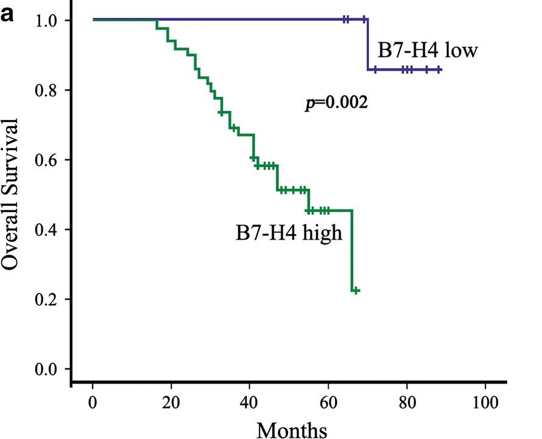
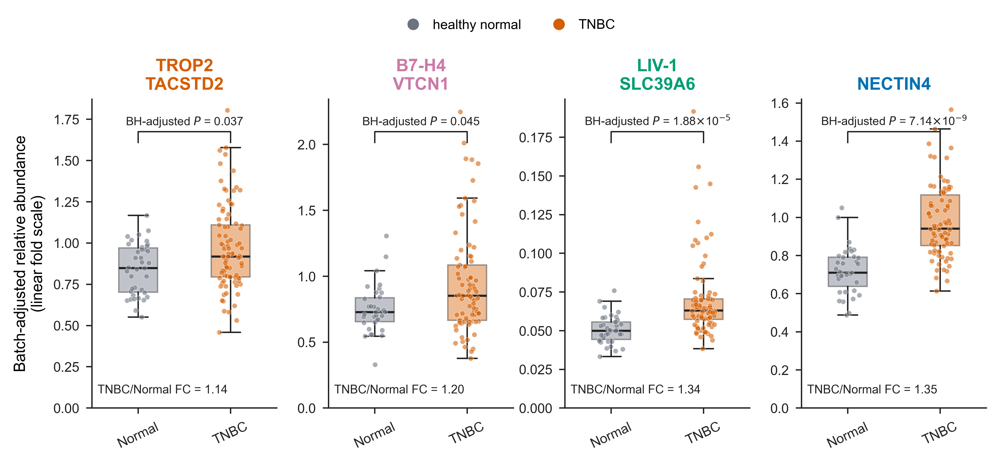
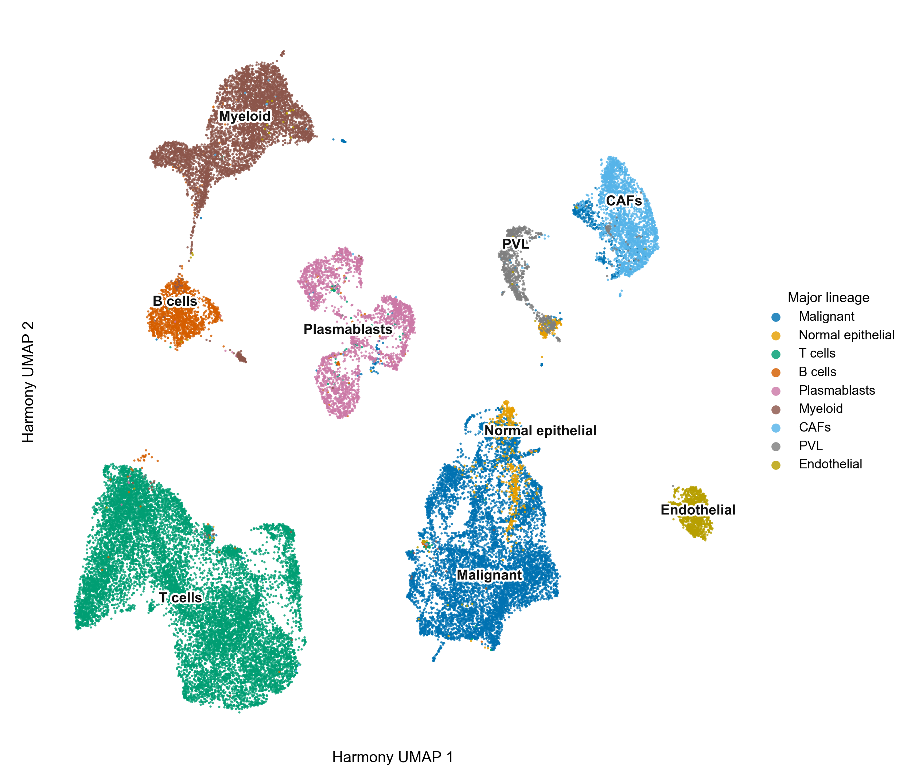
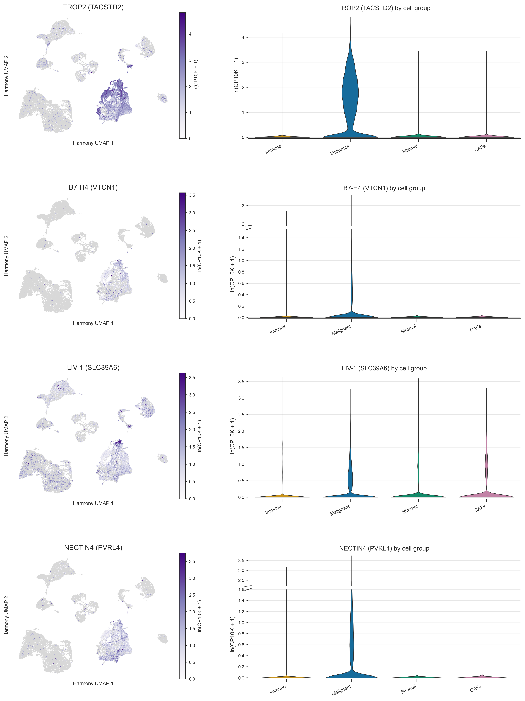

# Model Wiki（AEIP\+Cell2Dose\+SST\-QN）

# Judging

# Overview

We built three models: AEIP for antigen and epitope selection, Cell2Dose for dose prediction, and SST\-QN to evaluate sustainability\. The first two guide experimental design\. The third evaluates how SDGs interact in a general context, then assesses how CirCure might shift those interactions\.

**AEIP \(Antigen–Epitope Integration Pipeline\)** combines proteomics, single\-cell RNA sequencing, genomic profiling, and structural modeling to pick vaccine targets\. We started with the TNBC proteome, selected four antigens, and screened 1,838 candidate peptides down to 15 epitopes restricted to HLA\-A\*02:01\. The pipeline confirmed that these antigens appear as proteins in TNBC tissue, concentrate in malignant cells rather than stroma, cover 88% of patients when used together, and form stable complexes with MHC molecules\. That gives the wet lab a defined set to test instead of the full proteome\.

**Cell2Dose \(A Cell\-Informed Mechanistic Model for Tumor Vaccine Dose Exploration\)** bridges in\-vitro readouts to in\-vivo tumor dynamics through three computational layers: calibrating immune kinetics from cell assays, simulating the vaccine mechanism from injection to tumor killing, and quantifying uncertainty across parameters to rank dose candidates\. That helps the team decide which doses are worth testing in animals before the experiment begins and diagnose which process step limits efficacy if a dose fails, reducing the number of animals needed and aligning dose selection with animal welfare principles\.

**SST\-QN \(SDG Synergy–Trade\-off Quantification Network\)** maps how the 17 SDGs interact without project influence, classifying relationships and scoring synergies and trade\-offs across the system\. We then applied CirCure's actions at each stage, from early research through manufacturing scale\-up, to the baseline network\. The model projects how the project affects economic, social, and environmental outcomes and identifies where CirCure supports sustainability goals or creates conflicts\.

# AEIP\(\)

For patients with triple\-negative breast cancer \(TNBC\), three missing receptors mean fewer treatment options, while tumor diversity makes effective targeting even harder—behind this treatment gap are lives that cannot wait\. We are therefore developing a multi\-antigen circRNA vaccine designed to activate the body’s own antitumor immune response and help immune cells recognize and kill tumor cells\.

对三阴性乳腺癌（TNBC）患者而言，三种受体的缺失意味着更少的治疗选择，而肿瘤的高度异质性又让精准靶向更加困难——这一治疗缺口背后，是一个个等不起的生命。为此，我们开发多抗原 circRNA 疫苗，旨在激活机体自身的抗肿瘤免疫，促进免疫细胞识别并杀伤肿瘤细胞。

To translate this strategy into a testable vaccine design, we developed the Antigen–Epitope Integration Pipeline \(AEIP\)\. This computational workflow integrates proteomic evidence, single\-cell transcriptomics, patient\-level genomic profiling, and immunohistochemistry to prioritize antigens, followed by binding\-affinity prediction, immunogenicity scoring, and structural compatibility assessment to select HLA\-restricted epitopes\.

为将这一策略转化为可供实验验证的疫苗设计，我们构建了抗原–表位整合流程（Antigen–Epitope Integration Pipeline，AEIP）。该计算工作流首先整合蛋白质组证据、单细胞转录组学、患者层面的基因组分析和免疫组化结果，优选抗原；随后通过结合亲和力预测、免疫原性评分和结构相容性评估，筛选 HLA 限制性表位。

AEIP prioritized a four\-antigen panel—TROP2, B7\-H4, Nectin\-4, and LIV\-1—that collectively covered 88% of TNBC patients under a predefined genomic criterion and showed preferential expression in malignant cells relative to stromal and immune cells\. It narrowed 1,838 candidate peptides to 15 HLA\-A\*02:01\-restricted epitope candidates, which were delivered to the wet lab for T\-cell activation assays and circRNA construct design\.

AEIP确定了 TROP2、B7\-H4、Nectin\-4 和 LIV\-1 四抗原组合，在预设的基因组标准下共同覆盖 88% 的 TNBC 患者，且相较于基质细胞和免疫细胞，这些抗原在恶性细胞中的表达更高。该流程进一步将 1,838 条候选肽段筛选为 15 条 HLA\-A\*02:01 限制性候选表位，并交付湿实验，用于 T 细胞活化检测和 circRNA 构建设计。

## Antigen Selection

Selecting antigens for a cancer vaccine requires evidence from multiple angles, as cancer data comes in layers that don't always agree\. A gene may be highly transcribed but produce little protein, a protein may be abundant but expressed mainly in stromal rather than tumor cells, and an antigen may be present in one patient's tumor but absent in another's\. Each of these gaps can mislead antigen selection if evidence from only one source is used\.

选择癌症疫苗的抗原需要来自多个角度的证据，因为癌症数据分层呈现且并不总是一致。基因可能高度转录但产生很少蛋白，蛋白可能丰富但主要在基质而非肿瘤细胞中表达，抗原可能在一名患者肿瘤中存在却在另一名患者中缺失。如果只使用一个来源的证据，这些差距中的每一个都可能误导抗原选择。

We applied a systematic scoring framework adapted from Zahraei et al\. \(2025\) to evaluate candidates across subcellular localization, tumor specificity, prognostic association, and therapeutic validation in TNBC, selecting the top four—TROP2, B7\-H4, Nectin\-4, and LIV\-1—for multi\-evidence validation\. Quantitative proteomics confirmed tumor\-enriched protein abundance for all four, single\-cell analysis showed preferential expression in malignant cells with over 80% coverage, genomic profiling demonstrated that the panel collectively covered 88% of TCGA patients, and immunohistochemistry documented clinical tissue staining patterns\. These converging lines established that the antigens were present as proteins, localized to malignant cells, reached most patients as a panel, and matched clinical observations\.

我们应用从Zahraei等\(2025\)改进的系统性评分框架，从亚细胞定位、肿瘤特异性、预后关联和TNBC治疗验证四个维度评估候选抗原，选择得分最高的四个——TROP2、B7\-H4、Nectin\-4和LIV\-1——进行多证据验证。定量蛋白质组学确认了所有四个蛋白的肿瘤富集丰度，单细胞分析显示在恶性细胞中优先表达且覆盖超过80%，基因组分析表明该组合共同覆盖了88%的TCGA患者，免疫组织化学记录了临床组织染色模式。这些汇聚的证据线确立了这些抗原作为蛋白存在、定位于恶性细胞、作为组合覆盖大多数患者，并与临床观察相符。

### Systematic antigen prioritization / 系统性抗原优先级排序

Designing a multi\-epitope vaccine for TNBC requires selecting target antigens, but the criteria for prioritizing candidates are not immediately obvious\. Should we focus on antigens with the highest tumor\-to\-normal expression ratios, or those already validated in clinical trials? Should intracellular proteins be excluded because they require MHC processing, or included because vaccines can engage T cells? How much weight should be given to prognostic associations versus therapeutic precedent? These questions do not have universal answers, and different vaccine projects make different trade\-offs\.

为TNBC设计多表位疫苗需要选择靶抗原，但优先考虑候选抗原的标准并不是显而易见的。我们应该关注肿瘤对正常组织表达比最高的抗原，还是那些已经在临床试验中验证过的抗原？应该排除细胞内蛋白因为它们需要MHC加工，还是纳入它们因为疫苗可以调动T细胞？预后关联与治疗先例应该给予多少权重？这些问题没有通用答案，不同的疫苗项目会做出不同的权衡。

We turned to the recent literature on computational vaccine design for TNBC and found that Zahraei et al\. \(2025\) had proposed a systematic scoring framework for antigen selection\. Their approach evaluated candidates across four dimensions: subcellular localization, tumor specificity, prognostic association, and evidence of prior therapeutic targeting\. We adopted this framework as our starting point and refined the therapeutic\-targeting dimension to distinguish between exploratory trials and replicated clinical evidence in TNBC specifically, rather than treating all prior targeting equally\. The framework assigns each candidate a score from 0 to 10 based on localization \(L, 0–5 points\), tumor specificity \(S, 0–2 points\), prognostic association \(P, 0–1 point\), and TNBC therapeutic validation depth \(T, 0–2 points\)\.

我们查阅了关于TNBC计算疫苗设计的最新文献，发现Zahraei等\(2025\)提出了一个用于抗原选择的系统性评分框架。他们的方法从四个维度评估候选抗原：亚细胞定位、肿瘤特异性、预后关联和既往治疗靶向的证据。我们采用该框架作为起点，并改进了治疗靶向维度，以区分探索性试验和专门在TNBC中重复的临床证据，而不是平等对待所有既往靶向。该框架根据定位\(L,0\-5分\)、肿瘤特异性\(S,0\-2分\)、预后关联\(P,0\-1分\)和TNBC治疗验证深度\(T,0\-2分\)为每个候选抗原评分，满分10分。

**\[COLLAPSIBLE SECTION START: Detailed scoring criteria / 详细评分标准\]****（折叠）**

**Localization \(L, 0–5 points\)** distinguishes membrane proteins from intracellular targets\. Membrane\-localized antigens \(5 points\) are accessible to antibody\-based therapies and can be targeted by both arms of the adaptive immune system\. Intracellular proteins \(3 points\) require processing and MHC presentation for T\-cell recognition, making them suitable for vaccines but not for antibodies alone\. Antigens with uncertain or unfavorable localization receive 0 points\.

\*\*定位\(L,0\-5分\)\*\*区分膜蛋白与细胞内靶点。膜定位抗原\(5分\)可被抗体疗法接触，并可被适应性免疫系统的两个分支靶向。细胞内蛋白\(3分\)需要加工和MHC呈递才能被T细胞识别，适合疫苗但不适合单独使用抗体。定位不确定或不利的抗原得0分。

**Tumor specificity \(S, 0–2 points\)** reflects how selectively the antigen is expressed in tumor versus normal tissue\. Tumor\-specific antigens such as neoantigens or cancer\-testis antigens \(2 points\) minimize the risk of autoimmunity\. Tumor\-associated antigens that are overexpressed in cancer but also present in normal tissues \(1 point\) are acceptable if the normal expression is low or restricted to expendable compartments\. Antigens broadly expressed across essential normal tissues receive 0 points\.

肿瘤特异性\(S,0\-2分\)反映抗原在肿瘤中相对于正常组织的选择性表达。肿瘤特异性抗原如新抗原或癌睾抗原\(2分\)可最小化自身免疫风险。在癌症中过表达但在正常组织中也存在的肿瘤相关抗原\(1分\)是可接受的，如果正常表达较低或限于可牺牲的区室。在重要正常组织中广泛表达的抗原得0分。

**Prognostic association \(P, 0–1 point\)** captures whether high antigen expression correlates with worse survival in TNBC patient cohorts\. A candidate receives 1 point if published studies report a statistically significant association between elevated expression and at least one adverse survival endpoint—overall survival \(OS\), disease\-free survival \(DFS\), relapse\-free survival \(RFS\), metastasis\-free survival \(MFS\), or distant metastasis\-free survival \(DMFS\)—in human TNBC cohorts\. Antigens without such evidence receive 0 points\. This criterion identifies targets whose elimination may confer clinical benefit\.

预后关联\(P,0\-1分\)反映高抗原表达是否与TNBC患者队列中较差的生存相关。如果已发表研究报告了升高的表达与至少一种不良生存终点——总生存期\(OS\)、无病生存期\(DFS\)、无复发生存期\(RFS\)、无转移生存期\(MFS\)或无远处转移生存期\(DMFS\)——在人类TNBC队列中有统计学显著关联，候选抗原得1分。没有此类证据的抗原得0分。这一标准识别出清除后可能带来临床获益的靶点。

**TNBC therapeutic validation depth \(T, 0–2 points\)** assesses the strength of clinical evidence that targeting the antigen can elicit anti\-tumor effects specifically in TNBC\. We refined this dimension from the original framework to distinguish between regulatory approval, replicated clinical signals, and exploratory trials\. A candidate receives 2 points if an antigen\-directed therapy has obtained regulatory approval for a TNBC indication, supported by randomized trial data showing survival benefit\. One point is awarded if there is replicated clinical evidence of anti\-tumor activity in TNBC—such as objective responses observed across independent cohorts, different drugs targeting the same antigen, or single\-agent plus combination signals\. Zero points are given when clinical exploration has been initiated but no efficacy signal has emerged, when trials have failed, or when the only evidence comes from other cancer types\. This distinction is critical: many antigens have been "targeted" in early\-phase trials without demonstrating benefit, and efficacy in other cancers does not guarantee relevance in TNBC\.

TNBC治疗验证深度\(T,0\-2分\)评估靶向该抗原能在TNBC中引发抗肿瘤效应的临床证据强度。我们从原始框架改进了该维度，以区分监管批准、重复的临床信号和探索性试验。如果抗原定向疗法获得了TNBC适应症的监管批准，并有显示生存获益的随机试验数据支持，候选抗原得2分。如果在TNBC中有重复的抗肿瘤活性临床证据——如在独立队列中观察到客观缓解、不同药物靶向同一抗原，或单药加联合信号——得1分。当临床探索已启动但未出现疗效信号、试验失败，或唯一证据来自其他癌症类型时，得0分。这一区分至关重要：许多抗原在早期试验中被"靶向"但未显示获益，其他癌症中的疗效并不保证在TNBC中的相关性。

**\[COLLAPSIBLE SECTION END\]**

We applied this framework to a list of tumor\-associated antigens compiled from TNBC\-focused reviews, clinical trial databases, antibody\-drug conjugate development pipelines, and input from clinicians and industry partners through our Integrated Human Practices activities\. Each candidate was scored independently by reviewing primary literature for localization, expression patterns, survival associations, and therapeutic outcomes\. The top four scoring candidates were selected for multi\-evidence validation\.

我们将此框架应用于从TNBC相关综述、临床试验数据库、抗体偶联药物开发管线，以及通过整合性人类实践活动从临床医生和产业合作伙伴获得的输入中汇编的肿瘤相关抗原列表。每个候选抗原通过审阅关于定位、表达模式、生存关联和治疗结局的原始文献进行独立评分。得分最高的前四个候选抗原被选中进行多证据验证。

Table 1\. Top four antigens selected for vaccine development

表1\. 入选疫苗开发的前四个抗原

\[COLLAPSIBLE SECTION START: Complete scoring table for all evaluated antigens / 所有评估抗原的完整评分表\]

**\[COLLAPSIBLE SECTION END\]**

The four selected antigens—tumor\-associated calcium signal transducer 2 \(TROP2\), B7 homolog 4 \(B7\-H4\), nectin cell adhesion molecule 4 \(Nectin\-4\), and zinc transporter ZIP6 \(LIV\-1\)—are all membrane proteins with favorable tumor\-to\-normal expression ratios and replicated clinical validation in TNBC\. TROP2 ranked first with two FDA\-approved antibody\-drug conjugates for metastatic TNBC\. B7\-H4, LIV\-1, and Nectin\-4 each demonstrated reproducible anti\-tumor activity across independent clinical studies or different therapeutic agents targeting the same antigen\.

入选的四个抗原——肿瘤相关钙信号转导蛋白2\(TROP2\)、B7同源蛋白4\(B7\-H4\)、细胞黏附分子Nectin\-4和锌转运蛋白ZIP6\(LIV\-1\)——均为膜蛋白，具有有利的肿瘤对正常表达比，并在TNBC中有重复的临床验证。TROP2排名第一，有两个FDA批准的用于转移性TNBC的抗体偶联药物。B7\-H4、LIV\-1和Nectin\-4各自在独立临床研究或不同的靶向同一抗原的治疗药物中显示出可重复的抗肿瘤活性。

Published TNBC survival studies provided the clinical starting point for prognostic validation\. Higher expression of the four candidates was associated with shorter survival in the respective cohorts or subgroups reported by [Li et al\.](https://doi.org/10.1002/advs.202409835), [Wang et al\.](https://doi.org/10.1186/s12935-018-0597-9), [Xu et al\.](https://doi.org/10.1097/CM9.0000000000002930), [Son et al\.](https://doi.org/10.53941/jiim.2025.100013), and [Saravanan et al\.](https://doi.org/10.1002/jcp.31203)\.  The survival data for each antigen are presented below\.

已发表的TNBC生存研究为预后验证提供了临床起点。[Li 等](https://doi.org/10.1002/advs.202409835)、[Wang 等](https://doi.org/10.1186/s12935-018-0597-9)、[Xu 等](https://doi.org/10.1097/CM9.0000000000002930)、[Son 等](https://doi.org/10.53941/jiim.2025.100013)和[Saravanan 等](https://doi.org/10.1002/jcp.31203)分别在所研究的队列或亚组中发现，候选抗原表达较高的患者生存时间较短。每个抗原的生存数据如下所示。

**\[TAB 1: TROP2\]**

Li et al\. \(2025\) analyzed 80 TNBC patients and stratified them by TROP2 expression level measured by immunohistochemistry\. The high\-expression group showed significantly poorer overall survival compared to the low\-expression group \(P \< 0\.05\)\. TROP2 expression was also associated with a higher tumor grade and more advanced stage\. The median follow\-up time was 60 months\. This study provided direct evidence that TROP2 is not only a therapeutic target but also a prognostic marker in TNBC\.

Li等\(2025\)分析了80名TNBC患者，并通过免疫组化测量的TROP2表达水平进行分层。高表达组的总生存期显著短于低表达组\(P \< 0\.05\)。TROP2表达还与较高的肿瘤分级和更晚期的分期相关。中位随访时间为60个月。该研究提供了直接证据，表明TROP2不仅是治疗靶点，也是TNBC的预后标志物。

**Figure 1\.** Overall survival among 80 patients with TNBC, grouped by high or low TROP2 expression\. High TROP2 expression was associated with significantly shorter overall survival \(Li et al\., 2025\)\.

**图1\.** 80名TNBC患者按TROP2表达高低分组后的总生存期。高TROP2表达与显著较短的总生存期相关\(Li等，2025\)。

**Reference:** Li M, Zhang Y, Wang X, et al\. TROP2 is a prognostic biomarker and correlates with immune infiltration in triple\-negative breast cancer\. *Adv Sci\.* 2025;12\(3\):2409835\. [https://doi\.org/10\.1002/advs\.202409835](https://doi.org/10.1002/advs.202409835)

**\[TAB 2: B7\-H4\]**

Wang et al\. \(2018\) evaluated B7\-H4 expression in 65 TNBC patients and found that high B7\-H4 expression was significantly associated with shorter overall survival \(P = 0\.002\) and earlier recurrence\. B7\-H4 staining intensity remained associated with overall survival in multivariate analysis, indicating it is an independent prognostic factor\. The study also observed that B7\-H4 expression on tumor cells was higher than on tumor\-infiltrating lymphocytes, suggesting a tumor\-intrinsic role\. The median follow\-up was 42 months\.

Wang等\(2018\)评估了65名TNBC患者的B7\-H4表达，发现高B7\-H4表达与显著较短的总生存期\(P = 0\.002\)和更早的复发相关。B7\-H4染色强度在多变量分析中仍与总生存期相关，表明它是独立的预后因素。该研究还观察到肿瘤细胞上的B7\-H4表达高于肿瘤浸润淋巴细胞，提示其具有肿瘤内在作用。中位随访时间为42个月。

**Figure 2\.** Overall survival of patients with high or low B7\-H4 expression in a 65\-patient TNBC cohort\. High B7\-H4 was associated with shorter survival and earlier recurrence \(Wang et al\., 2018\)\.

**图2\.** 65名TNBC患者队列中B7\-H4高表达与低表达患者的总生存期。高B7\-H4与较短生存和更早复发相关\(Wang等，2018\)。

**Reference:** Wang L, Yang C, Wang X, et al\. B7\-H4 expression in triple\-negative breast cancer is associated with tumor\-infiltrating lymphocytes and predicts poor prognosis\. *Cancer Cell Int\.* 2018;18:92\. [https://doi\.org/10\.1186/s12935\-018\-0597\-9](https://doi.org/10.1186/s12935-018-0597-9)

**\[TAB 3: Nectin\-4\]**

Son et al\. \(2025\) analyzed gene expression data from 103 basal\-like 1 \(BL1\) TNBC patients and stratified them by Nectin\-4 \(*PVRL4*\) expression\. High Nectin\-4 expression was associated with worse overall survival in this molecularly defined TNBC subtype\. The BL1 subtype represents a distinct group within TNBC characterized by elevated cell\-cycle and DNA\-damage\-response signatures\. An earlier study by Siddharth et al\. \(2017\) also reported that high *PVRL4* expression was associated with reduced metastasis\-free survival in TNBC and served as an independent poor\-prognostic factor in multivariate analysis\.

Son等\(2025\)分析了103名基底样1型\(BL1\) TNBC患者的基因表达数据，并按Nectin\-4\(*PVRL4*\)表达进行分层。在这一分子定义的TNBC亚型中，高Nectin\-4表达与较差的总生存期相关。BL1亚型代表TNBC中一个独特的群体，其特征是细胞周期和DNA损伤应答特征升高。Siddharth等\(2017\)的早期研究也报告了高*PVRL4*表达与TNBC中较短的无转移生存期相关，并在多变量分析中是独立的不良预后因素。

**Figure 3\.** Overall survival in 103 patients classified as basal\-like 1 TNBC, grouped by Nectin\-4 \(*PVRL4*\) expression\. High Nectin\-4 was associated with worse outcomes in this subtype \(Son et al\., 2025\)\.

**图3\.** 103名被归为基底样1型TNBC的患者按Nectin\-4\(*PVRL4*\)表达高低分组后的总生存期。高Nectin\-4与该亚型中较差的结局相关\(Son等，2025\)。

Son JY, Kim S, Park J, et al\. Nectin\-4 as a prognostic biomarker in basal\-like 1 triple\-negative breast cancer\. *J Int Immunopharmacol Med\.* 2025;1:100013\. [https://doi\.org/10\.53941/jiim\.2025\.100013](https://doi.org/10.53941/jiim.2025.100013)

Siddharth S, Goutam K, Das S, et al\. Nectin\-4 is a breast cancer stem cell marker that induces WNT/β\-catenin signaling via Pi3k/Akt axis\. *Int J Biochem Cell Biol\.* 2017;89:85\-94\. [https://doi\.org/10\.1016/j\.biocel\.2017\.06\.007](https://doi.org/10.1016/j.biocel.2017.06.007)

**\[TAB 4: LIV\-1\]**

Xu et al\. \(2024\) performed immunohistochemical analysis of LIV\-1 \(ZIP6\) in TNBC tissue specimens and stratified patients by staining intensity \(0 to 3\+\)\. Patients with 3\+ LIV\-1 intensity had a median survival of approximately 4\.44 years, compared to 5\.47 years for those with 2\+ intensity\. LIV\-1 expression was higher in tumor tissue compared to adjacent normal tissue and was further elevated in high\-grade tumors and after chemotherapy\. The study defined LIV\-1 as a poor prognostic factor in TNBC\. Another study by Saravanan et al\. \(2024\) corroborated these findings using transcriptomic data, showing that high *SLC39A6* expression was associated with worse disease\-free survival and overall survival in TNBC cohorts\.

Xu等\(2024\)对TNBC组织标本进行了LIV\-1\(ZIP6\)免疫组化分析，并按染色强度\(0至3\+\)对患者进行分层。3\+ LIV\-1强度的患者中位生存期约为4\.44年，而2\+强度的患者为5\.47年。肿瘤组织中的LIV\-1表达高于邻近正常组织，在高级别肿瘤和化疗后进一步升高。该研究将LIV\-1定义为TNBC的不良预后因素。Saravanan等\(2024\)的另一项研究使用转录组数据证实了这些发现，显示高*SLC39A6*表达与TNBC队列中较差的无病生存期和总生存期相关。

**Figure 4\.** Survival of patients with TNBC stratified by LIV\-1 staining intensity\. Higher intensity \(3\+\) was associated with shorter survival compared to moderate intensity \(2\+\) \(Xu et al\., 2024\)\.

**图4\.** TNBC患者按LIV\-1染色强度分层后的生存曲线。较高强度\(3\+\)与较短生存期相关，相比中等强度\(2\+\)\(Xu等，2024\)。

**References:**
 Xu Y, Chen L, Wang T, et al\. LIV\-1 is a prognostic marker and therapeutic target in triple\-negative breast cancer\. *Chin Med J\.* 2024;137\(3\):324\-334\. [https://doi\.org/10\.1097/CM9\.0000000000002930](https://doi.org/10.1097/CM9.0000000000002930)

Saravanan S, Vimala Devi M, Krishnan R\. Prognostic significance of LIV\-1/SLC39A6 in triple\-negative breast cancer\. *J Cell Physiol\.* 2024;239\(3\):e31203\. [https://doi\.org/10\.1002/jcp\.31203](https://doi.org/10.1002/jcp.31203)

### Abbreviations and nomenclature / 缩写与命名规则

Abbreviations are expanded at first use throughout this page\. Human gene symbols are italicized, whereas protein names, database names, software names, and dataset accessions are written in roman type\. Peptide sequences are shown in monospace\. HLA\-A\*02:01 follows the official HLA allele nomenclature and is also written in roman type\.

本页中所有缩写均在首次出现时给出全称。人类基因符号使用斜体，蛋白名称、数据库名称、软件名称和数据集编号使用正体。肽序列使用等宽字体。HLA\-A\*02:01 遵循官方 HLA 等位基因命名规则，并使用正体。

|**Term / 术语**|**Meaning used on this page / 本页含义**|
|---|---|
|TNBC|Triple\-negative breast cancer 三阴性乳腺癌|
|ER|Estrogen receptor 雌激素受体|
|PR|Progesterone receptor 孕激素受体|
|HER2|Human epidermal growth factor receptor 2 人表皮生长因子受体 2|
|PARP|Poly\(ADP\-ribose\) polymerase 聚 ADP\-核糖聚合酶|
|circRNA|Circular RNA 环状 RNA|
|LNP|Lipid nanoparticle 脂质纳米颗粒|
|TROP2|Tumor\-associated calcium signal transducer 2, encoded by *TACSTD2* 肿瘤相关钙信号转导蛋白 2，由 *TACSTD2* 编码|
|B7\-H4|B7 homolog 4, encoded by *VTCN1* B7 同源蛋白 4，由 *VTCN1* 编码|
|Nectin\-4|Nectin cell adhesion molecule 4, encoded by *NECTIN4* 细胞黏附分子 Nectin\-4，由 *NECTIN4* 编码|
|LIV\-1|Estrogen\-regulated protein LIV\-1, also known as zinc transporter ZIP6, encoded by *SLC39A6* 雌激素调控蛋白 LIV\-1，又称锌转运蛋白 ZIP6，由 *SLC39A6* 编码|
|HLA\-I|Human leukocyte antigen class I 人类白细胞抗原 I 类|
|HLA\-A\*02:01|The HLA class I allele used for epitope prediction in this project 本项目用于表位预测的 HLA\-I 等位基因|
|IEDB|Immune Epitope Database and Analysis Resource 免疫表位数据库与分析资源|
|FDR|False discovery rate 错误发现率|
|TCGA|The Cancer Genome Atlas 癌症基因组图谱|
|TMT|Tandem mass tag 串联质量标签|
|UMI|Unique molecular identifier 唯一分子标识符|
|UMAP|Uniform manifold approximation and projection 均匀流形逼近与投影|
|mRNA|Messenger RNA 信使 RNA|
|TAP|Transporter associated with antigen processing 抗原加工相关转运蛋白|
|pMHC|Peptide–major histocompatibility complex 肽\-主要组织相容性复合物|
|BA|Binding affinity 结合亲和力|
|EL|Eluted ligand 洗脱配体|
|IC₅₀|Half\-maximal inhibitory concentration 半数抑制浓度|
|IFN|Interferon 干扰素|
|ipTM|Interface predicted template modeling score 界面预测模板建模评分|
|pTM|Predicted template modeling score 预测模板建模评分|

参照这个表格（在model界面前三次出现这个词的时候，鼠标挪到上面可以出现对应的名词解释）

### Proteomic evidence for antigen prioritization / 用于抗原优先级判断的蛋白质组证据

##### Why protein\-level evidence came first / 为什么首先考察蛋白水平证据

The first requirement for an antigen source is evidence that its protein is present in the tumor population the vaccine is meant to address, a principle shared by established tumor\-antigen prioritization frameworks \(**Cheever et al\., 2009**\)\. Because transcript abundance does not always predict protein abundance, we began with quantitative proteomics to measure TROP2, B7\-H4, Nectin\-4, and LIV\-1 directly in TNBC tissue\.

抗原来源首先需要有蛋白确实存在于目标肿瘤人群中的证据，这也是已有肿瘤抗原优先级框架所强调的原则 \(**Cheever et al\., 2009**\)。由于转录本丰度并不总能准确反映蛋白丰度，我们首先使用定量蛋白质组学，直接测量 TNBC 组织中的 TROP2、B7\-H4、Nectin\-4 和 LIV\-1。

PXD024322 contains 88 TNBC tumors and 38 normal\-breast samples, providing quantitative protein measurements across a broad cohort \(**Asleh et al\., 2022**\)\. PXD028102 contains 66 matched tumor and adjacent\-normal pairs within a larger TNBC cohort, allowing tumor\-to\-normal differences to be estimated within the same patients \(**Gong et al\., 2022**\)\.

PXD024322 包含 88 例 TNBC 肿瘤和 38 例正常乳腺样本，提供了较大队列中的定量蛋白数据 \(**Asleh et al\., 2022**\)。PXD028102 在更大的 TNBC 队列中包含 66 对肿瘤与癌旁正常样本，可以在同一患者内估计肿瘤与正常组织的差异 \(**Gong et al\., 2022**\)。

##### PXD024322 provided protein\-level evidence for all four candidates / PXD024322 为四个候选抗原提供蛋白水平证据

All four proteins were quantified in the PXD024322 cohort\. Each candidate showed higher average abundance in tumor tissue\. Nectin\-4 and LIV\-1 had the largest changes in this dataset, with fold changes of 1\.35 and 1\.34, followed by B7\-H4 at 1\.20 and TROP2 at 1\.14\. All four comparisons had a false discovery rate \(FDR\) below 0\.05\.

在 PXD024322 队列中，四个蛋白均被定量。四个候选蛋白在肿瘤组织中的平均丰度均高于正常组织。Nectin\-4 和 LIV\-1 的变化幅度最大，倍数变化分别为 1\.35 和 1\.34，其后为 B7\-H4 的 1\.20 和 TROP2 的 1\.14。四项比较的错误发现率（FDR）均低于 0\.05。

**Figure 5\.** Differential protein abundance in PXD024322\. Candidate antigens are highlighted against the complete quantified proteome\.

**图 5。** PXD024322 中的蛋白差异丰度。候选抗原在完整定量蛋白质组中被突出显示。

**Figure 6\.** Abundance distributions of TROP2, B7\-H4, Nectin\-4, and LIV\-1 in the PXD024322 TNBC and normal\-breast samples\.

**图 6。** PXD024322 的 TNBC 和正常乳腺样本中 TROP2、B7\-H4、Nectin\-4 与 LIV\-1 的丰度分布。

|**Antigen / 抗原**|**Gene / 基因**|**log2 fold change / log2 倍数变化**|**Fold change / 倍数变化**|**FDR**|
|---|---|---|---|---|
|TROP2|*TACSTD2*|0\.185|1\.14|0\.0370|
|B7\-H4|*VTCN1*|0\.268|1\.20|0\.0446|
|Nectin\-4|*NECTIN4*|0\.435|1\.35|7\.14 × 10−9|
|LIV\-1|*SLC39A6*|0\.419|1\.34|1\.88 × 10−5|

In PXD024322, the quantitative measurements supported all four candidates as protein\-level inputs for the next stage\.

在 PXD024322 中，定量蛋白数据为四个候选抗原进入下一阶段提供了蛋白水平依据。

##### PXD028102 revealed larger tumor\-to\-normal differences / PXD028102 显示更大的肿瘤与正常组织差异

In PXD028102, TROP2, B7\-H4, and Nectin\-4 were more abundant in tumors than in matched adjacent tissue, with estimated fold changes of 18\.25, 3\.72, and 7\.12, respectively\. Together with the PXD024322 measurements for LIV\-1, these paired results supported carrying the four\-antigen panel forward\.

在 PXD028102 中，TROP2、B7\-H4 和 Nectin\-4 在肿瘤中的丰度均高于患者匹配的癌旁组织，估计倍数变化分别为 18\.25、3\.72 和 7\.12。结合 PXD024322 对 LIV\-1 的定量结果，两套数据共同支持四抗原组合继续推进。

**Figure 7\.** Paired differential abundance analysis in PXD028102\. The paired design highlights tumor\-associated changes within the same patients\.

**图 7。** PXD028102 的配对差异丰度分析。配对设计突出显示了同一患者内的肿瘤相关变化。

**Figure 8\.** Paired tumor and adjacent\-normal abundance patterns for the three candidates quantified in PXD028102\.

**图 8。** PXD028102 中三个可定量候选蛋白在肿瘤与癌旁正常组织中的配对丰度模式。

|**Antigen / 抗原**|**log2 fold change / log2 倍数变化**|**Fold change / 倍数变化**|**FDR**|
|---|---|---|---|
|TROP2|4\.190|18\.25|2\.14 × 10−15|
|B7\-H4|1\.894|3\.72|7\.15 × 10−6|
|Nectin\-4|2\.831|7\.12|2\.13 × 10−11|

The two proteomic cohorts supported the same panel from different directions\. PXD024322 provided quantitative protein evidence for all four candidates, while PXD028102 revealed larger tumor\-associated differences for TROP2, Nectin\-4, and B7\-H4 in matched tissue\. This combination of broad protein evidence and tumor\-to\-normal contrast provided the basis for carrying all four antigens forward\.

两套蛋白质组队列从不同角度支持了同一个抗原组合。PXD024322 为四个候选抗原提供了定量蛋白证据，PXD028102 则在配对组织中显示出 TROP2、Nectin\-4 和 B7\-H4 更大的肿瘤相关变化。蛋白水平证据与肿瘤和正常组织之间的差异相结合，构成了保留四个抗原的依据。

##### What we learned from the proteomic data / 蛋白质组数据告诉了我们什么

Together, the two proteomic cohorts supported a four\-antigen panel from complementary evidence\. PXD024322 provided quantitative protein measurements for all four candidates across TNBC tumors, while PXD028102 provided paired tumor\-to\-adjacent\-normal increases for TROP2, Nectin\-4, and B7\-H4\. TROP2 showed the largest paired increase at 18\.25\-fold, Nectin\-4 increased 7\.12\-fold, and LIV\-1 showed higher average abundance in tumor tissue in PXD024322\. This combination gave each antigen a distinct evidence profile in the panel\.

两套蛋白质组数据从互补角度支持四抗原组合。PXD024322 为四个候选抗原提供了 TNBC 组织中的定量蛋白数据，PXD028102 则在配对组织中给出了 TROP2、Nectin\-4 和 B7\-H4 的肿瘤与癌旁组织差异。TROP2 的配对差异最大，为 18\.25 倍；Nectin\-4 的差异为 7\.12 倍；LIV\-1 在 PXD024322 中的肿瘤平均丰度更高。这样，每个抗原都在组合中呈现出不同的证据特征。

To place these tissue\-level protein signals within specific cell types, we next examined the four genes in single\-cell RNA\-sequencing data\.

为了把组织层面的蛋白信号定位到具体细胞类型，我们进一步在单细胞 RNA 测序数据中查看四个蛋白对应基因的表达位置。

#### Proteomic datasets and statistical methods / 蛋白质组数据集与统计方法（折叠）

##### PXD024322 cohort construction / PXD024322 队列构建

We downloaded the authors' supplementary quantitative\-proteomics workbook and its accompanying clinical tables for PXD024322 \(**Asleh et al\., 2022**\)\. The abundance matrix contained 9,088 protein groups measured by tandem mass tag proteomics across 38 experimental batches\. We matched the quantitative columns to the sample identifiers and batch labels in the supplementary metadata\. Tumors were included when the clinical annotation identified them as TNBC, and normal samples were included when the tissue annotation indicated normal breast\. This produced 88 TNBC tumors and 38 normal\-breast samples\. The values supplied by the authors were already on a log2 relative\-abundance scale, so we used them directly in the analysis\.

我们下载了 PXD024322 作者提供的定量蛋白质组补充工作簿及其临床信息表 \(**Asleh et al\., 2022**\)。丰度矩阵包含 9,088 个蛋白组，来自 38 个串联质量标签蛋白质组学实验批次。我们依据补充元数据中的样本编号和批次标签匹配定量列。临床注释为 TNBC 的样本被纳入肿瘤组，组织注释为正常乳腺的样本被纳入正常组，最终得到 88 例 TNBC 肿瘤和 38 例正常乳腺样本。作者提供的数值已经是 log2 相对丰度，因此我们直接使用这些数值进行分析。

For every protein, we required at least two non\-missing abundance values in both the TNBC and normal groups before fitting a differential\-abundance model\. Of the 9,088 protein groups, 8,734 met this requirement\. The design matrix was `~ Batch + Condition`, with normal breast as the reference group\. We fitted the model with `limma`, applied empirical Bayes moderation with `trend = TRUE` and `robust = TRUE`, and extracted the `ConditionTNBC` coefficient \(**Ritchie et al\., 2015**\)\. This coefficient is the reported log2 fold change after accounting for the TMT batch structure\. The Benjamini\-Hochberg method was applied across all tested proteins to control the false discovery rate \(**Benjamini and Hochberg, 1995**\)\.

对每个蛋白，我们要求 TNBC 组和正常组都至少有两个非缺失丰度值，再拟合差异丰度模型。9,088 个蛋白组中有 8,734 个满足这一要求。设计矩阵为 `~ Batch + Condition`，正常乳腺为参照组。我们使用 `limma` 拟合模型，并以 `trend = TRUE` 和 `robust = TRUE` 进行经验贝叶斯校正，最后提取 `ConditionTNBC` 系数 \(**Ritchie et al\., 2015**\)。该系数是在校正 TMT 批次结构后报告的 log2 倍数变化。所有受检蛋白的 *P* 值通过 Benjamini\-Hochberg 方法校正，以控制错误发现率 \(**Benjamini and Hochberg, 1995**\)。

##### PXD028102 paired analysis / PXD028102 配对分析

For PXD028102, we extracted the protein\-abundance matrix from sheet `B. Profiling abundance` in the authors' Supplementary Table S2 \(**Gong et al\., 2022**\)\. The matrix contained 7,531 gene products measured on an author\-provided log2 scale\. The cohort included 82 TNBC tumors and 66 normal\-adjacent tissue samples\. Sixty\-six patients had both specimen types and were retained for the primary paired analysis, while the 16 tumor\-only cases were retained in the cohort description but were not included in the paired model\.

对于 PXD028102，我们从作者补充表 S2 的 `B. Profiling abundance` 工作表中提取蛋白丰度矩阵 \(**Gong et al\., 2022**\)。矩阵包含 7,531 个基因产物，数值采用作者提供的 log2 标度。队列包括 82 例 TNBC 肿瘤和 66 例癌旁正常组织，其中 66 名患者同时具有两种标本，被纳入主要配对分析；其余 16 例仅有肿瘤标本，保留在队列描述中，但不进入配对模型。

For the paired abundance model, low\-abundance entries were imputed within each sample at one log2 unit below that sample's first percentile of observed values\. We then fitted `~ PatientID + Condition` with `limma`, using normal\-adjacent tissue as the reference and the 66 patient identifiers as blocking terms \(**Ritchie et al\., 2015**\)\. Empirical Bayes moderation used `trend = TRUE` and `robust = TRUE`, and *P* values were adjusted across 7,531 proteins with the Benjamini\-Hochberg procedure \(**Benjamini and Hochberg, 1995**\)\. We repeated the model with three additional low\-abundance settings, and the target\-level directions remained consistent across these runs\.

进行配对丰度建模时，每个样本中的低丰度条目被填补为该样本已观测值第 1 百分位数以下 1 个 log2 单位。随后使用 `limma` 拟合 `~ PatientID + Condition`，以癌旁正常组织为参照，并将 66 个患者编号作为阻断项 \(**Ritchie et al\., 2015**\)。经验贝叶斯校正使用 `trend = TRUE` 和 `robust = TRUE`，再用 Benjamini\-Hochberg 方法对 7,531 个蛋白的 *P* 值进行校正 \(**Benjamini and Hochberg, 1995**\)。我们还采用三种低丰度设置重复建模，各项分析中的目标蛋白变化方向保持一致。

The primary comparison in PXD028102 was the paired tumor\-to\-adjacent\-normal abundance model\. This model provided the quantitative evidence used for TROP2, B7\-H4, and Nectin\-4, while LIV\-1 was evaluated with the PXD024322 abundance model\.

PXD028102 的主要比较是配对肿瘤与癌旁正常组织的丰度模型。该模型为 TROP2、B7\-H4 和 Nectin\-4 提供定量证据，LIV\-1 则通过 PXD024322 的丰度模型进行评价。

##### Reporting and reproducibility / 结果报告与可复现性

For both datasets, differential abundance was analyzed with the model appropriate to the study design\. The volcano plots show the fitted log2 fold changes and adjusted *P* values across the full tested proteome\. The candidate panels show the source measurements used for TROP2, B7\-H4, Nectin\-4, and LIV\-1\. The analysis package retains the extracted abundance matrices, sample metadata, cohort assignments, model outputs, target summaries, and plot\-ready tables, so every value in Figures 5–8 can be traced to its source sample and statistical model\. The PXD028102 paired model handles the original observation pattern explicitly \(**Lazar et al\., 2016**\)\.

两套数据均根据各自的研究设计进行差异丰度分析。火山图展示完整受检蛋白质组的拟合 log2 倍数变化和校正 *P* 值，候选蛋白图则展示用于评价 TROP2、B7\-H4、Nectin\-4 和 LIV\-1 的来源测量值。分析包保存了提取后的丰度矩阵、样本元数据、队列分组、模型输出、目标汇总和作图数据，因此图 5–8 中的每个数值都可以追溯到来源样本和统计模型。PXD028102 的配对模型对原始观测模式作了明确处理 \(**Lazar et al\., 2016**\)。
折叠结束

---

#### Single\-cell transcriptomic evidence for malignant\-cell localization / 支持恶性细胞定位的单细胞转录组证据

##### From whole tissue to individual cells / 从整体组织到单个细胞

Proteomics measured the abundance of the candidate proteins in TNBC tissue, which contains malignant cells alongside immune and stromal cells\. For antigen selection, we also wanted to know which cell populations expressed the genes encoding those proteins\. High expression of a candidate gene in immune, stromal, or normal epithelial cells would weaken the case for prioritizing it as a tumor\-directed antigen\. We therefore analyzed GSE176078 as a separate, cell\-resolved source of evidence \(**Wu et al\., 2021**\)\. This breast\-cancer atlas provides patient identities, author\-assigned cell lineages, and raw unique molecular identifier \(UMI\) counts, allowing us to examine malignant epithelial, immune, stromal, and normal epithelial cells within the same study, with cancer\-associated fibroblasts \(CAFs\) examined separately as a subset of stromal cells\. We selected the samples labelled TNBC in the authors' integration configuration, reprocessed their counts with SCTransform and patient\-corrected Harmony, and compared the four candidate genes across these compartments\. We then measured the proportion of malignant cells in which at least one candidate gene was detected\. Together, the two analyses described both candidate protein abundance in tumor tissue and the distribution of the corresponding transcripts among its cell populations\.

蛋白质组分析测量了候选蛋白在 TNBC 肿瘤组织中的丰度，而一份肿瘤样本同时包含恶性细胞、免疫细胞和基质细胞。选择疫苗抗原时，我们还想知道编码这些蛋白的基因主要由哪些细胞表达。如果候选基因在免疫、基质或正常上皮细胞中也大量表达，就需要重新评估它是否适合作为肿瘤抗原。因此，我们选用 GSE176078，从单细胞层面获得另一组证据 \(**Wu et al\., 2021**\)。这项乳腺癌图谱提供患者编号、作者标注的细胞谱系和原始 UMI 计数，使我们能够在同一项研究中比较恶性上皮、免疫、基质和正常上皮细胞，并单独分析属于基质细胞的癌症相关成纤维细胞（CAFs）。我们选取作者整合配置中标注为 TNBC 的样本，用 SCTransform 和患者校正 Harmony 流程重新分析计数数据，再比较四个候选基因在这些细胞区室中的表达，并统计至少检出其中一个基因的恶性细胞比例。两项分析从不同层面描述了同一组候选抗原，一项提供肿瘤组织中的蛋白丰度，另一项展示相应转录本在不同细胞中的分布。

##### Malignant cells formed a broad region with internal substructure / 恶性细胞形成具有内部结构的宽广区域

After quality control, the TNBC subset contained 39,324 cells, including 24,411 immune cells, 9,491 malignant cells, 4,786 stromal cells, and 636 normal epithelial cells\. Most malignant cells occupied a broad, continuous region in the lower part of the uniform manifold approximation and projection \(UMAP\)\. Leiden clustering resolved five malignant\-cell\-dominated clusters within this region, together with a smaller malignant population in a mixed stromal cluster\. The map preserved visible structure within the malignant compartment, supporting comparisons across the malignant states represented in the atlas\.

质量控制后，TNBC 子集包含 39,324 个细胞，其中有 24,411 个免疫细胞、9,491 个恶性细胞、4,786 个基质细胞和 636 个正常上皮细胞。大多数恶性细胞位于均匀流形逼近与投影（UMAP）下部一个宽广而连续的区域。Leiden 聚类在该区域内分辨出 5 个以恶性细胞为主的簇，并在一个混合基质簇中识别出另一小群恶性细胞。因此，这张图保留了恶性细胞区室内部可见的结构，可以比较图谱中呈现的不同恶性细胞状态。

**Figure 9\.** Patient\-corrected Harmony UMAP of the GSE176078 TNBC subset after SCTransform normalization\. Colors identify the deposited major lineages, and labels mark their principal regions\. The analysis included 39,324 quality\-controlled cells\.

**图 9。** GSE176078 TNBC 子集经 SCTransform 标准化后的患者校正 Harmony UMAP。颜色表示数据中原有的主要细胞谱系，文字标注其主要分布区域。分析共纳入 39,324 个通过质量控制的细胞。

We therefore calculated candidate\-gene detection across the full malignant compartment, capturing all malignant states represented in the atlas\.

因此，我们在完整恶性细胞区室内统计候选基因的检出情况，覆盖图谱中呈现的全部恶性细胞状态。

##### All four genes were preferentially expressed in malignant cells / 四个基因均优先在恶性细胞中表达

Patient\-aware pseudobulk analysis compared malignant cells with the combined immune and stromal compartments\. All four candidates were enriched in malignant cells\. *VTCN1* and *NECTIN4* showed the largest differences, followed by *TACSTD2*, while *SLC39A6* retained a positive malignant\-cell preference across patients\.

患者感知的伪批量分析将恶性细胞与合并后的免疫和基质区室进行比较。四个候选基因在恶性细胞中均表现出富集。*VTCN1* 和 *NECTIN4* 的差异最大，其后为 *TACSTD2*，而 *SLC39A6* 在不同患者中也保持了正向的恶性细胞偏好。

|**Gene / 基因**|**Antigen / 抗原**|**Malignant versus non\-malignant log2 fold change / 恶性与非恶性细胞 log2 倍数变化**|**FDR**|**Malignant\-cell detection rate / 恶性细胞检出率**|**Immune\-cell detection rate / 免疫细胞检出率** |**CAF detection rate / 癌症相关成纤维细胞检出率**|
|---|---|---|---|---|---|---|
|*TACSTD2*|TROP2|4\.074|8\.37 × 10−5|70\.4%|4\.0%|5\.4%|
|*SLC39A6*|LIV\-1|0\.853|0\.0196|39\.4%|8\.5%|20\.7%|
|*NECTIN4*|Nectin\-4|4\.755|3\.70 × 10−6|37\.8%|1\.0%|0\.6%|
|*VTCN1*|B7\-H4|5\.393|2\.52 × 10−5|19\.8%|0\.3%|0\.4%|

Detection rates are the fractions of cells with at least one raw count for the gene after pooling cells from the 10 TNBC patients within each group\. These pooled rates are descriptive\. The log2 fold changes and FDR values retain their patient\-aware malignant\-versus\-combined\-immune\-and\-stromal comparison\.

各组检出率均为合并 10 位 TNBC 患者的细胞后，基因原始计数至少为 1 的细胞所占比例。这些总体检出率仅用于描述。log2 倍数变化和 FDR 仍来自考虑患者差异的恶性细胞与合并免疫及基质细胞比较。

**Figure 10\.** Candidate\-gene expression in the GSE176078 TNBC single\-cell dataset\. From top to bottom, the left panels show TROP2 \(*TACSTD2*\), B7\-H4 \(*VTCN1*\), LIV\-1 \(*SLC39A6*\), and Nectin\-4 \(*NECTIN4*, formerly *PVRL4*\) on a Harmony UMAP generated after SCTransform normalization and patient correction\. The right panels compare raw\-count\-derived ln\(CP10K \+ 1\) expression in immune, malignant, stromal, and cancer\-associated fibroblast \(CAF\) cells\. CAFs are also included in the broader stromal group, so those two distributions overlap by design\. *TACSTD2* had the broadest malignant\-cell expression\. *NECTIN4* and *VTCN1* were detected in smaller malignant\-cell populations\. *SLC39A6* was detected in CAFs as well as malignant cells\.

**图 10。** GSE176078 TNBC 单细胞数据集中候选基因的表达。左侧从上到下依次展示 TROP2（*TACSTD2*）、B7\-H4（*VTCN1*）、LIV\-1（*SLC39A6*）和 Nectin\-4（*NECTIN4*，旧符号 *PVRL4*）在经 SCTransform 标准化和患者校正所得 Harmony UMAP 上的分布。右侧比较免疫细胞、恶性细胞、基质细胞和癌症相关成纤维细胞（CAFs）中的 ln\(CP10K \+ 1\) 表达，该表达量由原始计数计算。CAFs 也属于基质细胞，因此图中这两组有意重叠。*TACSTD2* 在恶性细胞中的检出范围最广。*NECTIN4* 和 *VTCN1* 出现在较小的恶性细胞群中。除恶性细胞外，*SLC39A6* 在 CAFs 中也有检出。

Across patients, all four transcripts were more abundant in the malignant compartment than in the combined immune and stromal compartments\. The single\-cell data therefore placed the candidate\-gene signal mainly in malignant cells\. All four genes were also detected among the pooled CAFs\. *SLC39A6* had the highest CAF detection rate, at 20\.7% \(508 of 2,458 CAFs\)\. In a breast\-cancer mouse model, depletion of FAP\-positive fibroblasts reduced tumor growth and enhanced the effect of paclitaxel, supporting further study of CAF targeting to improve the tumor microenvironment \(**Fang et al\., 2016**\)\.

在不同患者中，四个转录本在恶性细胞区室中的丰度均高于合并后的免疫和基质区室。因此，单细胞数据表明候选基因的信号主要位于恶性细胞。合并所有 CAFs 后，四个候选基因均有检出。其中 *SLC39A6* 的 CAF 检出率最高，为 20\.7%（508/2,458 个 CAFs）。乳腺癌小鼠研究显示，清除 FAP 阳性成纤维细胞可抑制肿瘤生长，并增强紫杉醇的作用，提示靶向 CAFs 有望改善肿瘤微环境 \(**Fang et al\., 2016**\)。

##### At least one candidate gene was detected in 81\.4% of malignant cells / 81\.4%的恶性细胞至少检出一个候选基因

*TACSTD2* and *SLC39A6* were detected in the largest fractions of malignant cells, while *NECTIN4* and *VTCN1* marked additional malignant\-cell groups\. Across the dataset, 81\.4% of malignant cells expressed at least one candidate gene, with patient\-level values ranging from 52\.5% to 97\.8%\.

*TACSTD2* 和 *SLC39A6* 在恶性细胞中的检出范围最广，*NECTIN4* 和 *VTCN1* 则标记了额外的恶性细胞群。在整个数据集中，81\.4%的恶性细胞至少表达一个候选基因，各患者的比例为 52\.5%–97\.8%。

Pairwise Jaccard indices among gene\-positive malignant cells ranged from 0\.221 to 0\.438\. The four\-gene pattern occurred in 7\.3% of malignant cells, while the remaining gene\-positive cells showed one\-, two\-, or three\-gene patterns\. Together, these patterns reveal complementary coverage across malignant cells\.

基因阳性恶性细胞之间的两两 Jaccard 指数为 0\.221–0\.438。7\.3%的恶性细胞同时检出全部四个基因，其余基因阳性细胞呈现一至三个基因的组合模式。这些模式共同显示出四个候选基因在恶性细胞中的互补覆盖。

The single\-cell result described variation among cells within tumors\. We then used cBioPortal to ask how often the four candidates occurred across different patients\.

单细胞结果描述了同一肿瘤内不同细胞之间的差异。随后，我们在 cBioPortal 中统计四个候选抗原在不同患者中的出现情况。

#### Single\-cell dataset, processing, and statistical methods / 单细胞数据集、处理与统计方法

##### Source object and TNBC sample selection / 来源对象与 TNBC 样本选择

We used the processed GSE176078 breast\-cancer atlas distributed through CELLxGENE under dataset identifier `36ab5d3d-158e-4988-9700-e14fc7102fe4` \(**Wu et al\., 2021**\)\. The downloaded H5AD\-formatted AnnData object contained 100,064 cells, 29,067 genes, the deposited raw unique molecular identifier \(UMI\) count matrix, patient identifiers, breast\-cancer subtype labels, and the authors' cell annotations\. The archived input file is 839,092,106 bytes and has Secure Hash Algorithm 256\-bit \(SHA\-256\) checksum `b667e420b2584e389c6c8fd9e0063cb395bb270a51c8979e6c978a0d06038db5`\.

我们使用了 CELLxGENE 发布的 GSE176078 乳腺癌图谱处理对象，数据集编号为 `36ab5d3d-158e-4988-9700-e14fc7102fe4` \(**Wu et al\., 2021**\)。下载的 H5AD 格式 AnnData 对象包含 100,064 个细胞、29,067 个基因、原始唯一分子标识符（UMI）计数矩阵、患者编号、乳腺癌亚型标签和作者提供的细胞注释。归档输入文件大小为 839,092,106 字节，其安全散列算法 256 位（SHA\-256）校验值为 `b667e420b2584e389c6c8fd9e0063cb395bb270a51c8979e6c978a0d06038db5`。

We selected the ten samples labelled as TNBC in the authors' integration configuration: CID3946, CID3963, CID44041, CID4465, CID4495, CID44971, CID44991, CID4513, CID4515, and CID4523\. The deposited major lineages were then mapped to four compartments\. Cancer Epithelial cells were assigned to the malignant compartment\. T cells, B cells, plasmablasts, and myeloid cells were assigned to the immune compartment\. Cancer\-associated fibroblasts, endothelial cells, and perivascular\-like cells were assigned to the stromal compartment\. Normal Epithelial cells were retained as a separate contextual group\.

我们选取作者整合配置中标记为 TNBC 的 10 个样本：CID3946、CID3963、CID44041、CID4465、CID4495、CID44971、CID44991、CID4513、CID4515 和 CID4523。随后把数据中原有的主要谱系映射为四个区室。Cancer Epithelial 归入恶性区室；T cells、B cells、plasmablasts 和 myeloid cells 归入免疫区室；cancer\-associated fibroblasts、endothelial cells 和 perivascular\-like cells 归入基质区室；Normal Epithelial 作为单独的背景组保留。

##### Patient\-adaptive quality control / 患者自适应质量控制

Quality\-control values were recalculated from the raw UMI matrix\. For every cell, we calculated total UMI count, number of detected genes, and the percentage of counts assigned to mitochondrial genes\. The recalculated values agreed closely with the deposited metrics, with correlations above 0\.9999\. Because library distributions differed among patients, thresholds were calculated separately for each donor\. Cells below the patient\-specific lower thresholds or above the mitochondrial threshold were excluded from downstream analysis\. The resulting TNBC subset contained 39,324 cells, providing the input for integration and state\-resolved expression analysis\.

质量控制指标由原始 UMI 矩阵重新计算。对每个细胞，我们计算 UMI 总数、检出基因数和线粒体基因计数占比。重新计算的数值与原有指标高度一致，相关系数均高于 0\.9999。考虑到不同患者的文库分布不同，我们分别为每名供者计算阈值。低于患者特异性下限或高于线粒体比例阈值的细胞不进入后续分析。质量控制后的 TNBC 子集包含 39,324 个细胞，为整合分析和恶性细胞状态解析提供输入。

##### Normalization, integration, clustering, and annotation audit / 标准化、整合、聚类与注释核查

The filtered count matrix was imported into Seurat\. Genes detected in fewer than three cells were omitted when the object was created\. Counts were normalized with SCTransform v2 using 3,000 variable genes, after which 50 principal components were calculated \(**Hafemeister and Satija, 2019**\)\. Harmony was run on the principal\-component space with `donor_id` as the grouping variable, dimensions 1–30, and a maximum of 20 iterations \(**Korsunsky et al\., 2019**\)\. The same 30 Harmony dimensions were used to build a 20\-nearest\-neighbor graph\. Leiden clustering used algorithm 4 and resolution 0\.6, producing 19 clusters\. UMAP used 30 neighbors, a minimum distance of 0\.3, and the same random seed\.

过滤后的计数矩阵被导入 Seurat。创建对象时，少于 3 个细胞检出的基因被省略。我们使用 SCTransform v2 进行标准化并选择 3,000 个高变基因，随后计算 50 个主成分 \(**Hafemeister and Satija, 2019**\)。Harmony 在主成分空间中运行，以 `donor_id` 为分组变量，使用第 1–30 个维度，最多迭代 20 次 \(**Korsunsky et al\., 2019**\)。同样的 30 个 Harmony 维度用于构建 20 近邻图。Leiden 聚类采用算法 4 和分辨率 0\.6，共得到 19 个簇。UMAP 使用 30 个近邻、最小距离 0\.3 和相同的随机种子。

The four broad compartments summarized in Figure 9 came from the deposited lineage annotations, while marker expression was used as an independent check on their biological identity\. *EPCAM*, *KRT8*, *KRT18*, and *KRT19* supported the epithelial and malignant annotations\. *PTPRC* marked immune cells\. *COL1A1*, *COL1A2*, and *DCN* supported fibroblast\-rich stromal clusters, while *PECAM1*, *VWF*, and *KDR* supported endothelial clusters\. Five clusters were dominated by malignant cells: cluster 4 contained 3,512 malignant cells among 3,523 cells, cluster 7 contained 1,817 of 2,086, cluster 11 contained 1,706 of 1,780, cluster 14 contained 1,051 of 1,259, and cluster 17 contained 794 of 808\. A further 417 malignant cells occurred in cluster 5, which also contained 2,472 stromal cells\. These counts are the basis for the UMAP description in the main text\.

图 9 中的四个主要区室来自数据中原有的谱系注释，标志基因表达则作为独立的生物学核查。*EPCAM*、*KRT8*、*KRT18* 和 *KRT19* 支持上皮和恶性细胞注释，*PTPRC* 标记免疫细胞，*COL1A1*、*COL1A2* 和 *DCN* 支持成纤维细胞丰富的基质簇，*PECAM1*、*VWF* 和 *KDR* 支持内皮细胞簇。5 个簇以恶性细胞为主：簇 4 的 3,523 个细胞中有 3,512 个恶性细胞，簇 7 为 1,817/2,086，簇 11 为 1,706/1,780，簇 14 为 1,051/1,259，簇 17 为 794/808。另有 417 个恶性细胞位于簇 5，该簇同时含有 2,472 个基质细胞。这些计数构成正文中 UMAP 描述的依据。

##### Candidate\-gene detection and malignant\-cell coverage / 候选基因检出与恶性细胞覆盖率

Detection was defined directly from the raw count matrix\. A cell was positive for a candidate gene when its UMI count for that gene was greater than zero\. Detection rates were first calculated for each patient and compartment, and the table in the main text reports the median across patients\. Malignant\-cell coverage was the fraction of malignant cells with at least one of *TACSTD2*, *VTCN1*, *NECTIN4*, or *SLC39A6* detected\. Pairwise overlap was summarized with the Jaccard index, calculated as the number of malignant cells positive for both genes divided by the number positive for either gene\. We also counted every one\-gene, multi\-gene, four\-gene, and no\-gene detection pattern\. This yielded 81\.4% overall malignant\-cell coverage, a patient range of 52\.5% to 97\.8%, pairwise Jaccard indices of 0\.221 to 0\.438, 7\.3% of malignant cells with all four genes detected, and 18\.6% with none detected\.

检出情况直接根据原始计数矩阵定义。当某个细胞中候选基因的 UMI 计数大于零时，该细胞被记为该基因阳性。我们先分别计算每名患者和每个区室的检出率，正文表格报告患者间的中位数。恶性细胞覆盖率定义为至少检出 *TACSTD2*、*VTCN1*、*NECTIN4* 或 *SLC39A6* 中一个基因的恶性细胞比例。两两重叠用 Jaccard 指数汇总，即同时对两个基因呈阳性的恶性细胞数除以至少对其中一个基因呈阳性的细胞数。我们也统计了仅检出一个基因、检出多个基因、检出全部四个基因以及四个基因均未检出的模式。最终得到总体恶性细胞覆盖率 81\.4%，患者间范围 52\.5%–97\.8%，两两 Jaccard 指数 0\.221–0\.438，7\.3%的恶性细胞检出全部四个基因，18\.6%的恶性细胞均未检出。

##### Patient\-level pseudobulk analysis / 患者层面的伪批量分析

Raw UMI counts were summed within each patient and compartment before differential testing\. Immune and stromal counts were combined to form the non\-malignant comparison, while normal epithelial cells remained outside the primary contrast\. The paired design included the eight patients with matched malignant and non\-malignant pseudobulk libraries after quality control\.

差异检验前，我们在每名患者和每个区室内汇总原始 UMI 计数。免疫和基质计数合并为非恶性对照，正常上皮细胞不纳入主要比较。质量控制后，配对设计纳入了同时具有恶性和非恶性伪批量文库的 8 名患者。

The pseudobulk matrix was analyzed with edgeR \(**Robinson et al\., 2010**\)\. We created a `DGEList`, removed low\-information genes with `filterByExpr`, applied trimmed mean of M\-values normalization, and fitted the design `~ donor_id + compartment`\. Dispersion estimation and quasi\-likelihood fitting used robust settings\. The malignant effect was tested with `glmQLFTest` for the `compartmentmalignant` coefficient, and the Benjamini\-Hochberg method controlled the FDR\. Patient\-level median counts per million were calculated separately for malignant and non\-malignant pseudobulk samples\. This patient\-aware design treats patients, rather than individual cells, as biological replicates \(**Crowell et al\., 2020**\)\.

伪批量矩阵使用 edgeR 分析 \(**Robinson et al\., 2010**\)。我们创建 `DGEList`，用 `filterByExpr` 移除信息量较低的基因，采用 M 值截尾均值标准化，并拟合设计式 `~ donor_id + compartment`。离散度估计和拟似然拟合均使用稳健设置。恶性细胞效应通过 `glmQLFTest` 检验 `compartmentmalignant` 系数，并用 Benjamini\-Hochberg 方法控制 FDR。每百万计数中位数分别在恶性和非恶性伪批量样本中按患者计算。该设计以患者而不是单个细胞作为生物学重复 \(**Crowell et al\., 2020**\)。

##### Sample\-label and treatment sensitivity analyses / 样本标签与治疗状态敏感性分析

We repeated the pseudobulk analysis under an alternative sample\-label specification and a treatment\-aware subset\. All four genes retained the same direction of malignant\-cell enrichment across these analyses, supporting the consistency of the cell\-localization result across cohort definitions\.

我们在另一套样本标签设定和一组考虑治疗状态的样本子集中重复了伪批量分析。四个基因在各项分析中均保持相同的恶性细胞富集方向，说明细胞定位结果在不同队列设定下具有一致性。

---

#### Patient coverage and clinical relevance of the multi\-antigen panel / 多抗原组合的患者覆盖率与临床相关性

##### At least one candidate met the gene\-level rule in 88% of TNBC cases / 88%的 TNBC 病例至少有一个候选基因满足判定规则

We queried 115 TNBC cases from the TCGA Breast Invasive Carcinoma PanCancer Atlas in cBioPortal \(**Cerami et al\., 2012**, **Gao et al\., 2013**\)\. Under a predefined Onco Query Language rule, a case met the criterion for a gene if its messenger RNA \(mRNA\) z\-score was at least 0\.5 or it had a high\-level copy\-number amplification \(**cBioPortal, n\.d\.**\)\. The corresponding genes for TROP2, B7\-H4, Nectin\-4, and LIV\-1 met this rule in 38%, 31%, 79%, and 4% of cases, respectively\. At least one gene met the rule in 101 of 115 cases, or 88%\.

我们在 cBioPortal 中查询了 TCGA Breast Invasive Carcinoma PanCancer Atlas 的 115 例 TNBC 患者 \(**Cerami et al\., 2012**, **Gao et al\., 2013**\)。根据预先设定的 Onco Query Language 规则，当某个基因的信使 RNA（mRNA）z 分数不低于 0\.5，或存在高水平拷贝数扩增时，该病例被记为满足该基因的判定标准 \(**cBioPortal, n\.d\.**\)。TROP2、B7\-H4、Nectin\-4 和 LIV\-1 对应的基因分别在 38%、31%、79%和 4%的病例中满足规则。115 例中有 101 例至少满足一项，即 88%。

The 38% for TROP2 and the higher protein\-positivity rates reported in clinical TNBC tissue studies come from different cohorts and different measurements\. Our cBioPortal analysis counts cases with relatively elevated *TACSTD2* mRNA or high\-level amplification under a fixed rule \(**cBioPortal, n\.d\.**\), whereas immunohistochemistry detects TROP2 protein in tumor cells\. This distinction matters because mRNA abundance does not fully predict protein abundance in breast tumors \(**Tang et al\., 2018**\)\. Applying the same gene\-level rule to all four candidates let us compare their distribution across patients and see how many additional cases met the rule when the genes were combined\. Immunohistochemical protein\-positivity rates in clinical tissue are presented below in *Histopathological validation of candidate antigens*\.

TROP2 在这里的 38%与临床 TNBC 组织研究中较高的蛋白阳性比例，来自不同队列，也采用了不同的测量指标。我们的 cBioPortal 分析按统一规则统计 *TACSTD2* mRNA 相对升高或发生高水平扩增的病例 \(**cBioPortal, n\.d\.**\)，而免疫组化检测的是肿瘤细胞中的 TROP2 蛋白。这一区别很重要，因为乳腺癌组织中的 mRNA 丰度并不能完全预测蛋白丰度 \(**Tang et al\., 2018**\)。我们对四个候选基因使用同一规则，以比较它们在患者中的分布，并计算组合后新增多少符合规则的病例。临床组织中的蛋白免疫组化阳性比例见下文 *Histopathological validation of candidate antigens*。

|**Antigen / 抗原**|**Gene / 基因**|**Patients meeting the predefined rule / 满足预设规则的患者**|
|---|---|---|
|TROP2|*TACSTD2*|38%|
|B7\-H4|*VTCN1*|31%|
|Nectin\-4|*NECTIN4*|79%|
|LIV\-1|*SLC39A6*|4%|
|At least one of the four / 至少满足四者之一|—|101/115, 88%|

Nectin\-4 alone met the rule in 79% of patients\. Adding the other three genes increased the union to 88%, covering ten additional patients under the same rule\. This increase, together with the partly overlapping single\-cell detection patterns, was the reason we retained all four antigen sources\.

Nectin\-4 单独在 79%的患者中满足规则，加入另外三个基因后，并集提高到 88%，在同一规则下多覆盖 10 名患者。结合单细胞数据中部分重叠的检出模式，这一增量使我们决定保留全部四个抗原来源。

#### Patient\-coverage analysis methods / 患者覆盖率分析方法

##### TCGA patient\-coverage analysis / TCGA 患者覆盖率分析

We opened the Breast Invasive Carcinoma PanCancer Atlas study in cBioPortal and selected the cases classified as TNBC, producing a cohort of 115 patients \(**Cerami et al\., 2012**, **Gao et al\., 2013**\)\. The four genes were queried together with the cBioPortal Onco Query Language shown below \(**cBioPortal, n\.d\.**\)\. `AMP` denotes a high\-level amplification called by Genomic Identification of Significant Targets in Cancer \(GISTIC\)\. `EXP>=0.5` denotes an mRNA z\-score at least 0\.5 above the mean of the expression reference population selected by the portal\.

我们在 cBioPortal 中打开 Breast Invasive Carcinoma PanCancer Atlas 研究，选择其中分类为 TNBC 的病例，得到 115 名患者的队列 \(**Cerami et al\., 2012**, **Gao et al\., 2013**\)。四个基因使用下方所示的 cBioPortal Onco Query Language 同时查询 \(**cBioPortal, n\.d\.**\)。`AMP` 表示由 Genomic Identification of Significant Targets in Cancer（GISTIC）判定的高水平扩增，`EXP>=0.5` 表示 mRNA z 分数至少比门户所选表达参照人群的均值高 0\.5。

A patient met the rule for a gene when either `AMP` or `EXP>=0.5` was present\. Individual reach was calculated by dividing the number of patients meeting the rule for that gene by 115\. Panel reach was calculated once for the union of the four gene\-positive sets, so a patient meeting several gene rules was counted only once\. The resulting union contained 101 patients\. The OncoPrint and patient\-level event table were retained as the source for the four individual percentages and the 88% combined value\. This calculation measured the distribution of the four candidates across TNBC patients\. Tumor\-to\-normal abundance was assessed separately in the proteomic cohorts\.

当某个基因出现 `AMP` 或 `EXP>=0.5` 时，该患者即满足该基因的判定规则。单个抗原的覆盖率为满足相应规则的患者数除以 115。组合覆盖率只对四个基因阳性患者集合的并集计算一次，因此同时满足多个基因规则的患者不会重复计数。最终并集包含 101 名患者。OncoPrint 和患者层面的事件表作为四个单独百分比及 88%组合覆盖率的来源。这项计算衡量四个候选抗原在 TNBC 患者中的分布，肿瘤与正常组织的丰度差异则由前述蛋白质组队列单独评价。

#### Histopathological validation of candidate antigens / 候选抗原的组织病理学验证

##### Returning the candidates to tissue architecture / 把候选抗原放回完整组织结构

To add tissue architecture to the model, we assembled representative immunohistochemistry panels for all four candidates from open\-access publications and cite each source alongside the image\. These panels place the proteomic and single\-cell findings in the context of intact breast\-cancer tissue\.

为了把组织结构信息加入模型，我们从开放获取论文中整理了四个候选抗原的代表性免疫组织化学图版，并在每张图片旁标注来源。这些图版把蛋白质组和单细胞结果放回完整的乳腺癌组织背景中理解。

Proteomics measured abundance across tissue samples, while single\-cell RNA sequencing resolved expression by cell type\. Immunohistochemistry added tissue\-level protein\-expression evidence through staining intensity, the proportion of positive tumor cells, and tumor\-to\-normal comparisons\. This was especially informative for TROP2, B7\-H4, Nectin\-4, and LIV\-1 because each is membrane associated and has been investigated as a therapeutic target\.

蛋白质组学测量不同组织样本中的丰度，单细胞 RNA 测序则按细胞类型解析表达。免疫组织化学进一步提供真实组织中的蛋白表达证据，包括染色强度、阳性细胞比例以及肿瘤和正常组织之间的差异。TROP2、B7\-H4、Nectin\-4 和 LIV\-1 均为膜相关蛋白，也都曾作为治疗靶点进行研究，因此组织层面的蛋白表达证据对本项目尤其重要。

We therefore reviewed TNBC studies that reported staining intensity, scoring method, cellular staining pattern, and tumor\-to\-normal comparisons\. These tissue measurements allowed us to compare protein\-expression patterns for each antigen with the evidence already obtained from proteomics, single\-cell data, and patient\-level analysis\.

我们据此整理了报告 TNBC 组织中的染色强度、评分方法、细胞染色模式以及肿瘤与正常组织比较的研究。这些组织测量使我们能够把每个抗原的蛋白表达模式，与前述蛋白质组、单细胞和患者层面结果进行比较。

##### Four tissue patterns supported one complementary panel / 四种组织表达模式共同支持互补组合

|**Antigen / 抗原**|**Histopathological evidence in TNBC / TNBC 组织病理学证据**|**Interpretation for our design / 对本项目设计的意义**|
|---|---|---|
|TROP2|Izci and colleagues described broad but heterogeneous membrane and cytoplasmic staining in stage I–III TNBC \(**Izci et al\., 2022**\)\. Jeon and colleagues observed membranous TROP2 staining in more than 10% of tumor cells in 97\.1% of 715 primary TNBC cases without neoadjuvant chemotherapy \(**Jeon et al\., 2022**\)\. Izci 等观察到 I–III 期 TNBC 组织中广泛但不均一的膜和胞质染色 \(**Izci et al\., 2022**\)。Jeon 等在 715 例未接受新辅助治疗的原发 TNBC 中发现，97\.1%的病例有超过 10%的肿瘤细胞出现 TROP2 膜染色 \(**Jeon et al\., 2022**\)。|TROP2 provides a broadly represented protein signal, while its intratumoral variation supports combining it with other targets\. TROP2 提供广泛的组织蛋白表达信号，其肿瘤内差异也支持与其他靶点联合使用。 |
|B7\-H4|Wang and colleagues reported frequent B7\-H4 staining in TNBC tissue \(**Wang et al\., 2018**\)\. Spatial analyses further associated B7\-H4 expression with tumor epithelial regions and distinct immune microenvironments \(**Gruosso et al\., 2019**, **Wescott et al\., 2024**\)\. Wang 等报告了 TNBC 组织中较为广泛的 B7\-H4 染色 \(**Wang et al\., 2018**\)。空间分析进一步显示 B7\-H4 表达与肿瘤上皮区域及不同免疫微环境相关 \(**Gruosso et al\., 2019**, **Wescott et al\., 2024**\)。|B7\-H4 adds a tumor\-epithelial protein signal with a pattern that differs from TROP2\. B7\-H4 增加了一种表达模式不同于 TROP2 的肿瘤上皮蛋白信号。|
|Nectin\-4|M\-Rabet and colleagues reported membranous Nectin\-4 staining in TNBC tissue\. Zeindler and colleagues also identified a high\-expression TNBC subgroup \(**M\-Rabet et al\., 2017**, **Zeindler et al\., 2019**\)\. M\-Rabet 等报告了 TNBC 组织中的 Nectin\-4 膜染色。Zeindler 等也识别出 Nectin\-4 高表达的 TNBC 亚群 \(**M\-Rabet et al\., 2017**, **Zeindler et al\., 2019**\)。|Nectin\-4 contributes clear membrane\-associated expression evidence in TNBC tissue\. Nectin\-4 提供了 TNBC 组织中清晰的膜相关表达证据。 |
|LIV\-1|Sussman and colleagues reported LIV\-1 staining in primary TNBC tissue \(**Sussman et al\., 2014**\)\. Saravanan and colleagues subsequently reported stronger LIV\-1 staining in TNBC than in normal tissue and linked higher staining with aggressive clinicopathological features \(**Saravanan et al\., 2024**\)\. An independent open\-access tissue\-microarray study of early\-stage breast cancer documented SLC39A6 immunoreactivity in invasive epithelial tumour cells and provided positive and negative IHC examples \(**Althobiti et al\., 2021**\)\. These findings add tissue\-level protein\-expression evidence to the TNBC\-focused measurements in \(**Sussman et al\., 2014**, **Saravanan et al\., 2024**\)\. Sussman 等报告了原发 TNBC 组织中的 LIV\-1 染色 \(**Sussman et al\., 2014**\)。Saravanan 等随后报道 TNBC 中的 LIV\-1 染色强于正常组织，并且较强染色与侵袭性临床病理特征相关 \(**Saravanan et al\., 2024**\)。另一项开放获取的早期乳腺癌组织芯片研究记录了浸润性上皮肿瘤细胞中的 SLC39A6 免疫反应，并提供了阳性和阴性 IHC 代表图像 \(**Althobiti et al\., 2021**\)。这些结果为 \(**Sussman et al\., 2014**, **Saravanan et al\., 2024**\) 的 TNBC 组织测量补充了组织层面的蛋白表达证据。|LIV\-1 contributes an additional tissue\-level protein\-expression pattern to the TNBC\-focused evidence from \(**Sussman et al\., 2014**, **Saravanan et al\., 2024**\)\. LIV\-1 为 \(**Sussman et al\., 2014**, **Saravanan et al\., 2024**\) 的 TNBC 组织证据补充了另一种组织层面的蛋白表达模式。|

The tissue studies provided tissue\-level protein\-expression evidence for all four candidates\. They also showed that staining intensity and cellular patterns varied across tumor contexts\. TROP2 showed broad but heterogeneous staining, B7\-H4 was associated with tumor epithelial regions, Nectin\-4 showed clear membrane staining, and LIV\-1 was associated with stronger staining in high\-grade and residual disease\.

人体组织研究为四个候选抗原提供了组织层面的蛋白表达证据，同时也显示染色强度和细胞表达模式会随肿瘤背景而变化。TROP2 呈现广泛但不均一的染色，B7\-H4 与肿瘤上皮区域相关，Nectin\-4 显示清楚的膜染色，LIV\-1 则与高级别和治疗后残留病灶中的较强染色相关。

After this review, we retained the four proteins and used their canonical sequences as inputs for HLA\-I epitope prediction\.

完成组织病理学核对后，我们保留四个蛋白，并将其标准序列作为 HLA\-I 表位预测的输入。

##### Representative published tissue images / 代表性文献组织图像

**Figure 11\.** Published TROP2 immunohistochemistry in TNBC\. The original figure shows intermediate and high TROP2 staining, with cytoplasmic, membranous, or combined localization and heterogeneity across tumor tissue\. Reproduced from Izci et al\. \(**Izci et al\., 2022**\) under the article's Creative Commons Attribution 4\.0 license\.

**图 11。** TNBC 组织中的 TROP2 免疫组织化学染色。原图展示了中等和高水平的 TROP2 染色，信号可位于胞质、细胞膜或两者同时出现，并且在肿瘤组织内呈现异质性。图片转载自 Izci 等 \(**Izci et al\., 2022**\)，遵循该论文的知识共享署名 4\.0 许可。

**Figure 12\.** Published B7\-H4 immunohistochemistry in TNBC and normal breast tissue\. Panel 1d of the original figure compares B7\-H4 staining in TNBC tissue with normal breast tissue at 200× magnification\. Reproduced from Wang et al\. \(**Wang et al\., 2018**\) under the article's Creative Commons Attribution 4\.0 license\.

**图 12。** TNBC 与正常乳腺组织中的 B7\-H4 免疫组织化学染色。原图中的 1d 面板在 200 倍放大下比较了 TNBC 组织和正常乳腺组织的 B7\-H4 染色。图片转载自 Wang 等 \(**Wang et al\., 2018**\)，遵循该论文的知识共享署名 4\.0 许可。

**Figure 13\.** Published Nectin\-4 immunohistochemistry in TNBC\. The three panels show strong, moderate, and negative Nectin\-4 staining in TNBC tissue at 200× magnification\. Reproduced from Zeindler et al\. \(**Zeindler et al\., 2019**\) under the article's Creative Commons Attribution license\.

**图 13。** TNBC 组织中的 Nectin\-4 免疫组织化学染色。三个面板分别展示了 200 倍放大下 TNBC 组织中的强、中等和阴性 Nectin\-4 染色。图片转载自 Zeindler 等 \(**Zeindler et al\., 2019**\)，遵循该论文的知识共享署名许可。

The open\-access study by Althobiti et al\. \(**Althobiti et al\., 2021**\) provides a directly reusable tissue panel\. Figure 1 shows positive and negative SLC39A6 immunohistochemical staining in invasive breast\-cancer epithelial cells\. We use this licensed image to illustrate tissue localization, complementing the TNBC prevalence measurements reported in \(**Sussman et al\., 2014**, **Saravanan et al\., 2024**\)\.

Althobiti 等 \(**Althobiti et al\., 2021**\) 的开放获取研究提供了一张可以直接复用的组织图版。Figure 1 展示了浸润性乳腺癌上皮细胞中 SLC39A6 免疫组织化学染色阳性和阴性的代表图像。这里采用这张具有明确许可的图片来展示组织定位，并与 \(**Sussman et al\., 2014**, **Saravanan et al\., 2024**\) 报告的 TNBC 阳性率形成互补。

**Figure 14\.** Open\-access SLC39A6 immunohistochemistry\. Panel A shows positive staining in the cytoplasm and nuclei of invasive breast\-cancer epithelial cells, and panel B shows negative staining\. Reproduced from source Figure 1 of Althobiti et al\. \(**Althobiti et al\., 2021**\), *Oestrogen\-regulated protein SLC39A6: a biomarker of good prognosis in luminal breast cancer*, under the Creative Commons Attribution 4\.0 license \(https://creativecommons\.org/licenses/by/4\.0/\)\. The image was resized for this Wiki; no other changes were made\.

**图 14。** 开放获取的 SLC39A6 免疫组织化学染色。A 面板显示浸润性乳腺癌上皮细胞胞质和细胞核中的阳性染色，B 面板显示阴性染色。图片转载自 Althobiti 等 \(**Althobiti et al\., 2021**\) 的原始图 1，论文题目为 *Oestrogen\-regulated protein SLC39A6: a biomarker of good prognosis in luminal breast cancer*，遵循知识共享署名 4\.0 许可（https://creativecommons\.org/licenses/by/4\.0/）。图片为适配 Wiki 版式而调整尺寸，未作其他修改。

The four validation layers established that TROP2, B7\-H4, Nectin\-4, and LIV\-1 were present as proteins in TNBC tissue, preferentially expressed in malignant cells, detectable across 88% of patients when combined as a panel, and confirmed by immunohistochemistry in clinical specimens\. Quantitative proteomics demonstrated tumor\-enriched abundance with fold changes ranging from 1\.14 to 18\.25 depending on the cohort and candidate\. Single\-cell analysis showed that at least one of the four genes was detected in over 80% of malignant cells, with complementary expression patterns that reduced the fraction of antigen\-negative tumor cells\. Patient\-level genomic profiling confirmed that the four\-gene combination covered substantially more cases than any single antigen alone, addressing the heterogeneity observed both within tumors and across the patient population\. Together, these results supported advancing all four antigens to epitope\-level design\.

四个验证层确立了TROP2、B7\-H4、Nectin\-4和LIV\-1作为蛋白存在于TNBC组织中、优先在恶性细胞中表达、作为组合在88%的患者中可检测到，并在临床标本的免疫组织化学中得到确认。定量蛋白质组学显示肿瘤富集丰度，倍数变化从1\.14到18\.25，取决于队列和候选抗原。单细胞分析显示至少有一个四基因在超过80%的恶性细胞中被检测到，互补的表达模式减少了抗原阴性肿瘤细胞的比例。患者层面的基因组分析确认四基因组合覆盖的病例数远多于任何单一抗原，解决了肿瘤内部和患者群体中观察到的异质性。这些结果共同支持将全部四个抗原推进到表位层面的设计。

However, full\-length antigens cannot be used directly in circRNA vaccines due to technical limitations\. Long coding sequences reduce circularization efficiency because the splice donor and acceptor must be brought into close proximity for backsplicing\. Translation from circRNA is less efficient than from capped linear mRNA and becomes more so with longer open reading frames\. Full\-length membrane proteins with signal peptides or transmembrane domains may be mistargeted within the cell, reducing their availability for MHC class I presentation \(**Chen et al\., 2021**; **Qu et al\., 2022**\)\. We therefore identified short HLA\-A\*02:01\-restricted epitopes from the four antigens for concatenation into a compact circRNA coding sequence\.

然而，由于技术限制，全长抗原不能直接用于circRNA疫苗。长编码序列降低成环效率，因为反向剪接需要剪接供体和受体靠近。circRNA的翻译效率低于带帽的线性mRNA，开放阅读框越长这一问题越明显。带有信号肽或跨膜结构域的全长膜蛋白可能在细胞内被错误定位，减少其用于MHC I类呈递的可用性（**Chen et al\., 2021**; **Qu et al\., 2022**）。因此，我们从四个抗原中鉴定出短的HLA\-A\*02:01限制性表位，用于串联成紧凑的circRNA编码序列。

---

## Epitope Screening

### HLA\-I\-restricted candidate epitope prediction / HLA\-I 限制性候选表位预测

We extracted the canonical protein sequences of TROP2, B7\-H4, Nectin\-4, and LIV\-1, submitted them to the IEDB MHC\-I binding prediction tool, and specified HLA\-A\*02:01 as the restriction allele, which generated 1,838 overlapping 9\-mer peptides for evaluation\. A two\-stage screening strategy then filtered these candidates: IEDB\-based computational prediction assessed binding affinity \(IC₅₀ \< 500 nM\), immunogenicity score, and source\-protein topology, reducing the set to 17 peptides, followed by AlphaFold3 structural modeling of peptide\-MHC complexes to confirm stable presentation geometry, which yielded 15 final epitopes for experimental validation\. The sections below describe the filtering criteria, structural assessments, and the rationale that defined this testable set\.

我们提取了TROP2、B7\-H4、Nectin\-4和LIV\-1的标准蛋白序列，提交给IEDB的MHC\-I结合预测工具，并指定HLA\-A\*02:01作为限制性等位基因，生成了1,838条重叠9\-mer肽段用于评估。随后两阶段筛选策略过滤这些候选肽：基于IEDB的计算预测评估结合亲和力（IC₅₀ \< 500 nM）、免疫原性评分和来源蛋白拓扑，将集合缩小到17条肽段，再通过AlphaFold3对肽\-MHC复合物进行结构建模以确认稳定的呈递几何构型，得到15条最终表位用于实验验证。下面的部分描述了筛选标准、结构评估以及定义这个可测试集合的依据。

#### IEDB T Cell Epitope Prediction: MHC Class I Tools Suite / IEDB T 细胞表位预测：MHC I 类工具集

We chose the Immune Epitope Database and Analysis Resource \(IEDB\) for this first\-pass screen because it is a widely used reference platform for T\-cell epitope prediction and a practical gold\-standard framework in the field, with curated methods, published benchmarks, and explicit prediction settings \(**Yan et al\., 2024**\)\. Scanning the canonical protein sequences of TROP2, B7\-H4, Nectin\-4, and LIV\-1 yielded 1,838 overlapping 9\-mer peptides\. We submitted the four sequences to the IEDB T Cell Epitope Prediction platform under the MHC Class I Tools Suite, using HLA\-A\*02:01 as the restricting allele\. The task combined three complementary readouts\. NetMHCpan 4\.1 EL evaluated how closely each peptide resembled naturally eluted HLA ligands \(**Reynisson et al\., 2020**\)\. The Basic Processing Predictions module combined NetMHCpan 4\.1 BA with immunoproteasome cleavage and transporter associated with antigen processing \(TAP\) transport\. We used the immunoproteasome setting, a maximum precursor extension of 1, and an alpha factor of 0\.2 \(**Peters et al\., 2003**, **Tenzer et al\., 2005**\)\. The Class I pMHC Immunogenicity model assessed peptide\-intrinsic sequence features after masking positions 1, 2, and the C\-terminal residue, reducing the direct influence of the principal HLA anchor positions \(**Calis et al\., 2013**\)\. Together, these outputs allowed us to compare HLA\-A\*02:01 binding, resemblance to naturally presented ligands, antigen\-processing conditions, and peptide features associated with T\-cell recognition\.

我们选择免疫表位数据库与分析资源（Immune Epitope Database and Analysis Resource，IEDB）作为第一轮筛选平台，是因为它是领域内广泛采用的 T 细胞表位预测参考平台，也常被作为实践中的金标准框架，能够提供经过整理的方法、公开的基准研究和明确的参数记录 \(**Yan et al\., 2024**\)。扫描 TROP2、B7\-H4、Nectin\-4 和 LIV\-1 的标准蛋白序列后，我们共获得 1,838 条重叠的 9\-mer 肽段。随后，我们将四条序列提交至 IEDB T Cell Epitope Prediction 平台的 MHC I 类工具集，并将限制性等位基因设为 HLA\-A*02:01。该任务同时提供三类互补信息。NetMHCpan 4\.1 EL 用于评估每条肽段与天然洗脱 HLA 配体的相似程度 \(****Reynisson et al\., 2020****\)。Basic Processing Predictions 模块结合 NetMHCpan 4\.1 BA、免疫蛋白酶体切割和抗原加工相关转运蛋白（TAP）转运进行分析。我们采用免疫蛋白酶体设置，将最大前体延伸长度设为 1，alpha factor 设为 0\.2 \(****Peters et al\., 2003****, ****Tenzer et al\., 2005****\)。Class I pMHC Immunogenicity 模型屏蔽第 1 位、第 2 位和 C 端氨基酸，再评估其余位置的肽序列特征，从而减少主要 HLA 锚定位点对评分的直接影响 \(****Calis et al\., 2013****\)。综合这些输出，我们比较了每条肽段与 HLA\-A*02:01 的结合、其与天然呈递配体的相似程度、抗原加工条件，以及与 T 细胞识别相关的肽序列特征。

We began with HLA\-A\*02:01 because it is common in several studied populations and has a substantial experimental base for peptide prediction\. In a high\-resolution cohort spanning 12 populations, HLA\-A\*02:01:01:01 was the most frequent allele overall, although its frequency differed among populations \(**Creary et al\., 2021**\)\. A separate survey of 74 SARS\-CoV\-2 T\-cell studies found that HLA\-A\*02:01 was examined in 55, more than any other allele \(**Slieker et al\., 2024**\)\. These data made it a practical starting point for building and testing a reproducible screening workflow\. We discuss its extension to other alleles below\.

我们首先选择 HLA\-A*02:01，因为它在多个已研究人群中较为常见，也有较多可用于表位预测的实验资料。在一项涵盖 12 个人群的高分辨率研究中，四字段等位基因 HLA\-A*02:01:01:01 在整个研究队列里频率最高，但不同人群之间存在差异 \(**Creary et al\., 2021**\)。另一项针对 74 篇 SARS\-CoV\-2 T 细胞研究的调查发现，其中 55 篇研究了 HLA\-A\*02:01，多于其他等位基因 \(**Slieker et al\., 2024**\)。这些资料让我们能够先建立并检验一套可复现的筛选方法，再考虑向其他等位基因扩展，具体见下文讨论。

#### A staged screen reduced 1,838 peptides to 17 candidates / 分阶段筛选将 1,838 条肽缩小到 17 条候选肽

The NetMHCpan 4\.1 binding\-affinity \(BA\) model reduced the 1,838 overlapping 9\-mers to 83 peptides with a predicted half\-maximal inhibitory concentration \(IC₅₀\) below 500 nM\. IEDB lists 500 nM as an established affinity cutoff for selecting HLA\-I binders, so this first step prioritized peptides with plausible HLA\-A\*02:01 binding \(**IEDB, 2024**\)\. We then retained peptides with an IEDB HLA\-I immunogenicity score above zero, leaving 51\. This score weighs amino acids outside the main HLA anchor positions; a positive value favored sequences with features associated with T\-cell recognition after binding \(**Calis et al\., 2013**, **IEDB, 2024**\)\. Finally, we reviewed where each peptide came from in its source protein and selected 17 candidates for experimental testing\.

NetMHCpan 4\.1 结合亲和力（BA）模型把 1,838 条重叠 9\-mer 缩小到 83 条预测半数抑制浓度（IC₅₀）低于 500 nM 的肽。IEDB 将 500 nM 列为筛选 HLA\-I 结合肽的常用阈值，因此第一步优先保留预计能够与 HLA\-A\*02:01 结合的序列 \(**IEDB, 2024**\)。随后，我们要求 IEDB HLA\-I 免疫原性评分大于零，得到 51 条。该评分主要依据 HLA 锚定位点之外的氨基酸特征；正值使我们能够优先考虑在结合之后也具有较好 T 细胞识别特征的肽 \(**Calis et al\., 2013**, **IEDB, 2024**\)。最后，我们核对每条肽在来源蛋白中的位置，并选出 17 条进入实验检测。

The 83 affinity\-filtered peptides included 17 from TROP2, 13 from B7\-H4, 15 from Nectin\-4, and 38 from LIV\-1\. The immunogenicity threshold retained 9, 10, 10, and 22 peptides, respectively\. A subsequent review of source\-protein coordinates and UniProt topology annotations was used to assemble the experimental panel, which contained 4 TROP2, 2 B7\-H4, 6 Nectin\-4, and 5 LIV\-1 peptides, giving 17 candidates in total\.

83 条通过亲和力阈值的肽中，TROP2、B7\-H4、Nectin\-4 和 LIV\-1 分别有 17、13、15 和 38 条。免疫原性阈值进一步分别保留 9、10、10 和 22 条。随后，我们结合来源蛋白坐标和 UniProt 拓扑注释组建实验候选集合，其中包括 4 条 TROP2、2 条 B7\-H4、6 条 Nectin\-4 和 5 条 LIV\-1 肽，共 17 条候选肽。

|**Screening stage / 筛选阶段**|**TROP2**|**B7\-H4**|**Nectin\-4**|**LIV\-1**|**Total / 总计**|
|---|---|---|---|---|---|
|All overlapping 9\-mers / 全部重叠 9\-mer|315|274|502|747|1,838|
|Predicted IC₅₀ \< 500 nM|17|13|15|38|83|
|IEDB immunogenicity score \> 0|9|10|10|22|51|
|Final candidates after topology review / 拓扑复核后的最终候选肽|4|2|6|5|17|

#### Protein\-context review of the 51 numerically filtered peptides / 对 51 条通过数值筛选的肽进行来源蛋白背景复核

Applying both numerical thresholds retained 51 peptides: nine from TROP2, ten from B7\-H4, ten from Nectin\-4, and twenty\-two from LIV\-1\. Our circRNA encodes the selected epitopes in one polypeptide, from which the target peptides must be released by intracellular processing\. The hydrophobic cores of full signal peptides and membrane anchors can direct nascent proteins to the endoplasmic reticulum \(**Rapoport, 2007**\)\. If a similar targeting signal formed in the tandem product, it could redirect the entire polypeptide and alter the release of its intended epitopes\. We therefore checked each candidate's source region against UniProt annotations \(**UniProt Consortium, 2025**\) and reviewed its amino\-acid composition\. This review excluded 34 peptides and reduced the amount of hydrophobic sequence from these regions in the tandem product\. The remaining 17 formed the experimental panel\.

两个数值阈值共保留 51 条肽，其中 TROP2 9 条、B7\-H4 10 条、Nectin\-4 10 条、LIV\-1 22 条。我们的 circRNA 会把所选表位串联编码为一条多肽，再由细胞内加工释放目标肽段。完整信号肽和跨膜锚定序列的疏水核心能够将新生蛋白导向内质网 \(**Rapoport, 2007**\)。如果串联产物中形成类似的定位信号，整条多肽的细胞内去向就可能改变，干扰目标表位按设计释放。因此，我们结合 UniProt 注释 \(**UniProt Consortium, 2025**\) 核对每条肽的来源位置和氨基酸组成，筛除 34 条候选，减少串联产物中来自这些区域的疏水片段。最终留下 17 条进入实验候选集合。

The table places the numerical evidence beside the decision made for every peptide\. Predicted IC₅₀ from NetMHCpan 4\.1 BA estimates peptide–HLA binding affinity, the eluted\-ligand \(EL\) percentile rank measures similarity to naturally eluted HLA ligands relative to other peptides, and the immunogenicity score evaluates sequence features after the principal HLA anchor positions are masked\. Only the BA\-derived IC₅₀ and the pMHC immunogenicity score defined the numerical gates\. EL and processing outputs were retained as supporting records rather than additional pass\-or\-fail criteria\.

该表把每条肽的数值证据和最终决定并列呈现。NetMHCpan 4\.1 BA 给出的预测 IC₅₀ 用于估计肽与 HLA 的结合亲和力，洗脱配体（EL）百分位排名用于衡量该肽与天然 HLA 洗脱配体的相似程度，免疫原性评分则在屏蔽主要 HLA 锚定位点后评价其余肽序列特征。只有 BA 预测 IC₅₀ 和 pMHC 免疫原性评分参与数值筛选，EL 和抗原加工输出作为支持性记录保留，并未另设通过或淘汰条件。

|**Antigen / 抗原**|**Peptide / 肽序列**|**Protein position / 蛋白位置**|**Predicted IC₅₀, nM / 预测 IC₅₀（nM）** |**NetMHCpan EL percentile rank / EL 百分位排名**|**IEDB immunogenicity score / IEDB 免疫原性评分**|**Topology annotation and decision / 拓扑注释与决定**|
|---|---|---|---|---|---|---|
|TROP2|`GLAPPPLRL`|6–14|203\.99|0\.03|0\.00118|Signal peptide / 信号肽|
|TROP2|`LLLLVLAAV`|16–24|24\.52|0\.80|0\.07088|Signal peptide / 信号肽|
|TROP2|`SVCWCVNSV`|123–131|222\.32|3\.10|0\.08963|Retained / 保留|
|TROP2|`RLFRERYRL`|178–186|61\.63|0\.28|0\.26342|Retained / 保留|
|TROP2|`TLIYYLDEI`|256–264|12\.55|0\.34|0\.10266|Retained / 保留|
|TROP2|`YLDEIPPKF`|260–268|79\.58|0\.02|0\.09175|Retained / 保留|
|TROP2|`RLTAGLIAV`|272–280|10\.02|0\.07|0\.20971|Transmembrane / 跨膜区|
|TROP2|`GLIAVIVVV`|276–284|41\.76|0\.19|0\.30701|Transmembrane / 跨膜区|
|TROP2|`IVVVVVALV`|281–289|426\.36|2\.50|0\.16054|Transmembrane / 跨膜区|
|B7\-H4|`SLGQILFWS`|3–11|328\.57|3\.30|0\.24182|Signal peptide / 信号肽|
|B7\-H4|`ILFWSIISI`|7–15|10\.72|0\.19|0\.24073|Signal peptide / 信号肽|
|B7\-H4|`SIISIIIIL`|11–19|332\.68|0\.51|0\.32169|Signal peptide / 信号肽|
|B7\-H4|`SIIIILAGA`|14–22|229\.25|2\.00|0\.34910|Signal peptide / 信号肽|
|B7\-H4|`IILAGAIAL`|17–25|128\.04|0\.62|0\.24078|Signal peptide / 信号肽|
|B7\-H4|`ILAGAIALI`|18–26|12\.11|0\.19|0\.23672|Signal peptide / 信号肽|
|B7\-H4|`WLKEGVLGL`|71–79|31\.58|0\.11|0\.11305|Retained / 保留|
|B7\-H4|`AVFADQVIV`|102–110|329\.27|0\.54|0\.10253|Retained / 保留|
|B7\-H4|`SFFAISWAL`|264–272|331\.79|2\.20|0\.26104|Transmembrane / 跨膜区|
|B7\-H4|`AISWALLPL`|267–275|122\.80|2\.10|0\.18101|Transmembrane / 跨膜区|
|Nectin\-4|`FQARLRLRV`|137–145|439\.99|1\.30|0\.12358|Retained / 保留|
|Nectin\-4|`RLRVLVPPL`|142–150|193\.10|1\.50|0\.07056|Retained / 保留|
|Nectin\-4|`AVTSEFHLV`|203–211|357\.45|0\.44|0\.07465|Retained / 保留|
|Nectin\-4|`HILHVSFLA`|238–246|190\.78|1\.90|0\.00574|Retained / 保留|
|Nectin\-4|`FLAEASVRG`|244–252|460\.73|1\.90|0\.06090|Retained / 保留|
|Nectin\-4|`VVVGVIAAL`|351–359|261\.34|0\.68|0\.26886|Transmembrane / 跨膜区|
|Nectin\-4|`VIAALLFCL`|355–363|64\.24|1\.50|0\.09813|Transmembrane / 跨膜区|
|Nectin\-4|`ALLFCLLVV`|358–366|46\.65|1\.30|0\.06602|Transmembrane / 跨膜区|
|Nectin\-4|`LLFCLLVVV`|359–367|37\.44|1\.50|0\.02147|Transmembrane / 跨膜区|
|Nectin\-4|`YINGRGHLV`|502–510|255\.92|0\.41|0\.13512|Retained / 保留|
|LIV\-1|`KLSVILILT`|4–12|279\.90|1\.40|0\.21284|Signal peptide / 信号肽|
|LIV\-1|`SVILILTFA`|6–14|358\.45|1\.60|0\.25236|Signal peptide / 信号肽|
|LIV\-1|`VILILTFAL`|7–15|253\.64|2\.60|0\.27772|Signal peptide / 信号肽|
|LIV\-1|`LILTFALSV`|9–17|20\.75|0\.58|0\.08027|Signal peptide / 信号肽|
|LIV\-1|`TVSEGTHFL`|194–202|340\.45|0\.25|0\.21229|Retained / 保留|
|LIV\-1|`FLSLLGVIL`|337–345|102\.46|0\.64|0\.06884|Transmembrane / 跨膜区|
|LIV\-1|`LLGVILVPL`|340–348|53\.25|1\.50|0\.20006|Transmembrane / 跨膜区|
|LIV\-1|`LLSFLVALA`|357–365|33\.42|1\.60|0\.11870|Transmembrane / 跨膜区|
|LIV\-1|`FLVALAVGT`|360–368|120\.26|2\.40|0\.13344|Transmembrane / 跨膜区|
|LIV\-1|`YFMFLVEHV`|432–440|136\.19|1\.80|0\.19226|Transmembrane / 跨膜区|
|LIV\-1|`FMFLVEHVL`|433–441|7\.50|0\.14|0\.21271|Transmembrane / 跨膜区|
|LIV\-1|`FLVEHVLTL`|435–443|3\.38|0\.01|0\.19783|Transmembrane / 跨膜区|
|LIV\-1|`GVATLAWMV`|591–599|54\.75|0\.67|0\.16213|Retained / 保留|
|LIV\-1|`GLHNFSDGL`|604–612|110\.36|0\.47|0\.00078|Retained / 保留|
|LIV\-1|`SVAVFCHEL`|629–637|436\.04|1\.20|0\.20329|Retained / 保留|
|LIV\-1|`FIGHYAENV`|677–685|35\.71|0\.50|0\.15750|Retained / 保留|
|LIV\-1|`NVSMWIFAL`|684–692|130\.10|1\.90|0\.23224|Transmembrane / 跨膜区|
|LIV\-1|`SMWIFALTA`|686–694|48\.04|0\.95|0\.36997|Transmembrane / 跨膜区|
|LIV\-1|`WIFALTAGL`|688–696|27\.42|1\.50|0\.15593|Transmembrane / 跨膜区|
|LIV\-1|`FMYVALVDM`|697–705|63\.80|1\.60|0\.11580|Transmembrane / 跨膜区|
|LIV\-1|`MLLGFGIML`|732–740|18\.06|0\.23|0\.18612|Transmembrane / 跨膜区|
|LIV\-1|`LLGFGIMLL`|733–741|33\.39|0\.41|0\.13240|Transmembrane / 跨膜区|

分块

The final panel contained 17 peptides: four from TROP2, two from B7\-H4, six from Nectin\-4, and five from LIV\-1\. The table records the topology annotation and the final panel decision for each of the 51 numerically filtered peptides\.

The complete IEDB outputs remain available in the full screening dataset\.

最终候选集合包含 17 条肽，包括 4 条 TROP2、2 条 B7\-H4、6 条 Nectin\-4 和 5 条 LIV\-1 肽。该表分别记录 51 条通过数值筛选的肽所对应的 UniProt 拓扑注释和最终候选决定。完整 IEDB 输出则保存在全部筛选数据中。

以下记录了我们的详细步骤。

#### IEDB inputs, parameters, and filtering rules / IEDB 输入、参数与筛选规则

下面内容分块

##### Protein inputs and peptide enumeration / 蛋白输入与候选肽枚举

Reviewed canonical human protein sequences were downloaded from UniProtKB for TROP2, B7\-H4, Nectin\-4, and LIV\-1 \(**UniProt Consortium, 2025**\)\. The accessions were P09758, Q7Z7D3, Q96NY8, and Q13433, respectively\. Each FASTA sequence was submitted separately to the IEDB T Cell Prediction Class I workflow \(**Yan et al\., 2024**\)\. Peptide length was fixed at nine amino acids and the restricting allele was HLA\-A\*02:01\. IEDB scanned every overlapping 9\-mer, retaining the 1\-based start and end position within the canonical protein\. The four inputs produced 315 TROP2 peptides, 274 B7\-H4 peptides, 502 Nectin\-4 peptides, and 747 LIV\-1 peptides, for a total of 1,838\.

我们从 UniProtKB 下载 TROP2、B7\-H4、Nectin\-4 和 LIV\-1 经审核的标准人蛋白序列 \(**UniProt Consortium, 2025**\)，对应编号分别为 P09758、Q7Z7D3、Q96NY8 和 Q13433。每条 FASTA 序列分别提交至 IEDB T Cell Prediction Class I 流程 \(**Yan et al\., 2024**\)。肽长度固定为 9 个氨基酸，限制性等位基因为 HLA\-A\*02:01。IEDB 扫描每条重叠 9\-mer，并保留其在标准蛋白中的 1 起始坐标。四个输入分别产生 315 条 TROP2、274 条 B7\-H4、502 条 Nectin\-4 和 747 条 LIV\-1 肽，总计 1,838 条。

##### IEDB model configuration / IEDB 模型设置

The following settings were entered in the IEDB prediction page for each protein:

我们对每个蛋白都在 IEDB 预测页面中输入了以下设置：

|**IEDB component / IEDB 模块**|**Setting / 设置**|**Purpose in this workflow / 在本流程中的作用**|
|---|---|---|
|Peptide length 肽长度|9 amino acids 9 个氨基酸|Matches the canonical length preference used for the initial HLA\-A\*02:01 screen 符合 HLA\-A\*02:01 初筛采用的典型长度|
|HLA allele HLA 等位基因|HLA\-A\*02:01|Defines the first population\-relevant allele for method development 确定用于方法开发的首个人群相关等位基因|
|HLA\-I binding and elution HLA\-I 结合与洗脱|NetMHCpan 4\.1 EL|Provides a ligand\-related supporting output and was not used as a numerical gate \(**Reynisson et al\., 2020**\) 提供与天然配体相关的支持性输出，不作为数值筛选条件 \(**Reynisson et al\., 2020**\)|
|HLA\-I processing HLA\-I 加工|Basic Processing Predictions|Provides proteasomal\-cleavage and TAP\-transport supporting outputs; no separate pass\-or\-fail rule was applied \(**Peters et al\., 2003**, **Tenzer et al\., 2005**\) 提供蛋白酶体切割和 TAP 转运的支持性输出，不另设通过或淘汰条件 \(**Peters et al\., 2003**, **Tenzer et al\., 2005**\)|
|Binding model inside processing 加工模块中的结合模型|NetMHCpan 4\.1 BA|Supplies the predicted IC₅₀ used for the first numerical gate 提供第一道数值筛选所使用的预测 IC₅₀|
|Proteasome cleavage 蛋白酶体切割|Immunoproteasome 免疫蛋白酶体|Represents the interferon \(IFN\)\-responsive proteasome context expected in antigen\-presenting and inflamed tumor settings 模拟抗原呈递和炎症性肿瘤环境中的干扰素响应型蛋白酶体背景|
|Maximum precursor extension 最大前体延伸长度|1|Uses the configured N\-terminal precursor extension in the TAP component 在 TAP 模块中采用设定的 N 端前体延伸长度|
|TAP alpha factor TAP alpha 因子|0\.2|Uses the selected weighting parameter in the IEDB processing model 采用 IEDB 加工模型中选定的权重参数|
|HLA\-I pMHC immunogenicity HLA\-I pMHC 免疫原性|Positions 1, 2, and C terminus masked 屏蔽第 1、2 位和 C 端|Supplies the second numerical gate after masking the principal HLA anchor positions \(**Calis et al\., 2013**\) 屏蔽主要 HLA 锚定位点后，提供第二道数值筛选条件 \(**Calis et al\., 2013**\)|

NetMHCpan 4\.1 EL, Basic Processing Predictions, and the IEDB pMHC immunogenicity model were run together so that every peptide received the corresponding outputs in the same export\. For the actual numerical screen, only the NetMHCpan 4\.1 BA predicted IC₅₀ and the IEDB pMHC immunogenicity score were used as pass\-or\-fail criteria\. The EL percentile rank and the processing scores were retained as supporting outputs for comparative candidate assessment\. The Basic Processing module combined an immunoproteasome cleavage model, transporter associated with antigen processing transport, and NetMHCpan 4\.1 BA\.

NetMHCpan 4\.1 EL、Basic Processing Predictions 和 IEDB pMHC 免疫原性模型在同一次任务中运行，使每条肽在同一份导出结果中获得相应输出。实际数值筛选只使用 NetMHCpan 4\.1 BA 预测的 IC₅₀ 和 IEDB pMHC 免疫原性评分作为通过或淘汰条件。EL 百分位排名和抗原加工评分作为候选肽比较时的支持性输出保留。Basic Processing 模块结合免疫蛋白酶体切割模型、TAP 转运和 NetMHCpan 4\.1 BA。

##### Sequential filtering and topology review / 顺序筛选与拓扑复核

The first numerical filter retained peptides with a NetMHCpan 4\.1 BA predicted IC₅₀ below 500 nM\. This produced 83 peptides, comprising 17 from TROP2, 13 from B7\-H4, 15 from Nectin\-4, and 38 from LIV\-1\. The second filter required an IEDB immunogenicity score above zero\. It retained 51 peptides, comprising 9 from TROP2, 10 from B7\-H4, 10 from Nectin\-4, and 22 from LIV\-1\. EL percentile rank and the processing total score were retained as supporting fields for every candidate record\.

第一道数值筛选保留 NetMHCpan 4\.1 BA 预测 IC₅₀ 低于 500 nM 的肽，共得到 83 条，其中 TROP2 17 条、B7\-H4 13 条、Nectin\-4 15 条、LIV\-1 38 条。第二道筛选要求 IEDB 免疫原性评分大于零，共保留 51 条，其中分别为 9、10、10 和 22 条。EL 百分位排名和加工总评分作为支持性字段保留在每条候选记录中。

The 51 sequences were matched to the UniProt topology intervals listed in the main text\. Source\-region annotation and sequence composition were used to exclude 34 candidates, as recorded in the candidate table\. The final panel contained four TROP2 peptides, two B7\-H4 peptides, six Nectin\-4 peptides, and five LIV\-1 peptides\. These 17 sequences are the final output of this module\.

随后，我们把 51 条序列与正文列出的 UniProt 拓扑区间进行匹配，结合来源区域和序列组成筛除 34 条，并在候选表中记录每条肽的结果。最终得到 4 条 TROP2、2 条 B7\-H4、6 条 Nectin\-4 和 5 条 LIV\-1 肽，共 17 条。

##### Output audit / 输出核查

All screening counts were calculated from the four complete IEDB result exports\. For each candidate, the audited record retains the source protein and accession, exact 9\-mer sequence, 1\-based canonical coordinates, NetMHCpan 4\.1 BA predicted IC₅₀, NetMHCpan 4\.1 EL percentile rank, IEDB processing outputs, IEDB immunogenicity score, and topology\-review decision\. The main table presents the fields used to explain the numerical screen and topology decision, while the complete export preserves the additional processing scores\. Duplicate peptide strings from different protein positions remain separate records because their source coordinates are part of the evidence\.

所有筛选计数均根据四个完整 IEDB 结果导出文件计算。每条候选记录保存来源蛋白及编号、准确的 9\-mer 序列、标准蛋白中的 1 起始坐标、NetMHCpan 4\.1 BA 预测 IC₅₀、NetMHCpan 4\.1 EL 百分位排名、IEDB 加工输出、IEDB 免疫原性评分和拓扑复核决定。正文主表列出解释数值筛选和拓扑决定所需的字段，完整导出文件则保存额外的加工评分。来自不同蛋白位置的重复肽字符串仍作为独立记录保留，因为来源坐标本身也是证据的一部分。

##### \(分块结束\)

The final panel contained 17 peptides: four from TROP2, two from B7\-H4, six from Nectin\-4, and five from LIV\-1\. The table records the topology annotation and the final panel decision for each of the 51 numerically filtered peptides\. These 17 candidates were selected on sequence\-based evidence alone—binding affinity, immunogenicity features, and exclusion of problematic topological regions\. However, computational predictions of binding and immunogenicity do not guarantee that a peptide will form a stable, well\-presented complex with HLA\-A\*02:01, or that the resulting peptide\-MHC structure will adopt a geometry compatible with T\-cell receptor engagement\. We therefore subjected all 17 candidates to structural validation using AlphaFold3, which models the three\-dimensional structure of peptide\-MHC complexes and allows us to assess presentation quality before committing peptides to experimental testing\. The structural analysis is described in the following section\.

最终候选集合包含17条肽，包括4条TROP2、2条B7\-H4、6条Nectin\-4和5条LIV\-1肽。该表分别记录51条通过数值筛选的肽所对应的UniProt拓扑注释和最终候选决定。这17条候选肽仅基于序列证据选出——结合亲和力、免疫原性特征以及排除有问题的拓扑区域。然而，结合和免疫原性的计算预测并不能保证肽段会与HLA\-A\*02:01形成稳定、良好呈递的复合物，或者所得肽\-MHC结构会采用与T细胞受体结合相容的几何构型。因此，我们使用AlphaFold3对全部17条候选肽进行结构验证，该工具可以建模肽\-MHC复合物的三维结构，使我们能够在将肽段交付实验测试前评估呈递质量。结构分析在下一部分描述。

---

### Structural validation of the 17 candidates / 17 条候选的结构验证

The 17 IEDB\-selected peptides met sequence\-based criteria for HLA\-A*02:01 binding and immunogenicity, but computational predictions cannot confirm whether a peptide will form a stable, well\-presented complex in three dimensions or adopt a geometry suitable for T\-cell receptor recognition\. We used AlphaFold3 to model the structure of each peptide bound to HLA\-A*02:01 and assessed complex stability, peptide conformation within the binding groove, and the predicted interface quality for TCR engagement **\(Abramson et al\., 2024\)\.** This step sits between epitope prediction and experimental testing, asking whether each predicted binder can adopt a plausible loading geometry\.

这17条经IEDB筛选的肽段满足了HLA\-A*02:01结合和免疫原性的序列标准，但计算预测无法确认肽段是否会在三维空间形成稳定、良好呈递的复合物，或采用适合T细胞受体识别的几何构型。我们使用AlphaFold3对每条肽段与HLA\-A*02:01结合的结构进行建模，并评估复合物稳定性、肽段在结合槽中的构象以及TCR结合的预测界面质量 **\(Abramson et al\., 2024\)**。这一步骤位于表位预测和实验检测之间，用于确认每个预测结合肽是否能采用合理的装载几何构型。

#### **Models generation / 模型生成**

We submitted each of the 17 candidates once to AlphaFold 3 \(Abramson et al\., 2024\)\. Each submission returned five sampled models, for 85 in total\. We included all five in the measurements\. Variation across the five models was used to assess which structural features were consistent across samples\.

17 条候选各提交一次给 AlphaFold 3 \(Abramson et al\., 2024\)，每次返回 5 个采样模型，共 85 个。5 个模型均纳入测量。我们通过比较模型间的变化，评估各项结构特征在不同采样中的一致性。

Confidence scores were high across all 85 models, with peptide\-heavy\-chain interface pTM values ranging from 0\.932 to 0\.970 \(median 0\.956\), but they did not distinguish candidates that passed structural review from those that failed \(Figure 15\)\. The two rejected peptides had pTM scores of 0\.933 and 0\.960, both within the range of accepted candidates\. AlphaFold3's own confidence metric reports whether a model is self\-consistent, not whether the peptide fits the groove correctly\. We therefore assessed binding geometry separately using structural measurements derived from the predicted coordinates\.

85个模型的置信度均较高，肽\-重链界面pTM值范围为0\.932至0\.970（中位数0\.956），但这一指标不足以区分结构验证通过与未通过的候选肽（图15）。两条被拒绝的肽的pTM分数分别为0\.933和0\.960，都在接受候选肽的范围内。AlphaFold3自身的置信度指标反映模型是否自洽，而非肽段是否正确配合沟槽。因此，我们另行使用从预测坐标衍生的结构测量来评估结合几何。

**Figure 15\. **AlphaFold 3 confidence scores and position\-9 fill ratio for the 17 candidate peptides\. Each point represents the mean across five models; diamonds mark the two candidates below the fill\-ratio criterion\. ipTM ranged from 0\.932 to 0\.970, with a rank correlation of \+0\.02 between ipTM and fill ratio\. HILHVSFLA had an ipTM of 0\.960 and an F\-pocket fill ratio of 43%\.（此图仅作示例使用，wiki在此处作可视化）

**图 15\.** 17 条候选肽的 AlphaFold 3 置信度与第 9 位填充比。每个点为 5 个模型的均值；菱形标出低于填充比判据的两条候选。ipTM 范围为 0\.932–0\.970，与填充比的秩相关为 \+0\.02。HILHVSFLA 的 ipTM 为 0\.960，F 口袋填充比为 43%。

### Evaluation criteria / 评估标准

#### **What correct loading looks like / 正确的装载是什么样子**

The MHC class I groove is closed at both ends, and two types of interaction hold the peptide in place\. First, side chains at positions 2 and 9 \(the C\-terminus\) insert into the B and F pockets, respectively; this anchoring depends on the peptide sequence\. Second, heavy\-chain residues form a conserved hydrogen\-bond network with the peptide backbone** \(Saper et al\., 1991, Madden, 1995\)\.** Eleven of these bonds recur in HLA\-A\*02:01 complexes\. Because they contact the backbone rather than side chains, we used them as the expected pattern for a correctly loaded 9\-mer, regardless of sequence\. This provides a countable criterion and an internal positive control\.

MHC I类分子的沟槽两端封闭，肽主要通过两类相互作用固定。第2位和第9位（C端）的侧链分别插入B口袋和F口袋，这种锚定方式取决于肽序列。重链残基还会与肽主链形成一组保守的氢键网络** \(Saper et al\., 1991, Madden, 1995\)**。其中11条氢键反复出现在HLA\-A\*02:01复合物中。由于这些氢键接触主链而非侧链，我们将其作为正确装载9\-mer的预期模式，不论序列如何。这提供了可计数的判据和内部阳性对照。

结构组件

#### **The conserved network is complete in all seventeen candidates / 保守网络在全部十七条候选上都完整**

Across 85 models and 935 bond determinations, 3 bonds were missing\. No bond was absent from all five models of any candidate\. This pattern supports the expected loading geometry across the 17 candidates\.

在 85 个模型、共 935 次氢键判定中，有 3 次缺失；没有任何一条键在某条候选的 5 个模型中全部缺失。这一结果支持 17 条候选具有预期的装载几何。

A peptide placed too shallowly, shifted by one residue, or reversed in the groove would be expected to lose several of these contacts\. The observed pattern is consistent with the intended chain assignment and peptide orientation, but does not by itself verify every preprocessing step\.

如果肽链位置过浅、沿沟槽偏移一个残基或方向相反，预计会影响多条保守氢键。当前结果与预期的链指认和肽链方向相符，但单凭这些氢键无法验证每一步预处理。

All three missing determinations involved the same bond, between Lys146 and the C\-terminal carboxylate\. Each occurred in one model only, in GVATLAWMV, GLHNFSDGL or FLAEASVRG\. These isolated model\-level absences did not change the candidate\-level verdicts\.

3 次缺失均涉及 Lys146 与 C 端羧基之间的同一条键，分别出现在 GVATLAWMV、GLHNFSDGL 和 FLAEASVRG 的一个模型中。这些单模型缺失不影响候选层面的判定。

#### **Both ends are anchored, while central side chains remain more exposed / 肽链两端形成锚定，中段侧链暴露较多**

Figure 16 summarizes side\-chain burial by position across the 17 candidates\. The anchor positions are most buried, while several central side chains remain more exposed toward the T\-cell receptor\.

图 16 汇总了 17 条候选各位置的侧链埋藏度。锚定位点的埋藏度最高，中段有几个侧链暴露较多，朝向 T 细胞受体一侧。

Positions 2 and 9 were highly buried across the 17 candidates: 99\.0%–99\.9% and 99\.4%–100\.0%, with medians of 99\.8% and 100\.0%, respectively\. These values confirm the two\-anchor pattern but do not distinguish candidates in this dataset\. Positions 4 and 8 were more exposed, with median burial of 22\.6% and 44\.1%; positions 5 and 6 varied most, ranging from 17\.8% to 95\.3% and from 10\.8% to 98\.1%, respectively\.

17 条候选的第 2 位和第 9 位均高度埋藏，范围分别为 99\.0%–99\.9% 和 99\.4%–100\.0%，中位数分别为 99\.8% 和 100\.0%。这些数值符合两端锚定模式，但在本数据集中无法区分候选。第 4 位和第 8 位暴露较多，中位埋藏度分别为 22\.6% 和 44\.1%；第 5 位和第 6 位的变化最大，范围分别为 17\.8%–95\.3% 和 10\.8%–98\.1%。

The total TCR\-facing surface area varied across candidates, from a mean of 147 Ų for WLKEGVLGL to 424 Ų for FQARLRLRV, a nearly threefold range\. Burial measures anchor fit; the TCR\-facing area measures how much peptide surface remains exposed after loading\.

候选肽的 TCR 朝向面总面积差异较大，体系均值从 WLKEGVLGL 的 147 Ų 到 FQARLRLRV 的 424 Ų，接近三倍。埋藏度用于评估锚定情况，TCR 朝向面面积则反映装载后仍暴露的肽表面积。

Figure 16\. Per\-position side\-chain burial for the 17 candidate epitopes, averaged over five models\. Grey hatched cells denote glycine, a residue that has no side chain and for which a burial fraction is undefined\.

图 16\. 17 条候选表位的逐位置侧链埋藏度，为 5 个模型的均值。灰色加斜线的格子是甘氨酸，该残基无侧链，埋藏比例无定义。

#### **Measurements at the two ends converge across models; those in the middle do not / 两端的测量在模型之间收敛，中段不收敛**

We assessed variation across models before interpreting the means\. The median standard deviation was 0\.0 percentage points at both positions 2 and 9, with maxima of 0\.1 and 0\.6, respectively\. At positions 5 and 6, the medians were 5\.5 and 4\.8 percentage points, with greater variation in some candidates \(Figure 17\)\. We therefore use anchor\-position measurements as criteria and report central\-segment values as observations\.

解释均值前，我们先检查模型间的变化。第 2 位和第 9 位的标准差中位数均为 0\.0 个百分点，最大值分别为 0\.1 和 0\.6。第 5 位和第 6 位的中位数分别为 5\.5 和 4\.8 个百分点，部分候选的波动更大（图 17）。因此，锚定位点的测量可用于判定，中段数值则作为观察结果报告。

This pattern was observed across all 17 candidates\.

这一模式在全部 17 条候选中均出现。

**Figure 17\.** Across\-model standard deviation of per\-position side\-chain burial\. Each point corresponds to one candidate epitope and the horizontal line is the median\. Glycine is excluded from the plot, so some positions have fewer than 17 points\.

**图 17\.** 逐位置侧链埋藏度在 5 个模型之间的标准差，每点对应一条候选表位，横线为中位数。甘氨酸不参与作图，因此部分位置少于 17 点。

#### **A percentage does not reveal whether the F pocket is full / 百分比看不出 F 口袋填得满不满**

Burial fraction is normalized by the side chain's own surface area, so it does not show how much absolute area fills the pocket\. In this dataset, three candidates had the same position\-9 burial of 99\.4%, but their absolute buried areas were 60\.1, 143\.8 and 173\.3 Ų\.

埋藏比例以侧链自身表面积为分母，因此不能反映填入口袋的绝对面积。本数据集中有 3 条候选的第 9 位埋藏度同为 99\.4%，但绝对埋藏面积分别为 60\.1、143\.8 和 173\.3 Ų。

We therefore used absolute buried area for position 9 and expressed it relative to a leucine anchor side chain: fill ratio = absolute buried area of the position\-9 side chain ÷ 140 Ų\. Two candidates fell below the criterion: FLAEASVRG at 0\.0% and HILHVSFLA at 42\.9% \(Figure 18\)\. Both were rejected at this tier\.

因此，第 9 位采用绝对埋藏面积，并以亮氨酸锚定侧链为参照换算填充比：填充比 = 第 9 位侧链的绝对埋藏面积 ÷ 140 Ų。两条候选低于判据：FLAEASVRG 为 0\.0%，HILHVSFLA 为 42\.9%（图 18），因此未通过本层级判定。

（下述内容折叠）

#### How the 60% bound was derived / 60% 下界是怎么定出来的

The C\-terminal anchor motif of HLA\-A\*02:01 is valine or leucine, with isoleucine and methionine within tolerance \(Falk et al\., 1991\); the measured fill volume of leucine and isoleucine in this dataset is 139\.5 to 143\.8 Ų, and 140 Ų is taken as the reference\.

HLA\-A\*02:01 的 C 端锚定基序为缬氨酸与亮氨酸，异亮氨酸与甲硫氨酸在容忍范围内 \(Falk et al\., 1991\)；本数据集中亮氨酸与异亮氨酸的实测填充体积为 139\.5 至 143\.8 Ų，取 140 Ų 作参照。

|**Position\-9 residue**|**Systems**|**Burial \(%\)**|**Absolute buried area \(Ų\)**|**Fill ratio \(%\)**|
|---|---|---|---|---|
|Gly|1|undefined|0\.0|0\.0|
|Ala|1|99\.4|60\.1 ± 0\.4|42\.9|
|Val|7|100\.0|113\.3 – 115\.1|80\.9 – 82\.2|
|Leu / Ile|7|99\.7 – 100\.0|139\.5 – 143\.8|99\.7 – 102\.7|
|Phe|1|99\.4|173\.3 ± 0\.5|123\.8|

Table 11\. Fill volume summarized by the type of anchor residue at position 9\. Apart from glycine, the burial column shows almost no difference, whereas the fill\-ratio column separates the residues according to size\.

表 11\. 按第 9 位锚定残基类型汇总的填充体积。甘氨酸以外，埋藏度一列几乎读不出差别，填充比一列随残基大小拉开。

Abualrous et al\. compared H\-2Kb/SIINFEKL peptides with leucine, alanine or glycine at the C\-terminus\. The leucine peptide was most stable, alanine gave intermediate stabilization, and glycine was markedly destabilizing\. Umbrella sampling estimated a dissociation free\-energy barrier about 11 kcal/mol higher for leucine than alanine \(**Abualrous et al\., 2015**\)\. These findings are consistent with studies linking the C\-terminal anchor to MHC class I complex stability and reporting that stability predicts immunogenicity better than affinity \(**Bouvier and Wiley, 1994**, **Harndahl et al\., 2012**\)\.

Abualrous 等比较了 H\-2Kb/SIINFEKL 体系中 C 端分别为亮氨酸、丙氨酸和甘氨酸的肽。亮氨酸肽稳定性最高，丙氨酸带来中等程度的稳定化，甘氨酸则明显降低稳定性。伞形采样估计亮氨酸肽的解离自由能垒比丙氨酸高约 11 kcal/mol \(**Abualrous et al\., 2015**\)。这些结果与既往关于 C 端锚定影响 MHC I 复合物稳定性、且稳定性比亲和力更能预测免疫原性的研究一致 \(**Bouvier and Wiley, 1994**, **Harndahl et al\., 2012**\)。

Across the five models, alanine candidates had fill ratios up to 43\.3%; the lowest passing candidate was 80\.4%\. We set the lower bound at 60% \(84 Ų\), within this observed gap\. Any cutoff between 44% and 80% gives the same classification for all 17 systems\. Two candidates fall below the bound: FLAEASVRG at 0\.0% and HILHVSFLA at 42\.9%\.

5 个模型中，丙氨酸候选的填充比最高为 43\.3%，通过判定的候选中最低为 80\.4%。我们将下界设为 60%（84 Ų），位于这一区间内；在 44% 至 80% 之间选择阈值，17 个体系的分类均不变。低于下界的两条候选为 FLAEASVRG（0\.0%）和 HILHVSFLA（42\.9%）。
（折叠结束）

Figure 18\. Absolute buried area of the position\-9 side chain for the 17 systems; error bars are the standard deviation across the five models\. The dashed line is the 84 Ų lower bound of the criterion, i\.e\. 60% of the fill volume of a leucine anchor side chain; the shaded band is the passing range\.

图 18\. 17 个体系第 9 位侧链的绝对埋藏面积，误差棒为 5 个模型的标准差。虚线为 84 Ų 的判据下界，即一个亮氨酸锚定侧链填充体积的 60%；阴影区为通过区间。

#### **Results for all seventeen systems / ****全部十七个体系的结果**

**Acceptance criteria / ****判定标准**

|**Criterion**|**Threshold**|**Basis**|
|---|---|---|
|Position\-2 side\-chain burial|≥ 90% in every model|B\-pocket filling|
|Position\-9 side\-chain burial|≥ 90% in every model|F\-pocket filling|
|Conserved hydrogen\-bond   network|≥ 10 of 11 in every model|Loading geometry|
|Interface steric clash|no \< 2\.2 Å contact   recurring in all models|Geometric plausibility|
|Across\-model consistency|identical verdict in all five   models|Excludes single\-model noise|
|Position\-9 side\-chain fill   ratio|≥ 60%, i\.e\. ≥ 84 Ų|F\-pocket fill volume|

Table 12\. Acceptance criteria of the structural tier\.

表 12\. 结构层级的判定标准。

Under these criteria, 2 of the 17 candidates failed\. FLAEASVRG has glycine at position 9 and therefore no side chain to fill the F pocket; all five models failed this criterion\. HILHVSFLA has alanine at position 9 and a fill ratio of 42\.9%, below the lower bound\. The other 15 candidates passed all six criteria\.

按上述标准，17 条候选中有 2 条未通过。FLAEASVRG 的第 9 位为甘氨酸，没有侧链填入 F 口袋，5 个模型在这一项上均未达标。HILHVSFLA 的第 9 位为丙氨酸，填充比为 42\.9%，低于下界。其余 15 条通过了全部六项判据。

**Results / 结果**

我们本次筛选得到了15条表位，筛去了FLAEASVRG和HILHVSFLA。

|**Antigen**|**Peptide**|**P2 \(%\)**|**Position 9 \(%\)**|**Position\-9 fill \(Ų / %\)**|**Conserved network** |**TCR face \(Ų\)**|**Verdict**|
|---|---|---|---|---|---|---|---|
|TROP2|RLFRERYRL|99\.8|99\.7|143\.8 / 103|11/11|374|Pass|
|TROP2|SVCWCVNSV|99\.8|100\.0|114\.4 / 82|11/11|245|Pass|
|TROP2|TLIYYLDEI|99\.8|100\.0|140\.0 / 100|11/11|361|Pass|
|TROP2|YLDEIPPKF|99\.8|99\.4|173\.3 / 124|11/11|270|Pass|
|B7\-H4|AVFADQVIV|99\.8|100\.0|115\.1 / 82|11/11|252|Pass|
|B7\-H4|WLKEGVLGL|99\.8|99\.9|140\.2 / 100|11/11|147|Pass|
|Nectin\-4|AVTSEFHLV|99\.9|100\.0|114\.3 / 82|11/11|240|Pass|
|Nectin\-4|FLAEASVRG|99\.8|undefined|0\.0 / 0|10/11|293|Rejected|
|Nectin\-4|FQARLRLRV|99\.0|100\.0|113\.7 / 81|11/11|424|Pass|
|Nectin\-4|HILHVSFLA|99\.9|99\.4|60\.1 / 43|11/11|269|Rejected|
|Nectin\-4|RLRVLVPPL|99\.8|100\.0|139\.6 / 100|11/11|259|Pass|
|Nectin\-4|YINGRGHLV|99\.9|100\.0|113\.5 / 81|11/11|226|Pass|
|LIV\-1|FIGHYAENV|99\.9|100\.0|113\.9 / 81|11/11|249|Pass|
|LIV\-1|GLHNFSDGL|99\.7|99\.7|139\.8 / 100|10/11|222|Pass|
|LIV\-1|GVATLAWMV|99\.8|100\.0|113\.3 / 81|10/11|280|Pass|
|LIV\-1|SVAVFCHEL|99\.8|99\.7|139\.8 / 100|11/11|277|Pass|
|LIV\-1|TVSEGTHFL|99\.8|99\.7|139\.5 / 100|11/11|234|Pass|

Table 13\. Structural QC results for the 17 systems; all values are means over five models\. The conserved\-network column gives the number of bonds present in all five models\.

表 13\. 17 个体系的结构 QC 结果，全部数值为 5 个模型的均值。保守网络一列给出在全部 5 个模型中均存在的键数。

以下是我们本次筛选的详细过程。

#### Co\-folding setup / 共折叠任务设置

We submitted each peptide with the HLA\-A\*02:01 heavy chain and β2\-microglobulin, using the heavy\-chain sequence from Protein Data Bank entry 3UTQ\. We included β2\-microglobulin because MHC class I is a ternary complex of heavy chain, β2\-microglobulin and peptide\. Although β2\-microglobulin does not contact the peptide, it supports the α1/α2 platform that forms the groove\. Structural templates were enabled\. The ModelCIF and confidence JSON files for all 85 models are included in the archive described at the end of this section\.

每条肽均与 HLA\-A\*02:01 重链和 β2\-微球蛋白一起提交，重链序列采用蛋白质数据库条目 3UTQ。MHC I 类分子由重链、β2\-微球蛋白和肽组成，因此建模时纳入 β2\-微球蛋白。它虽不直接接触肽，但会支撑构成沟槽的 α1/α2 平台。任务中启用了结构模板。全部 85 个模型的 ModelCIF 和置信度 JSON 文件收录在本节末尾所述的存档中。

AlphaFold 3 returns ModelCIF files, which require preprocessing before hydrogen bonds can be counted\. We applied the same seven steps to all 17 candidates\. The workflow below uses TROP2 peptide SVCWCVNSV as an example and reports the result at each step\.

AlphaFold 3 返回的 ModelCIF 文件需要经过预处理后才能统计氢键。17 条候选均按相同的七个步骤处理。下面以 TROP2 的 SVCWCVNSV 为例，逐步说明流程和结果。

**Step 1 · Cleaning the structure and standardizing nomenclature**

**步骤一　清洗结构，统一命名（折叠）**

The raw output contains non\-polymer atoms and alternate conformations, and chain identifiers vary across jobs\. In PyMOL \(Schrödinger, n\.d\.\) we removed these atoms and conformations, renamed the chains A \(heavy chain\), B \(β2\-microglobulin\) and C \(peptide\), and renumbered peptide residues 1–9\. Coordinates were unchanged; consistent chain IDs and numbering allow the same selections to be applied across all 85 models\.

原始输出中含有非聚合物原子和备选构象，各次任务的链标识也不一致。我们在 PyMOL \(Schrödinger, n\.d\.\) 中移除这些内容，将三条链统一命名为 A（重链）、B（β2\-微球蛋白）和 C（肽），并把肽残基编号改为 1–9。此步骤不改变坐标，统一链标识和编号后，后续选择可用于全部 85 个模型。

**Step 2 · Rebuilding hydrogens and assigning protonation states**

**步骤二　重建氢原子并指定滴定态**

AlphaFold output contains no hydrogen atoms\. Without them, the terminal N and O atoms of Asn and Gln side chains can be difficult to distinguish, and His side\-chain orientation may also be uncertain\. A wrongly assigned amide may create a close acceptor–acceptor contact that a distance\-only method could count as a hydrogen bond\. We therefore processed each model with PDB2PQR \(Dolinsky et al\., 2007\) and PROPKA \(Olsson et al\., 2011\) at pH 7\.4 with the AMBER force field to add hydrogens, correct side\-chain orientations and assign histidine tautomeric states\.

AlphaFold 的输出不含氢原子，因此 Asn 和 Gln 侧链末端的 N、O 原子较难区分，His 侧链的朝向也可能不确定。酰胺朝向若指定错误，两个受体可能形成距离接近的接触，被仅按距离判断的算法误计为氢键。因此，我们用 PDB2PQR \(Dolinsky et al\., 2007\) 与 PROPKA \(Olsson et al\., 2011\) 在 pH 7\.4、AMBER 力场条件下处理每个模型，补加氢原子、修正侧链朝向并指定组氨酸互变异构态。

For SVCWCVNSV, preprocessing changed three hydrogen\-bond calls\. Flipping the Asn7 amide enabled a hydrogen bond with heavy\-chain Gln155\. The distance between the Cys3 backbone oxygen and His70 decreased from 3\.58 Å to 2\.91 Å, supporting an unambiguous hydrogen\-bond assignment\. A Cys5–His70 contact was excluded because both atoms are acceptors\.

对 SVCWCVNSV，预处理改变了三处氢键判定。翻转 Asn7 的酰胺后，它与重链 Gln155 形成氢键。Cys3 主链氧与 His70 的距离从 3\.58 Å 缩短至 2\.91 Å，因此可明确判为氢键。Cys5–His70 接触则未计入，因为两侧原子均为受体。

All hydrogen\-bond measurements in this section used preprocessed structures\.

本节的氢键测量均基于预处理后的结构。

**Step 3 · Per\-residue side\-chain burial**

**步骤三　逐残基侧链埋藏度**

We calculated the solvent\-accessible surface area \(SASA\) \(Lee and Richards, 1971\) of each peptide side chain in both the complex and the free peptide\. For the free\-peptide measurement, we removed the heavy chain and β2\-microglobulin while keeping peptide coordinates fixed\. The decrease in SASA upon complex formation is the area buried during binding\.

我们分别计算复合物和游离肽中各侧链的溶剂可及表面积（solvent\-accessible surface area，SASA） \(Lee and Richards, 1971\)。计算游离肽时，删去重链和 β2\-微球蛋白，肽的坐标保持不变。形成复合物后 SASA 的减少量即为结合时被埋藏的面积。

SVCWCVNSV showed the expected two\-anchor pattern: V2 and V9 were 99\.8% and 100\.0% buried, respectively, and the absolute buried area at V9 was 114\.4 ± 1\.1 Ų\. W4 was 32\.7% buried, leaving 139–148 Ų of its side\-chain surface exposed\. Burial at positions 3, 5, 6 and 7 fell between these values\.

SVCWCVNSV 呈现两端锚定模式：第 2 位和第 9 位缬氨酸的埋藏度分别为 99\.8% 和 100\.0%，第 9 位的绝对埋藏面积为 114\.4 ± 1\.1 Ų。第 4 位色氨酸的埋藏度为 32\.7%，仍有 139–148 Ų 的侧链表面暴露在外。第 3、5、6、7 位的埋藏度介于两端之间。

**Step 4 · Typing hydrogen bonds before counting them**

**步骤四　氢键先分型，再计数**

We screened each candidate atom pair for distance and donor–acceptor compatibility\. Nitrogen, oxygen or sulfur heavy atoms had to be within 3\.6 Å; contacts shorter than 2\.2 Å were classified as clashes\. Backbone N was treated as a donor and backbone O as an acceptor\. Side\-chain roles were assigned by residue type and protonation state\. Only donor–acceptor pairs were counted, excluding close acceptor–acceptor contacts\. We recorded backbone and side\-chain hydrogen bonds separately\.

我们从距离和供体–受体相容性两方面检查候选原子对。氮、氧或硫重原子之间的距离须不超过 3\.6 Å；短于 2\.2 Å 的接触记为空间冲突。主链 N 作为供体、主链 O 作为受体，侧链原子的属性则按残基类型和质子化状态指定。只有供体–受体配对才计为氢键，因此不会把距离接近的受体–受体接触计入。主链和侧链氢键分别记录。

Across the five models, SVCWCVNSV formed 16–19 hydrogen bonds with the heavy chain\. Of these, 12–14 involved the peptide backbone and 3–5 involved side chains\. Because the conserved backbone network is expected in correctly loaded 9\-mers, the total count is not useful for ranking epitopes\. Most peptide side chains remained exposed toward the T\-cell receptor\.

在 5 个模型中，SVCWCVNSV 与重链形成 16–19 条氢键，其中 12–14 条接触肽主链，3–5 条接触侧链。正确装载的 9\-mer 均应形成这组保守的主链氢键，因此氢键总数不适合用来给表位排序。大多数肽侧链仍暴露在外，朝向 T 细胞受体一侧。

**Step 5 · Measuring the eleven conserved bonds individually**

**步骤五　逐条测量 11 条保守键**

We defined the 11 conserved bonds as specific atom pairs: three contact the peptide backbone near its N\-terminus \(Tyr7, Tyr159, Tyr171\); two connect Glu63 and Lys66 to position 2 in the B pocket; one connects Tyr99 to position 3 at the groove floor; and five involve Trp147, Asp77, Tyr84, Thr143 and Lys146 near the F pocket\. We checked each heavy\-atom pair against the 3\.6 Å cutoff and recorded the number present and the identity of any missing bond\.

我们将 11 条保守氢键预先定义为特定原子对：3 条连接肽 N 端附近的主链（Tyr7、Tyr159、Tyr171）；2 条由 B 口袋中的 Glu63、Lys66 连接至第 2 位；1 条由沟底的 Tyr99 连接至第 3 位；另有 5 条涉及 F 口袋附近的 Trp147、Asp77、Tyr84、Thr143 和 Lys146。我们逐一检查各重原子对是否符合 3\.6 Å 阈值，并记录存在的键数及缺失键的身份。

All five SVCWCVNSV models retained all 11 bonds\.

SVCWCVNSV 的 5 个模型均保留了全部 11 条键。

**Step 6 · Geometric plausibility check**

**步骤六　几何合理性检查**

At each interface, we checked for heavy\-atom contacts shorter than 2\.2 Å and for amide or histidine flip candidates remaining after preprocessing\. Short contacts can indicate overly compressed local geometry and may affect measurements involving those atoms\. Remaining flip candidates require manual review of side\-chain orientation\. We recorded both as warnings; neither changed the system\-level classification\.

我们检查界面上是否存在短于 2\.2 Å 的重原子接触，以及预处理后仍未排除的酰胺或组氨酸翻转候选。过短接触可能表示局部几何过于紧密，并影响涉及这些原子的测量；残留的翻转候选则需要人工复核侧链朝向。两类情况均作为警告逐条记录，且不改变体系层面的分类。

None of the five SVCWCVNSV models had a steric clash or a remaining flip candidate\.

SVCWCVNSV 的 5 个模型均无空间冲突，也没有残留翻转候选。

**Step 7 · Aggregating the five models into a single row**

**步骤七　把 5 个模型聚合成一行**

We applied steps 1–6 separately to each of the five models, then summarized the results across models\. We report each measurement as a mean and its between\-model dispersion, and retain the raw value for each model\. Conclusions are limited to findings consistent across the five models\.

步骤 1–6 分别应用于 5 个模型，再汇总各模型的结果。每项测量报告均值及模型间离散程度，并保留逐模型原始值。结论仅基于 5 个模型结果一致的观察。

（折叠结束）

In SVCWCVNSV, the two ends varied little across models: the largest Cα displacement between any pair of models was 0\.12 Å at position 1 and 0\.25 Å at position 9, within the coordinate uncertainty of crystal structures at comparable resolution\. The central segment varied more\. At position 6, the valine Cα displacement reached 2\.04 Å, while side\-chain burial ranged from 28\.6% to 93\.6% \(SD 27\.1 percentage points\)\. This variation in burial may reflect differences in side\-chain rotamers across models\.

SVCWCVNSV 的两端在模型间变化较小：任意两个模型之间，第 1 位和第 9 位的最大 Cα 位移分别为 0\.12 Å 和 0\.25 Å，处于相近分辨率晶体结构的坐标不确定度范围内。中段变化较大。第 6 位缬氨酸的 Cα 位移达到 2\.04 Å，侧链埋藏度则在 28\.6% 至 93\.6% 之间变化（标准差为 27\.1 个百分点）。这种埋藏度差异可能反映了不同模型中的侧链旋转异构体变化。

|**Measurement**|**model 0**|**model 1**|**model 2**|**model 3**|**model 4**|
|---|---|---|---|---|---|
|Position\-2 side\-chain burial   \(%\)|99\.9|99\.8|99\.7|99\.7|99\.9|
|Position\-9 side\-chain burial   \(%\)|100\.0|100\.0|100\.0|100\.0|100\.0|
|Conserved hydrogen\-bond   network|11/11|11/11|11/11|11/11|11/11|
|Total hydrogen bonds|16|19|16|16|16|
|of which backbone / side chain|12 / 4|14 / 5|13 / 3|13 / 3|13 / 3|
|TCR\-facing surface \(Ų\)|237|270|239|241|238|
|Steric clashes / flip   candidates|0 / 0|0 / 0|0 / 0|0 / 0|0 / 0|
|Verdict|Pass|Pass|Pass|Pass|Pass|

（横纵切换）Table 10\. Item\-by\-item measurements for SVCWCVNSV across the five models\. The tryptophan at position 4 is the largest single contributor to the TCR\-facing surface in all five models, contributing 139 to 148 Ų, more than half of the 237 to 270 Ų total\.

表 10\. SVCWCVNSV 在 5 个模型上的逐项测量。第 4 位色氨酸在 5 个模型中都是 TCR 面贡献最大的残基，贡献 139 至 148 Ų，占 237 至 270 Ų 总面积的一半以上。

Across all five models, SVCWCVNSV had the required loading geometry and passed to downstream experiments\. Trp4 contributed 139–148 Ų, more than half of the TCR\-facing surface in each model\. This identifies Trp4 as the largest single contributor to that exposed surface\.

SVCWCVNSV 的 5 个模型均符合装载几何要求，因此通过并进入下游实验。第 4 位色氨酸在每个模型中贡献 139–148 Ų，占 TCR 朝向面的一半以上，是该暴露表面中贡献最大的单个残基。

#### Applying the workflow to the remaining sixteen / 同一套流程施加于其余十六条

We applied the same seven steps and parameters to the remaining 16 candidates, bringing the analysis to 85 models in total\. Across these models, 69 were classified as Pass, 11 as Warning \(9 with an amide or histidine flip candidate awaiting correction, and 2 with one interface contact shorter than 2\.2 Å\), and 5 as Fail\. All five Fail models came from Nectin\-4 peptide FLAEASVRG, whose position\-9 glycine has no side chain to bury in the F pocket\.

其余 16 条候选也按相同的七个步骤和参数处理，全部共 85 个模型。其中 69 个判为通过，11 个判为警告（9 个存在待修正的酰胺或组氨酸翻转候选，2 个存在一处短于 2\.2 Å 的界面接触），5 个判为失败。5 个失败模型均来自 Nectin\-4 肽 FLAEASVRG；其第 9 位为甘氨酸，没有侧链可埋入 F 口袋。

#### **Data and code availability / ****数据与代码可用性**

The public archive contains the raw and processed data for this section: AlphaFold 3 job requests and returned ModelCIF and confidence files for all 85 models; cleaned and preprocessed PDB files; per\-model and per\-system result tables; the data and scripts for Figures 15–18; and the analysis pipeline\. These files and scripts are provided to support reproduction of the reported measurements\.

公开存档包含本节的原始和处理后数据：全部 85 个模型的 AlphaFold 3 作业请求及返回的 ModelCIF 和置信度文件、清洗和预处理后的 PDB 文件、逐模型和逐体系结果表、图 15–18 的数据与脚本，以及分析流程。存档中的文件和脚本可用于复现本节报告的测量。

### Discussion / 讨论

The antigen and epitope selection process combined evidence from multiple biological scales to define a compact, validated input set for circRNA vaccine design\. Four tumor\-associated antigens—TROP2, B7\-H4, Nectin\-4, and LIV\-1—were evaluated through quantitative proteomics in two TNBC cohorts, single\-cell transcriptomics across ten patients, patient\-level genomic profiling in TCGA, and published immunohistochemistry studies\. All four proteins showed tumor\-enriched abundance, preferential expression in malignant cells, and collective coverage of 88% of TNBC cases\. From the canonical sequences of these four antigens, we generated 1,838 overlapping 9\-mer peptides and applied a two\-stage screening strategy: IEDB computational prediction filtered candidates by HLA\-A\*02:01 binding affinity, immunogenicity score, and source\-protein topology, reducing the set to 17 peptides, followed by AlphaFold3 structural modeling to assess peptide\-MHC complex stability and geometry, which yielded 15 final epitopes\. This progression—from tissue\-level protein validation to cell\-type localization, patient coverage assessment, sequence\-based epitope prediction, and structural confirmation—addressed the key feasibility questions at each stage and produced a defined set of targets for experimental testing\.

抗原和表位选择过程结合了多个生物学尺度的证据，为circRNA疫苗设计定义了一个紧凑、经过验证的输入集。四个肿瘤相关抗原——TROP2、B7\-H4、Nectin\-4和LIV\-1——通过两个TNBC队列中的定量蛋白质组学、十名患者的单细胞转录组学、TCGA中的患者层面基因组分析以及已发表的免疫组织化学研究进行评估。所有四个蛋白均显示肿瘤富集丰度、在恶性细胞中优先表达，并且共同覆盖88%的TNBC病例。从这四个抗原的标准序列中，我们生成了1,838条重叠9\-mer肽段，并应用两阶段筛选策略：IEDB计算预测通过HLA\-A\*02:01结合亲和力、免疫原性评分和来源蛋白拓扑筛选候选肽，将集合缩小到17条，随后使用AlphaFold3结构建模评估肽\-MHC复合物稳定性和几何构型，得到15条最终表位。这一进程——从组织层面的蛋白验证到细胞类型定位、患者覆盖率评估、基于序列的表位预测和结构确认——在每个阶段解决了关键的可行性问题，并产生了一组明确的实验测试靶点。

Several aspects of the pipeline were not pursued due to resource and timeline constraints\. Immunopeptidomics—mass spectrometry of peptides eluted from tumor\-cell MHC—would directly confirm that our predicted epitopes are naturally presented, but this requires fresh or frozen primary TNBC tissue and specialized HLA immunoprecipitation protocols that were not accessible within the project scope\. Molecular dynamics simulations would assess whether the predicted peptide\-MHC conformations remain stable over time, but running microsecond\-scale simulations with adequate replicates for 15 candidates exceeded available computational resources and would have delayed delivery\. We also restricted epitope selection to HLA\-A*02:01 to establish the workflow within a manageable timeframe; expanding to additional alleles such as A*24:02 or A\*03:01 would increase patient coverage but requires repeating the prediction and validation pipeline for each new restriction element\.

由于资源和时间限制，流程的几个方面未能开展。免疫肽组学——对从肿瘤细胞MHC洗脱的肽段进行质谱分析——可以直接确认我们预测的表位是否被天然呈递，但这需要新鲜或冷冻的原代TNBC组织以及专门的HLA免疫沉淀方案，这些在项目范围内无法获得。分子动力学模拟可以评估预测的肽\-MHC构象是否随时间保持稳定，但对15条候选肽运行具有足够重复次数的微秒级模拟超出了可用计算资源，并会延迟交付。我们还将表位选择限制在HLA\-A*02:01以在可管理的时间范围内建立工作流；扩展到其他等位基因如A*24:02或A\*03:01将增加患者覆盖率，但需要为每个新的限制元件重复预测和验证流程。

Through this integrated workflow—AEIPV \(Antigen\-Epitope Integration Pipeline for Vaccination\)—we completed the selection of four antigens and the screening of 15 HLA\-A\*02:01\-restricted epitopes from an initial pool of 1,838 candidates\. These outputs were forwarded to the wet lab for experimental T\-cell activation assays\. Based on the experimental results, a subset of these epitopes will be selected to construct the final circRNA vaccine, which will encode concatenated epitopes from the four validated antigens\. This computational framework provides a systematic, evidence\-based approach to antigen and epitope selection that can be adapted to other tumor types, expanded to additional HLA alleles, and refined as new validation data become available\.

通过这个整合的工作流——AEIPV（疫苗抗原\-表位整合流程）——我们完成了四个抗原的选择，并从最初的1,838条候选肽中筛选出15条HLA\-A\*02:01限制性表位。这些输出被交付给湿实验进行T细胞活化检测。基于实验结果，将从这些表位中选择一个子集来构建最终的circRNA疫苗，该疫苗将编码来自四个验证抗原的串联表位。这个计算框架提供了一种系统的、基于证据的抗原和表位选择方法，可以适应其他肿瘤类型，扩展到其他HLA等位基因，并随着新验证数据的获得而改进。

---

### Reproducibility and downloads / 可复现性与下载

The following inventory defines the reproducibility package for this page and keeps each conclusion connected to its input, parameter set, and output\.

下表定义了本页的复现材料，并把每项结论与相应输入、参数设置和输出对应起来。

|**Component / 模块**|**Public input / 公共输入**|**Key recorded parameters / 记录的关键参数**|**Team output / 团队输出**|
|---|---|---|---|
|Proteomics 蛋白质组学|PXD024322 and PXD028102|Cohort definition, pairing, TMT batch, differential model, FDR method 队列定义、配对、TMT 批次、差异模型和 FDR 方法|Differential\-abundance tables and candidate plots 差异丰度表和候选蛋白图|
|Single\-cell analysis 单细胞分析|GSE176078|TNBC sample list, quality control, SCTransform v2, 3,000 variable genes, Harmony components, Leiden resolution, pseudobulk design TNBC 样本表、质量控制、SCTransform v2、3,000 个高变基因、Harmony 成分、Leiden 分辨率和伪批量设计|Cell metadata, UMAPs, detection table, differential\-expression table, CID3963 sensitivity analysis 细胞元数据、UMAP、检出表、差异表达表和 CID3963 敏感性分析|
|Patient coverage 患者覆盖率|TCGA Breast Invasive Carcinoma PanCancer Atlas|115 TNBC cases, `AMP EXP>=0.5`, union across four genes 115 例 TNBC、`AMP EXP>=0.5`、四基因并集|Patient\-level coverage table and OncoPrint 患者覆盖率表和 OncoPrint|
|Histopathology 组织病理学|Peer\-reviewed human tissue studies, with TNBC\-specific studies for prevalence 经同行评议的人体组织研究，阳性率采用 TNBC 特异性研究|Sample size, tissue setting, localization, scoring rule 样本量、组织背景、定位和评分规则|Evidence table with source\-level citations 带来源文献的证据表|
|Epitope prediction 表位预测|UniProt canonical sequences and IEDB Class I workflow UniProt 标准序列与 IEDB Class I 流程 |HLA\-A\*02:01, 9\-mers, NetMHCpan 4\.1 EL and BA, immunoproteasome, TAP extension 1, alpha 0\.2, masked positions 1, 2, and C terminus HLA\-A\*02:01、9\-mer、NetMHCpan 4\.1 EL 与 BA、免疫蛋白酶体、TAP 延伸 1、alpha 0\.2，以及屏蔽第 1、2 位和 C 端|Complete prediction exports, the 51\-candidate topology table, and the final 17\-peptide set 完整预测导出文件、51 条候选肽拓扑表和最终 17 条候选肽 |
|AlphaFold 3 structure prediction AlphaFold 3 结构预测|Cleaned and preprocessed PDB files 清洗和预处理后的 PDB 文件|85 models total, AlphaFold 3 job requests, ModelCIF format, confidence scoring method 共 85 个模型、AlphaFold 3 作业请求、ModelCIF 格式、置信度评分方法|ModelCIF and confidence files for all 85 models, per\-model and per\-system result tables, data and scripts for Figures 15–18, analysis pipeline 全部 85 个模型的 ModelCIF 和置信度文件、逐模型和逐体系结果表、图 15–18 的数据与脚本、分析流程|

Table 15

The GSE176078 analysis package indexes the single\-cell workflow, execution order, input checksums, scripts, processed objects, result tables and figures\. For the representative structural run, it includes the AlphaFold 3 job request, selected model and confidence summary file\.

GSE176078 分析包收录单细胞分析流程、运行顺序、输入校验值、脚本、处理对象、结果表和图像。代表性结构任务则附有 AlphaFold 3 作业请求、所选模型、置信度汇总文件。

---

## References / 参考文献

**Bray et al\., 2024\.** Bray F, Laversanne M, Sung H, et al\. Global cancer statistics 2022: GLOBOCAN estimates of incidence and mortality worldwide for 36 cancers in 185 countries\. *CA: A Cancer Journal for Clinicians*\. 2024;74:229–263\. [https://doi\.org/10\.3322/caac\.21834](https://doi.org/10.3322/caac.21834)

**Bianchini et al\., 2022\.** Bianchini G, De Angelis C, Licata L, Gianni L\. Treatment landscape of triple\-negative breast cancer: expanded options, evolving needs\. *Nature Reviews Clinical Oncology*\. 2022;19:91–113\. [https://doi\.org/10\.1038/s41571\-021\-00565\-2](https://doi.org/10.1038/s41571-021-00565-2)

**Garrido\-Castro et al\., 2019\.** Garrido\-Castro AC, Lin NU, Polyak K\. Insights into molecular classifications of triple\-negative breast cancer: improving patient selection for treatment\. *Cancer Discovery*\. 2019;9:176–198\. [https://doi\.org/10\.1158/2159\-8290\.CD\-18\-1177](https://doi.org/10.1158/2159-8290.CD-18-1177)

**Karaayvaz et al\., 2018\.** Karaayvaz M, Cristea S, Gillespie SM, et al\. Unravelling subclonal heterogeneity and aggressive disease states in TNBC through single\-cell RNA\-seq\. *Nature Communications*\. 2018;9:3588\. [https://doi\.org/10\.1038/s41467\-018\-06052\-0](https://doi.org/10.1038/s41467-018-06052-0)

**Keren et al\., 2018\.** Keren L, Bosse M, Marquez D, et al\. A structured tumor\-immune microenvironment in triple negative breast cancer revealed by multiplexed ion beam imaging\. *Cell*\. 2018;174:1373–1387\.e19\. [https://doi\.org/10\.1016/j\.cell\.2018\.08\.039](https://doi.org/10.1016/j.cell.2018.08.039)

**Wesselhoeft et al\., 2019\.** Wesselhoeft RA, Kowalski PS, Parker\-Hale FC, Huang Y, Bisaria N, Anderson DG\. RNA circularization diminishes immunogenicity and can extend translation duration in vivo\. *Molecular Cell*\. 2019;74:508–520\.e4\. [https://doi\.org/10\.1016/j\.molcel\.2019\.02\.015](https://doi.org/10.1016/j.molcel.2019.02.015)

**Cheever et al\., 2009\.** Cheever MA, Allison JP, Ferris AS, et al\. The prioritization of cancer antigens: a National Cancer Institute pilot project for the acceleration of translational research\. *Clinical Cancer Research*\. 2009;15:5323–5337\. [https://doi\.org/10\.1158/1078\-0432\.CCR\-09\-0737](https://doi.org/10.1158/1078-0432.CCR-09-0737)

**Asleh et al\., 2022\.** Asleh K, Negri GL, Spencer Miko SE, et al\. Proteomic analysis of archival breast cancer clinical specimens identifies biological subtypes with distinct survival outcomes\. *Nature Communications*\. 2022;13:896\. [https://doi\.org/10\.1038/s41467\-022\-28524\-0](https://doi.org/10.1038/s41467-022-28524-0)

**Gong et al\., 2022\.** Gong Y, Ji P, Yang YS, et al\. Metabolic\-pathway\-based subtyping of triple\-negative breast cancer reveals potential therapeutic targets\. *Cell Reports*\. 2022;39:110460\. [https://doi\.org/10\.1016/j\.celrep\.2022\.110460](https://doi.org/10.1016/j.celrep.2022.110460)

**Ritchie et al\., 2015\.** Ritchie ME, Phipson B, Wu D, et al\. limma powers differential expression analyses for RNA\-sequencing and microarray studies\. *Nucleic Acids Research*\. 2015;43:e47\. [https://doi\.org/10\.1093/nar/gkv007](https://doi.org/10.1093/nar/gkv007)

**Benjamini and Hochberg, 1995\.** Benjamini Y, Hochberg Y\. Controlling the false discovery rate: a practical and powerful approach to multiple testing\. *Journal of the Royal Statistical Society Series B*\. 1995;57:289–300\. [https://doi\.org/10\.1111/j\.2517\-6161\.1995\.tb02031\.x](https://doi.org/10.1111/j.2517-6161.1995.tb02031.x)

**Lazar et al\., 2016\.** Lazar C, Gatto L, Ferro M, Bruley C, Burger T\. Accounting for the multiple natures of missing values in label\-free quantitative proteomics data sets to compare imputation strategies\. *Journal of Proteome Research*\. 2016;15:1116–1125\. [https://doi\.org/10\.1021/acs\.jproteome\.5b00981](https://doi.org/10.1021/acs.jproteome.5b00981)

**Wu et al\., 2021\.** Wu SZ, Al\-Eryani G, Roden DL, et al\. A single\-cell and spatially resolved atlas of human breast cancers\. *Nature Genetics*\. 2021;53:1334–1347\. [https://doi\.org/10\.1038/s41588\-021\-00911\-1](https://doi.org/10.1038/s41588-021-00911-1)

**Hafemeister and Satija, 2019\.** Hafemeister C, Satija R\. Normalization and variance stabilization of single\-cell RNA\-seq data using regularized negative binomial regression\. *Genome Biology*\. 2019;20:296\. [https://doi\.org/10\.1186/s13059\-019\-1874\-1](https://doi.org/10.1186/s13059-019-1874-1)

**Korsunsky et al\., 2019\.** Korsunsky I, Millard N, Fan J, et al\. Fast, sensitive and accurate integration of single\-cell data with Harmony\. *Nature Methods*\. 2019;16:1289–1296\. [https://doi\.org/10\.1038/s41592\-019\-0619\-0](https://doi.org/10.1038/s41592-019-0619-0)

**Robinson et al\., 2010\.** Robinson MD, McCarthy DJ, Smyth GK\. edgeR: a Bioconductor package for differential expression analysis of digital gene expression data\. *Bioinformatics*\. 2010;26:139–140\. [https://doi\.org/10\.1093/bioinformatics/btp616](https://doi.org/10.1093/bioinformatics/btp616)

**Crowell et al\., 2020\.** Crowell HL, Soneson C, Germain PL, et al\. muscat detects subpopulation\-specific state transitions from multi\-sample multi\-condition single\-cell transcriptomics data\. *Nature Communications*\. 2020;11:6077\. [https://doi\.org/10\.1038/s41467\-020\-19894\-4](https://doi.org/10.1038/s41467-020-19894-4)

**Cerami et al\., 2012\.** Cerami E, Gao J, Dogrusoz U, et al\. The cBio Cancer Genomics Portal: an open platform for exploring multidimensional cancer genomics data\. *Cancer Discovery*\. 2012;2:401–404\. [https://doi\.org/10\.1158/2159\-8290\.CD\-12\-0095](https://doi.org/10.1158/2159-8290.CD-12-0095)

**Gao et al\., 2013\.** Gao J, Aksoy BA, Dogrusoz U, et al\. Integrative analysis of complex cancer genomics and clinical profiles using the cBioPortal\. *Science Signaling*\. 2013;6:pl1\. [https://doi\.org/10\.1126/scisignal\.2004088](https://doi.org/10.1126/scisignal.2004088)

**cBioPortal, n\.d\.\.** cBioPortal\. Onco Query Language\. [https://docs\.cbioportal\.org/user\-guide/oql/](https://docs.cbioportal.org/user-guide/oql/)

**Tang et al\., 2018\.** Tang W, Zhou M, Dorsey TH, et al\. Integrated proteotranscriptomics of breast cancer reveals globally increased protein\-mRNA concordance associated with subtypes and survival\. *Genome Medicine*\. 2018;10:94\. [https://doi\.org/10\.1186/s13073\-018\-0602\-x](https://doi.org/10.1186/s13073-018-0602-x)

**Izci et al\., 2022\.** Izci H, Punie K, Waumans L, et al\. Correlation of TROP\-2 expression with clinical\-pathological characteristics and outcome in triple\-negative breast cancer\. *Scientific Reports*\. 2022;12:22498\. [https://doi\.org/10\.1038/s41598\-022\-27093\-y](https://doi.org/10.1038/s41598-022-27093-y)

**Jeon et al\., 2022\.** Jeon Y, Jo U, Hong J, Gong G, Lee HJ\. Trophoblast cell\-surface antigen 2 \(TROP2\) expression in triple\-negative breast cancer\. *BMC Cancer*\. 2022;22:1014\. [https://doi\.org/10\.1186/s12885\-022\-10076\-7](https://doi.org/10.1186/s12885-022-10076-7)

**Wang et al\., 2018\.** Wang L, Yang C, Liu XB, Wang L, Kang FB\. B7\-H4 overexpression contributes to poor prognosis and drug\-resistance in triple\-negative breast cancer\. *Cancer Cell International*\. 2018;18:100\. [https://doi\.org/10\.1186/s12935\-018\-0597\-9](https://doi.org/10.1186/s12935-018-0597-9)

**Gruosso et al\., 2019\.** Gruosso T, Gigoux M, Manem VSK, et al\. Spatially distinct tumor immune microenvironments stratify triple\-negative breast cancers\. *Journal of Clinical Investigation*\. 2019;129:1785–1800\. [https://doi\.org/10\.1172/JCI96313](https://doi.org/10.1172/JCI96313)

**Wescott et al\., 2024\.** Wescott EC, Sun X, Gonzalez\-Ericsson P, et al\. Epithelial expressed B7\-H4 drives differential immunotherapy response in murine and human breast cancer\. *Cancer Research Communications*\. 2024;4:1120–1134\. [https://doi\.org/10\.1158/2767\-9764\.CRC\-23\-0468](https://doi.org/10.1158/2767-9764.CRC-23-0468)

**M\-Rabet et al\., 2017\.** M\-Rabet M, Cabaud O, Josselin E, et al\. Nectin\-4: a new prognostic biomarker for efficient therapeutic targeting of primary and metastatic triple\-negative breast cancer\. *Annals of Oncology*\. 2017;28:769–776\. [https://doi\.org/10\.1093/annonc/mdw678](https://doi.org/10.1093/annonc/mdw678)

**Zeindler et al\., 2019\.** Zeindler J, Soysal SD, Piscuoglio S, et al\. Nectin\-4 expression is an independent prognostic biomarker and associated with better survival in triple\-negative breast cancer\. *Frontiers in Medicine*\. 2019;6:200\. [https://doi\.org/10\.3389/fmed\.2019\.00200](https://doi.org/10.3389/fmed.2019.00200)

**Sussman et al\., 2014\.** Sussman D, Smith LM, Anderson ME, et al\. SGN\-LIV1A: a novel antibody\-drug conjugate targeting LIV\-1 for the treatment of metastatic breast cancer\. *Molecular Cancer Therapeutics*\. 2014;13:2991–3000\. [https://doi\.org/10\.1158/1535\-7163\.MCT\-13\-0896](https://doi.org/10.1158/1535-7163.MCT-13-0896)

**Saravanan et al\., 2024\.** Saravanan R, Balasubramanian V, Sundaram S, et al\. Expression of cell surface zinc transporter LIV1 in triple negative breast cancer is an indicator of poor prognosis and therapy failure\. *Journal of Cellular Physiology*\. 2024;239\. [https://doi\.org/10\.1002/jcp\.31203](https://doi.org/10.1002/jcp.31203)

**Creary et al\., 2021\.** Creary LE, Sacchi N, Mazzocco M, et al\. High\-resolution HLA allele and haplotype frequencies in several unrelated populations determined by next generation sequencing: 17th International HLA and Immunogenetics Workshop joint report\. *Human Immunology*\. 2021;82:505–522\. [https://doi\.org/10\.1016/j\.humimm\.2021\.04\.007](https://doi.org/10.1016/j.humimm.2021.04.007)

**Yan et al\., 2024\.** Yan Z, Dhanda SK, Paul S, et al\. Next\-generation IEDB tools: a platform for epitope prediction and analysis\. *Nucleic Acids Research*\. 2024;52:W526–W532\. [https://doi\.org/10\.1093/nar/gkae407](https://doi.org/10.1093/nar/gkae407)

**Reynisson et al\., 2020\.** Reynisson B, Alvarez B, Paul S, Peters B, Nielsen M\. NetMHCpan\-4\.1 and NetMHCIIpan\-4\.0: improved predictions of MHC antigen presentation by concurrent motif deconvolution and integration of MS MHC eluted ligand data\. *Nucleic Acids Research*\. 2020;48:W449–W454\. [https://doi\.org/10\.1093/nar/gkaa379](https://doi.org/10.1093/nar/gkaa379)

**Peters et al\., 2003\.** Peters B, Bulik S, Tampé R, Van Endert PM, Holzhütter HG\. Identifying MHC class I epitopes by predicting the TAP transport efficiency of epitope precursors\. *Journal of Immunology*\. 2003;171:1741–1749\. [https://doi\.org/10\.4049/jimmunol\.171\.4\.1741](https://doi.org/10.4049/jimmunol.171.4.1741)

**Tenzer et al\., 2005\.** Tenzer S, Peters B, Bulik S, et al\. Modeling the MHC class I pathway by combining predictions of proteasomal cleavage, TAP transport and MHC class I binding\. *Cellular and Molecular Life Sciences*\. 2005;62:1025–1037\. [https://doi\.org/10\.1007/s00018\-005\-4528\-2](https://doi.org/10.1007/s00018-005-4528-2)

**Calis et al\., 2013\.** Calis JJA, Maybeno M, Greenbaum JA, et al\. Properties of MHC class I presented peptides that enhance immunogenicity\. *PLoS Computational Biology*\. 2013;9:e1003266\. [https://doi\.org/10\.1371/journal\.pcbi\.1003266](https://doi.org/10.1371/journal.pcbi.1003266)

**UniProt Consortium, 2025\.** The UniProt Consortium\. UniProt: the Universal Protein Knowledgebase in 2025\. *Nucleic Acids Research*\. 2025;53:D609–D617\. [https://www\.uniprot\.org/help/publications](https://www.uniprot.org/help/publications)

**Abramson et al\., 2024\.** Abramson J, Adler J, Dunger J, et al\. Accurate structure prediction of biomolecular interactions with AlphaFold 3\. *Nature*\. 2024;630:493–500\. [https://doi\.org/10\.1038/s41586\-024\-07487\-w](https://doi.org/10.1038/s41586-024-07487-w)

**Saper et al\., 1991\.** Saper MA, Bjorkman PJ, Wiley DC\. Refined structure of the human histocompatibility antigen HLA\-A2 at 2\.6 Å resolution\. *Journal of Molecular Biology*\. 1991;219:277–319\. [https://doi\.org/10\.1016/0022\-2836\(91\)90567\-P](https://doi.org/10.1016/0022-2836(91)90567-P)

**Schrödinger, n\.d\.\.** Schrödinger, LLC\. The PyMOL Molecular Graphics System\. [https://pymol\.org/](https://pymol.org/)

**iGEM Foundation, 2026\.** iGEM Foundation\. 2026 Judge Handbook\. [https://competition\.igem\.org/judging/handbook](https://competition.igem.org/judging/handbook)

**Saravanan et al\., 2022\.** Saravanan R, Balasubramanian V, Swaroop Balamurugan SS, et al\. Zinc transporter LIV1: A promising cell surface target for triple negative breast cancer\. *Journal of Cellular Physiology*\. 2022;237:4132–4156\. [https://doi\.org/10\.1002/jcp\.30880](https://doi.org/10.1002/jcp.30880)

**Althobiti et al\., 2021\.** Althobiti M, El\-sharawy KA, Joseph C, et al\. Oestrogen\-regulated protein SLC39A6: a biomarker of good prognosis in luminal breast cancer\. *Breast Cancer Research and Treatment*\. 2021;189:621–630\. [https://doi\.org/10\.1007/s10549\-021\-06336\-y](https://doi.org/10.1007/s10549-021-06336-y)\. Open access under the Creative Commons Attribution 4\.0 International License: [https://creativecommons\.org/licenses/by/4\.0/](https://creativecommons.org/licenses/by/4.0/)

**Fang et al\., 2016\.** Fang J, Xiao L, Joo KI, et al\. A potent immunotoxin targeting fibroblast activation protein for treatment of breast cancer in mice\. *International Journal of Cancer*\. 2016;138:1013–1023\. [https://doi\.org/10\.1002/ijc\.29831](https://doi.org/10.1002/ijc.29831)

******Slieker et al\., 2024\.** Slieker RC, Warmerdam DO, Vermeer MH, et al\. Reassessing human MHC\-I genetic diversity in T cell studies\. *Scientific Reports*\. 2024;14:7966\. [https://doi\.org/10\.1038/s41598\-024\-58777\-2](https://doi.org/10.1038/s41598-024-58777-2)

******IEDB, 2024\.** Immune Epitope Database and Analysis Resource\. IEDB Next\-Generation Tools: 2024 User Workshop presentation\. [https://discuss\.iedb\.org/uploads/short\-url/58CtFaZudVrj2LEucIhMSRl41mZ\.pdf](https://discuss.iedb.org/uploads/short-url/58CtFaZudVrj2LEucIhMSRl41mZ.pdf)

******Rapoport, 2007\.** Rapoport TA\. Protein translocation across the eukaryotic endoplasmic reticulum and bacterial plasma membranes\. *Nature*\. 2007;450:663–669\. [https://doi\.org/10\.1038/nature06384](https://doi.org/10.1038/nature06384)

**Madden, 1995\.** Madden DR\. The three\-dimensional structure of peptide\-\-MHC complexes\. Annual Review of Immunology\. 1995;13:587\-\-622\. [https://doi\.org/10\.1146/annurev\.iy\.13\.040195\.003103](https://doi.org/10.1146/annurev.iy.13.040195.003103)

**Bouvier and Wiley, 1994\.** Bouvier M, Wiley DC\. Importance of peptide amino and carboxyl termini to the stability of MHC class I molecules\. Science\. 1994;265:398\-\-402\. [https://doi\.org/10\.1126/science\.8023162](https://doi.org/10.1126/science.8023162)

**Falk et al\., 1991\.** Falk K, Rötzschke O, Stevanović S, Jung G, Rammensee HG\. Allele\-specific motifs revealed by sequence analysis of self\-peptides eluted from MHC molecules\. Nature\. 1991;351:290\-\-296\. [https://doi\.org/10\.1038/351290a0](https://doi.org/10.1038/351290a0)

**Lee and Richards, 1971\.** Lee B, Richards FM\. The interpretation of protein structures: estimation of static accessibility\. Journal of Molecular Biology\. 1971;55:379\-\-400\. [https://doi\.org/10\.1016/0022\-2836\(71\)90324\-X](https://doi.org/10.1016/0022-2836(71)90324-X)

**Dolinsky et al\., 2007\.** Dolinsky TJ, Czodrowski P, Li H, et al\. PDB2PQR: expanding and upgrading automated preparation of biomolecular structures for molecular simulations\. Nucleic Acids Research\. 2007;35:W522\-\-W525\. [https://doi\.org/10\.1093/nar/gkm276](https://doi.org/10.1093/nar/gkm276)

**Olsson et al\., 2011\.** Olsson MHM, Søndergaard CR, Rostkowski M, Jensen JH\. PROPKA3: consistent treatment of internal and surface residues in empirical pKa predictions\. Journal of Chemical Theory and Computation\. 2011;7:525\-\-537\. [https://doi\.org/10\.1021/ct100578z](https://doi.org/10.1021/ct100578z)

**Motmaen et al\., 2023\.** Motmaen A, Dauparas J, Baek M, et al\. Peptide\-binding specificity prediction using fine\-tuned protein structure prediction networks\. Proceedings of the National Academy of Sciences\. 2023;120:e2216697120\. [https://doi\.org/10\.1073/pnas\.2216697120](https://doi.org/10.1073/pnas.2216697120)

**Abualrous et al\., 2015\.** Abualrous ET, Saini SK, Ramnarayan VR, Ilca FT, Zacharias M, Springer S\. The carboxy terminus of the ligand peptide determines the stability of the MHC class I molecule H\-2Kb: a combined molecular dynamics and experimental study\. PLoS ONE\. 2015;10:e0135421\. [https://doi\.org/10\.1371/journal\.pone\.0135421](https://doi.org/10.1371/journal.pone.0135421)

**Harndahl et al\., 2012\.** Harndahl M, Rasmussen M, Roder G, et al\. Peptide\-MHC class I stability is a better predictor than peptide affinity of CTL immunogenicity\. European Journal of Immunology\. 2012;42:1405\-\-1416\. [https://doi\.org/10\.1002/eji\.201141774](https://doi.org/10.1002/eji.201141774)

# Cell2Dose

# SST\-QN

