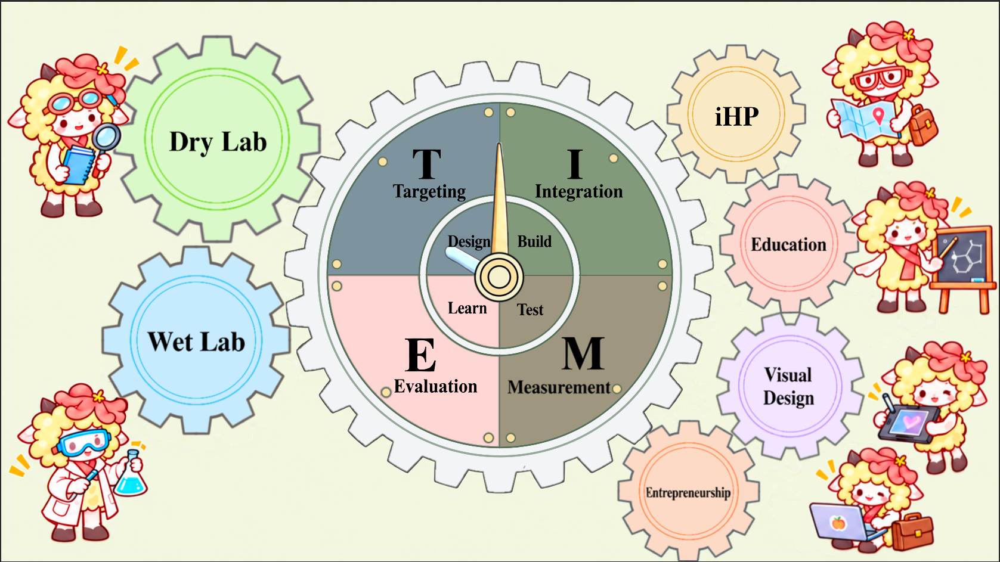

# Engineering改2

# Overview｜概述

**English\.** **TIME** is the engineering system developed by JLU\-FBH to organize the evidence\-driven development of CirCure\. **TIME** represents four connected project\-level cycles: **Targeting, Integration, Measurement and Evaluation**\. The system takes the form of a mechanical stopwatch: TIME is marked on the outer scale of the central gear, Design–Build–Test–Learn runs along the inner scale, and the two hands locate the project within its current cycle and engineering stage\. Yet TIME is more than an acronym\. It reflects the urgency at the heart of CirCure: when recurrence remains a possibility, every well\-founded decision should bring the next answer closer\. Our stopwatch therefore records how evidence from antigen selection, construct design and functional testing shapes each next engineering decision, while carrying our long\-term hope that this progress can help patients at high risk of recurrence gain more time to recover, be with their families and return to everyday life\.

**中文。** **TIME**是JLU\-FBH为组织CirCure循证工程进程而构建的系统。**TIME**代表四轮相互衔接的项目级循环：**Targeting、Integration、Measurement与Evaluation**。整套系统以机械停表呈现：中央大齿轮的外圈刻画TIME，内圈运行Design–Build–Test–Learn，两枚指针则共同定位项目所处的整体循环与当前工程阶段。但TIME不只是四个循环首字母组成的名字，它也回应着CirCure最初的紧迫感：面对复发风险，每一个经得起检验的决定，都应让下一个答案更快到来。这枚停表因此记录着抗原筛选、构建设计与功能验证中的证据如何转化为下一项工程决定，也承载着我们的长期愿望：让这些研究进展有机会为复发风险较高的患者争取更多用于康复、陪伴家人和回归日常生活的时间。



> **Figure E01｜The CirCure TIME Engineering System｜CirCure TIME工程系统**
>
> **English caption\.** CirCure TIME connects four project\-level cycles with recurring Design–Build–Test–Learn iterations and the coordinated engagement of the project teams\.
>
> **中文图注。** CirCure TIME通过各组之间的协同啮合，将四轮项目级循环与持续运行的Design–Build–Test–Learn迭代连接起来。

**English\.** In TIME, **Dry Lab and Wet Lab act as the primary driving gears**\. Dry Lab turns biological questions into traceable antigen and epitope decisions, structural hypotheses and quantitative predictions; Wet Lab converts these designs into physical constructs and molecular or cellular evidence\. Their alternating motion drives the central mechanism and gives rise to CircuForge, TorusFold, mathematical modelling\. **iHP, Education, Visual Design and Entrepreneurship operate as driven gears**, translating scientific progress into clinical and ethical refinements, transferable learning, coherent communication and development requirements\. Their feedback then enters the next DBTL iteration, guiding and extending the main drive\.

**中文。** 在TIME中，**Dry Lab与Wet Lab是两枚主要主动轮**。Dry Lab将生物学问题转化为可追踪的抗原与表位决策、结构假设和定量预测，Wet Lab则将这些设计转化为实体构建及分子和细胞证据。二者交替驱动中央机构，并形成CircuForge、TorusFold、数学模型等工程产出。**iHP、Education、Visual Design与Entrepreneurship作为从动齿轮**，将科学进展转化为临床与伦理修订、可传递的学习、连贯的项目表达及开发要求，并把反馈带入下一次DBTL，持续引导和拓展主传动路线。

https://static\.igem\.wiki/teams/6056/wiki/files/pages/project/engineering/engineering\-overviewcycle\.avif

最后一段的文字用上面这个图片在网页上展示⬆️

**English\.** Four connected cycles record how CirCure progressed through **TIME**\. **Cycle 1 — Targeting: From intended use to a four\-antigen strategy** defined the clinical purpose and antigen sources\. **Cycle 2 — Integration: From epitope exploration to Combined** connected prediction, structural review and experimental screening to form Combined\. **Cycle 3 — Measurement: Building the molecular and cellular evidence chain** followed circRNA from preparation and persistence to protein expression and immune\-cell function\. **Cycle 4 — Evaluation: Extending molecular and cellular evidence to in vivo evaluation** examined whether this activity translated into tumour control and associated immune responses in an animal model, alongside independent quantitative modelling\. Within each cycle, DBTL turned evidence and stakeholder feedback into concrete engineering decisions\.

**中文。** 四轮相互衔接的循环记录了CirCure沿**TIME**推进的过程。**Cycle 1——锁定目标：从预期用途到四抗原策略**明确临床目的与抗原来源；**Cycle 2——整合：从表位探索到Combined**连接预测、结构复核及实验筛选，形成Combined；**Cycle 3——测量：建立分子与细胞证据链**沿circRNA制备与持续性，推进至蛋白表达及免疫细胞功能；**Cycle 4——评价：将分子与细胞证据延伸至体内评价**结合独立定量模型，考察体外活性能否转化为动物模型中的肿瘤控制及相关免疫应答。每轮循环内，DBTL将证据与利益相关者反馈转化为具体工程决定。

# Cycle 1 — Targeting: From intended use to a four\-antigen strategy｜Cycle 1——锁定目标：从预期用途到四抗原策略

**English\.** TIME begins with **T—Targeting**\. This cycle moved from intended use to a four\-antigen strategy\. We first located the project within the TNBC treatment pathway, then translated that purpose into an RNA\-platform decision and a multilayer antigen\-selection route\. Education and Visual Design developed a shared language for circRNA, while Dry Lab, Software and Human Practices connected the scientific question with traceable evidence and experimental preparation\. By the end of the cycle, four antigen sources had gained support at the protein, malignant\-cell and patient levels, and a common human DC–T\-cell workflow had been established\.

**中文。** TIME从**T——锁定目标（Targeting）**开始。本轮从预期用途出发，逐步形成四抗原策略。我们首先定位项目在TNBC治疗路径中的作用，再将这一目标转化为RNA平台选择与多层抗原筛选路线。Education与Visual Design为circRNA形成共同语言，Dry Lab、Software及Human Practices则将科学问题与可追踪证据和实验准备连接起来。至本轮结束时，四种抗原来源已获得蛋白、恶性细胞和患者层面的支持，统一的人源DC–T细胞流程也已建立。

## Iteration 1\.1｜Defining the clinical use case｜明确临床应用情境

### Design｜设计

**English\.** We began with a clinical question: where could an additional immune intervention contribute most clearly in the TNBC treatment pathway? TNBC heterogeneity and recurrence after standard treatment directed our attention to patients who remain at higher risk after neoadjuvant treatment and surgery \(Garrido\-Castro et al\., 2019\)\. Runhui Tian encouraged us to explore an additional therapeutic approach for TNBC\.

**中文。** 我们首先提出一个临床问题：在TNBC治疗路径中，补充性免疫干预可以在哪个阶段发挥更明确的作用？TNBC的异质性以及标准治疗后的复发风险，使我们的关注点落在接受新辅助治疗和手术后仍面临较高风险的患者（Garrido\-Castro et al\., 2019）。田润辉老师建议团队围绕TNBC探索补充性的治疗方式。

> **References｜参考文献**
>
> Garrido\-Castro AC, Lin NU, Polyak K\. Insights into molecular classifications of triple\-negative breast cancer: improving patient selection for treatment\. *Cancer Discovery*\. 2019;9:176–198\. [doi:10\.1158/2159\-8290\.CD\-18\-1177](https://doi.org/10.1158/2159-8290.CD-18-1177)

### Build｜构建

**English\. **We combined this direction with literature research and clinical discussions with Lei Wang and Chengli Li, both oncology doctors, and **built an intended\-use specification with three defined elements\.** First, the clinical setting was the period after neoadjuvant treatment and surgery, when some patients remain at higher risk of recurrence\. Second, the proposed role was an antigen\-directed immune approach that could complement standard treatment\. Third, later development would require a documented antigen rationale, molecular eligibility criteria and measurable molecular and immune\-response evidence\. Tumour\-antigen expression and HLA compatibility were recorded as questions for the subsequent Dry Lab and epitope analyses\.

**中文。** 我们结合文献调研，以及与王磊、李成丽两位肿瘤科医生的临床讨论，建立了**包含三项明确内容的预期用途说明。**第一，临床情境定位于新辅助治疗及手术之后，部分患者仍面临较高复发风险的阶段；第二，项目拟探索一种能够补充标准治疗的抗原导向免疫策略；第三，后续开发需要形成抗原选择依据、分子适用条件以及可测量的分子与免疫应答证据。肿瘤抗原表达和HLA匹配则被记录为后续干实验及表位分析需要回答的问题。

### Test｜测试

**English\.** We placed the intended use after neoadjuvant treatment and surgery, focusing on TNBC patients with residual invasive disease and a high risk of recurrence\. This clinical setting defined four questions for subsequent evaluation: whether the selected antigens were expressed in the tumour, whether their epitopes matched the patient’s HLA type, whether the circRNA preparation could be reliably identified and whether it could induce measurable responses in the DC–T\-cell system\. The review therefore fixed the timing and initial patient population, while leaving the antigen\- and HLA\-based eligibility criteria to later analysis\.

**中文。** 我们将预期应用时间明确为新辅助治疗及手术之后，并将初步目标人群聚焦于仍存在残余浸润性病灶、复发风险较高的TNBC患者。这一临床情境进一步提出四项需要验证的问题：所选抗原是否在肿瘤中表达，其表位是否与患者HLA类型匹配，circRNA制备物能否得到可靠鉴定，以及其能否在DC–T细胞体系中产生可测量的免疫应答。由此，本轮复核明确了应用阶段与初步目标人群；具体的抗原及HLA适用条件则交由后续分析确定。

### Learn｜学习

**English\.** Literature and clinical consultation showed that recurrence risk may remain after surgery and systemic treatment, establishing a clear complementary position for an antigen\-directed immune approach\. We therefore retained the post\-treatment, higher\-risk TNBC setting as the project's intended use and translated it into three requirements for platform selection: the ability to encode tumour\-antigen sequences, support sustained expression and remain measurable from molecular preparation to immune function\. These requirements formed the Design of Iteration 1\.2\. Further details are provided in [Integrated Human Practices: clinical positioning](https://2026.igem.wiki/jlu-fbh/human-practices)\.

**中文。** 文献与临床咨询表明，部分患者在手术及系统治疗后仍存在复发风险，这为抗原导向免疫策略明确了补充位置。我们由此保留治疗后较高风险TNBC人群作为项目的预期应用情境，并将其转化为平台选择的三项要求：能够编码肿瘤抗原序列、支持持续表达，并允许从分子制备到免疫功能逐级测量。这三项要求直接形成Iteration 1\.2的Design。相关咨询与修订[详见Integrated Human Practices：临床定位](https://2026.igem.wiki/jlu-fbh/human-practices)。

## Iteration 1\.2｜Selecting a measurable circRNA platform｜选择可逐级检验的circRNA平台

### Design｜设计

**English\.** The intended\-use specification from Iteration 1\.1 gave us five criteria for platform selection: antigen\-coding capacity, RNA stability, duration of expression, immune\-stimulatory potential and compatibility with measurements available to the team\. We used these criteria to compare linear mRNA with engineered circRNA, allowing stability, expression and experimental measurability to enter the same decision\.

**中文。** Iteration 1\.1形成的预期用途说明为平台选择提供了五项标准：抗原编码能力、RNA稳定性、表达持续性、免疫刺激潜力，以及与团队可执行检测的兼容性。我们据此比较线性mRNA与工程化circRNA，使稳定性、表达特征与实验可测性共同进入平台决策。

### Build｜构建

**English\.** Literature research and technical discussions with Jifan Hu and Ruohan Yang were organized into a platform\-decision matrix\. The same work produced a five\-stage route linking the DNA template, linear transcription precursor, mature circRNA, encoded protein and immune function\. Published studies supported stable translation from engineered circRNA and showed that innate sensing depends on how the RNA is generated and prepared\. We therefore defined adjuvant\-like stimulation as a preparation\-dependent property to examine in later experiments \(Chen et al\., 2017; Wesselhoeft et al\., 2018; Wesselhoeft et al\., 2019\)\.

**中文。** 我们将文献调研及与胡继繁老师、杨若晗师姐的技术交流整理为平台决策矩阵，并据此建立连接DNA模板、线性转录前体、成熟circRNA、编码蛋白与免疫功能的五阶段路线。已有研究支持工程化circRNA的稳定翻译，也表明先天免疫识别会受到RNA生成和制备方式影响。因此，我们把佐剂样免疫刺激界定为需要在后续实验中考察的制备相关性质（Chen et al\., 2017；Wesselhoeft et al\., 2018；Wesselhoeft et al\., 2019）。

> **References｜参考文献**
>
> Chen YG, Kim MV, Chen X, et al\. Sensing self and foreign circular RNAs by intron identity\. *Molecular Cell*\. 2017;67:228–238\.e5\. [doi:10\.1016/j\.molcel\.2017\.05\.022](https://doi.org/10.1016/j.molcel.2017.05.022)
>
> Wesselhoeft RA, Kowalski PS, Anderson DG\. Engineering circular RNA for potent and stable translation in eukaryotic cells\. *Nature Communications*\. 2018;9:2629\. [doi:10\.1038/s41467\-018\-05096\-6](https://doi.org/10.1038/s41467-018-05096-6)
>
> Wesselhoeft RA, Kowalski PS, Parker\-Hale FC, et al\. RNA circularization diminishes immunogenicity and can extend translation duration in vivo\. *Molecular Cell*\. 2019;74:508–520\.e4\. [doi:10\.1016/j\.molcel\.2019\.02\.015](https://doi.org/10.1016/j.molcel.2019.02.015)

**Table C1\-01｜Platform decision matrix｜平台选择决策矩阵**

| Design requirement    | Linear mRNA                                                | Engineered circRNA                                                | Project check                                          | Design implication                                        |
| --------------------- | ---------------------------------------------------------- | ----------------------------------------------------------------- | ------------------------------------------------------ | --------------------------------------------------------- |
| Antigen coding        | Can encode the selected antigen sequence                   | Can encode the selected antigen sequence                          | Sequence and construct feasibility                     | Both formats meet the basic coding requirement            |
| RNA stability         | Free ends remain susceptible to exonuclease-mediated decay | Closed topology can improve nuclease resistance                   | Literature and technical consultation                  | circRNA better matches the intended persistence question  |
| Expression duration   | Expression is constrained by RNA lifetime                  | Engineered circRNA can extend translation duration                | Published expression studies                           | Supports staged persistence measurements                  |
| Immune stimulation    | Depends on sequence, modification, purity and delivery     | Innate sensing is tunable through RNA design and preparation      | Literature and iHP discussion                          | Evaluate it under defined preparation conditions          |
| Preparation           | Comparatively direct production route                      | Requires circularization and added identity checks                | Team facilities and planned Experiments                | Assign a measurable checkpoint to every preparation stage |
| Functional evaluation | Can enter protein and immune assays                        | Can enter the same downstream assays after circularization checks | FLAG expression, DC–T-cell culture and immune readouts | Provides a continuous molecule-to-function route          |

### Test｜测试

**English\.** We tested the selected platform against the operations required by the literature and the resources available to the team\. For each molecular stage, we asked whether there was a defined way to obtain the material, an accessible measurement and an observable output that could be passed to the next stage\.

**中文。** 我们依据文献与技术咨询提出的操作要求以及团队能够使用的实验条件，对所选平台进行逐阶段检验。对于每个分子阶段，我们分别确认材料如何获得、是否存在可执行的检测方法，以及能否形成可以交接到下一阶段的可观察输出。

**Table C1\-02｜Stage\-by\-stage feasibility check for the circRNA route｜circRNA路线的逐阶段可行性检查**

| Stage                          | Material source or operation                                                          | Available project check                                                                                                                                                                        | Observable output                                                                | Decision   |
| ------------------------------ | ------------------------------------------------------------------------------------- | ---------------------------------------------------------------------------------------------------------------------------------------------------------------------------------------------- | -------------------------------------------------------------------------------- | ---------- |
| DNA template                   | Recombinant plasmids assembled by a commercial service provider                       | Supplier plasmid map, sequence file and sample label were matched to the intended design before the delivered material entered the team’s recorded template-processing and transcription route | DNA template corresponding to the intended construct                             | Executable |
| Linear transcription precursor | In vitro transcription from the DNA template and the designed self-splicing precursor | RNA preparation and nucleic-acid analytical methods recorded in Experiments                                                                                                                    | Detectable linear precursor                                                      | Executable |
| Mature circRNA                 | Self-splicing and circularization of the precursor                                    | RNA purification, RNase R treatment and the corresponding nucleic-acid analysis recorded in Experiments                                                                                        | A circRNA preparation that can be evaluated separately from the linear precursor | Executable |
| Encoded protein                | Translation after cellular delivery                                                   | FLAG-associated protein-expression measurement                                                                                                                                                 | Expected FLAG-associated expression signal                                       | Executable |
| Immune function                | circRNA-loaded DCs co-cultured with T cells                                           | ELISpot, flow cytometry and target-cell killing assays                                                                                                                                         | IFN-γ-associated, activation and effector readouts                               | Executable |

**English\.** All five stages therefore had a defined source or procedure, an accessible measurement and an observable output\. This established the testability of the circRNA route; the resulting RNA, protein and immune\-response evidence is presented in the later cycles\.

**中文。** 五个阶段由此均具有明确的材料来源或操作、可执行的测量方式及可观察输出，说明circRNA路线能够进入逐级检验。相应的RNA、蛋白及免疫应答证据将在后续Cycle中呈现。

### Learn｜学习

**English\.** We selected circRNA as the project's working expression platform\. Its closed topology provided a clear stability rationale, published work supported prolonged expression, and its preparation\-dependent innate sensing defined an additional experimental question\. With the platform established, the next decision concerned its antigen payload\. That content question became the scientific thread carried into antigen selection\. Further details are provided in [Integrated Human Practices: platform selection](https://2026.igem.wiki/jlu-fbh/human-practices) and [Experiments: circRNA preparation and validation](https://2026.igem.wiki/jlu-fbh/experiments)\.

**中文。** 我们由此选择circRNA作为项目的工作表达平台。闭合结构为稳定性提供明确依据，已有研究支持较长的表达潜力，受制备条件影响的先天免疫识别则形成另一项实验问题。平台确定后，下一项决定转向其抗原载荷，这一内容问题由此进入后续抗原筛选。相关内容[详见Integrated Human Practices：平台选择](https://2026.igem.wiki/jlu-fbh/human-practices)及[Experiments：circRNA制备与验证](https://2026.igem.wiki/jlu-fbh/experiments)。

## Iteration 1\.3｜Building the first educational and visual entry｜建立首个教育与视觉入口

### Design｜设计

**English\.** Once circRNA became the working platform, Education and Visual Design asked how first\-time learners could encounter an unfamiliar molecular form without losing sight of its biomedical setting\. The scientific core needed to remain stable, while the teaching entry and visual language had to adapt to different schools\.

**中文。** circRNA成为工作平台后，Education与Visual Design开始思考：如何让第一次接触这一分子形式的学习者理解核心概念，同时保留其生物医学情境。科学核心需要保持一致，教学入口与视觉语言则应适应不同学校。

### Build｜构建

**English\.** We planned and delivered Winter Outreach across five schools, reaching approximately 308 students\. Five school\-adapted teaching decks introduced synthetic biology, linear and circular RNA and possible biomedical applications\. Dream circRNA used circular cardboard and coloured segments as a participatory activity after the scientific explanation\. The first sheep character and project emblem gave the materials a consistent identity\.

**中文。** 我们策划并实施五校寒假巡讲，覆盖约308名学生。团队制作五套根据不同学校情境调整的教学课件，介绍合成生物学、线性与环状RNA及其潜在生物医学应用。“梦想circRNA”在科学讲解后使用环形纸板和彩色扇环开展参与式活动；初版小羊形象与项目徽则为教学材料建立统一识别。

### Test｜测试

**English\.** In an end\-of\-session show\-of\-hands check, roughly 80% of students indicated that they understood the core distinction between linear and circular RNA introduced in class\. Their participation and completed Dream circRNA pieces showed that the circular form provided an accessible entry to the topic\. Differences among the five classrooms also showed that a shared scientific core benefited from school\-specific teaching routes\.

**中文。** 在课程结束时的现场举手核对中，约80%的学生表示理解了课堂介绍的线性RNA与环状RNA核心区别。学生的参与过程及完成的“梦想circRNA”作品表明，环状形式为理解这一陌生主题提供了易于进入的起点。五所学校的课堂反应存在差异，也说明共同科学核心需要与学校情境相适配的教学路径。

> **Figure C1\-01｜Winter Outreach and the first visual identity｜寒假巡讲与初版视觉识别****（此部分图片用村哥在网页上展示的那个插件）**
>
> https://static\.igem\.wiki/teams/6056/wiki/files/pages/project/engineering/engineering\-c1\-01\-1\.avif
>
> https://static\.igem\.wiki/teams/6056/wiki/files/pages/project/engineering/engineering\-c1\-01\-2\.avif
>
> https://static\.igem\.wiki/teams/6056/wiki/files/pages/project/engineering/engineering\-c1\-01\-3\.avif
>
> https://static\.igem\.wiki/teams/6056/wiki/files/pages/project/engineering/engineering\-c1\-01\-4\.avif
>
> https://static\.igem\.wiki/teams/6056/wiki/files/pages/project/engineering/engineering\-c1\-01\-5\.avif
>
> https://static\.igem\.wiki/teams/6056/wiki/files/pages/project/engineering/engineering\-c1\-01\-6\.avif
>
> https://static\.igem\.wiki/teams/6056/wiki/files/pages/project/engineering/engineering\-c1\-01\-7\.avif
>
> https://static\.igem\.wiki/teams/6056/wiki/files/pages/project/engineering/engineering\-c1\-01\-8\.avif
>
> https://static\.igem\.wiki/teams/6056/wiki/files/pages/project/engineering/engineering\-c1\-01\-9\.avif
>
> https://static\.igem\.wiki/teams/6056/wiki/files/pages/project/engineering/engineering\-c1\-01\-10\.avif
>
> https://static\.igem\.wiki/teams/6056/wiki/files/pages/project/engineering/engineering\-c1\-01\-11\.avif
>
> https://static\.igem\.wiki/teams/6056/wiki/files/pages/project/engineering/engineering\-c1\-01\-12\.avif
>
> https://static\.igem\.wiki/teams/6056/wiki/files/pages/project/engineering/engineering\-c1\-01\-13\.avif
>
> **English caption\.** Winter Outreach introduced circRNA through five school\-adapted teaching decks and the Dream circRNA activity\. The first sheep character and project emblem maintained visual continuity across the materials\.
>
> **中文图注。** 寒假巡讲通过五套适配学校情境的课件与“梦想circRNA”活动介绍环状RNA；初版小羊形象与项目徽使不同材料保持视觉连续。

### Learn｜学习

**English\.** We retained the first visual identity and adopted a **layered education approach** for later activities\. The scientific core remained consistent, while the depth of content, language, interaction and teaching materials were adjusted to learners’ ages, prior knowledge, learning settings and educational goals\. Vaccine Classroom, Virtual Laboratory and Synbio Classroom later applied this principle to different audiences and forms of learning\. Along the main scientific route, Iteration 1\.2 had also defined the next content question: which TNBC antigens should the circRNA encode? Further details are provided in [Education: Winter Outreach](https://2026.igem.wiki/jlu-fbh/education)\.

**中文。** 我们保留初版视觉识别，并为后续活动确立了**分层教育**思路：科学核心保持一致，同时根据学习者的年龄、已有知识、活动场景和学习目标，调整内容深度、表达语言、互动方式及教学材料。后续Vaccine Classroom、Virtual Laboratory与Synbio Classroom分别面向不同受众和学习形式延续这一原则。沿科学主线，Iteration 1\.2也进一步明确了下一项内容问题：circRNA应当编码哪些TNBC抗原？[详见Education：寒假巡讲](https://2026.igem.wiki/jlu-fbh/education)。

## Iteration 1\.4｜Defining a clinically grounded four\-antigen starting set｜形成具有临床依据的四抗原起始集合

### Design｜设计

**English\.** Iteration 1\.2 established circRNA as the molecular platform, leaving a central content question: which TNBC antigens should it encode? We therefore needed to identify a clinically relevant starting set before applying quantitative selection\. At this stage, an antigen needed documented relevance to human TNBC tissue and a connection to disease outcome or translational research; final retention would depend on the common evidence framework developed later\.

**中文。** Iteration 1\.2确立了circRNA分子平台，也留下一个核心内容问题：它应当编码哪些TNBC抗原？因此，在进入定量筛选前，我们首先需要形成具有临床相关性的起始集合。本阶段要求抗原在人TNBC组织中具有明确依据，并与疾病结局或转化研究建立联系；是否最终保留，则留待后续统一证据框架评价。

### Build｜构建

**English\.** We combined preliminary clinical\-data review, iHP discussions and literature research to build an initial four\-antigen evidence record\. This process identified TROP2 \(*TACSTD2*\), B7\-H4 \(*VTCN1*\), Nectin\-4 \(*NECTIN4*\) and LIV\-1 \(*SLC39A6*\) as the starting set\. For each antigen, we recorded its molecular identity, the TNBC population or tissue context in which it had been studied, the reported clinical or pathological observation and the question that remained for quantitative evaluation \(Izci et al\., 2022; Wang et al\., 2018; M\-Rabet et al\., 2017; Saravanan et al\., 2024\)\.

**中文。** 我们结合初步临床数据审查、iHP讨论与文献调研，建立四抗原起始证据记录，并确定TROP2（*TACSTD2*）、B7\-H4（*VTCN1*）、Nectin\-4（*NECTIN4*）和LIV\-1（*SLC39A6*）作为起始集合。对于每种抗原，我们记录其分子身份、已有研究涉及的TNBC人群或组织情境、已报道的临床或病理观察，以及仍需通过定量分析回答的问题（Izci et al\., 2022；Wang et al\., 2018；M\-Rabet et al\., 2017；Saravanan et al\., 2024）。

> **References｜参考文献**
>
> Izci H, Punie K, Waumans L, et al\. Correlation of TROP\-2 expression with clinical\-pathological characteristics and outcome in triple\-negative breast cancer\. *Scientific Reports*\. 2022;12:22498\. [doi:10\.1038/s41598\-022\-27093\-y](https://doi.org/10.1038/s41598-022-27093-y)
>
> Wang L, Yang C, Liu XB, Wang L, Kang FB\. B7\-H4 overexpression contributes to poor prognosis and drug\-resistance in triple\-negative breast cancer\. *Cancer Cell International*\. 2018;18:100\. [doi:10\.1186/s12935\-018\-0597\-9](https://doi.org/10.1186/s12935-018-0597-9)
>
> M\-Rabet M, Cabaud O, Josselin E, et al\. Nectin\-4: a new prognostic biomarker for efficient therapeutic targeting of primary and metastatic triple\-negative breast cancer\. *Annals of Oncology*\. 2017;28:769–776\. [doi:10\.1093/annonc/mdw678](https://doi.org/10.1093/annonc/mdw678)
>
> Saravanan R, Balasubramanian V, Sundaram S, et al\. Expression of cell surface zinc transporter LIV1 in triple negative breast cancer is an indicator of poor prognosis and therapy failure\. *Journal of Cellular Physiology*\. 2024;239\. [doi:10\.1002/jcp\.31203](https://doi.org/10.1002/jcp.31203)

### Test｜测试

**English\.** We reviewed each antigen against three starting questions: whether it had been studied in human TNBC samples, whether tumour\-associated expression had been reported and what clinical relevance the published evidence supported\. Studies documented TROP2 expression in TNBC tissue and its association with selected clinicopathological features; B7\-H4 expression associated with poor prognosis and drug resistance; Nectin\-4 expression in primary and metastatic TNBC with prognostic relevance; and LIV\-1 expression associated with aggressive features and therapy failure\. These findings provided a clinical basis for retaining all four antigen sources for systematic quantitative evaluation\. The following published tissue images illustrate their protein\-expression patterns, with the study population and source identified in each caption\.

**中文。** 我们围绕三项起始问题逐一复核四种抗原：是否在人TNBC样本中开展过研究、是否具有肿瘤相关表达证据，以及已发表证据支持怎样的临床相关性。相关研究记录了TROP2在TNBC组织中的表达及其与部分临床病理特征的关系；B7\-H4表达与较差预后及耐药的关联；Nectin\-4在原发和转移性TNBC中的表达及预后相关性；以及LIV\-1表达与侵袭性特征、治疗失败的关联。这些发现为保留四种抗原来源、开展系统定量评价提供了临床依据。以下已发表组织图像进一步展示其蛋白表达模式，各图对应的研究人群及来源分别在图注中说明。

> **Figure C1\-02A｜Published TROP2 staining in TNBC tissue｜已发表的TNBC组织TROP2染色**
>
> https://static\.igem\.wiki/teams/6056/wiki/files/pages/project/engineering/engineering\-c1\-02a\.avif
>
> **English caption\.** Representative TROP2 immunohistochemistry in TNBC tissue, showing intermediate staining in the left and middle fields and high staining in the right field\. Reproduced from Figure 2 of Izci et al\. \(2022\), under CC BY 4\.0; the tissue fields are retained and an external panel label has been added\.
>
> **中文图注。** TNBC组织中TROP2的代表性免疫组化图像，左侧与中间视野呈中等染色，右侧呈较强染色。转载自Izci等（2022）的Figure 2，采用CC BY 4\.0许可；保留完整组织视野，并添加外部面板编号。
>
> 
>
> **Figure C1\-02B｜Published B7\-H4 tissue\-staining patterns｜已发表的B7\-H4组织染色模式**
>
> https://static\.igem\.wiki/teams/6056/wiki/files/pages/project/engineering/engineering\-c1\-02b\.avif
>
> **English caption\.** Representative B7\-H4 immunostaining showing strong, moderate, weak and negative staining, as labelled in the source image\. Cropped from Figure 1d of Wang et al\. \(2018\), under CC BY 4\.0; source labels and scale bars are retained, with an external panel label added\.
>
> **中文图注。** B7\-H4代表性免疫组化图像，按原图标注展示强、中、弱及阴性染色。裁取自Wang等（2018）的Figure 1d，采用CC BY 4\.0许可；保留原图标签与比例尺，并添加外部面板编号。
>
> 
>
> **Figure C1\-02C｜Published Nectin\-4 staining in TNBC tissue｜已发表的TNBC组织Nectin\-4染色**
>
> https://static\.igem\.wiki/teams/6056/wiki/files/pages/project/engineering/engineering\-c1\-02c\.avif
>
> **English caption\.** Representative TNBC tissue showing strong, moderate and negative Nectin\-4 staining in the original panels A, B and C, respectively \(200× magnification\)\. Reproduced from Figure 1 of Zeindler et al\. \(2019\), under CC BY; original panel labels and scale bars are retained, with an external panel label added\.
>
> **中文图注。** TNBC组织中Nectin\-4的代表性强、中及阴性染色，分别对应原图A、B和C面板（200倍放大）。转载自Zeindler等（2019）的Figure 1，采用CC BY许可；保留原面板标签与比例尺，并添加外部面板编号。
>
> 
>
> **Figure C1\-02D｜Published SLC39A6/LIV\-1 staining in breast\-cancer tissue｜已发表的乳腺癌组织SLC39A6/LIV\-1染色**
>
> https://static\.igem\.wiki/teams/6056/wiki/files/pages/project/engineering/engineering\-c1\-02d\.avif
>
> **English caption\.** Representative positive and negative SLC39A6/LIV\-1 immunostaining in breast\-cancer tissue, corresponding to the original panels A and B\. Reproduced from Figure 1 of Althobiti et al\. \(2021\), under CC BY 4\.0; an external panel label has been added\. These images illustrate breast\-cancer tissue staining rather than TNBC\-specific prevalence\.
>
> **中文图注。** 乳腺癌组织中SLC39A6/LIV\-1阳性与阴性的代表性免疫组化图像，分别对应原图A和B面板。转载自Althobiti等（2021）的Figure 1，采用CC BY 4\.0许可，并添加外部面板编号。本图展示乳腺癌组织染色，不用于表示TNBC特异性阳性率。

### Learn｜学习

**English\.** The four\-antigen starting set answered what the project should evaluate, while also clarifying that literature findings obtained from different cohorts and measurements could not by themselves determine final retention\. We therefore needed a common framework that examined protein abundance, malignant\-cell localization, patient representation and clinical evidence as distinct but connected dimensions\. Building that framework became the next design\. Further details are provided in [Bioinformatics: clinical starting evidence](https://2026.igem.wiki/jlu-fbh/bioinformatics) and [Integrated Human Practices: antigen\-selection route](https://2026.igem.wiki/jlu-fbh/human-practices)\.

**中文。** 四抗原起始集合明确了项目需要评价什么，也说明来自不同队列和测量方式的文献发现尚不足以单独决定最终保留。我们因此需要建立统一框架，分别考察蛋白丰度、恶性细胞定位、患者代表范围和临床证据，并使四个维度相互衔接。建立这套框架由此成为下一轮Design。[详见Bioinformatics：临床起始证据](https://2026.igem.wiki/jlu-fbh/bioinformatics)及[Integrated Human Practices：抗原筛选路线](https://2026.igem.wiki/jlu-fbh/human-practices)。

## Iteration 1\.5｜Building a four\-dimensional antigen\-evidence framework｜建立四维抗原证据框架

### Design｜设计

**English\.** Iteration 1\.4 established TROP2, B7\-H4, Nectin\-4 and LIV\-1 as a clinically grounded starting set\. To determine how these antigens should be evaluated under a common standard, we translated antigen selection into four measurable questions: whether each antigen was supported at the protein level in TNBC tissue; whether its expression was enriched in malignant cells; how broadly and complementarily it represented different patients; and how strongly tissue, disease and translational studies supported its clinical relevance\. In consultation with Associate Professor Qingtian Guan, we separated these questions so that each type of evidence would support a defined decision\.

**中文。** Iteration 1\.4形成了由TROP2、B7\-H4、Nectin\-4和LIV\-1组成的临床相关起始集合。为了用共同标准评价四种抗原，我们将抗原筛选转化为四项可测问题：每种抗原能否在TNBC组织中获得蛋白层支持；其表达是否富集于恶性细胞；它在不同患者中具有怎样的代表范围与互补性；组织、疾病及转化研究能够为其临床相关性提供多强的支持。通过与管青天副教授的咨询，我们将四项问题分别处理，使每类证据对应明确的工程决定。

### Build｜构建

**English\.** We built a four\-dimensional antigen\-evidence framework\. **Protein abundance** evaluated whether each antigen was present and increased at the protein level in TNBC tissue\. **Malignant\-cell enrichment** located the corresponding expression signal within malignant and non\-malignant cellular compartments\. **Patient representation** measured the individual and combined reach of the four genes across TNBC cases\. **Clinical evidence** integrated published histopathological, prognostic and translational findings\. Normal\-tissue expression was retained as a parallel safety consideration\. This structure followed established principles for tumour\-antigen prioritization \(Cheever et al\., 2009\)\.

**中文。** 我们据此建立四维抗原证据框架。**蛋白丰度**评价每种抗原能否在TNBC组织中获得蛋白层检出及升高证据；**恶性细胞富集**定位相应表达信号在恶性与非恶性细胞区室中的分布；**患者代表范围**测量四个基因在TNBC病例中的单独覆盖与组合覆盖；**临床证据**整合已发表的组织病理、预后及转化研究。正常组织表达则作为并行的安全性考量。这一结构与已有肿瘤抗原优先级原则一致（Cheever et al\., 2009）。

> **References｜参考文献**
>
> Cheever MA, Allison JP, Ferris AS, et al\. The prioritization of cancer antigens: a National Cancer Institute pilot project for the acceleration of translational research\. *Clinical Cancer Research*\. 2009;15:5323–5337\. [doi:10\.1158/1078\-0432\.CCR\-09\-0737](https://doi.org/10.1158/1078-0432.CCR-09-0737)

### Test｜测试

**English\.** We tested whether the framework could be executed by assigning an accessible evidence source, measurable output and engineering decision to every dimension\. Public TNBC quantitative\-proteomics cohorts could measure protein abundance; a cell\-resolved breast\-cancer atlas could locate expression among malignant and non\-malignant compartments; patient\-level cancer\-genomics records could quantify individual and combined antigen representation; and published tissue and translational studies could provide clinical context\. This source\-readiness check confirmed that all four antigens could enter the same evidence structure and established the order in which the four dimensions would be examined\.

**中文。** 我们通过为每个维度指定可获取的证据来源、可测输出和工程决定，检验这套框架能否实际执行。公开TNBC定量蛋白组队列可用于测量蛋白丰度；具有细胞分辨率的乳腺癌图谱可用于定位恶性与非恶性细胞中的表达；患者层癌症基因组记录可用于量化单种抗原及其组合的代表范围；已发表的组织与转化研究则可补充临床情境。这项证据来源完备性检查确认四种抗原均可进入同一套评价结构，并确定了四个维度依次接受检验的顺序。

### Learn｜学习

**English\.** The framework converted the four\-antigen starting set into an executable evidence sequence\. We would first test protein\-level support, then locate the expression signal at cellular resolution, extend the comparison across patients and finally integrate the quantitative results with clinical evidence\. Quantitative proteomics therefore became the next design\.

The finalized evidence map is shown below\. Further details are provided in [Bioinformatics: antigen\-selection framework](https://2026.igem.wiki/jlu-fbh/bioinformatics) and [Integrated Human Practices: Dry Lab route](https://2026.igem.wiki/jlu-fbh/human-practices)\.

**中文。** 这套框架将四抗原起始集合转化为可以依次执行的证据路线：首先检验蛋白层支持，随后在细胞分辨率下定位表达信号，再把比较延伸至不同患者，最后将定量结果与临床证据共同整合。因此，定量蛋白组分析成为下一轮Design。

最终形成的证据图谱如下。[详见Bioinformatics：抗原筛选框架](https://2026.igem.wiki/jlu-fbh/bioinformatics)及[Integrated Human Practices：Dry Lab路线](https://2026.igem.wiki/jlu-fbh/human-practices)。

**Table C1\-03｜Four\-dimensional antigen\-evidence map｜四维抗原证据图谱**

| Evidence dimension        | Question                                                                           | Primary source                                             | Decision produced                                                  |
| ------------------------- | ---------------------------------------------------------------------------------- | ---------------------------------------------------------- | ------------------------------------------------------------------ |
| Protein abundance         | Is each antigen supported by protein-level measurements in TNBC tissue?            | Public TNBC quantitative-proteomics cohorts                | Retain or reconsider each antigen source                           |
| Malignant-cell enrichment | Is the corresponding expression signal enriched in malignant cells?                | A public cell-resolved breast-cancer atlas                 | Establish tumour-cell relevance and cellular complementarity       |
| Patient representation    | How broadly do individual antigens and their union represent TNBC cases?           | Patient-level cancer-genomics records                      | Evaluate the patient-level value of retaining four antigen sources |
| Clinical evidence         | How do tissue, prognostic and translational studies support continued development? | Published TNBC histopathological and translational studies | Integrate quantitative results with clinical context               |

## Iteration 1\.6｜Testing the four antigen sources with protein evidence｜以蛋白证据检验四种抗原来源

### Design｜设计

**English\.** Following the evidence order established in Iteration 1\.5, we first asked whether the four antigen candidates were supported by quantitative protein measurements in TNBC tissue and whether their abundance was higher in tumours than in normal or adjacent\-normal tissue\. PXD024322 and PXD028102 are ProteomeXchange accessions for two public quantitative\-proteomics cohorts with complementary designs\. PXD024322 provided 88 TNBC tumours and 38 normal\-breast samples; PXD028102 included 82 TNBC tumours, of which 66 had matched adjacent\-normal tissue \(Asleh et al\., 2022; Gong et al\., 2022\)\.

**中文。** 按照Iteration 1\.5确定的证据顺序，我们首先考察四种候选抗原能否在TNBC组织中获得定量蛋白测量支持，以及其蛋白丰度是否高于正常或邻近正常组织。PXD024322与PXD028102是ProteomeXchange收录的两个公开定量蛋白组队列编号，二者具有互补设计：PXD024322包含88例TNBC肿瘤与38例正常乳腺样本；PXD028102包含82例TNBC肿瘤，其中66例具有配对邻近正常组织（Asleh et al\., 2022；Gong et al\., 2022）。

> **References｜参考文献**
>
> Asleh K, Negri GL, Spencer Miko SE, et al\. Proteomic analysis of archival breast cancer clinical specimens identifies biological subtypes with distinct survival outcomes\. *Nature Communications*\. 2022;13:896\. [doi:10\.1038/s41467\-022\-28524\-0](https://doi.org/10.1038/s41467-022-28524-0)
>
> Gong Y, Ji P, Yang YS, et al\. Metabolic\-pathway\-based subtyping of triple\-negative breast cancer reveals potential therapeutic targets\. *Cell Reports*\. 2022;39:110460\. [doi:10\.1016/j\.celrep\.2022\.110460](https://doi.org/10.1016/j.celrep.2022.110460)

### Build｜构建

**English\.** We built a reproducible proteomic\-analysis workflow that retained sample, batch and patient identities\. PXD024322 used a `Batch + Condition` model to compare TNBC tumours with normal\-breast samples while accounting for TMT batches; proteins required at least two non\-missing measurements in each group to enter statistical testing\. PXD028102 used a paired `subject + condition` model, with `subject` identifying the 66 tumour–adjacent\-normal patient pairs\. Four left\-censored imputation settings assessed sensitivity to missing\-value handling\. Both analyses used limma empirical\-Bayes moderation and Benjamini–Hochberg correction across the proteins entering each analysis \(Ritchie et al\., 2015; Benjamini and Hochberg, 1995\)\.

**中文。** 我们建立可复现的蛋白组分析流程，保留样本、批次及患者身份。PXD024322采用`Batch + Condition`模型，在校正TMT批次后比较TNBC肿瘤与正常乳腺样本；蛋白需在每组至少具有两个非缺失测量值，才能进入统计检验。PXD028102采用配对的`subject + condition`模型，其中`subject`标识66对患者的肿瘤与邻近正常组织，并通过四种左删失填补设置检验结果对缺失值处理的敏感性。两项分析均使用limma经验贝叶斯方法，并在各自进入分析的蛋白范围内进行Benjamini–Hochberg校正（Ritchie et al\., 2015；Benjamini and Hochberg, 1995）。

> **References｜参考文献**
>
> Ritchie ME, Phipson B, Wu D, et al\. limma powers differential expression analyses for RNA\-sequencing and microarray studies\. *Nucleic Acids Research*\. 2015;43:e47\. [doi:10\.1093/nar/gkv007](https://doi.org/10.1093/nar/gkv007)
>
> Benjamini Y, Hochberg Y\. Controlling the false discovery rate: a practical and powerful approach to multiple testing\. *Journal of the Royal Statistical Society Series B*\. 1995;57:289–300\. [doi:10\.1111/j\.2517\-6161\.1995\.tb02031\.x](https://doi.org/10.1111/j.2517-6161.1995.tb02031.x)

**Code C1\-01｜Proteomic\-analysis script excerpts｜蛋白组分析脚本节选**

**English note\.** The excerpts retain the original model specifications, filtering rules, imputation settings and output filenames\. Data loading, function definitions and complete result\-table assembly are provided in the full script\.

**中文说明。** 以下节选保留原脚本的模型设置、筛选规则、缺失值填补设置及输出文件名；数据读取、函数定义和完整结果表组装见完整脚本。
【代码块的效果要平时可以折叠起来折叠成一行然后可以点击进行展开然后再点击可以收起】

**PXD024322｜Batch\-adjusted comparison｜批次校正比较**

```Plain
# Original script: 08_pxd024322_limma_tnbc_vs_normal.R

normal_columns <- metadata$Condition == "Normal"
tnbc_columns <- metadata$Condition == "TNBC"

normal_n <- rowSums(!is.na(expression[, normal_columns, drop = FALSE]))
tnbc_n <- rowSums(!is.na(expression[, tnbc_columns, drop = FALSE]))
total_n <- normal_n + tnbc_n

# Test proteins with at least 2 nonmissing values in each group.
# Retain all proteins in the complete results table.
testable <- normal_n >= 2 & tnbc_n >= 2

design <- model.matrix(~ Batch + Condition, data = metadata)
if (qr(design)$rank != ncol(design)) {
  stop("Design matrix is not full rank: batch and condition are confounded.")
}

fit <- lmFit(expression[testable, , drop = FALSE], design)
fit <- eBayes(fit, trend = TRUE, robust = TRUE)
tested_results <- topTable(
  fit,
  coef = "ConditionTNBC",
  number = Inf,
  sort.by = "none"
)

# After complete result-table assembly:
full_results$TNBC_coverage <- full_results$TNBC_n / full_results$TNBC_total
full_results$Normal_coverage <- full_results$Normal_n / full_results$Normal_total
full_results$Primary_high_coverage <- (
  full_results$TNBC_coverage >= 0.70 &
    full_results$Normal_coverage >= 0.70
)
full_results$Meets_conservative_screen <- (
  !is.na(full_results$adj.P.Val) &
    full_results$adj.P.Val < 0.05 &
    full_results$log2FC_TNBC_minus_Normal >= 0.5
)

write.csv(
  full_results,
  file.path(result_dir, "PXD024322_TNBC_vs_Normal_limma_ALL_9088_proteins.csv"),
  row.names = FALSE,
  na = ""
)

primary_results <- subset(full_results, Primary_high_coverage & Testable)
write.csv(
  primary_results,
  file.path(result_dir, "PXD024322_TNBC_vs_Normal_limma_primary_high_coverage.csv"),
  row.names = FALSE,
  na = ""
)
```

**PXD028102｜Patient\-paired comparison and missingness sensitivity｜患者配对比较与缺失值敏感性分析**

```Plain
# Original script: 12_pxd028102_missingness_sensitive_limma.R
# subject represents the patient identifier (PatientID).

tumor_columns <- grep("T_Prot$", names(abundance), value = TRUE)
nat_columns <- grep("P_Prot$", names(abundance), value = TRUE)
tumor_ids <- sub("T_Prot$", "", tumor_columns)
nat_ids <- sub("P_Prot$", "", nat_columns)
paired_ids <- intersect(tumor_ids, nat_ids)

if (length(paired_ids) != 66L) {
  stop("Expected 66 tumor-NAT patient pairs; found ", length(paired_ids))
}

sample_columns <- c(
  paste0(paired_ids, "P_Prot"),
  paste0(paired_ids, "T_Prot")
)
condition <- factor(
  c(rep("NAT", length(paired_ids)), rep("TNBC", length(paired_ids))),
  levels = c("NAT", "TNBC")
)
subject <- factor(rep(paired_ids, 2))
design <- model.matrix(~ subject + condition)
coefficient_name <- "conditionTNBC"

# run_limma() performs left-censored imputation and then:
# lmFit(imputed, design)
# eBayes(fit, trend = TRUE, robust = TRUE)
# topTable(fit, coef = coefficient_name, number = Inf, sort.by = "none")

sensitivity_settings <- data.frame(
  quantile_probability = c(0.005, 0.01, 0.01, 0.05),
  offset = c(1.0, 0.5, 1.0, 1.0),
  method = c(
    "q0.5pct_minus1.0",
    "q1pct_minus0.5",
    "q1pct_minus1.0_primary",
    "q5pct_minus1.0"
  ),
  stringsAsFactors = FALSE
)

all_results <- vector("list", nrow(sensitivity_settings))
for (index in seq_len(nrow(sensitivity_settings))) {
  setting <- sensitivity_settings[index, ]
  all_results[[index]] <- run_limma(
    quantile_probability = setting$quantile_probability,
    offset = setting$offset,
    method_name = setting$method
  )
}

primary <- all_results[[3]]
write.csv(
  primary,
  file.path(result_dir, "PXD028102_paired_limma_imputed_ALL.csv"),
  row.names = FALSE,
  fileEncoding = "UTF-8"
)
```

### Test｜测试

**English\.** PXD024322 provided quantitative protein evidence for all four candidates\. Compared with normal\-breast samples, average abundance was higher in TNBC tumours for TROP2 \(1\.14\-fold, FDR = 0\.0370\), B7\-H4 \(1\.20\-fold, FDR = 0\.0446\), Nectin\-4 \(1\.35\-fold, FDR = 7\.14 × 10⁻⁹\) and LIV\-1 \(1\.34\-fold, FDR = 1\.88 × 10⁻⁵\)\. In the paired PXD028102 analysis, TROP2, B7\-H4 and Nectin\-4 were respectively 18\.25\-, 3\.72\- and 7\.12\-fold more abundant in tumours than in matched adjacent\-normal tissue, with FDR values of 2\.14 × 10⁻¹⁵, 7\.15 × 10⁻⁶ and 2\.13 × 10⁻¹¹\. LIV\-1 was not quantified in this cohort and retained its protein\-level support from PXD024322\. Together, the two cohorts supported carrying all four antigen sources forward\.

**中文。** PXD024322为四种候选抗原均提供了定量蛋白证据。与正常乳腺样本相比，TROP2、B7\-H4、Nectin\-4和LIV\-1在TNBC肿瘤中的平均丰度分别升高1\.14倍、1\.20倍、1\.35倍和1\.34倍，相应FDR分别为0\.0370、0\.0446、7\.14 × 10⁻⁹和1\.88 × 10⁻⁵。在PXD028102配对分析中，TROP2、B7\-H4和Nectin\-4在肿瘤中的丰度分别为匹配邻近正常组织的18\.25倍、3\.72倍和7\.12倍，相应FDR分别为2\.14 × 10⁻¹⁵、7\.15 × 10⁻⁶和2\.13 × 10⁻¹¹。LIV\-1未在该队列中获得定量，其蛋白层支持由PXD024322提供。两个队列共同支持四种抗原来源继续进入后续评价。

> **Figure C1\-03A｜Differential protein abundance in PXD024322｜PXD024322蛋白差异丰度**
>
> https://static\.igem\.wiki/teams/6056/wiki/files/pages/project/engineering/engineering\-c1\-03a\.avif
>
> **English caption\.** Volcano plot comparing TNBC tumours with normal\-breast samples in PXD024322 using a batch\-adjusted limma model\. Axes show the fitted log₂ fold change and −log₁₀ Benjamini–Hochberg\-adjusted P value\. TROP2, B7\-H4, LIV\-1 and Nectin\-4 are highlighted against the quantified proteome\.
>
> **中文图注。** PXD024322中TNBC肿瘤与正常乳腺样本的蛋白差异丰度火山图，采用校正批次的limma模型。横纵轴分别为拟合的log₂倍数变化及Benjamini–Hochberg校正P值的−log₁₀转换，图中突出TROP2、B7\-H4、LIV\-1及Nectin\-4。
>
> 
>
> **Figure C1\-03B｜Candidate\-protein abundance in PXD024322｜PXD024322候选蛋白丰度**
>
> https://static\.igem\.wiki/teams/6056/wiki/files/pages/project/engineering/engineering\-c1\-03b\.avif
>
> **English caption\.** Batch\-adjusted log₂ protein\-abundance distributions for TROP2, B7\-H4, LIV\-1 and Nectin\-4 in PXD024322\. Grey and orange points represent normal\-breast and TNBC samples, respectively\. Each panel reports the fitted log₂ fold change and Benjamini–Hochberg\-adjusted P value\.
>
> **中文图注。** PXD024322中TROP2、B7\-H4、LIV\-1及Nectin\-4经批次校正的log₂蛋白丰度分布。灰色与橙色散点分别代表正常乳腺及TNBC样本，各面板标注拟合的log₂倍数变化与Benjamini–Hochberg校正P值。
>
> 
>
> **Figure C1\-03C｜Paired differential protein abundance in PXD028102｜PXD028102配对蛋白差异丰度**
>
> https://static\.igem\.wiki/teams/6056/wiki/files/pages/project/engineering/engineering\-c1\-03c\.avif
>
> **English caption\.** Volcano plot from the patient\-paired limma comparison of TNBC tumours and matched normal\-adjacent tissue in PXD028102\. Axes show the fitted log₂ fold change and −log₁₀ Benjamini–Hochberg\-adjusted P value\. TROP2, B7\-H4 and Nectin\-4 are highlighted\.
>
> **中文图注。** PXD028102中TNBC肿瘤与患者匹配癌旁正常组织的配对limma分析火山图。横纵轴分别为拟合的log₂倍数变化及Benjamini–Hochberg校正P值的−log₁₀转换，图中突出TROP2、B7\-H4及Nectin\-4。
>
> 
>
> **Figure C1\-03D｜Candidate\-protein abundance in PXD028102｜PXD028102候选蛋白丰度**
>
> https://static\.igem\.wiki/teams/6056/wiki/files/pages/project/engineering/engineering\-c1\-03d\.avif
>
> **English caption\.** Target\-centred log₂ abundance distributions for TROP2, B7\-H4 and Nectin\-4 in PXD028102\. Grey and orange points represent normal\-adjacent tissue \(NAT\) and TNBC samples, respectively\. Diamonds and connecting lines indicate group means, while statistical estimates derive from the patient\-paired model; the lines do not connect individual patient pairs\.
>
> **中文图注。** PXD028102中TROP2、B7\-H4及Nectin\-4按各目标蛋白中心化的log₂丰度分布。灰色与橙色散点分别代表癌旁正常组织（NAT）及TNBC样本。菱形与连线标示组均值，统计估计来自患者配对模型；图中连线并非逐患者配对连线。

### Learn｜学习

**English\.** Quantitative proteomics established protein\-level support for all four antigen sources: PXD024322 measured all four candidates, while the matched design of PXD028102 independently reinforced TROP2, B7\-H4 and Nectin\-4\. We therefore retained the complete four\-antigen starting set\. The next question concerned cellular origin: tumour tissue contains malignant, immune and stromal compartments, so a cell\-resolved analysis was required to determine where the corresponding expression signals arose\. This became the next design\. Further details are provided in [Bioinformatics: proteomic evidence](https://2026.igem.wiki/jlu-fbh/bioinformatics)\.

**中文。** 定量蛋白组分析为四种抗原来源建立了蛋白层支持：PXD024322测量了全部四种候选抗原，PXD028102的患者配对设计则进一步支持TROP2、B7\-H4和Nectin\-4的肿瘤相关升高。因此，我们保留完整的四抗原起始集合。下一项问题转向信号的细胞来源：肿瘤组织同时包含恶性、免疫和基质细胞，需要通过细胞分辨分析判断相应表达信号来自哪些细胞区室。这由此成为下一轮Design。[详见Bioinformatics：蛋白组证据](https://2026.igem.wiki/jlu-fbh/bioinformatics)。

## Iteration 1\.7｜Locating antigen expression within malignant\-cell diversity｜在恶性细胞多样性中定位抗原表达

### Design｜设计

**English\.**  The proteomic results supported all four antigen sources in TNBC tissue, but tumour samples also contain immune, stromal and endothelial cells\.We therefore asked whether the corresponding genes were enriched in malignant cells and whether they marked the same or complementary malignant\-cell populations\. GSE176078—the accession number of a public single\-cell and spatial atlas of human breast cancer in the Gene Expression Omnibus—retained the patient and cell\-type identities required for this analysis \(Wu et al\., 2021\)\.

**中文。** 蛋白组结果为TNBC组织中的四种抗原来源提供了支持，但肿瘤样本同时包含免疫、基质和内皮细胞。因此，我们进一步考察相应基因是否富集于恶性细胞，以及它们标记的是相同还是互补的恶性细胞群。GSE176078是Gene Expression Omnibus数据库中一项公开人乳腺癌单细胞与空间图谱的收录编号，该数据保留了这项分析所需的患者身份与细胞类型信息（Wu et al\., 2021）。

> **References｜参考文献**
>
> Wu SZ, Al\-Eryani G, Roden DL, et al\. A single\-cell and spatially resolved atlas of human breast cancers\. \*Nature Genetics\*\. 2021;53:1334–1347\. [doi:10\.1038/s41588\-021\-00911\-1](https://doi.org/10.1038/s41588-021-00911-1)

### Build｜构建

**English\.** We established a unified workflow for the ten TNBC\-derived samples selected from GSE176078\. Quality control was performed within each sample, followed by SCTransform normalization and Harmony integration for cell\-level visualization\. To assess malignant\-cell enrichment, raw gene counts were aggregated by patient and cell compartment for pseudobulk analysis\. The eight patients with paired malignant and non\-malignant compartments served as biological replicates \(Hafemeister and Satija, 2019; Korsunsky et al\., 2019; Robinson et al\., 2010\)\. For the eight cases containing retained malignant cells, we also calculated the four\-gene detection union: a cell was counted as positive when at least one candidate gene had a raw UMI count above zero\. The positive fraction within each case, together with its malignant\-cell count, supplied the case\-wise pie\-chart summary\.

**中文。** 我们为GSE176078中选取的10个TNBC来源样本建立统一分析流程。首先在各样本内部开展质量控制，再通过SCTransform进行表达归一化，并使用Harmony整合细胞以开展可视化。为评价恶性细胞富集，我们按患者及细胞区室汇总原始基因计数，开展pseudobulk分析，以具备恶性与非恶性区室配对数据的8例患者作为生物学重复（Hafemeister and Satija, 2019；Korsunsky et al\., 2019；Robinson et al\., 2010）。对于保留了恶性细胞的8个病例，我们进一步计算四基因检出并集：至少一个候选基因的原始UMI计数大于零时，该细胞被记为阳性。各病例的阳性比例及恶性细胞数量共同构成病例饼图的统计依据。

> **References｜参考文献**
>
> Hafemeister C, Satija R\. Normalization and variance stabilization of single\-cell RNA\-seq data using regularized negative binomial regression\. *Genome Biology*\. 2019;20:296\. [doi:10\.1186/s13059\-019\-1874\-1](https://doi.org/10.1186/s13059-019-1874-1)
>
> Korsunsky I, Millard N, Fan J, et al\. Fast, sensitive and accurate integration of single\-cell data with Harmony\. *Nature Methods*\. 2019;16:1289–1296\. [doi:10\.1038/s41592\-019\-0619\-0](https://doi.org/10.1038/s41592-019-0619-0)
>
> Robinson MD, McCarthy DJ, Smyth GK\. edgeR: a Bioconductor package for differential expression analysis of digital gene expression data\. *Bioinformatics*\. 2010;26:139–140\. [doi:10\.1093/bioinformatics/btp616](https://doi.org/10.1093/bioinformatics/btp616)

### Test｜测试

**English\.** The analysis retained 39,324 cells, including 9,491 malignant cells\. All four candidate genes were enriched in the malignant compartment, with lower detection rates in immune cells and cancer\-associated fibroblasts\. TROP2 had the highest individual malignant\-cell detection rate at 70\.4%; combining the four genes increased this fraction to 81\.4% \(7,727/9,491\), while 7\.3% had all four detected\. Across the eight cases shown, the union fractions ranged from 52\.5% to 97\.8%\. These results supported retaining complementary antigen sources rather than relying on a single gene\.

**中文。** 分析保留39,324个细胞，其中9,491个为恶性细胞。四个候选基因均在恶性细胞中富集，在免疫细胞及癌症相关成纤维细胞中的检出率较低。TROP2单独的恶性细胞检出率最高，为70\.4%；四基因组合将这一比例扩展至81\.4%（7,727/9,491），同时检出四个基因的比例为7\.3%。图示8个病例的并集比例为52\.5%–97\.8%。这些结果为保留互补抗原来源、减少对单一基因的依赖提供了依据。

**Table C1\-04｜Malignant\-cell enrichment and compartment\-specific detection of candidate genes｜候选基因的恶性细胞富集与细胞区室检出率**

| Gene    | Antigen  | Malignant vs non-malignant log₂ fold change | FDR         | Malignant-cell detection | Immune-cell detection | CAF detection |
| ------- | -------- | ------------------------------------------- | ----------- | ------------------------ | --------------------- | ------------- |
| TACSTD2 | TROP2    | 4.074                                       | 8.37 × 10⁻⁵ | 70.40%                   | 4.00%                 | 5.40%         |
| SLC39A6 | LIV-1    | 0.853                                       | 0.0196      | 39.40%                   | 8.50%                 | 20.70%        |
| NECTIN4 | Nectin-4 | 4.755                                       | 3.70 × 10⁻⁶ | 37.80%                   | 1.00%                 | 0.60%         |
| VTCN1   | B7-H4    | 5.393                                       | 2.52 × 10⁻⁵ | 19.80%                   | 0.30%                 | 0.40%         |

**English note\.** Log₂ fold changes and FDR values describe the patient\-paired pseudobulk comparison between malignant and non\-malignant compartments\. Detection rates indicate the fraction of cells within each compartment with a raw UMI count greater than zero for the corresponding gene\. CAF, cancer\-associated fibroblast\.

**中文表注。** log₂倍数变化与FDR对应以患者为单位的恶性与非恶性细胞配对pseudobulk比较。检出率指各细胞区室中，对应基因原始UMI计数大于零的细胞比例。CAF为癌症相关成纤维细胞。

> **Figure C1\-04A｜Cell\-lineage distribution in the TNBC single\-cell subset｜TNBC单细胞子集的细胞谱系分布**
>
> https://static\.igem\.wiki/teams/6056/wiki/files/pages/project/engineering/engineering\-c1\-04a\.avif
>
> **English caption\.** Harmony\-integrated UMAP of the 39,324 quality\-controlled cells in the GSE176078 TNBC subset\. Each point represents a cell, coloured by its annotated major lineage\. The map locates malignant cells alongside epithelial, immune, stromal and endothelial populations\.
>
> **中文图注。** GSE176078 TNBC子集中39,324个质量控制后细胞的Harmony整合UMAP。每个点代表一个细胞，颜色对应其主要谱系注释。图中展示恶性细胞及上皮、免疫、基质和内皮等细胞群的分布。
>
> 
>
> **Figure C1\-04B｜Candidate\-gene expression across cell populations｜候选基因在不同细胞群中的表达**
>
> https://static\.igem\.wiki/teams/6056/wiki/files/pages/project/engineering/engineering\-c1\-04b\.avif
>
> **English caption\.** Candidate\-gene expression on the Harmony UMAP \(left\) and expression distributions across cell compartments \(right\)\. Rows show TROP2/*TACSTD2*, B7\-H4/*VTCN1*, LIV\-1/*SLC39A6* and Nectin\-4/*NECTIN4* \(also labelled PVRL4\)\. Expression is displayed as ln\(CP10K \+ 1\), calculated from raw counts\. Cancer\-associated fibroblasts \(CAFs\) are included in the stromal compartment and also shown separately\.
>
> **中文图注。** 候选基因在Harmony UMAP上的表达分布（左）及不同细胞区室中的表达分布（右）。各行依次为TROP2/*TACSTD2*、B7\-H4/*VTCN1*、LIV\-1/*SLC39A6*及Nectin\-4/*NECTIN4*（图中亦标为PVRL4）。表达值采用由原始计数计算的ln\(CP10K \+ 1\)。癌症相关成纤维细胞（CAFs）包含于基质区室，并单独展示。
>
> 
>
> **Figure C1\-04C｜Case\-wise detection of the four\-gene panel in malignant cells｜四基因组合在各病例恶性细胞中的检出情况**
>
> https://static\.igem\.wiki/teams/6056/wiki/files/pages/project/engineering/engineering\-c1\-04c\.avif
>
> **English caption\.** The pie chart represents 9,491 malignant cells from eight cases in the GSE176078 TNBC subset\. Each case contributes a sector proportional to its malignant\-cell count, divided into coloured portions with at least one candidate gene detected and grey portions with none detected\. Labels report the case\-specific detection fraction and malignant\-cell number\. The pooled detection fraction was 81\.4% \(7,727/9,491\)\.
>
> **中文图注。** 饼图呈现GSE176078 TNBC子集中8个病例的9,491个恶性细胞。各病例扇区大小按其恶性细胞数确定，并分为至少检出一个候选基因的彩色部分及四个候选基因均未检出的灰色部分。标签标注各病例的检出比例与恶性细胞数量，合并检出比例为81\.4%（7,727/9,491）。

### Learn｜学习

**English\.** The cell\-resolved analysis gave the multi\-antigen strategy a cellular rationale: the four sources represented partly overlapping but non\-identical malignant\-cell populations, while the case\-wise summaries showed their combined detection within individual tumours\. We retained all four sources to broaden the cellular expression patterns represented in the design\. The next iteration used an independent TCGA TNBC cohort to evaluate representation at the patient level\. Further details are provided in [Bioinformatics: single\-cell analysis](https://2026.igem.wiki/jlu-fbh/bioinformatics)\.

**中文。** 细胞分辨分析为多抗原策略提供了细胞层依据：四种来源对应部分重叠但并不相同的恶性细胞群，病例饼图则呈现它们在各肿瘤中的联合检出范围。我们因此保留四种来源，使设计能够纳入更丰富的细胞表达模式。下一轮进一步采用独立的TCGA TNBC队列，评价四抗原组合在患者层面的代表范围。[详见Bioinformatics：单细胞分析](https://2026.igem.wiki/jlu-fbh/bioinformatics)。

## Iteration 1\.8｜Extending antigen representation across patients｜将抗原代表范围延伸至患者层面

### Design｜设计

**English\.** Iteration 1\.7 showed that the four antigen sources marked partly overlapping but non\-identical malignant\-cell populations\. We next asked whether combining these sources also increased representation across TNBC patients\. To answer this question, we needed a patient\-level rule that could be applied consistently to all four genes and a union calculation that counted each patient only once\.

**中文。** Iteration 1\.7显示四种抗原来源标记了部分重叠但并不相同的恶性细胞群。下一步，我们考察组合这些抗原来源能否进一步扩大在TNBC患者中的代表范围。为此，我们需要对四个基因采用一致的患者层判据，并通过并集计算确保每位患者只被计入一次。

### Build｜构建

**English\.** We examined 115 TNBC cases from the TCGA Breast Invasive Carcinoma PanCancer Atlas through cBioPortal, a public cancer\-genomics platform\. A patient met the criterion for a gene when its mRNA z\-score was at least 0\.5 or when high\-level copy\-number amplification was recorded\. We calculated the proportion of patients meeting the rule for each gene and then formed the union of the four gene\-positive sets, counting patients who met several criteria only once \(Cerami et al\., 2012; Gao et al\., 2013; cBioPortal, n\.d\.\)\. Published tissue evidence reviewed earlier in the cycle provided the clinical context for interpreting these patient\-level molecular records\.

**中文。** 我们通过公共癌症基因组平台cBioPortal，考察TCGA Breast Invasive Carcinoma PanCancer Atlas中的115例TNBC病例。当某个基因的mRNA z\-score不低于0\.5，或记录到高水平拷贝数扩增时，该患者被记为满足这一基因的判据。我们分别计算四个基因满足判据的患者比例，随后构建四个基因阳性患者集合的并集；同时满足多个条件的患者只计一次（Cerami et al\., 2012；Gao et al\., 2013；cBioPortal，无日期）。本轮此前复核的已发表组织证据则为这些患者层分子记录提供临床解释背景。

> **References｜参考文献**
>
> Cerami E, Gao J, Dogrusoz U, et al\. The cBio Cancer Genomics Portal: an open platform for exploring multidimensional cancer genomics data\. *Cancer Discovery*\. 2012;2:401–404\. [doi:10\.1158/2159\-8290\.CD\-12\-0095](https://doi.org/10.1158/2159-8290.CD-12-0095)
>
> Gao J, Aksoy BA, Dogrusoz U, et al\. Integrative analysis of complex cancer genomics and clinical profiles using the cBioPortal\. *Science Signaling*\. 2013;6:pl1\. [doi:10\.1126/scisignal\.2004088](https://doi.org/10.1126/scisignal.2004088)
>
> cBioPortal\(n\.d\.\)\. Onco Query Language\. [Documentation](https://docs.cbioportal.org/user-guide/oql/)

### Test｜测试

**English\.** Under the predefined rule, TROP2, B7\-H4, Nectin\-4 and LIV\-1 individually met the criterion in 38%, 31%, 79% and 4% of the 115 cases, respectively\. Nectin\-4 provided the broadest individual representation, while the union of all four genes included 101 patients, or 88%\. The combined set therefore represented ten additional patients beyond Nectin\-4 alone\. Together with the partly overlapping malignant\-cell patterns observed in Iteration 1\.7 and Yishu Wang’s advice on multi\-epitope design, this increase supported retaining all four antigen sources for epitope selection\. The 88% value described antigen representation under the predefined molecular rule; HLA matching was carried forward as an independent eligibility layer\.

**中文。** 按照预设判据，TROP2、B7\-H4、Nectin\-4和LIV\-1分别在115例患者中的38%、31%、79%和4%满足条件。Nectin\-4具有最广的单抗原代表范围，四基因并集则覆盖101例患者，即88%，比Nectin\-4单独多代表10例患者。结合Iteration 1\.7观察到的恶性细胞部分重叠模式，以及王医术老师关于多表位设计的建议，这一增量支持保留四种抗原来源进入表位筛选。88%描述的是预设分子判据下的抗原代表范围，HLA匹配则作为独立适用条件继续评价。

> **Figure C1\-05｜Patient\-level representation of the four antigen\-source genes｜四种抗原来源基因的患者层代表范围**
>
> https://static\.igem\.wiki/teams/6056/wiki/files/pages/project/engineering/engineering\-c1\-05\.avif
>
> **English caption\.** cBioPortal OncoPrint of 115 selected TCGA TNBC cases using the query `AMP EXP >= 0.5`, which identifies copy\-number amplification or an mRNA expression Z\-score of at least 0\.5\. The proportions meeting this rule were 38% for *TACSTD2*, 31% for *VTCN1*, 79% for *NECTIN4* and 4% for *SLC39A6*\. At least one of the four genes met the rule in 101 of 115 cases \(88%\)\.
>
> **中文图注。** 对115例选定TCGA TNBC病例开展cBioPortal OncoPrint分析，查询条件为`AMP EXP >= 0.5`，即拷贝数扩增或mRNA表达Z\-score不低于0\.5。*TACSTD2*、*VTCN1*、*NECTIN4*及*SLC39A6*满足该条件的病例比例分别为38%、31%、79%及4%；四基因并集达到101/115例（88%）。

### Learn｜学习

**English\.** The four\-antigen strategy now had three connected quantitative evidence levels\. Iteration 1\.6 established protein\-level support in TNBC tissue; Iteration 1\.7 located the four genes within partly overlapping malignant\-cell populations; and this iteration showed that combining the four sources increased patient representation beyond the broadest individual antigen\. Together with the clinical starting evidence from Iteration 1\.4, these results supported retaining TROP2, B7\-H4, Nectin\-4 and LIV\-1\. The next task was to preserve their data, literature and selection reasons as the four antigen sources moved into epitope design\. Further details are provided in [Bioinformatics: patient\-level evidence](https://2026.igem.wiki/jlu-fbh/bioinformatics)\.

**中文。** 四抗原策略由此获得三个相互衔接的定量证据层：Iteration 1\.6建立TNBC组织中的蛋白层支持；Iteration 1\.7将四个基因定位于部分重叠的恶性细胞群；本轮则说明四种来源的组合能够在患者层面获得高于最广单抗原的代表范围。结合Iteration 1\.4形成的临床起始证据，这些结果共同支持保留TROP2、B7\-H4、Nectin\-4和LIV\-1。下一项任务，是在四种抗原来源进入表位设计时，继续保存其数据、文献与筛选理由。[详见Bioinformatics：患者层证据](https://2026.igem.wiki/jlu-fbh/bioinformatics)。

## Iteration 1\.9｜Connecting the first Dry Lab workflow in CircuForge V1\.0｜以CircuForge V1\.0连接首轮干实验流程

### Design｜设计

**English\.** During our own Dry Lab work, quantitative results first had to be reorganized for target review, and selected target names, accessions, protein sequences and supporting evidence then had to be transferred into epitope prediction\. Moving between R, Python, command\-line scripts and web tools repeatedly changed the required input format and made selection reasons difficult to retain\. This was especially demanding for new users\. We therefore designed CircuForge to connect the steps in one guided environment and preserve the context needed for the next decision\.

**中文。** 在团队实际干实验过程中，定量结果需要先被重新整理为靶点审查材料，入选靶点的名称、编号、蛋白序列及支持证据随后还要转入表位预测。R、Python、命令行脚本与网页工具要求不同输入格式，反复转移不仅增加操作负担，也容易丢失筛选理由，对初学者尤其困难。因此，我们设计CircuForge，把连续步骤放入一个引导式环境，并保留下一项决定所需的背景。

### Build｜构建

**English\.** We built CircuForge V1\.0 in R Shiny with three connected modules: data import and quality control, candidate\-target screening and epitope prediction\. Processed data could move into target analysis, and selected targets could continue into epitope review without rebuilding the workflow in another application\. V1\.0 was intended to help first\-time users follow the path from evidence to an epitope candidate while keeping the main analysis stages visible\.

**中文。** 我们以R Shiny构建CircuForge V1\.0，连接数据导入与质量控制、候选靶点筛选和表位预测三个模块。处理后的数据可以直接进入靶点分析，已选靶点则继续进入表位审查，无须在另一套应用中重新搭建流程。V1\.0旨在帮助初学者看清证据怎样形成表位候选，并让主要分析阶段保持可见。

> **Figure C1\-06｜CircuForge V1\.0 module interfaces｜CircuForge V1\.0模块界面****（此部分图片用村哥在网页上展示的那个插件）**
>
> https://static\.igem\.wiki/teams/6056/wiki/files/pages/project/engineering/engineering\-c1\-06a\.avif
>
> https://static\.igem\.wiki/teams/6056/wiki/files/pages/project/engineering/engineering\-c1\-06b\.avif
>
> https://static\.igem\.wiki/teams/6056/wiki/files/pages/project/engineering/engineering\-c1\-06c\.avif
>
> **English caption\.** CircuForge V1\.0 module interfaces\. **\(A\)** Data import and quality control, showing quantitative\-data and sample\-metadata upload, preprocessing controls and quality\-control plots\. **\(B\)** Candidate\-target screening, showing Limma analysis settings and a volcano plot\. **\(C\)** Epitope prediction, showing protein\-sequence input, prediction\-mode and HLA settings, and a candidate\-peptide results table\.
>
> **中文图注。** CircuForge V1\.0模块界面。**（A）** 数据导入与质量控制，展示定量数据与样本元数据上传、预处理控件及质量控制图。**（B）** 候选靶点筛选，展示Limma分析设置及火山图。**（C）** 表位预测，展示蛋白序列输入、预测模式与HLA设置，以及候选肽结果表。

### Test｜测试

**English\.** We presented V1\.0 at an iGEM software exchange involving five teams\. Participants asked for a clearer distinction between software recommendations and the entries selected by the researcher, together with more visible candidate identity and supporting information during stage\-to\-stage transfer\. We converted this feedback into specific requirements for the next version\.

**中文。** 我们在一次由五支队伍参与的iGEM软件交流中展示V1\.0。参与者希望软件更清楚地区分系统推荐与研究人员最终选择，并在阶段交接时持续显示候选身份和支持信息。我们据此把交流反馈整理为下一版本的具体需求。

> **Figure C1\-07｜Five\-team online iGEM software exchange｜五队iGEM线上软件交流**
>
> https://static\.igem\.wiki/teams/6056/wiki/files/pages/project/engineering/engineering\-c1\-07\.avif
>
> **English caption\.** Group screenshot from a five\-team online iGEM software exchange involving JLU\-FBH, HUBU\-WUHAN, AFMU\-China, JLU\-SPH and LZU\-GANSU\.
>
> **中文图注。** JLU\-FBH、HUBU\-WUHAN、AFMU\-China、JLU\-SPH与LZU\-GANSU五支队伍参与iGEM线上软件交流的参会者合影截图。

### Learn｜学习

**English\.** V1\.0 connected the first three Dry Lab stages and gave the next software iteration three precise directions: **separate judgement, preserve evidence and clarify handoff**\. Stage\-specific candidate keys, Evidence Cards, visible software states and an independent confirmation step would later answer the problems identified here\. Along the scientific route, the four selected antigen sources also needed a common human\-cell framework before their epitopes could be compared experimentally\.  [See Software: CircuForge iterations](https://2026.igem.wiki/jlu-fbh/software)\.

**中文。** V1\.0接通了首批三个干实验阶段，并为下一轮软件迭代明确三个方向：**区分判断、保存证据、明确交接**。后续阶段特异候选标识、Evidence Card、可见软件状态及独立确认步骤，均用于回应本轮识别的问题。科学路线方面，四种已选抗原来源还需要进入统一的人源细胞框架，才能在后续比较其表位。[详见Software：CircuForge迭代](https://2026.igem.wiki/jlu-fbh/software)。

## Iteration 1\.10｜Preparing a common human DC–T\-cell workflow｜准备统一的人源DC–T细胞流程

### Design｜设计

**English\.** Before the four antigen sources could enter epitope screening, their later RNA designs needed a common human\-cell context\. We therefore required a defined cell source, a consistent route for preparing antigen\-presenting and responder cells, and records that would keep biological inputs comparable across constructs\.

**中文。** 四种抗原来源进入表位筛选前，后续RNA设计需要一套共同的人源细胞情境。因此，我们需要明确的细胞来源、统一的抗原呈递细胞与应答细胞制备路线，以及能够保持不同构建间生物学输入可比的记录。

### Build｜构建

**English\.** Based on the Wet Lab protocol and human\-material ethics discussion with Junqi Niu, we placed procurement, cell preparation and record continuity within the experimental plan\. We then built a standardized preparation and co\-culture framework beginning with commercial HLA\-A\*02:01 PBMC material\. CD14\-positive monocytes were isolated for GM\-CSF/IL\-4\-induced monocyte\-derived DC culture, while CD3\-positive T cells were obtained from the CD14\-negative fraction\. The framework specified how circRNA\-loaded DCs would later enter a common DC–T\-cell co\-culture for ELISpot, flow\-cytometry and killing readouts \(Miltenyi Biotec, n\.d\.\-a; Miltenyi Biotec, n\.d\.\-b; Sallusto and Lanzavecchia, 1994\)\.

**中文。** 根据Wet Lab实验方案以及与牛俊奇老师进行的人源材料伦理讨论，我们将材料获取、细胞准备和记录连续性纳入实验计划。随后，我们建立以商业来源HLA\-A\*02:01 PBMC为起点的标准化制备与共培养框架：分选CD14阳性单核细胞，并以GM\-CSF/IL\-4诱导单核细胞来源DC；从CD14阴性组分中进一步获得CD3阳性T细胞。框架同时规定后续circRNA负载DC如何进入统一DC–T细胞共培养，并承接ELISpot、流式和杀伤读出（Miltenyi Biotec，无日期，CD14；Miltenyi Biotec，无日期，CD3；Sallusto and Lanzavecchia, 1994）。 

> **References｜参考文献**
>
> Miltenyi Biotec\(n\.d\.\-a\)\. CD14 MicroBeads, human: data sheet, 130\-050\-201\. [Source](https://www.miltenyibiotec.com/upload/assets/IM0001260.PDF)
>
> Miltenyi Biotec\(n\.d\.\-b\)\. CD3 MicroBeads, human: data sheet, 130\-050\-101\. [Source](https://www.miltenyibiotec.com/upload/assets/IM0001261.PDF)
>
> Sallusto F, Lanzavecchia A\. Efficient presentation of soluble antigen by cultured human dendritic cells is maintained by granulocyte/macrophage colony\-stimulating factor plus interleukin 4 and downregulated by tumor necrosis factor alpha\. *Journal of Experimental Medicine*\. 1994;179:1109–1118\. [doi:10\.1084/jem\.179\.4\.1109](https://doi.org/10.1084/jem.179.4.1109)

### Test｜测试

**English\.** The first ELISpot screen was intended to compare the immune responses associated with different epitope\-encoding RNA constructs\. For that comparison to be interpretable, the construct being tested needed to remain the principal planned variable\. We therefore checked the experimental plan group by group: the commercial PBMC batch, HLA\-A\*02:01 background, DC and T\-cell preparation routes, RNA input, loading procedure, co\-culture conditions and ELISpot procedure were kept consistent, while the RNA construct assigned to each condition changed\. This design allowed differences between wells to be interpreted primarily in relation to the construct under comparison\.

**中文。** 首轮ELISpot的目的，是比较不同表位编码RNA构建体所对应的免疫应答。为了使比较结果能够得到明确解释，接受检测的RNA构建体需要成为主要的计划变量。因此，我们逐组检查实验方案：各组使用同一批商业来源PBMC及相同的HLA\-A\*02:01背景，并保持DC与T细胞制备路线、RNA投入量、负载方式、共培养条件和ELISpot操作一致；组间主要改变的是接受比较的RNA构建体。这样，检测孔之间的差异可以主要结合相应RNA构建体进行解释。

### Learn｜学习

**English\.** The common DC–T\-cell framework made a controlled first comparison possible: different epitope designs could later enter the same cell\-preparation and culture route, while cell source and construct identity remained visible during interpretation\. The four antigen sources were therefore ready to move from antigen\-level evidence to peptide prediction and experimental construct design\. Further details are provided in [Experiments: human\-cell preparation](https://2026.igem.wiki/jlu-fbh/experiments) and [Integrated Human Practices: human\-material ethics](https://2026.igem.wiki/jlu-fbh/human-practices)\.

**中文。** 统一DC–T细胞框架为首轮可比较实验准备了条件：不同表位设计随后能够进入相同的细胞制备与培养路线，细胞来源与构建身份也能够在结果解释中持续保留。四种抗原来源由此可以从抗原层证据推进到肽段预测和实验构建设计。[详见Experiments：人源细胞准备](https://2026.igem.wiki/jlu-fbh/experiments)及[Integrated Human Practices：人源材料伦理](https://2026.igem.wiki/jlu-fbh/human-practices)。

## Cycle 1 Summary｜Cycle 1总结

**English\.** Cycle 1 completed the **T—Targeting** stage of TIME, moving from intended use to a four\-antigen strategy ready for epitope\-level engineering\. We selected a measurable circRNA platform, established a clinically grounded four\-antigen starting set and retained TROP2, B7\-H4, Nectin\-4 and LIV\-1 through clinical, protein\-level, malignant\-cell and patient\-level evidence\.Education and Visual Design established an adaptable first language for circRNA; CircuForge V1\.0 began to connect the computational handoff; and the common DC–T\-cell workflow prepared a shared experimental setting\. Cycle 2 could now ask a narrower engineering question: which epitopes from the four antigen sources should be encoded, built and compared?

**中文。** Cycle 1完成了TIME中的**T——锁定目标（Targeting）**，从预期用途推进到能够进入表位工程的四抗原策略。我们选择了可逐级检验的circRNA平台，形成具有临床依据的四抗原起始集合，并通过临床、蛋白、恶性细胞及患者层证据保留TROP2、B7\-H4、Nectin\-4和LIV\-1。Education与Visual Design建立了可适配受众的第一套circRNA表达方式，CircuForge V1\.0开始连接计算交接，统一DC–T细胞流程则准备了共同实验情境。Cycle 2由此进入更具体的工程问题：四种抗原来源中的哪些表位应当被编码、构建并进入比较？


# Cycle 2 — Integration: From epitope exploration to Combined｜Cycle 2——整合：从表位探索到Combined

**English\.** TIME continues with **I—Integration**\. Cycle 1 defined four antigen sources and a common human DC–T\-cell context; this cycle connected those starting points to an experimentally selected multi\-antigen design\. Dry Lab first reduced the peptide search through sequence prediction and structural review\. Wet Lab then converted retained epitope sequences into traceable coding designs, corresponding circRNA preparations and a shared first\-round screen\. ELISpot, cellular activation and overall effector\-activity measurements supplied complementary evidence for selecting modules and building Combined\. Education and Visual Design translated recognition and experimental continuity into accessible learning experiences, while CircuForge developed the record structure needed to preserve decisions across a longer design workflow\.

**中文。** TIME进入**I——整合（Integration）**。Cycle 1已经明确四种抗原来源和统一的人源DC–T细胞情境；本轮进一步把这些起点连接成经过实验筛选的多抗原设计。Dry Lab首先通过序列预测与结构复核收敛肽段搜索范围；Wet Lab再把保留的表位序列转化为可追踪的编码设计、对应circRNA制备物及统一的首轮筛选。ELISpot、细胞激活和总体效应活性测量提供互补证据，支持模块选择与Combined构建。Education与Visual Design把“识别”和“实验连续性”转化为可理解的学习体验；CircuForge则发展出能够在更长设计流程中保存决定的记录结构。

Iteration 2\.1｜Defining a traceable epitope\-prediction route｜建立可追踪的表位预测路线

## Iteration 2\.1｜Defining a traceable epitope\-prioritisation route｜建立可追踪的表位优先排序路线

### Design｜设计

**English\.** The four antigen sources retained in Cycle 1 established the protein space for epitope exploration\. We next moved from source proteins to experimentally comparable short sequences under a defined HLA context\. The Dry Lab consultation with Associate Professor Qingtian Guan that shaped Iteration 1\.5 helped us distinguish two connected decisions: antigen selection identified the proteins to examine, while epitope prediction prioritised peptide sequences within those proteins\. We selected HLA\-A\*02:01 as a well\-characterised starting allele and required every predicted peptide to retain its source antigen, protein coordinates, HLA context, prediction outputs and selection status\. Canonical UniProt sequences provided a common protein reference, while the IEDB environment supplied the prediction tools \(The UniProt Consortium, 2025; Yan et al\., 2024\)\.

**中文。** Cycle 1保留的四种抗原来源为表位探索确定了蛋白范围。下一步，我们在明确的HLA情境下，由来源蛋白推进至可进入实验比较的短序列。Iteration 1\.5中与管青天副教授围绕Dry Lab路线开展的咨询，帮助我们区分两项相互衔接的决定：抗原选择确定需要考察的蛋白，表位预测则对这些蛋白中的肽段进行优先级判断。我们选择研究基础较充分的HLA\-A\*02:01作为起始等位基因，并要求每条预测肽段保留来源抗原、蛋白坐标、HLA情境、预测输出及筛选状态。UniProt标准蛋白序列提供统一参照，IEDB环境则提供预测工具（The UniProt Consortium, 2025；Yan et al\., 2024）。

> **References｜参考文献**
>
> The UniProt Consortium\. UniProt: the Universal Protein Knowledgebase in 2025\. *Nucleic Acids Research*\. 2025;53–D617\. [doi:10\.1093/nar/gkae1010](https://doi.org/10.1093/nar/gkae1010)
>
> Yan Z, Kim K, Kim H, et al\. Next\-generation IEDB tools: a platform for epitope prediction and analysis\. *Nucleic Acids Research*\. 2024;52–W532\. [doi:10\.1093/nar/gkae407](https://doi.org/10.1093/nar/gkae407)

### Build｜构建

**English\.** We built a staged prioritisation route using all overlapping nine\-amino\-acid windows from the four canonical protein sequences\. Each peptide record linked its sequence and source coordinates to predicted HLA\-A\*02:01 binding affinity, sequence\-based immunogenicity and processing\-related outputs\. The numerical screen applied two predefined criteria in sequence:

1. **Binding\-affinity criterion:** Peptides with a predicted HLA\-A\*02:01 binding IC50 below 500 nM were retained, identifying sequences with stronger predicted binding\.

2. **Immunogenicity criterion:** The retained peptides were further required to have an IEDB immunogenicity score above zero, prioritising sequences with favourable immunogenicity predictions\.

Processing\- and eluted\-ligand\-related outputs were retained as supporting fields for subsequent review rather than applied as additional independent cutoffs \(Reynisson et al\., 2020; Calis et al\., 2013; Peters et al\., 2003; Tenzer et al\., 2005\)\.

Peptides satisfying both criteria then entered a source\-protein context review\. Their start and end coordinates were mapped onto the corresponding UniProt canonical sequences and compared individually with signal\-peptide and transmembrane\-region annotations\. We also recorded sequence overlaps and the representation of all four antigen sources to support later coding design\. This route connected each peptide’s numerical prediction results with its biological position in the source protein and preserved the basis for every subsequent selection decision\.

**中文。** 我们以四条标准蛋白序列中的全部重叠九氨基酸窗口建立分阶段优先排序路线。每条肽段记录将其序列和来源坐标与预测的HLA\-A\*02:01结合亲和力、基于序列的免疫原性及加工相关输出对应起来。数值筛选依次采用两项预先确定的判据：

1. **结合亲和力判据：** 保留预测HLA\-A\*02:01结合IC50低于500 nM的肽段，用于识别预测结合能力较强的序列。

2. **免疫原性判据：** 进一步要求上述肽段的IEDB免疫原性评分大于0，优先保留免疫原性预测结果较好的序列。

加工及洗脱配体相关输出作为后续复核的支持字段保留，不再单独设置为淘汰阈值（Reynisson et al\., 2020；Calis et al\., 2013；Peters et al\., 2003；Tenzer et al\., 2005）。

同时满足两项判据的肽段随后进入来源蛋白情境复核。我们将其起止坐标映射至对应的UniProt标准蛋白序列，并与信号肽及跨膜区注释逐项比较；同时记录序列之间的重叠关系及四种抗原来源的构成，为后续编码设计提供依据。这条路线将每条肽段的数值预测结果与其在来源蛋白中的生物学位置连接起来，并保留后续每项筛选决定的具体依据。

> **References｜参考文献**
>
> Reynisson B, Alvarez B, Paul S, Peters B, Nielsen M\. NetMHCpan\-4\.1 and NetMHCIIpan\-4\.0: improved predictions of MHC antigen presentation by concurrent motif deconvolution and integration of MS MHC eluted ligand data\. *Nucleic Acids Research*\. 2020;48–W454\. [doi:10\.1093/nar/gkaa379](https://doi.org/10.1093/nar/gkaa379)
>
> Calis JJA, Maybeno M, Greenbaum JA, et al\. Properties of MHC class I presented peptides that enhance immunogenicity\. *PLoS Computational Biology*\. 2013;9\. [doi:10\.1371/journal\.pcbi\.1003266](https://doi.org/10.1371/journal.pcbi.1003266)
>
> Peters B, Bulik S, Tampé R, Van Endert PM, Holzhütter HG\. Identifying MHC class I epitopes by predicting the TAP transport efficiency of epitope precursors\. *Journal of Immunology*\. 2003;171:1741–1749\. [doi:10\.4049/jimmunol\.171\.4\.1741](https://doi.org/10.4049/jimmunol.171.4.1741)
>
> Tenzer S, Peters B, Bulik S, et al\. Modeling the MHC class I pathway by combining predictions of proteasomal cleavage, TAP transport and MHC class I binding\. *Cellular and Molecular Life Sciences*\. 2005;62:1025–1037\. [doi:10\.1007/s00018\-005\-4528\-2](https://doi.org/10.1007/s00018-005-4528-2)

### Test｜测试

**English\.** The four canonical proteins generated 1,838 overlapping nine\-amino\-acid peptides: 315 from TROP2, 274 from B7\-H4, 502 from Nectin\-4 and 747 from LIV\-1\. The binding\-affinity threshold retained 83 peptides—17, 13, 15 and 38 from the four respective sources\. Applying the positive immunogenicity\-score requirement retained 51 peptides: nine from TROP2, ten from B7\-H4, ten from Nectin\-4 and twenty\-two from LIV\-1\.

We then mapped these 51 peptides back to their source proteins and compared their coordinates with UniProt signal\-peptide and transmembrane annotations\. The source\-protein review formed a 17\-epitope shortlist comprising four TROP2, two B7\-H4, six Nectin\-4 and five LIV\-1 sequences\. Each shortlisted epitope retained its binding\-affinity result, immunogenicity score, source coordinates and protein\-context record, providing a traceable input for structural review\.

**中文。** 四条标准蛋白序列共产生1,838条重叠九肽，其中TROP2为315条、B7\-H4为274条、Nectin\-4为502条、LIV\-1为747条。结合亲和力阈值保留83条，四种来源分别为17、13、15和38条；进一步应用免疫原性评分大于0的要求后，共保留51条，其中TROP2为9条、B7\-H4为10条、Nectin\-4为10条、LIV\-1为22条。

随后，我们将51条肽段对应回来源蛋白，并把其坐标与UniProt信号肽及跨膜区注释逐项比较。来源蛋白复核最终形成17条候选表位，包括4条TROP2、2条B7\-H4、6条Nectin\-4和5条LIV\-1来源序列。每条候选表位均保留其结合亲和力结果、免疫原性评分、来源坐标及蛋白情境记录，由此形成进入结构复核的可追踪输入。

> **Figure C2\-01｜From overlapping peptides to a 17\-epitope shortlist｜从重叠肽段形成17条候选表位**
>
> https://static\.igem\.wiki/teams/6056/wiki/files/pages/project/engineering/engineering\-c2\-01\.avif
>
> **English caption\.** Binding\-affinity and immunogenicity thresholds followed by source\-protein context review reduced 1,838 overlapping nine\-amino\-acid peptides to 17 traceable candidate epitopes\.
>
> **中文图注。** 结合亲和力、免疫原性阈值及来源蛋白情境复核将1,838条重叠九肽逐步确定为17条可追踪候选表位。

### Learn｜学习

**English\.** The staged route connected numerical prediction with source\-protein context and produced 17 candidate epitopes carrying explicit selection records\. The next decision concerned their predicted peptide–HLA arrangements, so the 17\-sequence shortlist entered a shared structural\-review route before the experimental handoff\. Natural presentation was assigned to a dedicated subsequent evidence layer\. Further details are provided in [Bioinformatics: epitope prediction](https://2026.igem.wiki/jlu-fbh/bioinformatics) and [Integrated Human Practices: Dry Lab route](https://2026.igem.wiki/jlu-fbh/human-practices)\.

**中文。** 分阶段路线把数值预测与来源蛋白情境连接起来，形成17条具有明确筛选记录的候选表位。下一项决定转向其预测肽–HLA排列，因此，这份17条序列短名单在实验交接前进入统一的结构复核路线；天然呈递则被安排为后续独立评价的证据层。[详见Bioinformatics：表位预测](https://2026.igem.wiki/jlu-fbh/bioinformatics)及[Integrated Human Practices：Dry Lab路线](https://2026.igem.wiki/jlu-fbh/human-practices)。

## Iteration 2\.2｜Using structural review to define the Wet Lab handoff｜通过结构复核确定Wet Lab交接序列

### Design｜设计

**English\.** Iteration 2\.1 produced 17 traceable candidate epitopes through sequence prediction and source\-protein context review\. Dry Lab then introduced a unified structural assessment to support the Wet Lab handoff\. We examined peptide placement within the HLA\-A\*02:01 binding groove, P2/P9 anchoring, interface contacts, consistency across sampled models and structural conflicts\. These observations supported computational prioritisation, while subsequent cell\-based experiments would evaluate immune responses \(Bouvier and Wiley, 1994; Saper et al\., 1991\)\.

**中文。** Iteration 2\.1通过序列预测与来源蛋白情境复核形成17条可追踪候选表位。随后，Dry Lab引入统一结构评价，为Wet Lab交接提供依据。我们考察肽段在HLA\-A\*02:01结合槽中的位置、P2/P9锚定、界面接触、采样模型之间的一致性及结构冲突。这些观察用于支持计算层面的优先级判断，后续细胞实验则继续评价免疫应答（Bouvier and Wiley, 1994；Saper et al\., 1991）。

> **References｜参考文献**
>
> Bouvier M, Wiley DC\. Importance of peptide amino and carboxyl termini to the stability of MHC class I molecules\. *Science*\. 1994;265:398–402\. [doi:10\.1126/science\.8023162](https://doi.org/10.1126/science.8023162)
>
> Saper MA, Bjorkman PJ, Wiley DC\. Refined structure of the human histocompatibility antigen HLA\-A2 at 2\.6 Å resolution\. *Journal of Molecular Biology*\. 1991;219:277–319\. [doi:10\.1016/0022\-2836\(91\)90567\-P](https://doi.org/10.1016/0022-2836%2891%2990567-P)

### Build｜构建

**English\.** We established a unified AlphaFold 3 structural\-review workflow for all 17 candidates\. Each peptide was submitted with the HLA\-A\*02:01 heavy chain and β2\-microglobulin, with structural templates enabled\. Each task returned five sampled models; all 85 models and their confidence files were retained, and all five models per candidate were included in the structural measurements \(Abramson et al\., 2024\)\.

The review was organised into five dimensions:

1. **Groove placement:** the peptide’s position and orientation within the HLA binding groove\.

2. **P2/P9 anchoring:** side\-chain burial at positions 2 and 9 and their accommodation within the B and F pockets, respectively\.

3. **Interface contacts:** peptide–HLA contacts and the conserved backbone hydrogen\-bond network\.

4. **Model consistency:** agreement in structural measurements and review outcomes across the five sampled models\.

5. **Structural conflicts:** recurring steric clashes, distortion or displacement\.

Each record remained linked to the source antigen, protein coordinates and IEDB prediction history\. The representative TROP2 peptide `SVCWCVNSV` documented the PyMOL workflow for examining peptide placement, interface residues and predicted hydrogen bonds \(Saper et al\., 1991\)\.

**中文。** 我们为17条候选表位建立统一的AlphaFold 3结构复核流程。每条肽段均与HLA\-A\*02:01重链及β2微球蛋白共同提交，并启用结构模板。每项任务返回五个采样模型；全部85个模型及其置信度文件均被保留，每条候选对应的五个模型全部纳入结构测量（Abramson et al\., 2024）。

复核围绕五个维度展开：

1. **结合槽位置：** 肽段在HLA结合槽中的位置与方向。

2. **P2/P9锚定：** 第2位与第9位侧链的埋藏程度，以及分别与B口袋和F口袋的配合情况。

3. **界面接触：** 肽段与HLA之间的接触及保守主链氢键网络。

4. **模型一致性：** 五个采样模型的结构测量及复核结果是否一致。

5. **结构冲突：** 是否反复出现空间碰撞、构象扭曲或位置偏移。

每条记录继续关联来源抗原、蛋白坐标及IEDB预测历程。代表性TROP2肽段`SVCWCVNSV`用于记录PyMOL观察流程，展示肽段位置、界面残基及预测氢键（Saper et al\., 1991）。

> **Figure C2\-02A｜Unified AlphaFold 3 structural\-review workflow｜统一的AlphaFold 3结构复核流程**
>
> https://static\.igem\.wiki/teams/6056/wiki/files/pages/project/engineering/engineering\-c2\-02a\.avif
>
> **English caption\.** Each candidate peptide was modelled with the HLA\-A\*02:01 heavy chain and β2\-microglobulin\. All five returned models were retained and assessed across five structural\-review dimensions\. `SVCWCVNSV` illustrated the PyMOL measurement and visualization workflow\.
>
> **中文图注。** 每条候选肽段均与HLA\-A\*02:01重链及β2微球蛋白共同建模，返回的五个模型全部保留并纳入五个结构复核维度。`SVCWCVNSV`用于示例展示PyMOL测量与可视化流程。
>
> **References｜参考文献**
>
> Abramson J, Adler J, Dunger J, et al\. Accurate structure prediction of biomolecular interactions with AlphaFold 3\. *Nature*\. 2024;630:493–500\. [doi:10\.1038/s41586\-024\-07487\-w](https://doi.org/10.1038/s41586-024-07487-w)
>
> Saper MA, Bjorkman PJ, Wiley DC\. Refined structure of the human histocompatibility antigen HLA\-A2 at 2\.6 Å resolution\. *Journal of Molecular Biology*\. 1991;219:277–319\. [doi:10\.1016/0022\-2836\(91\)90567\-P](https://doi.org/10.1016/0022-2836%2891%2990567-P)

### Test｜测试

**English\.** The first\-round handoff retained 15 of the 17 candidate epitopes: four TROP2, two B7\-H4, four Nectin\-4 and five LIV\-1 sequences\. `HILHVSFLA` and `FLAEASVRG` were not included in the first\-round coding set\. The table summarises structural measurements alongside coding status, while the retained sequences remained linked to their IEDB results and source\-protein coordinates for Wet Lab preparation\.

**中文。** 首轮交接保留17条候选表位中的15条，包括4条TROP2、2条B7\-H4、4条Nectin\-4和5条LIV\-1序列；`HILHVSFLA`与`FLAEASVRG`未纳入首轮编码集合。下表并列呈现结构测量与编码状态，保留序列同时关联IEDB结果及来源蛋白坐标，为Wet Lab构建准备提供对应记录。

**Table C2\-02B｜Structural measurements and first\-round coding status of 17 candidate epitopes｜17条候选表位的结构测量与首轮编码状态**

| Antigen  | Peptide   | P2 side-chain burial (%) | P9 side-chain burial (%) | P9 buried area / reference ratio (Ų / %) | Conserved hydrogen-bond network | TCR-facing exposed area (Ų) | First-round coding status |
| -------- | --------- | ------------------------ | ------------------------ | ----------------------------------------- | ------------------------------- | ---------------------------- | ------------------------- |
| TROP2    | RLFRERYRL | 99.8                     | 99.7                     | 143.8 / 103                               | 11.11                           | 374                          | Included                  |
| TROP2    | SVCWCVNSV | 99.8                     | 100                      | 114.4 / 82                                | 11.11                           | 245                          | Included                  |
| TROP2    | TLIYYLDEI | 99.8                     | 100                      | 140.0 / 100                               | 11.11                           | 361                          | Included                  |
| TROP2    | YLDEIPPKF | 99.8                     | 99.4                     | 173.3 / 124                               | 11.11                           | 270                          | Included                  |
| B7-H4    | AVFADQVIV | 99.8                     | 100                      | 115.1 / 82                                | 11.11                           | 252                          | Included                  |
| B7-H4    | WLKEGVLGL | 99.8                     | 99.9                     | 140.2 / 100                               | 11.11                           | 147                          | Included                  |
| Nectin-4 | AVTSEFHLV | 99.9                     | 100                      | 114.3 / 82                                | 11.11                           | 240                          | Included                  |
| Nectin-4 | FLAEASVRG | 99.8                     | Undefined                | 0.0 / 0                                   | 11.11                           | 293                          | Not included              |
| Nectin-4 | FQARLRLRV | 99                       | 100                      | 113.7 / 81                                | 11.11                           | 424                          | Included                  |
| Nectin-4 | HILHVSFLA | 99.9                     | 99.4                     | 60.1 / 43                                 | 11.11                           | 269                          | Not included              |
| Nectin-4 | RLRVLVPPL | 99.8                     | 100                      | 139.6 / 100                               | 11.11                           | 259                          | Included                  |
| Nectin-4 | YINGRGHLV | 99.9                     | 100                      | 113.5 / 81                                | 11.11                           | 226                          | Included                  |
| LIV-1    | FIGHYAENV | 99.9                     | 100                      | 113.9 / 81                                | 11.11                           | 249                          | Included                  |
| LIV-1    | GLHNFSDGL | 99.7                     | 99.7                     | 139.8 / 100                               | 11.11                           | 222                          | Included                  |
| LIV-1    | GVATLAWMV | 99.8                     | 100                      | 113.3 / 81                                | 11.11                           | 280                          | Included                  |
| LIV-1    | SVAVFCHEL | 99.8                     | 99.7                     | 139.8 / 100                               | 11.11                           | 277                          | Included                  |
| LIV-1    | TVSEGTHFL | 99.8                     | 99.7                     | 139.5 / 100                               | 11.11                           | 234                          | Included                  |

**English note\.** Coding status records inclusion in the first\-round experimental design; structural measurements provide accompanying computational descriptions\. Numerical measurements are means across five models, while the conserved\-network column counts hydrogen bonds present in all five\. The P9 reference ratio uses 140 Ų as its denominator and may exceed 100%\. “Undefined” denotes an undefined side\-chain burial percentage\.

**中文表注。** 编码状态记录各序列是否纳入首轮实验设计，结构测量作为相应的计算描述并列呈现。数值测量为五个模型的均值，保守网络列记录在全部五个模型中均存在的氢键数。第9位参照比例以140 Ų为分母，可以超过100%；“无定义”表示该侧链埋藏比例无法定义。

**English\.** Across the five models of the representative TROP2 peptide `SVCWCVNSV`, the P2 and P9 side chains were highly buried, the conserved hydrogen\-bond network was maintained and no interface steric clashes were recorded\. PyMOL views illustrated peptide placement within the HLA binding groove, surrounding interface residues and predicted hydrogen bonds\. The archived models, measurement records and PyMOL session preserved these observations for subsequent review\.

**中文。** 在代表性TROP2肽段`SVCWCVNSV`的五个模型中，P2与P9侧链均高度埋藏，保守氢键网络保持完整，且未记录到界面空间碰撞。PyMOL视图展示肽段在HLA结合槽中的位置、周围界面残基及预测氢键。保存的模型、测量记录与PyMOL会话保留了这些观察，便于后续复核。

> **Figure C2\-02C｜Representative peptide–HLA structural visualization｜代表性肽–HLA结构可视化**
>
> https://static\.igem\.wiki/teams/6056/wiki/files/pages/project/engineering/engineering\-c2\-02c\.avif
>
> **English caption\.** A representative PyMOL view illustrates the predicted placement of `SVCWCVNSV` within the HLA\-A\*02:01 binding groove, together with surrounding interface residues and predicted hydrogen bonds\. Structural measurements included all five sampled models\.
>
> **中文图注。** 代表性PyMOL视图展示`SVCWCVNSV`在HLA\-A\*02:01结合槽中的预测位置、周围界面残基及预测氢键。结构测量纳入全部五个采样模型。

### Learn｜学习

**English\.** Structural review accompanied a defined 15\-sequence Dry Lab handoff, with prediction and structural records retained for each candidate\. The source\-protein coordinates also allowed Wet Lab to identify two overlapping pairs: `TLIYYLDEI` with `YLDEIPPKF` in TROP2, and `FQARLRLRV` with `RLRVLVPPL` in Nectin\-4\. This defined the next engineering decision: encode each pair as one continuous segment while preserving both source epitopes\. Further details are provided in [Bioinformatics: AlphaFold structural review](https://2026.igem.wiki/jlu-fbh/bioinformatics)\.

**中文。** 结构复核为Dry Lab的15条序列交接提供了对应记录，并保留各候选的预测与结构信息。来源蛋白坐标还使Wet Lab能够识别两组重叠表位：TROP2中的`TLIYYLDEI`与`YLDEIPPKF`，以及Nectin\-4中的`FQARLRLRV`与`RLRVLVPPL`。这一观察确定了下一项工程决定：将每组重叠表位整合为一段连续编码序列，同时保留两条来源表位。[详见Bioinformatics：AlphaFold结构复核](https://2026.igem.wiki/jlu-fbh/bioinformatics)。

## Iteration 2\.3｜Converting overlapping epitopes into continuous coding designs｜将重叠表位转化为连续编码设计

### Design｜设计

**English\.** Wet Lab compared the source coordinates of the 15 retained candidate epitopes\. Two pairs overlapped within their native proteins: `TLIYYLDEI` with `YLDEIPPKF` in TROP2, and `FQARLRLRV` with `RLRVLVPPL` in Nectin\-4\. Representing each overlapping pair as one continuous segment allowed the shared residues to be encoded once while preserving the complete native sequence of both source epitopes\. We therefore designed one continuous coding segment for each pair\.

**中文。** Wet Lab比较了15条保留候选表位的来源坐标，其中两组序列在各自天然蛋白中发生重叠：TROP2中的`TLIYYLDEI`与`YLDEIPPKF`，以及Nectin\-4中的`FQARLRLRV`与`RLRVLVPPL`。将每组重叠表位表示为一段连续序列，可以使共有残基只编码一次，同时完整保留两条来源表位的天然序列。因此，我们为每组重叠表位设计了一段连续编码片段。

### Build｜构建

**English\.** Wet Lab produced three TROP2, two B7\-H4, three Nectin\-4 and five LIV\-1 coding designs for the first experimental comparison\. To preserve the complete information of the overlapping epitopes without repeatedly encoding their shared residues, two sequence pairs were merged into continuous segments: `TLIYYLDEI` and `YLDEIPPKF` formed TROP2 CTL3 \(`TLIYYLDEIPPKF`\), while `FQARLRLRV` and `RLRVLVPPL` formed NECTIN4 CTL1 \(`FQARLRLRVLVPPL`\)\. The other retained candidate epitopes remained separately encoded\.

**中文。** Wet Lab形成了三个TROP2、两个B7\-H4、三个Nectin\-4和五个LIV\-1编码设计，用于首轮实验比较。为了完整保留重叠表位的信息，同时避免重复编码共有残基，我们将两组序列分别融合为连续编码片段：`TLIYYLDEI`与`YLDEIPPKF`形成TROP2 CTL3（`TLIYYLDEIPPKF`），`FQARLRLRV`与`RLRVLVPPL`形成NECTIN4 CTL1（`FQARLRLRVLVPPL`）。其余保留候选表位继续采用独立编码。

### Test｜测试

**English\.** Sequence mapping confirmed that the 13 first\-round coding designs contained all 15 retained candidate epitopes\. The TROP2 epitopes `TLIYYLDEI` and `YLDEIPPKF` shared `YLDEI` and formed the continuous segment `TLIYYLDEIPPKF`, designated TROP2 CTL3\. The Nectin\-4 epitopes `FQARLRLRV` and `RLRVLVPPL` shared `RLRV` and formed `FQARLRLRVLVPPL`, designated NECTIN4 CTL1\. Each merged segment preserved both source epitopes in their native order, with the shared residues encoded once\.

**中文。** 序列对应检查确认，13种首轮编码设计完整涵盖15条保留候选表位。TROP2表位`TLIYYLDEI`与`YLDEIPPKF`共享`YLDEI`，形成连续片段`TLIYYLDEIPPKF`，记为TROP2 CTL3；Nectin\-4表位`FQARLRLRV`与`RLRVLVPPL`共享`RLRV`，形成`FQARLRLRVLVPPL`，记为NECTIN4 CTL1。两段合并序列均按天然顺序完整保留两条来源表位，重叠残基仅编码一次。

### Learn｜学习

**English\.** The overlap decision established 13 first\-round coding designs representing all 15 retained candidate epitopes\. The next requirement was to connect these sequence\-level designs to identifiable DNA materials while preserving the correspondence among insert sequence, supplier\-assembled recombinant plasmid and Wet Lab sample label\. This requirement led the engineering route from coding design to the DNA\-template handoff used for transcription\. Further details are provided in [Experiments: first\-round coding designs](https://2026.igem.wiki/jlu-fbh/experiments) and [Parts: epitope\-encoding sequences](https://2026.igem.wiki/jlu-fbh/parts)\.

**中文。** 重叠处理形成13种首轮编码设计，共同表示15条保留候选表位。下一项要求，是将这些序列层面的设计连接到可识别的DNA材料，并保持插入序列、商业服务商组装的重组质粒及Wet Lab样品标签之间的对应关系。这项要求推动工程路线由编码设计进入用于转录的DNA模板交接。相关内容[详见Experiments：首轮编码设计](https://2026.igem.wiki/jlu-fbh/experiments)及[Parts：表位编码序列](https://2026.igem.wiki/jlu-fbh/parts)。

## Iteration 2\.4｜Connecting coding designs to transcribable DNA templates｜将编码设计衔接至可转录DNA模板

### Design｜设计

**English\.** The 13 coding designs needed corresponding DNA material that could enter one common transcription route\. This handoff required three identities to remain aligned: the intended insert sequence, the recombinant plasmid supplied for that design and the Wet Lab sample label used during template processing\. Establishing this correspondence was the purpose of the iteration\.

**中文。** 13种编码设计需要获得能够进入同一转录路线的对应DNA材料。这项交接必须保持三类身份一致：预期插入序列、商业服务商为该设计提供的重组质粒，以及Wet Lab在模板处理过程中使用的样品标签。本轮迭代的目的就是建立这种对应关系。

### Build｜构建

**English\.** Wet Lab and the commercial service provider translated the 13 coding designs into identifiable plasmid materials\. Wet Lab finalised the insert sequences and construct identities, while the provider completed plasmid synthesis and assembly\. On delivery, we matched the plasmid maps, sequence files and sample labels to the design records\. The verified plasmids then entered transcription\-template preparation, maintaining the connection between each coding design and the DNA material used for circRNA production\.

**中文。** Wet Lab与商业服务商协同，将13种编码设计转化为身份明确的质粒材料。Wet Lab确定插入序列及构建身份，服务商完成质粒合成与组装。交付后，我们将质粒图谱、序列文件及样品标签与设计记录逐项对应，再使核对后的质粒进入转录模板制备，保持每种编码设计与circRNA制备所用DNA材料之间的对应关系。

### Test｜测试

**English\.** The document\-to\-sample check confirmed the correspondence between the 13 delivered plasmids, their intended coding designs and sample labels\. Construct identifiers were retained during DNA\-template preparation and T7 transcription, allowing each first\-round design to remain linked to the material used for circRNA production\. This established an identifiable set of plasmid inputs for the shared preparation workflow\.

**中文。** 文件与样品核对确认了13份交付质粒、预期编码设计及样品标签之间的对应关系。构建标识在DNA模板制备与T7转录过程中持续保留，使每种首轮设计都能对应到实际用于circRNA制备的材料。由此，13种设计获得身份明确的质粒输入，能够进入后续统一制备流程。

### Learn｜学习

**English\.** The 13 coding designs were now connected to identifiable plasmid materials and a common transcription route\. The next engineering question shifted from DNA identity to preparation comparability: could all 13 designs be converted into circRNA inputs under shared conditions and introduced into the same DC–T\-cell system?

**中文。** 13种编码设计由此分别连接到可识别的质粒材料及统一转录路线。下一项工程问题由DNA身份转向制备可比性：能否在共同条件下把13种设计制备为circRNA输入，并导入同一DC–T细胞体系？

## Iteration 2\.5｜Producing comparable circRNA inputs for the first screen｜制备用于首轮筛选的可比circRNA输入

### Design｜设计

**English\.** A meaningful first\-round comparison required the encoded epitope segment to be the principal difference among the 13 inputs\. We therefore fixed a shared route from DNA template to circRNA preparation, DC electroporation and DC–T\-cell co\-culture\. The RNA measurements were reported at their actual scale, with RNase R\-related and primer\-based results describing preparation composition and consistency\.

**中文。** 要使首轮比较具有意义，13种输入之间的主要差异应集中于所编码的表位片段。因此，我们固定了由DNA模板进入circRNA制备、DC电转及DC–T细胞共培养的共同路线。RNA测量按照实际尺度报告，以RNase R相关结果和引物检测描述制备物组成与一致性。

### Build｜构建

**English\.** Wet Lab established a unified plasmid\-to\-circRNA\-to\-DC–T\-cell workflow for the 13 coding designs, allowing each preparation to enter the first experimental comparison under consistent conditions\. Starting from the delivered plasmids, we prepared transcription templates, generated precursor RNA by T7 in vitro transcription, removed the DNA templates and purified the RNA \(New England Biolabs, n\.d\.\)\. The precursors then underwent self\-splicing and circularisation \(Wesselhoeft et al\., 2018\), followed by RNA purification and the recorded RNase R\-related check \(LGC Biosearch Technologies, n\.d\.\)\. Discussion with Ruohan Yang helped standardise the preparation sequence and the terminology used for the RNA readouts\. Finally, each circRNA preparation was introduced into immature DCs using the same Nucleofector II programme and RNA input \(Lonza, n\.d\.\), after which the DCs were co\-cultured with autologous T cells at the common ratio established in Cycle 1\.

**中文。** Wet Lab为13种编码设计建立了统一的“质粒—circRNA—DC–T细胞”实验路线，使各制备物能够在一致条件下进入首轮实验比较。我们首先以交付质粒制备转录模板，经T7体外转录获得RNA前体，随后去除DNA模板并纯化RNA（New England Biolabs，无日期）。RNA前体再进入自剪接与成环步骤（Wesselhoeft et al\., 2018），并接受RNA纯化及已记录的RNase R相关检查（LGC Biosearch Technologies，无日期）。与杨若晗师姐的交流帮助我们统一了制备顺序及RNA读出的表述。最后，每份circRNA制备物均以相同的Nucleofector II程序和RNA输入导入未成熟DC（Lonza，无日期），再按照Cycle 1建立的统一比例与自体T细胞共培养。

> **References｜参考文献**
>
> New England Biolabs \(n\.d\.\) *Standard RNA synthesis with HiScribe T7 Quick High Yield RNA Synthesis Kit, E2050*\. [Source](https://www.neb.com/en/protocols/standard-rna-synthesis-with-hiscribe-t7-quick-high-yield-rna-synthesis-kit-neb-e2050?utm_source=chatgpt.com)
>
> Wesselhoeft RA, Kowalski PS, Anderson DG\. Engineering circular RNA for potent and stable translation in eukaryotic cells\. *Nature Communications*\. 2018;9:2629\. [doi:10\.1038/s41467\-018\-05096\-6](https://doi.org/10.1038/s41467-018-05096-6)
>
> LGC Biosearch Technologies \(n\.d\.\) *Ribonuclease R Manual*\. Cat\. RNR07250\. [Source](https://biosearchtech.a.bigcontent.io/v1/static/manual_RNR07250_RNase-R?utm_source=chatgpt.com)
>
> Lonza \(n\.d\.\) *Human Dendritic Cell Nucleofector Kit*\. VPA\-1004, Optimized Protocol U\-002\. [Source](https://bioscience.lonza.com/lonza_bs/US/en/Transfection/p/000000000000191773/Human-Dendritic-Cell-Nucleofector-Kit?utm_source=chatgpt.com)

### Test｜测试

**English\.** RT\-qPCR assessment of the RNase R\-purified TROP2\-CTL1 preparation supported 4 µL as the working input\. Divergent primers targeted the circularisation junction, while convergent primers supplied the comparison signal used in the recorded calculation\. At 4 µL, the recorded circular\-to\-linear signal ratio was 32\.5:1, with an estimated circular fraction of 96\.96±0\.70% across three technical wells, consistent with the 6 µL result\. These measurements supported a circRNA\-rich representative preparation\. The 13 preparations produced through the shared route subsequently entered the first DC–T\-cell screen under matched electroporation and culture conditions\.

**中文。** 对RNase R纯化后的TROP2\-CTL1制备物开展RT\-qPCR评价，确定4 µL为工作输入。发散引物靶向环化接缝，收敛引物提供原始计算所用的比较信号。4 µL条件下，记录的环状—线性相关信号比为32\.5:1，估算环状组分为96\.96±0\.70%（三个技术复孔），与6 µL结果保持一致。这些测量支持代表性制备物中富含circRNA。沿统一路线获得的13份制备物随后在匹配的电转与培养条件下进入首轮DC–T细胞筛选。

| Input volume | Recorded circular-to-linear signal ratio | Estimated circular fraction |
| ------------ | ---------------------------------------- | --------------------------- |
| 2 µL         | 13.0:1                                   | 92.85±0.08%                 |
| 4 µL         | 32.5:1                                   | 96.96±0.70%                 |
| 6 µL         | 26.4:1                                   | 96.25±1.14%                 |


> **Table C2\-01｜RT\-qPCR assessment of the representative first\-round preparation｜首轮代表性制备物的RT\-qPCR评价**
>
> **English note\.** TROP2\-CTL1 served as the representative first\-round preparation\. Each input volume included three technical replicate wells; estimated fractions are reported as mean±SD using the source calculation\. The 4 µL input was selected for subsequent measurements\.
>
> **中文说明。** TROP2\-CTL1作为首轮代表性制备物，各输入量设置三个技术复孔；估算组分沿用来源记录的计算方法，以均值±标准差表示。后续测量采用4 µL作为工作输入。

### Learn｜学习

**English\.** The shared preparation route produced 13 traceable circRNA inputs under matched molecular and cellular conditions\. This made a within\-run immune\-response comparison possible\. The next Design therefore fixed the selection rule before examining the ELISpot results: retain two responsive modules from each antigen source so that the four\-antigen strategy established in Cycle 1 remained represented in Combined\. Further details are provided in [Experiments: circRNA preparation and DC–T\-cell culture](https://2026.igem.wiki/jlu-fbh/experiments) and [Integrated Human Practices: circRNA preparation](https://2026.igem.wiki/jlu-fbh/human-practices)\.

**中文。** 统一制备路线在匹配的分子与细胞条件下形成13种可追踪circRNA输入，使同轮免疫应答比较成为可能。因此，下一轮在查看ELISpot结果前先固定选择规则：从每种抗原来源保留两个具有应答的模块，使Cycle 1确立的四抗原策略继续在Combined中得到表示。相关内容[详见Experiments：circRNA制备与DC–T细胞培养](https://2026.igem.wiki/jlu-fbh/experiments)及[Integrated Human Practices：circRNA制备](https://2026.igem.wiki/jlu-fbh/human-practices)。

## Iteration 2\.6｜Selecting two responsive modules from each antigen source｜从每种抗原来源选择两个应答模块

### Design｜设计

**English\.** Iteration 1\.6 established protein\-level support for the four antigen sources, Iteration 1\.7 located them within complementary malignant\-cell populations and Iteration 1\.8 extended this complementarity across patients\. Together, these results supported retaining all four sources during epitope selection\. Before examining the ELISpot spot counts, we therefore established an antigen\-source\-stratified rule: rank the circRNA preparations within each source and select two responsive modules from every source\. This preserved more than one experimentally responsive sequence from each antigen, maintained equal representation despite different numbers of first\-round constructs and produced a balanced eight\-module composition for Combined\.

**中文。** Iteration 1\.6为四种抗原来源建立蛋白层支持，Iteration 1\.7将其定位于具有互补性的恶性细胞群，Iteration 1\.8则把这种互补性延伸至患者层面。三轮结果共同支持在表位筛选中保留全部四种抗原来源。因此，在查看ELISpot斑点计数前，我们预先建立按抗原来源分层的选择规则：在每种来源内部对circRNA制备物进行排序，并分别选择两个具有应答的模块。这样既能为每种抗原保留一条以上具有实验应答的序列，也能在首轮构建数量不同的情况下维持四种来源的同等代表，并为Combined形成由8个模块组成的平衡设计。

### Build｜构建

**English\.** The 13 epitope\-encoding circRNA preparations were compared through the same human DC–T\-cell route and IFN\-γ ELISpot procedure\. Equalised cell inputs, the shared culture route and consistent plate handling allowed the spot counts to serve as a within\-run ranking measure\. A methods consultation with Teacher Lin Jia addressed whether ELISpot alone was sufficient for the next design decision and established the need for complementary activation and effector\-activity measurements \(Dakewe Biotech, n\.d\.\)\.

**中文。** 13种表位编码circRNA制备物通过统一的人源DC–T细胞路线和IFN\-γ ELISpot进行比较。均一化细胞输入、共同培养路线及一致的板面操作，使斑点计数能够作为本轮内部排序指标。我们还就“ELISpot是否足以支持下一步设计决定”咨询了贾琳老师，由此明确需要补充细胞激活与效应活性测量（Dakewe Biotech，无日期）。

> **References｜参考文献**
>
> Dakewe Biotech \(n\.d\.\) *Human IFN\-γ Precoated ELISPOT Kit \(strips\): instruction manual*\. Cat\. 2110005, Rev\. C/2\. [Instruction manual](https://files.dakewe.cn/crm/instruction/dy/2110005.pdf?utm_source=chatgpt.com)

### Test｜测试

**English\.** The spot\-count comparison identified two modules from each antigen source and refined the 13 first\-round circRNA inputs into eight selected modules\. TROP2 CTL1 and TROP2 CTL2 produced the two highest counts within the TROP2 group\. Both B7\-H4 modules were retained, together with the two leading Nectin\-4 modules and LIV\-1 CTL2 and CTL3\. Because all 13 inputs were compared within the same experimental run, their spot counts provided the relative selection evidence required to define Combined’s eight\-module composition\.

**中文。** 斑点计数比较从每种抗原来源确定两个模块，将13种首轮circRNA输入进一步确定为8个入选模块。TROP2 CTL1与TROP2 CTL2获得TROP2组内最高的两项计数；两个B7\-H4模块同时保留，并选择Nectin\-4组内前两项及LIV\-1 CTL2与CTL3。由于13种输入均在同一轮实验中完成比较，其斑点计数提供了确定Combined八模块组成所需的相对选择依据。

> **Figure C2\-03｜First\-round ELISpot selection of eight modules｜首轮ELISpot选择8个模块**
>
> https://static\.igem\.wiki/teams/6056/wiki/files/pages/project/engineering/engineering\-c2\-03\.avif
>
> **English caption\.** First\-round IFN\-γ ELISpot compared 13 epitope\-encoding circRNA preparations and selected two responsive modules from each of the four antigen sources\.
>
> **中文图注。** 首轮IFN\-γ ELISpot比较13种表位编码circRNA制备物，并从四种抗原来源中各选择两个应答模块。

### Learn｜学习

**English\.** ELISpot supplied the eight modules required for Combined and also clarified the next evidence step\. IFN\-γ secretion recorded a recognition\-associated cellular response; the project still needed to observe early CD8 T\-cell activation and overall effector activity before assembling the first\-round evidence\. We retained that scientific requirement and first translated the idea of recognition into an age\-appropriate educational experience\. Further details are provided in [Results: first\-round ELISpot](https://2026.igem.wiki/jlu-fbh/results) and [Integrated Human Practices: extending the ELISpot evidence](https://2026.igem.wiki/jlu-fbh/human-practices)\.

**中文。** ELISpot确定了Combined所需的8个模块，也明确了下一层证据。IFN\-γ分泌记录识别相关的细胞应答；在整合首轮证据前，项目还需要观察CD8 T细胞早期激活及总体效应活性。我们保留这一科学要求，并首先把“识别”转化为适龄教育体验。相关结果[详见Results：首轮ELISpot](https://2026.igem.wiki/jlu-fbh/results)及[Integrated Human Practices：ELISpot证据的延伸](https://2026.igem.wiki/jlu-fbh/human-practices)。

## Iteration 2\.7｜Translating recognition into Vaccine Classroom｜将“识别”转化为Vaccine Classroom

### Design｜设计

**English\.** The ELISpot screen gave the project a concrete example of how biological information can guide recognition\. For primary\-school learners, we began with experiences already familiar to them: receiving an injection, feeling pain or fever and hearing that vaccination helps the body prepare\. These everyday memories became a bridge to the idea of advance recognition, allowing immunological concepts to unfold through situations that children could readily understand\.

**中文。** ELISpot筛选为“生物信息如何帮助识别”提供了具体的项目情境。面向小学生时，我们从他们熟悉的生活经验出发：接受注射、感到疼痛或发热，以及听大人说接种能够帮助身体提前准备。这些日常记忆成为理解“提前识别”的桥梁，使免疫学概念能够在儿童易于感知的情境中自然展开。

### Build｜构建

**English\.** Education and Visual Design developed an interactive vaccine\-science lesson for approximately 50 students at the Primary School Affiliated to Jilin University\. Beginning with the students’ own vaccination experiences, the lesson introduced the basic idea that the immune system recognises targets through biological information\. Students then completed two rounds of a “wanted\-poster” game: the first provided only limited information, while the second added clear identifying clues\. By comparing their group decisions across the two rounds, students could experience how more specific information improves recognition before returning to the scientific explanation of immune recognition\.

**中文。** Education与Visual Design共同为吉林大学附属小学约50名学生设计了一堂互动式疫苗科普课。课程从学生熟悉的接种经历出发，引导他们理解免疫系统会利用生物信息识别目标；随后，学生以小组形式参与两轮“通缉令”识别游戏：第一轮只提供有限信息，第二轮加入明确的特征线索。通过比较两轮判断结果，学生能够直观感受到具体信息如何提高识别准确性，并在游戏结束后进一步理解免疫识别的科学原理。

### Test｜测试

**English\.** A rough classroom tally showed that recognition accuracy increased from approximately **40%** in the limited\-clue round to approximately **87%** after clear identifying clues were provided—an improvement of about **47 percentage points**\. In the second round, students also explained which clues supported their choices more actively during group discussion\. The class then connected this experience to how biological information supports immune recognition and how vaccination prepares the immune system to respond\.

**中文。** 课堂粗略统计显示，在仅提供有限信息的第一轮中，学生的识别准确率约为**40%**；加入明确特征线索后，第二轮准确率提高至约**87%**，提升约**47个百分点**。第二轮讨论中，学生也更主动地向组员解释支持判断的具体线索。课程随后将这一体验连接到生物信息如何帮助免疫识别，以及疫苗如何使免疫系统提前做好应答准备。

> **Figure C2\-04｜Two\-round recognition activity in Vaccine Classroom｜Vaccine Classroom两轮识别活动（****此部分图片用村哥在网页上展示的那个插件）**
>
> https://static\.igem\.wiki/teams/6056/wiki/files/pages/project/engineering/engineering\-c2\-04a\.avif
>
> https://static\.igem\.wiki/teams/6056/wiki/files/pages/project/engineering/engineering\-c2\-04b\.avif
>
> **English caption\.** **\(A\)** Approximate classroom recognition accuracy in the limited\-clue and clear\-clue rounds\. **\(B\)** Classroom scene from the Vaccine Classroom activity at the Primary School Affiliated to Jilin University\.
>
> **中文图注。** **（A）** 有限线索与明确线索两轮活动中的课堂识别准确率粗略统计。**（B）** 吉林大学附属小学Vaccine Classroom活动的课堂现场。

### Learn｜学习

**English\.** We retained the four\-part structure, two\-round game and scientific return in a reusable Teaching Pack\. The classroom also gave us a transferable design principle: understanding improved when learners could see what information entered a decision and how that information changed the next action\. We next applied this principle to a longer educational problem—making a multi\-step experimental workflow visible and repeatable in the Virtual Laboratory\. Further details are provided in [Education: Vaccine Classroom](https://2026.igem.wiki/jlu-fbh/education)\.

**中文。** 我们把四部分课程结构、两轮游戏和科学收束整理进可复用Teaching Pack。课堂同时形成一项可迁移的设计原则：当学习者能够看见哪些信息进入判断，以及这些信息怎样改变下一步行动时，理解会更加清楚。下一轮把这一原则应用于更长的教育问题——通过Virtual Laboratory使多步骤实验流程可见、可重复。相关内容[详见Education：Vaccine Classroom](https://2026.igem.wiki/jlu-fbh/education)。

## Iteration 2\.8｜From team\-guided use to independent classroom teaching｜从团队协助使用到教师独立教学

### Design｜设计

**English\.** Iteration 2\.7 showed that learners understood a decision more clearly when they could see what information guided it and how it changed the next action\. We next asked whether this principle could be extended from a short recognition activity to a complete molecular\-biology workflow\. This was particularly relevant for schools that could teach experimental concepts but could not continuously provide the instruments, consumables, safety conditions and supervision required for a full cloning course\. Building on our Winter Outreach connection, we introduced the initial Virtual Laboratory at Hailun No\. 1 High School in Heilongjiang Province, China\. The first team\-guided activity showed that learners needed clearer explanations of each experiment’s purpose and more visible links between consecutive steps, defining the focus of the subsequent revision\.

**中文。** Iteration 2\.7表明，当学习者能够看见哪些信息支持当前判断，以及这一判断如何影响下一步行动时，对过程的理解会更加清楚。下一步，我们尝试把这一原则由一项短时识别活动延伸到完整的分子生物学实验流程。这对于能够讲授实验概念、却难以持续提供整套克隆课程所需仪器、耗材、安全条件及专业指导的学校尤为重要。基于寒假巡讲建立的联系，我们将初版Virtual Laboratory带到中国黑龙江省海伦市第一中学。首次团队协助活动显示，学习者仍需要更清楚地了解每项实验的目的，并看见连续步骤之间的关系，由此确定了后续改版的重点。

> **Figure C2\-05A｜First teacher\-guided use of the Virtual Laboratory｜教师首次使用Virtual Laboratory**
>
> https://static\.igem\.wiki/teams/6056/wiki/files/pages/project/engineering/engineering\-c2\-05a\.avif
>
> **English caption\.** During the first activity at Hailun No\. 1 High School, the teacher used the initial Virtual Laboratory with support from the development team\. This activity revealed the need for clearer experimental purposes and more visible connections between consecutive steps\.
>
> **中文图注。** 海伦市第一中学第一次活动中，教师在开发团队协助下使用初版Virtual Laboratory。本次实践显示，程序仍需进一步明确各项实验的目的及连续步骤之间的关系。

### Build｜构建

**English\.** Education and the Wiki team reorganised the Virtual Laboratory into a continuous nine\-experiment GFP cloning and verification route\. Approximately 160 experimental illustrations supported direct mouse\-based operation\. Step navigation displayed the learner’s current position, yellow prompts identified the next action and the Theory, Safety, Instruments and Reagents modules remained accessible throughout the procedure\. Together, these changes allowed the programme itself to explain where the learner was, what should be done and how the result connected to the next experiment\.

**中文。** Education与Wiki组将Virtual Laboratory重新组织为包含九项实验的连续GFP分子克隆与验证路线，并以约160张实验贴图支持鼠标直接操作。步骤导航显示学习者所处位置，黄色提示指出下一项操作，Theory、Safety、Instruments和Reagents模块则在整个过程中持续可查。经过改版，程序能够主动说明“当前进行到哪里”“接下来需要做什么”以及“本步结果如何进入下一项实验”。

### Test｜测试

**English\.** We returned to Hailun No\. 1 High School with the revised programme and invited the same teacher to organise a second activity\. The teacher introduced the workflow through the classroom display and later continued using it during self\-study periods without the development team present\. Her feedback highlighted two improvements: the visible route made the experimental sequence easier to organise, and the supporting modules allowed key explanations to be revisited whenever students encountered difficulty\. The second activity therefore demonstrated a transition from team\-guided presentation to continued teacher\-led use\.

**中文。** 我们携改版后的程序再次来到海伦市第一中学，并邀请同一位教师组织第二次活动。教师通过教室大屏带领学生进入实验流程，随后在开发团队不在现场时继续利用自习时间开展学习。她的反馈明确指出两项改善：可见的流程使实验顺序更容易组织，持续开放的辅助模块则便于在学生遇到困难时重新查看相关解释。第二次活动由此验证了Virtual Laboratory能够由团队现场演示进一步转变为教师独立、持续使用的教学资源。

> **Figure C2\-05B｜Teacher\-led use of the revised Virtual Laboratory｜教师独立使用改版后的Virtual Laboratory**
>
> https://static\.igem\.wiki/teams/6056/wiki/files/pages/project/engineering/engineering\-c2\-05b\.avif
>
> **English caption\.** After revision, the same teacher independently organised the Virtual Laboratory and continued using it after the development team had left\.
>
> **中文图注。** 完成改版后，同一位教师能够独立组织Virtual Laboratory教学，并在开发团队离场后继续使用。

### Learn｜学习

**English\.** The two activities showed that digital access alone was not sufficient; a transferable learning resource also needed to explain its sequence and retain its supporting information after handoff\. Hailun No\. 1 High School therefore became not only a user of the Virtual Laboratory but also a contributor to its refinement\. This experience encouraged us to introduce the resource to more schools with different equipment conditions, teaching schedules and learner backgrounds\. With this Education branch completed, the scientific route returned to the first\-round screen from Iteration 2\.6 and extended IFN\-γ secretion evidence to cellular activation and effector activity\. Further details are provided in [Education: Virtual Laboratory](https://2026.igem.wiki/jlu-fbh/education)\.

**中文。** 两次活动表明，仅仅把实验搬到线上并不足以完成交接；一项真正可持续使用的学习资源，还需要主动说明流程顺序，并在团队离场后保留必要的辅助信息。海伦市第一中学因此不仅是Virtual Laboratory的使用者，也参与了它的改进。这段经历进一步推动我们把资源带到设备条件、课程安排和学习基础不同的更多学校。完成这一Education分支后，科学主线重新承接Iteration 2\.6的首轮筛选结果，将IFN\-γ分泌证据进一步延伸至细胞激活与效应活性。相关内容[详见Education：Virtual Laboratory](https://2026.igem.wiki/jlu-fbh/education)。

## Iteration 2\.9｜Extending the first\-round evidence from secretion to cellular action｜将首轮证据由分泌延伸至细胞作用

### Design｜设计

**English\.** Iteration 2\.6 identified eight modules through IFN\-γ\-associated responses\. To complete the planned first\-round evidence, we added two complementary questions: whether TROP2 CTL1 and CTL2 initiated early activation of CD8\-positive T cells, and whether the first\-round effector preparations displayed measurable overall cytotoxic activity\. Consultation with Jia Lin helped us place the K562 result at the correct level: it could inform overall effector activity, while a TNBC target carrying the relevant antigen and HLA context would be required later for target\-specific interpretation \(Cibrián and Sánchez\-Madrid, 2017; Lichtenfels et al\., 1994; Neri et al\., 2001\)\.

**中文。** Iteration 2\.6通过IFN\-γ相关应答确定8个模块。为完成计划中的首轮证据，我们增加两个互补问题：TROP2 CTL1与CTL2能否启动CD8阳性T细胞的早期激活，以及首轮效应细胞制备物能否呈现可测量的总体细胞毒活性。与贾琳老师的交流帮助我们明确K562结果的证据层级：它能够说明总体效应活性；针对特定靶标的解释则需要后续使用同时具备相关抗原与HLA情境的TNBC靶细胞（Cibrián and Sánchez\-Madrid, 2017；Lichtenfels et al\., 1994；Neri et al\., 2001）。

> **References｜参考文献**
>
> Cibrián D, Sánchez\-Madrid F\. CD69: from activation marker to metabolic gatekeeper\. *European Journal of Immunology*\. 2017;47:946–953\. [doi:10\.1002/eji\.201646837](https://doi.org/10.1002/eji.201646837)
>
> Lichtenfels R, Biddison WE, Schulz H, Vogt AB, Martin R\. CARE\-LASS \(calcein\-release\-assay\), an improved fluorescence\-based test system to measure cytotoxic T lymphocyte activity\. *Journal of Immunological Methods*\. 1994;172:227–239\. [PubMed](https://pubmed.ncbi.nlm.nih.gov/7518485/)
>
> Neri S, Mariani E, Meneghetti A, Cattini L, Facchini A\. Calcein\-acetoxymethyl cytotoxicity assay: standardization of a method allowing additional analyses on recovered effector cells and supernatants\. *Clinical and Diagnostic Laboratory Immunology*\. 2001;8:1131–1135\. [PubMed](https://pubmed.ncbi.nlm.nih.gov/11687452/)

### Build｜构建

**English\.** We built two parallel functional assays to complement the IFN\-γ secretion measured by ELISpot\. The first used flow cytometry to quantify the CD8⁺CD69⁺ cell fraction under the TROP2 CTL1 and CTL2 conditions, providing an early T\-cell activation readout\. The second used Calcein\-AM\-labelled K562 targets to measure the overall cytotoxic activity of the first\-round effector preparations at an effector\-to\-target ratio of 80:1\. Spontaneous\- and maximum\-release controls provided the fluorescence references for calculating normalised cytotoxicity\. Together, these assays supplemented the secretion measurement with complementary evidence of early activation and effector\-cell killing activity\.

**中文。** 我们建立两条平行功能检测路线，为ELISpot测得的IFN\-γ分泌补充细胞层面的评价。第一条使用流式细胞术测量TROP2 CTL1与CTL2条件下的CD8⁺CD69⁺细胞比例，获得T细胞早期激活读出；第二条使用Calcein\-AM标记的K562靶细胞，在80:1效靶比下评价首轮效应细胞制备物的总体细胞毒活性。自发释放与最大释放对照提供荧光参照，用于计算归一化细胞毒性。两项检测由此在分泌测量之外，补充早期激活与效应细胞杀伤活性的互补证据。

> **Figure C2\-06｜Complementary first\-round functional\-assessment workflow｜首轮互补功能评价流程**
>
> https://static\.igem\.wiki/teams/6056/wiki/files/pages/project/engineering/engineering\-c2\-06\.avif
>
> **English caption\.** **\(A\)** CD8/CD69 staining and flow cytometry assessed early T\-cell activation under the TROP2 CTL1 and CTL2 conditions\. **\(B\)** Calcein\-AM release from K562 targets measured overall effector\-cell cytotoxicity at an effector\-to\-target ratio of 80:1, with spontaneous\- and maximum\-release controls supporting normalisation\.
>
> **中文图注。** **（A）** CD8/CD69染色与流式检测评价TROP2 CTL1与CTL2条件下的T细胞早期激活。**（B）** K562靶细胞的Calcein\-AM释放检测在80:1效靶比下测量效应细胞的总体细胞毒活性，并以自发释放与最大释放对照进行归一化。

### Test｜测试

**English\.** The CD8/CD69 comparison recorded early activation under both leading TROP2 conditions, while the K562 assay detected effector activity across the first\-round preparations\. These results complemented the ELISpot ranking through distinct cellular readouts\. K562 therefore supplied overall effector\-activity evidence; the later TNBC target\-cell assay would add the corresponding antigen–HLA context\.

**中文。** CD8/CD69比较在两个领先TROP2条件下均记录到早期激活；K562实验则检测到首轮效应细胞制备物的作用。两项结果通过不同细胞读出补充ELISpot排序。K562由此提供总体效应活性证据，后续TNBC靶细胞实验则进一步加入相应抗原—HLA情境。

> **Figure C2\-07A｜First\-round CD8/CD69 flow cytometry｜首轮CD8/CD69流式检测**
>
> https://static\.igem\.wiki/teams/6056/wiki/files/pages/project/engineering/engineering\-c2\-07a\.avif
>
> **English caption\.** CD8/CD69 flow cytometry following TROP2 CTL1 or CTL2 stimulation\. Red ellipses identify the lymphocyte gate; green boxes identify CD8⁺CD69⁺ cells within that gate\.
>
> **中文图注。** TROP2 CTL1或CTL2刺激后的CD8/CD69流式检测。红色椭圆标示淋巴细胞门，绿色方框标示该门内的CD8⁺CD69⁺细胞。
>
> **Figure C2\-07B｜First\-round K562 killing｜首轮K562杀伤检测**
>
> https://static\.igem\.wiki/teams/6056/wiki/files/pages/project/engineering/engineering\-c2\-07b\.avif
>
> **English caption\.** K562 killing was measured by Calcein\-AM release at an effector\-to\-target ratio of 80:1 across the first\-round constructs\.
>
> **中文图注。** 首轮各构建体在80:1效靶比下通过Calcein\-AM释放测量的K562杀伤结果。

### Learn｜学习

**English\.** ELISpot established the eight selected modules, while CD8/CD69 and K562 extended the evidence from cytokine secretion to cellular activation and overall effector action\. The four antigen sources remained represented, and TROP2 CTL1 and CTL2 supplied the strongest single\-antigen reference pair\. These decisions defined the next Build: assemble the eight selected modules into Combined and create a five\-group comparison that could distinguish vector background, single TROP2 modules, their within\-antigen combination and the complete multi\-antigen design\. Further details are provided in [Results: first\-round flow cytometry and K562 assay](https://2026.igem.wiki/jlu-fbh/results) and [Integrated Human Practices: defining the K562 evidence boundary](https://2026.igem.wiki/jlu-fbh/human-practices)\.

**中文。** ELISpot确定8个入选模块，CD8/CD69与K562则把证据由细胞因子分泌延伸到细胞激活和总体效应作用。四种抗原来源继续得到保留，TROP2 CTL1与CTL2则形成表现最强的同一抗原参照组合。这些决定直接定义下一项Build：把8个入选模块组装为Combined，并建立能够区分载体背景、两个TROP2单模块、其抗原内组合及完整多抗原设计的五组比较。相关结果[详见Results：首轮流式与K562实验](https://2026.igem.wiki/jlu-fbh/results)及[Integrated Human Practices：K562证据边界](https://2026.igem.wiki/jlu-fbh/human-practices)。

## Iteration 2\.10｜Integrating eight selected modules into Combined｜将8个入选模块整合为Combined

### Design｜设计

**English\.** The eight\-module endpoint was predetermined by the stratified ELISpot rule: two modules from each of the four antigen sources\. Wet Lab now designed their order and linker arrangement within one multi\-antigen coding sequence\. To evaluate what the complete design added, the second\-round comparison was organised as Blank, TROP2 CTL1, TROP2 CTL2, TROP2 CTL1\+2 and Combined\. This hierarchy separated vector background, the two strongest TROP2 modules, their within\-antigen combination and the complete four\-antigen design\.

**中文。** 8个模块的终点来自预先确定的分层ELISpot规则：四种抗原来源各选择两个模块。Wet Lab据此确定它们在同一多抗原编码序列中的排列及连接方式。为评价完整设计带来的变化，第二轮比较设置为Blank、TROP2 CTL1、TROP2 CTL2、TROP2 CTL1\+2及Combined，依次区分载体背景、两个表现最强的TROP2模块、其抗原内组合及完整四抗原设计。

### Build｜构建

**English\.** Wet Lab built a five\-group comparison centred on Combined\. The eight selected modules from four antigen sources were arranged with defined linkers to form the Combined coding sequence\. Blank, TROP2 CTL1, TROP2 CTL2 and TROP2 CTL1\+2 provided stepwise references for the shared background, individual modules and their within\-antigen combination\. A commercial service provider assembled the corresponding recombinant plasmids, and the delivered DNA templates entered the same transcription, circularisation and purification workflow to produce comparable circRNA preparations for the second\-round experiments\.

**中文。** Wet Lab构建了以Combined为核心的五组比较体系，将来自四种抗原的8个入选模块按照确定的顺序与连接设计组成Combined编码序列。Blank、TROP2 CTL1、TROP2 CTL2及TROP2 CTL1\+2分别提供共同背景、单模块及抗原内组合的递进参照。相应重组质粒由商业服务商完成组装，交付后的DNA模板再进入统一的转录、成环与纯化流程，形成用于第二轮实验的可比较circRNA制备物。

### Test｜测试

**English\.** Wet Lab compared the supplier\-provided sequence records and sample labels with the intended five\-group design, focusing on the order of the eight selected modules and the linker boundaries in Combined\. This check linked the first\-round selection records to the second\-round construct materials, providing a traceable starting point for subsequent circRNA preparation and comparison\.

**中文。** Wet Lab将供应商提供的序列记录和样品标签与预期五组设计逐项对应，重点核对Combined中八个入选模块的顺序及连接边界。这项复核将首轮筛选记录与第二轮构建材料对应起来，为后续circRNA制备与比较建立可追踪的起点。

> **Figure C2\-08｜Combined construct plasmid map｜Combined构建体质粒图谱**
>
> https://static\.igem\.wiki/teams/6056/wiki/files/pages/project/engineering/engineering\-c2\-08\.avif
>
> **English caption\.** Plasmid map of the Combined construct, designed to incorporate eight modules selected through the first\-round ELISpot screen\.
>
> **中文图注。** Combined构建体的质粒图谱，其编码设计整合了首轮ELISpot筛选入选的八个模块。

### Learn｜学习

**English\.** Integration now had a physical endpoint: Combined and four comparison preparations whose roles were defined before testing\. The next cycle could therefore measure the molecules that had actually been prepared, beginning with their RNA\-level properties and continuing through translation, DC activation, T\-cell phenotype, cytokine secretion and TNBC target\-cell activity\. Before entering that Measurement cycle, we used the completed integration route to refine how such decisions could be recorded and handed to another researcher\. Further details are provided in [Experiments: Combined construction](https://2026.igem.wiki/jlu-fbh/experiments) and [Parts: Combined design](https://2026.igem.wiki/jlu-fbh/parts)\.

**中文。** Integration由此获得实体终点：Combined及四种在检测前已经明确作用的比较制备物。下一Cycle可以从RNA层面开始，依次检验实际制得分子的翻译、DC激活、T细胞表型、细胞因子分泌及TNBC靶细胞作用。在进入Measurement之前，我们以已经完成的整合路线进一步改进这些决定如何被记录并交接给其他研究者。相关内容[详见Experiments：Combined构建](https://2026.igem.wiki/jlu-fbh/experiments)及[Parts：Combined设计](https://2026.igem.wiki/jlu-fbh/parts)。

## Iteration 2\.11｜Turning the integration route into a traceable CircuForge workflow｜将整合路线转化为可追踪的CircuForge工作流

### Design｜设计

**English\.** Across Cycle 2, epitopes moved through prediction, review, coding and experimental preparation, but their sources, evidence and selection decisions remained scattered across different files\. We therefore aimed to turn this one\-project route into a reusable evidence chain, allowing another researcher to trace why each candidate was retained and continue the design without reconstructing its history\. Feedback from the five\-team software exchange, Associate Professor Qingtian Guan and Professor Xiangyu Meng defined three requirements for CircuForge: separate software recommendations from researcher decisions through a Design Cart, display task states and preserve a reproducible workflow\.

**中文。** Cycle 2中，表位依次经历预测、复核、编码及实验准备，但其来源、证据与筛选决定仍分散在不同文件中。我们因此希望把仅服务于本项目的一次性流程转化为可复用的证据链，使其他研究者也能追溯每条候选表位为何被保留，并在无需重新整理全部历史记录的情况下继续设计。五队软件交流以及管青天副教授、孟祥宇教授的反馈由此形成三项要求：通过Design Cart区分软件建议与研究人员决定、显示任务状态，并保留可复现的工作流程。

### Build｜构建

**English\.** CircuForge V2\.0 reorganised these requirements into a guided browser workflow\. Stage\-specific identifiers and Evidence Cards preserved source information; KEEP, REVIEW and REJECT represented software review states, while researcher confirmation determined whether an entry entered the Design Cart\. Stable Cart IDs, deduplication and retained order supported later assembly\. External resources were connected through adapters, longer tasks displayed visible progress states, and reviewed designs could be exported together with their sequences and evidence records\. In this way, decisions about sequence overlap, module selection and Combined arrangement remained traceable as confirmed researcher choices throughout the workflow\.

**中文。** CircuForge V2\.0将这些要求重组为引导式浏览器工作流。阶段特异标识与Evidence Card用于保留来源信息；KEEP、REVIEW和REJECT呈现软件审查状态，研究人员的确认则决定条目是否进入Design Cart。稳定Cart ID、去重机制和顺序记录支持后续组装，外部资源通过适配层连接，耗时任务显示可见进度状态，经过审查的设计则能够连同序列和证据记录一并导出。由此，序列重叠、模块选择及Combined排列等决定能够作为经研究人员确认的选择，在整个流程中保持可追踪。

### Test｜测试

**English\.** Automated tests examined identifiers, review states, Cart behaviour, task progression, external\-response parsing and export readback\. Task\-based user testing then followed the workflow from data import and target or epitope review to junction inspection and export\. Early sessions identified unclear task\-status messages and export guidance\. After these elements were revised, participants completed the workflow more independently and efficiently, supporting the usability and transferability of CircuForge V2\.0\.

**中文。** 自动测试检查标识、审查状态、Design Cart行为、任务推进、外部响应解析及导出回读。随后，任务式用户测试覆盖数据导入、靶点与表位审查、连接检查及结果导出。早期测试定位到任务状态提示和导出引导不够清晰的问题；完成相应修改后，参与者能够更加独立、高效地完成连续流程，支持CircuForge V2\.0的可用性与可交接性。

> **Figure C2\-09｜CircuForge V2\.0 review, confirmation and export interfaces｜CircuForge V2\.0审查、确认与导出界面****（此部分图片用村哥在网页上展示的那个插件）**
>
> https://static\.igem\.wiki/teams/6056/wiki/files/pages/project/engineering/engineering\-c2\-09a\.avif
>
> https://static\.igem\.wiki/teams/6056/wiki/files/pages/project/engineering/engineering\-c2\-09b\.avif
>
> https://static\.igem\.wiki/teams/6056/wiki/files/pages/project/engineering/engineering\-c2\-09c\.avif
>
> https://static\.igem\.wiki/teams/6056/wiki/files/pages/project/engineering/engineering\-c2\-09d\.avif
>
> **English caption\.** CircuForge V2\.0 interfaces illustrated using a hepatocellular carcinoma proteomics demo project\. **\(A\)** The Design Cart, labelled “Design list”, displays saved targets and epitopes, project identifiers and project\-saving controls\. **\(B\)** The construct interface provides researcher review controls for the inferred mature circRNA boundary and backbone design, alongside a confirmation\-record field\. **\(C\)** The export interface displays construct\-generation status, review guidance and file\-download options\. **\(D\)** The Evidence Card summarises candidate\-target evidence while retaining the requirement for user confirmation\.
>
> **中文图注。** 使用肝细胞癌蛋白组演示项目展示CircuForge V2\.0界面。**（A）** Design Cart在界面中标为“Design list”，展示已保存的靶点与表位、项目标识及保存控件。**（B）** 构建设计界面提供推断成熟circRNA边界与骨架设计的研究人员审查控件，并设置确认记录字段。**（C）** 导出界面展示构建生成状态、审查提示及文件下载选项。**（D）** Evidence Card汇总候选靶点证据，同时保留用户确认要求。

### Learn｜学习

**English\.** CircuForge converted the lessons of Integration into a reusable design workflow: later users could preserve source evidence, review state and researcher decisions without rebuilding the process across separate scripts\. The software retained and transferred the biological decisions made by Dry Lab and Wet Lab\. With Combined and its four comparison preparations already defined experimentally, the engineering story could now enter **M—Measurement** and test their molecular and cellular performance\. Further details are provided in [Software: CircuForge](https://2026.igem.wiki/jlu-fbh/software) and [Integrated Human Practices: software workflow reviews](https://2026.igem.wiki/jlu-fbh/human-practices)\.

**中文。** CircuForge把Integration阶段的经验转化为可复用设计工作流，使后续用户无需在分散脚本间重新搭建流程，也能保留来源证据、审查状态和研究人员决定。软件由此能够记录并传递Dry Lab与Wet Lab作出的生物学决定。Combined及其四种比较制备物已经由实验路线明确，工程故事由此进入**M——测量（Measurement）**，检验其分子与细胞表现。相关内容[详见Software：CircuForge](https://2026.igem.wiki/jlu-fbh/software)及[Integrated Human Practices：软件工作流评审](https://2026.igem.wiki/jlu-fbh/human-practices)。

## Cycle 2 Summary｜Cycle 2总结

**English\.** Integration began with four antigen sources and ended with one defined multi\-antigen design\. Sequence prediction established a traceable epitope shortlist; structural review refined it; Wet Lab converted overlapping sequences into continuous coding designs and connected the resulting materials to a common circRNA and DC–T\-cell route\. First\-round ELISpot retained two modules from every antigen source, while CD8/CD69 and K562 supplied complementary activation and overall effector\-activity evidence\. These decisions produced Combined and four comparison preparations for the next cycle\. Vaccine Classroom and the Virtual Laboratory extended the same ideas of recognition and continuity into Education, and CircuForge turned the completed handoff logic into a reusable Dry Lab workflow\.

**中文。** Integration从四种抗原来源开始，以一个明确的多抗原设计结束。序列预测建立可追踪表位短名单，结构复核进一步收敛范围；Wet Lab把重叠序列转化为连续编码设计，并使所得材料进入统一的circRNA及DC–T细胞路线。首轮ELISpot从每种抗原来源保留两个模块，CD8/CD69与K562则补充细胞激活和总体效应活性证据。这些决定最终形成Combined及四种比较制备物。Vaccine Classroom与Virtual Laboratory把识别和连续性的思想延伸到Education；CircuForge则把已经形成的交接逻辑转化为可复用的Dry Lab工作流。

**English\.** With Combined and the four comparison preparations established, the next step was to move from sequence selection to experimental measurement\. Under matched preparation and comparison conditions, we would follow the five second\-round preparations from RNA characterisation through translation and immune\-cell responses to their functional effects on TNBC target cells\.

**中文。** 随着Combined及四种比较制备物得到确定，下一步工作由序列筛选进入实验测量。在统一的制备与比较条件下，我们将沿五种第二轮制备物，依次考察RNA表征、蛋白翻译、免疫细胞应答及其对TNBC靶细胞的功能效应。

# Cycle 3 — Measurement: Building the molecular and cellular evidence chain｜测量：建立分子与细胞证据链

**English\.** TIME enters **M—Measurement**\. Cycle 2 answered **what should be integrated** by establishing Combined and three TROP2 comparison constructs\. Cycle 3 then asked **what evidence the integrated design could produce**\. Four antigen\-encoding circRNA preparations and an equal\-input Blank control were examined in sequence from RNA preparation and persistence to protein translation, dendritic\-cell activation, T\-cell responses, IFN\-γ secretion and target\-cell killing\. Once this molecule\-to\-function chain was established, its value was extended through three further levels: CircuForge turned experimental records into a transferable workflow, Education translated that workflow into procedures learners could follow, and Visual Design transformed the project’s specialised content into a shared visual language\. Measurement therefore progressed from the molecule, to the cell, to the transfer of the knowledge produced\.

**中文。** TIME进入**M——测量（Measurement）**。Cycle 2回答了“**需要整合什么**”，形成Combined及三个TROP2比较构建；Cycle 3则进一步回答“**整合后的设计能够产生什么证据**”。四种抗原编码circRNA制备物与等量Blank对照依次接受RNA制备与持续性、蛋白翻译、DC激活、T细胞应答、IFN\-γ分泌及靶细胞杀伤测量，建立由分子走向功能的证据链。在此基础上，本轮继续向外推进三个层级：CircuForge把实验记录转化为可交接的工作流，Education把工作流转化为学习者能够完成的操作过程，Visual Design再把专业内容转化为能够共同识别的视觉语言。Measurement由此从分子与细胞层面的证据生成，进一步延伸至知识的交接、理解与传播。

## Iteration 3\.1｜Preparing circRNA inputs for the second\-round comparison｜制备第二轮比较所需的circRNA输入

### Design｜设计

**English\.** The first\-round ELISpot selected eight modules from 13 circRNA groups, leading to the Combined design\. The second round compared Combined with TROP2 CTL1, TROP2 CTL2, TROP2 CTL1\+2 and the empty\-vector Blank\. We established a shared preparation route for these five inputs and selected Combined as the representative preparation for quantitative circularity assessment and junction\-sequence verification before DC electroporation\. Blank retained the same circRNA backbone and adjuvant elements while omitting the epitope\-coding sequence\.

**中文。** 首轮ELISpot从13组circRNA中选出八个模块，形成Combined设计。第二轮进一步比较Combined、TROP2 CTL1、TROP2 CTL2、TROP2 CTL1\+2及空载体Blank。我们为五组建立共同制备路线，并以Combined作为代表性制备物，在DC电转前开展成环定量评价与接缝序列验证。Blank保留相同的circRNA骨架与佐剂元件，同时不编码表位序列。

### Build｜构建

**English\.** Wet Lab prepared all five circRNA inputs through the same DNA\-to\-RNA workflow\. PCR\-derived transcription templates from the corresponding plasmids entered T7 in vitro transcription, DNA\-template removal, RNA purification, self\-splicing circularisation and RNase R purification\. Agarose\-gel electrophoresis documented the four antigen\-encoding DNA templates\.

For the purified Combined preparation, divergent\- and convergent\-primer RT\-qPCR used the 4 µL working input established in Iteration 2\.5, with three technical wells\. The recorded calculation estimated the circular fraction against the predefined ≥90% release criterion\. Sanger sequencing of a junction\-spanning amplification product then checked the expected head\-to\-tail connection\. Group identifiers were retained throughout preparation and subsequent DC electroporation \(Wesselhoeft et al\., 2018; LGC Biosearch Technologies, n\.d\.\)\.

**中文。** Wet Lab沿同一DNA—RNA流程制备五组circRNA。相应质粒经PCR获得转录模板后，依次进入T7体外转录、DNA模板去除、RNA纯化、自剪接成环及RNase R纯化；琼脂糖凝胶电泳记录其中四种抗原编码DNA模板。

纯化后的Combined采用Iteration 2\.5确定的4 µL工作输入，进行发散/收敛引物RT\-qPCR检测，并设置三个技术复孔。我们按照原始计算方法估算环状组分，以预设的≥90%标准进行放行评价；随后对跨越环化接缝的扩增产物开展Sanger测序，核对预期的首尾连接。组别标识在制备与后续DC电转中持续保留（Wesselhoeft et al\., 2018；LGC Biosearch Technologies，无日期）。

> **References｜参考文献**
>
> Wesselhoeft RA, Kowalski PS, Anderson DG\. Engineering circular RNA for potent and stable translation in eukaryotic cells\. *Nature Communications*\. 2018;9:2629\. [doi:10\.1038/s41467\-018\-05096\-6](https://doi.org/10.1038/s41467-018-05096-6)
>
> LGC Biosearch Technologies \(n\.d\.\) *Ribonuclease R Manual*\. Cat\. RNR07250\. [Official manual](https://biosearchtech.a.bigcontent.io/v1/static/manual_RNR07250_RNase-R?utm_source=chatgpt.com)

### Test｜测试

**English\.** The gel showed prominent DNA bands for all four antigen\-encoding transcription templates, supporting their progression to transcription\. At the RNA stage, the purified Combined preparation gave a recorded circular\-to\-linear signal ratio of 145\.7:1 and an estimated circular fraction of 99\.30±0\.17%, exceeding the ≥90% release criterion\. This measurement described the composition after RNase R purification\.

Junction sequencing recovered the expected connection between the precursor’s 3′ and 5′ sequences\. Together, the quantitative readout and junction sequence supported the preparation of circRNA\-rich Combined material for the second\-round comparison\.

**中文。** 凝胶图显示四种抗原编码转录模板均形成明显DNA条带，为后续转录提供模板阶段的检查依据。进入RNA阶段后，纯化Combined的环状—线性相关信号比为145\.7:1，估算环状组分为99\.30±0\.17%，高于≥90%的放行标准。该数值描述RNase R纯化后制备物的组成。

接缝测序检出前体3′端与5′端之间的预期连接。定量读出与接缝序列共同支持我们获得富含circRNA的Combined材料，用于第二轮比较。

> **Figure C3\-01A｜DNA transcription\-template check for the four antigen\-encoding constructs｜四种抗原编码构建的DNA转录模板检查**
>
> https://static\.igem\.wiki/teams/6056/wiki/files/pages/project/engineering/engineering\-c3\-01a\.avif
>
> **English caption\.** Agarose\-gel electrophoresis documented the four antigen\-encoding DNA transcription templates before T7 transcription\.
>
> **中文图注。** 琼脂糖凝胶电泳记录T7转录前的四种抗原编码DNA转录模板。

**Table C3\-01｜RT\-qPCR assessment of purified Combined｜纯化Combined的RT\-qPCR评价**

| Measure                                  | Recorded result |
| ---------------------------------------- | --------------- |
| Working input                            | 4 µL            |
| Technical wells                          | 3               |
| ΔCq: convergent−divergent                | 7.19±0.39       |
| Recorded circular-to-linear signal ratio | 145.7:1         |
| Estimated circular fraction              | 99.30±0.17%     |
| Release criterion                        | ≥90%            |

> **English note\.** Results describe the RNase R\-purified Combined preparation\. ΔCq and estimated circular fraction are reported as mean±SD across three technical wells; the ratio and fraction follow the recorded calculation\.
>
> **中文说明。** 结果对应RNase R纯化后的Combined制备物。ΔCq及估算环状组分以三个技术复孔的均值±标准差表示；比值与比例沿用原始计算方法。
>
> **Figure C3\-01B｜Junction\-sequence verification of Combined circRNA｜Combined circRNA的接缝序列验证**
>
> https://static\.igem\.wiki/teams/6056/wiki/files/pages/project/engineering/engineering\-c3\-01b\.avif
>
> **English caption\.** Sanger sequencing of the junction\-spanning amplification product identified the expected head\-to\-tail connection in Combined\.
>
> **中文图注。** 跨接缝扩增产物的Sanger测序检出Combined中预期的首尾连接。

### Learn｜学习

**English\.** The shared preparation route supplied the five second\-round inputs, while Combined’s quantitative assessment and junction sequence established the molecular evidence for the complete multi\-antigen design\. We next compared Combined circRNA with its corresponding linear precursor over time to examine whether circularisation improved RNA persistence\.

**中文。** 共同制备路线形成第二轮所需的五组输入，Combined的定量评价与接缝序列则为完整多抗原设计建立分子证据。下一轮进一步比较Combined circRNA及其对应线性前体随时间的变化，检验成环是否提高RNA的持续性。

[Further details: Experiments — circRNA preparation and characterisation](https://2026.igem.wiki/jlu-fbh/experiments)｜[详见Experiments：circRNA制备与表征](https://2026.igem.wiki/jlu-fbh/experiments)

## Iteration 3\.2｜Measuring the persistence of Combined RNA｜测量Combined RNA的持续性

### Design｜设计

**English\.** After confirming the identity of the Combined circRNA preparation, we next asked whether its circular structure provided greater persistence than the corresponding linear precursor—an important reason for selecting circRNA as the project platform\. We therefore established a matched time\-course comparison using equal masses of both RNA forms from the same preparation batch, incubated at 37 °C and sampled at 0, 24, 48 and 72 h\. By aligning their sequence background, starting mass and incubation conditions, the experiment focused on the effect of RNA topology on persistence \(Wesselhoeft et al\., 2018\)\.

**中文。** 在确认Combined circRNA制备物身份后，我们进一步考察其环状结构能否比对应线性前体维持更长时间——这也是项目选择circRNA平台的重要依据。为此，我们取同一制备批次中等质量的两种RNA，在37 ℃条件下分别于0、24、48和72 h取样，建立匹配时间序列。通过统一序列背景、起始质量及孵育条件，本实验将比较重点集中于RNA拓扑结构对持续性的影响（Wesselhoeft et al\., 2018）。

> **References｜参考文献**
>
> Wesselhoeft RA, Kowalski PS, Anderson DG\. Engineering circular RNA for potent and stable translation in eukaryotic cells\. *Nature Communications*\. 2018;9:2629\. [doi:10\.1038/s41467\-018\-05096\-6](https://doi.org/10.1038/s41467-018-05096-6)

### Build｜构建

**English\.** Wet Lab established a four\-point electrophoretic persistence assay\. Equal\-mass aliquots were incubated in parallel, frozen after collection and later loaded together on the same 1% agarose gel\. Band intensity was normalised within the same image and then to each RNA form's own 0 h lane, producing a relative residual\-signal record\. With one lane representing each time point, relative band retention served as the defined descriptive endpoint\.

**中文。** Wet Lab建立四时间点电泳持续性检测。两种RNA按等质量分装并平行孵育，取样后冻存，最终在同一块1%琼脂糖凝胶中同时上样。条带灰度先在同一图像内归一化，再分别以各自0 h泳道为基准，形成相对残留信号记录。每个时间点由一个泳道表示，相对条带保留量作为本轮明确的描述性终点。

### Test｜测试

**English\.** The time course showed greater retention of Combined circRNA than its linear precursor\. At 24 h, their relative band intensities were 71\.9% and 5\.9% of their respective 0 h values; at 72 h, they were 39\.5% and 2\.7%\. The electrophoretic and densitometric results therefore supported greater persistence of Combined circRNA under the tested 37 °C in vitro conditions, providing experimental support for the stability advantage sought when selecting the circRNA platform\.

**中文。** 时间序列显示，Combined circRNA比对应线性前体保留更多RNA信号。24 h时，两者的相对条带灰度分别为各自0 h的71\.9%和5\.9%；72 h时，分别为39\.5%和2\.7%。电泳与灰度定量结果共同支持Combined circRNA在本实验37 ℃体外条件下具有更高的持续性，为项目选择circRNA平台时所期待的稳定性优势提供实验依据。

> **Figure C3\-02A｜RNA electrophoresis over time｜RNA时间序列电泳**
>
> https://static\.igem\.wiki/teams/6056/wiki/files/pages/project/engineering/engineering\-c3\-02a\.avif
>
> **English caption\.** Combined circRNA and its linear precursor were compared by electrophoresis after incubation at 37 °C for 0, 24, 48 and 72 h\.
>
> **中文图注。** Combined circRNA及其线性前体在37 ℃孵育0、24、48和72 h后的电泳比较。
>
> **Figure C3\-02B｜Relative RNA band intensity｜RNA条带相对灰度**
>
> https://static\.igem\.wiki/teams/6056/wiki/files/pages/project/engineering/engineering\-c3\-02b\.avif
>
> **English caption\.** Relative band intensities were normalised to each RNA’s own 0 h value\. Lines connect the measured time points\.
>
> **中文图注。** 各RNA条带灰度分别以自身0 h数值归一化，连线连接各实测时间点。

### Learn｜学习

**English\.** The time course provided the first direct comparison of Combined circRNA with its linear counterpart\. The mature Combined RNA is 2013 nt long and contains the complete sequence used in the experiment, including its annotated IRES region\. Its length made direct three\-dimensional prediction impractical, so the next iteration addressed how the real sequence could enter a reproducible structural\-computation route\.

**中文。** 时间序列完成了Combined circRNA与相应线性RNA的首次直接比较。实验使用的成熟Combined RNA全长2013 nt，并包含标注的IRES区域；这一长度超出所选三维预测工具适合直接处理的范围。因此，下一轮转向如何使真实Combined序列进入可复现的结构计算。

[Further details: Results — RNA persistence](https://2026.igem.wiki/jlu-fbh/results)｜[详见Results：RNA持续性](https://2026.igem.wiki/jlu-fbh/results)

## Iteration 3\.3｜Exploring the full\-length structure of Combined RNA with TorusFold｜以TorusFold尝试解析Combined RNA全长结构

### Design｜设计

**English\.** To add a spatial perspective to the molecular measurements, we sought to explore the complete mature Combined RNA sequence\. Its length exceeded the range suitable for direct processing by the selected three\-dimensional prediction tool and available computing resources\. We therefore developed **TorusFold**, a workflow that preserves the original sequence, predicts overlapping fragments locally and uses their shared nucleotides to assemble a full\-length structural hypothesis \(Hofacker, 2003; Shen et al\., 2024\)\.

**中文。** 为在分子测量之外进一步探索Combined的空间结构，我们希望对实验使用的成熟RNA完整序列开展计算。其长度超出了所选三维预测工具及现有计算资源适合直接处理的范围，因此我们尝试开发**TorusFold**：保留原始序列，将相互重叠的片段分别进行局部预测，再利用共有核苷酸组装全长结构假设（Hofacker, 2003；Shen et al\., 2024）。

> **References｜参考文献**
>
> Hofacker IL\. Vienna RNA secondary structure server\. *Nucleic Acids Research*\. 2003;31:3429–3431\. [doi:10\.1093/nar/gkg599](https://doi.org/10.1093/nar/gkg599)
>
> Shen T, Hu Z, Sun S, et al\. Accurate RNA 3D structure prediction using a language model\-based deep learning approach\. *Nature Methods*\. 2024\. [doi:10\.1038/s41592\-024\-02487\-0](https://doi.org/10.1038/s41592-024-02487-0)

### Build｜构建

**English\.** We organised TorusFold into four steps: **\(1\)** use predicted base\-pairing information to guide segment boundaries; **\(2\)** divide the 2,013 nt sequence into overlapping fragments with a target length of approximately 200 nt; **\(3\)** retain each fragment’s original coordinates during local three\-dimensional prediction; and **\(4\)** align neighbouring models through their shared nucleotides, using prediction confidence to weight their contribution to the assembly\.

**中文。** 我们将TorusFold组织为四个步骤：（1）**根据预测的碱基配对信息辅助选择分段位置；**（2）**以约200 nt为目标长度，将2,013 nt序列划分为相互重叠的片段；**（3）**局部三维预测过程中保留各片段在原始序列中的坐标；**（4）利用共有核苷酸对齐相邻模型，并根据预测置信度确定不同区域对组装结构的贡献。

> **Figure C3\-03｜Segmentation and overlap scheme for Combined RNA｜Combined RNA分段与重叠方案**
>
> https://static\.igem\.wiki/teams/6056/wiki/files/pages/project/engineering/engineering\-c3\-03\.avif
>
> **English caption\.** The 2,013 nt Combined sequence was divided into ten overlapping fragments\. Hatched regions indicate shared sequence between neighbouring fragments\. The diagram uses 0\-based half\-open coordinates; Table C3\-02 lists the corresponding 1\-based inclusive positions\.
>
> **中文图注。** 全长2,013 nt的Combined序列被划分为十个相互重叠的片段，斜线区域表示相邻片段的共有序列。图中采用从0开始的半开区间坐标，Table C3\-02列出对应的从1开始、包含两端的序列位置。

### Test｜测试

**English\.** The segmentation record contained ten fragments of 195–249 nt whose combined coverage preserved the complete 2,013 nt sequence\. Eight neighbouring pairs shared 30 nt, and the final pair shared 50 nt\. Recording every fragment’s position, length and overlap established the sequence correspondence needed for local prediction and subsequent assembly\.

**中文。** 分段记录形成十个长度为195–249 nt的片段，其覆盖范围完整保留2,013 nt原始序列。八组相邻片段重叠30 nt，最后一组重叠50 nt。各片段的位置、长度与重叠关系均被记录，为局部预测及后续组装建立明确的序列对应关系。

**Table C3\-02｜Fragment coordinates and overlaps for Combined RNA｜Combined RNA片段坐标与重叠记录**

| Fragment | Sequence positions | Length (nt) | Overlap with previous fragment (nt) |
| -------- | ------------------ | ----------- | ----------------------------------- |
| C1       | 1–195              | 195         | —                                   |
| C2       | 166–396            | 231         | 30                                  |
| C3       | 367–588            | 222         | 30                                  |
| C4       | 559–781            | 223         | 30                                  |
| C5       | 752–982            | 231         | 30                                  |
| C6       | 953–1201           | 249         | 30                                  |
| C7       | 1172–1406          | 235         | 30                                  |
| C8       | 1377–1619          | 243         | 30                                  |
| C9       | 1590–1818          | 229         | 30                                  |
| C10      | 1769–2013          | 245         | 50                                  |

> **English note\.** Coordinates are 1\-based and inclusive\. C1 and C10 flank the back\-splice junction and share no residues with each other in this segmentation record\.
>
> **中文说明。** 坐标从1开始，包含起止位置。C1与C10分别位于反向剪接连接位点两侧，在本分段记录中彼此没有共有残基。

### Learn｜学习

**English\.** The segmentation scheme defined how the full\-length sequence could enter local prediction and assembly\. The next task was to examine the geometry produced during refinement: **\(1\)** whether excessively close backbone contacts decreased and **\(2\)** how fragment terminal distance changed\. We tested these quantities in a 200 nt fragment before presenting the separately retained full\-length model\.

**中文。** 分段方案明确了全长序列进入局部预测与组装的方式。下一步需要检查精修过程中的几何变化：（1）距离过近的骨架接触是否减少；（2）片段首尾距离如何变化。我们先在200 nt片段中检验这两项指标，再分别展示已保存的全长模型。

## Iteration 3\.4｜Testing structural refinement in TorusFold｜检验TorusFold的结构精修效果

### Design｜设计

**English\.** Following the segmentation scheme in Iteration 3\.3, we examined whether TorusFold refinement improved structural geometry\. A 200 nt fragment corresponding to Combined residues 1–200 provided a manageable test case\. We compared backbone close contacts and terminal distance across successive stages, while presenting the existing 2,013 nt model separately as a full\-length structural hypothesis\.

**中文。** 在Iteration 3\.3确定分段方案后，我们进一步检验TorusFold精修能否改善结构几何。选取Combined第1–200位残基作为计算规模较小的测试对象，比较不同处理阶段的骨架近距离接触与首尾距离；已保存的2,013 nt模型则单独作为全长结构假设展示。

### Build｜构建

**English\.** The assembly workflow combined boundary alignment and relaxation with hydrogen\-bond repair and final all\-atom refinement\. For the 200 nt test, we retained the initial reconstruction, PPR\-stage model and final Amber\-stage model from the same run\. Each stage was evaluated using the same definitions of non\-adjacent P\-atom close contacts and fragment terminal P–P distance\. Before\-and\-after views displayed the P atoms extracted from the all\-atom models \(Eastman et al\., 2024\)\.

**中文。** 组装流程结合边界对齐与松弛、氢键修复及最终全原子精修。对于200 nt测试，我们保留同一次运行中的初始重建、PPR阶段及最终Amber阶段模型，并采用相同定义统计非相邻P原子近距离接触及片段首尾P原子距离。精修前后视图均展示从全原子模型中提取的P原子（Eastman et al\., 2024）。

> **References｜参考文献**
>
> Eastman P, Galvelis R, Peláez RP, et al\. OpenMM 8: molecular dynamics simulation with machine learning potentials\. *Journal of Physical Chemistry B*\. 2024;128:109–116\. [doi:10\.1021/acs\.jpcb\.3c06662](https://doi.org/10.1021/acs.jpcb.3c06662)

### Test｜测试

**English\.** In the 200 nt test, non\-adjacent P\-atom close\-contact pairs decreased from 8 in the initial reconstruction to 4 after PPR and 3 after Amber refinement\. The fragment terminal P–P distance decreased from 6\.751 Å to 5\.899 Å and then 5\.673 Å\. These measurements showed fewer excessively close backbone contacts and a shorter terminal separation during refinement of the tested fragment\.

**中文。** 在200 nt测试中，非相邻P原子近距离接触对数由初始重建的8对降至PPR阶段的4对，并在Amber精修后降至3对；片段首尾P原子距离则由6\.751 Å依次缩短至5\.899 Å和5\.673 Å。这些测量表明，所测片段在精修过程中减少了距离过近的骨架接触，同时缩短了首尾间距。

> **Figure C3\-04A｜Structural views before and after fragment refinement｜片段精修前后的结构视图**
>
> https://static\.igem\.wiki/teams/6056/wiki/files/pages/project/engineering/engineering\-c3\-04a\.avif
>
> **English caption\.** P\-atom views of the same 200 nt Combined fragment before refinement \(left\) and after final Amber refinement \(right\)\. Both views originate from all\-atom models of the same run\.
>
> **中文图注。** 同一200 nt Combined片段精修前（左）及最终Amber精修后（右）的P原子视图，两幅视图均来自同一次运行的全原子模型。

**Table C3\-03｜Geometric diagnostics during refinement of the 200 nt fragment｜200 nt片段精修过程的几何诊断**

| Stage              | Non-adjacent P-atom close-contact pairs | Fragment terminal P–P distance (Å) |
| ------------------ | --------------------------------------- | ---------------------------------- |
| Raw reconstruction | 8                                       | 6.751                              |
| PPR refinement     | 4                                       | 5.899                              |
| Amber refinement   | 3                                       | 5.673                              |

> **English note\.** Close contacts count P\-atom pairs separated by at least three sequence positions and less than 3 Å in space\. Terminal distance is measured between the first and last P atoms of the 200 nt fragment\.
>
> **中文说明。** 近距离接触统计序列位置相隔至少3位、空间距离小于3 Å的P原子对；端点距离测量200 nt片段首尾P原子之间的距离。

**English\.** Alongside this fragment\-level test, the retained full\-length model represented all 2,013 nt of Combined and contained 42,831 atoms\. It provided a computational view of the complete sequence’s spatial organisation\. The quantitative refinement measurements above refer specifically to the 200 nt fragment\.

**中文。** 除片段测试外，已保存的全长模型覆盖Combined全部2,013 nt，共包含42,831个原子，为完整序列的空间组织提供计算视图。上述定量精修结果对应200 nt片段。

> **Figure C3\-04B｜Full\-length structural hypothesis for Combined RNA｜Combined RNA全长结构假设**
>
> https://static\.igem\.wiki/teams/6056/wiki/files/pages/project/engineering/engineering\-c3\-04b\.avif
>
> **English caption\.** The separately retained full\-length Combined model represents 2,013 nt and contains 42,831 atoms\. It is presented as a sequence\-specific structural hypothesis\.
>
> **中文图注。** 单独保存的Combined全长模型覆盖2,013 nt，包含42,831个原子，作为对应完整序列的结构假设展示。

### Learn｜学习

**English\.** TorusFold established a segmentation scheme for the experimental Combined sequence, demonstrated geometric refinement in a fragment\-level test and supplied a full\-length structural hypothesis\. Together, these outputs added a computational perspective to the molecular measurements\. We then returned to the prepared circRNA to examine whether it produced an encoded protein and elicited a maturation\-associated response in dendritic cells\.

**中文。** TorusFold为实验使用的Combined序列建立分段方案，在片段测试中展示几何精修效果，并提供全长结构假设，为分子测量补充了计算视角。随后，我们回到实际制备的circRNA，检验其能否产生编码蛋白，以及接受circRNA的DC是否形成成熟相关应答。

[Further details: Software — TorusFold outputs](https://2026.igem.wiki/jlu-fbh/software)｜[详见Software：TorusFold输出](https://2026.igem.wiki/jlu-fbh/software)

## Iteration 3\.5｜Verifying circRNA translation and comparing dendritic\-cell maturation｜验证circRNA翻译并比较DC成熟

### Design｜设计

**English\.** Iteration 3\.4 produced a refined structural model of Combined\. We then returned to the cellular experiments to examine two connected steps in vaccine function: **\(1\)** translation of the delivered circRNA into protein and **\(2\)** maturation of the receiving dendritic cells, which supports subsequent T\-cell activation\. The five\-group comparison assessed the DC response to Combined alongside its TROP2 components and the empty\-vector background\.

**中文。** Iteration 3\.4形成了经过优化的Combined结构模型。随后，我们回到细胞实验，考察疫苗发挥作用的两个衔接环节：\*\*（1）导入的circRNA能否翻译产生蛋白；（2）接受circRNA的DC能否形成支持后续T细胞激活的成熟应答。\*\*五组比较进一步评价Combined、各TROP2组成部分及空载体背景下的DC反应。

### Build｜构建

**English\.** Wet Lab established protein\-expression and DC\-maturation measurements\. Anti\-FLAG Western blotting compared circRNA\-electroporated DCs with the negative control, using β\-actin as the loading reference \(Towbin et al\., 1979\)\.

For the five\-group maturation comparison, Blank, TROP2 CTL1, TROP2 CTL2, TROP2 CTL1\+2 and Combined each delivered 5 µg of circRNA to 1×10⁶ DCs in 100 µL using programme U\-002\. Blank received equal\-input empty\-vector circRNA\. Flow cytometry measured DCs expressing both CD80 and CD86, two co\-stimulatory molecules associated with their ability to activate T cells \(Banchereau and Steinman, 1998\)\.

**中文。** Wet Lab建立蛋白表达与DC成熟两项检测。抗FLAG Western blot比较circRNA电转DC与阴性对照，并以β\-actin作为上样参照（Towbin et al\., 1979）。

五组成熟比较中，Blank、TROP2 CTL1、TROP2 CTL2、TROP2 CTL1\+2及Combined均使用U\-002程序，在100 µL体系中将5 µg circRNA导入1×10⁶个DC；Blank加入等量空载体circRNA。流式细胞术检测同时表达CD80和CD86的DC比例，这两种共刺激分子与DC激活T细胞的能力相关（Banchereau and Steinman, 1998）。

> **References｜参考文献**
>
> Banchereau J, Steinman RM\. Dendritic cells and the control of immunity\. *Nature*\. 1998;392:245–252\. [doi:10\.1038/32588](https://doi.org/10.1038/32588)
>
> Towbin H, Staehelin T, Gordon J\. Electrophoretic transfer of proteins from polyacrylamide gels to nitrocellulose sheets\. *Proceedings of the National Academy of Sciences USA*\. 1979;76:4350–4354\. [doi:10\.1073/pnas\.76\.9\.4350](https://doi.org/10.1073/pnas.76.9.4350)

### Test｜测试

**English\.** Anti\-FLAG blotting detected a distinct band near 50 kDa in the circRNA\-electroporated lane, with little corresponding signal in the negative control and comparable β\-actin signals\. This supported translation of the circRNA\-encoded protein in DCs\.

The maturation comparison showed a stronger response with Combined\. CD80⁺CD86⁺ DCs increased from 10\.33±0\.55% in Blank to 15\.57±0\.35% and 15\.80±0\.36% in the two individual TROP2 groups, 17\.50±0\.30% in TROP2 CTL1\+2 and 22\.37±0\.31% in Combined\. Combined reached 2\.16 times the Blank level and exceeded both Blank and the dual\-module construct after Holm correction\. These results connected protein expression with a measurable DC response and supported following the immune response into T cells\.

**中文。** 抗FLAG检测在circRNA电转泳道中显示约50 kDa的明显条带，阴性对照中的对应信号较弱，β\-actin信号相近，支持circRNA编码蛋白在DC内获得翻译表达。

成熟比较进一步显示Combined引起更强的DC反应。CD80⁺CD86⁺ DC比例由Blank的10\.33±0\.55%，升至两个TROP2单模块组的15\.57±0\.35%和15\.80±0\.36%，联合构建组为17\.50±0\.30%，Combined达到22\.37±0\.31%。Combined为Blank的2\.16倍，与Blank及双模块构建的差异经Holm校正后均保持显著。这些结果将蛋白表达与可测的DC应答相衔接，为继续追踪T细胞反应提供依据。

> **Figure C3\-05A｜Anti\-FLAG Western blot｜抗FLAG Western blot**
>
> https://static\.igem\.wiki/teams/6056/wiki/files/pages/project/engineering/engineering\-c3\-05a\.avif
>
> **English caption\.** Anti\-FLAG Western blot with β\-actin as the loading reference\. The original circRNA and Blank lane labels are retained\.
>
> **中文图注。** 抗FLAG Western blot以β\-actin作为上样参照，保留原图circRNA与Blank泳道标签。
>
> **Figure C3\-05B｜Representative DC CD80/CD86 flow cytometry｜DC CD80/CD86代表性流式图**
>
> https://static\.igem\.wiki/teams/6056/wiki/files/pages/project/engineering/engineering\-c3\-05b\.avif
>
> **English caption\.** Representative flow\-cytometry plots show CD80⁺CD86⁺ DCs across the five circRNA groups\.
>
> **中文图注。** 代表性流式图展示五组circRNA条件下的CD80⁺CD86⁺ DC群体。
>
> **Figure C3\-05C｜Quantification of DC maturation｜DC成熟定量比较**
>
> https://static\.igem\.wiki/teams/6056/wiki/files/pages/project/engineering/engineering\-c3\-05c\.avif
>
> **English caption\.** CD80⁺CD86⁺ DC frequencies are shown as mean ± SD; \*\*\* denotes P \< 0\.001 for Blank versus Combined\.
>
> **中文图注。** CD80⁺CD86⁺ DC比例以均值±标准差呈现；\*\*\*表示Blank与Combined比较的P \< 0\.001。

### Learn｜学习

**English\.** The protein\-expression measurement supported circRNA translation in DCs, while the five\-group comparison identified Combined as the strongest DC\-maturation condition\. We therefore retained the same comparison groups and next examined T\-cell activation, co\-stimulation and effector\-memory\-associated phenotypes after DC–T\-cell co\-culture\.

**中文。** 蛋白检测支持circRNA在DC内获得翻译表达，五组比较则显示Combined具有最强的DC成熟应答。下一轮继续沿用相同组别，在DC–T细胞共培养后考察T细胞激活、共刺激及效应记忆相关表型。

[Further details: Results — translation and DC maturation](https://2026.igem.wiki/jlu-fbh/results)｜[详见Results：翻译与DC成熟](https://2026.igem.wiki/jlu-fbh/results)

## Iteration 3\.6｜Following the response across complementary T\-cell phenotypes｜以互补T细胞表型追踪应答

### Design｜设计

**English\.** After examining whether circRNA\-loaded DCs entered a maturation\-associated state, we next asked how the T cells receiving their signals responded\. Three complementary phenotype axes were selected to describe different parts of this response: **\(1\) CD8⁺CD69⁺** captured early T\-cell activation, **\(2\) CD8⁺CD28⁺** indicated retention of the co\-stimulatory receptor associated with continued responsiveness and **\(3\) CD45RO⁺CCR7⁻** identified the effector\-memory\-associated population used in our analysis\. Together, these measurements followed the response from initial activation to continued responsiveness and memory\-associated differentiation, while each axis was analysed separately to preserve its distinct biological meaning \(Cibrián and Sánchez\-Madrid, 2017; Lenschow et al\., 1996; Sallusto et al\., 1999\)\.

**中文。** 在考察circRNA负载DC能否进入成熟相关状态后，我们进一步关注接收其信号的T细胞发生了怎样的变化。为此，我们选择三个彼此补充的表型维度：**（1）CD8⁺CD69⁺反映T细胞的早期激活；（2）CD8⁺CD28⁺反映与持续应答能力相关的共刺激受体保留；（3）CD45RO⁺CCR7⁻标记本项目分析中的效应记忆相关细胞群。**三项指标共同呈现由初始激活、持续应答能力到记忆相关分化的不同环节，同时分别分析，以保留各自的生物学含义（Cibrián and Sánchez\-Madrid, 2017；Lenschow et al\., 1996；Sallusto et al\., 1999）。

> **References｜参考文献**
>
> Cibrián D, Sánchez\-Madrid F\. CD69: from activation marker to metabolic gatekeeper\. *European Journal of Immunology*\. 2017;47:946–953\. [doi:10\.1002/eji\.201646837](https://doi.org/10.1002/eji.201646837)
>
> Lenschow DJ, Walunas TL, Bluestone JA\. CD28/B7 system of T cell costimulation\. *Annual Review of Immunology*\. 1996;14:233–258\. [doi:10\.1146/annurev\.immunol\.14\.1\.233](https://doi.org/10.1146/annurev.immunol.14.1.233)
>
> Sallusto F, Lenig D, Förster R, Lipp M, Lanzavecchia A\. Two subsets of memory T lymphocytes with distinct homing potentials and effector functions\. *Nature*\. 1999;401:708–712\. [doi:10\.1038/44385](https://doi.org/10.1038/44385)

### Build｜构建

**English\.** Wet Lab established three independent flow\-cytometry panels for T cells generated through the common DC–T\-cell route\. Blank, TROP2 CTL1, TROP2 CTL2, TROP2 CTL1\+2 and Combined entered the same viability, staining and gating framework for CD8/CD69, CD8/CD28 and CD8/CD45RO/CCR7\. Each group was represented by three independently electroporated and co\-cultured wells, while unstained, single\-stain and isotype controls supported panel interpretation\.

**中文。** Wet Lab为统一DC–T细胞路线获得的T细胞建立三套独立流式方案。Blank、TROP2 CTL1、TROP2 CTL2、TROP2 CTL1\+2及Combined分别进入CD8/CD69、CD8/CD28和CD8/CD45RO/CCR7对应的活性排除、染色及门控流程。每组由三个独立电转并共培养的孔构成，同时设置未染、单染和同型对照支持结果判读。

### Test｜测试

**English\.** Across the recorded CD8/CD69, CD8/CD28 and CD45RO/CCR7 comparisons, Combined remained at the leading end of the five\-group response and showed increases relative to Blank\. The three panels approached the T\-cell response from different phenotypic directions and converged on Combined as the preparation to carry into direct cytokine\-secretion measurement\.

**中文。** 在记录的CD8/CD69、CD8/CD28及CD45RO/CCR7比较中，Combined在五组中保持较高水平，并相对Blank呈现增加。三套流式从不同表型方向观察T细胞应答，并共同支持Combined进入直接的细胞因子分泌测量。

> **Figure C3\-06A｜T\-cell activation\-associated phenotype｜T细胞激活相关表型**
>
> https://static\.igem\.wiki/teams/6056/wiki/files/pages/project/engineering/engineering\-c3\-06a\.avif
>
> **English caption\.** Representative flow\-cytometry plots \(top\) and quantitative comparison \(bottom\) of CD8⁺CD69⁺ cells across the five circRNA groups, assessing the activation\-associated T\-cell response\.
>
> **中文图注。** 五组circRNA条件下CD8⁺CD69⁺细胞的代表性流式图（上）及定量比较（下），用于评价T细胞激活相关应答。
>
> **Figure C3\-06B｜Co\-stimulation\-associated T\-cell phenotype｜共刺激相关T细胞表型**
>
> https://static\.igem\.wiki/teams/6056/wiki/files/pages/project/engineering/engineering\-c3\-06b\.avif
>
> **English caption\.** Representative flow\-cytometry plots \(top\) and quantitative comparison \(bottom\) of CD8⁺CD28⁺ cells across the five circRNA groups, assessing the co\-stimulation\-associated phenotype\.
>
> **中文图注。** 五组circRNA条件下CD8⁺CD28⁺细胞的代表性流式图（上）及定量比较（下），用于评价共刺激相关表型。
>
> **Figure C3\-06C｜Effector\-memory\-associated T\-cell phenotype｜效应记忆相关T细胞表型**
>
> https://static\.igem\.wiki/teams/6056/wiki/files/pages/project/engineering/engineering\-c3\-06c\.avif
>
> **English caption\.** Representative flow\-cytometry plots \(top\) and quantitative comparison \(bottom\) of the CD45RO⁺CCR7⁻ population across the five circRNA groups, assessing the effector\-memory\-associated phenotype\.
>
> **中文图注。** 五组circRNA条件下CD45RO⁺CCR7⁻细胞群的代表性流式图（上）及定量比较（下），用于评价效应记忆相关表型。

### Learn｜学习

**English\.** The phenotype panels supported Combined across three complementary views of the T\-cell response\. The next iteration retained the same five groups and used IFN\-γ ELISpot to compare their cytokine\-secretion\-associated responses under one second\-round assay\.

**中文。** 三套表型从互补角度共同支持Combined。下一轮继续使用相同五组，通过第二轮IFN\-γ ELISpot直接比较其细胞因子分泌相关应答。

[Further details: Results — T\-cell phenotypes](https://2026.igem.wiki/jlu-fbh/results)｜[详见Results：T细胞表型](https://2026.igem.wiki/jlu-fbh/results)

## Iteration 3\.7｜Comparing the five second\-round preparations by ELISpot｜以ELISpot比较五种第二轮制备物

### Design｜设计

**English\.** Iteration 2\.6 used the first\-round ELISpot screen to retain two responsive modules from each antigen source, with TROP2 CTL1 and TROP2 CTL2 forming the leading same\-antigen pair\. The second\-round ELISpot therefore compared five circRNA preparations within one assay: Blank represented the vector background, TROP2 CTL1 and CTL2 represented the individual modules, TROP2 CTL1\+2 tested their combined response and Combined represented the complete four\-antigen design\. This arrangement allowed IFN\-γ\-associated responses to be compared across progressively integrated designs \(Dakewe Biotech, n\.d\.\)\.

**中文。** Iteration 2\.6通过首轮ELISpot从每种抗原来源中保留两个具有应答的模块，其中TROP2 CTL1与TROP2 CTL2形成表现领先的同抗原组合。第二轮ELISpot据此在同一检测中比较五种circRNA制备物：Blank呈现载体背景，TROP2 CTL1与CTL2分别代表两个单模块，TROP2 CTL1\+2检验二者联合后的应答，Combined则代表完整四抗原设计。该设置使IFN\-γ相关应答能够在逐步整合的设计之间直接比较（Dakewe Biotech，无日期）。

> **References｜参考文献**
>
> Dakewe Biotech \(n\.d\.\) *Human IFN\-γ Precoated ELISPOT Kit \(strips\): instruction manual*\. Cat\. 2110005, Rev\. C/2\. [Instruction manual](https://files.dakewe.cn/crm/instruction/dy/2110005.pdf?utm_source=chatgpt.com)

### Build｜构建

**English\.** Wet Lab established a five\-group second\-round IFN\-γ ELISpot\. DCs carrying Blank, TROP2 CTL1, TROP2 CTL2, TROP2 CTL1\+2 or Combined were co\-cultured with autologous T cells at a DC:T ratio of 1:20, with 1×10⁵ cells placed in each well for 20 h\. Plate handling, washing, colour development and spot counting followed one procedure across all five conditions\.

**中文。** Wet Lab建立五组第二轮IFN\-γ ELISpot。分别导入Blank、TROP2 CTL1、TROP2 CTL2、TROP2 CTL1\+2或Combined的DC与自体T细胞按1:20比例共培养，每孔加入1×10⁵个细胞并孵育20 h；五组采用同一套板面处理、洗涤、显色及斑点计数流程。

### Test｜测试

**English\.** The recorded spot counts were 32 for Blank, 198 for TROP2 CTL1, 227 for TROP2 CTL2, 298 for TROP2 CTL1\+2 and 367 for Combined\. The response increased from the vector background through the individual TROP2 modules and their paired design, with Combined producing the highest IFN\-γ\-associated readout\. This ordering supported the value of integrating the selected modules and retained Combined as the leading design for subsequent functional evaluation\.

**中文。** ELISpot记录的斑点数分别为Blank 32个、TROP2 CTL1 198个、TROP2 CTL2 227个、TROP2 CTL1\+2 298个及Combined 367个。IFN\-γ相关应答由载体背景逐步提升至TROP2单模块及二者联合设计，Combined则获得最高记录值。这一排序支持整合入选模块所带来的价值，并使Combined作为后续功能评价的主要设计继续推进。

> **Figure C3\-07｜Second\-round IFN\-γ ELISpot｜第二轮IFN\-γ ELISpot**
>
> https://static\.igem\.wiki/teams/6056/wiki/files/pages/project/engineering/engineering\-c3\-07\.avif
>
> **English caption\.** IFN\-γ ELISpot comparison across the five second\-round circRNA groups\. Combined produced the highest recorded spot count, followed by the paired TROP2 CTL1\+2 design\.
>
> **中文图注。** 五种第二轮circRNA组的IFN\-γ ELISpot比较。Combined获得最高斑点记录值，其次为TROP2 CTL1\+2联合设计。

### Learn｜学习

**English\.** ELISpot added a direct IFN\-γ\-associated readout and placed Combined at the top of this recorded five\-group run\. This result supported carrying all five effector preparations into a functional comparison against the HLA\-A\*02:01\-positive, TROP2\-positive TNBC cell line MDA\-MB\-231\.

**中文。** ELISpot在表型证据之外增加了直接的IFN\-γ相关读出，并使Combined在本次五组记录中取得最高数值。这项结果支持将五种效应细胞制备物继续带入HLA\-A\*02:01阳性、TROP2阳性的TNBC细胞系MDA\-MB\-231功能比较。

[Further details: Results — second\-round ELISpot](https://2026.igem.wiki/jlu-fbh/results)｜[详见Results：第二轮ELISpot](https://2026.igem.wiki/jlu-fbh/results)

## Iteration 3\.8｜Testing cytotoxic activity in a TNBC target\-cell context｜在TNBC靶细胞情境中检测细胞毒活性

### Design｜设计

**English\.** We extended the cellular evidence chain from IFN\-γ secretion to target\-cell function\. Blank\-, TROP2 CTL1\-, TROP2 CTL2\-, TROP2 CTL1\+2\- and Combined\-derived effector preparations were compared against MDA\-MB\-231 at increasing effector\-to\-target ratios\. Calcein\-AM release retained spontaneous\- and maximum\-release controls, allowing every condition to be normalised to its own target\-cell background \(Lichtenfels et al\., 1994; Neri et al\., 2001\)\.

**中文。** 我们把细胞证据链由IFN\-γ分泌延伸到靶细胞功能。Blank、TROP2 CTL1、TROP2 CTL2、TROP2 CTL1\+2及Combined对应的效应细胞制备物，在逐渐升高的效靶比下与MDA\-MB\-231进行比较。Calcein\-AM释放实验设置自发释放与最大释放对照，使每种条件都能依据自身靶细胞背景完成归一化（Lichtenfels et al\., 1994；Neri et al\., 2001）。

> **References｜参考文献**
>
> Lichtenfels R, Biddison WE, Schulz H, Vogt AB, Martin R\. CARE\-LASS \(calcein\-release\-assay\), an improved fluorescence\-based test system to measure cytotoxic T lymphocyte activity\. *Journal of Immunological Methods*\. 1994;172:227–239\. [PMID: 7518485](https://pubmed.ncbi.nlm.nih.gov/7518485/)
>
> Neri S, Mariani E, Meneghetti A, Cattini L, Facchini A\. Calcein\-acetoxymethyl cytotoxicity assay: standardization of a method allowing additional analyses on recovered effector cells and supernatants\. *Clinical and Diagnostic Laboratory Immunology*\. 2001;8:1131–1135\. [PMID: 11687452](https://pubmed.ncbi.nlm.nih.gov/11687452/)

### Build｜构建

**English\.** Wet Lab established a three\-ratio target\-cell assay\. Calcein\-AM\-labelled MDA\-MB\-231 cells were combined with the five effector preparations at 20:1, 40:1 and 80:1 and co\-incubated for 4–6 h\. Every condition included three replicate wells together with spontaneous\-, maximum\- and medium\-background controls\. Target\-cell input and release calculations were kept consistent, leaving the priming circRNA and effector\-to\-target ratio as the comparison variables\.

**中文。** Wet Lab建立三个效靶比的靶细胞检测。Calcein\-AM标记的MDA\-MB\-231分别与五种效应细胞制备物按20:1、40:1及80:1共孵育4–6 h；每种条件设置三个复孔，并配套自发释放、最大释放及培养基背景对照。靶细胞输入与释放率计算保持一致，比较变量集中于效应细胞对应的circRNA组别与效靶比。

### Test｜测试

**English\.** Cytotoxicity increased with the effector\-to\-target ratio, and Combined produced the highest recorded killing across the three tested ratios\. This result extended the evidence chain from translation, activation and IFN\-γ secretion to direct function against an HLA\- and target\-matched TNBC cell line\. MDA\-MB\-231 then served as the tumour reference for a broader target\-cell comparison\.

**中文。** 细胞毒性随效靶比升高而增强，Combined在三个检测梯度中均获得最高记录杀伤。该结果把翻译、激活与IFN\-γ分泌证据进一步延伸至HLA及靶抗原匹配的TNBC细胞功能，并使MDA\-MB\-231成为下一轮靶细胞比较的肿瘤参照。

> **Figure C3\-08｜MDA\-MB\-231 killing across three effector\-to\-target ratios｜三个效靶比下的MDA\-MB\-231杀伤**
>
> https://static\.igem\.wiki/teams/6056/wiki/files/pages/project/engineering/engineering\-c3\-08\.avif
>
> **English caption\.** Killing of MDA\-MB\-231 TNBC cells by T cells stimulated through DCs receiving Blank, TROP2 CTL1, TROP2 CTL2, TROP2 CTL1\+2 or Combined circRNA, at effector\-to\-target ratios of 20:1, 40:1 and 80:1\. Killing increased with the effector\-to\-target ratio, with Combined showing the highest recorded activity at all three ratios\.
>
> **中文图注。** 比较经Blank、TROP2 CTL1、TROP2 CTL2、TROP2 CTL1\+2或Combined circRNA处理的DC所刺激的T细胞，在20:1、40:1和80:1效靶比下对TNBC细胞MDA\-MB\-231的杀伤。杀伤水平随效靶比升高而增强，Combined在三个效靶比下均表现出最高的记录杀伤活性。

### Learn｜学习

**English\.** Combined led the five\-group comparison in the MDA\-MB\-231 context\. An iHP safety review then refined the next question from efficacy ranking to target context: how would the same Combined\-derived effectors behave against HLA\-A\*02:01\-positive non\-tumour cell lines? We fixed the effector preparation and varied the target cells in the next assay\.

**中文。** Combined在MDA\-MB\-231情境下取得五组中的领先结果。iHP安全性复核进一步把下一项问题由效力排序聚焦到靶细胞情境：同一Combined来源效应细胞面对HLA\-A\*02:01阳性非肿瘤细胞时会呈现怎样的作用？下一轮因此固定效应细胞制备物，并改变靶细胞。

[Further details: Results — MDA\-MB\-231 cytotoxicity](https://2026.igem.wiki/jlu-fbh/results)｜[详见Results：MDA\-MB\-231细胞毒性](https://2026.igem.wiki/jlu-fbh/results)

## Iteration 3\.9｜Comparing killing of tumour and non\-tumour target cells｜比较肿瘤与非肿瘤靶细胞的杀伤

### Design｜设计

**English\.** Iteration 3\.8 established Combined\-associated killing of TNBC target cells\. We next examined whether these effectors also damaged non\-tumour cells\. Using the same Combined\-primed T\-cell preparation, we compared MDA\-MB\-231 with four HLA\-A\*02:01\-positive non\-tumour cell lines from different tissues\. This matched\-HLA comparison assessed tumour\-target preference alongside potential effects on non\-tumour cells\.

**中文。** Iteration 3\.8建立了Combined相关效应细胞对TNBC靶细胞的杀伤证据。下一步，我们进一步考察这些效应细胞是否也会损伤非肿瘤细胞。实验固定同一批Combined激活的T细胞，将MDA\-MB\-231与四种来自不同组织、HLA\-A\*02:01阳性的非肿瘤细胞进行比较，在匹配HLA背景下同时评价肿瘤靶向作用与非肿瘤细胞损伤。

### Build｜构建

**English\.** Wet Lab used the Calcein\-AM release assay at effector\-to\-target ratios of 80:1 and 100:1\. Targets included MDA\-MB\-231 and four non\-tumour cell lines: HCAEC from coronary artery endothelium, LX\-2 from hepatic stellate cells, BEAS\-2B from bronchial epithelium and MCF12A from mammary epithelium\. Each target had its own spontaneous\- and maximum\-release controls\. Experimental and control conditions each contained three technical replicate wells on the same plate\.

**中文。** Wet Lab采用Calcein\-AM释放法，在80:1和100:1两个效靶比下开展比较。靶细胞包括MDA\-MB\-231，以及四种非肿瘤细胞：冠状动脉内皮来源的HCAEC、肝星状细胞来源的LX\-2、支气管上皮来源的BEAS\-2B和乳腺上皮来源的MCF12A。每种靶细胞分别设置自发释放与最大释放对照，实验及对照条件均在同一块板上设置三个技术复孔。

### Test｜测试

**English\.** At 80:1, mean killing of the four non\-tumour cell lines ranged from 0\.78% to 2\.77%, compared with 59\.24±2\.10% for MDA\-MB\-231\. At 100:1, the corresponding range was 1\.31–3\.47%, while tumour\-cell killing reached 62\.07±3\.58%\. MCF12A, which shared a mammary epithelial origin with the tumour target, showed only 1\.86% and 2\.26% killing at the two ratios\. The consistent separation supported preferential activity against the tumour target while retaining low non\-tumour\-cell killing within the tested panel\.

**中文。** 在80:1效靶比下，四种非肿瘤细胞的平均杀伤率为0\.78%–2\.77%，MDA\-MB\-231则达到59\.24±2\.10%；在100:1下，非肿瘤细胞为1\.31%–3\.47%，肿瘤细胞达到62\.07±3\.58%。其中，与肿瘤靶细胞同属乳腺上皮来源的MCF12A，在两个效靶比下的杀伤率仅为1\.86%和2\.26%。这一稳定差异支持效应细胞在所测面板中优先作用于肿瘤靶细胞，同时对非肿瘤细胞保持较低杀伤。

> **Figure C3\-09｜Tumour and non\-tumour target\-cell killing｜肿瘤与非肿瘤靶细胞杀伤比较**
>
> https://static\.igem\.wiki/teams/6056/wiki/files/pages/project/engineering/engineering\-c3\-09\.avif
>
> **English caption\.** Combined\-primed T cells showed substantially higher killing of MDA\-MB\-231 than of four HLA\-A\*02:01\-positive non\-tumour cell lines at both tested ratios\. Values are mean±SD across three technical replicate wells per condition\.
>
> **中文图注。** 在两个检测效靶比下，Combined激活的T细胞对MDA\-MB\-231的杀伤均明显高于四种HLA\-A\*02:01阳性非肿瘤细胞。结果为每种条件三个技术复孔的均值±标准差。

### Learn｜学习

**English\.** The comparison supported tumour\-target preference within the tested cell panel\. We then extended the assessment from effector\-cell killing to the delivery material itself, using a separate CCK\-8 assay to measure how increasing amounts of empty LNP affected DC viability\.

**中文。** 本轮比较为效应细胞在所测面板中的肿瘤靶向作用提供支持。随后，我们将评价由效应细胞杀伤延伸至递送材料本身，通过独立的CCK\-8实验，测量空载LNP输入量增加时DC活力的变化。

[Further details: Experiments — target\-cell comparison](https://2026.igem.wiki/jlu-fbh/experiments)｜[详见Experiments：靶细胞比较](https://2026.igem.wiki/jlu-fbh/experiments)

## Iteration 3\.10｜Assessing the effect of empty LNP on dendritic\-cell viability｜评价空载LNP对DC活力的影响

### Design｜设计

**English\.** After examining non\-tumour\-cell killing in Iteration 3\.9, we turned to the delivery carrier itself\. To isolate its effect on DC viability, we tested empty LNP without circRNA cargo\. A five\-level input series and a common 24 h CCK\-8 readout assessed how increasing carrier amounts affected cell viability \(Dojindo Laboratories, 2026\)\.

**中文。** Iteration 3\.9评价非肿瘤细胞杀伤后，我们进一步考察递送载体本身对DC的影响。为单独评价载体相关细胞毒性，实验使用不含circRNA的空载LNP，通过五个输入水平及统一的24 h CCK\-8检测，判断载体用量增加时细胞活力如何变化（Dojindo Laboratories，2026）。

> **References｜参考文献**
>
> Dojindo Laboratories\. *Cell Counting Kit\-8 \(CCK\-8\) Product Manual*, Code CK04\. Revised April 14, 2026\. [Official manual](https://www.dojindo.com/manual/CK04/)

### Build｜构建

**English\.** Wet Lab seeded 1×10⁴ immature monocyte\-derived DCs per well and added empty LNP at 0, 50, 100, 200 or 400 ng per well\. Each level contained four replicate wells\. After 24 h, CCK\-8 absorbance was corrected using cell\-free reagent wells and normalised to the 0 ng control, producing a comparable relative\-viability series\.

**中文。** Wet Lab每孔接种1×10⁴个未成熟单核细胞来源DC，分别加入0、50、100、200或400 ng空载LNP，每个水平设置四个复孔。培养24 h后进行CCK\-8检测，扣除无细胞试剂孔的吸光背景，再以0 ng对照归一化，形成可直接比较的相对活力结果。

### Test｜测试

**English\.** DC viability remained near the untreated level at 50–200 ng per well, with relative values of 101\.7±3\.7%, 106\.3±4\.7% and 103\.0±1\.6%; none differed significantly from the control\. At 400 ng, viability fell to 57\.2±5\.8% \(Holm\-corrected P=7\.6×10⁻⁵\)\. The series identified a clear change between 200 and 400 ng, supporting carrier inputs up to 200 ng per well as compatible with maintained DC viability under the tested conditions\.

**中文。** 每孔50–200 ng空载LNP条件下，DC活力保持在未处理水平附近，相对活力分别为101\.7±3\.7%、106\.3±4\.7%和103\.0±1\.6%，与对照均无显著差异；400 ng时则降至57\.2±5\.8%（Holm校正后P=7\.6×10⁻⁵）。该梯度明确显示200与400 ng之间的活力变化，支持在本实验条件下，每孔不超过200 ng的载体输入能够维持DC活力。

> **Figure C3\-10｜DC viability across empty\-LNP input levels｜不同空载LNP输入量下的DC活力**
>
> https://static\.igem\.wiki/teams/6056/wiki/files/pages/project/engineering/engineering\-c3\-10\.avif
>
> **English caption\.** Immature monocyte\-derived DCs received empty LNP without circRNA cargo for 24 h\. Relative viability remained near baseline at 50–200 ng per well and decreased at 400 ng\. Values are mean±SD across four replicate wells, normalised to the 0 ng control\.
>
> **中文图注。** 未成熟单核细胞来源DC接受不含circRNA的空载LNP处理24 h。每孔50–200 ng时，相对活力保持在基线附近，400 ng时明显下降。结果以0 ng对照归一化，表示为四个复孔的均值±标准差。

### Learn｜学习

**English\.** The assay added a carrier\-specific viability measurement to the molecular and cellular evidence assembled for Combined\. As these records accumulated, their transfer required more than a list of results: another user needed to identify the tested material, follow the comparison and recover the reasoning behind each decision\. The next iteration therefore tested how CircuForge preserved and transferred this information\.

**中文。** 本轮为Combined已有的分子与细胞证据补充了载体相关活力评价。随着记录不断积累，交接也需要让其他使用者看清检测材料、比较方式及每项决定的依据。下一轮因此转向CircuForge，检验软件能否完整保存并传递这些信息。

[Further details: Results — empty\-LNP viability](https://2026.igem.wiki/jlu-fbh/results)｜[详见Results：空载LNP活力评价](https://2026.igem.wiki/jlu-fbh/results)

## Iteration 3\.11｜Testing CircuForge as a transferable design workflow｜检验CircuForge的设计工作流交接能力

### Design｜设计

**English\.** Iteration 2\.11 established CircuForge V2\.0 as a guided workflow that retained candidate identity, review decisions and supporting evidence across modules\. As the project accumulated source data, sequence records and exported designs, we used this more complete evidence chain to test whether the workflow remained understandable after handoff to another user\. Software\-architecture consultation focused the evaluation on three requirements: candidate identity should persist between modules, long\-running external tasks should display their progress and returned evidence should pass through an explicit researcher\-confirmation step\.

**中文。** Iteration 2\.11将CircuForge V2\.0建立为引导式工作流，使候选身份、审查决定及支持证据能够在不同模块间持续保留。随着项目进一步积累来源数据、序列记录与导出设计，我们利用这条更加完整的证据链，检验工作流在交给其他使用者后能否保持清晰可用。软件架构咨询将本轮评价集中到三项要求：候选身份在模块间连续保留，耗时外部任务显示执行进度，返回证据经过研究人员明确确认后再进入后续设计。

### Build｜构建

**English\.** Building on CircuForge V2\.0, we refined the transfer workflow around stable identifiers, Evidence Cards, the Design Cart, visible task states, run manifests and reloadable Project Bundles\. External services remained connected through adapters, while PENDING, RUNNING, COMPLETED and FAILED made task progress visible\. KEEP, REVIEW and REJECT recorded the review state, and a separate confirmation action determined whether an entry entered the Design Cart\. Together, these functions kept researcher judgement and supporting evidence connected throughout the handoff\.

**中文。** 在CircuForge V2\.0既有结构上，我们围绕稳定标识、Evidence Card、Design Cart、可见任务状态、运行清单及可重新载入的Project Bundle完善交接流程。外部服务继续通过适配层连接，PENDING、RUNNING、COMPLETED和FAILED用于显示任务进度；KEEP、REVIEW与REJECT记录审查状态，独立确认操作决定条目是否进入Design Cart。这些功能使研究人员的判断及其支持证据在交接过程中始终保持关联。

### Test｜测试

**English\.** Automated tests covered identifier stability, review\-state assignment, Cart deduplication, task creation and status changes, and export readback\. Task walkthroughs highlighted the BLASTP transition as a priority for workflow refinement\. Users needed a clearer connection between task submission, returned alignment evidence and researcher confirmation\. We translated this finding into a three\-stage interface requirement—submit, monitor and review—with emphasis on visible task progress, accessible evidence and an explicit confirmation step\.

**中文。** 自动测试覆盖标识稳定性、审查状态分配、Cart去重、任务创建与状态变化，以及导出回读。任务走查将BLASTP转换确定为流程优化的重点：使用者需要更清楚地连接任务提交、返回的比对证据及研究人员确认。我们将这一发现转化为“提交—监测—复核”三阶段界面的设计要求，重点明确任务进度展示、证据查看入口及研究人员确认步骤。

### Learn｜学习

**English\.** The revision established three practical rules for transferable workflows: orientation should precede unfamiliar actions, intermediate states should remain visible and final acceptance should stay with the user\. We carried these interaction rules into another project resource that also needed to work after handoff—the Virtual Laboratory\.

**中文。** 本轮修订形成三项可交接工作流规则：陌生操作前提供导入、操作过程中显示中间状态、最终结果由使用者确认。我们随后把这些交互规则带入另一项同样需要在交接后独立使用的项目资源——Virtual Laboratory。

[Further details: Software — CircuForge](https://2026.igem.wiki/jlu-fbh/software)｜[详见Software：CircuForge](https://2026.igem.wiki/jlu-fbh/software)

## Iteration 3\.12｜Moving orientation before the first virtual operation｜将导入前置到第一次虚拟操作之前

### Design｜设计

**English\.** Iteration 1\.3 established layered education as a principle for adapting scientific content to learners with different ages and prior knowledge\. Iteration 2\.8 then showed at Hailun No\. 1 High School that the revised Virtual Laboratory could continue to be used by a teacher after handoff\. However, children in some economically disadvantaged and resource\-limited communities still have few opportunities to enter a laboratory because their schools lack specialised instruments, consumables and trained experimental support\. We hoped that the Virtual Laboratory could help narrow this gap, so that a child’s opportunity to experience experimental science would not be determined solely by geography or school resources\.

With this purpose, we brought the programme to Pilu Town and organised a Gram\-staining activity for second\- and fourth\-grade pupils\. Younger learners mainly followed colour and touch cues, while older pupils more often paused to ask about the experimental purpose and materials\. Together with the handoff rules established in Iteration 3\.11, these observations defined the next design target: provide essential orientation before the first virtual action and keep supporting information accessible throughout the procedure\.

**中文。** Iteration 1\.3确立了分层教育原则，即根据学习者的年龄与已有知识调整科学内容及进入方式；Iteration 2\.8在海伦市第一中学进一步表明，改版后的Virtual Laboratory能够在完成交接后由教师继续使用。然而，在部分经济欠发达、教育资源相对有限的地区，学校缺少专业仪器、实验耗材及实验指导力量，孩子们也因此很少有机会真正进入实验情境。我们希望Virtual Laboratory能够帮助缩小这种科学教育机会上的差距，让一个孩子能否接触实验科学，不再完全取决于所在地区和学校拥有多少资源。

带着这一目标，我们将程序带到毗卢镇，并面向二年级与四年级学生开展革兰氏染色体验活动。低龄学习者主要跟随颜色与触屏提示，高年级学生则更常停下来询问实验目的及所用材料。结合Iteration 3\.11形成的交接规则，这些观察共同明确了下一项设计目标：在第一次虚拟操作前提供必要导入，并使辅助信息在操作过程中持续可查。

### Build｜构建

**English\.** Education and the development team reorganised the learning entry into four concise orientation cards: Theory introduced the purpose and principle of Gram staining, Safety highlighted operational precautions, Instruments identified the required equipment and Reagents explained the materials used in the procedure\. All four cards appeared before the first operation and remained accessible from the procedure screen, providing different levels of support within one continuous activity route\.

**中文。** Education与开发团队把学习入口重组为四张简明导入卡片：Theory介绍革兰氏染色的目的与基本原理，Safety提示操作注意事项，Instruments说明所需仪器，Reagents解释实验使用的材料。四张卡片均设置在第一次操作之前，并在操作页面保留回看入口，从而在同一条活动路线中提供不同层次的学习支持。

### Test｜测试

**English\.** During first use in Pilu Town, Sichuan Province, China, second\-grade learners tended to follow colour and touch cues, while fourth\-grade learners more often paused to ask about the purpose, instruments and reagents involved in Gram staining\. These behaviours defined two requirements for the revised interface: establish the experimental context before action and keep supporting information accessible during operation\. A complete walkthrough confirmed that Safety, Theory, Instruments and Reagents all appeared before the first operation and could be reopened from the procedure screen\.

**中文。** 在中国四川省毗卢镇首次使用活动中，二年级学习者更倾向于跟随颜色与触屏提示，四年级学习者则更常停下来询问革兰氏染色的目的、仪器和试剂。这些行为形成了两项界面改进要求：操作前建立实验情境，操作中保留辅助信息。完整流程走查确认，Safety、Theory、Instruments和Reagents均已前置，并可从操作页面重新打开。

> **Figure C3\-11｜Gram\-staining learning activity in Pilu Town｜毗卢镇革兰氏染色学习活动（****此部分图片用村哥在网页上展示的那个插件）**
>
> https://static\.igem\.wiki/teams/6056/wiki/files/pages/project/engineering/engineering\-c3\-11a\.avif
>
> https://static\.igem\.wiki/teams/6056/wiki/files/pages/project/engineering/engineering\-c3\-11b\.avif
>
> **English caption\.** During the Gram\-staining learning activity in Pilu Town, team members used illustrated teaching materials to introduce crystal violet and iodine, explaining their roles in the staining procedure to primary\-school learners\.
>
> **中文图注。** 在毗卢镇革兰氏染色学习活动中，团队成员通过图示教学材料向小学生介绍结晶紫与碘液，讲解两种试剂在染色流程中的作用。

### Learn｜学习

**English\.** The Pilu Town observation and interface walkthrough showed that first\-time learners benefited from receiving the experimental purpose, safety information, instruments and reagents before beginning an unfamiliar virtual procedure, with the same information remaining available during operation\. We therefore retained the four\-card entry as the standard orientation structure for the Virtual Laboratory\. This decision also extended layered education from a single interface to a complete teaching route: the next iteration would connect virtual orientation, physical experimentation, result interpretation and molecular design for high\-school learners in Synbio Classroom\.

**中文。** 毗卢镇活动观察与界面走查表明，首次接触陌生虚拟实验的学习者需要在操作前了解实验目的、安全要求、仪器与试剂，并在操作过程中保留相应内容的回看入口。因此，我们将四卡片入口保留为Virtual Laboratory的标准导入结构。这项决定也把分层教育从单一界面延伸至完整课程路线：下一轮面向高中生开展Synbio Classroom，进一步连接虚拟导入、实体实验、结果解释与分子设计。

[Further details: Education — Virtual Laboratory and the Pilu Town activity](https://2026.igem.wiki/jlu-fbh/education)｜[详见Education：Virtual Laboratory与毗卢镇活动](https://2026.igem.wiki/jlu-fbh/education)

## Iteration 3\.13｜Connecting orientation, physical experiments and molecular design｜连接导入、实体实验与分子设计

### Design｜设计

**English\.** Iteration 3\.12 established how orientation could support learners entering a single unfamiliar virtual procedure\. For students about to enter Grade 11, the next educational need was to connect procedures that they had previously encountered as separate concepts\. Many already recognised terms such as DNA, PCR and plasmids, but had limited opportunities to follow how preparation, operation, verification, interpretation and design form one research process\. We therefore designed Synbio Classroom for 16 rising Grade 11 students as a connected learning route, extending layered education from interface guidance to research\-process understanding\.

**中文。** Iteration 3\.12明确了如何通过前置导入帮助学习者进入一项陌生的虚拟实验。面向准高二学生时，新的教育需求是把他们以往分别接触的实验概念连接起来。许多学生已经了解DNA、PCR和质粒等术语，但较少有机会完整理解实验准备、实际操作、结果验证、信息解释与分子设计如何组成一项科研过程。因此，我们面向16名准高二学生设计Synbio Classroom，将分层教育由单项界面引导进一步延伸至科研流程理解。

### Build｜构建

**English\.** Education, Wet Lab members and instructors built a course containing laboratory safety, pipetting, DNA extraction, PCR, gel electrophoresis, a process game and plasmid\-component design\. The activity order followed the movement of biological information: learners first prepared and handled material, then interpreted experimental outputs and finally used functional elements to assemble a design\. Virtual resources supplied procedural orientation and review where they matched the course sequence\.

**中文。** Education、Wet Lab成员与指导教师共同建立包含实验室安全、移液、DNA提取、PCR、凝胶电泳、流程游戏及质粒元件设计的课程。活动顺序围绕生物信息的流动展开：学习者先准备和处理材料，再解释实验输出，最后使用功能元件完成设计；与课程顺序相匹配的虚拟资源则用于流程导入和回看。

### Test｜测试

**English\.** Activity records documented 16 learners participating in physical operations, the process game and plasmid\-component design\. Their clearest qualitative feedback emerged after the design activity, when they continued asking how a plasmid design would proceed through amplification, digestion, ligation, transformation and verification\. The originally planned Virtual Laboratory component covered one PCR\- and electrophoresis\-related exercise\. In response to these questions, the teaching team expanded it during the session into a guided walkthrough of the platform’s existing nine\-experiment route\. The change from one virtual exercise to a nine\-experiment walkthrough provided a measurable revision of the teaching scope, while the learners’ questions identified the need for stronger continuity between design and verification\.

**中文。** 活动记录显示，16名学习者参与了实体操作、流程游戏及质粒元件设计。其中最明确的定性反馈出现在设计活动之后：学生继续追问一项质粒设计如何依次进入扩增、酶切、连接、转化与验证。原定Virtual Laboratory环节仅包含一项与PCR和电泳相关的练习；针对这些连续提问，授课团队在活动现场将其扩展为平台已有九项实验路线的引导式走查。从一项虚拟练习扩展至九项实验路线，构成课程范围的一项可量化修订；学习者提出的问题则进一步明确了分子设计与实验验证之间需要更清晰的连续关系。

> **Figure C3\-12｜Synbio Classroom practical learning and discussion｜Synbio Classroom实践学习与讨论****（此部分图片用村哥在网页上展示的那个插件）**
>
> https://static\.igem\.wiki/teams/6056/wiki/files/pages/project/engineering/engineering\-c3\-12a\.avif
>
> https://static\.igem\.wiki/teams/6056/wiki/files/pages/project/engineering/engineering\-c3\-12b\.avif
>
> https://static\.igem\.wiki/teams/6056/wiki/files/pages/project/engineering/engineering\-c3\-12c\.avif
>
> **English caption\.** Photographs from Synbio Classroom document guided pipetting practice, a classroom discussion of gel electrophoresis results, and a group photograph of learners and JLU\-FBH team members\.
>
> **中文图注。** Synbio Classroom活动照片记录了学习者在指导下开展移液实践、参与凝胶电泳结果的课堂讨论，以及学习者与JLU\-FBH团队成员的活动合影。

### Learn｜学习

**English\.** The layered Virtual Laboratory route produced three progressive outcomes: **\(1\)** at Hailun No\. 1 High School, it became a resource that a teacher could continue using independently; **\(2\)** in Pilu Town, it gained a four\-module orientation structure adapted to younger learners; and **\(3\)** in Synbio Classroom, it connected virtual preparation, physical experiments, result interpretation and molecular design for 16 high\-school learners\. These outcomes showed that the same scientific workflow could retain its core while changing its entry point and depth for different audiences\. As Wet Lab, Education, software and communication roles increasingly appeared together in these materials, a new visual requirement emerged: the shared project character needed to preserve one identity while making each contribution recognisable\.

**中文。** Virtual Laboratory的分层教育路线最终形成三项递进结果：\*\*（1）**在****海伦市第一中学****，它成为教师能够在完成交接后独立持续使用的教学资源；**（2）**在毗卢镇，它形成适应低龄学习者的四模块导入结构；**（3）\*\*在面向16名高中生的Synbio Classroom中，它进一步连接虚拟准备、实体实验、结果解释与分子设计。三项结果表明，同一科学流程可以在保持核心内容的同时，根据不同受众调整进入方式与学习深度。随着Wet Lab、Education、软件及传播角色共同进入这些材料，新的视觉需求也随之出现：项目形象既要保持统一识别，也要让各类贡献能够被清楚看见。

[Further details: Education — Synbio Classroom](https://2026.igem.wiki/jlu-fbh/education)｜[详见Education：Synbio Classroom](https://2026.igem.wiki/jlu-fbh/education)

## Iteration 3\.14｜Iterating the sheep character family through exchange feedback｜根据交流反馈迭代小羊角色系统

### Design｜设计

**English\.** Iteration 1\.3 established CirCure’s first sheep\-based visual identity, which later appeared in presentation materials, keychains and fridge magnets at China iGEM exchanges\. Participants recognised the shared character and suggested that it could also represent the different work behind the project, including Dry Lab, Wet Lab and Engineering\. We therefore asked how the original sheep could evolve into distinct project roles while remaining recognisably part of CirCure\.
