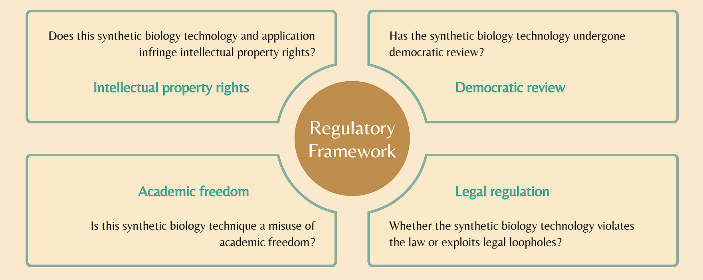

# Engineering改2

# Overview｜概述

**English\.** **TIME** is the engineering system developed by JLU\-FBH to organize the evidence\-driven development of CirCure\. **TIME** represents four connected project\-level cycles: **Targeting, Integration, Measurement and Evaluation**\. The system takes the form of a mechanical stopwatch: TIME is marked on the outer scale of the central gear, Design–Build–Test–Learn runs along the inner scale, and the two hands locate the project within its current cycle and engineering stage\. Yet TIME is more than an acronym\. It reflects the urgency at the heart of CirCure: when recurrence remains a possibility, every well\-founded decision should bring the next answer closer\. Our stopwatch therefore records not only the progress of engineering, but also our effort to turn evidence into action without losing time\.

**中文。** **TIME**是JLU\-FBH为组织CirCure循证工程进程而构建的系统。**TIME**代表四轮相互衔接的项目级循环：**Targeting、Integration、Measurement与Evaluation**。整套系统以机械停表呈现：中央大齿轮的外圈刻画TIME，内圈运行Design–Build–Test–Learn，两枚指针则共同定位项目所处的整体循环与当前工程阶段。但TIME不只是四个循环首字母组成的名字，它也回应着CirCure最初的紧迫感：面对复发风险，每一个经得起检验的决定，都应让下一个答案更快到来。因此，这枚停表记录的不只是工程推进的刻度，也象征着我们让证据尽快走向行动、为患者争取时间的努力。

> **Figure E01｜The CirCure TIME Engineering System｜CirCure TIME工程系统**
> 
> **［图片位置：中央机械停表式大齿轮，外圈四个主要刻度依次为T–I–M–E，内圈为D–B–T–L；长短指针分别指示当前TIME循环与DBTL阶段，外围为各组小齿轮］**
> 
> **English caption\.** CirCure TIME connects four project\-level cycles with recurring Design–Build–Test–Learn iterations and the coordinated engagement of the project teams\.
> 
> **中文图注。** CirCure TIME通过各组之间的协同啮合，将四轮项目级循环与持续运行的Design–Build–Test–Learn迭代连接起来。
> 
> 

**English\.** The surrounding gears represent the teams that keep TIME moving\. Dry Lab converts biological questions into traceable antigen and epitope decisions, structural hypotheses and quantitative predictions, supported by CircuForge, TorusFold and mathematical modelling\. Wet Lab converts these designs into physical constructs and molecular, cellular and broader biological measurements, with experimental practice also giving rise to CirCore\. iHP introduces clinical needs, ethical requirements and evidence boundaries where they can refine project decisions\. Education examines the transfer of scientific concepts and procedures; Visual Design develops a coherent project language; and Entrepreneurship connects experimental progress with preparation, collaboration and further development\. Their engagement varies across the four cycles, but every effective connection contributes torque to the same engineering system\.

**中文。** 外围小齿轮代表共同推动TIME运行的各个团队。Dry Lab将生物学问题转化为可追踪的抗原与表位决策、结构假设和定量预测，并形成CircuForge、TorusFold及数学模型等工程工具；Wet Lab则将这些设计转化为实体构建以及分子、细胞和更高层次的生物学测量，实验实践也进一步催生CirCore。iHP在能够修订项目决定的节点引入临床需求、伦理要求和证据边界；Education检验科学概念与操作流程的传递；Visual Design建立连贯的项目语言；Entrepreneurship将实验进展与制备、合作及后续开发连接起来。各个齿轮在四轮循环中的参与程度有所不同，但每次有效啮合都会为同一套工程系统提供动力。（主次分清，dw是主动轮 ，其他是从动轮这种）


**English\.** Four descriptive cycles record how CirCure progressed through TIME\. **Cycle 1 — Targeting: From intended use to a four\-antigen strategy** defined the clinical and biological design space\. **Cycle 2 — Integration: From epitope exploration to Combined** brought computational prediction, structural review, experimental construction and immune\-response screening into one design\. **Cycle 3 — Measurement: Building the molecular and cellular evidence chain** connected RNA characterization, protein expression and cellular responses while refining the workflows used for preparation, analysis and design transfer\. **Cycle 4 — Evaluation: Extending evidence across biological scales** connected broader biological evaluation with a forward multiscale model\. Within every TIME cycle, DBTL transformed results and stakeholder input into a concrete decision for the next stage\.

**中文。** 四轮描述性Cycle记录了CirCure如何沿TIME逐步推进。**Cycle 1——Targeting：从预期用途到四抗原策略**，明确临床与生物学设计空间；**Cycle 2——Integration：从表位探索到Combined**，将计算预测、结构复核、实验构建与免疫应答筛选汇入同一设计；**Cycle 3——Measurement：建立分子与细胞证据链**，连接RNA表征、蛋白表达与细胞应答，并同步完善制备、分析和设计交接流程；**Cycle 4——Evaluation：将证据拓展至不同生物学尺度**，把更高层次的生物学评价与前向多尺度模型连接起来。在每轮TIME循环内部，DBTL持续将实验结果和利益相关方反馈转化为下一阶段具体的工程决定。（这一段融合为一个图，参考三院）



# Cycle 1 — Targeting: From intended use to a four\-antigen strategy｜Cycle 1——锁定目标：从预期用途到四抗原策略

**English\.** TIME begins with **T—Targeting**\. This cycle moved from intended use to a four\-antigen strategy prepared for epitope\-level engineering\. We first located the project within the TNBC treatment pathway, then translated that purpose into an RNA\-platform decision and an antigen\-selection route\. Education and Visual Design developed the first shared language for circRNA, while Dry Lab, Software and Human Practices connected the scientific question to traceable evidence and an experimental handoff\. By the end of this cycle, four antigen sources had gained support at the protein, malignant\-cell and patient levels, and a common human DC–T\-cell workflow was ready to receive the epitope designs developed in Cycle 2\.

**中文。** TIME从**T——锁定目标（Targeting）**开始。本轮从预期用途出发，逐步形成能够进入表位工程的四抗原策略。我们首先定位项目在TNBC治疗路径中的作用，再据此选择RNA平台并建立抗原筛选路线。Education与Visual Design为circRNA形成第一套共同语言；Dry Lab、Software及Human Practices则把科学问题连接到可追踪的证据与实验交接。至本轮结束时，四种抗原来源已获得蛋白、恶性细胞和患者层面的支持，统一的人源DC–T细胞流程也能够承接Cycle 2形成的表位设计。（cycle2就不要提了）

## Iteration 1\.1｜Defining the clinical use case｜明确临床应用情境

### Design｜设计

**English\.** We began with a clinical question: where could an additional immune intervention contribute most clearly in the TNBC treatment pathway? TNBC heterogeneity and recurrence after standard treatment directed our attention to patients who remain at higher risk after neoadjuvant treatment and surgery \(Garrido\-Castro et al\., 2019\)\.Runhui Tian encouraged us to explore an additional therapeutic approach for TNBC\.

**中文。** 我们首先提出一个临床问题：在TNBC治疗路径中，补充性免疫干预可以在哪个阶段发挥更明确的作用？TNBC的异质性以及标准治疗后的复发风险，使我们的关注点落在接受新辅助治疗和手术后仍面临较高风险的患者（Garrido\-Castro et al\., 2019）。田润辉老师建议团队围绕TNBC探索补充性的治疗方式。

> **References｜参考文献**
> 
> Garrido\-Castro AC, Lin NU, Polyak K\. Insights into molecular classifications of triple\-negative breast cancer: improving patient selection for treatment\. *Cancer Discovery*\. 2019;9:176–198\. [doi:10\.1158/2159\-8290\.CD\-18\-1177](https://doi.org/10.1158/2159-8290.CD-18-1177)
> 
> 

### Build｜构建

**English\. **We combined this direction with literature research and clinical discussions with Lei Wang and Chengli Li, both oncology doctors, and **built an intended\-use specification with three defined elements\.** First, the clinical setting was the period after neoadjuvant treatment and surgery, when some patients remain at higher risk of recurrence\. Second, the proposed role was an antigen\-directed immune approach that could complement standard treatment\. Third, later development would require a documented antigen rationale, molecular eligibility criteria and measurable molecular and immune\-response evidence\. Tumour\-antigen expression and HLA compatibility were recorded as questions for the subsequent Dry Lab and epitope analyses\.

**中文。** 我们结合文献调研，以及与王磊、李成丽两位肿瘤科医生的临床讨论，建立了**包含三项明确内容的预期用途说明。**第一，临床情境定位于新辅助治疗及手术之后，部分患者仍面临较高复发风险的阶段；第二，项目拟探索一种能够补充标准治疗的抗原导向免疫策略；第三，后续开发需要形成抗原选择依据、分子适用条件以及可测量的分子与免疫应答证据。肿瘤抗原表达和HLA匹配则被记录为后续干实验及表位分析需要回答的问题。

### Test｜测试

**English\.** We mapped this specification onto the TNBC treatment pathway and reviewed three points within the clinical context: timing, population and measurable evidence\. The post\-neoadjuvant and postsurgical setting provided a recognisable point of use; recurrence risk defined the clinical purpose; and antigen expression, HLA compatibility, molecular preparation and immune\-response measurements formed a staged evidence plan\. This review retained the proposed clinical setting while leaving molecular eligibility to the antigen and epitope analyses that followed\.

**中文。** 我们将这份预期用途说明对应到TNBC诊疗路径，并从时间位置、目标人群和可测证据三个方面进行复核。新辅助治疗及手术后的阶段提供了明确的应用位置，复发风险明确了项目的临床目的；抗原表达、HLA匹配、分子制备和免疫应答测量则共同组成分阶段证据计划。复核后，我们保留这一临床情境，并把分子适用条件交由后续抗原与表位分析进一步确定。（时间位置是什么，目标人群是谁这种）

### Learn｜学习

**English\.** Literature and clinical consultation showed that recurrence risk may remain after surgery and systemic treatment, establishing a clear complementary position for an antigen\-directed immune approach\. We therefore retained the post\-treatment, higher\-risk TNBC setting as the project's intended use and translated it into three requirements for platform selection: the ability to encode tumour\-antigen sequences, support sustained expression and remain measurable from molecular preparation to immune function\. These requirements formed the Design of Iteration 1\.2\. Further details are provided in [Integrated Human Practices: clinical positioning](https://2026.igem.wiki/jlu-fbh/human-practices)\.

**中文。** 文献与临床咨询表明，部分患者在手术及系统治疗后仍存在复发风险，这为抗原导向免疫策略明确了补充位置。我们由此保留治疗后较高风险TNBC人群作为项目的预期应用情境，并将其转化为平台选择的三项要求：能够编码肿瘤抗原序列、支持持续表达，并允许从分子制备到免疫功能逐级测量。这三项要求直接形成Iteration 1\.2的Design。相关咨询与修订[详见Integrated Human Practices：临床定位](https://2026.igem.wiki/jlu-fbh/human-practices)。

## Iteration 1\.2｜Selecting a measurable circRNA platform｜选择可逐级检验的circRNA平台

### Design｜设计

**English\.** The intended\-use specification from Iteration 1\.1 gave us five criteria for platform selection: antigen\-coding capacity, RNA stability, duration of expression, immune\-stimulatory potential and compatibility with measurements available to the team\. We used these criteria to compare linear mRNA with engineered circRNA, allowing stability, expression and experimental measurability to enter the same decision\.

**中文。** Iteration 1\.1形成的预期用途说明为平台选择提供了五项标准：抗原编码能力、RNA稳定性、表达持续性、免疫刺激潜力，以及与团队可执行检测的兼容性。我们据此比较线性mRNA与工程化circRNA，使稳定性、表达特征与实验可测性共同进入平台决策。

### Build｜构建

**English\.** Literature research and technical discussions with Jifan Hu and Ruohan Yang were organized into a platform\-decision matrix\. The same work produced a five\-stage route linking the DNA template, linear transcription precursor, mature circRNA, encoded protein and immune function\. Published studies supported stable translation from engineered circRNA and showed that innate sensing depends on how the RNA is generated and prepared\. We therefore defined adjuvant\-like stimulation as a preparation\-dependent property to examine in later experiments \(Chen et al\., 2017; Wesselhoeft et al\., 2018; Wesselhoeft et al\., 2019\)\.

**中文。** 我们将文献调研及与胡继繁老师、杨若晗师姐的技术交流整理为平台决策矩阵，并据此建立连接DNA模板、线性转录前体、成熟circRNA、编码蛋白与免疫功能的五阶段路线。已有研究支持工程化circRNA的稳定翻译，也表明先天免疫识别会受到RNA生成和制备方式影响。因此，我们把佐剂样免疫刺激界定为需要在后续实验中考察的制备相关性质（Chen et al\., 2017；Wesselhoeft et al\., 2018；Wesselhoeft et al\., 2019）。

> **References｜参考文献**
> 
> Chen YG, Kim MV, Chen X, et al\. Sensing self and foreign circular RNAs by intron identity\. *Molecular Cell*\. 2017;67:228–238\.e5\. [doi:10\.1016/j\.molcel\.2017\.05\.022](https://doi.org/10.1016/j.molcel.2017.05.022)
> 
> Wesselhoeft RA, Kowalski PS, Anderson DG\. Engineering circular RNA for potent and stable translation in eukaryotic cells\. *Nature Communications*\. 2018;9:2629\. [doi:10\.1038/s41467\-018\-05096\-6](https://doi.org/10.1038/s41467-018-05096-6)
> 
> Wesselhoeft RA, Kowalski PS, Parker\-Hale FC, et al\. RNA circularization diminishes immunogenicity and can extend translation duration in vivo\. *Molecular Cell*\. 2019;74:508–520\.e4\. [doi:10\.1016/j\.molcel\.2019\.02\.015](https://doi.org/10.1016/j.molcel.2019.02.015)
> 
> 

**Table C1\-01｜Platform decision matrix｜平台选择决策矩阵**

|Design requirement｜设计要求|Linear mRNA｜线性mRNA|Engineered circRNA｜工程化circRNA|Project check｜项目检查依据|Design implication｜设计含义|
|---|---|---|---|---|
|Antigen coding｜抗原编码|Can encode the selected antigen sequence｜可编码目标抗原|Can encode the selected antigen sequence｜可编码目标抗原|Sequence and construct feasibility｜序列与构建设计可行性|Both formats meet the basic coding requirement｜两者均满足基本编码要求|
|RNA stability｜RNA稳定性|Free ends remain susceptible to exonuclease\-mediated decay｜游离末端仍易受外切核酸酶影响|Closed topology can improve nuclease resistance｜闭合结构可提高核酸酶耐受性|Literature and technical consultation｜文献与技术咨询|circRNA better matches the intended persistence question｜circRNA更符合持续性评价方向|
|Expression duration｜表达持续性|Expression is constrained by RNA lifetime｜表达受到RNA寿命限制|Engineered circRNA can extend translation duration｜工程化circRNA具有延长翻译的潜力|Published expression studies｜公开表达研究|Supports staged persistence measurements｜支持后续持续性测量|
|Immune stimulation｜免疫刺激|Depends on sequence, modification, purity and delivery｜取决于序列、修饰、纯度与递送|Innate sensing is tunable through RNA design and preparation｜可通过RNA设计与制备调控先天免疫识别|Literature and iHP discussion｜文献与iHP讨论|Evaluate it under defined preparation conditions｜在明确制备条件下开展评价|
|Preparation｜制备|Comparatively direct production route｜制备路线相对直接|Requires circularization and added identity checks｜需要成环及额外身份检查|Team facilities and planned Experiments｜团队条件与拟定Experiments|Assign a measurable checkpoint to every preparation stage｜为每个制备阶段设置可测检查点|
|Functional evaluation｜功能评价|Can enter protein and immune assays｜可进入蛋白与免疫检测|Can enter the same downstream assays after circularization checks｜成环检查后可进入相同下游检测|FLAG expression, DC–T\-cell culture and immune readouts｜FLAG表达、DC–T细胞培养及免疫读出|Provides a continuous molecule\-to\-function route｜形成从分子到功能的连续路线|

### Test｜测试

**English\.** We tested the selected platform against the operations required by the literature and the resources available to the team\. For each molecular stage, we asked whether there was a defined way to obtain the material, an accessible measurement and an observable output that could be passed to the next stage\.

**中文。** 我们依据文献与技术咨询提出的操作要求以及团队能够使用的实验条件，对所选平台进行逐阶段检验。对于每个分子阶段，我们分别确认材料如何获得、是否存在可执行的检测方法，以及能否形成可以交接到下一阶段的可观察输出。

**Table C1\-02｜Stage\-by\-stage feasibility check for the circRNA route｜circRNA路线的逐阶段可行性检查**

|Stage｜阶段|Material source or operation｜材料来源或操作|Available project check｜项目可执行检查|Observable output｜可观察输出|Decision｜判断|
|---|---|---|---|---|
|DNA template｜DNA模板|Recombinant plasmids assembled by a commercial service provider｜重组质粒由商业服务商完成合成与组装|Supplier plasmid map, sequence file and sample label were matched to the intended design before the delivered material entered the team's recorded template\-processing and transcription route｜依据供应商提供的质粒图谱、序列文件和样品标签对应预期设计，再使交付材料进入团队实际记录的模板处理与转录路线|DNA template corresponding to the intended construct｜与预期构建相对应的DNA模板|Executable｜可执行|
|Linear transcription precursor｜线性转录前体|In vitro transcription from the DNA template and the designed self\-splicing precursor｜以DNA模板体外转录形成设计的自剪接前体|RNA preparation and nucleic\-acid analytical methods recorded in Experiments｜Experiments记录的RNA制备与核酸分析方法|Detectable linear precursor｜可检测的线性前体|Executable｜可执行|
|Mature circRNA｜成熟circRNA|Self\-splicing and circularization of the precursor｜前体自剪接并成环|RNA purification, RNase R treatment and the corresponding nucleic\-acid analysis recorded in Experiments｜Experiments记录的RNA纯化、RNase R处理及相应核酸分析|A circRNA preparation that can be evaluated separately from the linear precursor｜可与线性前体分别评价的circRNA制备物|Executable｜可执行|
|Encoded protein｜编码蛋白|Translation after cellular delivery｜细胞递送后的翻译|FLAG\-associated protein\-expression measurement｜FLAG相关蛋白表达检测|Expected FLAG\-associated expression signal｜预期FLAG相关表达信号|Executable｜可执行|
|Immune function｜免疫功能|circRNA\-loaded DCs co\-cultured with T cells｜circRNA负载DC与T细胞共培养|ELISpot, flow cytometry and target\-cell killing assays｜ELISpot、流式细胞术及靶细胞杀伤实验|IFN\-γ\-associated, activation and effector readouts｜IFN\-γ相关、细胞激活及效应读出|Executable｜可执行|

**English\.** All five stages therefore had a defined source or procedure, an accessible measurement and an observable output\. This established the testability of the circRNA route; the resulting RNA, protein and immune\-response evidence is presented in the later cycles\.

**中文。** 五个阶段由此均具有明确的材料来源或操作、可执行的测量方式及可观察输出，说明circRNA路线能够进入逐级检验。相应的RNA、蛋白及免疫应答证据将在后续Cycle中呈现。

### Learn｜学习

**English\.** We selected circRNA as the project's working expression platform\. Its closed topology provided a clear stability rationale, published work supported prolonged expression, and its preparation\-dependent innate sensing defined an additional experimental question\. With the platform established, the next decision concerned its antigen payload\. That content question became the scientific thread carried into antigen selection\. Further details are provided in [Integrated Human Practices: platform selection](https://2026.igem.wiki/jlu-fbh/human-practices) and [Experiments: circRNA preparation and validation](https://2026.igem.wiki/jlu-fbh/experiments)\.

**中文。** 我们由此选择circRNA作为项目的工作表达平台。闭合结构为稳定性提供明确依据，已有研究支持较长的表达潜力，受制备条件影响的先天免疫识别则形成另一项实验问题。平台确定后，下一项决定转向其抗原载荷，这一内容问题由此进入后续抗原筛选。相关内容[详见Integrated Human Practices：平台选择](https://2026.igem.wiki/jlu-fbh/human-practices)及[Experiments：circRNA制备与验证](https://2026.igem.wiki/jlu-fbh/experiments)。

## Iteration 1\.3｜Building the first educational and visual entry｜建立首个教育与视觉入口

### Design｜设计

**English\.** Once circRNA became the working platform, Education and Visual Design asked how first\-time learners could encounter an unfamiliar molecular form without losing sight of its biomedical setting\. The scientific core needed to remain stable, while the teaching entry and visual language had to adapt to different schools\.

**中文。** circRNA成为工作平台后，Education与Visual Design开始思考：如何让第一次接触这一分子形式的学习者理解核心概念，同时保留其生物医学情境。科学核心需要保持一致，教学入口与视觉语言则应适应不同学校。

### Build｜构建

**English\.** We planned and delivered Winter Outreach across five schools, reaching approximately 308 students\. Five school\-adapted teaching decks introduced synthetic biology, linear and circular RNA and possible biomedical applications\. Dream circRNA used circular cardboard and coloured segments as a participatory activity after the scientific explanation\. The first sheep character and project emblem gave the materials a consistent identity\.

**中文。** 我们策划并实施五校寒假巡讲，覆盖约308名学生。团队制作五套根据不同学校情境调整的教学课件，介绍合成生物学、线性与环状RNA及其潜在生物医学应用。“梦想circRNA”在科学讲解后使用环形纸板和彩色扇环开展参与式活动；初版小羊形象与项目徽则为教学材料建立统一识别。

### Test｜测试

**English\.** In an end\-of\-session show\-of\-hands check, roughly 80% of students indicated that they understood the core distinction between linear and circular RNA introduced in class\. Their participation and completed Dream circRNA pieces showed that the circular form provided an accessible entry to the topic\. Differences among the five classrooms also showed that a shared scientific core benefited from school\-specific teaching routes\.

**中文。** 在课程结束时的现场举手核对中，约80%的学生表示理解了课堂介绍的线性RNA与环状RNA核心区别。学生的参与过程及完成的“梦想circRNA”作品表明，环状形式为理解这一陌生主题提供了易于进入的起点。五所学校的课堂反应存在差异，也说明共同科学核心需要与学校情境相适配的教学路径。

> **Figure C1\-01｜Winter Outreach and the first visual identity｜寒假巡讲与初版视觉识别**
> 
> **［图片预留位置：放置五校寒假巡讲真实现场照片、五套教学课件封面、Dream circRNA作品及初版小羊与项目徽］**
> 
> **English caption\.** Winter Outreach introduced circRNA through five school\-adapted teaching decks and the Dream circRNA activity\. The first sheep character and project emblem maintained visual continuity across the materials\.
> 
> **中文图注。** 寒假巡讲通过五套适配学校情境的课件与“梦想circRNA”活动介绍环状RNA；初版小羊形象与项目徽使不同材料保持视觉连续。
> 
> 

### Learn｜学习

**English\.** We retained the first visual identity and adopted an **Audience × Context** approach for later Education work: the scientific core would remain consistent, while age, prior knowledge, setting and learning purpose would shape the entry point\. Vaccine Classroom, Virtual Laboratory and Synbio Classroom would later return to this principle in different forms\. Along the main scientific route, the content question left by Iteration 1\.2 remained unchanged: which TNBC antigens should the circRNA encode? Further details are provided in [Education: Winter Outreach](https://2026.igem.wiki/jlu-fbh/education)\.

**中文。** 我们保留初版视觉识别，并为后续Education采用“**受众×场景**”（解释受众\*场景的含义，教育方式是分层教育等等的表述）设计方式：科学核心保持一致，年龄、已有知识、活动条件和学习目标共同决定进入方式。后续Vaccine Classroom、Virtual Laboratory与Synbio Classroom将以不同形式回到这一原则。科学主线则继续回答Iteration 1\.2留下的内容问题：circRNA应当编码哪些TNBC抗原？[详见Education：寒假巡讲](https://2026.igem.wiki/jlu-fbh/education)。

## Iteration 1\.4｜Building an initial antigen\-discovery route｜建立初步抗原发现路线

### Design｜设计

**English\.** The circRNA platform could only become a testable design after its encoded content was defined\. We therefore needed a reproducible route from public TNBC data to an initial list of antigen candidates, while keeping the clinical purpose from Iteration 1\.1 visible\.

**中文。** circRNA平台只有在编码内容得到确定后，才能成为可检验的设计。因此，我们需要建立一条从公开TNBC数据进入初始抗原候选清单的可重复路线，同时保留Iteration 1\.1提出的临床目的。

### Build｜构建

**English\.** Literature research led us to draft a bulk RNA\-seq workflow from tumour\-versus\-normal differential expression to candidate\-antigen ranking\. The workflow specified data import, sample grouping, quality control, differential analysis and candidate export\. Higher average RNA expression in tumour tissue defined the first discovery signal, while later evidence layers would determine antigen suitability\.

**中文。** 文献调研推动我们建立从肿瘤—正常组织差异表达进入候选抗原排序的bulk RNA\-seq流程，依次规定数据导入、样本分组、质量控制、差异分析和候选导出。肿瘤组织中较高的平均RNA表达用于形成第一批发现信号，后续证据层继续判断抗原适用性。

### Test｜测试

**English\.** We tested the reproducibility of this initial route by defining a complete output record linking the public dataset, tumour and normal sample composition, differential model, screening threshold, candidate\-ranking table and corresponding visualization\. This record separated discovery from subsequent prioritization: bulk RNA\-seq established a traceable pool of tissue\-level expression signals, while protein abundance, malignant\-cell localization and patient representation were reserved for independent evidence layers\.

**中文。** 我们通过建立完整的分析输出记录检验这条初始路线的可重复性，将公开数据集、肿瘤与正常样本构成、差异分析模型、筛选阈值、候选排序表及对应可视化相互关联。该记录进一步区分了候选发现与后续优先级判断：bulk RNA\-seq用于形成可追溯的组织层表达信号范围，蛋白丰度、恶性细胞定位和患者代表范围则分别交由独立证据层评价。（我们要得出一个能落地的结论）

> **Figure C1\-02｜Initial bulk RNA\-seq antigen\-discovery output｜初始bulk RNA\-seq抗原发现结果**
> 
> **［图片预留位置：放置Dry Lab核验后的真实差异表达图、候选排序图及关键参数说明］**
> 
> **English caption\.** The traceable bulk RNA\-seq record connects the public dataset, sample composition, differential model and screening threshold to the ranked tissue\-level discovery pool\.
> 
> **中文图注。** 可追溯的bulk RNA\-seq记录将公开数据集、样本构成、差异分析模型及筛选阈值与排序后的组织层候选发现范围相连接。
> 
> 

### Learn｜学习

**English\.** The bulk route established a reproducible discovery step and produced a structured starting pool\. Turning that pool into an antigen decision required four additional views: protein support, malignant\-cell localization, patient representation and clinical context\. These questions defined the next antigen\-selection framework\.

**中文。** bulk路线建立了可重复的候选发现步骤并形成结构化起始范围。为了把这一起始范围转化为抗原决定，我们继续加入蛋白支持、恶性细胞定位、患者代表范围和临床背景四个视角，由此定义下一轮抗原筛选框架。

## Iteration 1\.5｜Building a four\-dimensional antigen\-evidence framework｜建立四维抗原证据框架

### Design｜设计

**English\.** The initial bulk route produced a useful starting point but left four independent questions unanswered\. In consultation with Associate Professor Qingtian Guan, we examined how those questions could be separated so that one type of evidence would not be asked to prove more than it measured\.

**中文。** 初始bulk路线提供了可执行起点，但留下四项相互独立的问题。（四项问题没明确）在与管青天副教授的咨询中，我们进一步拆分这些问题，避免让某一种证据承担超出其测量范围的结论。

### Build｜构建

**English\.** We built a four\-dimensional framework: **protein abundance** assessed whether the candidate antigens were detected as proteins in TNBC tissue; **malignant\-cell enrichment** located their expression within the cells of interest; **patient representation** measured breadth and complementarity across cases; and **clinical evidence** placed each antigen in published disease and translational research\. Normal\-tissue expression remained a parallel safety consideration\. This structure was consistent with established tumour\-antigen prioritization principles \(Cheever et al\., 2009\)\.

**中文。** 我们建立四维证据框架：**蛋白丰度**判断候选抗原是否在TNBC组织中获得蛋白层支持；**恶性细胞富集**定位表达是否关联目标细胞；**患者代表范围**检验候选抗原在不同病例中的广度与互补性；**临床证据**则把每种抗原放回已发表的疾病与转化研究。正常组织表达作为并行安全问题处理。该结构与已有肿瘤抗原优先级原则一致（Cheever et al\., 2009）。

> **References｜参考文献**
> 
> Cheever MA, Allison JP, Ferris AS, et al\. The prioritization of cancer antigens: a National Cancer Institute pilot project for the acceleration of translational research\. *Clinical Cancer Research*\. 2009;15:5323–5337\. [doi:10\.1158/1078\-0432\.CCR\-09\-0737](https://doi.org/10.1158/1078-0432.CCR-09-0737)
> 
> 

### Test｜测试

**English\.** To test whether the framework was operational rather than conceptual, we used TROP2, B7\-H4, Nectin\-4 and LIV\-1 as four input antigens and performed an evidence\-source readiness check\. For each of the four dimensions, we identified an accessible data source, the question that could be measured and the decision that the resulting evidence could support\. The check showed that all four antigens could enter the same evaluation structure\. Protein abundance was selected as the first evidence layer to execute\.

**中文。** 为检验这套框架能否真正执行，而不只是停留在概念层面，我们以TROP2、B7\-H4、Nectin\-4和LIV\-1作为四种输入抗原，对证据来源的完备性进行检查。针对四个评价维度，我们分别确定可获取的数据来源、能够测量的问题，以及相应证据可以支持的工程决定。检查结果表明，四种抗原均能够进入同一套评价结构；蛋白丰度则被确定为首先执行的证据层。

**Table C1\-03｜Four\-dimensional antigen\-evidence map｜四维抗原证据图谱**

（放到learn当中）

### Learn｜学习

**English\.** The four\-dimensional route separated presence, cellular origin, patient breadth and clinical relevance, giving the four antigen candidates a consistent evaluation structure while preserving the role of each evidence type\. Protein abundance was the first layer to test, so quantitative proteomics became the next design\. The consultation also established a long\-term software requirement: every retained antigen should carry the evidence behind its selection\. Further details are provided in [Bioinformatics: antigen\-selection framework](https://2026.igem.wiki/jlu-fbh/bioinformatics) and [Integrated Human Practices: Dry Lab route](https://2026.igem.wiki/jlu-fbh/human-practices)\.

**中文。** 四维路线分别解释候选是否存在、来自哪些细胞、代表多少患者以及具有怎样的临床依据，使四种候选抗原获得统一的评价结构，同时保留不同证据各自的作用。首先进入检验的是蛋白丰度，因此定量蛋白组分析成为下一轮Design。咨询也为后续软件形成一项长期要求：每项保留的抗原都应携带其筛选证据。[详见Bioinformatics：抗原筛选框架](https://2026.igem.wiki/jlu-fbh/bioinformatics)及[Integrated Human Practices：Dry Lab路线](https://2026.igem.wiki/jlu-fbh/human-practices)。

## Iteration 1\.6｜Testing the four antigen sources with protein evidence｜以蛋白证据检验四种抗原来源

### Design｜设计

**English\.** We first asked whether all four antigen candidates were repeatedly detected as proteins in TNBC tissue\. PXD024322 and PXD028102 are ProteomeXchange accessions for two public quantitative\-proteomics cohorts with complementary designs\. PXD024322 provided 88 TNBC tumours and 38 normal\-breast samples; PXD028102 included 82 TNBC tumours, of which 66 had matched adjacent\-normal tissue \(Asleh et al\., 2022; Gong et al\., 2022\)\.

**中文。** 我们首先检验四种候选抗原能否在TNBC组织中于蛋白层面被重复检出。PXD024322与PXD028102是ProteomeXchange收录的两个公开定量蛋白组队列编号，二者具有互补设计：PXD024322包含88例TNBC肿瘤与38例正常乳腺样本；PXD028102包含82例TNBC肿瘤，其中66例具有配对邻近正常组织（Asleh et al\., 2022；Gong et al\., 2022）。

> **References｜参考文献**
> 
> Asleh K, Negri GL, Spencer Miko SE, et al\. Proteomic analysis of archival breast cancer clinical specimens identifies biological subtypes with distinct survival outcomes\. *Nature Communications*\. 2022;13:896\. [doi:10\.1038/s41467\-022\-28524\-0](https://doi.org/10.1038/s41467-022-28524-0)
> 
> Gong Y, Ji P, Yang YS, et al\. Metabolic\-pathway\-based subtyping of triple\-negative breast cancer reveals potential therapeutic targets\. *Cell Reports*\. 2022;39:110460\. [doi:10\.1016/j\.celrep\.2022\.110460](https://doi.org/10.1016/j.celrep.2022.110460)
> 
> 

### Build｜构建

**English\.** We built a reproducible proteomic\-analysis route that preserved sample and batch identities, separated detection from abundance and used patient pairing when available\. PXD024322 was analysed with a `Batch + Condition` design; PXD028102 used a `PatientID + Condition` paired design\. Both routes used limma with empirical\-Bayes moderation and Benjamini–Hochberg correction across the tested proteins \(Ritchie et al\., 2015; Benjamini and Hochberg, 1995\)\.

**中文。** 我们建立可复现的蛋白组分析路线，保留样本与批次身份，分别处理检出和丰度，并在具备条件时使用患者配对。PXD024322采用`Batch + Condition`设计，PXD028102采用`PatientID + Condition`配对设计；两条路线均使用limma经验贝叶斯方法，并对受检蛋白进行Benjamini–Hochberg校正（Ritchie et al\., 2015；Benjamini and Hochberg, 1995）。

> **References｜参考文献**
> 
> Ritchie ME, Phipson B, Wu D, et al\. limma powers differential expression analyses for RNA\-sequencing and microarray studies\. *Nucleic Acids Research*\. 2015;43:e47\. [doi:10\.1093/nar/gkv007](https://doi.org/10.1093/nar/gkv007)
> 
> Benjamini Y, Hochberg Y\. Controlling the false discovery rate: a practical and powerful approach to multiple testing\. *Journal of the Royal Statistical Society Series B*\. 1995;57:289–300\. [doi:10\.1111/j\.2517\-6161\.1995\.tb02031\.x](https://doi.org/10.1111/j.2517-6161.1995.tb02031.x)
> 
> **Code C1\-01｜Proteomic\-analysis script excerpt｜蛋白组分析脚本节选（管欧阳or潘要）**
> 
> ```Plain Text
> # Insert a verified excerpt from the team's archived Dry Lab script here.
> # PXD024322 model: ~ Batch + Condition
> # PXD028102 model: ~ PatientID + Condition
> # Retain the exact object names, filtering rules and output filenames used by the team.
> ```
> 
> **［定稿要求：用Dry Lab实际R脚本替换以上注释，并添加完整代码仓库的可点击链接。］**
> 
> 

### Test｜测试

**English\.** In PXD024322, TROP2 and LIV\-1 were detected in all 88 tumours, B7\-H4 in 81 and Nectin\-4 in 82; all four also showed higher abundance in the tumour comparison\. The paired PXD028102 cohort independently supported tumour\-associated increases in TROP2, B7\-H4 and Nectin\-4, while LIV\-1 was supported by the first cohort\. The two datasets therefore contributed different but compatible protein evidence\.

**中文。** 在PXD024322中，TROP2与LIV\-1均在88例肿瘤中检出，B7\-H4在81例、Nectin\-4在82例中检出，四者在肿瘤比较中均呈较高丰度。PXD028102配对队列独立支持TROP2、B7\-H4与Nectin\-4的肿瘤相关升高；LIV\-1则由首个队列提供支持。两个数据集由此贡献不同但相互兼容的蛋白证据。

> **Figure C1\-03｜Complementary protein evidence｜互补的蛋白证据**
> 
> **［图片预留位置：放置Bioinformatics中的PXD024322与PXD028102真实差异丰度图、检出汇总图及配对结果图］**
> 
> **English caption\.** Team reanalysis of two public TNBC proteomic cohorts\. PXD024322 assessed broad detection and tumour–normal abundance, while PXD028102 contributed a patient\-matched comparison\.
> 
> **中文图注。** 团队对两个公开TNBC蛋白组队列的再分析。PXD024322评价广泛检出及肿瘤—正常丰度差异，PXD028102提供患者配对比较。
> 
> 

### Learn｜学习

**English\.** Broad detection in PXD024322 and tumour\-associated increases across the two cohorts supported retaining all four antigen sources\. The protein measurements established the tissue\-level evidence; determining the cellular origin of each signal required a cell\-resolved analysis\. This became the next design\. Further details are provided in [Bioinformatics: proteomic evidence](https://2026.igem.wiki/jlu-fbh/bioinformatics)\.

**中文。** PXD024322中的广泛检出及两个队列提供的肿瘤相关升高支持保留全部四种抗原来源。蛋白组分析建立了组织层证据；进一步确定每项信号的细胞来源需要细胞分辨分析，因此这一问题成为下一轮Design。[详见Bioinformatics：蛋白组证据](https://2026.igem.wiki/jlu-fbh/bioinformatics)。

## Iteration 1\.7｜Locating antigen expression within malignant\-cell diversity｜在恶性细胞多样性中定位抗原表达

### Design｜设计

**English\.** The proteomic results confirmed the presence of the four antigen sources in TNBC tissue, but tumour samples also contain immune, stromal and endothelial cells\. We therefore asked whether the corresponding genes were enriched in malignant cells and whether they marked the same or complementary malignant\-cell populations\. GSE176078—the accession number of a public single\-cell and spatial atlas of human breast cancer in the Gene Expression Omnibus—retained the patient and cell\-type identities required for this analysis \(Wu et al\., 2021\)\.

**中文。** 蛋白组结果确认四种抗原来源存在于TNBC组织，但肿瘤样本同时包含免疫、基质和内皮细胞。因此，我们进一步考察相应基因是否富集于恶性细胞，以及它们标记的是相同还是互补的恶性细胞群。GSE176078是Gene Expression Omnibus数据库中一项公开人乳腺癌单细胞与空间图谱的收录编号，该数据保留了这项分析所需的患者身份与细胞类型信息（Wu et al\., 2021）。

> **References｜参考文献**
> 
> Wu SZ, Al\-Eryani G, Roden DL, et al\. A single\-cell and spatially resolved atlas of human breast cancers\. \*Nature Genetics\*\. 2021;53:1334–1347\. [doi:10\.1038/s41588\-021\-00911\-1](https://doi.org/10.1038/s41588-021-00911-1)
> 
> 

### Build｜构建

**English\.** We performed quality control within each patient, used SCTransform to normalize expression and stabilize technical variation, and applied Harmony to integrate cells across patients while retaining their biological identities\. These steps produced a TNBC subset for visualization\. For statistical comparison, we then aggregated gene counts separately for the malignant and non\-malignant compartments within each patient—a pseudobulk strategy—so that patients, rather than thousands of correlated individual cells, served as the biological replicates \(Hafemeister and Satija, 2019; Korsunsky et al\., 2019; Robinson et al\., 2010\)\.

**中文。** 我们首先在各患者内部开展质量控制，使用SCTransform进行表达归一化并稳定技术变异，再通过Harmony整合不同患者的细胞，同时保留其生物学身份，由此形成用于可视化的TNBC子集。随后，我们分别汇总每位患者恶性与非恶性细胞区室中的基因计数，即采用pseudobulk策略进行统计比较，使患者而非大量彼此相关的单个细胞作为生物学重复（Hafemeister and Satija, 2019；Korsunsky et al\., 2019；Robinson et al\., 2010）。

> **References｜参考文献**
> 
> Hafemeister C, Satija R\. Normalization and variance stabilization of single\-cell RNA\-seq data using regularized negative binomial regression\. *Genome Biology*\. 2019;20:296\. [doi:10\.1186/s13059\-019\-1874\-1](https://doi.org/10.1186/s13059-019-1874-1)
> 
> Korsunsky I, Millard N, Fan J, et al\. Fast, sensitive and accurate integration of single\-cell data with Harmony\. *Nature Methods*\. 2019;16:1289–1296\. [doi:10\.1038/s41592\-019\-0619\-0](https://doi.org/10.1038/s41592-019-0619-0)
> 
> Robinson MD, McCarthy DJ, Smyth GK\. edgeR: a Bioconductor package for differential expression analysis of digital gene expression data\. *Bioinformatics*\. 2010;26:139–140\. [doi:10\.1093/bioinformatics/btp616](https://doi.org/10.1093/bioinformatics/btp616)
> 
> 

### Test｜测试

**English\.** The analysis retained 39,324 cells, including 9,491 malignant cells\. All four genes showed malignant\-cell enrichment\. At least one of the four genes was detected in 81\.4% of malignant cells, while 7\.3% expressed all four\. TROP2 and LIV\-1 provided the broadest representation, whereas Nectin\-4 and B7\-H4 marked additional malignant\-cell subsets\.

**中文。** 分析保留39,324个细胞，其中9,491个为恶性细胞。四个基因均呈恶性细胞富集；81\.4%的恶性细胞至少检出其中一个基因，同时检出四个基因的比例为7\.3%。TROP2与LIV\-1提供较广的恶性细胞代表范围，Nectin\-4与B7\-H4则补充其他恶性细胞亚群。

> **Figure C1\-04｜Antigen expression across malignant\-cell populations｜恶性细胞群中的抗原表达**
> 
> **［图片预留位置：放置Bioinformatics中的GSE176078 UMAP、细胞区室表达比较、患者层pseudobulk结果及四基因并集图］**
> 
> **English caption\.** Cell\-resolved analysis of the GSE176078 TNBC subset\. The four genes were enriched in malignant cells and represented partly overlapping malignant\-cell populations\.
> 
> **中文图注。** GSE176078 TNBC子集的细胞分辨分析。四个基因均富集于恶性细胞，并代表部分重叠的恶性细胞群。
> 
> 

### Learn｜学习

**English\.** The cell\-resolved analysis explained why antigen diversity mattered: the four sources covered partly overlapping but non\-identical malignant\-cell states\. Retaining them reduced the design's dependence on any single cellular state and gave the multi\-antigen strategy a cell\-level rationale\. We next asked whether the same complementarity extended across patients\. Further details are provided in [Bioinformatics: single\-cell analysis](https://2026.igem.wiki/jlu-fbh/bioinformatics)\.

**中文。** 细胞分辨分析说明了保留抗原多样性的意义：四种来源覆盖部分重叠但并不相同的恶性细胞状态。保留四种来源可以降低设计对单一细胞状态的依赖，并为多抗原策略提供细胞层依据。下一轮进一步检验这种互补性是否延伸到不同患者。[详见Bioinformatics：单细胞分析](https://2026.igem.wiki/jlu-fbh/bioinformatics)。

## Iteration 1\.8｜Extending antigen complementarity across patients｜将抗原互补性延伸至患者层面

### Design｜设计

**English\.** The four antigen sources occupied different malignant\-cell populations\. To turn that cellular observation into a design relevant to the intended population, we examined how broadly the four genes were distributed across TNBC cases and whether published tissue studies supported their clinical relevance\.

**中文。** 四种抗原来源分布于不同的恶性细胞群。为了把这一细胞层观察转化为与预期人群相关的设计依据，我们进一步考察四个基因在TNBC病例中的分布广度，并复核已发表组织研究能否支持其临床相关性。

### Build｜构建

**English\.** We evaluated 115 TCGA TNBC cases through cBioPortal using the recorded rule of an mRNA z\-score of at least 0\.5 or high\-level amplification\. To measure the breadth of the four\-antigen strategy without repeated counting, each patient was counted once in the four\-gene union \(Cerami et al\., 2012; Gao et al\., 2013\)\. Correlation analysis and published histopathological studies further described the overlap, independence and tissue distribution of the four antigens\.

**中文。** 我们通过cBioPortal评价115例TCGA TNBC病例，采用已记录的“mRNA z\-score至少为0\.5或发生高水平扩增”判据。为了在避免重复计数的情况下评价四抗原策略的覆盖范围，每位患者在四基因并集中仅计一次（Cerami et al\., 2012；Gao et al\., 2013）。相关性分析及已发表组织病理研究进一步补充四种抗原之间的重叠、独立性和组织分布信息。

> **References｜参考文献**
> 
> Cerami E, Gao J, Dogrusoz U, et al\. The cBio Cancer Genomics Portal: an open platform for exploring multidimensional cancer genomics data\. *Cancer Discovery*\. 2012;2:401–404\. [doi:10\.1158/2159\-8290\.CD\-12\-0095](https://doi.org/10.1158/2159-8290.CD-12-0095)
> 
> Gao J, Aksoy BA, Dogrusoz U, et al\. Integrative analysis of complex cancer genomics and clinical profiles using the cBioPortal\. *Science Signaling*\. 2013;6:pl1\. [doi:10\.1126/scisignal\.2004088](https://doi.org/10.1126/scisignal.2004088)
> 
> 

### Test｜测试

**English\.** Under the recorded rule, the four\-gene union included 101 of 115 patients, or 88%\. The individual genes were not distributed identically, and LIV\-1 showed a more independent expression pattern than the other three\. Together with published tissue evidence and Yishu Wang's advice on multi\-epitope design, the result supported retaining all four antigen sources for downstream epitope selection\. The 88% value described antigen representation under one predefined data rule; HLA eligibility remained a separate question\.

**中文。** 按记录判据，四基因并集包含115例患者中的101例，即88%。不同基因的患者分布并不相同，其中LIV\-1呈现出比其余三者更独立的表达模式。结合已发表组织证据及王医术老师对多表位设计的建议，这项结果支持在后续表位筛选中保留全部四种抗原来源。88%描述的是一项预设数据判据下的抗原代表范围，HLA适用条件仍需单独评价。

> **Figure C1\-05｜Patient\-level representation of the four antigen sources｜四种抗原来源的患者层代表范围**
> 
> **［图片预留位置：放置Bioinformatics中115例TCGA TNBC的真实OncoPrint或患者事件图、101/115并集结果及四基因相关性图］**
> 
> **English caption\.** Patient\-level analysis of 115 TCGA TNBC cases\. The union of the four recorded gene criteria included 101 patients, while their different expression patterns explained the value of retaining multiple antigen sources\.
> 
> **中文图注。** 115例TCGA TNBC病例的患者层分析。四项基因判据的并集包含101例患者，不同表达分布说明了保留多种抗原来源的价值。
> 
> 

### Learn｜学习

**English\.** The four\-antigen strategy now rested on three connected evidence levels: Iteration 1\.6 established protein detection in TNBC tissue, Iteration 1\.7 located the four genes within complementary malignant\-cell populations and this iteration extended their complementarity across patients\. These results supported retaining all four sources\. The next task was to carry their data, literature and selection reasons into epitope design with the full context intact\. Further details are provided in [Bioinformatics: patient\-level evidence](https://2026.igem.wiki/jlu-fbh/bioinformatics) \.

**中文。** 四抗原策略由此获得三个相互衔接的证据层：Iteration 1\.6确认其在TNBC组织中的蛋白检出，Iteration 1\.7将四个基因定位于互补的恶性细胞群，本轮则把这种互补性延伸到患者层面。三层结果共同支持保留四种抗原来源。下一项任务，是把数据、文献和筛选理由连同完整背景一起交接到表位设计。[详见Bioinformatics：患者层证据](https://2026.igem.wiki/jlu-fbh/bioinformatics)。

## Iteration 1\.9｜Connecting the first Dry Lab workflow in CircuForge V1\.0｜以CircuForge V1\.0连接首轮干实验流程

### Design｜设计

**English\.** During our own Dry Lab work, quantitative results first had to be reorganized for target review, and selected target names, accessions, protein sequences and supporting evidence then had to be transferred into epitope prediction\. Moving between R, Python, command\-line scripts and web tools repeatedly changed the required input format and made selection reasons difficult to retain\. This was especially demanding for new users\. We therefore designed CircuForge to connect the steps in one guided environment and preserve the context needed for the next decision\.

**中文。** 在团队实际干实验过程中，定量结果需要先被重新整理为靶点审查材料，入选靶点的名称、编号、蛋白序列及支持证据随后还要转入表位预测。R、Python、命令行脚本与网页工具要求不同输入格式，反复转移不仅增加操作负担，也容易丢失筛选理由，对初学者尤其困难。因此，我们设计CircuForge，把连续步骤放入一个引导式环境，并保留下一项决定所需的背景。

### Build｜构建

**English\.** We built CircuForge V1\.0 in R Shiny with three connected modules: data import and quality control, candidate\-target screening and epitope prediction\. Processed data could move into target analysis, and selected targets could continue into epitope review without rebuilding the workflow in another application\. V1\.0 was intended to help first\-time users follow the path from evidence to an epitope candidate while keeping the main analysis stages visible\.

**中文。** 我们以R Shiny构建CircuForge V1\.0，连接数据导入与质量控制、候选靶点筛选和表位预测三个模块。处理后的数据可以直接进入靶点分析，已选靶点则继续进入表位审查，无须在另一套应用中重新搭建流程。V1\.0旨在帮助初学者看清证据怎样形成表位候选，并让主要分析阶段保持可见。

**在build中放V1\.0界面截图**

### Test｜测试

**English\.** We presented V1\.0 at an iGEM software exchange involving five teams\. Participants asked for a clearer distinction between software recommendations and the entries selected by the researcher, together with more visible candidate identity and supporting information during stage\-to\-stage transfer\. We converted this feedback into specific requirements for the next version\.

**中文。** 我们在一次由五支队伍参与的iGEM软件交流中展示V1\.0。参与者希望软件更清楚地区分系统推荐与研究人员最终选择，并在阶段交接时持续显示候选身份和支持信息。我们据此把交流反馈整理为下一版本的具体需求。

> **Figure C1\-06｜CircuForge V1\.0 at the software exchange｜软件交流中的CircuForge V1\.0**
> 
> **［图片预留位置：放置真实软件交流截图或合影、V1\.0界面截图，以及记录“软件推荐与研究人员选择需要区分”的真实反馈］**
> 
> **English caption\.** CircuForge V1\.0 connected data import, target screening and epitope prediction\. Feedback from a five\-team software exchange identified the need to separate software assessment from researcher selection and to retain candidate context across stages\.
> 
> **中文图注。** CircuForge V1\.0连接数据导入、靶点筛选和表位预测。五队软件交流反馈提出，需要区分软件评估与研究人员选择，并在阶段交接中保留候选背景。
> 
> 

### Learn｜学习

**English\.** V1\.0 connected the first three Dry Lab stages and gave the next software iteration three precise directions: **separate judgement, preserve evidence and clarify handoff**\. Stage\-specific candidate keys, Evidence Cards, visible software states and an independent confirmation step would later answer the problems identified here\. Along the scientific route, the four selected antigen sources also needed a common human\-cell framework before their epitopes could be compared experimentally\.  [See Software: CircuForge iterations](https://2026.igem.wiki/jlu-fbh/software)\.

**中文。** V1\.0接通了首批三个干实验阶段，并为下一轮软件迭代明确三个方向：**区分判断、保存证据、明确交接**。后续阶段特异候选标识、Evidence Card、可见软件状态及独立确认步骤，均用于回应本轮识别的问题。科学路线方面，四种已选抗原来源还需要进入统一的人源细胞框架，才能在后续比较其表位。[详见Software：CircuForge迭代](https://2026.igem.wiki/jlu-fbh/software)。

## Iteration 1\.10｜Preparing a common human DC–T\-cell workflow｜准备统一的人源DC–T细胞流程

### Design｜设计

**English\.** Before the four antigen sources could enter epitope screening, their later RNA designs needed a common human\-cell context\. We therefore required a defined cell source, a consistent route for preparing antigen\-presenting and responder cells, and records that would keep biological inputs comparable across constructs\.

**中文。** 四种抗原来源进入表位筛选前，后续RNA设计需要一套共同的人源细胞情境。因此，我们需要明确的细胞来源、统一的抗原呈递细胞与应答细胞制备路线，以及能够保持不同构建间生物学输入可比的记录。

### Build｜构建

**English\.** Based on the Wet Lab protocol and human\-material ethics discussion with Junqi Niu, we placed procurement, cell preparation and record continuity within the experimental plan\. We then built a standardized preparation and co\-culture framework beginning with commercial HLA\-A\*02:01 PBMC material\. CD14\-positive monocytes were isolated for GM\-CSF/IL\-4\-induced monocyte\-derived DC culture, while CD3\-positive T cells were obtained from the CD14\-negative fraction\. The framework specified how circRNA\-loaded DCs would later enter a common DC–T\-cell co\-culture for ELISpot, flow\-cytometry and killing readouts \(Miltenyi Biotec, n\.d\., CD14; Miltenyi Biotec, n\.d\., CD3; Sallusto and Lanzavecchia, 1994\)\.

**中文。** 根据Wet Lab实验方案以及与牛俊奇老师进行的人源材料伦理讨论，我们将材料获取、细胞准备和记录连续性纳入实验计划。随后，我们建立以商业来源HLA\-A\*02:01 PBMC为起点的标准化制备与共培养框架：分选CD14阳性单核细胞，并以GM\-CSF/IL\-4诱导单核细胞来源DC；从CD14阴性组分中进一步获得CD3阳性T细胞。框架同时规定后续circRNA负载DC如何进入统一DC–T细胞共培养，并承接ELISpot、流式和杀伤读出（Miltenyi Biotec，无日期，CD14；Miltenyi Biotec，无日期，CD3；Sallusto and Lanzavecchia, 1994）。

> **References｜参考文献**
> 
> Miltenyi Biotec\. CD14 MicroBeads, human: data sheet, 130\-050\-201\. [Source](https://www.miltenyibiotec.com/upload/assets/IM0001260.PDF)
> 
> Miltenyi Biotec\. CD3 MicroBeads, human: data sheet, 130\-050\-101\. [Source](https://www.miltenyibiotec.com/upload/assets/IM0001261.PDF)
> 
> Sallusto F, Lanzavecchia A\. Efficient presentation of soluble antigen by cultured human dendritic cells is maintained by granulocyte/macrophage colony\-stimulating factor plus interleukin 4 and downregulated by tumor necrosis factor alpha\. *Journal of Experimental Medicine*\. 1994;179:1109–1118\. [doi:10\.1084/jem\.179\.4\.1109](https://doi.org/10.1084/jem.179.4.1109)
> 
> 

### Test｜测试

**English\.** The first ELISpot screen was intended to compare the immune responses associated with different epitope\-encoding RNA constructs\. For that comparison to be interpretable, the construct being tested needed to remain the principal planned variable\. We therefore checked the experimental plan group by group: the commercial PBMC batch, HLA\-A\*02:01 background, DC and T\-cell preparation routes, RNA input, loading procedure, co\-culture conditions and ELISpot procedure were kept consistent, while the RNA construct assigned to each condition changed\. This design allowed differences between wells to be interpreted primarily in relation to the construct under comparison\.

**中文。** 首轮ELISpot的目的，是比较不同表位编码RNA构建体所对应的免疫应答。为了使比较结果能够得到明确解释，接受检测的RNA构建体需要成为主要的计划变量。因此，我们逐组检查实验方案：各组使用同一批商业来源PBMC及相同的HLA\-A\*02:01背景，并保持DC与T细胞制备路线、RNA投入量、负载方式、共培养条件和ELISpot操作一致；组间主要改变的是接受比较的RNA构建体。这样，检测孔之间的差异可以主要结合相应RNA构建体进行解释。

### Learn｜学习

**English\.** The common DC–T\-cell framework made a controlled first comparison possible: different epitope designs could later enter the same cell\-preparation and culture route, while cell source and construct identity remained visible during interpretation\. The four antigen sources were therefore ready to move from antigen\-level evidence to peptide prediction and experimental construct design\. Further details are provided in [Experiments: human\-cell preparation](https://2026.igem.wiki/jlu-fbh/experiments) and [Integrated Human Practices: human\-material ethics](https://2026.igem.wiki/jlu-fbh/human-practices)\.

**中文。** 统一DC–T细胞框架为首轮可比较实验准备了条件：不同表位设计随后能够进入相同的细胞制备与培养路线，细胞来源与构建身份也能够在结果解释中持续保留。四种抗原来源由此可以从抗原层证据推进到肽段预测和实验构建设计。[详见Experiments：人源细胞准备](https://2026.igem.wiki/jlu-fbh/experiments)及[Integrated Human Practices：人源材料伦理](https://2026.igem.wiki/jlu-fbh/human-practices)。

## Cycle 1 Summary｜Cycle 1总结

**English\.** Cycle 1 completed the **T—Targeting** stage of TIME, moving from intended use to a four\-antigen strategy ready for epitope\-level engineering\. We selected a measurable circRNA platform, built a four\-dimensional antigen\-evidence framework and retained TROP2, B7\-H4, Nectin\-4 and LIV\-1 through protein, malignant\-cell and patient\-level analyses\. Education and Visual Design established an adaptable first language for circRNA; CircuForge V1\.0 began to connect the computational handoff; and the common DC–T\-cell workflow prepared a shared experimental setting\. Cycle 2 could now ask a narrower engineering question: which epitopes from the four antigen sources should be encoded, built and compared?

**中文。** Cycle 1完成了TIME中的**T——锁定目标（Targeting）**，从预期用途推进到能够进入表位工程的四抗原策略。我们选择可逐级检验的circRNA平台，建立四维抗原证据框架，并通过蛋白、恶性细胞和患者层分析保留TROP2、B7\-H4、Nectin\-4和LIV\-1。Education与Visual Design建立了可适配受众的第一套circRNA表达方式，CircuForge V1\.0开始连接计算交接，统一DC–T细胞流程则准备了共同实验情境。Cycle 2由此进入更具体的工程问题：四种抗原来源中的哪些表位应当被编码、构建并进入比较？


# Cycle 2 — Integration: From epitope exploration to Combined｜Cycle 2——整合：从表位探索到Combined

**English\.** TIME continues with **I—Integration**\. Cycle 1 defined four antigen sources and a common human DC–T\-cell context; this cycle connected those starting points to an experimentally selected multi\-antigen design\. Dry Lab first reduced the peptide search through sequence prediction and structural review\. Wet Lab then converted retained epitope sequences into traceable coding designs, corresponding circRNA preparations and a shared first\-round screen\. ELISpot, cellular activation and overall effector\-activity measurements supplied complementary evidence for selecting modules and building Combined\. Education and Visual Design translated recognition and experimental continuity into accessible learning experiences, while CircuForge developed the record structure needed to preserve decisions across a longer design workflow\.

**中文。** TIME进入**I——整合（Integration）**。Cycle 1已经明确四种抗原来源和统一的人源DC–T细胞情境；（前两句话调换一下顺序）本轮进一步把这些起点连接成经过实验筛选的多抗原设计。Dry Lab首先通过序列预测与结构复核收敛肽段搜索范围；Wet Lab再把保留的表位序列转化为可追踪的编码设计、对应circRNA制备物及统一的首轮筛选。ELISpot、细胞激活和总体效应活性测量提供互补证据，支持模块选择与Combined构建。Education与Visual Design把“识别”和“实验连续性”转化为可理解的学习体验；CircuForge则发展出能够在更长设计流程中保存决定的记录结构。

## Iteration 2\.1｜Defining a traceable epitope\-prediction route｜建立可追踪的表位预测路线

### Design｜设计

**English\.** The four antigen sources from Cycle 1 defined the proteins to examine, but they did not yet specify which short sequences should enter an HLA\-A\*02:01\-focused screen\. Our earlier consultation with Associate Professor Qingtian Guan separated two questions that had to remain distinct: antigen selection established *where* to search, whereas epitope prediction estimated *which peptide sequences* merited experimental comparison\. We therefore required every predicted candidate epitope to retain its source protein, coordinates, HLA context, prediction outputs and selection rationale\. Literature research then identified canonical UniProt sequences as the common reference and the IEDB environment as the prediction entry point \(The UniProt Consortium, 2025; Yan et al\., 2024\)\.

**中文。** Cycle 1保留的四种抗原来源确定了需要考察的蛋白，但尚未说明哪些短序列适合进入以HLA\-A\*02:01为重点的筛选。此前与管青天副教授的交流帮助我们区分两个需要分别回答的问题：抗原选择决定“从哪里寻找”，表位预测则估计“哪些肽段值得进入实验比较”。因此，每条预测候选表位都需要保留来源蛋白、坐标、HLA情境、预测输出和筛选理由。进一步的文献调研使我们选用UniProt标准蛋白序列作为统一参照，并以IEDB环境作为预测入口（The UniProt Consortium, 2025；Yan et al\., 2024）。

> **References｜参考文献**
> 
> The UniProt Consortium\. UniProt: the Universal Protein Knowledgebase in 2025\. *Nucleic Acids Research*\. 2025;53:D609–D617\. [doi:10\.1093/nar/gkae1010](https://doi.org/10.1093/nar/gkae1010)
> 
> Yan Z, Kim K, Kim H, et al\. Next\-generation IEDB tools: a platform for epitope prediction and analysis\. *Nucleic Acids Research*\. 2024;52:W526–W532\. [doi:10\.1093/nar/gkae407](https://doi.org/10.1093/nar/gkae407)
> 
> 

### Build｜构建

**English\.** We used IEDB to predict overlapping nine\-amino\-acid peptides from the canonical sequences of the four proteins and organised the peptides entering review into a unified screening record\. For each peptide, the record linked its sequence and source coordinates with predicted HLA\-A\*02:01 binding, sequence\-based immunogenicity and processing\-related outputs\. Binding and immunogenicity guided the principal ranking, while processing outputs, UniProt topology annotations and published evidence supported the review of individual sequences and boundary cases \(Reynisson et al\., 2020; Calis et al\., 2013; Peters et al\., 2003; Tenzer et al\., 2005\)\. This format kept the basis for retaining each epitope visible and produced a traceable shortlist for subsequent structural assessment\.

**中文。** 我们使用IEDB对四种蛋白标准序列中的重叠九氨基酸肽段进行预测，并将进入复核的肽段整理为统一的筛选记录。每条记录将肽段序列及其来源坐标与预测的HLA\-A\*02:01结合能力、基于序列的免疫原性和加工相关输出对应起来。结合能力与免疫原性用于主要排序，加工相关输出、UniProt拓扑注释及已发表证据则用于复核具体序列和边界情况（Reynisson et al\., 2020；Calis et al\., 2013；Peters et al\., 2003；Tenzer et al\., 2005）。这一记录方式清晰保留了各表位的入选依据，并为后续结构评估形成可追踪的序列短名单。

> **References｜参考文献**
> 
> Reynisson B, Alvarez B, Paul S, Peters B, Nielsen M\. NetMHCpan\-4\.1 and NetMHCIIpan\-4\.0: improved predictions of MHC antigen presentation by concurrent motif deconvolution and integration of MS MHC eluted ligand data\. *Nucleic Acids Research*\. 2020;48:W449–W454\. [doi:10\.1093/nar/gkaa379](https://doi.org/10.1093/nar/gkaa379)
> 
> Calis JJA, Maybeno M, Greenbaum JA, et al\. Properties of MHC class I presented peptides that enhance immunogenicity\. *PLoS Computational Biology*\. 2013;9:e1003266\. [doi:10\.1371/journal\.pcbi\.1003266](https://doi.org/10.1371/journal.pcbi.1003266)
> 
> Peters B, Bulik S, Tampé R, Van Endert PM, Holzhütter HG\. Identifying MHC class I epitopes by predicting the TAP transport efficiency of epitope precursors\. *Journal of Immunology*\. 2003;171:1741–1749\. [doi:10\.4049/jimmunol\.171\.4\.1741](https://doi.org/10.4049/jimmunol.171.4.1741)
> 
> Tenzer S, Peters B, Bulik S, et al\. Modeling the MHC class I pathway by combining predictions of proteasomal cleavage, TAP transport and MHC class I binding\. *Cellular and Molecular Life Sciences*\. 2005;62:1025–1037\. [doi:10\.1007/s00018\-005\-4528\-2](https://doi.org/10.1007/s00018-005-4528-2)
> 
> 

### Test｜测试

**English\.** We first retained peptides with a predicted HLA\-A\*02:01 binding IC50 below 500 nM, reducing the overlapping nine\-amino\-acid peptide space to 83 sequences\. Requiring a positive IEDB immunogenicity score further reduced this set to 51\. We then compared their source coordinates with UniProt signal\-peptide and transmembrane annotations and reviewed the remaining sequences alongside published evidence\. Processing\-related scores were retained as supporting information rather than applied as an independent cutoff\. This staged assessment produced 17 candidate epitopes for structural review, each linked to its antigen source, protein coordinates and prediction outputs\.

**中文。** 我们首先保留预测HLA\-A\*02:01结合IC50低于500 nM的肽段，使重叠九肽的搜索范围收敛为83条序列；随后要求IEDB免疫原性评分大于0，进一步保留51条。我们再将其来源坐标与UniProt中的信号肽和跨膜区注释进行比对，并结合已发表证据复核剩余序列。加工相关评分作为支持信息保留，不单独作为淘汰阈值。经过这一分阶段评价，最终形成17条进入结构复核的候选表位；每条记录均保留其抗原来源、蛋白坐标及预测输出。

> **Figure C2\-01｜IEDB prediction and prioritisation of candidate epitopes｜IEDB候选表位预测与优先排序**
> 
> **［图片预留位置：放置Bioinformatics材料中真实的IEDB预测结果、筛选流程或17条候选表位汇总图；图内数量与最终确认清单保持一致］**
> 
> **English caption\.** IEDB\-based prediction and literature review reduced the peptide search across four antigen sources to 17 traceable candidate epitopes for structural review\.
> 
> **中文图注。** 基于IEDB的预测与文献复核将四种抗原来源的肽段搜索范围收敛为17条可追踪候选表位，进入结构复核。
> 
> 

### Learn｜学习

**English\.** Sequence prediction gave us a reviewable shortlist and a common HLA context, but the next decision required a different type of evidence: whether each peptide could occupy the HLA\-A\*02:01 groove with plausible anchoring and interface geometry\. We therefore retained all prediction records and added structural review as the next prioritisation layer\. Further details are provided in [Bioinformatics: epitope prediction](https://2026.igem.wiki/jlu-fbh/bioinformatics) and [Integrated Human Practices: Dry Lab route](https://2026.igem.wiki/jlu-fbh/human-practices)\.

**中文。** 序列预测形成了可复核的短名单及统一HLA情境，下一项决定则需要另一类证据：各肽段能否以合理的锚定与界面几何进入HLA\-A\*02:01结合沟槽。我们因此保留全部预测记录，并把结构复核加入下一层优先排序。相关内容[详见Bioinformatics：表位预测](https://2026.igem.wiki/jlu-fbh/bioinformatics)及[Integrated Human Practices：Dry Lab路线](https://2026.igem.wiki/jlu-fbh/human-practices)。

## Iteration 2\.2｜Adding structural review before experimental construction｜在实验构建前加入结构复核

### Design｜设计

**English\.** Iteration 2\.1 produced 17 candidate epitopes with favourable sequence\-based prediction results\. Before passing these sequences to Wet Lab, we needed to examine whether they could be accommodated within the HLA\-A\*02:01 binding groove in a consistent spatial arrangement\. We therefore designed a structural review of the 17 peptide–HLA complexes, focusing on whether each peptide remained within the groove, whether its termini approached the expected anchor regions and whether repeated models showed consistent interface contacts without recurrent displacement or severe clashes\. The review would determine which sequences were sufficiently supported to enter experimental construction; their immune activity would subsequently be assessed in the biological screening system\.

**中文。** Iteration 2\.1形成了17条序列预测结果较好的候选表位。在将这些序列交给Wet Lab之前，我们还需要考察它们能否以相对一致的空间排布进入HLA\-A\*02:01结合槽。因此，我们为17个肽段–HLA复合物设计结构复核，重点观察肽段是否保持在结合槽内、两端是否接近预期锚定区域，以及重复模型中的界面接触是否一致、是否反复出现明显偏移或严重空间碰撞。复核结果将用于确定哪些序列获得足够的结构支持并进入实验构建；其免疫活性则继续由后续生物学筛选评价。

> **References｜参考文献**
> 
> Abramson J, Adler J, Dunger J, et al\. Accurate structure prediction of biomolecular interactions with AlphaFold 3\. *Nature*\. 2024;630:493–500\. [doi:10\.1038/s41586\-024\-07487\-w](https://doi.org/10.1038/s41586-024-07487-w)
> 
> 

### Build｜构建

**English\.** We built an AlphaFold 3 review route for peptide–HLA\-A\*02:01 complexes\. Each candidate epitope was modelled with the HLA heavy chain and β2\-microglobulin, and repeated predictions were compared through peptide placement, terminal anchoring, conserved interface contacts and agreement across models\. The resulting record joined structural observations to the source coordinates and sequence\-prediction history already retained in Iteration 2\.1 \(Bouvier and Wiley, 1994; Harndahl et al\., 2012\)\.

**中文。** 我们建立了针对肽段–HLA\-A\*02:01复合物的AlphaFold 3复核路线。每条候选肽均与HLA重链及β2\-微球蛋白共同建模，并通过肽段位置、末端锚定、保守界面接触及模型间一致性比较重复预测。所得记录继续与Iteration 2\.1保留的来源坐标和序列预测历程相连接（Bouvier and Wiley, 1994；Harndahl et al\., 2012）。

> **References｜参考文献**
> 
> Bouvier M, Wiley DC\. Importance of peptide amino and carboxyl termini to the stability of MHC class I molecules\. *Science*\. 1994;265:398–402\. [doi:10\.1126/science\.8023162](https://doi.org/10.1126/science.8023162)
> 
> Harndahl M, Rasmussen M, Roder G, et al\. Peptide–MHC class I stability is a better predictor than peptide affinity of CTL immunogenicity\. *European Journal of Immunology*\. 2012;42:1405–1416\. [doi:10\.1002/eji\.201141774](https://doi.org/10.1002/eji.201141774)
> 
> 

### Test｜测试

**English\.** Structural review removed the Nectin\-4 sequences `HILHVSFLA` and `FLAEASVRG` from the experimental set\. The remaining 15 candidate epitopes retained their original prediction records and structural observations, forming the sequence set passed to Wet Lab for coding design\.

**中文。** 结构复核从实验集合中去除了Nectin\-4序列`HILHVSFLA`与`FLAEASVRG`。其余15条候选表位继续保留原有预测记录和结构观察，并作为进入Wet Lab编码设计的序列集合。

> **Figure C2\-02｜Structural review of peptide–HLA complexes｜肽–HLA复合物结构复核**
> 
> **［图片预留位置：放置项目真实AlphaFold结构分析图、锚定位或界面测量结果；应与最终采用的15条保留序列及两条去除序列保持一致］**
> 
> **English caption\.** Structural review compared peptide placement, terminal anchoring and interface geometry before 15 candidate epitopes were retained for coding design\.
> 
> **中文图注。** 结构复核比较肽段位置、末端锚定及界面几何，随后保留15条候选表位进入编码设计。
> 
> 

### Learn｜学习

**English\.** The structural layer converted the sequence shortlist into a smaller experimental set while preserving the evidence behind every decision\. Wet Lab could now work from 15 retained candidate epitopes, but two pairs occupied overlapping coordinates within their source proteins\. The next design therefore addressed how to preserve both intended sequences without carrying redundant encoded segments into the first screen\. Further details are provided in [Bioinformatics: AlphaFold structural review](https://2026.igem.wiki/jlu-fbh/bioinformatics)\.

**中文。** 结构层在保留每项决定依据的同时，把序列短名单收敛为更小的实验集合。Wet Lab由此获得15条保留候选表位，但其中两组序列在各自来源蛋白中存在重叠坐标。因此，下一轮需要解决如何同时保留两条目标序列，又避免把重复编码片段带入首轮筛选。相关分析[详见Bioinformatics：AlphaFold结构复核](https://2026.igem.wiki/jlu-fbh/bioinformatics)。

## Iteration 2\.3｜Converting overlapping epitopes into continuous coding designs｜将重叠表位转化为连续编码设计

### Design｜设计

**English\.** Wet Lab compared the source coordinates of the 15 retained candidate epitopes\. Two pairs overlapped within their native proteins: `TLIYYLDEI` with `YLDEIPPKF` in TROP2, and `FQARLRLRV` with `RLRVLVPPL` in Nectin\-4\. Encoding every nine\-amino\-acid sequence separately would duplicate their shared residues\. We therefore designed one continuous coding segment for each pair, preserving the native order and complete sequence of both source epitopes\.

**中文。** Wet Lab比较了15条保留候选表位的来源坐标，其中两组序列在各自天然蛋白中发生重叠：TROP2中的`TLIYYLDEI`与`YLDEIPPKF`，以及Nectin\-4中的`FQARLRLRV`与`RLRVLVPPL`。若把每条九肽分别编码，将重复包含它们共有的残基。因此，我们为每组重叠序列设计一段连续编码片段，按照天然顺序完整保留两条来源表位。

### Build｜构建

**English\.** Wet Lab converted the two overlapping pairs into overlap\-preserving continuous segments\. `TLIYYLDEI` and `YLDEIPPKF` became TROP2 CTL3 \(`TLIYYLDEIPPKF`\); `FQARLRLRV` and `RLRVLVPPL` became NECTIN4 CTL1 \(`FQARLRLRVLVPPL`\)\. The other retained candidate epitopes remained separately encoded\. This produced three TROP2, two B7\-H4, three Nectin\-4 and five LIV\-1 coding designs for the first experimental comparison\.

**中文。** Wet Lab把两组重叠序列分别转化为保留重叠关系的连续编码片段：`TLIYYLDEI`与`YLDEIPPKF`形成TROP2 CTL3（`TLIYYLDEIPPKF`）；`FQARLRLRV`与`RLRVLVPPL`形成NECTIN4 CTL1（`FQARLRLRVLVPPL`）。其余保留候选表位分别编码，由此形成三个TROP2、两个B7\-H4、三个Nectin\-4和五个LIV\-1编码设计，用于首轮实验比较。

### Test｜测试

**English\.** Sequence mapping confirmed that each continuous segment contained both intended source epitopes in the correct native order\. Every retained candidate epitope was represented once across the resulting set\. The coding\-design stage therefore transformed 15 retained candidate\-epitope sequences into 13 experimental coding designs without losing either member of an overlapping pair\.

**中文。** 序列对应检查确认，每段连续编码片段均按正确天然顺序包含预期的两条来源表位；全部保留候选表位都在所得集合中被表示一次。因此，本阶段把15条保留候选表位序列转化为13种实验编码设计，同时完整保留两组重叠序列的信息。

> **Figure C2\-03｜Overlap\-preserving coding of TROP2 and Nectin\-4 epitopes｜TROP2与Nectin\-4重叠表位的连续编码**
> 
> **［图片预留位置：放置两组真实重叠序列的坐标对应图或序列比对示意，明确显示TROP2 CTL3与NECTIN4 CTL1的形成方式］**
> 
> **English caption\.** Two pairs of overlapping candidate epitopes were represented as continuous coding segments that preserved both source sequences in their native order\.
> 
> **中文图注。** 两组相互重叠的候选表位被表示为连续编码片段，并按天然顺序保留两条来源序列。
> 
> 

### Learn｜学习

**English\.** The overlap decision established the physical coding objects required by the first screen: 13 designs representing all 15 retained candidate epitopes\. The next requirement was to connect those designs to experimental material without confusing sequence design with plasmid assembly\. We therefore moved from coding records to commercially assembled recombinant plasmids and the DNA\-template workflow used for transcription\. Further details are provided in [Experiments: first\-round coding designs](https://2026.igem.wiki/jlu-fbh/experiments) and [Parts: epitope\-encoding sequences](https://2026.igem.wiki/jlu-fbh/parts)\.

**中文。** 重叠处理明确了首轮筛选需要的实体编码对象：13种设计共同表示15条保留候选表位。下一项要求是把这些设计连接到实验材料，同时避免把序列设计与质粒组装混为一谈。因此，工程路线由编码记录进入商业服务商组装的重组质粒及其后续转录模板流程。相关内容[详见Experiments：首轮编码设计](https://2026.igem.wiki/jlu-fbh/experiments)及[Parts：表位编码序列](https://2026.igem.wiki/jlu-fbh/parts)。

## Iteration 2\.4｜Connecting coding designs to transcribable DNA templates｜将编码设计衔接至可转录DNA模板

### Design｜设计

**English\.** The 13 coding designs needed corresponding DNA material that could enter one common transcription route\. This handoff required three identities to remain aligned: the intended insert sequence, the recombinant plasmid supplied for that design and the Wet Lab sample label used during template processing\. Establishing this correspondence was the purpose of the iteration\.

**中文。** 13种编码设计需要获得能够进入同一转录路线的对应DNA材料。这项交接必须保持三类身份一致：预期插入序列、商业服务商为该设计提供的重组质粒，以及Wet Lab在模板处理过程中使用的样品标签。本轮迭代的目的就是建立这种对应关系。

### Build｜构建

**English\.** We converted the 13 coding designs into physical DNA templates through a coordinated handoff between Wet Lab and a commercial service provider\. Wet Lab finalised the insert sequences and their corresponding construct identities, while the provider completed plasmid synthesis and assembly\. Once the plasmids were delivered, we aligned the accompanying plasmid maps, sequence files and sample labels with the design records before introducing each template into the project’s template\-processing and transcription workflow\. This handoff preserved a continuous connection from the biological design decision to the DNA material used for circRNA preparation\.

**中文。** 我们通过Wet Lab与商业服务商之间的协同交接，将13种编码设计转化为实体DNA模板。Wet Lab确定插入序列及其对应的构建身份，商业服务商完成质粒合成与组装。质粒交付后，我们将随附的质粒图谱、序列文件和样品标签与设计记录逐项对应，再使各DNA模板进入项目的模板处理与转录流程。这一交接保持了从生物学设计决定到circRNA制备所用DNA材料之间的连续对应关系。

### Test｜测试

**English\.** We checked whether every delivered sample could be assigned to one intended coding design through the supplier documents and Wet Lab labels, and whether the assigned material could continue into the recorded DNA\-template preparation and T7 transcription route\. This document\-to\-sample check established a complete handoff for all 13 coding designs without adding an unsupported in\-house cloning or sequencing claim\.

**中文。** 我们依据供应商文件及Wet Lab标签，检查每份交付样品能否对应到一种预期编码设计，并确认相应材料能够继续进入已记录的DNA模板处理与T7体外转录路线。这项“文件—样品”核对为13种编码设计建立了完整交接，同时不增加团队自行完成质粒克隆或测序验证的表述。

### Learn｜学习

**English\.** The 13 coding designs were now connected to identifiable plasmid materials and a common transcription route\. The next engineering question shifted from DNA identity to preparation comparability: could all 13 designs be converted into circRNA inputs under shared conditions and introduced into the same DC–T\-cell system?

**中文。** 13种编码设计由此分别连接到可识别的质粒材料及统一转录路线。下一项工程问题由DNA身份转向制备可比性：能否在共同条件下把13种设计制备为circRNA输入，并导入同一DC–T细胞体系？

## Iteration 2\.5｜Producing comparable circRNA inputs for the first screen｜制备用于首轮筛选的可比circRNA输入

### Design｜设计

**English\.** A meaningful first\-round comparison required the encoded epitope segment to be the principal difference among the 13 inputs\. We therefore fixed a shared route from DNA template to circRNA preparation, DC electroporation and DC–T\-cell co\-culture\. The RNA measurements were reported at their actual scale, with RNase R\-related and primer\-based results describing preparation composition and consistency\.

**中文。** 要使首轮比较具有意义，13种输入之间的主要差异应集中于所编码的表位片段。因此，我们固定了由DNA模板进入circRNA制备、DC电转及DC–T细胞共培养的共同路线。RNA测量按照实际尺度报告，以RNase R相关结果和引物检测描述制备物组成与一致性。

### Build｜构建

**English\.** Wet Lab prepared transcription templates from the delivered plasmids, generated precursor RNA by T7 in vitro transcription, removed the DNA template and purified the RNA\. The precursors then entered the selected self\-splicing and circularisation conditions, followed by purification and the recorded RNase R\-related check\. Discussion with Ruohan Yang helped align the preparation steps and the wording used for the RNA readout\. Each circRNA preparation was introduced into immature DCs with the same Nucleofector II programme and RNA input, and the DCs were co\-cultured with autologous T cells under the common ratio established in Cycle 1 \(Wesselhoeft et al\., 2018; New England Biolabs, n\.d\.; LGC Biosearch Technologies, n\.d\.; Lonza, n\.d\.\)\.

**中文。** Wet Lab以交付质粒制备转录模板，经T7体外转录获得RNA前体，去除DNA模板并完成RNA纯化。随后，前体进入选定的自剪接与成环条件，再进行纯化及已记录的RNase R相关检查。与杨若晗师姐的交流帮助我们统一制备步骤及RNA读出的表述方式。每份circRNA制备物均使用相同的Nucleofector II程序和RNA输入导入未成熟DC，再按Cycle 1确定的统一比例与自体T细胞共培养（Wesselhoeft et al\., 2018；New England Biolabs，无日期；LGC Biosearch Technologies，无日期；Lonza，无日期）。

> **References｜参考文献**
> 
> Wesselhoeft RA, Kowalski PS, Anderson DG\. Engineering circular RNA for potent and stable translation in eukaryotic cells\. *Nature Communications*\. 2018;9:2629\. [doi:10\.1038/s41467\-018\-05096\-6](https://doi.org/10.1038/s41467-018-05096-6)
> 
> New England Biolabs\. Standard RNA synthesis with HiScribe T7 Quick High Yield RNA Synthesis Kit, E2050\. [Source](https://www.neb.com/en/protocols/standard-rna-synthesis-with-hiscribe-t7-quick-high-yield-rna-synthesis-kit-neb-e2050)
> 
> LGC Biosearch Technologies\. Ribonuclease R Manual, NRR07250\. [Source](https://biosearchtech.a.bigcontent.io/v1/static/manual_RNR07250_RNase-R)
> 
> Lonza\. Human Dendritic Cell Nucleofector Kit, VPA\-1004, Optimized Protocol U\-002\. [Source](https://bioscience.lonza.com/lonza_bs/US/en/Transfection/p/000000000000191773/Human-Dendritic-Cell-Nucleofector-Kit)
> 
> 

### Test｜测试

**English\.** Nucleic\-acid analysis recorded the expected contrast between the circRNA\-associated and linear\-RNA\-associated readouts and provided a shared preparation check before cellular screening\. All 13 circRNA preparations then entered DCs using the same electroporation programme, RNA input, cell number and culture conditions\. Their downstream identities remained linked to the original coding designs and to the corresponding ELISpot conditions\.

**中文。** 核酸分析记录了circRNA相关读出与线性RNA相关读出之间的预期差异，并在细胞筛选前提供统一的制备检查。随后，13份circRNA制备物均按照相同电转程序、RNA输入、细胞数量与培养条件进入DC；其下游身份继续与原始编码设计及对应ELISpot条件保持关联。

> **Figure C2\-04｜Preparation check for first\-round circRNA inputs｜首轮circRNA输入的制备检查**
> 
> **［图片预留位置：放置Results纯图版中真实的体外转录circRNA及线性RNA相关qPCR结果；图注按照原始指标名称填写，不将其改写为未经证明的绝对成环率］**
> 
> **English caption\.** The recorded nucleic\-acid readout provided a common preparation check before the 13 circRNA inputs entered the first DC–T\-cell screen\.
> 
> **中文图注。** 记录的核酸读出为13种circRNA输入进入首轮DC–T细胞筛选前提供统一制备检查。
> 
> 

### Learn｜学习

**English\.** The shared preparation route produced 13 traceable circRNA inputs under matched molecular and cellular conditions\. This made a within\-run immune\-response comparison possible\. The next Design therefore fixed the selection rule before examining the ELISpot results: retain two responsive modules from each antigen source so that the four\-antigen strategy established in Cycle 1 remained represented in Combined\. Further details are provided in [Experiments: circRNA preparation and DC–T\-cell culture](https://2026.igem.wiki/jlu-fbh/experiments) and [Integrated Human Practices: circRNA preparation](https://2026.igem.wiki/jlu-fbh/human-practices)\.

**中文。** 统一制备路线在匹配的分子与细胞条件下形成13种可追踪circRNA输入，使同轮免疫应答比较成为可能。因此，下一轮在查看ELISpot结果前先固定选择规则：从每种抗原来源保留两个具有应答的模块，使Cycle 1确立的四抗原策略继续在Combined中得到表示。相关内容[详见Experiments：circRNA制备与DC–T细胞培养](https://2026.igem.wiki/jlu-fbh/experiments)及[Integrated Human Practices：circRNA制备](https://2026.igem.wiki/jlu-fbh/human-practices)。

## Iteration 2\.6｜Selecting two responsive modules from each antigen source｜从每种抗原来源选择两个应答模块

### Design｜设计

**English\.** Cycle 1 supported retaining four antigen sources because they contributed complementary protein\-, malignant\-cell\- and patient\-level evidence\. The first ELISpot screen therefore needed to decide which epitope\-encoding circRNA preparations would represent each source in Combined\. Before comparing the spot counts, we set a quota of two modules per antigen\. A single module would place the representation of an antigen on one epitope and one screening result, whereas two modules preserved two recognition opportunities within each antigen source\. Limiting the selection to two per source also fixed the final design at eight modules, keeping the length and experimental comparison of Combined tractable\. We therefore compared preparations within each antigen source and selected the two with the most prominent recorded IFN\-γ\-associated responses\.

**中文。** Cycle 1通过蛋白、恶性细胞及患者层面的互补证据支持保留四种抗原来源。首轮ELISpot需要进一步确定，每种抗原应由哪些表位编码circRNA制备物进入Combined。在比较斑点计数之前，我们预先设定每种抗原选择两个模块：仅保留一个模块，会使该抗原在Combined中的代表性依赖单一表位及一次筛选结果；保留两个模块，则能够为每种抗原留下两种表位识别机会。同时，将每种来源限制为两个，使最终设计固定为8个模块，保证Combined的序列规模与后续实验比较具有可执行性。因此，我们在每种抗原来源内部比较各制备物，并选择记录中IFN\-γ相关应答最突出的两个模块。

### Build｜构建

**English\.** The 13 epitope\-encoding circRNA preparations were compared through the same human DC–T\-cell route and IFN\-γ ELISpot procedure\. Equalised cell inputs, the shared culture route and consistent plate handling allowed the spot counts to serve as a within\-run ranking measure\. A methods consultation with **\[Name to be added\]** addressed whether ELISpot alone was sufficient for the next design decision and established the need for complementary activation and effector\-activity measurements \(Dakewe Biotech, n\.d\.\)\.

**中文。** 13种表位编码circRNA制备物通过统一的人源DC–T细胞路线和IFN\-γ ELISpot进行比较。均一化细胞输入、共同培养路线及一致的板面操作，使斑点计数能够作为本轮内部排序指标。我们还就“ELISpot是否足以支持下一步设计决定”咨询了**［姓名待补］**，由此明确需要补充细胞激活与效应活性测量（Dakewe Biotech，无日期）。

> **References｜参考文献**
> 
> Dakewe Biotech\. Human IFN\-γ Precoated ELISPOT Kit \(strips\), Cat\. 2110005\. [Instruction manual](https://files.dakewe.cn/crm/instruction/dy/2110005.pdf)
> 
> 

### Test｜测试

**English\.** The spot\-count comparison identified two modules from each antigen source and reduced the 13 first\-round circRNA inputs to eight selected modules\. TROP2 CTL1 and TROP2 CTL2 produced the two highest TROP2 counts\. Both B7\-H4 modules were retained, together with the two leading Nectin\-4 modules and LIV\-1 CTL2 and CTL3\. As a shared\-run comparison, the screen supplied the relative ranking required to determine Combined’s composition\.

**中文。** 斑点计数比较从每种抗原来源确定两个模块，使13种首轮circRNA输入收敛为8个入选模块。TROP2 CTL1与TROP2 CTL2获得TROP2组内最高的两项计数；两个B7\-H4模块同时保留，并选择Nectin\-4组内前两项及LIV\-1 CTL2与CTL3。本轮筛选用于统一实验中的相对选择，因此结果直接服务于组成决定，而不用于估算绝对的抗原特异性应答频率。

> **Figure C2\-05｜First\-round ELISpot selection of eight modules｜首轮ELISpot选择8个模块**
> 
> **［图片预留位置：放置Results纯图版中的13种首轮ELISpot真实斑点图与计数汇总，并在图中标明每种抗原来源的两个入选模块］**
> 
> **English caption\.** First\-round IFN\-γ ELISpot compared 13 epitope\-encoding circRNA preparations and selected two responsive modules from each of the four antigen sources\.
> 
> **中文图注。** 首轮IFN\-γ ELISpot比较13种表位编码circRNA制备物，并从四种抗原来源中各选择两个应答模块。
> 
> 

### Learn｜学习

**English\.** ELISpot supplied the eight modules required for Combined and also clarified the next evidence step\. IFN\-γ secretion recorded a recognition\-associated cellular response; the project still needed to observe early CD8 T\-cell activation and overall effector activity before assembling the first\-round evidence\. We retained that scientific requirement and first translated the idea of recognition into an age\-appropriate educational experience\. Further details are provided in [Results: first\-round ELISpot](https://2026.igem.wiki/jlu-fbh/results) and [Integrated Human Practices: extending the ELISpot evidence](https://2026.igem.wiki/jlu-fbh/human-practices)\.

**中文。** ELISpot确定了Combined所需的8个模块，也明确了下一层证据。IFN\-γ分泌记录识别相关的细胞应答；在整合首轮证据前，项目还需要观察CD8 T细胞早期激活及总体效应活性。我们保留这一科学要求，并首先把“识别”转化为适龄教育体验。相关结果[详见Results：首轮ELISpot](https://2026.igem.wiki/jlu-fbh/results)及[Integrated Human Practices：ELISpot证据的延伸](https://2026.igem.wiki/jlu-fbh/human-practices)。

## Iteration 2\.7｜Translating recognition into Vaccine Classroom｜将“识别”转化为Vaccine Classroom

### Design｜设计

**English\.** The ELISpot screen gave the project a concrete example of how biological information can guide recognition\. For primary\-school learners, we began with experiences already familiar to them: receiving an injection, feeling pain or fever and hearing that vaccination helps the body prepare\. These everyday memories became a bridge to the idea of advance recognition, allowing immunological concepts to unfold through situations that children could readily understand\.

**中文。** ELISpot筛选为“生物信息如何帮助识别”提供了具体的项目情境。面向小学生时，我们从他们熟悉的生活经验出发：接受注射、感到疼痛或发热，以及听大人说接种能够帮助身体提前准备。这些日常记忆成为理解“提前识别”的桥梁，使免疫学概念能够在儿童易于感知的情境中自然展开。

### Build｜构建

**English\.** For approximately 50 students at the Primary School Affiliated to Jilin University, Education built a four\-part lesson: personal experience, scientific foundations, group judgement and a return to scientific explanation\. Visual Design produced the wanted\-poster and clue materials for two rounds of a recognition game\. One round offered limited identifying information; the other supplied clear clues, allowing students to compare how information changed their group decisions\.

**中文。** 面向吉林大学附属小学约50名学生，Education建立了“个人经验—科学基础—分组判断—回到科学解释”的四部分课程。Visual Design为两轮识别游戏制作“通缉令”和线索材料：一轮信息有限，另一轮提供明确特征，使学生能够比较信息如何改变小组判断。

### Test｜测试

**English\.** The two\-round comparison produced a clear classroom change: students identified more targets when the wanted\-poster clues were available and explained their choices to group members\. Their discussion then returned to vaccination, protection and why outcomes can differ among people\. The activity showed that recognition could be experienced through comparison, while the final scientific explanation connected the metaphor back to immune preparation and response\.

**中文。** 两轮比较呈现出清楚的课堂变化：获得“通缉令”线索后，学生整体识别出更多目标，并向组员解释选择依据。讨论随后回到接种、保护以及不同个体结果可能不同等现实问题。活动使学生通过比较亲身理解识别的作用，最后的科学解释则把课堂隐喻重新连接到免疫准备与应答。

> **Figure C2\-06｜Vaccine Classroom recognition activity｜Vaccine Classroom识别活动**
> 
> **［图片预留位置：放置吉林大学附属小学Vaccine Classroom真实课堂照片、“通缉令”材料或两轮分组活动记录］**
> 
> **English caption\.** Primary\-school students compared target recognition with and without identifying clues during the two\-round Vaccine Classroom activity\.
> 
> **中文图注。** 小学生在Vaccine Classroom两轮活动中比较有无识别线索时的目标判断。
> 
> 

### Learn｜学习

**English\.** We retained the four\-part structure, two\-round game and scientific return in a reusable Teaching Pack\. The classroom also gave us a transferable design principle: understanding improved when learners could see what information entered a decision and how that information changed the next action\. We next applied this principle to a longer educational problem—making a multi\-step experimental workflow visible and repeatable in the Virtual Laboratory\. Further details are provided in [Education: Vaccine Classroom](https://2026.igem.wiki/jlu-fbh/education)\.

**中文。** 我们把四部分课程结构、两轮游戏和科学收束整理进可复用Teaching Pack。课堂同时形成一项可迁移的设计原则：当学习者能够看见哪些信息进入判断，以及这些信息怎样改变下一步行动时，理解会更加清楚。下一轮把这一原则应用于更长的教育问题——通过Virtual Laboratory使多步骤实验流程可见、可重复。相关内容[详见Education：Vaccine Classroom](https://2026.igem.wiki/jlu-fbh/education)。

## Iteration 2\.8｜Making a complete experimental workflow transferable｜使完整实验流程能够被交接

### Design｜设计

**English\.** School laboratory learning is limited by equipment, consumables, safety requirements and class time\. Beginners may encounter PCR, electrophoresis, digestion, ligation or transformation as isolated activities without seeing how one result becomes the input to the next experiment\. We therefore designed the Virtual Laboratory for students, teachers and first\-time learners who needed access to the logic of a complete workflow before, during or after real laboratory practice\.

**中文。** 学校实验学习受到设备、耗材、安全要求和课时限制。初学者可能分别接触PCR、电泳、酶切、连接或转化，却难以看到一项结果怎样成为下一项实验的输入。因此，我们面向学生、教师及首次接触实验的学习者设计Virtual Laboratory，使他们能够在真实实践之前、期间或之后进入完整实验流程的逻辑。

### Build｜构建

**English\.** Education worked with the Wiki team to connect nine experiments into one continuous GFP cloning and verification route\. The first\-person interactive environment was built from approximately 160 experimental illustrations and allowed learners to operate instruments and reagents directly with a mouse\. Step navigation and yellow visual prompts indicated the current action, while Theory, Safety, Instruments and Reagents remained accessible throughout the process\. Delivered through a computer\-based environment, the Virtual Laboratory allowed learners to enter, revisit and connect experimental steps beyond the time and equipment limits of a single classroom session\.

**中文。** Education与Wiki组合作，将九项实验连接为一条连续的GFP分子克隆与验证路线。第一人称交互环境由约160张实验贴图构成，学习者可以使用鼠标直接操作场景中的仪器和试剂；步骤导航与黄色视觉提示用于标示当前操作，Theory、Safety、Instruments及Reagents则在整个流程中持续可查。借助这一计算机交互环境，学习者能够突破单次课堂在时间与设备方面的限制，进入、回看并连接前后相继的实验步骤。

### Test｜测试

**English\.** During a follow\-up activity at Hailun No\. 1 High School, a teacher introduced the Virtual Laboratory through the classroom display and continued using it during later self\-study periods while the development team was absent\. This independent deployment tested whether the resource contained sufficient guidance and internal structure for a teacher to organise learning after handoff\. The programme supported continued classroom use and extended the relationship established during Winter Outreach into a new digital\-learning setting\.

**中文。** 在海伦市第一中学的后续活动中，教师在团队成员不在现场的情况下，通过教室大屏组织学生使用Virtual Laboratory，并在之后的自习时间继续开展学习。这次独立部署检验了资源在完成交接后，能否凭借清晰的引导与内部结构支持教师组织课堂。程序由此进入持续的课堂使用，也使寒假巡讲建立的联系延伸至新的数字学习场景。

> **Figure C2\-07｜Teacher\-led deployment of the Virtual Laboratory｜教师独立开展Virtual Laboratory教学**
> 
> **［图片预留位置：放置海伦市第一中学教师独立使用Virtual Laboratory的真实课堂记录，以及九实验流程或程序界面截图］**
> 
> **English caption\.** A teacher used the Virtual Laboratory independently after handoff, allowing students to follow the connected experimental route without the development team present\.
> 
> **中文图注。** 教师在完成交接后独立使用Virtual Laboratory，使学生在开发团队不在现场时仍能进入连续实验路线。
> 
> 

### Learn｜学习

**English\.** The independent classroom use showed that a complex workflow becomes transferable when each step exposes its purpose, input and next consequence\. This lesson supplied a clearer way to organise continuity\. When the engineering route returned to the first\-round screen, we applied the same staged structure to the scientific requirement from Iteration 2\.6: follow IFN\-γ secretion with an early activation readout and an effector\-activity readout\. Further details are provided in [Education: Virtual Laboratory](https://2026.igem.wiki/jlu-fbh/education)\.

**中文。** 教师独立使用表明，当每一步都呈现自身目的、输入和对后续的影响时，复杂流程才能顺利完成交接。这项学习为组织连续流程提供了更清楚的方法。工程路线回到Iteration 2\.6留下的科学要求时，我们也采用同样的分阶段结构：在IFN\-γ分泌之后，继续加入早期激活读出和效应活性读出。相关内容[详见Education：Virtual Laboratory](https://2026.igem.wiki/jlu-fbh/education)。

## Iteration 2\.9｜Extending the first\-round evidence from secretion to cellular action｜将首轮证据由分泌延伸至细胞作用

### Design｜设计

**English\.** Iteration 2\.6 identified eight modules through IFN\-γ\-associated responses\. To complete the planned first\-round evidence, we added two complementary questions: whether TROP2 CTL1 and CTL2 initiated early CD8 T\-cell activation, and whether the first\-round effector preparations displayed measurable overall cytotoxic activity\. Consultation with Jia Lin helped us place the K562 result at the correct level: it could inform overall effector activity, while a TNBC target carrying the relevant antigen and HLA context would be required later for target\-specific interpretation \(Cibrián and Sánchez\-Madrid, 2017; Lichtenfels et al\., 1994; Neri et al\., 2001\)\.

**中文。** Iteration 2\.6通过IFN\-γ相关应答确定8个模块。为完成计划中的首轮证据，我们增加两个互补问题：TROP2 CTL1与CTL2能否启动CD8 T细胞早期激活，以及首轮效应细胞制备物能否呈现可测量的总体细胞毒活性。与贾琳老师的交流帮助我们明确K562结果的证据层级：它能够说明总体效应活性；针对特定靶标的解释则需要后续使用同时具备相关抗原与HLA情境的TNBC靶细胞（Cibrián and Sánchez\-Madrid, 2017；Lichtenfels et al\., 1994；Neri et al\., 2001）。

> **References｜参考文献**
> 
> Cibrián D, Sánchez\-Madrid F\. CD69: from activation marker to metabolic gatekeeper\. *European Journal of Immunology*\. 2017;47:946–953\. [doi:10\.1002/eji\.201646837](https://doi.org/10.1002/eji.201646837)
> 
> Lichtenfels R, Biddison WE, Schulz H, Vogt AB, Martin R\. CARE\-LASS \(calcein\-release\-assay\), an improved fluorescence\-based test system to measure cytotoxic T lymphocyte activity\. *Journal of Immunological Methods*\. 1994;172:227–239\. [PubMed](https://pubmed.ncbi.nlm.nih.gov/7518485/)
> 
> Neri S, Mariani E, Meneghetti A, Cattini L, Facchini A\. Calcein\-acetoxymethyl cytotoxicity assay: standardization of a method allowing additional analyses on recovered effector cells and supernatants\. *Clinical and Diagnostic Laboratory Immunology*\. 2001;8:1131–1135\. [PubMed](https://pubmed.ncbi.nlm.nih.gov/11687452/)
> 
> 

### Build｜构建

**English\.** We built a two\-part functional\-evaluation workflow to extend the ELISpot measurement from cytokine secretion to cellular activation and effector action\. The first arm used flow cytometry to quantify CD8⁺CD69⁺ cells under the TROP2 CTL1 and CTL2 conditions, providing an early T\-cell activation readout\. The second arm used Calcein\-AM\-labelled K562 cells to measure the overall cytotoxic activity of the first\-round effector preparations at an effector\-to\-target ratio of 80:1\. Spontaneous\- and maximum\-release controls defined the fluorescence range used to calculate normalised cytotoxicity\. Together, the two arms connected T\-cell activation status with a quantitative measurement of effector\-cell killing activity\.

**中文。** 我们构建了一套由两部分组成的功能评价流程，将ELISpot测得的细胞因子分泌进一步延伸至细胞激活与效应作用。第一部分使用流式细胞术测量TROP2 CTL1与CTL2条件下的CD8⁺CD69⁺细胞比例，以获得T细胞早期激活读出；第二部分使用Calcein\-AM标记的K562细胞，在80:1效靶比下评价首轮效应细胞制备物的总体细胞毒活性。自发释放与最大释放对照共同界定荧光变化范围，用于计算归一化细胞毒性。两个部分由此将T细胞激活状态与效应细胞杀伤活性的定量测量连接起来。

### Test｜测试

**English\.** The CD8/CD69 comparison recorded early activation under both leading TROP2 conditions, while the K562 assay detected effector activity across the first\-round preparations\. These results complemented the ELISpot ranking through distinct cellular readouts\. K562 therefore supplied overall effector\-activity evidence; the later TNBC target\-cell assay would add the corresponding antigen–HLA context\.

**中文。** CD8/CD69比较在两个领先TROP2条件下均记录到早期激活；K562实验则检测到首轮效应细胞制备物的作用。两项结果通过不同细胞读出补充ELISpot排序。K562由此提供总体效应活性证据，后续TNBC靶细胞实验则进一步加入相应抗原—HLA情境。

> **Figure C2\-08｜Early T\-cell activation and K562 effector\-activity readouts｜T细胞早期激活与K562效应活性读出**
> 
> **［图片预留位置：放置Results纯图版中的TROP2 CTL1/CTL2 CD8–CD69流式结果及E:T=80:1的K562 Calcein\-AM杀伤结果］**
> 
> **English caption\.** CD8/CD69 flow cytometry and K562 Calcein\-AM release supplied complementary early\-activation and overall effector\-activity evidence for the first\-round screen\.
> 
> **中文图注。** CD8/CD69流式与K562 Calcein\-AM释放分别为首轮筛选补充早期激活及总体效应活性证据。
> 
> 

### Learn｜学习

**English\.** ELISpot established the eight selected modules, while CD8/CD69 and K562 extended the evidence from cytokine secretion to cellular activation and overall effector action\. The four antigen sources remained represented, and TROP2 CTL1 and CTL2 supplied the strongest single\-antigen reference pair\. These decisions defined the next Build: assemble the eight selected modules into Combined and create a five\-group comparison that could distinguish vector background, single TROP2 modules, their within\-antigen combination and the complete multi\-antigen design\. Further details are provided in [Results: first\-round flow cytometry and K562 assay](https://2026.igem.wiki/jlu-fbh/results) and [Integrated Human Practices: defining the K562 evidence boundary](https://2026.igem.wiki/jlu-fbh/human-practices)\.

**中文。** ELISpot确定8个入选模块，CD8/CD69与K562则把证据由细胞因子分泌延伸到细胞激活和总体效应作用。四种抗原来源继续得到保留，TROP2 CTL1与CTL2则形成表现最强的同一抗原参照组合。这些决定直接定义下一项Build：把8个入选模块组装为Combined，并建立能够区分载体背景、两个TROP2单模块、其抗原内组合及完整多抗原设计的五组比较。相关结果[详见Results：首轮流式与K562实验](https://2026.igem.wiki/jlu-fbh/results)及[Integrated Human Practices：K562证据边界](https://2026.igem.wiki/jlu-fbh/human-practices)。

## Iteration 2\.10｜Integrating eight selected modules into Combined｜将8个入选模块整合为Combined

### Design｜设计

**English\.** The eight\-module endpoint was predetermined by the stratified ELISpot rule: two modules from each of the four antigen sources\. Wet Lab now designed their order and linker arrangement within one multi\-antigen coding sequence\. To evaluate what the complete design added, the second\-round comparison was organised as Blank, TROP2 CTL1, TROP2 CTL2, TROP2 CTL1\+2 and Combined\. This hierarchy separated vector background, the two strongest TROP2 modules, their within\-antigen combination and the complete four\-antigen design\.

**中文。** 8个模块的终点来自预先确定的分层ELISpot规则：四种抗原来源各选择两个模块。Wet Lab据此确定它们在同一多抗原编码序列中的排列及连接方式。为评价完整设计带来的变化，第二轮比较设置为Blank、TROP2 CTL1、TROP2 CTL2、TROP2 CTL1\+2及Combined，依次区分载体背景、两个表现最强的TROP2模块、其抗原内组合及完整四抗原设计。

### Build｜构建

**English\.** Wet Lab built a five\-group comparison centred on Combined\. The eight selected modules from four antigen sources were arranged with defined linkers to form the Combined coding sequence\. Blank, TROP2 CTL1, TROP2 CTL2 and TROP2 CTL1\+2 provided stepwise references for the shared background, individual modules and their within\-antigen combination\. A commercial service provider assembled the corresponding recombinant plasmids, and the delivered DNA templates entered the same transcription, circularisation and purification workflow to produce comparable circRNA preparations for the second\-round experiments\.

**中文。** Wet Lab构建了以Combined为核心的五组比较体系，将来自四种抗原的8个入选模块按照确定的顺序与连接设计组成Combined编码序列。Blank、TROP2 CTL1、TROP2 CTL2及TROP2 CTL1\+2分别提供共同背景、单模块及抗原内组合的递进参照。相应重组质粒由商业服务商完成组装，交付后的DNA模板再进入统一的转录、成环与纯化流程，形成用于第二轮实验的可比较circRNA制备物。

### Test｜测试

**English\.** Wet Lab checked the supplier\-provided sequence information and sample identities against the intended five\-group design, with particular attention to the order of the eight selected modules and the linker boundaries in Combined\. This completed the documented handoff from first\-round selection to five defined second\-round preparations\.

**中文。** Wet Lab将供应商提供的序列信息和样品身份与预期五组设计逐项对应，重点核对Combined中8个入选模块的顺序及连接边界。由此，首轮筛选结果完成向五种明确第二轮制备物的记录化交接。

> **Figure C2\-09｜Combined design and the five second\-round preparations｜Combined设计与五种第二轮制备物**
> 
> **［图片预留位置：放置真实Combined模块排列与连接设计图，以及Blank、TROP2 CTL1、TROP2 CTL2、TROP2 CTL1\+2和Combined五组示意。若使用本次上传的第二轮凝胶图，须先由Wet Lab确认检测对象、泳道名称、Marker及预期长度后再纳入］**
> 
> **English caption\.** Eight ELISpot\-selected modules were arranged in Combined, and five preparations were defined for the second\-round molecular and cellular comparison\.
> 
> **中文图注。** 8个经ELISpot入选的模块被整合进Combined，并形成用于第二轮分子与细胞比较的五种制备物。
> 
> 

### Learn｜学习

**English\.** Integration now had a physical endpoint: Combined and four comparison preparations whose roles were defined before testing\. The next cycle could therefore measure the molecules that had actually been prepared, beginning with their RNA\-level properties and continuing through translation, DC activation, T\-cell phenotype, cytokine secretion and TNBC target\-cell activity\. Before entering that Measurement cycle, we used the completed integration route to refine how such decisions could be recorded and handed to another researcher\. Further details are provided in [Experiments: Combined construction](https://2026.igem.wiki/jlu-fbh/experiments) and [Parts: Combined design](https://2026.igem.wiki/jlu-fbh/parts)\.

**中文。** Integration由此获得实体终点：Combined及四种在检测前已经明确作用的比较制备物。下一Cycle可以从RNA层面开始，依次检验实际制得分子的翻译、DC激活、T细胞表型、细胞因子分泌及TNBC靶细胞作用。在进入Measurement之前，我们以已经完成的整合路线进一步改进这些决定如何被记录并交接给其他研究者。相关内容[详见Experiments：Combined构建](https://2026.igem.wiki/jlu-fbh/experiments)及[Parts：Combined设计](https://2026.igem.wiki/jlu-fbh/parts)。

## Iteration 2\.11｜Turning the integration route into a traceable CircuForge workflow｜将整合路线转化为可追踪的CircuForge工作流

### Design｜设计

**English\.** But the completed route exposed a general handoff problem: an epitope could move from prediction to review, coding design and construct preparation while its origin and selection rationale remained distributed across different files\. CircuForge V1\.0 had connected data import, target screening and epitope prediction, and feedback from a five\-team software exchange clarified that users also needed to distinguish software recommendations from researcher decisions\. Biological review with Associate Professor Qingtian Guan supported an intermediate Design Cart for confirmed entries\. Professor Xiangyu Meng’s software\-engineering review then added clearer module responsibilities, visible states for long\-running tasks and a reproducible execution environment\.

**中文。** 但是已完成的整合路线暴露出一个普遍交接问题：一条表位可以依次经过预测、复核、编码设计与构建准备，但它的来源和选择理由仍可能分散在不同文件中。CircuForge V1\.0已经连接数据导入、靶点筛选与表位预测；五队软件交流的反馈进一步明确，用户还需要区分软件推荐与研究人员最终决定。与管青天副教授开展的生物学复核支持为确认条目设置中间Design Cart；孟祥宇教授的软件工程评审则进一步提出明确模块职责、显示耗时任务状态并建立可复现运行环境。

### Build｜构建

**English\.** CircuForge V2\.0 reorganised these requirements into a guided browser workflow\. Stage\-specific identifiers and Evidence Cards preserved source information; KEEP, REVIEW and REJECT represented software review states, while researcher confirmation determined whether an entry entered the Design Cart\. Stable Cart IDs, deduplication and retained order supported later assembly\. External resources were connected through adapters, longer tasks displayed visible progress states, and reviewed designs could be exported together with their sequences and evidence records\. In this way, decisions about sequence overlap, module selection and Combined arrangement remained traceable as confirmed researcher choices throughout the workflow\.

**中文。** CircuForge V2\.0将这些要求重组为引导式浏览器工作流。阶段特异标识与Evidence Card用于保留来源信息；KEEP、REVIEW和REJECT呈现软件审查状态，研究人员的确认则决定条目是否进入Design Cart。稳定Cart ID、去重机制和顺序记录支持后续组装，外部资源通过适配层连接，耗时任务显示可见进度状态，经过审查的设计则能够连同序列和证据记录一并导出。由此，序列重叠、模块选择及Combined排列等决定能够作为经研究人员确认的选择，在整个流程中保持可追踪。

### Test｜测试

**English\.** Automated tests examined identifiers, review states, Cart behaviour, task progression, external\-response parsing and export readback\. Task\-based user testing then followed the workflow from data import and target or epitope review to junction inspection and export\. Early sessions identified unclear task\-status messages and export guidance\. After these elements were revised, participants completed the workflow more independently and efficiently, supporting the usability and transferability of CircuForge V2\.0\.

**中文。** 自动测试检查标识、审查状态、Design Cart行为、任务推进、外部响应解析及导出回读。随后，任务式用户测试覆盖数据导入、靶点与表位审查、连接检查及结果导出。早期测试定位到任务状态提示和导出引导不够清晰的问题；完成相应修改后，参与者能够更加独立、高效地完成连续流程，支持CircuForge V2\.0的可用性与可交接性。

> **Figure C2\-10｜CircuForge V2\.0 workflow and task\-based testing｜CircuForge V2\.0工作流与任务测试**
> 
> **［图片预留位置：放置Software材料中真实的Design Cart、Evidence Card、任务状态或用户测试结果截图；不得使用“真实Combined构建体回读”作为图注］**
> 
> **English caption\.** CircuForge V2\.0 separated software review from researcher confirmation, connected reviewed entries through the Design Cart and exposed task and export states for traceable handoff\.
> 
> **中文图注。** CircuForge V2\.0将软件审查与研究人员确认分开，通过Design Cart连接经过审查的条目，并显示任务与导出状态以支持可追踪交接。
> 
> 

### Learn｜学习

**English\.** CircuForge converted the lessons of Integration into a reusable design workflow: later users could preserve source evidence, review state and researcher decisions without rebuilding the process across separate scripts\. The software retained and transferred the biological decisions made by Dry Lab and Wet Lab\. With Combined and its four comparison preparations already defined experimentally, the engineering story could now enter **M—Measurement** and test their molecular and cellular performance\. Further details are provided in [Software: CircuForge](https://2026.igem.wiki/jlu-fbh/software) and [Integrated Human Practices: software workflow reviews](https://2026.igem.wiki/jlu-fbh/human-practices)\.

**中文。** CircuForge把Integration阶段的经验转化为可复用设计工作流，使后续用户无需在分散脚本间重新搭建流程，也能保留来源证据、审查状态和研究人员决定。软件由此能够记录并传递Dry Lab与Wet Lab作出的生物学决定。Combined及其四种比较制备物已经由实验路线明确，工程故事由此进入**M——测量（Measurement）**，检验其分子与细胞表现。相关内容[详见Software：CircuForge](https://2026.igem.wiki/jlu-fbh/software)及[Integrated Human Practices：软件工作流评审](https://2026.igem.wiki/jlu-fbh/human-practices)。

## Cycle 2 Summary｜Cycle 2总结

**English\.** Integration began with four antigen sources and ended with one defined multi\-antigen design\. Sequence prediction established a traceable epitope shortlist; structural review refined it; Wet Lab converted overlapping sequences into continuous coding designs and connected the resulting materials to a common circRNA and DC–T\-cell route\. First\-round ELISpot retained two modules from every antigen source, while CD8/CD69 and K562 supplied complementary activation and overall effector\-activity evidence\. These decisions produced Combined and four comparison preparations for the next cycle\. Vaccine Classroom and the Virtual Laboratory extended the same ideas of recognition and continuity into Education, and CircuForge turned the completed handoff logic into a reusable Dry Lab workflow\.

**中文。** Integration从四种抗原来源开始，以一个明确的多抗原设计结束。序列预测建立可追踪表位短名单，结构复核进一步收敛范围；Wet Lab把重叠序列转化为连续编码设计，并使所得材料进入统一的circRNA及DC–T细胞路线。首轮ELISpot从每种抗原来源保留两个模块，CD8/CD69与K562则补充细胞激活和总体效应活性证据。这些决定最终形成Combined及四种比较制备物。Vaccine Classroom与Virtual Laboratory把识别和连续性的思想延伸到Education；CircuForge则把已经形成的交接逻辑转化为可复用的Dry Lab工作流。

**English\.** Cycle 3 therefore begins from a concrete measurement problem rather than another selection problem: under matched preparation and comparison conditions, what molecular and cellular evidence supports Combined? The next TIME stage follows the five second\-round preparations from RNA\-level characterisation through translation, immune\-cell responses and TNBC target\-cell function\.

**中文。** 因此，Cycle 3不再从新的筛选问题开始，而是进入一项具体测量问题：在匹配的制备与比较条件下，哪些分子和细胞证据能够支持Combined？TIME的下一阶段将沿五种第二轮制备物，由RNA层面表征推进至翻译、免疫细胞应答及TNBC靶细胞功能。

