# Notebook新

# Wet Lab｜湿实验

### 2025\-12\-06—2025\-12\-20｜Team formation and initial brainstorming｜建队与初步头脑风暴

#### Brainstorming｜From project ideas to testable questions｜从项目想法到可检验问题

**English\.** Discussion focus: Which health problems could be addressed within our experimental resources, and what constructs and readouts could make a project testable?

**中文。** 讨论要点：在现有实验资源下能够回应哪些健康问题，哪些构建对象与检测读出能够让项目得到验证？

**English\.** We completed recruitment and team formation and began discussing possible project directions, laboratory resources and measurable outcomes\.

**中文。** 完成招募与建队，开始讨论候选项目方向、实验资源及可测量的结果。

### 2025\-12\-21—2026\-01\-20｜Final examinations｜期末考试暂停

**English\.** Team members prepared for and took final examinations, pausing coordinated project work\.

**中文。** 团队成员准备并参加期末考试，暂停集中项目推进。

### 2026\-01\-21—2026\-04\-29｜Project discussions and experimental planning｜项目讨论与实验规划 

#### Brainstorming｜Planning a connected validation route｜规划相互衔接的验证路线

**English\.** Discussion focus: How should RNA identity and quality, protein expression, immune responses and functional comparisons connect? Align sequence handoff, sample labels and approval requirements with Dry Lab\.

**中文。** 讨论要点：RNA身份与质量、蛋白表达、免疫应答及功能比较应如何衔接？与Dry对齐序列交接、样品标签和审批要求。

**English\.** After examinations, we resumed project discussions and developed the circRNA vaccine direction, outlining material preparation, expression and immune\-function validation, resource needs and approvals\.

**中文。** 期末考试后恢复项目讨论，逐步形成circRNA疫苗方向，梳理材料制备、表达与免疫功能验证、资源需求及相关审批。

**Figure Wet\-Figure1｜Selected slides from early project discussions｜项目立项前期讨论PPT节选**

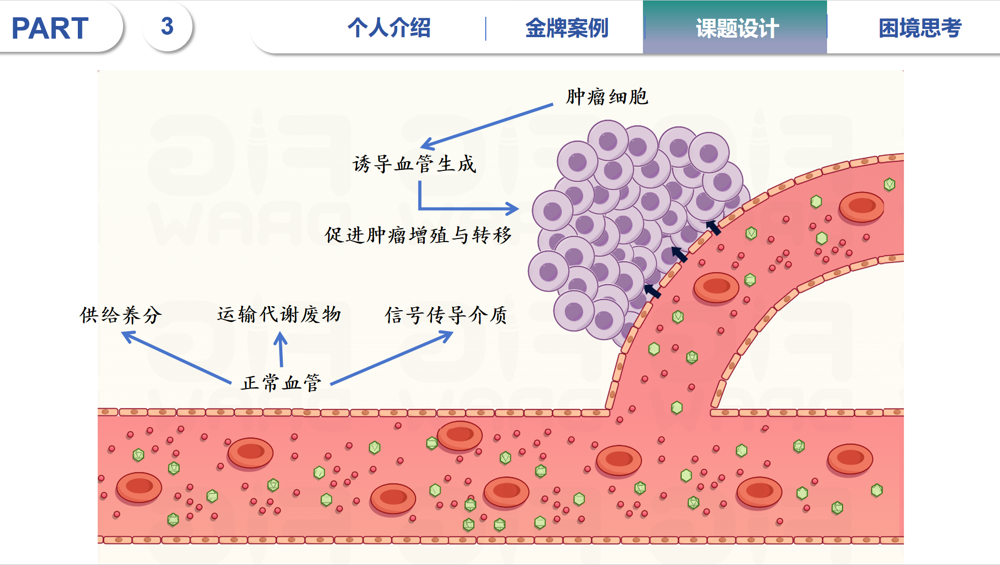

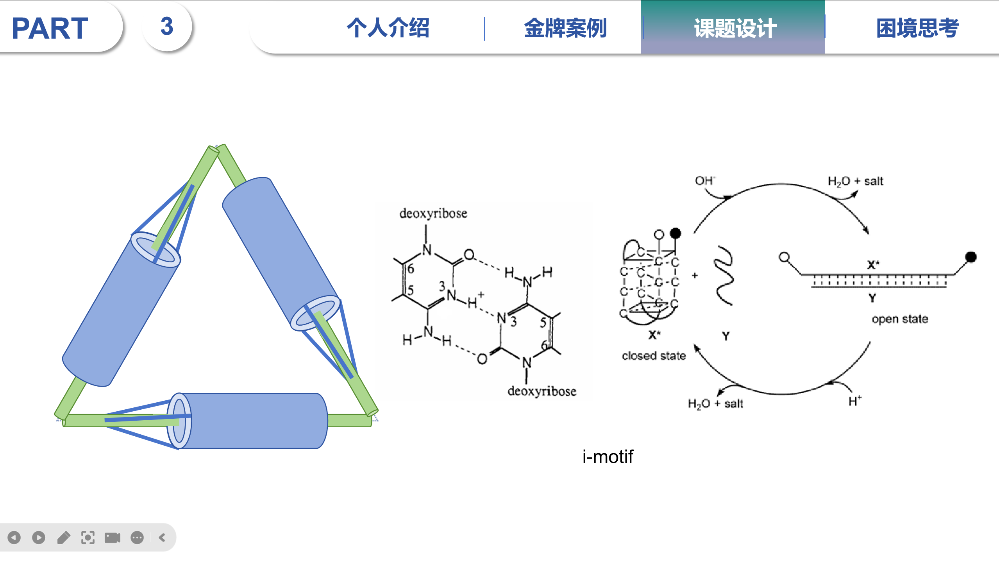

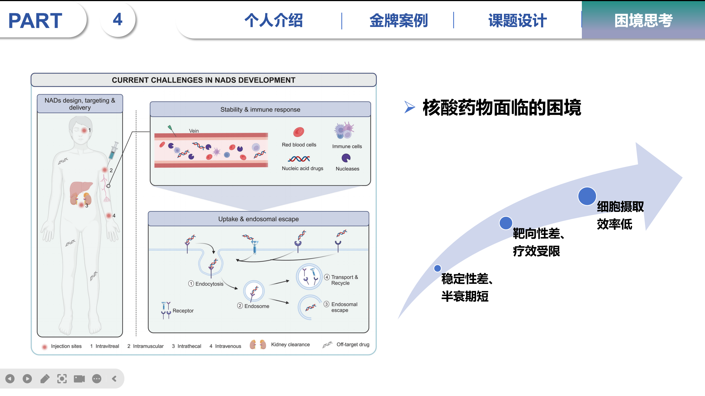

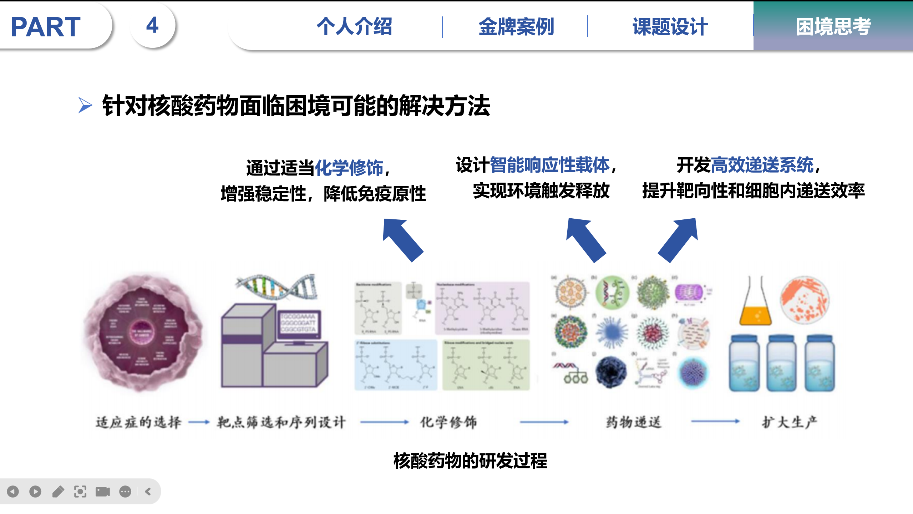

**English caption\.** Selected slides from early project discussions\.

**中文图注。** 项目立项前期讨论PPT节选。

### 2026\-06\-15｜Laboratory preparation｜实验室准备

**English\.** We began laboratory work, prepared materials and reviewed operating procedures\.

**中文。** 开始实验室工作，进行实验准备和操作规范学习。

### 2026\-06\-20｜Sequence handoff and label checks｜序列交接与标签核对

#### Brainstorming｜Comparing the first\-round designs｜首轮设计如何比较

**English\.** Discussion focus: Check the mapping from 17 candidates to 15 retained epitopes and 13 coding designs, including the two overlapping pairs\. Discuss common RNA inputs and controls for screening\.

**中文。** 讨论要点：核对17条候选、15条保留表位与13种编码设计的对应，重点检查两组重叠合并片段，并讨论筛选时统一的RNA输入与对照条件。

**English\.** We received the Dry Lab candidate sequences and checked the two overlapping epitope pairs against the 13 first\-round coding designs\. Merging the two pairs connected 15 retained epitopes to 13 designs, with labels linked to their continuous coding sequences\.

**中文。** 接收Dry Lab候选序列，核对两组重叠表位与13种首轮编码设计。15条保留表位通过两组重叠合并，对应13种首轮编码设计；标签与连续编码序列保持对应。

### 2026\-06\-21—2026\-08\-08｜Materials, experimental planning and form preparation｜材料、实验方案与表单准备

#### Brainstorming｜Preparing the first\-round comparisons｜准备首轮比较

**English\.** Discussion focus: Discuss RNA identity, circularisation\-related quality readouts, consistent inputs and controls\. Outline the PBMC, DC and T\-cell workflow and the records needed to link each construct with its readouts\.

**中文。** 讨论要点：讨论RNA身份、成环相关质控、输入一致性与对照条件，梳理PBMC、DC与T细胞流程，以及构建体与检测读出的对应记录。

#### Brainstorming｜Planning the animal evaluation｜规划动物评价

**English\.** Discussion focus: Outline the proposed model, comparison groups, administration arrangements, welfare criteria and endpoint collection\. Keep the early evaluation framework distinct from the module composition that would later be selected experimentally\.

**中文。** 讨论要点：梳理拟用模型、比较分组、处理安排、动物福利标准与终点取材，区分前期评价框架与后续通过实验确定的模块组成。

**English\.** We organised sequence versions, material and procurement requirements, sample identifiers, comparison plans and record sheets\. We also prepared the initial cell\-experiment and animal\-study plans for the first Check\-in and Animal Use Form submissions\.

**中文。** 整理序列版本、材料与采购需求、样品编号、比较方案及记录表，同时准备首版Check\-in与Animal Use Form所需的细胞实验和动物研究方案。

### 2026\-08\-09｜Initial Check\-in and Animal Use Form submissions｜首版Check\-in与Animal Use Form提交

**English\.** We submitted the initial Check\-in and Animal Use Form, recording the experimental plans available at that stage\.

**中文。** 提交首版Check\-in及Animal Use Form，记录该阶段已形成的实验方案。

### 2026\-08\-10—2026\-08\-16｜Implementation preparation and record checks｜实施准备与记录核对

#### Brainstorming｜Aligning the plan and implementation｜对齐方案与实施

**English\.** Discussion focus: Review material readiness, sample labels, comparison conditions, record sheets and handoffs between operations\.

**中文。** 讨论要点：核对材料准备、样品标签、比较条件、记录表及操作之间的交接。

**English\.** We continued checking materials, sample identifiers, operating arrangements and record sheets for the forthcoming experiments\.

**中文。** 继续核对后续实验所需的材料、样品编号、操作安排及记录表。

### 2026\-08\-17｜PBMC Check\-in approval｜PBMC Check\-in获批

**English\.** The PBMC\-related Check\-in was approved, and the corresponding cell operations began within its approved scope\.

**中文。** PBMC相关Check\-in获批，在获批范围内开始对应的细胞操作。

### 2026\-08\-17—2026\-08\-19｜PBMC, dendritic\-cell and T\-cell preparation｜PBMC、DC与T细胞准备

#### Brainstorming｜Connecting the DC–T\-cell workflow｜衔接DC–T细胞流程

**English\.** Discussion focus: Align cell batches, comparison groups and sample identifiers across DC preparation, T\-cell preparation and functional readouts\.

**中文。** 讨论要点：对齐DC准备、T细胞准备及功能读出之间的细胞批次、比较分组与样品编号。

**English\.** We began work with commercial PBMC material and prepared the DC and T\-cell conditions for first\-round screening\.

**中文。** 开展商业PBMC材料相关操作，准备首轮筛选所需的DC与T细胞条件。

### 2026\-08\-20—2026\-08\-24｜First\-round electroporation, co\-culture and screening｜首轮电转、共培养与筛选

#### Brainstorming｜Linking material quality to the screen｜将材料质量与筛选对应

**English\.** Discussion focus: Keep representative\-preparation quality results linked to the tested sample\. Compare modules within each antigen source while retaining cell\-batch and control records\.

**中文。** 讨论要点：将代表性质控结果对应到实际受测样品；按抗原来源比较模块，并保留细胞批次与对照记录。

**English\.** We carried out the first\-round electroporation, co\-culture and screening using quality\-checked circRNA materials\.

**中文。** 使用完成质量检查的circRNA材料开展首轮电转、共培养与筛选。

**English\.** The quality record for the first\-round screening material showed the following representative\-preparation result\. At a 4 µL input, the representative TROP2\-CTL1 preparation had a recorded circular\-to\-linear\-associated signal ratio of 32\.5:1 and an estimated circular fraction of 96\.96±0\.70% across three technical replicate wells\. This readout describes that representative preparation, rather than an identical fraction measured separately for all 13 preparations\.

**中文。** 首轮筛选材料的质量记录包含以下代表性制备物结果。代表性TROP2\-CTL1制备物在4 µL输入下，记录的环状—线性相关信号比为32\.5:1，估算环状组分为96\.96±0\.70%（三个技术复孔）。这是该代表性制备物的读出，不代表对13种材料逐一测得同一比例。

**Table Wet\-Table1｜First\-round RNA circularity assessment｜首轮RNA成环评价**

| Input volume | ΔCq \(linear − circular\) | Circular : linear | Estimated circular fraction |
| --- | --- | --- | --- |
| 2 µL | 3\.70 ± 0\.02 | 13\.0∶1 | 92\.85 ± 0\.08% |
| 4 µL | 5\.02 ± 0\.37 | 32\.5∶1 | 96\.96 ± 0\.70% |
| 6 µL | 4\.72 ± 0\.45 | 26\.4∶1 | 96\.25 ± 1\.14% |
| All nine wells | 4\.48 ± 0\.67 | 22\.4∶1 | 95\.35 ± 2\.01% |

**English caption\.** RT\-qPCR assessment of representative TROP2\-CTL1 RNA; three technical wells per input volume\. The pooled nine wells span three input conditions, not nine biological replicates\.

**中文表注。** 代表性TROP2\-CTL1 RNA的RT\-qPCR评价，每个输入体积三个技术复孔；九孔汇总跨三个输入条件，不代表九个生物学重复。

### 2026\-08\-24｜First\-round results and Combined selection｜首轮结果与Combined确定

#### Brainstorming｜Selecting and combining eight modules｜选择并组合八个模块

**English\.** Discussion focus: How can two modules from each antigen source preserve the four\-antigen design? Discuss the Combined arrangement, linkers and second\-round groups with Dry Lab, and review their connection with the earlier animal\-evaluation framework\.

**中文。** 讨论要点：每种抗原来源保留两个模块如何维持四抗原设计？与Dry讨论Combined排列、连接设计及第二轮比较分组，并核对其与前期动物评价框架的衔接。

**English\.** We tested 13 first\-round preparations in the DC–T\-cell system using ELISpot\. The within\-run comparison supported selecting two modules from each antigen source\. TROP2 CTL1 and CTL2 recorded 271 and 217 spots, respectively\.

**中文。** 开展首轮13种制备物的DC–T细胞实验与ELISpot检测。首轮ELISpot对13种制备物进行比较，为每种抗原来源选择两个模块提供同轮相对依据。图中TROP2 CTL1、CTL2分别记录271和217个斑点。

**English\.** We supplemented first\-round CD8/CD69 and K562 killing measurements to document cell activation and overall effector activity\.

**中文。** 补充首轮CD8/CD69及K562杀伤检测，记录细胞激活与总体效应活性。

**English\.** We reviewed the first\-round screen and selected two modules from each antigen source\. The eight selected modules were TROP2 CTL1/CTL2, B7\-H4 CTL1/CTL2, Nectin\-4 CTL1/CTL2 and LIV\-1 CTL2/CTL3 for the subsequent Combined design\.

**中文。** 整理首轮筛选结果，从四种抗原来源分别选择两个模块。入选八模块为TROP2 CTL1/CTL2、B7\-H4 CTL1/CTL2、Nectin\-4 CTL1/CTL2及LIV\-1 CTL2/CTL3，用于后续Combined设计。

**Figure Wet\-Figure2｜First\-round ELISpot｜首轮ELISpot**

**English caption\.** ELISpot comparison of the 13 first\-round preparations\.

**中文图注。** 13种首轮制备物的ELISpot比较。

**Figure Wet\-Figure3｜First\-round CD8/CD69｜首轮CD8/CD69**

**English caption\.** Representative CD8/CD69 plots for the two leading TROP2 conditions\.

**中文图注。** 两个领先TROP2条件的CD8/CD69代表性流式图。

**Figure Wet\-Figure4｜First\-round K562 killing｜首轮K562杀伤**

**English caption\.** K562 killing by first\-round effector\-cell preparations\.

**中文图注。** 首轮效应细胞制备物对K562的杀伤。

### 2026\-08\-25—2026\-08\-27｜Combined sequence verification and second\-round preparation｜Combined序列核对与第二轮实验准备

**English\.** We checked the Combined sequence version with Dry Lab, organised the materials for the second round of experiments and initiated plasmid identity verification and quality control\.

**中文。** 与Dry Lab核对Combined序列版本，整理第二轮实验所需材料，并启动质粒身份核验与质量控制。

**Figure Wet\-Figure5｜Combined plasmid map｜Combined质粒图谱**

**English caption\.** Plasmid map of the construct integrating eight selected modules\.

**中文图注。** 整合八个入选模块的Combined构建体质粒图谱。

### 2026\-08\-27—2026\-08\-30｜Second\-round quality control, electroporation and co\-culture｜第二轮质控、电转与共培养

#### Brainstorming｜From molecular identity to functional readouts｜从分子身份到功能读出

**English\.** Discussion focus: Connect DNA\-template and junction checks with RNA persistence, protein expression, DC maturation and T\-cell functional comparisons\. Keep the five preparations and their sample labels consistent\.

**中文。** 讨论要点：将DNA模板及接缝核对与RNA持续性、蛋白表达、DC成熟及T细胞功能比较衔接，统一五种制备物及其样品标签。

**English\.** We checked second\-round DNA templates, RNA circularisation and the Combined junction alongside preparation for the functional comparisons\. Junction sequencing identified the expected head\-to\-tail connection\. Purified Combined had a circular\-to\-linear\-associated signal ratio of 145\.7:1 and an estimated circular fraction of 99\.30±0\.17%\.

**中文。** 结合功能比较的准备核对第二轮DNA模板、RNA成环及Combined接缝。接缝测序检出预期的首尾连接；纯化后Combined的环状—线性相关信号比为145\.7:1，估算环状组分为99\.30±0\.17%。

**English\.** We carried out second\-round electroporation and co\-culture, preparing the effector\-cell conditions for the functional comparisons\.

**中文。** 开展第二轮电转与共培养，准备后续功能比较所需的效应细胞条件。

**Figure Wet\-Figure6｜Second\-round DNA templates｜第二轮DNA模板**

**English caption\.** Gel electrophoresis of four antigen\-encoding DNA transcription templates\.

**中文图注。** 四种抗原编码DNA转录模板的电泳图。

**Figure Wet\-Figure7｜Combined junction sequencing｜Combined接缝测序**

**English caption\.** Sanger sequencing of the junction\-spanning amplification product identified the expected head\-to\-tail connection\.

**中文图注。** 跨接缝扩增产物的Sanger测序检出预期的首尾连接。

### 2026\-08\-28—2026\-08\-31｜CCK\-8 viability assay｜CCK\-8活力检测

#### Brainstorming｜Separating carrier effects from target\-cell killing｜区分载体影响与靶细胞杀伤

**English\.** Discussion focus: Empty\-LNP effects on DC viability and effector\-cell killing address different questions\. Keep the cell identity, input units and controls explicit for each assay\.

**中文。** 讨论要点：空载LNP对DC活力的影响与效应细胞杀伤回答不同问题，分别明确细胞身份、输入单位及对照条件。

**English\.** We assessed immature moDC viability after 24 h of empty\-LNP exposure at nominal inputs of 0, 50, 100, 200 and 400 ng per well, with four wells per dose\. Viability remained near baseline at 50–200 ng and decreased to 57\.2±5\.8% at 400 ng\. The dataset was completed by 31 August for Cell2Dose calibration\.

**中文。** 以0、50、100、200及400 ng/孔名义输入的空载LNP处理未成熟moDC，24 h后开展CCK8检测，每剂量4孔。50–200 ng下活力接近基线，400 ng时降至57\.2±5\.8%；截至8月31日完成数据整理，用于Cell2Dose校准。

**Figure Wet\-Figure8｜Empty\-LNP DC viability｜空载LNP下DC活力**

**English caption\.** DC viability across the tested nominal empty\-LNP inputs\.

**中文图注。** 不同名义空载LNP输入量下的DC活力。

### 2026\-08\-28—2026\-09\-03｜Molecular and cellular supplementary readouts｜分子与细胞补充读出

#### Brainstorming｜Connecting the evidence chain｜衔接证据链

**English\.** Discussion focus: What does each RNA, protein, DC, T\-cell and ELISpot measurement establish? Compare the roles of expression, maturation\-associated phenotypes and functional outputs without treating them as interchangeable readouts\.

**中文。** 讨论要点：RNA、蛋白、DC、T细胞与ELISpot各自说明什么？梳理表达、成熟相关表型和功能输出的作用，分别解释各类读出。

**English\.** We measured RNA persistence at 37 ℃\. circRNA retained 71\.9% and 39\.5% of its own 0 h signal at 24 h and 72 h; the corresponding linear precursor retained 5\.9% and 2\.7%\. This time course ran alongside the cell comparisons\.

**中文。** 开展37 ℃条件下的RNA持续性检测。circRNA于24 h和72 h分别保留自身0 h信号的71\.9%和39\.5%，对应线性前体为5\.9%和2\.7%；该时间序列与细胞比较并行开展。

**English\.** We assessed protein expression and compared DC maturation\. Anti\-FLAG Western blotting detected a band near 50 kDa in the circRNA\-electroporated lane, supporting expression of the encoded protein\. CD80⁺CD86⁺ DCs increased from 10\.33±0\.55% in Blank to 22\.37±0\.31% in Combined, a 2\.16\-fold difference\.

**中文。** 开展翻译表达检测及DC成熟比较。抗FLAG Western blot在circRNA电转泳道出现约50 kDa条带，支持编码蛋白获得表达。CD80⁺CD86⁺ DC比例由Blank的10\.33±0\.55%升至Combined的22\.37±0\.31%，Combined为Blank的2\.16倍。

**English\.** We completed second\-round T\-cell phenotyping and the five\-group ELISpot comparison\. Combined showed relatively high values in the CD8/CD69, CD8/CD28 and CD45RO/CCR7 comparisons\. Spot counts were 32 for Blank, 198 for TROP2 CTL1, 227 for TROP2 CTL2, 298 for TROP2 CTL1\+2 and 367 for Combined\.

**中文。** 完成第二轮T细胞表型与五组ELISpot比较。Combined在CD8/CD69、CD8/CD28及CD45RO/CCR7比较中呈较高水平；五组斑点数依次为Blank 32、TROP2 CTL1 198、TROP2 CTL2 227、TROP2 CTL1\+2 298、Combined 367。

**Figure Wet\-Figure9｜RNA persistence gel｜RNA持续性电泳**

**English caption\.** circRNA and linear precursor signals at 0, 24, 48 and 72 h at 37 ℃\.

**中文图注。** 37 ℃条件下0、24、48及72 h的circRNA与线性前体信号。

**Figure Wet\-Figure10｜Relative RNA band intensity｜RNA相对条带灰度**

**English caption\.** Band intensities normalised to each RNA form’s own 0 h signal\.

**中文图注。** 两种RNA条带灰度分别以自身0 h信号归一化。

**Figure Wet\-Figure11｜Anti\-FLAG Western blot｜抗FLAG Western blot**

**English caption\.** Anti\-FLAG signal near 50 kDa after circRNA electroporation\.

**中文图注。** circRNA电转后约50 kDa处的抗FLAG信号。

**Figure Wet\-Figure12｜DC maturation flow cytometry｜DC成熟流式图**

**English caption\.** Representative CD80/CD86 flow\-cytometry plots for the five preparations\.

**中文图注。** 五种制备物对应的CD80/CD86代表性流式图。

**Figure Wet\-Figure13｜DC maturation quantification｜DC成熟定量**

**English caption\.** Comparison of CD80⁺CD86⁺ DC proportions across five groups\.

**中文图注。** 五组CD80⁺CD86⁺ DC比例比较。

**Figure Wet\-Figure14｜T\-cell activation phenotype｜T细胞激活表型**

**English caption\.** Representative CD8/CD69 plots and corresponding quantification\.

**中文图注。** CD8/CD69代表性流式图及定量结果。

**Figure Wet\-Figure15｜T\-cell co\-stimulation phenotype｜T细胞共刺激表型**

**English caption\.** Representative CD8/CD28 plots and corresponding quantification\.

**中文图注。** CD8/CD28代表性流式图及定量结果。

**Figure Wet\-Figure16｜Effector\-memory\-associated phenotype｜效应记忆相关表型**

**English caption\.** Representative CD45RO/CCR7 plots and corresponding quantification\.

**中文图注。** CD45RO/CCR7代表性流式图及定量结果。

**Figure Wet\-Figure17｜Second\-round ELISpot｜第二轮ELISpot**

**English caption\.** IFN\-γ ELISpot comparison of the five second\-round preparations\.

**中文图注。** 五种第二轮制备物的IFN\-γ ELISpot比较。

### 2026\-08\-30—2026\-08\-31｜Three\-ratio cytotoxicity assay｜三档效靶比细胞毒实验

**English\.** We completed MDA\-MB\-231 target\-cell killing measurements at E:T ratios of 20:1, 40:1 and 80:1\. Blank and Combined each had three records per ratio; Combined showed the highest recorded killing across the tested preparations at all three ratios\. The Blank and Combined data were organised for background correction and Cell2Dose calibration\.

**中文。** 完成20:1、40:1及80:1三个效靶比下的MDA\-MB\-231靶细胞杀伤检测。Blank与Combined每档各3个重复；Combined在三个效靶比下均获得受测制备物中的最高记录杀伤。整理Blank与Combined数据，用于背景校正和Cell2Dose校准。

**Figure Wet\-Figure18｜MDA\-MB\-231 killing｜MDA\-MB\-231杀伤**

**English caption\.** Target\-cell killing at three effector\-to\-target ratios\.

**中文图注。** 三个效靶比下的靶细胞杀伤。

### 2026\-08\-31｜Core cell\-data handoff｜核心细胞数据交接

**English\.** We handed the CCK8 and three\-ratio cytotoxicity datasets to Dry Lab, together with sample identifiers, dose and E:T labels, controls and replicate records\. These two datasets formed the core response\-curve calibration inputs available before 1 September\.

**中文。** 向Dry交付CCK8及三档效靶比细胞毒数据，并核对样品编号、剂量与效靶比标签、对照及重复记录。这两类数据构成9月1日前已取得的核心响应曲线校准输入。

### 2026\-09\-01—2026\-09\-03｜In vitro construction and validation of TROP2\-expressing 4T1 cells｜TROP2表达4T1细胞的体外构建与验证

#### Brainstorming｜Preparing the model\-cell input｜准备模型细胞输入

**English\.** Discussion focus: Align cell identity, GFP sorting, transcript detection and surface TROP2 records with the population used for the animal study\.

**中文。** 讨论要点：将细胞身份、GFP分选、转录检测及膜表面TROP2记录，对应到动物研究使用的细胞群。

**English\.** We constructed and validated the TROP2\-overexpressing 4T1 cell line in vitro from 1 to 3 September, alongside the vaccine\-screening work\. GFP signals were recorded during transduction and sorting; 84\.1% of events within the singlet gate were GFP\-positive\. The final cell population was 99\.9% surface\-TROP2\-positive, compared with 0% in wild\-type 4T1\. Semi\-quantitative RT\-PCR supported an order\-of\-magnitude increase in transcript signal; its 75\.83±3\.27\-fold readout is not treated as a calibrated exact expression ratio\.

**中文。** 9月1日至9月3日，与疫苗筛选并行开展TROP2过表达4T1细胞系的体外构建与验证。转导及分选过程中记录GFP信号；单细胞门内84\.1%事件为GFP阳性。最终细胞TROP2膜表面阳性率为99\.9%，野生型4T1为0%。半定量RT\-PCR支持转录信号数量级升高，其75\.83±3\.27倍读出不作为经过校准的精确表达倍数。

**Figure Wet\-Figure19｜TROP2 transcript detection｜TROP2转录检测**

**English caption\.** Semi\-quantitative TROP2 transcript comparison in the model cells\.

**中文图注。** 模型细胞中的TROP2转录信号半定量比较。

**Figure Wet\-Figure20｜Surface TROP2 expression｜TROP2膜表面表达**

**English caption\.** Surface TROP2 staining in wild\-type and engineered 4T1 cells\.

**中文图注。** 野生型与工程化4T1细胞的膜表面TROP2染色。

**Figure Wet\-Figure21｜GFP fluorescence｜GFP荧光**

**English caption\.** GFP fluorescence recorded after lentiviral transduction\.

**中文图注。** 慢病毒转导后的GFP荧光。

**Figure Wet\-Figure22｜GFP sorting gates｜GFP分选设门**

**English caption\.** Flow\-cytometry gates used to select GFP\-positive cells\.

**中文图注。** 选择GFP阳性细胞的流式设门。

### 2026\-09\-04｜Animal Use approval and dose confirmation｜Animal Use获批与剂量确认

#### Brainstorming｜Translating the plan into an animal study｜将方案落实为动物研究

**English\.** Discussion focus: Review groups, administration arrangements, welfare criteria and endpoint records together with the practical dose choice\.

**中文。** 讨论要点：结合剂量选择，梳理实验分组、处理安排、动物福利标准及终点记录。

**English\.** The Animal Use Form was approved\. We reviewed the preliminary Cell2Dose comparison and experimental plan with Dry Lab and the supervisors and confirmed 10 µg for the animal study\.

**中文。** Animal Use Form获批。与Dry及指导老师核对前期Cell2Dose比较和实验方案，确认10 µg动物实验剂量。

### 2026\-09\-17—2026\-09\-19｜Normal\-cell safety Check\-ins and comparison｜正常细胞安全性Check\-in与比较

#### Brainstorming｜Interpreting target preference within the panel｜解释所测面板内的靶细胞偏好

**English\.** Discussion focus: Compare tumour and normal targets under the same tested E:T conditions and distinguish this panel comparison from empty\-LNP DC viability and the earlier model\-calibration assay\.

**中文。** 讨论要点：在相同受测效靶比下比较肿瘤与正常靶细胞，区分本轮面板比较、空载LNP下DC活力及前期模型校准实验。

**English\.** The normal\-cell safety Check\-ins were approved on 17 September\. The corresponding experiments began after approval and were completed over three days, in parallel with the animal study\. We compared HCAEC, LX\-2, BEAS\-2B and MCF\-12A with the MDA\-MB\-231 tumour target\. At E:T 80:1, tumour\-target killing was 59\.24±2\.10%, versus 0\.78%–2\.77% for the four normal targets; at 100:1, the values were 62\.07±3\.58% and 1\.31%–3\.47%\. These records were separate from the earlier three\-ratio Cell2Dose calibration data\.

**中文。** 正常细胞安全性相关Check\-in于9月17日获批，对应实验在获批后开始，分三天完成，与动物观察并行开展。以MDA\-MB\-231为肿瘤靶细胞，对比HCAEC、LX\-2、BEAS\-2B及MCF\-12A。80:1时肿瘤靶细胞杀伤率为59\.24±2\.10%，四种正常细胞为0\.78%–2\.77%；100:1时分别为62\.07±3\.58%及1\.31%–3\.47%。该记录与前期用于Cell2Dose校准的三档效靶比数据分别整理。

**Figure Wet\-Figure23｜Tumour and non\-tumour targets｜肿瘤与非肿瘤靶细胞**

**English caption\.** Killing of tumour and non\-tumour targets at 80:1 and 100:1\.

**中文图注。** 80:1及100:1效靶比下的肿瘤与非肿瘤靶细胞杀伤。

### 2026\-09\-06—2026\-10\-03｜Animal\-study implementation and longitudinal monitoring｜动物实验实施与持续监测

**English\.** We initiated the TROP2\-expressing 4T1 tumour study in three groups: PBS, empty\-vector circRNA–LNP and Combined circRNA–LNP, with five mice per group\. Five administrations were completed during this period, with a Combined dose of 10 µg per administration\. Animal condition and tumour growth were monitored and recorded throughout\.

**中文。** 开展TROP2表达4T1荷瘤动物实验，设置PBS、空载体circRNA–LNP和Combined circRNA–LNP三组，每组5只小鼠。在此期间完成五次处理，Combined每次给药量为10 µg，并持续监测、记录动物状态及肿瘤生长。

### 2026\-10\-04—2026\-10\-09｜Continued observations and endpoint preparation｜持续观察与终点准备

**English\.** We continued tumour\-growth and animal\-condition observations and prepared the endpoint sample identifiers and collection records\.

**中文。** 继续记录肿瘤生长与动物状态，整理终点样本编号及取材记录。

### 2026\-10\-09｜Endpoint assessment and tissue collection｜终点评价与组织取材

#### Brainstorming｜Interpreting tumour and immune observations together｜共同解释肿瘤与免疫观察

**English\.** Discussion focus: Connect tumour control with systemic immune readouts under the same group and animal identifiers, and organise the samples for local tissue imaging\.

**中文。** 讨论要点：在一致的分组和动物编号下，将肿瘤控制与系统性免疫读出对应，并整理后续局部组织成像所需样本。

**English\.** We completed endpoint assessment, tumour and spleen collection and the splenic immune measurements\. Mean endpoint tumour volumes were 233\.64±28\.33 mm³ for PBS, 90\.36±13\.51 mm³ for empty vector and 24\.20±9\.72 mm³ for Combined \(five animals per group\)\. Combined volumes were 89\.6% lower than PBS and 73\.2% lower than empty vector\. The splenic panels assessed DC maturation, CD8 activation, memory\-associated phenotype, intracellular IFN\-γ and Granzyme B; quantification used three animals per group\.

**中文。** 完成终点评价、肿瘤与脾脏取材及脾脏免疫测量。终点肿瘤体积为PBS组233\.64±28\.33 mm³、空载体组90\.36±13\.51 mm³、Combined组24\.20±9\.72 mm³（每组5只动物）。Combined较PBS及空载体分别降低89\.6%和73\.2%。脾脏检测涵盖DC成熟、CD8激活、记忆相关表型、胞内IFN\-γ及Granzyme B；定量结果每组纳入3只动物。

**Figure Wet\-Figure24｜Tumour growth curves｜肿瘤生长曲线**

**English caption\.** Mean tumour growth in PBS, empty\-vector and Combined groups\.

**中文图注。** PBS、空载体与Combined组的平均肿瘤生长曲线。

**Figure Wet\-Figure25｜Excised tumours at the endpoint｜终点离体肿瘤**

**English caption\.** Excised tumours from the three comparison groups at the endpoint\.

**中文图注。** 三组终点离体肿瘤。

**Figure Wet\-Figure26｜Splenic DC maturation｜脾脏DC成熟**

**English caption\.** Representative splenic DC plots and quantification across three groups\.

**中文图注。** 三组脾脏DC代表性流式图及定量。

**Figure Wet\-Figure27｜Splenic CD8 activation｜脾脏CD8激活**

**English caption\.** Splenic CD8 activation\-associated plots and quantification\.

**中文图注。** 脾脏CD8激活相关流式图及定量。

**Figure Wet\-Figure28｜Splenic memory\-associated phenotype｜脾脏记忆相关表型**

**English caption\.** Splenic memory\-associated phenotype plots and quantification\.

**中文图注。** 脾脏记忆相关表型流式图及定量。

**Figure Wet\-Figure29｜Splenic intracellular IFN\-γ｜脾脏胞内IFN\-γ**

**English caption\.** Intracellular IFN\-γ in splenic CD8 T cells after stimulation\.

**中文图注。** 刺激后脾脏CD8 T细胞的胞内IFN\-γ。

**Figure Wet\-Figure30｜Splenic intracellular Granzyme B｜脾脏胞内Granzyme B**

**English caption\.** Intracellular Granzyme B in splenic CD8 T cells after stimulation\.

**中文图注。** 刺激后脾脏CD8 T细胞的胞内Granzyme B。

### 2026\-10\-10—2026\-10\-13｜Tumour immunofluorescence and result organisation｜肿瘤免疫荧光与结果整理

**English\.** We stained and imaged the tumour sections and organised the CD8 and Granzyme B channels with the endpoint records\. Representative fields showed stronger CD8\-associated signals in Combined; the tissue images were interpreted qualitatively\.

**中文。** 完成肿瘤切片染色与成像，将CD8及Granzyme B通道与终点记录共同整理。Combined代表性视野呈现更强的CD8相关信号，组织图像作定性解释。

**Figure Wet\-Figure31｜Tumour immune\-signal imaging｜肿瘤免疫信号成像**

**English caption\.** Representative tumour CD8 and Granzyme B channels, interpreted qualitatively\.

**中文图注。** 肿瘤CD8与Granzyme B代表性通道图，作定性解释。

### 2026\-10\-13｜Wet Lab completion and handoff｜湿实验完成与交付

**English\.** We completed Wet Lab work, checked sample and figure correspondence and handed the final experimental materials to Dry Lab and Wiki\.

**中文。** 完成Wet工作，核对样品与图表对应关系，向Dry及Wiki交付最终实验材料。

# Dry Lab｜干实验

### 2025\-12\-06—2025\-12\-20｜Team formation and initial brainstorming｜建队与初步头脑风暴

#### Brainstorming｜Connecting computation to experimental questions｜让计算对应实验问题

**English\.** Discussion focus: Which data could support candidate selection, and which computational outputs would be useful for Wet Lab design and interpretation?

**中文。** 讨论要点：哪些数据能够支持候选选择，哪些计算输出能够用于Wet设计及结果解释？

**English\.** We completed team formation and began discussing project directions, available datasets and computational questions\.

**中文。** 完成建队，开始讨论项目方向、可用数据及计算分析能够回答的问题。

### 2025\-12\-21—2026\-01\-20｜Final examinations｜期末考试暂停

**English\.** Team members prepared for and took final examinations, pausing coordinated project work\.

**中文。** 团队成员准备并参加期末考试，暂停集中项目推进。

### 2026\-01\-21—2026\-04\-29｜Project discussions and computational planning｜项目讨论与计算规划

#### Brainstorming｜Planning evidence and data handoffs｜规划证据与数据交接

**English\.** Discussion focus: Discuss protein evidence, malignant\-cell localisation, patient representation, epitope prioritisation and the information needed to connect analysis with experiments\.

**中文。** 讨论要点：讨论蛋白层证据、恶性细胞定位、患者层代表范围、表位优先筛选，以及分析交付实验所需的信息。

**English\.** After examinations, we resumed project discussions and organised the TNBC antigen, epitope and software questions for subsequent analysis\.

**中文。** 期末考试后恢复项目讨论，梳理后续TNBC抗原、表位及软件分析问题。

### 2026\-03\-28—2026\-03\-31｜Software development begins｜软件开发启动

#### Brainstorming｜Defining the initial workflow｜定义初始工作流

**English\.** Discussion focus: What inputs and outputs should connect data processing, target screening, epitope work and circRNA design within one workflow?

**中文。** 讨论要点：数据处理、靶点筛选、表位分析与circRNA设计需要通过哪些输入和输出衔接？

**English\.** We began software development and organised initial functions, data inputs and links between analysis steps\.

**中文。** 开始软件开发，梳理初始功能、数据输入及分析步骤之间的衔接。

### 2026\-04\-01｜Runnable software baseline｜可运行的软件基线

**English\.** We established a runnable V1 baseline\. The repository history retains this early development version; it is distinct from creation of the later official repository\.

**中文。** 形成可运行的V1基线。仓库历史保留该早期开发版本，其时间与后续正式仓库创建时间分别记录。

### 2026\-04\-02—2026\-04\-20｜Initial software workflow development｜初期软件流程开发

**English\.** We improved the existing data\-processing, quality\-control, target\-screening, epitope and circRNA\-design functions\.

**中文。** 完善已有数据处理、质控、靶点筛选、表位及circRNA设计功能。

### 2026\-05\-01—2026\-05\-08｜TNBC analysis and antigen\-evidence framework｜TNBC分析与抗原证据框架

#### Brainstorming｜Choosing a complementary antigen panel｜选择互补抗原组合

**English\.** Discussion focus: Compare the evidence for TROP2, B7\-H4, Nectin\-4 and LIV\-1 across protein, cell and patient levels rather than ranking candidates solely by expression\.

**中文。** 讨论要点：从蛋白、细胞与患者层面比较TROP2、B7\-H4、Nectin\-4及LIV\-1的证据，讨论表达水平与互补代表范围。

**English\.** We organised the TNBC candidate antigens and data sources and established an evaluation framework spanning protein evidence, malignant\-cell localisation, patient representation and clinical context\.

**中文。** 整理TNBC候选抗原及数据来源，建立覆盖蛋白证据、恶性细胞定位、患者层代表范围及临床背景的评价框架。

### 2026\-05\-09—2026\-05\-22｜Proteomic evidence｜蛋白组证据

**English\.** We analysed proteomic data for the four candidate antigens\. PXD024322 supported all four at the protein level, while the paired PXD028102 analysis further supported tumour\-associated increases in TROP2, B7\-H4 and Nectin\-4\. LIV\-1 was not quantified in the latter cohort and retained its evidence from PXD024322\.

**中文。** 开展蛋白组数据分析，比较四种候选抗原的蛋白层证据。PXD024322为四种抗原提供蛋白层支持；PXD028102配对分析进一步支持TROP2、B7\-H4与Nectin\-4的肿瘤相关升高。LIV\-1在后者未获得定量，保留其在PXD024322中的证据。

**Figure Dry\-Figure1｜PXD024322 differential proteins｜PXD024322差异蛋白**

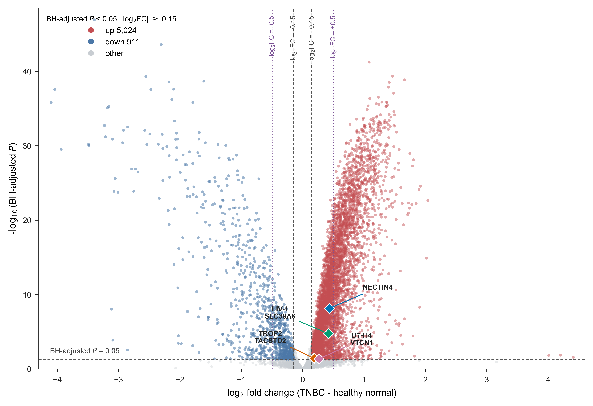

**English caption\.** Volcano plot comparing TNBC and normal\-breast protein abundance\.

**中文图注。** TNBC与正常乳腺蛋白丰度比较火山图。

**Figure Dry\-Figure2｜PXD024322 candidate abundance｜PXD024322候选蛋白丰度**

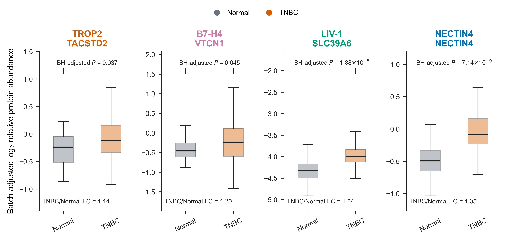

**English caption\.** Protein\-abundance distributions of the four candidate antigens\.

**中文图注。** 四种候选抗原的蛋白丰度分布。

**Figure Dry\-Figure3｜PXD028102 paired analysis｜PXD028102配对分析**

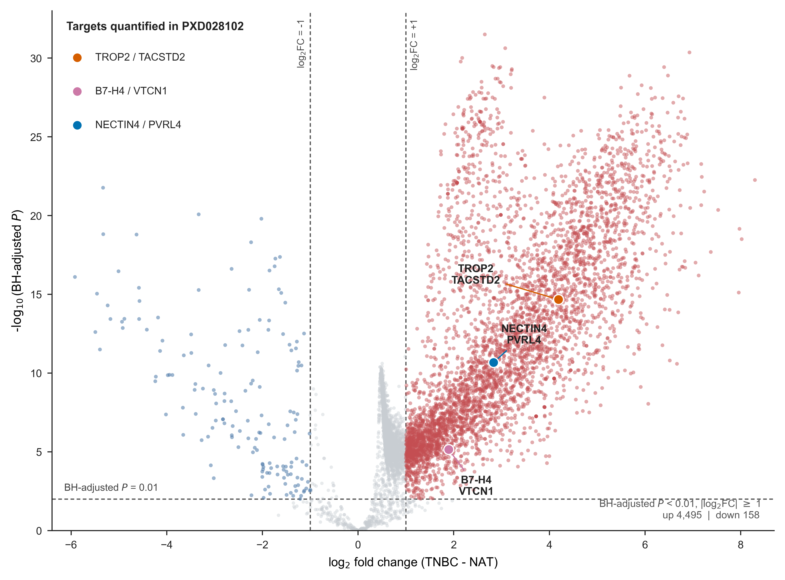

**English caption\.** Volcano plot of paired tumour and adjacent\-normal protein abundance\.

**中文图注。** 肿瘤与匹配癌旁组织蛋白丰度比较火山图。

**Figure Dry\-Figure4｜PXD028102 candidate abundance｜PXD028102候选蛋白丰度**

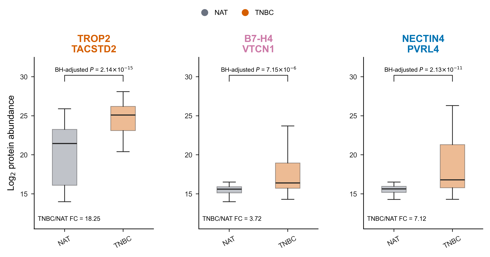

**English caption\.** Paired\-cohort abundance of TROP2, B7\-H4 and Nectin\-4\.

**中文图注。** 配对队列中TROP2、B7\-H4与Nectin\-4的蛋白丰度。

### 2026\-05\-23—2026\-05\-31｜Single\-cell localisation｜单细胞定位

**English\.** We used single\-cell analysis to locate the cellular sources of antigen expression\. The analysis retained 39,324 cells, including 9,491 malignant cells\. TROP2 alone was detected in 70\.4% of malignant cells, and the four\-gene union increased detection to 81\.4%; the four genes were not simultaneously expressed in every malignant cell\.

**中文。** 开展单细胞分析，定位抗原表达的细胞来源。分析保留39,324个细胞，其中9,491个为恶性细胞。TROP2单独的恶性细胞检出率为70\.4%，四基因并集扩展至81\.4%；四基因并非在所有恶性细胞中同时表达。

**Figure Dry\-Figure5｜Single\-cell lineages｜单细胞谱系**

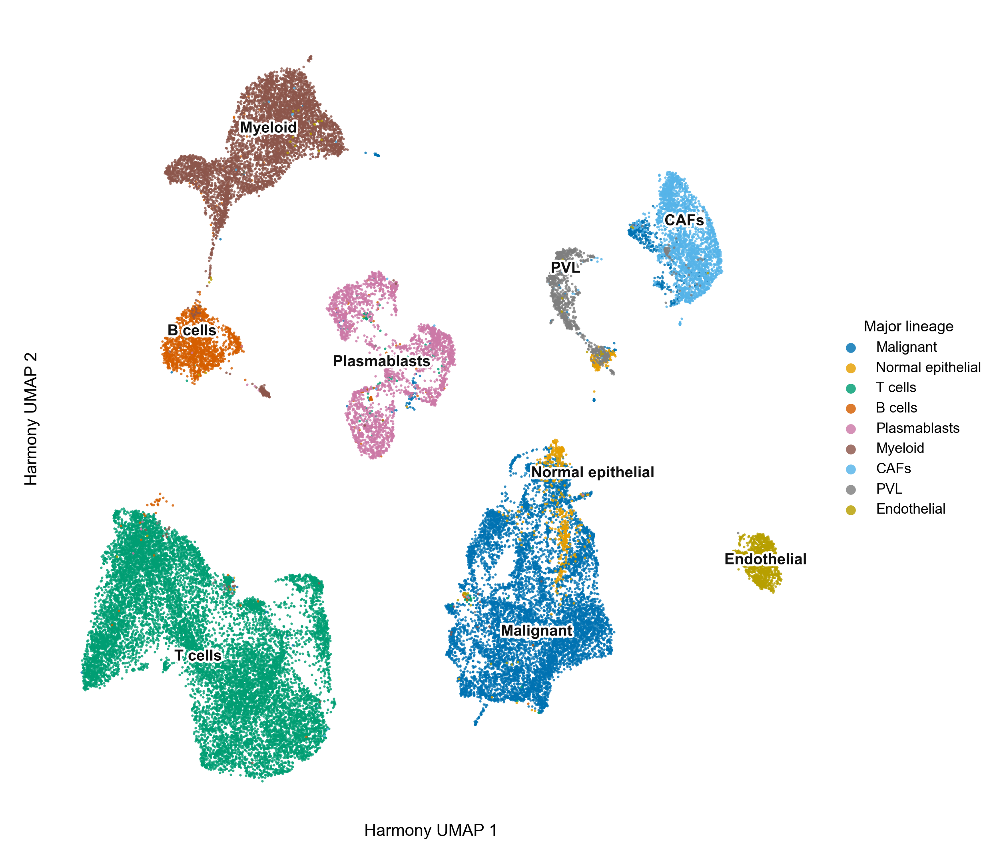

**English caption\.** Cell\-lineage distribution in the TNBC single\-cell subset\.

**中文图注。** TNBC单细胞子集的细胞谱系分布。

**Figure Dry\-Figure6｜Candidate\-gene localisation｜候选基因定位**

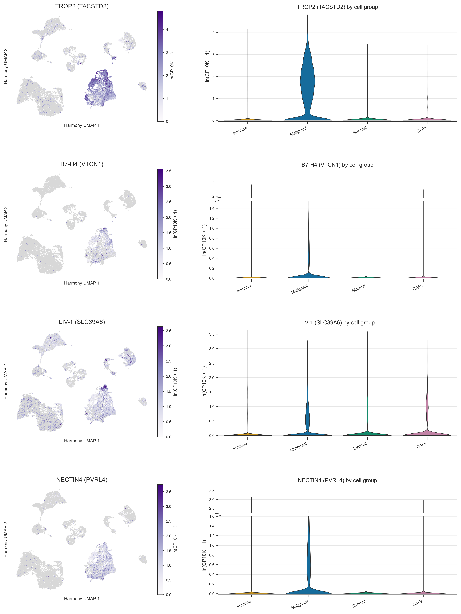

**English caption\.** Candidate\-gene expression across the analysed cell populations\.

**中文图注。** 候选基因在所分析细胞群中的表达。

**Figure Dry\-Figure7｜Malignant\-cell panel detection｜恶性细胞组合检出**

**English caption\.** Four\-gene panel detection in malignant cells across cases\.

**中文图注。** 各病例恶性细胞中的四基因组合检出情况。

### 2026\-06\-01—2026\-06\-05｜Patient\-level antigen representation｜患者层抗原代表范围

**English\.** We assessed patient\-level representation and organised evidence for the four\-antigen combination\. Under the predefined molecular criteria, the four\-gene union represented 101 of 115 patients, or 88%\. This describes antigen representation in the cohort, rather than HLA compatibility or clinical efficacy\.

**中文。** 开展患者层面的抗原代表范围分析，整理四抗原组合证据。按预设分子判据，四基因并集代表115例患者中的101例，即88%。该比例描述队列中的抗原代表范围，不等于HLA匹配比例或临床疗效。

**Figure Dry\-Figure8｜Patient\-level representation｜患者层代表范围**

**English caption\.** Four antigen\-source genes across the patient cohort\.

**中文图注。** 患者队列中四种抗原来源基因的代表范围。

### 2026\-06\-06—2026\-06\-12｜Epitope prioritisation｜表位优先筛选

#### Brainstorming｜Prioritising traceable epitopes｜优先选择可追踪的表位

**English\.** Discussion focus: Discuss binding and immunogenicity predictions in the HLA\-A\*02:01 context, retaining source\-protein coordinates and evidence for experimental handoff\.

**中文。** 讨论要点：在HLA\-A\*02:01情境下讨论结合与免疫原性预测，保留来源蛋白坐标及实验交接所需证据。

**English\.** We predicted epitopes in the HLA\-A\*02:01 context and reviewed their source\-protein positions, producing 17 traceable candidates\. Binding affinity, immunogenicity and source\-protein context supported their progression to structural assessment\.

**中文。** 开展HLA\-A\*02:01情境下的表位预测及来源蛋白复核，形成17条候选清单。经过结合亲和力、免疫原性及来源蛋白情境复核，形成17条可追踪候选，用于下一步结构评价。

**Figure Dry\-Figure9｜Epitope prioritisation｜表位优先筛选**

**English caption\.** Prediction and source\-protein review leading to 17 candidates\.

**中文图注。** 经预测与来源蛋白复核形成17条候选。

### 2026\-06\-13—2026\-06\-19｜Peptide–HLA structural review｜肽–HLA结构复核

**English\.** We reviewed peptide–HLA structures and established the 15 retained sequences for handoff\. Of the 17 candidates, four TROP2, two B7\-H4, four Nectin\-4 and five LIV\-1 epitopes were retained\. HILHVSFLA and FLAEASVRG were excluded from the first\-round coding set\. The representative peptide–HLA image is a computational structure, rather than an immune\-function experiment\.

**中文。** 开展肽–HLA结构复核，形成用于交接的15条保留序列。17条候选中保留15条：TROP2 4条、B7\-H4 2条、Nectin\-4 4条、LIV\-1 5条。HILHVSFLA与FLAEASVRG未纳入首轮编码集合。代表性肽–HLA图为计算结构，不能当作实际免疫功能结果。

**Figure Dry\-Figure10｜Peptide–HLA structural model｜肽–HLA结构模型**

**English caption\.** Predicted peptide placement within the HLA binding groove\.

**中文图注。** 预测肽段在HLA结合槽中的位置。

### 2026\-06\-20｜Mapping merged coding designs｜合并编码设计对应

#### Brainstorming｜Handing sequences to Wet Lab｜向Wet交付序列

**English\.** Discussion focus: Check the 17\-candidate, 15\-epitope and 13\-design mapping, including both overlapping pairs and their continuous coding sequences\.

**中文。** 讨论要点：核对17条候选、15条表位及13种设计的对应，检查两组重叠合并及连续编码序列。

**English\.** We checked the two overlapping pairs and the 13 design labels with Wet Lab\. The continuous coding fragments were TLIYYLDEIPPKF and FQARLRLRVLVPPL, corresponding to the merged labels TROP2 CTL3 and NECTIN4 CTL1, respectively\.

**中文。** 与Wet Lab核对两组重叠合并及13种首轮设计标签。两组连续编码片段为TLIYYLDEIPPKF及FQARLRLRVLVPPL，分别对应TROP2 CTL3和NECTIN4 CTL1的合并标签。

### 2026\-06\-21—2026\-07\-10｜Existing prototype improvement and organisation｜已有原型完善与整理

#### Brainstorming｜Connecting analysis steps｜衔接分析步骤

**English\.** Discussion focus: Keep candidate identifiers and outputs consistent across import, screening, prediction and experimental sequence handoff\.

**中文。** 讨论要点：在导入、筛选、预测及实验序列交接之间保持候选标识和输出一致。

**English\.** We improved the existing CircuForge prototype and organised the linked data\-import, quality\-control, target\-screening and epitope\-prediction functions\. The V1 interfaces below illustrate this workflow\.

**中文。** 完善已有CircuForge原型，整理相互衔接的数据导入、质控、靶点筛选及表位预测功能。下列V1界面展示该工作流。

**Figure Dry\-Figure11｜V1\.0 import and quality control｜V1\.0导入与质控**

**English caption\.** CircuForge V1\.0 data\-import and quality\-control interface\.

**中文图注。** CircuForge V1\.0数据导入与质控界面。

**Figure Dry\-Figure12｜V1\.0 target screening｜V1\.0靶点筛选**

**English caption\.** CircuForge V1\.0 candidate\-target screening interface\.

**中文图注。** CircuForge V1\.0候选靶点筛选界面。

**Figure Dry\-Figure13｜V1\.0 epitope prediction｜V1\.0表位预测**

**English caption\.** CircuForge V1\.0 epitope\-prediction interface\.

**中文图注。** CircuForge V1\.0表位预测界面。

### 2026\-07\-11—2026\-07\-31｜CircuForge V2 iteration｜CircuForge V2迭代

#### Brainstorming｜Keeping evidence and researcher decisions｜保留证据与研究人员判断

**English\.** Discussion focus: Discuss how recommendations, evidence, researcher review and design exports should remain connected across revisions\.

**中文。** 讨论要点：讨论如何在修订过程中持续关联软件建议、证据、研究人员审查与设计导出。

**English\.** We iterated the evidence\-processing workflow, compiler, export and traceability functions, refining how candidate sources and design decisions were retained\.

**中文。** 迭代证据处理流程、编译器、导出及可追溯功能，完善候选来源与设计决定的保存方式。

### 2026\-08\-01—2026\-08\-16｜Candidate review and Cell2Dose framework｜候选复核与Cell2Dose框架

#### Brainstorming｜Distinguishing measured inputs from assumptions｜区分实测输入与模型假设

**English\.** Discussion focus: Identify which upcoming cell measurements can constrain parameters and which processes require literature values or uncertainty ranges\.

**中文。** 讨论要点：明确后续哪些细胞测量可以约束参数，哪些过程需要文献数值或不确定范围。

**English\.** We supplemented the candidate\-epitope evidence review and checked the correspondence between computational results and experimental labels\.

**中文。** 补充候选表位证据复核，整理计算结果与实验标签对应关系。

**English\.** We prepared the sequence\-handoff workflow and outlined the Cell2Dose framework using the planned experimental context\. We organised literature parameters, structural assumptions and interfaces for cell measurements that would become available later\.

**中文。** 准备序列交接流程，结合计划采用的实验情境梳理Cell2Dose框架，整理文献参数、结构假设及后续细胞测量的数据接口。

### 2026\-08\-24—2026\-08\-25｜Combined result and sequence handoff｜Combined结果与序列交接

#### Brainstorming｜Aligning the Combined input｜对齐Combined输入

**English\.** Discussion focus: Keep the selected eight modules, sequence version, construct labels and mature\-RNA input linked across Wet Lab preparation and structural analysis\.

**中文。** 讨论要点：在Wet材料制备与结构分析之间，保持八模块名单、序列版本、构建标签及成熟RNA输入的对应。

**English\.** We received the first\-round results and checked the eight selected modules\. Two experimentally selected modules from each antigen source were retained, aligning the Combined module list and input version between Dry and Wet Lab\.

**中文。** 接收首轮筛选结果，核对八个入选模块。四种抗原来源分别保留两个实验入选模块，Dry与Wet对齐Combined的模块名单与输入版本。

**English\.** We checked the full Combined sequence and its version to prepare inputs for structural computation\.

**中文。** 核对Combined完整序列与版本，为后续结构计算准备输入。

**English\.** The confirmed sequence version was handed to Wet Lab for second\-round material preparation\.

**中文。** 将确认的最终序列版本交付Wet，用于第二轮材料制备。

### 2026\-08\-26—2026\-08\-30｜Cell2Dose comparison setup｜Cell2Dose比较设置

**English\.** We prepared the CCK8 and cytotoxicity data\-processing workflow, background correction, curve\-fitting interfaces and candidate\-dose settings while coordinating the data handoff with Wet Lab\.

**中文。** 准备CCK8与细胞毒数据整理、背景校正及曲线拟合流程，设置候选剂量比较条件，并与Wet对接数据交付。

### 2026\-08\-31｜Cell2Dose input handoff｜Cell2Dose输入交接

**English\.** We received the CCK8 and three\-ratio Blank/Combined cytotoxicity records, checked their sample identities and units, and fixed the input version for core response\-curve calibration\.

**中文。** 接收CCK8及三档效靶比Blank／Combined细胞毒记录，核对样品身份与单位，固定核心响应曲线校准的输入版本。

### 2026\-09\-01—2026\-09\-02｜Cell2Dose core response\-curve calibration｜Cell2Dose核心响应曲线校准

#### Brainstorming｜Calibrating the core cell responses｜校准核心细胞响应

**English\.** Discussion focus: Align the received CCK\-8 and three\-ratio killing inputs, background correction and parameter units, retaining uncertainty in the fitted responses\.

**中文。** 讨论要点：对齐已接收的CCK\-8与三档杀伤输入、背景校正及参数单位，保留拟合响应的不确定性。

**English\.** We fitted the viability and background\-corrected killing curves using the two received core datasets\. The posterior median E50 was 407\.26 ng, with a 95% credible interval of 402\.17–422\.93 ng; K\_ET was 38\.08, with a 95% credible interval of 32\.94–44\.02\. These are fitted model parameters, rather than additional experimental measurements\.

**中文。** 使用已接收的两类核心数据，拟合活力与背景校正后的杀伤响应曲线。Cell2Dose校准得到E50后验中位数407\.26 ng（95%可信区间402\.17–422\.93 ng），K\_ET为38\.08（95%可信区间32\.94–44\.02）。这些数值是模型拟合参数，不是新增的实验测量。

**Figure Dry\-Figure14｜Viability\-response calibration｜活力响应校准**

**English caption\.** Cell2Dose viability\-response fit and observed cell measurements\.

**中文图注。** Cell2Dose活力响应拟合及细胞测量点。

**Figure Dry\-Figure15｜Killing\-response calibration｜杀伤响应校准**

**English caption\.** Cell2Dose fit to background\-corrected killing measurements\.

**中文图注。** Cell2Dose对背景校正杀伤测量的拟合。

### 2026\-09\-02—2026\-09\-03｜Preliminary Cell2Dose scenario comparison｜前期Cell2Dose情景比较

**English\.** We compared candidate doses using the calibrated core response curves and declared mechanistic assumptions, and checked uncertainty and numerical consistency\. We organised the approximately 10 µg candidate region for discussion with Wet Lab and the supervisors\.

**中文。** 结合已校准的核心响应曲线与明确声明的机制假设，比较候选剂量并检查不确定性及计算一致性，整理约10 µg候选区域供Wet及指导老师讨论。

### 2026\-09\-04｜Confirmation of the animal\-study dose｜动物实验剂量确认

**English\.** We reviewed the available core cell\-response calibration and conditional Cell2Dose comparison alongside the experimental plan, and confirmed the 10 µg study dose with Wet Lab and the supervisors\. This provided a basis for implementation without establishing an experimentally validated optimal dose\.

**中文。** 结合实验方案，核对已有核心细胞响应校准及Cell2Dose条件性比较，与Wet及指导老师确认10 µg研究剂量，为实施提供依据；这一确认不等于已经实验证实最佳剂量。

### 2026\-09\-05—2026\-09\-18｜TorusFold input, segmentation and workflow organisation｜TorusFold输入、分段与流程整理

#### Brainstorming｜Modelling long RNA while retaining coordinates｜保留坐标的长链RNA建模

**English\.** Discussion focus: Discuss overlapping fragments, assembly consistency and separate presentation of fragment\-refinement metrics and the full\-length structural hypothesis\.

**中文。** 讨论要点：讨论重叠分段、组装一致性，以及片段精修指标与全长结构假设的分别展示。

**English\.** We organised the mature Combined RNA input, segmentation scheme, structure\-analysis workflow and available outputs\. The 2,013 nt sequence was represented by ten fragments of 195–249 nt: eight adjacent pairs overlapped by 30 nt and the final pair by 50 nt, retaining the original sequence coordinates\.

**中文。** 整理Combined成熟RNA输入、分段方案、结构分析流程及已有输出。2,013 nt序列对应十个195–249 nt片段，八组相邻片段重叠30 nt，最后一组重叠50 nt，保留原始序列坐标。

**Figure Dry\-Figure16｜Combined RNA segmentation｜Combined RNA分段**

**English caption\.** Ten overlapping segments preserve the 2,013 nt Combined sequence\.

**中文图注。** 十个重叠片段保留2,013 nt的Combined序列。

### 2026\-09\-06｜Official TorusFold repository publication｜TorusFold正式仓库发布

**English\.** We created the official TorusFold repository and uploaded a code snapshot and the existing full\-length demonstration outputs\.

**中文。** 建立TorusFold正式仓库，上传代码快照及已有全长演示输出。

### 2026\-09\-19—2026\-09\-27｜TorusFold refinement and comparisons｜TorusFold精修与比较

**English\.** We compared structural metrics before and after refinement\. In the 200 nt test fragment, non\-adjacent P\-atom close\-contact pairs decreased from 8 to 4 and then 3, while terminal P–P distance decreased from 6\.751 Å to 5\.899 Å and then 5\.673 Å\. The full\-length 2,013 nt model contained 42,831 atoms\. Fragment\-refinement results and the full\-length structural hypothesis are presented separately\.

**中文。** 比较TorusFold精修前后的结构指标，整理模型结果。200 nt测试片段的非相邻P原子近距离接触对由8降至4再降至3，首尾P–P距离由6\.751 Å缩短至5\.899 Å再至5\.673 Å。全长2,013 nt模型含42,831个原子；片段精修改善与全长结构假设分别展示。

**Figure Dry\-Figure17｜Fragment refinement｜片段精修**

**English caption\.** Structural views of the 200 nt fragment before and after refinement\.

**中文图注。** 200 nt片段精修前后的结构视图。

**Figure Dry\-Figure18｜Full\-length RNA model｜全长RNA模型**

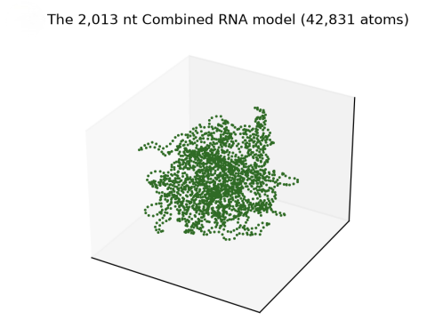

**English caption\.** Computational structural hypothesis for the 2,013 nt Combined RNA\.

**中文图注。** 2,013 nt Combined RNA的全长计算结构假设。

### 2026\-09\-20｜CircuForge interface and repository integration｜CircuForge界面与仓库集成

#### Brainstorming｜Making a handoff usable｜让交接后的工具可以使用

**English\.** Discussion focus: Review how users understand inputs, inspect intermediate states and confirm final exports\.

**中文。** 讨论要点：梳理用户如何理解输入、查看中间状态并确认最终导出。

**English\.** We integrated the CircuForge interface, bilingual support, deployment configuration and development history\. The V2 demonstration interfaces show Evidence Cards, review states, the Design Cart and export functions using a hepatocellular\-carcinoma proteomics demo project\.

**中文。** 集成CircuForge界面、双语支持、部署配置及开发历史。V2演示界面使用肝细胞癌蛋白组演示项目，展示Evidence Card、审查状态、Design Cart及导出功能。

**Figure Dry\-Figure19｜V2\.0 Design Cart｜V2\.0 Design Cart**

**English caption\.** Design Cart shown with the hepatocellular\-carcinoma demo project\.

**中文图注。** 肝细胞癌演示项目中的Design Cart界面。

**Figure Dry\-Figure20｜V2\.0 construct review｜V2\.0构建审查**

**English caption\.** Construct\-review interface in the software demo project\.

**中文图注。** 软件演示项目中的构建设计审查界面。

**Figure Dry\-Figure21｜V2\.0 export｜V2\.0导出**

**English caption\.** File\-export interface in the software demo project\.

**中文图注。** 软件演示项目中的文件导出界面。

**Figure Dry\-Figure22｜V2\.0 Evidence Card｜V2\.0 Evidence Card**

**English caption\.** Candidate\-evidence display in the software demo project\.

**中文图注。** 软件演示项目中的候选证据展示。

### 2026\-09\-22｜Compiler and junction\-interface checks｜编译器与接缝接口核对

**English\.** We updated the compiler and junction interface, documentation and associated checks\.

**中文。** 更新编译器与接缝接口、文档及相关核对内容。

### 2026\-10\-01—2026\-10\-06｜TorusFold interface and reproducibility updates｜TorusFold界面与可复现性更新

**English\.** We improved the interface, molecular viewer, refinement implementation and reproducibility documentation\.

**中文。** 完善界面、分子查看器、精修实现及可复现性文档。

### 2026\-10\-02｜CircuForge mature\-RNA boundary correction｜CircuForge成熟RNA边界修正

**English\.** We corrected the mature\-RNA boundary handling and updated the associated software records\.

**中文。** 修正成熟RNA边界处理，更新对应软件记录。

### 2026\-10\-08—2026\-10\-13｜Software export, reload and compatibility checks｜软件导出、重载与兼容性检查

**English\.** We checked export, readback and project reload, and continued deployment, compatibility and control updates for the software handoff\.

**中文。** 检查导出、回读与项目重载，继续完善部署、兼容性及控制逻辑，准备软件交付。

### 2026\-10\-09—2026\-10\-15｜Endpoint\-data comparison and integrated model evaluation｜终点数据对照与综合模型评价

#### Brainstorming｜Separating calibration, inputs and comparisons｜区分校准、输入与比较

**English\.** Discussion focus: Which observations informed each calculation, and which were used for comparison? Keep input provenance and model assumptions visible when integrating tumour and immune evidence\.

**中文。** 讨论要点：哪些观察进入各项计算，哪些记录用于结果比较？综合肿瘤与免疫证据时保留输入来源及模型假设。

**English\.** As endpoint and imaging records became available, we checked sample correspondence and separated core cell\-response calibration, immune\-response inputs and animal\-outcome comparisons\. The integrated Cell2Dose evaluation used 1,024 parameter sets to scan 301 doses from 0 to 30 µg at 0\.1 µg intervals\. Joint passage of the four model criteria was 81\.15% at 10\.0 µg and reached a grid maximum of 81\.45% at 10\.2 µg\. These conditional calculations supplied quantitative context for the study dose; they were recorded separately from the earlier core calibration and dose discussion\.

**中文。** 随终点及成像记录交付，核对样品对应，分别整理核心细胞响应校准、免疫应答输入和动物结果比较。综合Cell2Dose评价使用1,024组参数，以0\.1 µg间隔扫描0–30 µg共301个剂量。四项模型判据的联合通过率在10\.0 µg时为81\.15%，网格最高值在10\.2 µg时为81\.45%。这些条件性计算为研究剂量提供定量背景，与前期核心校准及剂量讨论分别记录。

### 2026\-10\-14—2026\-10\-15｜Primary Dry Lab materials and handoff｜干实验主要材料与交付

**English\.** We organised the main figures, code, model\-input notes and version records and handed these materials to Wiki\.

**中文。** 整理主要图表、代码、模型输入说明及版本记录，向Wiki交付主要材料。

### 2026\-10\-17｜TorusFold deliverable verification and Dry Lab completion｜TorusFold交付复核与干实验完成

#### Brainstorming｜Checking what the delivered files support｜核对交付文件能够支持的结论

**English\.** Discussion focus: Distinguish file and statistic checks from rerunning the complete prediction pipeline or validating structural accuracy\. Keep reproduced checks and recorded discrepancies visible\.

**中文。** 讨论要点：区分文件及统计核对、完整预测流程重跑与结构准确性验证，分别记录能够复现的检查项和已知差异。

**English\.** We checked the delivered files at public commit `b6c4171` using NumPy 2\.3\.5\. With the original LF sequence file, 20 of the script’s 32 checks reproduced; 12 checks retained the recorded `intra_pc` reconstruction discrepancies\. Converting the sequence file to Windows CRLF introduced an additional file\-hash mismatch, giving 19/32\. We completed the verification record and Dry Lab handoff; this was a check of existing deliverables rather than a full pipeline rerun\.

**中文。** 使用NumPy 2\.3\.5，对公共commit `b6c4171`的交付文件进行复核。原始LF序列文件下，脚本计数的32项检查中20项能够复现，另12项保留已记录的`intra_pc`重建差异。将序列文件转换为Windows CRLF会额外造成一项文件哈希不匹配，得到19/32。完成复核记录与Dry最终交付；本次核对针对已有产物，不代表完整预测流程重跑。

# Wiki｜网站建设

**English\.** The January–early June entries cover technical learning and Virtual Laboratory prototypes\. Development in the official iGEM GitLab repository began on 6 June\. Page development and experimental\-content integration are recorded separately\.

**中文。** 1月至6月初记录技术学习与Virtual Laboratory原型准备，正式iGEM GitLab仓库开发于6月6日启动。页面开发与实验内容集成分别记录。

### 2026\-01\-06｜Wiki roles and documentation｜Wiki分工与文档流程

#### Brainstorming｜Audiences and group handoff｜受众与组间交接

**English\.** Discussion focus: Discuss what visitors need to understand and how groups should submit text and media for the Wiki\.

**中文。** 讨论要点：讨论访客需要理解什么，以及各组如何向Wiki交付文稿与素材。

**English\.** We completed Wiki subgroup recruitment and role assignments and established shared documentation workflows\.

**中文。** 完成Wiki组招募与分工，建立共享文档协作流程。

### 2026\-01\-08—2026\-01\-12｜Development setup and Wiki review｜环境配置与Wiki调研

**English\.** We configured Node\.js, VSCode and Git, reviewed static\-hosting requirements and studied previous Wikis\.

**中文。** 配置Node\.js、VSCode及Git，学习静态托管要求并调研往届Wiki。

### 2026\-01\-14｜Learning roadmap｜学习路线规划

#### Brainstorming｜Learning and collaboration｜学习与协作

**English\.** Discussion focus: Plan the order of technical learning, Git collaboration and reusable interface work\.

**中文。** 讨论要点：规划技术学习、Git协作及可复用界面的推进顺序。

**English\.** We outlined the learning roadmap, Git branching conventions and initial self\-study tasks\.

**中文。** 梳理学习路线、Git分支规范及初期自学任务。

### 2026\-01\-17—2026\-01\-22｜HTML and CSS practice｜HTML与CSS练习

**English\.** We studied semantic HTML and CSS fundamentals and built practice pages\.

**中文。** 学习HTML语义结构与CSS基础，制作练习页面。

### 2026\-01\-28—2026\-02\-02｜Responsive layout and Git practice｜响应式布局与Git协作

**English\.** We practised Flexbox, responsive media queries and multi\-branch integration workflows\.

**中文。** 练习Flexbox、响应式媒体查询及多分支集成流程。

### 2026\-02\-07｜Interaction prototypes｜交互原型

#### Brainstorming｜Clear interaction states｜清晰的交互状态

**English\.** Discussion focus: Discuss accidental\-click handling, visible progress and feedback for unfamiliar operations\.

**中文。** 讨论要点：讨论陌生操作中的误触处理、进度显示及反馈方式。

**English\.** We explored DOM events, accidental\-click prevention in multi\-step interactions and biological\-themed cursors\.

**中文。** 探索DOM事件、多步操作的误触处理及生物主题鼠标交互。

### 2026\-02\-11—2026\-02\-14｜JavaScript and virtual\-experiment planning｜JavaScript与虚拟实验规划

**English\.** We studied ES6\+ and discussed the revival and staining workflows with Wet Lab for virtual\-course design\.

**中文。** 学习ES6\+，与Wet讨论虚拟课程中的菌种复苏和染色流程，用于教学模块设计。

### 2026\-02\-15｜Virtual Laboratory kickoff｜虚拟实验室启动

#### Brainstorming｜Virtual Laboratory modules｜虚拟实验室模块

**English\.** Discussion focus: Compare frameworks and decide how experimental steps, explanations and interactions should be divided into prototypes\.

**中文。** 讨论要点：比较框架，讨论如何将实验步骤、解释及交互拆分成原型。

**English\.** We reviewed JavaScript challenges, compared frameworks and began the Virtual Laboratory project\.

**中文。** 梳理JavaScript学习问题、比较框架，启动虚拟实验室项目。

### 2026\-02\-22—2026\-02\-27｜Component architecture｜组件架构学习

**English\.** We evaluated Vite and component\-based development and selected React with TypeScript as the learning path\.

**中文。** 评估Vite与组件化开发，确定React和TypeScript学习路线。

### 2026\-03\-05—2026\-03\-10｜First experiment prototypes｜首批实验原型

**English\.** Parallel work covered TypeScript and component decomposition, alongside workflow mapping and assets for revival and staining\.

**中文。** 并行开展TypeScript与组件拆分学习，以及复苏、染色实验的流程梳理和素材切分。

### 2026\-03\-15｜Prototype review｜原型检查

#### Brainstorming｜Guiding the first virtual operations｜引导最初的虚拟操作

**English\.** Discussion focus: Review whether prompts, experiment purpose and transitions between modules are clear to a new user\.

**中文。** 讨论要点：讨论提示、实验目的及模块衔接是否便于初次使用者理解。

**English\.** We reviewed componentisation progress and demonstrated interactions for the first two virtual experiments\.

**中文。** 检查组件化进展，演示前两项虚拟实验的交互原型。

### 2026\-03\-21—2026\-03\-26｜Extraction\-module interactions｜提取模块交互

**English\.** We practised modal and tab logic and designed centrifugation and gel\-cutting interactions for plasmid and gel extraction modules\.

**中文。** 练习弹窗与标签切换，设计质粒提取和胶回收模块中的离心、切胶交互。

### 2026\-04\-03—2026\-04\-08｜PCR and assembly\-module interactions｜PCR与组装模块交互

**English\.** We studied TailwindCSS and modelled pipetting and water\-bath interactions for PCR, double digestion and ligation\.

**中文。** 学习TailwindCSS，设计PCR、双酶切及连接模块中的移液和水浴交互。

### 2026\-04\-10｜Technical stack and canvas｜技术栈与画布

#### Brainstorming｜Canvas and navigation｜画布与导航

**English\.** Discussion focus: Discuss how the 16:9 canvas and directory should respond to different screens while keeping the current step visible\.

**中文。** 讨论要点：讨论16∶9画布和目录如何适应不同屏幕，同时保留当前步骤信息。

**English\.** We settled the React, TypeScript and Tailwind stack and reviewed the responsive 16:9 canvas and three\-dimensional directory design\.

**中文。** 确定React、TypeScript与Tailwind技术栈，检查16∶9响应式画布及三维目录设计。

### 2026\-04\-17—2026\-04\-23｜Transformation and verification modules｜转化与验证模块

**English\.** We practised Git merges and review workflows and designed transformation and fluorescent\-clone verification interactions\.

**中文。** 练习Git合并与代码审查，设计转化及荧光克隆验证交互。

### 2026\-05\-02—2026\-05\-08｜Nine\-experiment integration｜九实验集成

#### Brainstorming｜Connecting nine virtual experiments｜衔接九项虚拟实验

**English\.** Discussion focus: Review continuity between experiments and the placement of step indicators, questions and equipment activities\.

**中文。** 讨论要点：讨论实验间的连续性，以及步骤提示、原理题和器材活动的安排。

**English\.** We connected all nine virtual experiments and added step indicators, theory questions and equipment drag\-and\-drop activities\.

**中文。** 连接九项虚拟实验，加入步骤提示、原理题及器材拖拽活动。

### 2026\-05\-15｜Prototype and hosting review｜原型与托管检查

**English\.** We reviewed the nine\-experiment prototypes and checked the build and asset\-loading approach against hosting requirements\.

**中文。** 检查九实验原型，并核对构建及素材加载方式与托管要求。

### 2026\-05\-21—2026\-05\-26｜Reusable interface components｜可复用界面组件

**English\.** We extracted step indicators, citation tooltips and lightboxes and drafted the technical architecture specification\.

**中文。** 提取步骤条、引用提示与图片灯箱等公共组件，整理技术架构说明。

### 2026\-06\-03—2026\-06\-05｜Learning archive and development plan｜学习归档与开发安排

**English\.** We archived study notes and prototype code and organised the official development schedule\.

**中文。** 归档学习笔记和原型代码，整理正式开发安排。

### 2026\-06\-06｜Official repository setup｜正式仓库建立

**English\.** We concluded the initial learning phase, initialised the official iGEM GitLab repository and configured its baseline settings\.

**中文。** 结束初期学习阶段，初始化iGEM GitLab正式仓库并完成基础设置。

### 2026\-06\-10—2026\-06\-18｜Production layout and routing｜正式布局与路由

**English\.** We confirmed the React 19, TypeScript, Vite and TailwindCSS setup and built routing and global layout skeletons\.

**中文。** 确认React 19、TypeScript、Vite和TailwindCSS环境，搭建路由与全局布局骨架。

### 2026\-06\-25—2026\-07\-05｜Visual design system｜视觉设计系统

**English\.** We established the colour palette, typography scale and spacing conventions\.

**中文。** 确定配色、字体层级及卡片间距规范。

### 2026\-07\-15—2026\-07\-28｜Home Story and shared templates｜首页叙事与公共模板

**English\.** We built the scroll\-driven Home Story, back\-to\-top navigation, footer and reusable subpage templates\.

**中文。** 制作滚动叙事首页、返回顶部导航、页脚及可复用子页面模板。

### 2026\-08\-25—2026\-09\-05｜Molecular viewer integration｜分子查看器集成

**English\.** We integrated Molstar to display the TROP2\-CTL1 protein complex interactively\.

**中文。** 集成Molstar，交互展示TROP2\-CTL1蛋白复合物。

### 2026\-09\-12—2026\-09\-19｜Page Skins and navigation｜Page Skins与导航

**English\.** We refactored routing with modular Page Skins and a bookmark\-style contents sidebar\.

**中文。** 以模块化Page Skins重构路由，加入书签式目录侧栏。

### 2026\-09\-20—2026\-09\-26｜First content pages｜首批内容页面

**English\.** We built initial Description, SDG and Team Member pages from the first content deliveries\.

**中文。** 根据首批交付内容搭建Description、SDG和成员页面。

### 2026\-09\-27—2026\-09\-30｜Virtual Laboratory migration｜虚拟实验室迁移

**English\.** We moved the nine existing virtual modules into the main repository and added asset\-indexing scripts\.

**中文。** 将已有九项虚拟实验迁入主仓库，加入素材索引脚本。

### 2026\-10\-01—2026\-10\-06｜Scientific content integration｜科研内容集成

**English\.** We processed the available text and in vitro results and developed the Wet Lab protocol ring atlas, Results page structure and Attributions reader\.

**中文。** 处理已交付文稿与已有体外结果，开发Wet实验流程环图、Results页面结构和Attributions阅读界面。

### 2026\-10\-07—2026\-10\-11｜Interactive pages and media｜交互页面与媒体整理

**English\.** We uploaded available media to iGEM\-hosted assets and developed interactive components for model outputs, the Engineering cycle wheel and educational games\.

**中文。** 将已有媒体上传至iGEM素材托管，开发模型输出交互组件、Engineering循环轮及教育小游戏。

### 2026\-10\-12—2026\-10\-15｜Final page integration｜最终页面联调

**English\.** We continued the Software showcase, Education gallery and Entrepreneurship modules, received the final Wet Lab materials and the main Dry Lab delivery, and checked cross\-page integration and responsive layouts\.

**中文。** 继续完善Software展示、Education交互画廊及Entrepreneurship模块，接收Wet最终材料及Dry主要交付，开展跨页面联调和响应式检查。

### 2026\-10\-16—2026\-10\-20｜Page checks and final content integration — ongoing and scheduled｜页面核对与收尾材料集成｜进行中与后续安排

#### Brainstorming｜Cross\-page scientific consistency｜跨页面科研叙述一致性

**English\.** Discussion focus: Check whether Notebook, Engineering, Results and Model use consistent sample names, chronology and evidence descriptions\.

**中文。** 讨论要点：讨论Notebook、Engineering、Results及Model中的样品名称、时间顺序与证据表述是否一致。

**English\.** We continue page and asset checks and integrate the final group deliveries, including the Dry Lab verification record completed on 17 October\. Caption, link, cross\-page and responsive\-layout checks through 20 October remain part of the current schedule\.

**中文。** 继续核对页面与素材，集成各组最终交付，包括Dry于10月17日完成的复核记录；延续至10月20日的图注、链接、跨页面及响应式检查属于本版安排。

### 2026\-10\-21｜Final build and page checks — scheduled｜最终构建与页面检查｜后续安排

**English\.** We plan to complete the final page checks, build verification and submission preparation on 21 October\.

**中文。** 安排于10月21日完成最终页面检查、构建核验及提交前收尾。

> （注：部分内容由豆包工作 AI 生成）
