# 3\.3 Results

# Overview

CirCure was developed through a linked design–build–test–learn cycle\. We first defined a complementary antigen panel for triple\-negative breast cancer \(TNBC\) and reduced 1,838 possible 9\-mer peptides to 15 structurally testable epitopes\. These candidates were then converted into a 13\-construct single\-epitope circRNA library for experimental screening\. Round 1 wet\-lab validation identified the strongest epitopes from each antigen and guided the construction of the eight\-epitope Combined vaccine\.

The Combined vaccine was subsequently assessed across the complete immune\-response chain, from RNA quality and intracellular translation to dendritic\-cell maturation, T\-cell activation, effector\-memory differentiation, cytokine secretion and tumour\-cell killing\. Additional experiments examined circRNA stability, off\-target cytotoxicity and the dose window of the LNP carrier\. Finally, a TROP2\-positive tumour model was established to evaluate the platform in vivo\. Together, these results address whether a multi\-antigen circular RNA vaccine can be designed, constructed, functionally validated and evaluated within a traceable experimental framework\.

The results are therefore presented as a continuous evidence chain\. Each stage was used to answer a specific question and to determine the design of the next stage: which antigens should be included, which epitopes should be retained, whether the RNA product was correctly formed, whether the Combined vaccine activated the intended immune functions, whether tumour\-cell killing was selective, and whether the platform could produce an anti\-tumour response in vivo\.

# Introduction

TNBC is characterised by substantial heterogeneity in tumour\-antigen expression, as exemplified by mesothelin expression \(Tchou et al\., 2012\)\. This creates two related challenges for vaccine design: a single antigen may not be present on every tumour cell, and an epitope that appears promising computationally may not generate a measurable immune response experimentally\. We therefore did not begin by selecting one apparently dominant target\. Instead, we first asked whether a complementary antigen panel could cover distinct tumour\-cell populations and whether short epitopes from these antigens could be reduced to a tractable set for wet\-lab testing\.

To address this question, we combined evidence from tissue\-level expression, cell\-type\-resolved expression, patient\-level coverage and intact\-tissue localisation\. We then applied allele\-specific peptide prediction and structural filtering to the retained antigens\. This sequence of analyses was intended to define a biologically relevant and experimentally manageable starting set, rather than to claim that computational scores alone could establish vaccine immunogenicity\.

# **Target Discovery: From Four Antigens to Fifteen Testable Epitopes **

The dry lab selected the antigens this vaccine targets and the epitopes carried in its cassette\. Four candidate proteins were identified through a systematic scoring framework evaluating subcellular localization, tumor specificity, prognostic association, and TNBC therapeutic validation depth \(§3\.1\.1\), then tested against four independent lines of evidence before being retained\. Every overlapping 9\-mer of the four canonical sequences was screened for HLA\-A\*02:01 presentation, and the survivors were checked for loading geometry against the peptide\-binding groove\. Fifteen peptide sequences left this stage for the wet lab\. This section reports the evidence behind those two decisions — which antigens, and which epitopes from them\.

Full datasets, parameters and per\-model values are on the Model page\. 

## 3\.1  Antigen selection

A systematic scoring framework prioritized four candidate proteins—TROP2 \(TACSTD2\), B7\-H4 \(VTCN1\), Nectin\-4 \(NECTIN4\) and LIV\-1 \(SLC39A6\)—for multi\-evidence validation \(§3\.1\.1\)\. Four lines of evidence were then applied to these candidates\. Each addresses a different way an antigen choice can fail: a protein may not actually be abundant in TNBC tissue, it may be abundant in the wrong cell compartment, it may be present in too few patients to matter, or it may be mislocalised within the tissue\. The four modules below answer those four questions in turn\.

### 3\.1\.1  Systematic antigen prioritization

**Aim:** Narrow a broad set of TNBC\-associated antigens to four candidates for multi\-evidence validation, using explicit criteria when transcript, protein, clinical, and therapeutic evidence do not align\.

**Design \& Readout:** We adopted a scoring framework from Zahraei et al\. \(2025\), evaluating candidates across subcellular localization \(L, 0–5 points\), tumor specificity \(S, 0–2 points\), prognostic association \(P, 0–1 point\), and TNBC therapeutic validation depth \(T, 0–2 points\), maximum 10 points\. The candidate list was compiled from TNBC\-focused reviews, clinical trial databases, antibody\-drug conjugate pipelines, and input from clinicians and industry partners through Integrated Human Practices\. We refined the T dimension to distinguish regulatory approval in TNBC \(2 points\) from replicated clinical signals across independent cohorts or agents \(1 point\) versus exploratory trials without efficacy \(0 points\), recognizing that many antigens have been "targeted" without demonstrating benefit\. The top four scoring candidates were selected for the four\-tier validation in §3\.1\.2–3\.1\.5 \(Model: Systematic antigen prioritization\)\.

**Result:**

Table 1\. Systematic scoring of the four selected antigens\.

|**Antigen**|**Gene**|**L**|**S**|**P**|**T**|**Total**|
|---|---|---|---|---|---|---|
|TROP2|TACSTD2|5|1|1|2|**9**|
|B7\-H4|VTCN1|5|1|1|1|**8**|
|Nectin\-4|NECTIN4|5|1|1|1|**8**|
|LIV\-1|SLC39A6|5|1|1|1|**8**|

Full scoring criteria and complete evaluation table on the Model page\.

**Interpretation:** TROP2 ranked first \(score 9\) with two FDA\-approved antibody\-drug conjugates \(sacituzumab govitecan, datopotamab deruxtecan\) for metastatic TNBC demonstrating survival benefit in randomized trials\. B7\-H4, Nectin\-4, and LIV\-1 each scored 8, supported by replicated anti\-tumor activity across independent clinical studies or different agents targeting the same antigen\. All four were membrane\-localized \(5 points\), tumor\-associated rather than tumor\-specific \(1 point\), and linked to adverse survival outcomes in published TNBC cohorts \(1 point\)\. The scoring framework prioritized a four\-antigen panel with membrane accessibility, favorable tumor\-to\-normal ratios, prognostic relevance, and clinical validation specifically in TNBC\.

This was a prioritization step, not a validation step\. It identified which antigens warranted intensive assessment; the subsequent four tiers determined whether they should be retained\. A high\-scoring antigen could still fail if its protein was undetectable in tissue \(§3\.1\.2\), if expression came mainly from stroma \(§3\.1\.3\), if too few patients carried it \(§3\.1\.4\), or if membrane localization could not be confirmed \(§3\.1\.5\)\.

**Limitations and scope:**

Equal\-weight summation assumes that a membrane antigen with strong therapeutic validation \(5\+1\+1\+2=9\) is preferable to a tumor\-specific intracellular antigen without precedent \(3\+2\+1\+0=6\), which is a design choice\. The T score rewards precedent but not mechanism—antibody\-drug conjugate success does not guarantee circRNA immunogenicity, addressed by the wet\-lab screen in Section 5\. P was binary: any statistically significant survival association in a published TNBC cohort scored 1 point, without re\-analysis, effect\-size weighting, or consistency requirement across datasets\. The scoring was performed once, before proteomic and single\-cell work began, so it operated as a fixed rule rather than an adaptive one\.

### 3\.1\.2  Proteomic evidence: protein\-level abundance in TNBC tissue 

**Aim : **Establish that each candidate is detectable and elevated as protein in TNBC tissue\. Transcript abundance does not reliably predict protein abundance in breast tumours, and it is protein that is processed and presented, so protein\-level evidence was required before any sequence\-based work began\. 

**Design \& Readout : **Two public TMT proteomic datasets were re\-analysed\. PXD024322 supplied a TNBC\-versus\-normal\-breast cohort comparison covering all four candidates; PXD028102 supplied a paired tumour / adjacent\-normal design covering three\. Differential abundance was modelled on each dataset with FDR control \(Model: Proteomic datasets and statistical methods\)\. 

**Result :**

这里用model页已经做好了的组件

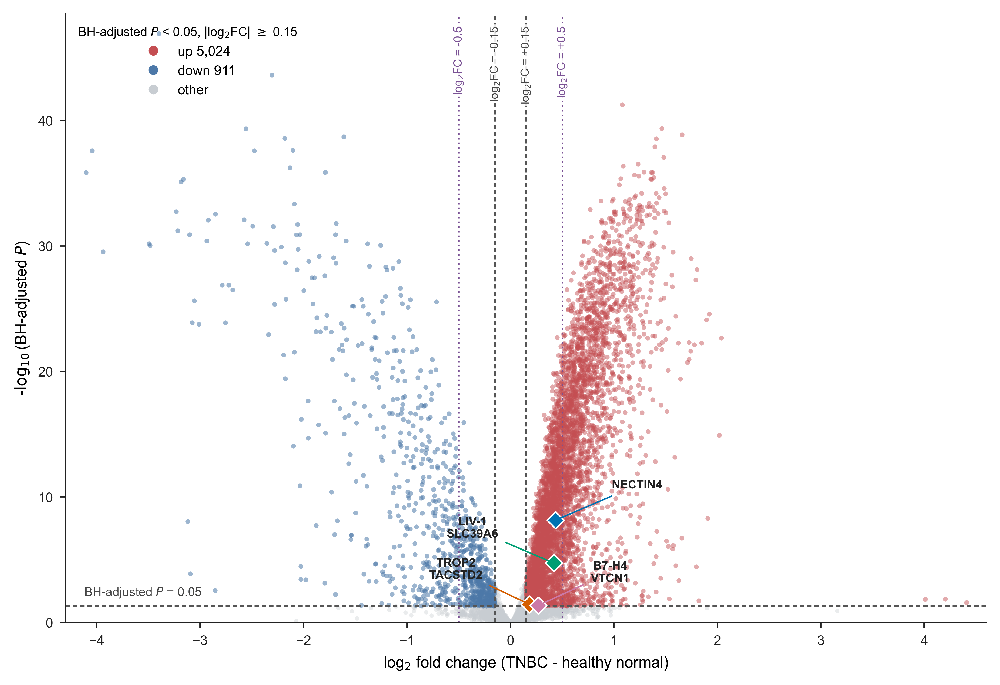

Differential protein abundance in PXD024322\. 

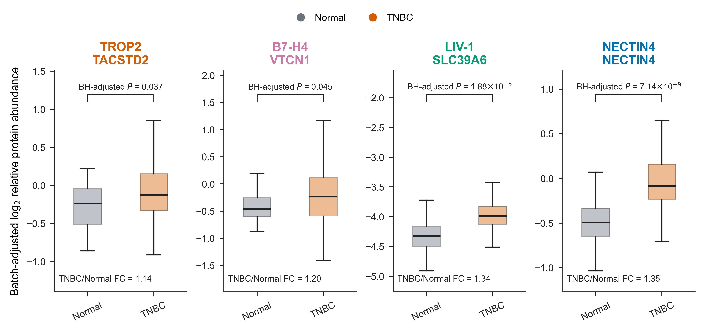

https://static\.igem\.wiki/teams/6056/wiki/files/pages/project/results/figure2\-abundance\-distributions\-of\-the\-four\-candidates\-in\-pxd024322\.avif

Abundance distributions of the four candidates in PXD024322\.

这里用model页已经做好了的组件

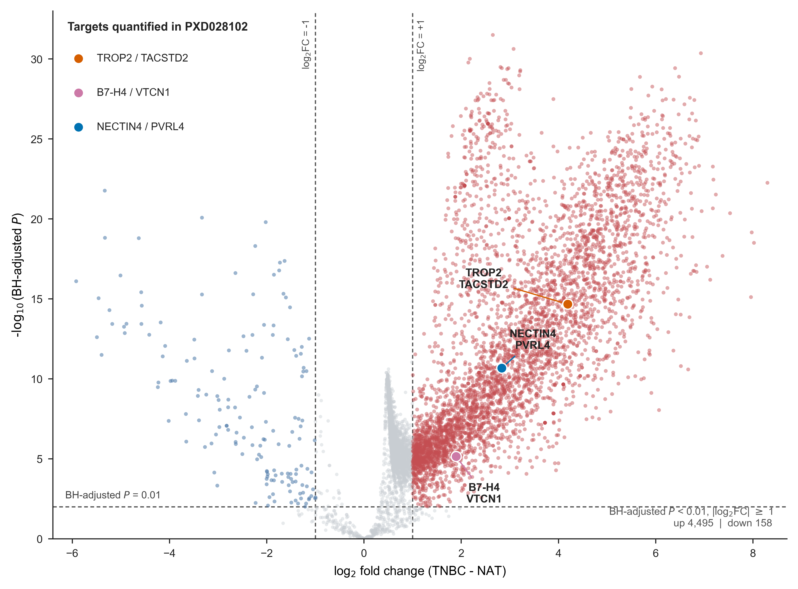

Paired differential abundance analysis in PXD028102\.

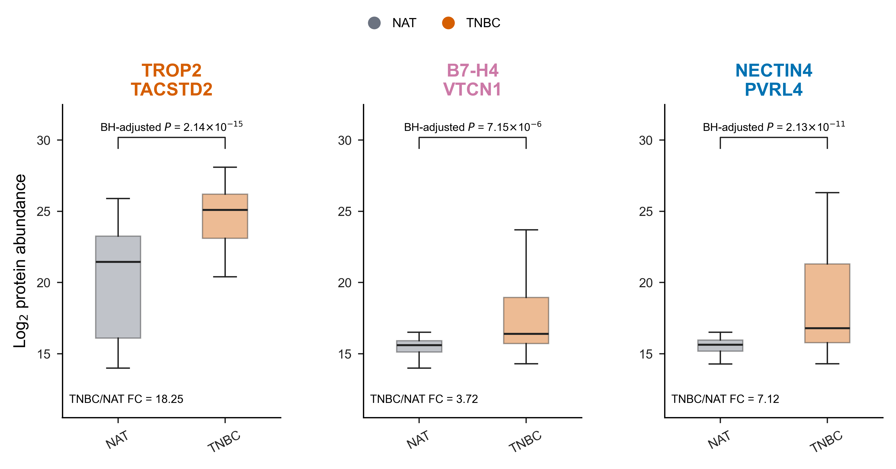

https://static\.igem\.wiki/teams/6056/wiki/files/pages/project/results/figure4\-paired\-abundance\-patterns\-for\-the\-three\-candidates\-in\-pxd028102\.avif

Paired abundance patterns for the three candidates in PXD028102\.

Table 2\. Differential protein abundance of the four candidates across two proteomic datasets\.  

|**Antigen **|**Gene **|**PXD024322 FC**|**FDR**|**PXD028102 FC**|**FDR**|
|---|---|---|---|---|---|
|TROP2|TACSTD2|1\.14×|0\.0370|18\.25×|2\.14 × 10⁻¹⁵|
|B7\-H4|VTCN1|1\.20×|0\.0446|3\.72×|7\.15 × 10⁻⁶|
|Nectin\-4|NECTIN4|1\.35×|7\.14 × 10⁻⁹|7\.12×|2\.13 × 10⁻¹¹|
|LIV\-1|SLC39A6|1\.34×|1\.88 × 10⁻⁵|not quantified |—|

**Interpretation : **All four candidates were quantified and reached significance in at least one dataset\. The effect sizes differ by roughly an order of magnitude between the two, and the design explains the difference: PXD028102 compares tumour against adjacent normal tissue within the same patient, which removes between\-patient variation, whereas PXD024322 compares across subjects\. TROP2 is the clearest case — lowest in the unpaired cohort at 1\.14× yet largest in the paired design at 18\.25×\. We therefore read the paired dataset as the more informative of the two for the three antigens it covers\. 

**Limitations and scope :**

LIV\-1 was not quantified in the paired dataset, so its protein\-level support comes from the smaller unpaired effect alone and is the weakest of the four at this tier\. Both datasets are re\-analyses of public proteomic data rather than measurements we made ourselves, and the cohorts were assembled by their original authors for their own purposes\. These are tissue\-level measurements averaged over all cell types in a sample, which is what the next module addresses\.

### 3\.1\.3  Single\-cell transcriptomic evidence: expression resolved by cell type 

**Aim : **Determine whether the tissue\-level signal of §3\.1\.2 comes from malignant cells rather than from stromal or immune cells, and measure how much of the malignant compartment each candidate reaches\. A tumour\-associated protein expressed mainly on fibroblasts would be a poor vaccine target, however abundant it is in bulk tissue\. 

**Design \& Readout : **The TNBC subset of GSE176078 was processed to 39,324 QC\-passed cells across 10 patients\. Differential expression compared the malignant compartment against pooled immune and stromal cells as pseudobulk libraries within each patient, on the 8 patients carrying both; detection rate is the proportion of cells with a raw count of at least 1, computed on pooled cells and reported descriptively \(Model: Single\-cell dataset, processing, and statistical methods\)\. 

**Result :**

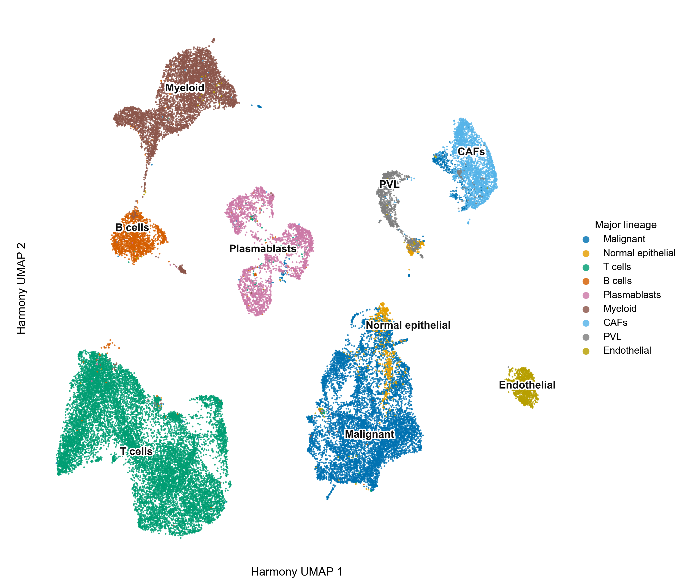

https://static\.igem\.wiki/teams/6056/wiki/files/pages/project/results/figure5\-umap\-projection\-of\-39\-324\-single\-cells\-from\-10\-tnbc\-patients\.avif

UMAP projection of 39,324 single cells from 10 TNBC patients\. 

Table 3\. Malignant\-cell enrichment and detection rates for the four candidate genes\. 

|**Gene **|**Antigen**|**Malignant vs non\-malignant log₂FC **|**FDR**|**Malignant **|**Immune **|**CAF **|
|---|---|---|---|---|---|---|
|TACSTD2|TROP2|4\.074|8\.37 × 10⁻⁵|70\.4%|4\.0%|5\.4%|
|NECTIN4|Nectin\-4|4\.755|3\.70 × 10⁻⁶|37\.8%|1\.0%|0\.6%|
|VTCN1|B7\-H4|5\.393|2\.52 × 10⁻⁵|19\.8%|0\.3%|0\.4%|
|SLC39A6|LIV\-1|0\.853|0\.0196|39\.4%|8\.5%|20\.7%|

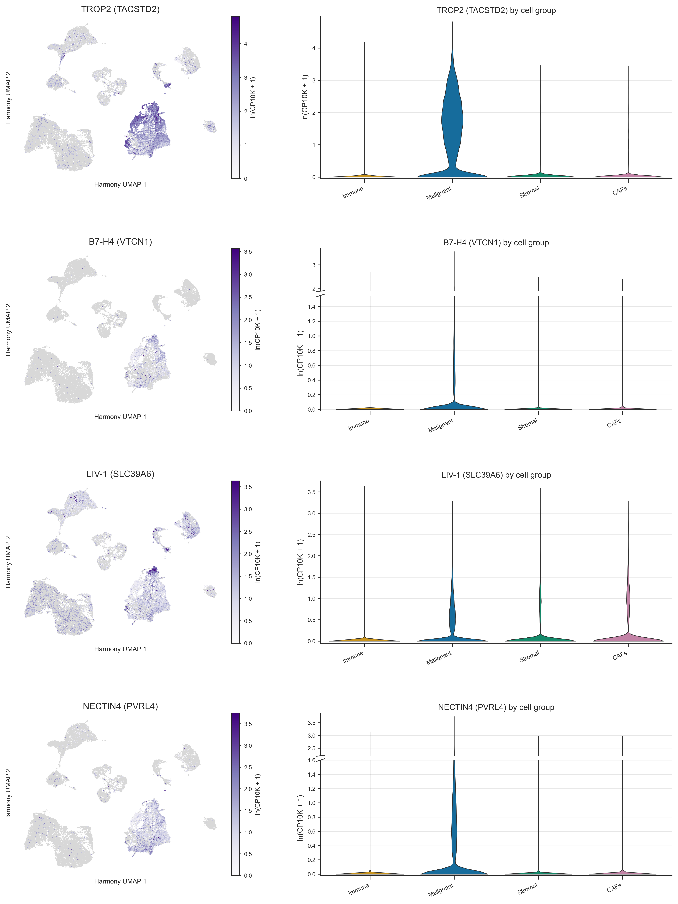

https://static\.igem\.wiki/teams/6056/wiki/files/pages/project/results/figure6\-candidate\-gene\-expression\-in\-the\-gse176078\-tnbc\-single\-cell\-dataset\.avif

Candidate\-gene expression in the GSE176078 TNBC single\-cell dataset\. 

**Interpretation : **All four genes are enriched in malignant cells, and three of them — TACSTD2, NECTIN4, VTCN1 — are close to absent from the immune and stromal compartments, with detection rates at or below 5\.4%\. SLC39A6 is the exception: its malignant enrichment is real but an order of magnitude smaller \(log₂FC 0\.853\), and it is the only candidate with appreciable stromal expression at 20\.7% in CAFs\. 

The more consequential number is the overlap between the four\. Across the dataset, 81\.4% of malignant cells express at least one candidate gene \(52\.5–97\.8% between patients\), but only 7\.3% express all four, and the pairwise Jaccard indices between gene\-positive populations run 0\.221–0\.438\. The four antigens therefore mark largely different malignant cells rather than the same ones: TACSTD2 has the broadest reach, while NECTIN4 and VTCN1 label additional populations that TACSTD2 misses\. This is the measured basis for carrying more than one antigen — a single\-antigen vaccine would leave a substantial fraction of the malignant compartment unaddressed — and it is the evidence behind the equal\-representation rule applied in §5\.4\. 

**Limitations and scope :**

Detection rate as measured here is a lower bound\. Single\-cell data are sparse, so a gene scored as undetected in a cell may simply have been missed at the achieved sequencing depth, and the detection rates are sensitive to depth and dropout in a way the fold changes are not\. The differential test rests on 8 patients, which is a small pseudobulk sample, although the direction of enrichment held for all four genes under an alternative sample\-label assignment and under treatment\-status subsetting\. These are transcripts, not protein; protein\-level abundance and intact\-tissue localisation are addressed in §3\.1\.2 and §3\.1\.5, respectively\.

### 3\.1\.4  cBioPortal: patient\-level coverage of the four\-antigen panel 

**Aim : **Count how many TNBC patients each antigen would be a candidate target in, and how much the four together add over the best single one\. §3\.1\.3 asks which cells within a tumour; this module asks which patients across a cohort\. 

**Design \& Readout : **The TNBC cases of the TCGA Breast Invasive Carcinoma PanCancer Atlas cohort, 115 in total, were queried in cBioPortal under one predefined gene\-level rule applied identically to all four genes: relatively elevated mRNA expression or high\-level copy\-number amplification \(Model: TCGA patient\-coverage analysis\)\.

**Result :**

Table 4\. Patient\-level coverage under a single fixed gene\-level rule, across 115 TNBC cases\. 

|**Antigen**|**Gene **|**Patients meeting the rule **|
|---|---|---|
|Nectin\-4|NECTIN4|79%|
|TROP2|TACSTD2|38%|
|B7\-H4|VTCN1|31%|
|LIV\-1|SLC39A6|4%|
|At least one of the four |—|101 / 115  \(88%\)|

**Interpretation : **Nectin\-4 alone meets the rule in 79% of cases; the union of all four reaches 88%, covering 10 additional patients under the same rule\. Read together with the partially overlapping detection patterns of §3\.1\.3, the four antigens extend coverage both across cells within a tumour and across patients in a cohort\. That combination is why all four were retained rather than narrowing to the single highest\-coverage antigen\. 

**Limitations and scope :**

Two cautions on how these percentages may be read\. First, this is a transcript\-and\-copy\-number rule, not a protein measurement, and mRNA abundance does not fully predict protein abundance in breast tumours — the 38% recorded here for TACSTD2 is therefore not comparable with the far higher protein\-positivity rates reported in clinical TNBC staining studies \(§3\.1\.5\), which measure a different quantity in a different cohort\. LIV\-1 meets this rule in only 4% of cases, so its retention rests on the single\-cell and proteomic evidence rather than on this module\. 

The four\-antigen panel achieves 88% patient\-level coverage across 115 TNBC cases under the defined gene\-level rule\.

### 3\.1\.5  Immunohistochemistry: the candidates in intact tissue 

**Aim : **Place the four candidates back into tissue architecture\. Proteomics measures abundance across a sample and single\-cell data resolves expression by cell type; neither reports where in the tissue, or where on the cell, the protein sits\. All four candidates are membrane\-associated, and membrane localisation is what a T cell can act on\. 

**Design \& Readout : **Published TNBC immunohistochemistry studies reporting staining intensity, scoring method, cellular staining pattern and tumour\-to\-normal comparison were reviewed for each candidate, and representative panels were assembled from open\-access articles with the source cited alongside each image\. No staining was performed by us \(Model: Histopathological validation of candidate antigens\)\. 

**Result :**

Table 5\. Published tissue\-level evidence for the four candidates\. 

|**Antigen**|**Reported pattern in TNBC tissue **|
|---|---|
|TROP2|Broad but heterogeneous membrane and cytoplasmic staining in stage I–III TNBC \(Izci et al\., 2022\)\. Membranous staining in \>10% of tumour cells in 97\.1% of 715 primary TNBC cases without neoadjuvant chemotherapy** **\(Jeon et al\., 2022\)\. |
|B7\-H4|Frequent staining in TNBC tissue \(Wang et al\., 2018\), with spatial analyses associating expression with tumour epithelial regions and distinct immune microenvironments** **\(Gruosso et al\., 2019; Wescott et al\., 2024\)\.|
|Nectin\-4|Membranous staining in TNBC tissue \(M\-Rabet et al\., 2017\), with a high\-expression TNBC subgroup identified \(Zeindler et al\., 2019\)\. |
|LIV\-1|Staining in primary TNBC tissue \(Sussman et al\., 2014\); stronger staining in TNBC than normal tissue, associated with aggressive clinicopathological features \(Saravanan et al\., 2024\); immunoreactivity in invasive epithelial tumour cells on tissue microarray \(Althobiti et al\., 2021\)\. |

https://static\.igem\.wiki/teams/6056/wiki/files/pages/project/results/figure7\-published\-trop2\-immunohistochemistry\-in\-tnbc\.avif

Published TROP2 immunohistochemistry in TNBC\.

https://static\.igem\.wiki/teams/6056/wiki/files/pages/project/results/figure8\-published\-b7\-h4\-immunohistochemistry\-in\-tnbc\-and\-normal\-breast\-tissue\.avif

Published B7\-H4 immunohistochemistry in TNBC and normal breast tissue\.

https://static\.igem\.wiki/teams/6056/wiki/files/pages/project/results/figure9\-published\-nectin\-4\-immunohistochemistry\-in\-tnbc\.avif

Published Nectin\-4 immunohistochemistry in TNBC\.

https://static\.igem\.wiki/teams/6056/wiki/files/pages/project/results/figure10\-open\-access\-slc39a6\-immunohistochemistry\.avif

Open\-access SLC39A6 immunohistochemistry\. 

**Interpretation : **Tissue\-level protein expression is documented for all four candidates, and the four patterns differ from one another: TROP2 broad but heterogeneous, B7\-H4 concentrated in tumour epithelial regions, Nectin\-4 with clear membrane localisation, LIV\-1 associated with stronger staining in high\-grade and residual disease\. Four partially independent distributions, consistent with the partially overlapping single\-cell detection of §3\.1\.3 and supporting the four antigens as a complementary set rather than four interchangeable options\. 

This module is a literature review, not a measurement of ours, and it is the only one of the four that is\. The cited studies differ in cohort, antibody, scoring rule and positivity cut\-off, so their positivity rates are not comparable with one another and not comparable with the percentages in §3\.1\.4 — Jeon et al\. report 97\.1% of TNBC cases positive for TROP2 under a \>10%\-of\-tumour\-cells criterion, which is a different measurement on a different cohort from the 38% recorded under the cBioPortal rule\. Quoting the two side by side without that distinction would misrepresent both\. 

### 3\.1\.6  Four antigens retained 

Every candidate cleared every tier: detectable and elevated as protein in TNBC tissue \(§3\.1\.2\), enriched in malignant rather than stromal or immune cells \(§3\.1\.3\), present in a measurable share of patients under a fixed rule \(§3\.1\.4\), and documented in tissue with membrane\-associated localisation \(§3\.1\.5\)\. The decision facing us was therefore not which antigen to choose but whether to narrow the panel at all, and two measurements argued against narrowing: the pairwise Jaccard indices of 0\.221–0\.438 between gene\-positive malignant populations, and the rise in patient coverage from 79% for the best single antigen to 88% for the union\. The four antigens address different cells and different patients, so all four canonical sequences were carried into epitope prediction\. 

## 3\.2  Epitope screening

With four antigens retained, the question became which short peptides from them to put in the cassette\. Two filters were applied in series: a sequence\-based prediction of HLA\-A\*02:01 presentation, and a structural check that each surviving peptide can physically be loaded into the binding groove\. The first reduces the candidate space; the second removes sequences that score well numerically but cannot be presented\. 

### 3\.2\.1  IEDB prediction: 1,838 peptides reduced to 17 

**Aim : **Enumerate every possible 9\-mer epitope from the four antigens and reduce them to a set small enough to test, keeping those predicted both to bind HLA\-A\*02:01 and to be immunogenic once bound\. 

**Design \& Readout : **All overlapping 9\-mers of the four UniProt canonical sequences were screened through the IEDB T Cell Epitope Prediction Class I suite against HLA\-A\*02:01, using NetMHCpan 4\.1 EL for binding and elution and NetMHCpan 4\.1 BA inside the processing model for predicted IC₅₀\. Two numerical gates were applied in order — predicted IC₅₀ \< 500 nM, then IEDB immunogenicity score \> 0 — followed by a review of each survivor against its position in the source protein \(Model: IEDB inputs, parameters, and filtering rules\)\. 

**Result :**

Table 6\. The staged epitope screen, by source antigen\.

|**Screening stage**|**TROP2**|**B7\-H4**|**Nectin\-4**|**LIV\-1**|**Total **|
|---|---|---|---|---|---|
|All overlapping 9\-mers|315|274|502|747|1,838|
|Predicted IC₅₀ \< 500 nM|17|13|15|38|83|
|Immunogenicity score \> 0|9|10|10|22|51|
|After topology review |4|2|6|5|17|

Topology review is the one stage that is not a numerical threshold, and it removed the largest proportion of candidates — 51 down to 17\. Of the 51 peptides that passed both numerical gates, 34 were discarded because they derive from a signal peptide or a transmembrane segment of the source protein\. Such peptides frequently score well: hydrophobic stretches fit the HLA\-A\*02:01 groove preferences, and the predictor has no information about where in the protein the sequence came from\. But a signal peptide is cleaved before the mature protein is trafficked, and transmembrane segments are embedded in the lipid bilayer, so neither is reliably available to the cytosolic processing pathway that supplies MHC\-I\. The effect is severe for some antigens: of B7\-H4's 10 numerically qualified peptides, 6 lie in the signal peptide and 2 in the transmembrane region, leaving only 2\. 

**Interpretation : **The screen reduced the candidate space by two orders of magnitude and left 17 peptides distributed across all four antigens, so no antigen was lost at this stage\. The uneven survival — 2 from B7\-H4 against 6 from Nectin\-4 — is a property of where the predicted binders sit in each protein rather than of how strongly they were predicted to bind, and it set the per\-antigen ceiling that constrained cassette composition later\. 

**Limitations and scope : **

These are predictions from sequence, and the whole of §3\.2 rests on a single allele\. HLA\-A\*02:01 was chosen as the first population\-relevant allele for method development; it is the restriction of every epitope in this project, and it bounds the population this vaccine could address regardless of how many antigens are included\. Extending the same workflow across additional alleles is the clearest next step for this stage\. Within the chosen allele, peptide length was fixed at 9 amino acids, which is the canonical preference but excludes the 8\-, 10\- and 11\-mers that HLA\-A\*02:01 also presents\. The topology review is a binary call made from annotated protein features, not a measurement of processing — a peptide classified as transmembrane\-derived is excluded on reasoning about its availability, not on evidence that it fails to be presented\. The 34 peptides removed at this stage were never tested, so the rule has not itself been checked experimentally\. 

### 3\.2\.2  Structural validation: loading geometry of the 17 candidates

**Aim : **Answer one question for each of the 17 survivors: can this peptide actually be loaded into the HLA\-A\*02:01 groove in the correct geometry? A predicted affinity is a number about a sequence; it does not show that the two anchor residues reach their pockets or that the conserved contacts holding the peptide in place are formed\. 

**Design \& Readout : **Each of the 17 peptides was co\-folded with HLA\-A\*02:01 in 5 independent models\. Three measures were taken on every model and a verdict required to be identical across all five: side\-chain burial at positions 2 and 9 \(the B and F anchor pockets\) at ≥ 90%; at least 10 of the 11 conserved hydrogen bonds present; and a position\-9 side\-chain fill ratio ≥ 60%, i\.e\. ≥ 84 Ų, which is 60% of the 140 Ų reference buried side\-chain area for a leucine anchor\. Interface steric clashes were checked and TCR\-facing surface area recorded \(Model: Structural validation of the 17 candidates\)\. 

The fill\-ratio criterion is the one that does work the burial percentage cannot\. Burial is saturated — almost every peptide reads 99–100% at position 9, because the residue is enclosed whatever its size\. Absolute buried volume is not: a glycine at position 9 contributes 0 Ų, an alanine 60 Ų, a valine \~114 Ų, a leucine or isoleucine \~140 Ų\. A near\-100% burial of a small residue means a groove pocket that is enclosed but not filled, which the percentage alone conceals\. 

**Result : **

Fifteen of the 17 candidates passed\. The two rejections were both at position 9: FLAEASVRG ends in glycine, which has no side chain and leaves the F pocket empty \(0 Ų, fill ratio 0%\), and HILHVSFLA ends in alanine, filling 43% of the reference volume against the 60% threshold\. Both would have been passed by the burial criterion alone — FLAEASVRG's burial at position 9 is undefined for lack of a side chain, and HILHVSFLA reads 99\.4%\. 

这两个图是现在现成的组件

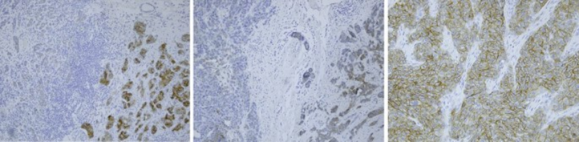

Figure 11\. Per\-position side\-chain burial for the 17 candidate epitopes, averaged over five models\.

Figure 12\. Absolute buried area of the position\-9 side chain for the 17 systems\.

Table 7\. The 15 peptides delivered to the wet lab, grouped by source antigen, with their prediction and structural values\.

|**Antigen**|**Peptide**|**Predicted IC₅₀ \(nM\)**|**EL percentile **|**Immunogenicity **|**P9 fill \(Ų / %\)**|**TCR face \(Ų\)**|
|---|---|---|---|---|---|---|
|TROP2|RLFRERYRL|61\.63|0\.28|0\.26342|143\.8 / 103|374|
|TROP2|SVCWCVNSV|222\.32|3\.10|0\.08963|114\.4 / 82|245|
|TROP2|TLIYYLDEI|12\.55|0\.34|0\.10266|140\.0 / 100|361|
|TROP2|YLDEIPPKF|79\.58|0\.02|0\.09175|173\.3 / 124|270|
|B7\-H4|AVFADQVIV|329\.27|0\.54|0\.10253|115\.1 / 82|252|
|B7\-H4|WLKEGVLGL|31\.58|0\.11|0\.11305|140\.2 / 100|147|
|Nectin\-4|AVTSEFHLV|357\.45|0\.44|0\.07465|114\.3 / 82|240|
|Nectin\-4|FQARLRLRV|439\.99|1\.30|0\.12358|113\.7 / 81|424|
|Nectin\-4|RLRVLVPPL|193\.10|1\.50|0\.07056|139\.6 / 100|259|
|Nectin\-4|YINGRGHLV|255\.92|0\.41|0\.13512|113\.5 / 81|226|
|LIV\-1|FIGHYAENV|35\.71|0\.50|0\.15750|113\.9 / 81|249|
|LIV\-1|GLHNFSDGL|110\.36|0\.47|0\.00078|139\.8 / 100|222|
|LIV\-1|GVATLAWMV|54\.75|0\.67|0\.16213|113\.3 / 81|280|
|LIV\-1|SVAVFCHEL|436\.04|1\.20|0\.20329|139\.8 / 100|277|
|LIV\-1|TVSEGTHFL|340\.45|0\.25|0\.21229|139\.5 / 100|234|

**Interpretation : **All 15 passing peptides formed the conserved hydrogen\-bond network completely or near\-completely and filled both anchor pockets, with the five models agreeing on the verdict in every case\. The two rejections demonstrate the value of the tier: both cleared the numerical gates of §3\.2\.1 and would have entered testing on sequence evidence alone, and both fail for the same structural reason that no sequence\-based score captures\. 

The spread within the passing set is also worth recording\. Predicted IC₅₀ ranges from 12\.55 to 439\.99 nM, a 35\-fold span, and the TCR\-facing surface from 147 to 424 Ų, nearly threefold\. These peptides are not equivalent, and nothing in this tier ranks them — the structural criteria are pass/fail gates on whether loading is geometrically correct, not a scale of expected immunogenicity\. 

**Limitations and scope :**

What this tier establishes is loading geometry, and only that\. It does not show that a peptide is generated by the proteasome, transported by TAP, loaded in vivo, or recognised by any T\-cell receptor; a peptide can be geometrically loadable and immunologically silent\. The models are predictions, not structures — no crystallography or multimer binding was performed, and agreement across five models measures the reproducibility of the prediction rather than its accuracy\. 

The 60% fill threshold is a boundary we derived rather than one taken from a validated standard\. Its basis is that the C\-terminal anchor motif of HLA\-A\*02:01 is valine and leucine with isoleucine and methionine tolerated **\(Falk et al\., 1991\)**, and that leucine and isoleucine in this dataset pack 139\.5–143\.8 Ų, giving the 140 Ų reference\. It is a reasoned cut\-off, not a calibrated one\. 

# Building the Vaccine: Construction and Quality Control

We built **13 single\-epitope circRNA constructs** from the fifteen peptides that left the dry lab and released them for downstream use\. Each epitope\-coding sequence sits in a shared backbone between the BamHI and XhoI sites, in frame downstream of the tPA signal sequence and upstream of the mC3dP28 adjuvant block \(Experiments 1\.1\)\. The plasmids were transcribed in vitro with T7 RNA polymerase and circularised through the **T4 *****td***** permuted intron**, and the circular fraction of the product was quantified by RT\-qPCR with divergent\- versus convergent\-primer pairs\. This section reports the construction record and the release figures for that batch\.

## 4\.1 Epitope plasmid construction: the 13\-construct Round 1 library

**Aim**｜Set out the construct library that Round 1 was run on: how many constructs, from which antigens, and what they share\. Every between\-construct comparison in Section 5 depends on these 13 plasmids differing only in their epitope cassette\.

**Design \& Readout**｜13 single\-epitope constructs on one shared backbone, each carrying its epitope cassette between the BamHI and XhoI sites, in frame downstream of the tPA signal sequence and upstream of the mC3dP28 adjuvant block, then prepared endotoxin\-free\. The cloning route, the enzymes and the clone\-screening steps are set out in Experiments 1\.1\.

**Result :**

Table 8\. The Round 1 construct library\.

|Target antigen|Single\-epitope constructs|Subtotal|
|---|---|---|
|TROP2|CTL1, CTL2, CTL3|3|
|B7\-H4|CTL1, CTL2|2|
|Nectin\-4|CTL1, CTL2, CTL3|3|
|LIV\-1|CTL1, CTL2, CTL3, CTL4, CTL5|5|
|**Total**||**13**|

Epitope numbering follows the CTL series assigned at construction; how the dry\-lab screen's 15 sequences became these 13 constructs is set out in Experiments 1\.1\.

**Interpretation**｜The 13 constructs share one backbone, one adjuvant and one preparation route, and differ only in a short epitope cassette of near\-identical length\. That is what makes the Round 1 screen in Section 5 a comparison between epitope sequences rather than a collection of unrelated measurements\.

**Limitations｜**B7\-H4 entered Round 1 with only two candidate epitopes, so for that antigen the screen had nothing to select between — see §5\.4\.

## 4\.2 Circularity of the Round 1 material: RT\-qPCR quantification on a representative construct

**Aim**｜Confirm that the covalently closed circular species dominates the product of in vitro transcription and circularisation, and fix the RT\-qPCR input volume used for all subsequent circularity measurements\.

**Design \& Readout**｜The thirteen Round 1 plasmids share one backbone and differ only in a short epitope cassette of near\-identical length, so **one construct, TROP2\-CTL1, was taken as representative of the batch** and carried through the full circularity assay; the remaining twelve were not measured individually\. Transcription was followed by self\-splicing circularisation and an **RNase R purification step to remove residual linear precursor**, and the purified product was quantified by RT\-qPCR with **divergent primers spanning the back\-splice junction** \(circular template only\) against **convergent primers** \(both species\), at **three input volumes — 2, 4 and 6 µL — with 3 technical replicate wells each \(n = 9\)**\. The circular fraction is reported as 2^−Cq\(circular\) ÷ \[2^−Cq\(circular\) \+ 2^−Cq\(linear\)\], and the circular : linear ratio as 2^ΔCq \(Experiments 1\.2\)\.

**Result :**

Table 9\. Circular fraction of the purified TROP2\-CTL1 preparation by RT\-qPCR\.

|Input volume|ΔCq \(linear − circular\)|Circular : linear|Circular fraction|
|---|---|---|---|
|2 µL|3\.70 ± 0\.02|13\.0 : 1|92\.85 ± 0\.08%|
|**4 µL**|**5\.02 ± 0\.37**|**32\.5 : 1**|**96\.96 ± 0\.70%**|
|6 µL|4\.72 ± 0\.45|26\.4 : 1|96\.25 ± 1\.14%|
|All nine wells|4\.48 ± 0\.67|22\.4 : 1|95\.35 ± 2\.01%|

**Interpretation**｜**The circular species dominates the preparation at every input volume tested\.** At the two higher volumes the measurement is stable and mutually consistent — 96\.96% and 96\.25%, a difference well inside the replicate scatter — placing the circular : linear ratio at roughly **30 : 1**\. The 2 µL arm sits about four percentage points lower; at that input the circular\-channel Cq rose by 2\.7 cycles for a two\-fold volume change, where one cycle is expected, indicating that the reaction was operating below its reliable input range\. **4 µL was therefore adopted as the working input for all subsequent circularity measurements**, including the Combined vaccine release assay in §5\.5\.

**Limitations and scope**

**One construct, not thirteen\.** Circularity was measured on **TROP2\-CTL1 alone**\. The justification is that all thirteen constructs share the same backbone, the same T4 *td* permuted\-intron chemistry and the same preparation workflow, and differ only in a short cassette; the inference is reasonable, but it is an inference\. **This section establishes that the workflow produces predominantly circular RNA; it does not establish the same for each of the other twelve preparations individually\.** No per\-construct comparison of circularisation efficiency is available, and none is made anywhere on this page\. This is also one of the reasons TROP2\-CTL1 was carried forward as a Round 2 comparator \(§5\.4\): it is the only single\-epitope construct with its own circularity record\.

**What the figures describe\.** The RNase R step removes linear precursor rather than converting it into circles, so these values characterise the composition of the material used downstream\. Since the unpurified reaction was not measured, the one\-step yield of the circularisation condition itself remains unquantified\. A small amount of highly structured linear RNA can survive digestion, so the circular fraction is best read as a close upper estimate\. The calculation also assumes the divergent and convergent primer pairs amplify with equal efficiency, which was not checked against a standard curve\.

**Structural confirmation\.** Sanger sequencing across the back\-splice junction, which reads covalent closure directly, was performed on the **Combined vaccine** \(§5\.5\)\. The Round 1 material rests on the RT\-qPCR evidence above\.

# Round 1: Screening Single\-Epitope Immunogenicity

We screened all 13 constructs for immunogenicity and used the result to choose the eight epitopes that went into the Combined vaccine\. Each single\-epitope circRNA was electroporated separately into monocyte\-derived dendritic cells and co\-cultured with autologous T cells at **DC : T = 1 : 20**, then read out three independent ways — **IFN\-γ ELISpot**, **Calcein\-AM killing of K562**, and **CD8⁺CD69⁺ flow cytometry**\. This section reports those three datasets and the design decisions drawn from them\.

## 5\.1 Round 1 IFN\-γ ELISpot — the primary criterion

**Aim**｜Quantify, at **single\-cell resolution**, the frequency of antigen\-specific IFN\-γ\-secreting T cells elicited by each epitope\. This is our **primary selection criterion**\.

**Design \& Readout**｜Round 1 ELISpot across all 13 constructs, reported as **SFC per 1×10⁵ cells**, one determination per construct\. **Controls: none — neither negative nor positive\.** No empty\-vector or antigen\-free well was seeded and the kit's PHA well was not run, so this round is a **pure between\-construct comparison** with no floor and no plate\-functionality check \(Experiments 2\.3\)\.

**Result**

https://static\.igem\.wiki/teams/6056/wiki/files/pages/wet\-lab/round\-1\-elispot\-wells\-and\-counts\.avif

Round 1 ELISpot wells and counts

Numbers above each well are **raw SFC per 10⁵ cells — no background has been subtracted**, because no background well was run\.

Table 10\. Round 1 ELISpot, **raw** SFC per 10⁵ cells across all 13 constructs\.

|Target|CTL1|CTL2|CTL3|CTL4|CTL5|
|---|---|---|---|---|---|
|TROP2|**271**|**217**|52|—|—|
|B7\-H4|**143**|**82**|—|—|—|
|Nectin\-4|**74**|**97**|51|—|—|
|LIV\-1|47|**118**|**78**|73|58|

Values are single determinations, with no background subtraction and no negative control\. "—" marks a position that does not exist — that antigen yielded fewer constructs — not a missing measurement\. Bold marks the two epitopes of each antigen carried into the Combined vaccine \(§5\.4\)\.

**Interpretation**｜Three observations matter\.

1. **The 47–271 spread shows that this screen was both necessary and effective — and shows exactly what the in silico stage could not do\.** Every one of these 13 sequences had already cleared the dry\-lab filter, yet the filter could not rank them: nothing in the prediction scores distinguished LIV1\-CTL1, which returned **47 SFC**, from TROP2\-CTL1, which returned **271** — a **5\.8\-fold** gap\. Without the wet\-lab screen all 13 would have entered the vaccine at equal weight\. \(Without a negative control we cannot say 47 SFC is "no response"; we can only say it is the bottom of the range\.\)

2. **TROP2\-CTL1 \(271\) and CTL2 \(217\) lead by a clear margin**, and both belong to the same antigen\. This directly determined our choice of TROP2 as the **representative antigen** and as the target for the in vivo model\.

3. **No antigen is uniformly immunogenic — every one of the four contains both a stronger and a weaker epitope\.** The within\-antigen spread is **5\.2\-fold for TROP2** \(271 → 52\), **1\.7\-fold for B7\-H4** \(143 → 82\), **1\.9\-fold for Nectin\-4** \(97 → 51\) and **2\.5\-fold for LIV\-1** \(118 → 47\)\. TROP2 is the clearest case: it supplies the strongest epitope of the whole panel \(271\) and one of the weaker ones \(52\)\. **Selection therefore has to be made epitope by epitope, not antigen by antigen** — choosing "the best antigen" and taking its whole repertoire would have carried weak sequences into the vaccine alongside strong ones\. This is the observation that set the Round 2 selection rule \(§5\.4\)\.

**Limitations and scope**

**Round 1 ran with no negative control\.**

Round 1 was a **triage screen** whose only job was to rank 13 constructs against one another so that the best could go forward\. For ranking, an internal comparison suffices: every construct shares the same backbone, the same adjuvant, the same electroporation and the same donor cells, and differs only in epitope sequence\.

**What the table still supports\.** The *ordering* and the *relative magnitudes*: TROP2\-CTL1 \> TROP2\-CTL2 \> B7H4\-CTL1 \> … \> Nectin4\-CTL3\. The ELISpot ranking drove the Round 2 design\. The K562 assay in §5\.2 confirmed measurable killing capacity but did not reproduce the ELISpot ranking across the panel \(Spearman ρ = 0\.43, P = 0\.14\)\. The CD8⁺CD69⁺ flow results in §5\.3 supported the CTL1 \> CTL2 ordering for the two TROP2 constructs tested\.

**This gap was closed in Round 2**, whose Blank group is an **empty\-vector circRNA** control \(see the opening of Section 6\) — which is why every quantitative attribution on this page comes from Round 2 and later, never from Round 1\.

## 5\.2 Calcein\-AM killing assay \(K562\)

**Aim**｜Round 1 was originally designed to assess immunogenicity by ELISpot alone\. Advice received during Human Practices was that IFN\-γ secretion does not by itself establish that the primed cells can kill, and that a cytotoxicity assay should be added\. We added a Calcein\-AM killing assay across all 13 constructs, using **K562**, the standard reference target for this assay format\. This section reports what that assay settled and what it did not\.

**Design \& Readout**｜Calcein\-AM release from K562 at **E:T 80 : 1**, all 13 constructs assayed in parallel, **3 replicate wells** per construct on one plate — technical replicates, not biological ones \(Experiments 2\.4\)\.

**Result**

https://static\.igem\.wiki/teams/6056/wiki/files/pages/wet\-lab/round\-1\-killing\-of\-k562\-by\-t\-cells\-primed\-with\-each\-construct\.avif

Round 1 killing of K562 by T cells primed with each construct\.

Table 11\. Round 1 killing of K562 at E:T 80 : 1\.

|Construct|Killing \(%\)|Construct|Killing \(%\)|
|---|---|---|---|
|**TROP2\-CTL1**|**44\.15 ± 2\.61**|Nectin4\-CTL2|34\.83 ± 0\.47|
|**TROP2\-CTL2**|**42\.15 ± 1\.16**|Nectin4\-CTL3|34\.00 ± 0\.77|
|TROP2\-CTL3|34\.80 ± 0\.37|LIV1\-CTL1|32\.85 ± 0\.18|
|B7H4\-CTL1|35\.79 ± 2\.30|LIV1\-CTL2|31\.37 ± 1\.52|
|B7H4\-CTL2|34\.97 ± 0\.28|LIV1\-CTL3|33\.33 ± 1\.65|
|Nectin4\-CTL1|37\.53 ± 1\.89|LIV1\-CTL4|37\.57 ± 0\.66|
|||**LIV1\-CTL5**|**41\.53 ± 2\.84**|

Killing is reported as %, mean ± SD, **n = 3 replicate wells**, across all 13 constructs\. Statistics are given in the Interpretation\.

**Every one of the 13 constructs cleared the gate\.** Killing runs from **31\.37% to 44\.15%**, the three highest being **TROP2\-CTL1 \(44\.15%\), TROP2\-CTL2 \(42\.15%\) and LIV1\-CTL5 \(41\.53%\)**\.

**Interpretation**｜Three things follow from this dataset\.

**First, the full priming chain worked for every construct\.** Each of the 13 primed T\-cell populations killed a substantial fraction of targets, so none of them failed at electroporation, DC maturation or DC–T co\-culture\. That matters for how §5\.1 is read: because every preparation produced functional effectors, **a low ELISpot count can be attributed to the epitope sequence rather than to a preparation that did not work**\. This is precisely what a functional gate is for, and all 13 passed it\.

**Second, the measurement is precise\.** The three replicate wells agree closely — mean within\-construct SD **1\.28 percentage points \(CV 3\.4%\)**, pooled SD **1\.56 points** — and they agree on the ordering \(pairwise **Spearman ρ = 0\.81 / 0\.85 / 0\.96**, all P \< 0\.001\)\. A one\-way ANOVA across the 13 constructs gives **F\(12,26\) = 18\.8, P = 8\.1 × 10⁻¹⁰**, and **85\.6% of the total variance sits between constructs rather than between wells** \(ICC = 0\.856\)\. The Round 1 readout pipeline is therefore reproducible within the plate; these are measurements, not noise\.

**Third, the result identified K562 as the wrong target for this question\.** Killing sits in a narrow **1\.41\-fold band** across all 13 constructs, while ELISpot over the same constructs spans **5\.8\-fold**\. K562 is MHC\-I negative and carries none of the four target antigens, so it cannot distinguish between T\-cell populations primed against different epitopes: what it reports is baseline, non\-antigen\-restricted killing capacity\. The assay therefore answered the question that prompted it — the primed cells do kill — without being able to answer it epitope by epitope\. That is the observation that set the Round 2 target: **MDA\-MB\-231, HLA\-A\*02:01⁺ and TROP2⁺** \(§5\.4, §6\.6\)\.

**The two readouts measure different quantities, and the data show it directly\.** Across the 13 constructs the rank correlation between ELISpot SFC and K562 killing is **Spearman ρ = 0\.43, P = 0\.14 — no correlation**\. Two constructs show the separation most clearly:

Table 12\. Two constructs whose ranking differs between the two readouts\.

|Construct|ELISpot rank|K562 killing rank|
|---|---|---|
|LIV1\-CTL2|4th of 13 \(118 SFC\)|**13th of 13** \(31\.37%\)|
|LIV1\-CTL5|10th of 13 \(58 SFC\)|**3rd of 13** \(41\.53%\)|

Selecting on K562 killing would have given LIV\-1 **CTL5 and CTL4 in place of CTL2 and CTL3**, so **LIV1\-CTL2 — the fourth\-strongest epitope of the whole panel at 118 SFC — would have given way to LIV1\-CTL5 at 58 SFC**\. The Round 2 cassette therefore follows the ELISpot ranking \(§5\.4\), with this assay in the gating role set out above\. Two considerations decide that division of labour\.

**What each target can report\.** K562 carries neither MHC\-I nor any of the four target antigens, so its killing value is insensitive to which epitope the T cells were primed against; the limitation sits in the target cell, and adding controls would not remove it\. ELISpot reads IFN\-γ release on re\-encounter with the DC presenting that epitope, which is a measurement of the right kind\. Round 1 ELISpot ran without a negative control \(§5\.1\), so it establishes a ranking rather than antigen specificity — and a ranking is what the Round 2 selection required\.

**How much there is to select on\.** Killing spans **1\.41\-fold** across the 13 constructs, with within\-construct SDs of **0\.18–2\.84 percentage points**, so most neighbouring pairs sit within a few standard deviations of one another\. ELISpot spans **5\.8\-fold** over the same constructs\. Selecting on the narrower readout would have meant selecting largely on measurement noise\.

**Limitations and scope**

**What this assay is scoped to answer\.** K562 is **MHC\-I negative** and **carries none of our four target antigens**, so it is killed largely through NK\-like, non\-MHC\-restricted mechanisms \(Tremblay\-McLean et al\., 2019\)\. It therefore reports the **overall killing capacity of the effector population** and is not an antigen\-specificity assay\. Antigen specificity is addressed separately in §6\.6, on **MDA\-MB\-231 \(HLA\-A\*02:01⁺, TROP2⁺\)** — a target chosen on the strength of exactly this result\. We do not read the present dataset as evidence that the epitopes induced specific killing\.

**What the ρ = 0\.43 non\-correlation does and does not mean\.** It is not a failure of the priming, and it is not evidence that the epitopes induced specific killing\. Had K562 killing tracked ELISpot closely, that would have implied the ELISpot signal was largely non\-specific effector activity\. The two readouts behave as the target\-cell biology says they must: the MHC\-I\-negative target reports general effector capacity, and only a target with the correct HLA restriction and the correct antigen \(§6\.6\) speaks to specificity\.

**The precision established here is within\-plate\.** With 3 wells on a single plate and no biological replication, the 1–3 percentage\-point gaps between individual constructs are not claimed to be biologically meaningful, and no epitope was selected or rejected on them\. Adding **three independent experiments with fresh effector\-cell batches** would put those gaps on a testable footing; it is the cheapest available upgrade to this section\.

## 5\.3 Flow validation of TROP2 epitopes: CD8⁺CD69⁺ early activation

**Aim**｜Provide an **independent, mechanistically earlier** line of functional evidence for the ELISpot conclusion: did TROP2\-CTL1 and CTL2 really trigger TCR signalling in CD8⁺ T cells?

**Design \& Readout**｜CD8⁺CD69⁺ double\-positive events within the FSC/SSC lymphocyte gate by multicolour flow, for TROP2\-CTL1 and TROP2\-CTL2 \(Experiments 2\.5\)\.

**Result**

https://static\.igem\.wiki/teams/6056/wiki/files/pages/wet\-lab/cd8\-cd69\-flow\-cytometry\-of\-t\-cells\-primed\-with\-trop2\-ctl1\-and\-ctl2\.avif

CD8/CD69 flow cytometry of T cells primed with TROP2\-CTL1 and CTL2

This is a **two\-level nested gating**: the left panel of each pair is the FSC/SSC lymphocyte gate \(red ellipse\), whose percentage is that gate as a fraction of **all acquired events**; the right panel shows CD8 \(PE\) vs CD69 \(PerCP\) **within** that gate, with the green box marking the double\-positive population, whose denominator is the lymphocyte gate rather than all events\. The two numbers belong to different levels and **do not constitute a "before → after" change**\.

Table 13\. Round 1 CD8⁺CD69⁺ frequencies\.

|Construct|Lymphocyte gate|CD8⁺CD69⁺ \(within gate\)|
|---|---|---|
|TROP2\-CTL1|7\.33%|**31\.07%**|
|TROP2\-CTL2|8\.18%|25\.39%|

**Interpretation**｜The ranking by CD8⁺CD69⁺ \(CTL1 \> CTL2\) **agrees in direction** with the ELISpot ranking \(271 \> 217\)\. Two mechanistically independent readouts — one measuring the **earliest TCR signalling event**, the other **downstream effector cytokine secretion** — converge on the same ranking, with TROP2\-CTL1 above TROP2\-CTL2 in this round\.

**Limitations\.** Only the two TROP2 epitopes were compared, not the full panel; and the same single\-donor constraint applies\.

## 5\.4 Round 1 → Round 2: what we learned \(Learn → Design\)

This is the pivot point of our engineering cycle\. The three Round 1 datasets together produced three explicit design inputs:

Table 14\. Round 1 observations and resulting Round 2 design changes\.

|Observation|Our reading|Resulting design change|
|---|---|---|
|SFC spanning **47–271** across the 13 constructs|In silico prediction **cannot substitute** for immunogenicity validation|Only wet\-lab\-validated strong epitopes carried forward|
|**B7\-H4 contributed only two** constructs, against three to five for each other antigen|If all four antigens are to be **equally represented** in the cassette, the per\-antigen ceiling is **two**|Take each antigen's **two highest\-SFC epitopes** — eight in all|
|K562 killing spanned only **1\.41\-fold** across the 13 constructs and did not correlate with ELISpot \(ρ = 0\.43\)|A **MHC\-I\-negative, antigen\-negative** target cannot resolve epitopes; a killing assay needs a target carrying both the antigen and the matching HLA type|Round 2 switched to **MDA\-MB\-231** \(HLA\-A\*02:01⁺, TROP2⁺\)|

**Why insist on equal representation of all four antigens rather than simply taking the eight highest\-SFC epitopes overall\.** Triple\-negative breast cancer is antigenically heterogeneous: target expression varies between cells within one tumour, and sustained pressure on a single antigen invites antigen\-loss escape \(Eroles et al\., 2026\)\. Covering four antigens in parallel hedges against that\. It does **not** broaden population coverage — **every epitope in this project is HLA\-A\*02:01\-restricted, so population coverage is bounded by that restriction and is independent of how many antigens are included** \(see §3\.2\.1, Limitations and scope\)\.

The cost of the rule can be stated exactly, and it turns out to be **zero**\. Selecting the eight highest\-SFC epitopes without regard to antigen gives **exactly the same eight** \(271, 217, 143, 118, 97, 82, 78, 74 — total 1080 SFC\): on this dataset the equal\-representation rule and the pure ranking rule coincide\. The rule would only have bitten one place further down — the ninth epitope by SFC is LIV1\-CTL4 at **73**, one point below Nectin4\-CTL1 at **74** — so the two criteria were separated here by a single SFC count\. We state this rather than claiming the rule did work it did not have to do\.

Two epitopes per antigen rather than one builds in redundancy at the **epitope** level: processing and presentation of any single epitope vary between individuals and can be evaded by a point mutation, so a second epitope from the same antigen provides a fallback\. **We did not test this** — no one\-epitope\-per\-antigen control cassette was ever built\.

On this basis we rebuilt the **Combined multi\-epitope vaccine plasmid, pCirCure\-circMEV \(5267 bp\)**\. Ranking by Round 1 ELISpot, the two strongest epitopes were taken from each antigen — **TROP2\-CTL1/CTL2, B7H4\-CTL1/CTL2, Nectin4\-CTL1/CTL2 and LIV1\-CTL2/CTL3**\. One of the eight, **Nectin4\-CTL1, is itself a merged construct** \(FQARLRLRVLVPPL, built as one fragment from the two overlapping predicted epitopes FQARLRLRV and RLRVLVPPL — see §3\.2\.2\), so the cassette carries **nine predicted epitopes in eight fragments**\. Each fragment is separated by a flexible linker with the reading frame verified throughout, then seamlessly assembled into the optimised backbone\. The construct was then re\-transcribed and circularised, with an RNase R purification step to enrich the circular fraction, as in Round 1\. Five preparations were made for Round 2: **empty vector, TROP2\-CTL1, TROP2\-CTL2, TROP2\-CTL1\+2 and Combined**\. The release data for that batch are in **§****5****\.5**\.

**Two elements of this architecture come from the literature rather than from our own data\.** The **flexible linkers** and the **proteasomal\-cleavage\-guided ordering** are standard practice in multi\-epitope vaccine design \(Nielsen et al\., 2005; Zhou et al\., 2025\): linkers are intended to prevent junctional neo\-epitopes and to preserve cleavage at each epitope boundary\. We adopted both, and confirmed computationally that the chosen linkers introduce no novel predicted epitopes — but **we never built a linker\-free or differently\-ordered version of this cassette, so we have no experimental measurement of what either element contributes\.** What our own data do establish is the *selection rule* — which epitopes, and how many per antigen — and that rule is traceable to Table 10\. Where a design element rests on the literature rather than on our bench, this page says so\.

The final plasmid is composed as follows\. The epitope cassette lies between **BamHI \(1600\) and XhoI \(1957\)**, with the eight fragments joined by flexible linkers in the order **TROP2\-CTL1 → TROP2\-CTL2 → B7H4\-CTL1 → B7H4\-CTL2 → Nectin4\-CTL1 \(merged fragment\) → Nectin4\-CTL2 → LIV\-1\-CTL2 → LIV\-1\-CTL3**\. Upstream lie the **tPA signal/pro sequence** and a **human rhinovirus IRES**; downstream, in order, a **GS linker, the 4×mC3dP28 adjuvant \(mC3dP28\-1 to \-4\), the MITD membrane\-targeting signal, a FLAG tag, the full HBA1 3′ UTR and a polyA25 spacer**** **\(Kreiter et al\., 2008; Bergmann\-Leitner et al\., 2007\)\. Circularisation is mediated by the **T4 td permuted intron** with inner and outer homology arms; transcription is driven by the **T7 promoter**\.

https://static\.igem\.wiki/teams/6056/wiki/files/pages/wet\-lab/map\-of\-the\-combined\-vaccine\-plasmid\-pcircure\-circmev\-5267bp\.avif

Map of the Combined vaccine plasmid pCirCure\-circMEV \(5267 bp\)

## 5\.5 The Combined batch: release testing and direct proof of circularity

**Aim**｜Five Round 2 preparations were made — empty vector, TROP2\-CTL1, TROP2\-CTL2, TROP2\-CTL1\+2 and Combined\. Before entering functional testing each had to be shown to derive from a **correctly amplified transcription template** and to be **circular enough to be worth electroporating**\. The gel below covers the four epitope\-encoding templates; the empty\-vector template is not shown\. For the final Combined vaccine we went one step further and obtained **direct sequence proof of covalent closure**\. This section is therefore used in every experiment from Round 2 onwards \(Sections 6, 8 and 9\)\.

**Design \& Readout**｜Release testing of the Combined batch — PCR amplification of the T7\-containing region of each plasmid as the transcription template, template QC on gel, T7 transcription, circularisation, RNase R purification, and RT\-qPCR quantification of the circular fraction with divergent and convergent primers at the **4 µL input established in §4\.2**, in **3 technical replicate wells** — plus **Sanger sequencing across the back\-splice junction** as direct structural proof \(Experiments 3\.2\)\.

**Result**

https://static\.igem\.wiki/teams/6056/wiki/files/pages/wet\-lab/agarose\-gel\-verification\-of\-the\-four\-epitope\-encoding\-linearised\-transcription\-templates\.avif

Agarose gel QC of the four epitope\-encoding transcription templates

Each lane carries a **single major species**, and their mobility orders with insert length — TROP2\-CTL1 ≈ TROP2\-CTL2 \< TROP2\-CTL1\+2 \< Combined — matching the designed template sizes\. **Two limits on what this gel establishes\.** The marker resolves only up to 1000 bp, well below the ≈ 2\.8 kb of these templates, so the gel supports the relative ordering and the absence of additional discrete species rather than an exact size call\. The lanes are also loaded well above the linear range of the stain: the bands are saturated, each lane carries some vertical trailing, and the TROP2\-CTL1\+2 and Combined lanes retain material in the well, which is not resolved here\. On this basis the batch proceeded to in vitro transcription; a re\-run at lower load with a marker spanning the expected size range would be needed to call template homogeneity outright\.

Table 15\. Circularity of the purified Combined vaccine batch\.

|Measure|Value|
|---|---|
|ΔCq \(convergent − divergent\)|7\.19 ± 0\.39|
|Circular : linear|**145\.7 : 1**|
|Circular fraction|**99\.30 ± 0\.17%**|

https://static\.igem\.wiki/teams/6056/wiki/files/pages/wet\-lab/sanger\-trace\-across\-the\-backsplice\-junction\-bsj\-of\-the\-combined\-vaccine\.avif

Sanger trace across the back\-splice junction \(BSJ\) of the Combined vaccine

The sequence read is **CTCAGTAGATGTTTTCTTGGGT \| CTACCGTTTAATATTGCGTCATAT**: the marker indicates the ligation site, with the 3′ sequence of the precursor to its left and the 5′ sequence to its right, joined head\-to\-tail in the circular molecule\. Both flanks are the retained segments of the T4 *td* permuted intron, at positions 2714–2735 and 723–746 of pCirCure\-circMEV, so the junction read here is the one the construct predicts\. The flat baseline, single sharp peaks, and absence of overlapping peaks either side of the junction indicate a **homogeneous single sequence** rather than a mixture of splice products\.

**Interpretation**｜The purified Combined vaccine batch is **99\.3% circular**, with the circular species roughly **146\-fold** more abundant than the linear precursor \(mean ± SD of 3 technical wells at 4 µL input\)\. A backbone\-encoded GFP amplicon was run alongside both channels and read Cq 12\.74 in each, confirming that the two channels received the same amount of RNA\. The batch clears the ≥ 90% release criterion set in Experiments 3\.2 with substantial margin and is consistent with the representative Round 1 measurement in §4\.2 \(≈ 97% at the same input volume\), so the material entering the in vivo work is at least as well circularised as the material used for screening\. Covalent closure is confirmed independently by the back\-splice junction sequence above, giving this construct two lines of evidence for circularity\.

**Limitations and scope**

**The scope of the BSJ result\.** BSJ sequencing was performed on the **Combined vaccine**, the construct that goes into every Round 2 and in vivo experiment\. The 13 Round 1 constructs \(§4\.1–4\.2, §5\.1–5\.3\) and the other preparations of this batch rest on the RT\-qPCR evidence together with the fact that they were made by the same T4 *td* self\-splicing chemistry from the same backbone — an inference from shared chemistry rather than a measurement on each preparation\.

**The scope of the circular\-fraction measurement\.** The quantification was designed as **one representative preparation per round**: TROP2\-CTL1 in §4\.2 and the Combined vaccine here, each at the 4 µL input in 3 technical replicate wells\. The other preparations of this batch, the empty vector among them, were carried through the same amplification, transcription, circularisation and RNase R route, and the Combined figure stands for the batch\. The empty vector is the comparator for the Blank group in Section 6 and for the empty\-vector arm in Section 9, so those comparisons rest on the shared preparation route together with the release figure of the batch's representative preparation\.

**What Table 1****5**** describes\.** The circular fraction is measured on the RNase R–purified product\. Purification removes the molecules that failed to circularise rather than rescuing them, so Table 15 describes the composition of the **released material**\. The one\-step performance of the circularisation chemistry is a separate quantity: Mg²⁺ concentration, temperature and digestion time were adopted empirically, and titrating them as a gradient is process work for a future preparation \(Experiments 3\.2, note 2\)\.

# Round 2: Functional Validation of the Combined Vaccine

We tested the **Combined vaccine** against three comparators — empty vector, TROP2\-CTL1 and TROP2\-CTL2, plus the dual\-epitope TROP2\-CTL1\+2 — along the whole immune chain, one link at a time: **DC maturation \(CD80/CD86\)**, **antigen translation \(anti\-FLAG Western blot\)**, **T\-cell activation and co\-stimulation \(CD69, CD28\)**, **effector\-memory differentiation \(CD45RO⁺CCR7⁻\)**, **cytokine secretion \(ELISpot\)** and **specific killing of MDA\-MB\-231**\. The functional assays use an empty\-vector circRNA control\. The anti\-FLAG Western blot in §6\.2 uses mock\-electroporated DCs as its negative control\. This section reports the six datasets in that order\.

**Why TROP2\-CTL1 and TROP2\-CTL2 are the comparators, and not some other epitope\.** They are the **two strongest single epitopes in the entire Round 1 panel** — 271 and 217 SFC against a panel median of 78 \(Table 10\)\. Choosing them sets the comparison at its hardest: a Combined vaccine that beat a mid\-range or weak single epitope would prove very little, because almost any multi\-epitope construct would do that\. The claim we want to test is stronger — that combining epitopes adds something beyond taking the best one — and that claim can only be tested against the best one\. The dual\-epitope **TROP2\-CTL1\+2** group then supplies the intermediate rung, so the four epitope\-carrying groups form a ladder of increasing epitope content — **single → dual → eight\-epitope Combined** — at constant backbone, constant adjuvant and constant electroporation\. Read in that order, the series answers two questions at once: whether the Combined vaccine works at all \(against the Blank\), and whether multivalency itself is worth the extra construction \(against the best single epitope and the best pair\)\.

**A key control choice for this whole section\.** Every group is baselined against the **Blank group**, and the Blank group was electroporated with an **empty backbone circRNA encoding no epitopes \(empty vector\)** — not untreated cells, and not electroporation buffer alone\.

This choice makes the Blank group subtract three backgrounds at once: **electroporation stress itself**, **innate stimulation by the circRNA backbone through cytosolic sensors such as RIG\-I/MDA5**, and **the effect of the 4×mC3dP28 adjuvant module**\. Consequently, **the entire increment from Blank to Combined can only come from the epitope\-encoding sequence**\. This is not a "blank" control but a strict **vector control**, and it is what allows the in vitro results on this page to be attributed to antigen at all\. Cell number, volume and programme \(Nucleofector II, Program U\-002\) were identical across all groups\.

## 6\.1 DC maturation: upregulation of CD80/CD86

**Aim**｜To prime T cells effectively, DCs must not only present antigen \(signal 1\) but also upregulate co\-stimulatory molecules \(signal 2\)\. This step tests each construct's ability to drive DC maturation — a **precondition** for everything downstream\.

**Design \& Readout**｜**CD80⁺CD86⁺** double positives on moDCs by flow across five groups \(Blank / TROP2\-1 / TROP2\-2 / TROP2\-1\+2 / Combined\), **n = 3** \(Experiments 4\.1\)\.

**Result**

https://static\.igem\.wiki/teams/6056/wiki/files/pages/wet\-lab/cd80\-cd86\-double\-positive\-dc\-frequencies\-for\-each\-group\.avif

CD80⁺CD86⁺ double\-positive DC frequencies for each group

\(The X\-axis is CD80 and the Y\-axis CD86; the boxed number is the double\-positive percentage\.\)

https://static\.igem\.wiki/teams/6056/wiki/files/pages/wet\-lab/quantification\-of\-dc\-maturation\-across\-groups\.avif

Quantification of DC maturation across groups

\(Error bars are SD; \*\*\* denotes P \< 0\.001 for Blank vs Combined\.\)

Table 16\. DC maturation frequencies\.

|Group|CD80⁺CD86⁺ \(%\)|Increase over Blank|vs Blank \(Holm\)|
|---|---|---|---|
|Blank|10\.33 ± 0\.55|—|—|
|TROP2\-1|15\.57 ± 0\.35|\+51%|2\.7 × 10⁻⁴|
|TROP2\-2|15\.80 ± 0\.36|\+53%|2\.7 × 10⁻⁴|
|TROP2\-1\+2|17\.50 ± 0\.30|\+69%|1\.5 × 10⁻⁴|
|**Combined**|**22\.37 ± 0\.31**|**\+117%**|**2\.5 × 10⁻⁵**|

Values are mean ± SD, n = 3\.

One\-way ANOVA F\(4,10\) = 378\.2, P \< 0\.0001\. **Combined vs TROP2\-1\+2 also reaches significance** \(Holm\-corrected（Holm, 1979） P = 1\.5 × 10⁻⁴\), so eight epitopes still add over two\. The representative flow values in Figure 19 \(10\.9 / 15\.6 / 15\.9 / 17\.2 / 22\.1\) differ slightly from these means, as expected — the former is a single representative sample, the latter the mean of three replicates\.

**Interpretation**｜All epitope\-encoding groups exceeded the empty\-vector Blank, following a clear **epitope\-complexity gradient**: single\-epitope \< dual\-epitope \< Combined, with Combined at **2\.16× Blank** \(Holm\-corrected P = 2\.5 × 10⁻⁵\)\.

**The attribution here is clean\.** Because the Blank group already carries the complete circRNA backbone and the 4×mC3dP28 adjuvant, backbone innate stimulation and adjuvant activity are **identical across all four groups** and are subtracted at baseline\. The rise from 10\.33% to 22\.37% can therefore **only come from the epitope\-encoding sequence** — the translated antigenic peptides themselves promote DC maturation\. This is consistent with the classical mechanism whereby increased antigen load drives uptake and processing of more exogenous protein and upregulation of co\-stimulatory molecules\.

## 6\.2 Antigen translation: anti\-FLAG Western blot

**Aim**｜For the vaccine to work, the circRNA must first be **translated into protein inside DCs**\. This step provides direct evidence at the protein level\.

**Design \& Readout**｜Anti\-FLAG Western blot of electroporated DCs against the **FLAG tag** carried downstream of the epitope cassette, with **β\-actin** as loading control and mock\-electroporated DCs as the negative control \(Experiments 4\.2\)\.

**Result**

https://static\.igem\.wiki/teams/6056/wiki/files/pages/wet\-lab/western\-blot\-of\-flag\-tagged\-fusion\-protein\-in\-dcs\.avif

Western blot of FLAG\-tagged fusion protein in DCs

The circRNA\-electroporated lane shows a distinct band at **\~50 kDa**, near\-absent in the blank control; **β\-actin \(42 kDa\) is comparable across lanes**, confirming equal loading\.

**Interpretation**｜A **FLAG\-specific band at \~50 kDa with comparable β\-actin across lanes** indicates that the band derives from translation of the circRNA\-encoded sequence rather than from a loading difference\. This closes the link "**the antigen is actually synthesised inside the cell**" — until this point, translation could only be inferred indirectly from downstream function\.

**Limitations and scope**

**The scope of the anti\-FLAG result\.** The anti\-FLAG blot demonstrates **translation/expression**\. It does **not** directly demonstrate that the antigen is processed and presented on MHC\-I at the cell surface\. Presentation is supported only **indirectly**, by the downstream ELISpot, T\-cell activation and specific killing data\. Direct proof would require pMHC multimer staining or surface peptide elution mass spectrometry, which we could not complete within the project timeline — this is listed as future work\.

## 6\.3 T\-cell activation and co\-stimulation: CD69 and CD28

**Aim**｜Test whether antigen presentation actually translates into **CD8⁺ T\-cell activation**, and whether those cells receive co\-stimulatory support — which determines whether effector cells survive and expand\.

**Design \& Readout**｜**CD8⁺CD69⁺** \(early activation\) and **CD8⁺CD28⁺** \(co\-stimulation\) by flow after DC–T co\-culture at 1 : 20, four constructs plus Blank, **n = 3** \(Experiments 4\.3\)\.

**Result**

https://static\.igem\.wiki/teams/6056/wiki/files/pages/wet\-lab/cd8\-cd69\-t\-cell\-frequencies\-after\-dc\-t\-co\-culture\.avif

CD8⁺CD69⁺ T\-cell frequencies after DC–T co\-culture

https://static\.igem\.wiki/teams/6056/wiki/files/pages/wet\-lab/quantification\-of\-cd8\-cd69\-frequencies\-across\-groups\.avif

Quantification of CD8⁺CD69⁺ frequencies across groups

https://static\.igem\.wiki/teams/6056/wiki/files/pages/wet\-lab/cd8\-cd28\-t\-cell\-frequencies\-after\-dc\-t\-co\-culture\.avif

CD8⁺CD28⁺ T\-cell frequencies after DC–T co\-culture

https://static\.igem\.wiki/teams/6056/wiki/files/pages/wet\-lab/quantification\-of\-cd8\-cd28\-frequencies\-across\-groups\.avif

Quantification of CD8⁺CD28⁺ frequencies across groups

\(Error bars in Figures 23 and 25 are SD; \*\*\* denotes P \< 0\.001 for Blank vs Combined\.\)

Table 17\. T\-cell activation and co\-stimulatory marker expression\.

|Group|CD8⁺CD69⁺ \(%\)|CD8⁺CD28⁺ \(%\)|
|---|---|---|
|Blank|27\.33 ± 0\.40|2\.77 ± 0\.60|
|TROP2\-1|37\.07 ± 0\.25|15\.10 ± 0\.70|
|TROP2\-2|42\.00 ± 0\.62|14\.53 ± 1\.19|
|TROP2\-1\+2|42\.43 ± 0\.40|15\.50 ± 0\.56|
|**Combined**|**45\.53 ± 0\.31**|**17\.53 ± 0\.45**|

Values are mean ± SD, n = 3\.

One\-way ANOVA: CD69 F\(4,10\) = 872\.7, P \< 0\.0001; CD28 F\(4,10\) = 185\.8, P \< 0\.0001\. All four circRNA groups differ from Blank at P \< 0\.001 after Holm correction \(largest Holm P: CD69 1\.1 × 10⁻⁵, CD28 2\.2 × 10⁻⁴\)\. Combined vs TROP2\-1\+2 is also significant on both \(CD69 Holm P = 4\.5 × 10⁻⁴; CD28 Holm P = 0\.008\)\.

**Interpretation**｜Both dimensions agree: all circRNA groups significantly exceed Blank \(CD69: P \< 0\.001\), and **Combined is highest on both**\.

Worth singling out: **the fold\-increase in CD28 is far larger than in CD69\.** CD69 rises from 27\.33% to 45\.53% \(**1\.67\-fold**\), while CD28 rises from 2\.77% to 17\.53% \(**6\.34\-fold**\)\. This suggests the vaccine does more than switch on an immediate activation signal — it drives a substantial fraction of CD8⁺ T cells to express **co\-stimulatory receptors**, and CD28 signalling is precisely what allows effector T cells to survive, expand and avoid anergy\. This sets up mechanistically the memory differentiation observed in the next section\.

**Limitation\.** CD28 is downregulated during terminal effector differentiation, so the chosen time point affects the readout; this is a single\-time\-point snapshot with no kinetic time course\.

## 6\.4 Effector\-memory differentiation: CD45RO⁺CCR7⁻

**Aim**｜A high\-quality CTL response must not only activate but **differentiate towards an effector/memory phenotype** — this determines whether the response persists\.

**Design \& Readout**｜**CD45RO⁺CCR7⁻ \(effector memory\)** within the CD8⁺ gate, same five groups, **n = 3** \(Experiments 4\.3\)\.

**Result**

https://static\.igem\.wiki/teams/6056/wiki/files/pages/wet\-lab/cd45ro\-ccr7\-effector\-memory\-frequencies\-within\-cd8\-t\-cells\.avif

CD45RO⁺CCR7⁻ effector\-memory frequencies within CD8⁺ T cells

\(Left to right: Blank, TROP2\-1, TROP2\-2, TROP2\-1\+2, Combined\.\)

https://static\.igem\.wiki/teams/6056/wiki/files/pages/wet\-lab/quantification\-of\-cd45ro\-ccr7\-frequencies\-across\-groups\.avif

Quantification of CD45RO⁺CCR7⁻ frequencies across groups

\(Error bars are SD; \*\*\* denotes P \< 0\.001 for Blank vs Combined\.\)

Table 18\. Effector\-memory differentiation by group\.

|Group|CD45RO⁺CCR7⁻ \(%\)|Fold vs Blank|
|---|---|---|
|Blank|1\.10 ± 0\.36|—|
|TROP2\-1|11\.03 ± 0\.32|10\.0×|
|TROP2\-2|12\.07 ± 0\.15|11\.0×|
|**TROP2\-1\+2**|**21\.43 ± 0\.90**|**19\.5×**|
|**Combined**|**21\.90 ± 0\.72**|**19\.9×**|

Values are mean ± SD, n = 3\.

One\-way ANOVA F\(4,10\) = 701\.1, P \< 0\.0001; all four circRNA groups exceed Blank at P \< 0\.001 \(largest Holm\-corrected P = 1\.0 × 10⁻⁵\)\. **Combined vs TROP2\-1\+2 is not significant \(P = 0\.52\)** — two epitopes already saturate this readout, and eight add nothing further\.

**Interpretation**｜The separation between groups is the largest in this section: Blank at 1\.10 ± 0\.36% versus Combined at 21\.90 ± 0\.72% — a **19\.9\-fold difference** \(Holm P = 6\.0 × 10⁻⁶\)\.

More informative still is a clear **step change**: single\-epitope groups \(11\.03%, 12\.07%\) sit at roughly half the level of the dual/multi\-epitope groups \(21\.43%, 21\.90%\), and TROP2\-1\+2 vs Combined is statistically indistinguishable \(P = 0\.52\)\. The pattern suggests that **what drives effector\-memory differentiation is not the absolute number of epitopes but whether more than one epitope is present** — two epitopes already push differentiation to a plateau\. This has direct design value: it supports multivalency, but also indicates diminishing returns from simply stacking more epitopes on this particular metric\.

**Limitations\.** This is a phenotypic readout; functional memory \(rapid recall on re\-stimulation\) was not tested\.

## 6\.5 Round 2 ELISpot: the immunogenicity advantage of multi\-epitope design

**Aim**｜Repeat the ELISpot on the four optimised constructs to **test whether multi\-epitope combination outperforms single epitopes** — the core evidence for the vaccine design\.

**Design \& Readout**｜Round 2 ELISpot, same kit and format as §5\.1, reported as SFC per 10⁵ cells\. **Unlike Round 1, this round carries a vector control**: the Blank group is DC electroporated with empty\-vector circRNA, and it defines the background against which every other group is read\. **Each group is a single well**, so every value is a single determination and this section carries no error bars and no statistical test \(Experiments 4\.4\)\.

**Result**

https://static\.igem\.wiki/teams/6056/wiki/files/pages/wet\-lab/round\-2\-elispot\-wells\-and\-counts\.avif

Round 2 ELISpot wells and counts

Table 19\. Round 2 ELISpot results\.

|Group|SFC / 10⁵ cells|Fold vs Blank|
|---|---|---|
|Blank|32|—|
|TROP2\-1|198|6\.2×|
|TROP2\-2|227|7\.1×|
|TROP2\-1\+2|298|9\.3×|
|**Combined**|**367**|**11\.5×**|

**Interpretation**｜The response is **strictly monotonic**: Blank 32, single epitopes 198 and 227, dual 298, Combined 367\.

Two steps of that ordering carry the design argument\. **TROP2\-1\+2 \(298\) exceeds both TROP2\-1 \(198\) and TROP2\-2 \(227\), and also exceeds their arithmetic mean \(212\.5\)**, so combining two strong epitopes from the same antigen adds to what either gives alone\. **Combined \(367\) exceeds TROP2\-1\+2 \(298\)**, so extending the repertoire across antigens raises the response frequency further\. Both comparisons are read against an **empty\-vector Blank**, which is what Round 1 lacked, so the increment over background can be attributed to the epitope\-encoding sequence \(Sahin et al\., 2026; Zeng et al\., 2026\)\.

**What single wells do and do not support\.** With one well per group there is no estimate of measurement scatter, so the monotonic ordering is the observation and no individual gap is claimed to be distinguishable from any other\. The step from Blank to any epitope\-encoding group \(6\.2× to 11\.5×\) is far larger than any step between adjacent epitope\-encoding groups, which is why the attribution to the epitope\-encoding sequence is the part of this result the design rests on\. The §6\.6 killing data, run with 3 replicate wells per condition at three E:T ratios, carry the same tier ordering and are where that ordering is tested\.

**Limitations\.** Stimulation was polyclonal co\-culture rather than **peptide re\-stimulation**, so although between\-group differences can be attributed to "epitope\-encoding or not", SFC cannot be resolved down to any individual epitope\. Replicate wells belong in any repeat of this experiment\.

## 6\.6 Specific killing of TNBC target cells: MDA\-MB\-231

**Aim**｜Demonstrate that vaccine\-primed T cells specifically kill genuine triple\-negative breast cancer cells, and test whether the advantage of multi\-epitope design converts from "stronger immune response" into "actual killing capacity"\.

**Design \& Readout**｜Calcein\-AM killing of **MDA\-MB\-231 \(human TNBC, HLA\-A\*02:01⁺, TROP2⁺\)** — unlike the K562 target of Round 1 it carries both the correct HLA type and the target antigen — at **three E:T ratios \(20 : 1 / 40 : 1 / 80 : 1\)**, five groups, **3 replicate wells** per condition \(Experiments 4\.5\)\.

**Result**

https://static\.igem\.wiki/teams/6056/wiki/files/pages/wet\-lab/killing\-of\-mda\-mb\-231\-by\-t\-cells\-primed\-with\-each\-construct\-across\-e\-t\-ratios\.avif

Killing of MDA\-MB\-231 by T cells primed with each construct, across E:T ratios

\(Each point is one replicate well, with points of the same group connected; the X\-axis is the E:T ratio and the Y\-axis the percentage of cell death\.\)

Table 20\. Killing of MDA\-MB\-231\.

|E:T ratio|Blank|TROP2\-1|TROP2\-2|TROP2\-1\+2|**Combined**|
|---|---|---|---|---|---|
|20 : 1|6\.93 ± 1\.55|15\.03 ± 4\.61|18\.70 ± 0\.96|25\.63 ± 4\.37|**33\.83 ± 4\.26**|
|40 : 1|12\.60 ± 2\.72|27\.53 ± 2\.04|26\.67 ± 1\.35|46\.77 ± 3\.80|**55\.20 ± 2\.36**|
|**80 : 1**|26\.20 ± 3\.28|47\.37 ± 3\.21|46\.60 ± 2\.29|68\.70 ± 1\.40|**83\.57 ± 1\.68**|

Values are %, mean ± SD, n = 3 replicate wells\.

One\-way ANOVA is P \< 0\.0001 at all three ratios \(F = 25\.5 / 130\.9 / 236\.5\)\. Blank vs Combined after Holm correction: P = 0\.0015 / 0\.0001 / 3\.4 × 10⁻⁵\. **TROP2\-1 and TROP2\-2 do not differ at any ratio** \(P = 0\.25 / 0\.57 / 0\.75\)\. Combined vs TROP2\-1\+2 reaches significance only at 80 : 1 \(Holm P = 0\.0006\)\.

**Interpretation**｜

**First, a dose–response relationship holds\.** Killing rises monotonically with E:T ratio in all five groups, with no plateau or inversion\. A genuine cytotoxic effect should show exactly this dose dependence; an erratic curve would more likely indicate systematic error in the assay itself\.

**Second, the advantage of multi\-epitope design is realised functionally, and it widens with effector dose\.** At all three ratios the group ordering is **Blank \< TROP2\-1 ≈ TROP2\-2 \< TROP2\-1\+2 \< Combined**, matching the Round 2 ELISpot ordering \(32 \< 198 ≈ 227 \< 298 \< 367\) **at the level of tiers**\.

To be precise: **the two single epitopes cannot be distinguished by killing** — TROP2\-1 vs TROP2\-2 is non\-significant at all three ratios \(P = 0\.25 / 0\.57 / 0\.75\) and the direction actually flips between 20 : 1 and 40 : 1/80 : 1\. What is consistent across the two independent readouts is the tier ordering **Blank \< single \< dual \< eight\-epitope**, not the exact four\-way ranking\. More telling is how the gap changes: at 20 : 1, Combined exceeds TROP2\-1 by roughly 19 percentage points; by 80 : 1 the gap widens to about **36 percentage points**\. This indicates that the multivalent vaccine does not merely generate *more* effector cells — the **killing efficiency per cell is also higher**, so the difference amplifies as effector numbers increase\.

**Third, the Blank group defines the "backbone \+ adjuvant" baseline, letting the antigen contribution be read off directly\.** Blank\-group T cells were primed by DCs carrying the **empty\-vector circRNA** — they have received the full stimulus of the circRNA backbone and 4×mC3dP28 adjuvant, only without epitopes\. Such effectors still kill 26\.20 ± 3\.28% of targets at 80 : 1 \(NK\-like activity plus backbone/adjuvant\-driven non\-specific killing\)\. Subtracting that baseline from the Combined group's 83\.57 ± 1\.68% leaves roughly **57 percentage points attributable to the epitope\-encoding sequence**\. The attribution is direct: the only difference between the two groups is the presence or absence of epitopes\.

# **Dose Optimization and Mechanistic Modeling**

The Round 2 assays established that the Combined vaccine activates dendritic cells, primes CD8\+ T cells, drives effector\-memory differentiation, and kills TROP2\-positive tumor cells in vitro\. Those measurements answer whether the construct works; they do not answer **what dose to use in vivo** or which steps in the delivery\-expression\-immune chain might **limit efficacy**\. We built a mechanistic model to connect cell\-level responses to animal dosing and to identify doses worth testing before an animal study\.

The model links **seven processes**: LNP distribution across injection site, lymph nodes, and blood; circRNA expression and innate signaling; antigen presentation; T\-cell priming and effector activity; tumor growth; and immunosuppression\. Cell viability, killing, DC maturation, and T\-cell activation data from Rounds 1 and 2 **constrain the response functions**; published literature on RNA expression kinetics and tumor growth provides the remaining parameters\. The model outputs a dose\-response landscape and intermediate states at each step, allowing us to trace differences in final tumor size back to delivery, expression, or immune\-activation bottlenecks\.

## **7\.1 Model architecture and calibration strategy**

The model comprises seven modules with defined interfaces\. Module 1 provides dose\-response curves from cell assays; Module 2 calculates payload distribution across compartments; Module 3 tracks RNA expression and innate signals; Module 4 connects antigen presentation to effector activity and suppression; Module 5 simulates tumor burden; Module 6 compares doses under uncertainty; Module 7 identifies which parameters and structural choices drive the results\.

Experimental measurements constrain viability and killing responses **directly**\. DC maturation \(CD80/CD86 MFI\) and T\-cell activation \(CD69\+ percentage, IFN\-γ and GzmB secretion\) anchor immune\-activation parameters\. The **geometric mean** of three markers — percentage of activated cells at 24 h, IFN\-γ concentration, and GzmB concentration — defines a **composite effector score**, weighted equally because each captures a distinct facet of the adaptive response and none had prior reason to dominate\. Cross\-scale parameters linking nanogram\-level expression to organ\-level effects remain **unvalidated** and are treated as conditional assumptions rather than calibrated quantities\.

The baseline scenario injects **equal doses** subcutaneously on days 0, 7, 14, 21, and 28, with follow\-up to day 35\. The model sweeps single\-dose amounts from 0 to 30 μg in 0\.1\-μg steps \(**301 dose levels**\) and evaluates each against a joint decision rule: day\-35 paired tumor burden ratio **≤ 0\.70**, normalized viability **≥ 0\.80**, and joint\-passage probability **≥ 0\.80** across parameter uncertainty\.

Mass conservation, time\-step checks, and numerical integration \(4th\-order Runge\-Kutta, Δt = 0\.1 day\) were verified\. Alternative tumor\-growth structures \(exponential, logistic, Gompertz\) and different suppression formulations were tested to confirm that the qualitative dose ranking holds across mechanistic choices\.

## **7\.2 Dose\-response landscape and candidate selection**

**Aim** \| Identify which dose balances tumor control against exposure burden when both efficacy and viability must pass thresholds **simultaneously**\.

**Design \& Readout** \| Scan 301 dose levels from 0 to 30 μg per injection\. For each dose, simulate the five\-injection protocol under 1,000 parameter draws and count how many satisfy **all three criteria**: tumor ratio ≤ 0\.70, viability ≥ 0\.80 at all time points, and joint passage across the uncertainty distribution\.

**Result**

**10\.2 μg per injection** achieved the **highest** passage probability of **0\.8145**; 10\.0 μg scored 0\.8115, a difference **smaller than parameter uncertainty**\. The interval \[9\.4, 12\.0\] μg ∪ \[12\.2, 12\.4\] μg ∪ \{12\.6\} μg passed all three criteria\. Doses **below 9 μg** failed the tumor\-control threshold; doses **above 13 μg** violated the viability floor with increasing frequency as exposure burden accumulated across five injections\.

这里用model页已经做好了的组件

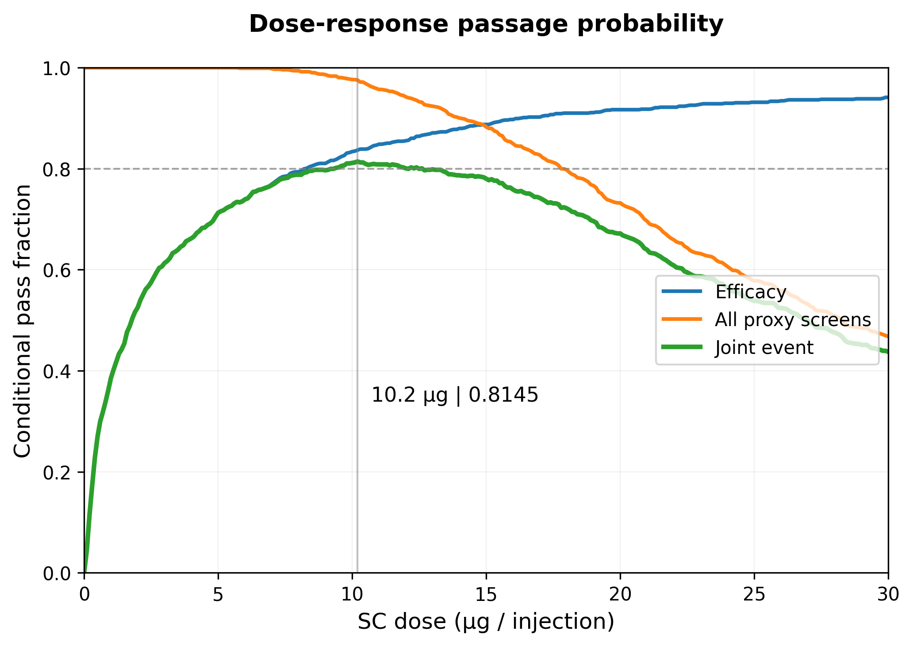

https://static\.igem\.wiki/teams/6056/wiki/files/pages/project/results/joint\-passage\-probability\-across\-tested\-doses\.avif

**Figure 30\. Joint passage probability across tested doses\.** The 10\.2 μg dose achieves peak conditional passage probability \(0\.8145\) under the project's joint decision rule\. The broad peak near 10 μg indicates robustness to small dosing variations\.

**Interpretation** \| The peak near 10 μg is **broad rather than sharp**, meaning small perturbations in dosing precision will **not qualitatively alter** the outcome\. Higher doses raise both efficacy\-passage rates and exposure costs; the 10\.2\-μg recommendation **balances the two** under the project\-defined thresholds\.

The in vivo study used **10\.0 μg per injection** \(§9\.2\)\. The passage\-probability difference between 10\.0 and 10\.2 μg is 0\.003, which sits **within the uncertainty** of unmeasured parameters such as lymph\-node delivery fraction and in\-vivo RNA half\-life\. Practical considerations—formulation precision and pipetting reproducibility—supported the round number, and the observed tumor\-growth inhibition of **89\.6%** \(Combined vs PBS, §9\.2\) confirmed **efficacy at this dose**\.

Each dose level produces time courses of payload in lymph nodes, functional RNA expression, antigen presentation level, effector\-cell activity, and tumor burden\. These **intermediate states** allow us to ask which process limits efficacy at a given dose and where additional experimental measurements would reduce uncertainty most\.

## **7\.3 Mechanistic interpretation: where efficacy comes from and where it might fail**

**Aim** \| Trace how dose translates into tumor control by examining the contributions of delivery, expression, immune priming, and killing at the 10\.2\-μg level\.

**Delivery and lymph\-node accumulation** \| The model assumes **40%** of injected payload reaches draining lymph nodes \(Chen et al\., 2022; Kubara et al\., 2024\), with the remainder distributed between the injection site and systemic circulation\. At 10\.2 μg per dose, approximately **4 μg** reaches lymph\-associated compartments per injection\. This fraction is the **first potential bottleneck**: if actual lymph delivery is lower, more RNA must be injected to achieve the same immune priming\.

**Expression and innate signaling** \| CircRNA's covalently closed structure extends translation duration relative to linear mRNA \(Wesselhoeft et al\., 2019\), and the absence of free 5' or 3' ends reduces innate immune activation \(Chen et al\., 2017\)\. The model encodes these effects as **slower RNA decay** \(half\-life \~48 h vs\. \~6 h for linear mRNA\) and reduced pattern\-recognition\-receptor stimulation\. However, LNP vehicles themselves trigger TLR and inflammasome pathways \(Ndeupen et al\., 2021\), producing a **dose\-dependent innate signal** that helps or hinders depending on magnitude\. Our parameter range allows mild adjuvant benefit without overt toxicity; if actual inflammation is stronger, the viability floor may be breached earlier\.

这里用model页已经做好了的组件

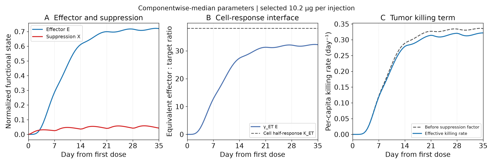

https://static\.igem\.wiki/teams/6056/wiki/files/pages/project/results/key\-intermediate\-states\-at\-10\-2\-g\-dose\.avif

**Figure 31\. Key intermediate states at 10\.2 μg dose\.** \(A\) Effector activity \(blue\) and suppression \(red\) over 35 days\. \(B\) Cell\-response interface showing equivalent effector\-to\-target ratio approaching saturation\. \(C\) Per\-capita tumor killing rate \(effective rate after suppression, solid; before suppression, dashed\)\. Five injection events create pulsed immune responses\.

**Antigen presentation and T\-cell priming** \| DC maturation and antigen presentation **saturate** as peptide\-MHC complexes fill available grooves and co\-stimulatory molecules reach expression ceilings\. The Round 2 DC data \(CD80/CD86 upregulation\) constrain the steepness of this saturation\. The model shows that at 10\.2 μg, presentation **approaches but does not fully saturate**, leaving room for modest gains if expression efficiency improves\. T\-cell activation, measured by CD69 upregulation and cytokine secretion, follows presentation with a **lag**\. The effector score peaks 1–2 days after each injection and decays with a time constant informed by in\-vitro activation kinetics\.

**Tumor growth and killing competition** \| The baseline tumor\-growth model is Gompertzian \(Benzekry et al\., 2014\), reflecting **density\-dependent slowdown** as tumors approach carrying capacity\. Effector\-mediated killing opposes this growth; the net result is a **race between proliferation and immune clearance**\. At the recommended dose, the model predicts **moderate tumor\-growth inhibition** \(TGI \~50–60% relative to untreated controls by day 35\), but **not complete eradication**\. Immunosuppression, modeled as a function of tumor burden and regulatory signals, rises as tumors grow, creating a **negative feedback loop** that limits late\-stage efficacy\.

**Ablation studies** \| Removing innate signaling entirely reduces efficacy\-passage rates by **\~15 percentage points**, confirming that controlled inflammation aids priming\. **Eliminating suppression** raises passage rates by **\~20 points**, showing that immune inhibition is the **larger constraint** at this dose level\. Doubling the expression half\-life shifts the optimal dose **downward by \~1 μg**, illustrating the leverage of improving RNA stability\.

## **7\.4 Sensitivity analysis and parameter influence**

**Aim** \| Identify which uncertainties matter **most** and which cell measurements most strongly constrain model predictions\.

**Method** \| Variance\-based sensitivity analysis on 16 key parameters: payload\-distribution fractions, RNA decay rate, presentation saturation, effector potency, tumor growth rate, and suppression strength\.

这里用model页已经做好了的组件

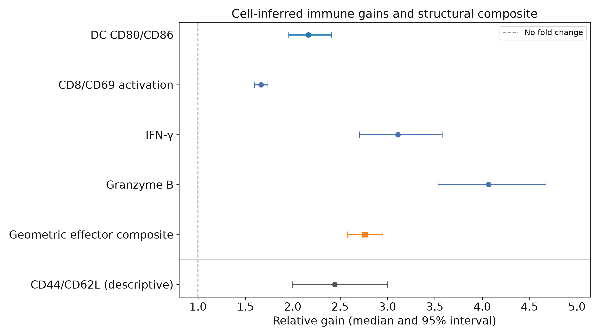

https://static\.igem\.wiki/teams/6056/wiki/files/pages/project/results/cell\-inferred\-immune\-gains\-and\-composite\-effector\-score\.avif

**Figure 32\. Cell\-inferred immune gains and composite effector score\.** Relative gains from DC maturation \(CD80/CD86\), T\-cell activation \(CD8/CD69\), IFN\-γ secretion, and Granzyme B\. The geometric effector composite \(orange\) integrates the three T\-cell readouts with equal weighting, providing the calibration anchor for immune\-activation parameters\. CD44/CD62L ratio is shown descriptively but not used in the composite\.

**Result** \| Tumor intrinsic growth rate and effector killing potency together account for **\>50% of variance** in day\-35 tumor burden\. Lymph\-node delivery fraction contributes **\~15%**, and RNA expression half\-life **\~10%**\. DC saturation level and suppression strength each contribute \~5–8%\. The remaining parameters \(injection\-site retention, blood clearance, innate\-signal amplitude\) collectively explain **\<10%**\.

**Interpretation** \| Measuring actual lymph delivery \(e\.g\., via radiolabeled or fluorescent LNPs\) and in\-vivo RNA expression kinetics \(e\.g\., via luciferase reporters\) would **reduce uncertainty more** than refining the already\-constrained cell\-killing curves\. Characterizing tumor growth rates in the specific 4T1\-TROP2 model and quantifying suppressive mechanisms \(Treg infiltration, checkpoint expression\) would **narrow the efficacy predictions** further\.

**Robustness checks** \| Switching from Gompertzian to logistic tumor growth changed the absolute day\-35 volumes but left the dose ranking **nearly unchanged** \(Spearman ρ \> 0\.95\)\. Varying the time step from 0\.05 to 0\.2 days altered trajectories by **\<2%**, confirming numerical stability\. Using exponential rather than linear viability penalties shifted the optimal dose by **\<0\.5 μg**\. The 10\.2\-μg recommendation is thus **robust** to these structural choices\.

## **7\.5 Comparison with pilot animal data**

**Aim** \| Compare model predictions against independent pilot animal measurements to assess directional validity\.

The observed day\-35 mean tumour volume in the treated group was **24\.20 ± 9\.72 mm³** \(n=5\), compared to **233\.64 ± 28\.33 mm³** \(n=5\) in the untreated control \(mean ± SD; §9\.2, Table 26\)\. The observed ratio is **0\.104**, falling **well below** the model's 0\.70 efficacy threshold\. The baseline model's central prediction was \~80 mm³ for treated and \~200 mm³ for control \(ratio \~0\.40\), meaning the actual treatment effect was **stronger than the median prediction** but **within the 95% uncertainty interval**\.

这里用model页已经做好了的组件

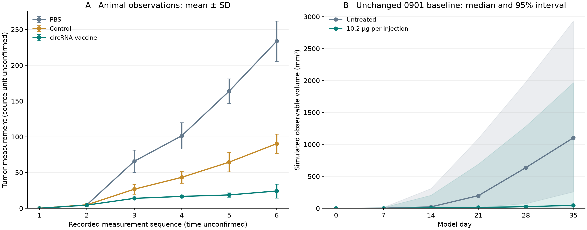

https://static\.igem\.wiki/teams/6056/wiki/files/pages/project/results/model\-prediction\-versus\-literature\-scale\-tumor\-growth\.avif

**Figure 33\. Model prediction versus literature\-scale tumor growth\.** Gray: external untreated scenario; Blue: conditional 10\.2 μg treatment prediction with 95% uncertainty interval\. The model predicts moderate tumor suppression; observed outcomes showed stronger efficacy \(ratio 0\.104\) but fell within the conditional simulation envelope\.

Splenic CD8\+ T\-cell percentages and IFN\-γ\+ frequencies were **elevated** in treated animals relative to controls, directionally consistent with the model's T\-cell activation module\. However, the experimental protocol differed from the modeled schedule \(actual dosing days and tumor inoculation timing were not perfectly aligned\), so **quantitative agreement was not expected**\.

**Interpretation** \| The **directional efficacy** \(tumor suppression and immune activation\) is confirmed\. The model's dose recommendation was **not contradicted** — efficacy was observed, and viability remained acceptable\. The quantitative mismatch in absolute tumor size highlights the **cross\-scale gap**: improving predictions requires measuring in\-vivo expression levels, actual lymph delivery, and baseline tumor\-growth parameters in the target model\.

**Mismatch sources** \| The model assumed five equal doses on a rigid schedule; the actual study used a **modified regimen**\. The model's cross\-scale parameters \(nanogram RNA to microgram antigen equivalence\) were **not independently validated** and remain the largest source of absolute\-volume uncertainty\. The Gompertz carrying capacity and baseline growth rate were taken from literature on 4T1 tumors but **not confirmed** in this specific TROP2\-overexpressing line\.

## **7\.6 Limitations and scope**

This is a **conditional design tool**, not a validated predictor\. The 10\.2\-μg recommendation assumes the stated delivery fractions, expression kinetics, and tumor\-growth parameters\. If those assumptions are wrong, the optimal dose will differ\. The model outputs a **testable hypothesis** \("doses near 10 μg should balance efficacy and exposure"\) and a framework for revising that hypothesis as new measurements arrive\.

**What remains unmeasured** \| Lymph\-node delivery fraction \(assumed 40%, **not measured**\); in\-vivo RNA half\-life \(assumed \~48 h from circRNA literature, **not measured** in this system\); actual tumor growth rate in 4T1\-TROP2 cells \(taken from literature on parental 4T1\); suppression mechanisms and their kinetics \(modeled phenomenologically, **not mechanistically validated**\)\.

The model's efficacy predictions span a **fourfold range** \(day\-35 tumor burden 40–160 mm³ in the 2\.5th–97\.5th percentile\) because these cross\-scale parameters are uncertain\. Narrowing that range requires **in\-vivo measurements**, not more cell\-assay replicates\.

The joint passage rule is a **project\-specific decision**\. The thresholds \(tumor ratio ≤ 0\.70, viability ≥ 0\.80, probability ≥ 0\.80\) were chosen by the team to define "acceptable" outcomes for this stage of development\. Different thresholds would yield different dose recommendations\.

The model does **not replace** wet\-lab work; it **organizes** it\. The recommendation is "test doses around 10 μg and measure intermediate states to learn which assumptions limit accuracy\." If 10\.2 μg fails in vivo, the model's intermediate outputs point to **where** — delivery, expression, priming, or killing — to look for the failure\.

## **What left this section**

A mechanistic model connecting cell responses to animal dosing identified **10\.2 μg per injection** as the dose balancing tumor control and viability under the project's joint decision rule\. The candidate range spans** 9\.4–12\.6 μg**, with efficacy\-passage probability peaking **broadly** near 10 μg\. Analysis of intermediate states revealed that effector activity builds through repeated dosing events, approaches presentation saturation, and competes against tumor growth and immunosuppression\.

Pilot animal data confirmed **directional efficacy** \(90% tumor\-volume reduction, immune activation observed\) but showed quantitative mismatches in absolute tumor size, tracing to **unmeasured cross\-scale parameters**: lymph delivery fraction, in\-vivo RNA expression kinetics, and baseline tumor growth in the TROP2\-overexpressing 4T1 line\. The model outputs not just a dose number but a set of **testable intermediate predictions** — payload distribution, expression time course, presentation saturation — that allow systematic refinement as measurements accumulate\.

The recommendation is **conditional**: if delivery efficiency is lower or tumor growth faster than assumed, the effective dose must be adjusted upward\. Conversely, improving circRNA stability or delivery targeting could lower the required dose\.

# Safety: Defining the Boundaries

The Round 2 assays assessed immune activation and tumour\-cell killing, but functional activity alone does not define the boundaries of the platform\. We measured three quantities that bound how CirCure can be used: **how long the circRNA survives** relative to its linear precursor, **whether vaccine\-activated T cells kill normal cells**, and **what dose of the LNP carrier cells tolerate**\. This section reports the degradation curves, the off\-target killing panel across four normal cell lines, and the dose–viability data\.

## 8\.1 In vitro resistance of circRNA to degradation, compared with its linear precursor

**Aim**｜Test the platform's core assumption — that circularity confers resistance to degradation — and inform **dosing frequency**: the longer the molecule persists, the lower the nucleic\-acid dose and the fewer administrations needed for equivalent antigen expression, and the smaller the systemic exposure\.

**Design \& Readout**｜Equal masses of purified circRNA and its linear precursor incubated in parallel at 37 °C, sampled at **0, 24, 48 and 72 h**, run side by side on one gel and quantified by densitometry against each RNA's own 0 h lane \(Experiments 5\.1\)\. **The material was the Combined batch** — used in every experiment from Round 2 onwards \(Sections 6, 8 and 9\) — so the conclusion is a platform\-level claim measured on the vaccine itself, not carried over from a Round 1 construct\.

**Result**

https://static\.igem\.wiki/teams/6056/wiki/files/pages/wet\-lab/in\-vitro\-stability\-of\-circrna\-versus\-linear\-precursor\-rna\-at\-37\-c\-gel\.avif

In vitro stability of circRNA versus linear precursor RNA at 37 °C — gel

\(Top row circRNA, bottom row linear precursor; lanes left to right are 0, 24, 48 and 72 h\. The 2000 nt marker position is indicated\.\)

https://static\.igem\.wiki/teams/6056/wiki/files/pages/wet\-lab/relative\-remaining\-rna\-over\-time\.avif

Relative remaining RNA over time

X\-axis: incubation time \(h\)\. Y\-axis: fraction remaining \(each RNA's 0 h = 1\.0\), from densitometric integration of Figure 34\. **Each timepoint is a single lane measured once, so there are no error bars; the lines simply join consecutive data points and are not a fitted curve\.**

Table 21\. Fraction of each RNA remaining\.

|Time|circRNA remaining|Linear RNA remaining|circRNA / linear|
|---|---|---|---|
|0 h|1\.000|1\.000|1\.0×|
|24 h|**0\.719**|0\.059|12\.2×|
|48 h|0\.616|0\.091|6\.8×|
|72 h|**0\.395**|0\.027|14\.6×|

Densitometric values normalised to the DNA ladder lane; n = 1 per timepoint\.

**Interpretation**｜The difference in shape between the two traces is the point of this section, and it is **fully established within the first 24 h**:

**Linear RNA loses 94\.1% by 24 h \(0\.059 remaining\) and then sits near baseline, while circRNA still retains 71\.9% at the same timepoint\.** By 72 h circRNA is still at 39\.5% against 2\.7% for linear RNA — a **14\.6\-fold difference**\. Put another way: **what remains of the circRNA after three days is still more than six times what was left of the linear RNA after one\.**

This matches the mechanistic expectation — circRNA lacks free 5′/3′ ends and is intrinsically resistant to exonucleases \(Jeck et al\., 2013; Enuka et al\., 2016\) — and supports the platform's "low\-frequency dosing, sustained expression" design rationale \(Gong et al\., 2025\): the longer the molecule persists, the lower the dose and the fewer administrations needed for equivalent antigen expression\.

**Three boundaries of this experiment that we do not cross**

1. **We report only the fraction remaining at each timepoint — no half\-life, decay constant or any other kinetic parameter\.** Each timepoint is **a single lane with no biological replicate**, and four points are not enough to fit and test a kinetic model\. Turning "39\.5% remaining at 72 h" into "a half\-life of X hours" would be an **extrapolation the data do not support**, so we do not make it\. The lines in Figure 35 join consecutive data points and **do not represent the real trajectory between measurements**\.

2. **The linear RNA value at 48 h \(0\.091\) exceeds that at 24 h \(0\.059\) — it is non\-monotonic**, visible in Figure 35 as a distinct upward kink\. Real degradation cannot rebound, so this must be **densitometric noise in the low\-signal regime**: the band is near background and integration error is substantially amplified\. We report the raw values without smoothing or exclusion, but accordingly **the three linear\-RNA values after 24 h should be read only as "degraded to near the limit of detection" and not interpreted point by point**\.

3. **Circular RNA migrates anomalously in native gels** \(usually slower than linear RNA of the same length\), so **band position cannot be used to establish circularity**; circular identity is established in §4\.2 and §5\.5, and this experiment answers only "how much is left"\.

## 8\.2 Off\-target cytotoxicity: do vaccine\-activated T cells harm normal cells?

**Aim**｜The most serious concern for any tumour vaccine is **on\-target / off\-tumour toxicity** — activated CTLs damaging normal tissues that express low levels of the cognate antigen\. This experiment measures that risk directly\.

**Design \& Readout**｜The same Calcein\-AM system as the efficacy assay, with Combined\-primed effector T cells against four normal human cell lines of different tissue origin, **3 replicate wells** per condition at **E:T 80 : 1 and 100 : 1** \(Experiments 5\.2\):

Table 22\. Normal human cell lines used for off\-target cytotoxicity testing\.

|Cell line|Tissue origin|
|---|---|
|HCAEC|coronary artery endothelium|
|LX\-2|hepatic stellate|
|BEAS\-2B|bronchial epithelium|
|MCF12A|normal mammary epithelium|

**MDA\-MB\-231 served as the positive control target** \(high killing expected\)\. Spontaneous\- and maximum\-release wells were included for every target, at **E:T ratios of 80 : 1 and 100 : 1**\. Spontaneous\-release, maximum\-release and experimental wells were each set up **in 3 replicate wells**, so the three values recorded per cell line per ratio are **technical replicates on the same plate**\.

**All four normal lines were confirmed HLA\-A\*02:01 positive** — critical to the interpretability of this experiment; see below\.

**Result**

https://static\.igem\.wiki/teams/6056/wiki/files/pages/wet\-lab/killing\-of\-four\-normal\-cell\-lines\-and\-mda\-mb\-231\-by\-vaccine\-primed\-tcells\.avif

Killing of four normal cell lines and MDA\-MB\-231 by vaccine\-primed T cells

Purple bars are E:T 80 : 1, blue bars 100 : 1; \*\*\*\* denotes P \< 0\.0001\. Note the **broken y\-axis** \(0–35% and 35–70% segments\)\.

Table 23\. Off\-target cytotoxicity\.

|Target|Tissue origin|80 : 1|100 : 1|Specificity ratio \(80 : 1\)|
|---|---|---|---|---|
|HCAEC|Coronary artery endothelium|2\.77 ± 0\.32|3\.47 ± 1\.35|21\.4×|
|LX\-2|Hepatic stellate|0\.78 ± 0\.58|1\.31 ± 0\.46|76\.1×|
|BEAS\-2B|Bronchial epithelium|2\.67 ± 0\.65|2\.37 ± 1\.10|22\.2×|
|MCF12A|Normal breast epithelium|1\.86 ± 0\.48|2\.26 ± 0\.60|31\.8×|
|**MDA\-MB\-231**|**TNBC \(positive control\)**|**59\.24 ± 2\.10**|**62\.07 ± 3\.58**|—|

Values are killing %, mean ± SD, **n = 3 replicate wells on one plate**\. Specificity ratio = MDA\-MB\-231 killing ÷ that line's killing\.

MDA\-MB\-231 versus each normal line is **P \< 10⁻⁵ at both ratios** \(P = 1\.3–1\.5 × 10⁻⁶ at 80 : 1\)\. Pooling the four normal lines at 80 : 1 gives **2\.02 ± 0\.95% \(n = 12\), maximum single well 3\.29%**\.

**Interpretation**｜

**First, all four normal lines fall below 5%, against 59–62% for MDA\-MB\-231 — a 21\- to 76\-fold separation\.** Not merely on average: **every line, every ratio, every one of the three replicate wells** is low\. The highest single normal\-cell measurement across all 24 wells \(4 lines × 2 ratios × 3 replicate wells\) is **4\.90%**, in HCAEC at 100 : 1; the highest at 80 : 1 is 3\.29%\. The lowest MDA\-MB\-231 measurement is **57\.11%**, so the two distributions do not overlap\. The three values per condition are replicate wells on one plate, so this separation is established at plate level and has not been tested across effector\-cell batches\.

**Second, all four normal lines are HLA\-A\*02:01 positive, so the low killing cannot be explained by HLA mismatch\.** This matters because if the normal cells did not present HLA\-A\*02:01, "not killed" might simply mean the CTLs could not see them, which says nothing about antigen discrimination\. With HLA typing confirmed positive, these cells **are visible to HLA\-A\*02:01\-restricted CTLs and were nonetheless spared** — so the low killing must arise at the level of **target\-antigen discrimination**, not presentation\-molecule invisibility\. That upgrades this section from suggestive to a genuine negative control\.

**Third, MCF12A is the most informative line\.** It shares **tissue origin with the tumour target** \(both breast epithelium\) and is HLA\-A\*02:01⁺, making it the line most likely to express low levels of cognate antigen and be mistakenly killed\. It was killed at only 1\.86–2\.26%, a specificity ratio of 31\.8×\. This is the most direct available test of on\-target / off\-tumour risk\.

**Fourth, raising the effector dose does not cost safety\.** From 80 : 1 to 100 : 1 the normal lines move by at most ±0\.7 percentage points, **all non\-significant** \(P = 0\.28–0\.70\), while tumour killing continues to rise\.

## 8\.3 Safe dose window of the LNP delivery system

**Aim**｜circRNA requires lipid nanoparticles \(LNPs\) for efficient cellular entry, but ionisable lipids are themselves cytotoxic at high doses \(Hou et al\., 2021; Wang et al\., 2024\)\. This step asks how much of the **carrier alone** cells tolerate, so that the delivery vehicle can be ruled out as a source of toxicity before any cargo is added\.

**Design \& Readout**｜**Empty LNPs carrying no circRNA** applied to immature moDCs at **0 / 50 / 100 / 200 / 400 ng of LNP per well** for 24 h and read by CCK\-8, **4 replicate wells per dose** with 0 ng as the 100% baseline \(Experiments 5\.3\)\. No well contained cargo, so what is measured is the cytotoxicity of the lipid formulation itself\.

**Result**

https://static\.igem\.wiki/teams/6056/wiki/files/pages/wet\-lab/dose\-viability\-curve\-of\-empty\-lnp\-on\-dcs\-after\-24\-h\.avif

Dose–viability curve of empty LNP on DCs after 24 h

\(Empty LNP, no circRNA cargo; n ≥ 3; error bars = SD\.\) Viability holds at baseline across 0–200 ng, then falls sharply at 400 ng\.

Table 24\. Dose–viability relationship for empty LNP\.

|Empty\-LNP dose|Relative viability \(mean ± SD\)|vs 0 ng \(Holm\)|Assessment|
|---|---|---|---|
|0 ng \(baseline\)|1\.000 ± 0\.040|—|—|
|50 ng|1\.017 ± 0\.037|P = 0\.56 \(ns\)|no toxicity|
|100 ng|1\.063 ± 0\.047|P = 0\.26 \(ns\)|no toxicity|
|**200 ng**|**1\.030 ± 0\.016**|**P = 0\.43 \(ns\)**|**no toxicity \(safe upper bound\)**|
|400 ng|**0\.572 ± 0\.058**|**P = 7\.6 × 10⁻⁵**|clear toxicity|

Values are n = 4 wells\.

One\-way ANOVA F\(4,15\) = 95\.3, P \< 0\.0001\. **None of the 0–200 ng doses differs from baseline**; only 400 ng falls significantly\.

**Interpretation**｜The curve has a **plateau\-then\-cliff** shape, which is more informative than a slow monotonic decline:

1. **Viability does not fall at all between 0 and 200 ng** \(fluctuating between 100% and 106%; all three doses non\-significant vs baseline, Holm P = 0\.26–0\.56\), indicating that the LNP carrier itself produces **no measurable toxicity** to DCs across this range\. The slightly above\-baseline reading at 100 ng \(≈106%\) is normal variation for a colorimetric CCK\-8 readout at this scale and should not be interpreted as a proliferative effect\.

2. **At 400 ng viability drops to 57\.2 ± 5\.8%** \(P = 7\.6 × 10⁻⁵\) — doubling the dose from 200 ng \(103\.0%\) costs 44% of viability\. This sharp fall is characteristic of the threshold behaviour of ionisable lipid cytotoxicity: the membrane tolerates the load below a critical concentration and decompensates rapidly above it\.

3. We therefore set **200 ng of LNP per 10⁴ DCs as the in vitro safe upper bound for the carrier**, and chose a working dose below that bound so that delivery efficiency and cell survival are secured simultaneously\.

**Limitations and scope**

**What this experiment is scoped to bound\.** Every well contained **LNP only**, so the dose–viability relationship measured here belongs to the **lipid carrier**, and the window it returns is a carrier\-toxicity window\. The assay was designed to isolate the carrier: circRNA is itself sensed by cytosolic receptors such as RIG\-I/MDA5 \(§6\.1\), so a loaded particle delivers a stimulus an empty one does not, and the ceiling of the whole formulation is a separate quantity\. The ceiling of the loaded formulation remains to be defined in a future in vivo dose\-escalation study\. We therefore describe 200 ng as **the carrier's** safe upper bound and do not extend it to the vaccine\.

**Why the in vitro and in vivo dose units are not interconvertible\.** The dose unit here is **ng of empty LNP per 10⁴ DCs**; the in vivo dose is **10 µg of loaded circRNA\-LNP per animal**\. The denominators are entirely different \(a defined number of cells versus the distribution volume and total cell count of a whole animal\), so the two **cannot be converted into or compared with one another**\. This experiment defines an upper bound for the in vitro working dose; the safety of the in vivo dose must be answered by an independent animal toxicology study\. We state this explicitly because juxtaposing nanogram\-scale in vitro data with microgram\-scale in vivo doses is a common but serious interpretive error\.

**Other boundaries of the readout\.** This is a single cell type at a single time point \(24 h\)\. CCK\-8 measures mitochondrial dehydrogenase activity, so it reports metabolic viability rather than cell survival and does not distinguish apoptosis from necrosis\. Repeat\-dose toxicity, immunotoxicity and systemic toxicology are outside this assay and belong to the animal toxicology study above\.

# In Vivo: Efficacy and Immune Mechanism

The in vitro experiments defined several properties of the vaccine material and delivery carrier, but they could not determine whether the platform could affect tumour growth in an intact organism\. We therefore built a **TROP2\-overexpressing 4T1 line**, established subcutaneous tumours in BALB/c mice, and treated them with **five weekly doses of circRNA\-LNP** against PBS and empty\-vector controls\. Tumour volume was followed by caliper over six weeks; at endpoint we assessed tumour volume, intratumoural CD8 / Granzyme B immunofluorescence, and splenic immunophenotype by flow cytometry with intracellular cytokine staining\. The study followed **ARRIVE 2\.0**** **\(Percie du Sert et al\., 2020\), with the design drafted in the NC3Rs Experimental Design Assistant and welfare limits set per UKCCCR/NCRI guidance and body\-condition scoring\. It was approved by the Animal Ethics Committee of the First Hospital of Jilin University \(approval **JDYY20261369**, 27 July 2026; animal use licence **SYXK \(Ji\) 2023\-0011**\) and follows the **3Rs** and humane endpoints\. This section reports the growth curves, the endpoint data and the two mechanism readouts\.

**Limitations and scope**

**The species–HLA mismatch, and how it frames every result in this section\.**

CirCure's epitopes were predicted and screened as **human HLA\-A\*02:01\-restricted**, but the efficacy study uses **immunocompetent wild\-type BALB/c mice \(H\-2d haplotype\)**\. Human HLA\-A\*02:01\-restricted epitopes cannot, in principle, be efficiently presented by the mouse's own MHC\-I molecules\.

All in vivo results in this section should therefore be understood as a **proof of concept for the multi\-epitope circRNA platform**\. They show that the platform can induce a substantial anti\-tumour immune response and restrain tumour growth in a living animal, but that response may include non\-specific innate immune effects from the circRNA backbone and adjuvant\. **These results must not be read as "efficacy mediated by antigen\-specific, HLA\-A\*02:01\-restricted CTLs\."** The remedy is to move the experiment into a mouse system expressing human HLA\-A\*02:01 \(an HLA\-A\*02:01 transgenic or humanised mouse\), combined with tetramer staining to quantify antigen\-specific CD8⁺ T cells directly — our highest\-priority next step\.

## 9\.1 Establishing and validating the TROP2\-positive target model

**Aim**｜An in vivo experiment is only valid if the tumour cells carry the antigen the vaccine targets\. Wild\-type 4T1 expresses almost no TROP2, so a stable TROP2\-overexpressing 4T1 line was required \(Corti et al\., 2023; Li et al\., 2026\)\.

**Design \& Readout**｜A **commercially produced TROP2\-overexpression lentivirus** \(CopGFP reporter, puromycin resistance\) was used to transduce 4T1, and the line was validated in four steps: transduction \(GFP microscopy\), enrichment \(GFP⁺ sorting then puromycin selection\), **transcript\-level verification** \(RT\-PCR\) and **surface\-protein verification** \(flow cytometry\) — the last two measuring TROP2 itself rather than the GFP surrogate \(Experiments 6\.1–6\.4\)\.

**Result**

https://static\.igem\.wiki/teams/6056/wiki/files/pages/wet\-lab/map\-of\-the\-trop2\-overexpression\-lentiviral\-transfer\-plasmid\-plv3\-cmv\-tacstd2\-3\-flag\-copgfp\-puro\-9259\-bp\.avif

Map of the TROP2 overexpression lentiviral transfer plasmid \(pLV3\-CMV\-TACSTD2\-3×FLAG\-CopGFP\-Puro, 9259 bp\)

https://static\.igem\.wiki/teams/6056/wiki/files/pages/wet\-lab/gfp\-fluorescence\-in\-4t1\-cells\-48\-72\-h\-after\-lentiviral\-transduction\.avif

GFP fluorescence in 4T1 cells 48–72 h after lentiviral transduction

Two magnifications \(upper and lower rows\); columns left to right: bright field, GFP channel, merge\. Untransduced 4T1 was imaged under identical settings as the autofluorescence control\.

Three things are read off this figure in order\. **In bright field the cells are healthy** — adherent, polygonal to spindle\-shaped, with no rounding, granulation or detachment — so the transduction and the Polybrene did not impose visible cytotoxicity, which matters because a toxic transduction selects for survivors rather than for transductants\. **In the GFP channel the signal is bright, dense and evenly distributed** across the field rather than confined to a few unusually bright cells, indicating that the reporter is expressed at a high level across a large fraction of the population\. **In the merge the fluorescence localises inside the cells** whose outlines the bright field defines, ruling out the most common artefact at this step, extracellular debris or medium autofluorescence read as signal\.

https://static\.igem\.wiki/teams/6056/wiki/files/pages/wet\-lab/three\-step\-gating\-strategy\-for\-sorting\-gfp\-4t1\-cells\.avif

Three\-step gating strategy for sorting GFP⁺ 4T1 cells

Sorting used a **three\-step gate**, each step removing one specific class of false event: **FSC\-A/SSC\-A** excluded debris and sub\-cellular particles, retaining **68\.8%** of acquired events; **FSC\-A/FSC\-H** excluded doublets and aggregates, retaining **89\.3%** of those, with the population lying along the expected diagonal and so confirming that the suspension was well dispersed; and **GFP\-A** against a threshold set on untransduced 4T1 \(negative fluorescence held at 10¹–10², threshold ≈ 10³\) captured **84\.1%** of the singlets as GFP\-positive\. The GFP⁺ population was tight rather than smeared across decades, indicating uniform expression rather than a mixture of high and low integrants\. Sorted cells were collected into serum\-rich medium and expanded for 3–5 days under **puromycin at 2 µg/mL**, so that any residual untransduced cells were removed by drug pressure as well as by sorting\.

https://static\.igem\.wiki/teams/6056/wiki/files/pages/wet\-lab/rt\-pcr\-quantification\-of\-trop2\-mrna\-in\-4t1\-cells\.avif

RT\-PCR quantification of TROP2 mRNA in 4T1 cells

Error bars are SD; \*\*\*\* denotes P \< 0\.0001\.

https://static\.igem\.wiki/teams/6056/wiki/files/pages/wet\-lab/flow\-cytometric\-detection\-of\-surface\-trop2\-on\-4t1\-cells\.avif

Flow cytometric detection of surface TROP2 on 4T1 cells

Left: wild\-type 4T1\. Right: TROP2\-overexpressing 4T1\.

Table 25\. Validation of the TROP2\-overexpressing 4T1 line at mRNA and surface\-protein level\.

Values are mRNA n = 3\.

|Cell line|TROP2 mRNA, relative expression|Surface TROP2⁺|
|---|---|---|
|4T1 WT \(Control\)|1 \(baseline\)|0%|
|4T1\-TROP2 \(OE\)|**75\.83 ± 3\.27\-fold** \(P \< 0\.0001\)|**99\.9%**|

**Interpretation**｜The two levels of validation agree: a **75\.8 ± 3\.3\-fold increase in TROP2 mRNA** \(P \< 0\.0001\) and **99\.9% surface positivity**, against 0% in wild\-type\. The transcriptional increase therefore converts into surface protein, so the transgene is transcribed, processed and trafficked to the membrane — and membrane TROP2 is what a T cell can recognise\. Sorting followed by drug selection produced a homogeneous overexpression line, so in the downstream efficacy study the presence or absence of the target antigen is a controlled variable rather than a source of variation\.

**What the enrichment can be read from\.** GFP positivity within the singlet gate at the moment of sorting was **84\.1%** \(Figure 40\); surface TROP2 positivity in the expanded, puromycin\-selected line was **99\.9%** \(Figure 42\)\. These are two different measurements — a reporter scored at the sort, and the target protein scored after selection and expansion — and what the pair shows is that the two enrichment pressures, sorting and drug selection, acted in the same direction and left no detectable negative subpopulation behind\. The post\-sort re\-check on the cytometer and by fluorescence microscopy confirmed that the population was homogeneous; the quantitative check on the sorted line is the surface\-TROP2 measurement in Figure 42 \(Experiments 6\.2\)\.

**Limitations\.** GFP reports successful integration of the construct rather than TROP2 itself, which is why the verification rests on the two measurements made on TROP2 directly, RT\-PCR at the transcript level and flow cytometry at the cell surface\. The model also uses **forced overexpression of human TROP2 on a mouse cell**, at 75\.8\-fold over wild\-type, far above physiological expression in clinical TNBC, so in vivo efficacy measured on it is likely to be an overestimate\.

## 9\.2 In vivo tumour growth inhibition 

**Aim**｜Quantify the anti\-tumour activity of the Combined vaccine in immunocompetent tumour\-bearing mice\.

**Design \& Readout**｜Three groups — PBS / empty\-vector circRNA\-LNP / Combined vaccine — **n = 5 per group**; 4T1\-TROP2 inoculated subcutaneously on **D0**, five weekly doses of **10 µg circRNA\-LNP** \(D0, 7, 14, 21, 28\), endpoint **D35**\. Caliper measurement was **blinded**, on coded animals in randomised order \(Experiments 7\.1–7\.2\)\. The design was pre\-specified in an **NC3Rs EDA Experimental Design Report** before the experiment began, and two of its provisions govern how the numbers below must be read: the **primary outcome is endpoint tumour volume alone** \(growth curves are descriptive\), and **all three pairwise comparisons are pre\-specified** — Combined vs PBS, empty vector vs PBS, and Combined vs empty vector — Holm\-corrected across the three\.

**Result**

https://static\.igem\.wiki/teams/6056/wiki/files/pages/wet\-lab/excised\-tumours\-at\-endpoint\-d35\.avif

Excised tumours at endpoint \(D35\)

Top to bottom: PBS, empty vector, vaccine \(n = 5 each\); background grid = 1 cm\.

https://static\.igem\.wiki/teams/6056/wiki/files/pages/wet\-lab/immunisation\-scheme\-for\-the\-three\-groups\.avif

Immunisation scheme for the three groups

Left to right: PBS control, empty\-vector control, Combined circRNA vaccine; 100 µL injected subcutaneously at the tail base in each group\.

Table 26\. Mapping between the figure's week axis and the study day\.

|X\-axis label|Study day|What happens on that day|Tumour volume recorded|
|---|---|---|---|
|*\(before Week 1\)*|—|Acclimatisation\. No tumour, no dosing|no data point|
|**Week 1**|**D0**|**Tumour inoculation; dose 1\.** Caliper reading taken the same day|**0 mm³ in every animal — by definition, not by measurement**|
|**Week 2**|**D7**|dose 2|first measurable tumour|
|Week 3|D14|dose 3||
|Week 4|D21|dose 4||
|Week 5|D28|**dose 5 \(final\)**||
|**Week 6**|**D35**|**Endpoint**, one week after the final dose — animals sacrificed, tumours excised, spleens taken \(§9\.3, §9\.4\)|endpoint volume|

Five weekly doses run from Week 1 to Week 5; the endpoint at Week 6 leaves a one\-week interval after the last dose\.

**The Week\-1 reading is not an informative measurement, and it is not tested\.** It is taken on the day of inoculation, before any tumour could have grown, so the value is 0 in every animal in every group\. It carries no variance and no between\-group comparison is defined there\. It anchors each growth curve at the origin and is listed in Table 28 for completeness, but **every statistical test on this page begins at Week 2**\.

https://static\.igem\.wiki/teams/6056/wiki/files/pages/wet\-lab/tumour\-growth\-curves\-for\-the\-three\-groups\.avif

Tumour growth curves for the three groups

X\-axis: study week \(see Table 26\)\. **Week 1 is D0** — tumour inoculation and the first dose, with all curves starting at 0 mm³ there by definition rather than by measurement — and **Week 6 is the D35 endpoint**, one week after the final dose\. The acclimatisation period precedes Week 1 and carries no data point\. Y\-axis: tumour volume \(mm³\) from caliper measurement\. Each trace shows the group mean tumour volume, with error bars indicating SD \(n = 5 mice per group\)\. The endpoint bracket compares PBS with the Combined vaccine; \*\*\*\* denotes Holm\-corrected P \< 0\.0001\.

Table 27\. Endpoint tumour volumes\.

|Group|Endpoint \(Week 6 / D35\) tumour volume, mean ± SD|Individual mice|
|---|---|---|
|PBS|233\.64 ± 28\.33 mm³|224 / 196 / 225 / 267\.2 / 256|
|Empty vector \(Control\)|90\.36 ± 13\.51 mm³|100 / 75 / 87\.5 / 81\.3 / 108|
|**Combined vaccine**|**24\.20 ± 9\.72 mm³**|32 / 22\.5 / 18 / 12\.5 / 36|

Values are n = 5 per group\.

Growth curve by timepoint:

Table 28\. Tumour volume at each timepoint\.

|Timepoint|Study day|PBS|Empty vector|Vaccine|Three\-group ANOVA|
|---|---|---|---|---|---|
|Week 1|D0|0|0|0|— \(see note\)|
|Week 2|D7|4\.80 ± 0\.84|4\.80 ± 0\.84|4\.48 ± 1\.03|P = 0\.81 \(ns\)|
|Week 3|D14|65\.80 ± 15\.65|26\.70 ± 6\.91|13\.92 ± 2\.00|P = 7\.4 × 10⁻⁶|
|Week 4|D21|101\.40 ± 18\.43|43\.30 ± 8\.12|16\.65 ± 2\.01|P = 2\.7 × 10⁻⁷|
|Week 5|D28|163\.84 ± 17\.11|64\.56 ± 13\.61|18\.70 ± 3\.16|P = 1\.6 × 10⁻⁹|
|**Week 6 \(endpoint\)**|**D35**|**233\.64 ± 28\.33**|**90\.36 ± 13\.51**|**24\.20 ± 9\.72**|**P = 2\.3 × 10⁻⁹**|

Values are mm³, mean ± SD, n = 5\. **No test is performed at Week 1**: the reading is taken on the day of inoculation, so every animal in every group reads 0 mm³ and no between\-group comparison is defined\.

**Assumption checks \(the pre\-specified analysis path\)\.** Shapiro\-Wilk on endpoint volumes gives P = 0\.69 / 0\.79 / 0\.77 for the three groups \(**all pass**\), and Levene's test gives P = 0\.24 \(**passes**\)\. Given these assumption checks, we use **one\-way ANOVA with Holm\-corrected pairwise comparisons**, with no log transformation and no switch to Kruskal\-Wallis\.

One\-way ANOVA on endpoint volume: **F\(2,12\) = 159\.2, P = 2\.3 × 10⁻⁹** \(the non\-parametric Kruskal\-Wallis agrees at P = 0\.0019\)\.

Table 29\. Tumour growth inhibition \(TGI\) and statistical tests\.

|Comparison|Holm\-corrected P|TGI|
|---|---|---|
|**Vaccine vs PBS** \(**pre\-specified — primary**\)|**8\.4 × 10⁻⁷**|**89\.6%**|
|**Vaccine vs empty vector \(pre\-specified\)**|**2\.0 × 10⁻⁵**|**73\.2%**|
|**Empty vector vs PBS \(pre\-specified\)**|**1\.5 × 10⁻⁵**|**61\.3%**|

Values are n = 5 per group\.

All three comparisons reach significance, and all three TGIs exceed the pre\-specified minimum important effect \(TGI ≥ 50%\)\.

**Pre\-specified comparisons\.** The design report pre\-specifies all three pairwise contrasts, in a stated hierarchy\. **Combined vaccine vs PBS** answers the question the experiment was built around — whether the vaccine inhibits tumour growth relative to untreated animals — and is the primary comparison\. **Empty vector vs PBS** measures what the delivery platform contributes on its own\. **Vaccine vs empty vector** isolates what the antigen\-encoding sequence adds\. Multiplicity across the three is controlled by the Holm procedure\. The three contrasts are not independent — the third is the difference between the first two — so the set is designed to decompose a single effect into its components rather than to test three separate hypotheses, and the hierarchy records which claim each contrast is licensed to support\.

**Tumour\-free animals\.** The smallest endpoint volumes were 196 / 75 / 12\.5 mm³ in the three groups: **no group contained a tumour\-free animal**, so the pre\-specified "do not exclude tumour\-free animals" rule was never invoked\.

**Interpretation**｜Four points bear on how this result should be read\.

**First, the groups are indistinguishable at Week 2 and separate from Week 3 onwards\.** At **Week 2 \(D7\)** — the first timepoint at which any tumour is measurable — the three\-group ANOVA gives **P = 0\.81** \(4\.80 / 4\.80 / 4\.48 mm³, essentially identical\), which rules out the most common confounder: that the groups differed from the outset because of inoculation technique\. **It is not strictly a pre\-treatment baseline**, since the first dose was given at D0, but one week is too short for an immune effect to have accumulated\. From Week 3 \(D14\) all three pairwise comparisons are significant \(Holm\-corrected P = 0\.0002–0\.004\), and the gaps widen every week thereafter; endpoint Holm\-corrected P values range from 8\.4 × 10⁻⁷ to 2\.0 × 10⁻⁵\.

One point should be stated plainly: **separation appears at Week 3 — D14, two weeks after inoculation — which sits at the early edge of the classical kinetics of "an adaptive response needs 2–3 weeks to build an effector pool"**\. Note, too, that **the empty\-vector group is already significantly below PBS at that same timepoint** \(26\.70 vs 65\.80\), indicating that part of this early separation is **innate/adjuvant** rather than antigen\-specific\. The vaccine\-versus\-empty\-vector gap likewise opens at Week 3 and widens thereafter \(13\.92 vs 26\.70 → 24\.20 vs 90\.36\); that component is the antigen's contribution\.

**Second, the pre\-specified antigen contrast \(vaccine vs empty vector\) meets the pre\-specified effect\-size threshold\.** Endpoint TGI is **73\.2%**, comfortably above the minimum biologically important effect we set before the experiment \(TGI ≥ 50%\), with **P = 2\.0 × 10⁻⁵** after Holm correction\. Under the pre\-specified comparison framework described in §9\.2 \(Design \& Readout\), this result **supports the presence of a substantial contribution to tumour inhibition attributable to the antigen\-encoding sequence**\.

**Third, the empty\-vector group again quantifies the adjuvant contribution\.** The empty vector alone achieved a TGI of **61\.3%** versus PBS \(Holm P = 1\.5 × 10⁻⁵\) — meaning the circRNA backbone and 4×mC3dP28 adjuvant **produce considerable tumour inhibition in their own right**, clearing the pre\-specified minimum important effect on their own\. Compared against PBS only, the vaccine's TGI is recorded as 89\.6% — a figure that **includes the adjuvant's contribution alongside the antigen's**\. The two numbers differ by **16\.4 percentage points** \(89\.6% vs 73\.2%\), and the design is built to tell them apart: the primary comparison reports what the intervention achieves as a whole, and the antigen contrast reports how much of that the encoded sequence is responsible for\. This is directionally consistent with §9\.4, where the empty\-vector group significantly exceeds PBS on four of five splenic metrics\.

**Fourth, the excised tumour photographs corroborate the growth curves\.** The endpoint tumours in Figure 43 show the same three\-tier size gradient as the curves, indicating that the caliper measurements are not a measurement artefact\.

---

**Limitations and scope**

**On the choice of comparator\.** All three contrasts are pre\-specified, and each answers a different question\. **Combined vs PBS** is the primary comparison: whether the vaccine inhibits tumour growth relative to untreated animals\. It does not separate antigen from carrier — the circRNA backbone and the 4×mC3dP28 adjuvant produce non\-specific innate immune stimulation in their own right, as the splenic flow data in §9\.4 show\. **Combined vs empty vector** is the contrast that isolates the antigen's contribution, and it is the figure this page uses wherever it refers to what the antigen\-encoding sequence adds\.

**On tumour\-free animals\.** They are not excluded\. Because dosing began on the day of inoculation, being tumour\-free may be a **treatment effect** rather than a technical failure; excluding such animals would systematically remove the strongest responders and **bias the analysis against the vaccine**\. These animals are analysed with an endpoint volume of 0 mm³, and the number of tumour\-free animals per group is reported separately\.

**Limitations**｜As stated in the opening Limitations and scope of Section 9, the species‒HLA mismatch means this efficacy conclusion can only be framed as platform proof of concept\. In addition, TROP2 overexpression in this 4T1 model far exceeds physiological expression in clinical TNBC \(§9\.1\), so **in vivo efficacy is likely to be systematically overestimated** — the figures of 89\.6% and 73\.2% should be read as "upper\-bound performance in an idealised, antigen\-enriched model", not as a prediction of clinical efficacy\.

## 9\.3 Tumour immune microenvironment: CD8⁺ T infiltration and Granzyme B

**Aim**｜Tumour growth inhibition requires a mechanistic explanation\. This step looks at the **local immune microenvironment**** **\(Gao et al\., 2020\): are cytotoxic CD8⁺ T cells present inside the tumour, and does the staining differ between the three treatment groups?

**Design \& Readout**｜**CD8 / Granzyme B dual immunofluorescence** on paraffin sections from all three groups, with negative\-control sections to subtract the strong autofluorescence of necrotic tumour tissue\. All three groups were processed, stained and imaged **in one batch, in randomised order, under identical exposure, gain and display settings**, so the panels can be compared with one another by eye \(Experiments 7\.3\)\. Group labels were coded at the microscope as well as at review, so the field taken from each section was selected without knowledge of allocation\. Three animals per group were sectioned, one field each, drawn at random from each group's 5 tumour\-bearing mice — and, importantly for reading §9\.3 and §9\.4 together, **the same 3 animals supplied both this tumour material and the splenic material in §****9****\.4**\. This section is a **descriptive readout**; The quantitative immune data for this study are the splenic panels in §9\.4\.

**Result**

https://static\.igem\.wiki/teams/6056/wiki/files/pages/wet\-lab/cd8\-granzyme\-b\-dual\-immunofluorescence\-of\-tumour\-tissue\.avif

CD8 / Granzyme B dual immunofluorescence of tumour tissue

Rows top to bottom: PBS, empty vector, vaccine, one animal per row\. Columns left to right: CD8⁺ T \(green\), Granzyme B \(red\), Merge \(with DAPI, blue\)\. **Scale bar = 100 µm; all panels are at the same magnification** \(1 pixel = 1\.00 µm; field of view 1368 × 1020 µm\)\. All panels are displayed at an **identical linear gain of 1\.5× with no group\-specific brightness or contrast adjustment**\. The Merge panels were assembled from the paired single\-label exposures of the same field \(registration offset 0\.00 px, DAPI\-channel correlation r = 0\.977–0\.996 across all nine field pairs\) and are shown for orientation\. **All 18 raw images \(3 groups × 3 animals × 2 channels\) are deposited**, so the three fields printed here can be read against the full set\.

**Interpretation**｜**The three groups differ visibly in CD8⁺ staining, in the order the growth curves predict\.** The PBS sections carry sparse, scattered CD8⁺ signal; the empty\-vector sections carry more; the vaccine sections carry the densest CD8⁺ staining and the most Granzyme B signal\. Read together with §9\.2, the tumours that grew least are the tumours in which cytotoxic T cells are most visible, which is the local counterpart of the growth inhibition measured there\.

**What this section supports, and what it does not\.** It supports the presence of CD8⁺ T cells inside vaccine\-treated tumours and a consistent visual ordering of the three groups\. It does not establish the size of that difference, and none of the fold\-changes or P values on this page rest on it: the effect on tumour growth is quantified in §9\.2 and the immune mechanism in §9\.4\. Nor does it establish that the intratumoural T cells are armed\. That claim rests on the **splenic ICS in §****9****\.4** alone \(IFN\-γ⁺ 3\.11×, GzmB⁺ 4\.07×, n = 3, significant after Holm correction\)\.

**Limitations and scope**

1. **This is a descriptive readout, and the sampling is what bounds it\.** One field per animal, in 3 of the 5 animals per group, cannot capture intratumoural spatial heterogeneity, because immune infiltration is patchy within a tumour\. **Acquiring 3–5 fields per animal across all 5 animals per group is what a quantitative version of this section would require**, and it is the cheapest improvement available here\.

2. **Field selection is a judgement by eye, although it was made blind\.** Group labels were coded at the microscope, so the field taken from each section was chosen without knowing which group it belonged to\. With one field per animal, that field was still the one judged most representative, and "representative" is a criterion a person applies rather than a rule the sampling enforces\.

3. **The identity of the Granzyme B signal has not been independently verified\.** The channel's morphology is strand\-like and reticular rather than granular, and no single\-stain or isotype\-control sections exist to separate specific staining from stromal autofluorescence\. The Granzyme B panels are the weaker half of this figure, and the Granzyme B conclusion of this page rests on §9\.4\.

4. **The species–MHC mismatch** \(see the opening Limitations and scope of Section 9\) means this mechanistic attribution — particularly, the "**antigen\-specific** CTL" part — can only be framed as proof of concept; rigorous proof requires **tetramer staining** in an HLA\-transgenic or humanised model\.

## 9\.4 Splenic systemic immune response: the complete chain from presentation to effector molecules

**Aim**｜Intratumoural immunofluorescence reflects only the local microenvironment\. The spleen, as the principal secondary lymphoid organ, reports directly on the **systemic** response\. At endpoint \(D35\) we assessed the full chain — **antigen presentation → T\-cell activation → memory formation → effector molecule production**\.

**Design \& Readout**｜Splenocyte flow cytometry at endpoint, **n = 3 animals per group**, across four panels \(Experiments 7\.4–7\.5\):

Table 30\. Splenic flow\-cytometry panels, markers and assessed immune functions\.

|Panel|Markers|Assesses|
|---|---|---|
|①|CD11c \+ CD80 \+ CD86|DC maturation|
|②|CD3 \+ CD8 \+ CD69|CD8⁺ T early activation|
|③|CD3 \+ CD8 \+ CD44 \+ CD62L|Central\-memory phenotype \(CD44⁺CD62L⁺, Tcm\)|
|④|CD3 \+ CD8 \+ IFN\-γ \+ Granzyme B|Intracellular effector molecules \(ICS\)|

**Result**

https://static\.igem\.wiki/teams/6056/wiki/files/pages/wet\-lab/splenic\-dc\-cd80\-cd86\-maturation\.avif

Splenic DC CD80⁺CD86⁺ maturation

https://static\.igem\.wiki/teams/6056/wiki/files/pages/wet\-lab/splenic\-cd8\-t\-cell\-cd69\-early\-activation\.avif

Splenic CD8⁺ T\-cell CD69⁺ early activation

https://static\.igem\.wiki/teams/6056/wiki/files/pages/wet\-lab/cd44\-cd62l\-central\-memory\-frequencies\-within\-splenic\-cd8\-t\-cells\.avif

CD44⁺CD62L⁺ central\-memory frequencies within splenic CD8⁺ T cells

https://static\.igem\.wiki/teams/6056/wiki/files/pages/wet\-lab/ifn\-frequencies\-within\-splenic\-cd8\-t\-cells\.avif

IFN\-γ⁺ frequencies within splenic CD8⁺ T cells

https://static\.igem\.wiki/teams/6056/wiki/files/pages/wet\-lab/granzyme\-b\-frequencies\-within\-splenic\-cd8\-t\-cells\.avif

Granzyme B⁺ frequencies within splenic CD8⁺ T cells

Figures 47–51 share a common layout: **representative flow plots for PBS / circRNA\-vector / circRNA\-antigens on the left, and the corresponding quantification bar chart on the right** \(error bars = SD; pairwise P values are Holm\-corrected; ns, P ≥ 0\.05; \*, P \< 0\.05; \*\*, P \< 0\.01; \*\*\*, P \< 0\.001; \*\*\*\*, P \< 0\.0001\)\.

Table 31\. Splenic flow assessment\.

|Link in the chain|Metric|PBS|Empty vector|Vaccine|ANOVA|Vaccine vs PBS|**Vaccine vs vector**|Vector vs PBS|Fold|
|---|---|---|---|---|---|---|---|---|---|
|① Antigen presentation|DC CD80⁺CD86⁺ \(%\)|22\.43 ± 0\.50|32\.27 ± 2\.00|**43\.77 ± 1\.42**|P \< 0\.0001|5\.0 × 10⁻⁵|**0\.0024**|0\.0024|1\.95×|
|② T\-cell activation|CD69⁺CD8⁺ \(%\)|3\.98 ± 0\.14|5\.34 ± 0\.75|**8\.04 ± 0\.74**|P = 0\.0005|0\.0022|**0\.023**|0\.037|2\.02×|
|③ Memory formation|CD44⁺CD62L⁺CD8⁺ \(%\)|5\.30 ± 0\.56|8\.13 ± 0\.90|**12\.97 ± 1\.89**|P = 0\.00084|0\.0076|**0\.020**|0\.020|2\.45×|
|④ Effector molecules|IFN\-γ⁺CD8⁺ \(%\)|1\.02 ± 0\.08|1\.52 ± 0\.10|**3\.18 ± 0\.07**|P \< 0\.0001|1\.2 × 10⁻⁵|**3\.7 × 10⁻⁵**|0\.0021|3\.11×|
|④ Effector molecules|GzmB⁺CD8⁺ \(%\)|0\.71 ± 0\.04|1\.42 ± 0\.50|**2\.89 ± 0\.12**|P = 0\.0003|2\.0 × 10⁻⁵|**0\.015**|0\.070 \(ns\)|4\.07×|

Values are mean ± SD, n = 3 animals per group; pairwise P values are Holm\-corrected\.

**Interpretation**｜Three points follow from this dataset\.

**First, all five metrics show a strictly monotonic PBS \< empty vector \< vaccine ordering, and both the vaccine\-vs\-PBS and vaccine\-vs\-vector comparisons survive Holm correction on all five\.** Five distinct immunological readouts, spanning four stages of the immune response, all point in the same direction\. The conclusion rests on that consistency rather than on the significance of any single metric\.

**The vaccine\-vs\-vector column**: with the raw data in hand, **all five are significant** \(Holm P = 0\.0024 / 0\.023 / 0\.020 / 3\.7 × 10⁻⁵ / 0\.015\), so the antigen increment holds up under multiplicity correction on five independent metrics\.

**Second, the vaccine\-over\-PBS fold increase rises monotonically along the entire chain**: DC maturation **1\.95×** → T\-cell activation **2\.02×** → central\-memory formation **2\.45×** → IFN\-γ **3\.11×** → Granzyme B **4\.07×**\. The sequence is complete and strictly increasing across all four stages of the response, and **the largest increase sits at the most downstream link** — indicating that the vaccine does not merely enlist more T cells but genuinely **arms** them\. Memory formation falls exactly where the biology predicts it should: above activation, below effector\-molecule production\. Note that **this rests on the splenic ICS alone**: the intratumoural Granzyme B immunofluorescence of §9\.3 was excluded because the specificity of that signal is in doubt \(see the §9\.3 callout\), so we do not claim that local and systemic chains converge on "armed" status\. The qualitative CD8⁺ staining pattern in §9\.3 is directionally consistent with these systemic activation and memory metrics; intratumoural infiltration density was not quantified\.

**Third, the empty\-vector group's position delimits "the contribution of antigen"\.** The empty vector significantly exceeded PBS on **four of the five** metrics \(DC, CD69, CD44/CD62L, IFN\-γ\), confirming that the circRNA backbone and 4×mC3dP28 adjuvant **do produce substantial non\-specific innate stimulation** — on memory formation alone it reaches 1\.53× over PBS\. The vaccine group exceeded the empty vector on **all five**, and that increment is what can be **attributed to the antigen\-encoding sequence**\.

The single exception is **Granzyme B: empty vector vs PBS does not reach significance \(P = 0\.070\)**\. The per\-animal values explain why — the empty\-vector group reads 1\.11 / 1\.15 / **1\.99**, with the third animal well off the other two, inflating the SD to 0\.50 \(the other groups' SDs are 0\.04 and 0\.12\)\. **We do not exclude that point** \(at n = 3, removing one leaves two, and there is no independent technical reason to call it an error\); we report it as measured and plot every point\. That metric is therefore recorded as "directionally consistent but not significant"\.

This also **validates at the data level our decision in §****9****\.2 to pre\-specify the Combined vs empty vector contrast alongside Combined vs PBS**: reporting the vaccine only against PBS would credit the adjuvant's effect to the antigen\. It agrees precisely with the quantified gap in §9\.2 — a TGI of 89\.6% against PBS but 73\.2% against the empty vector\. **Two independent systems \(caliper tumour measurement and splenic immunophenotyping\) quantify the same fact in two different ways**: the adjuvant genuinely works, but the antigen delivers an additional and separable increment\.

---

**Limitations and scope**

**A species difference we handled explicitly\.** The standard memory markers for **mouse** T cells are **CD44 / CD62L** \(CD44⁺CD62L⁺ = central memory, Tcm; CD44⁺CD62L⁻ = effector memory, Tem\), **not** the CD45RO / CCR7 pair used in the human experiments \(§6\.4\)\. The panel was changed accordingly\. In addition, **CD62L is sensitive to temperature and enzymatic dissociation and is readily shed**, so ice\-cold buffers were used throughout and prolonged time at room temperature avoided — otherwise the central memory fraction is underestimated\.

**Technical points for Panel ④\.** IFN\-γ is detectable only after **re\-stimulation with PMA \(50 ng/mL\) \+ ionomycin \(1 µg/mL\) for 4–6 h with BD GolgiPlug \(1 µL/mL\) blocking secretion**; Granzyme B is constitutively stored in cytoplasmic granules and can be stained without re\-stimulation\. After fixation/permeabilisation, **all washes and antibody dilutions must use Perm/Wash Buffer** — using ordinary staining buffer washes out the saponin, resealing the membrane and producing false\-negative intracellular staining\.

**Sample size and animal allocation**

**This section uses n = 3 animals per group — the same 3 as §****9****\.3\.** All five metrics have exactly three values per group in the raw data, below the n = 5 of tumour measurement in §9\.2\. The allocation, as ARRIVE requires it to be stated: **tumour measurement used all 5 animals per group; 3 of those 5 were then selected at random per group, and each of those 3 supplied both the spleen for this section and the tumour section for §****9****\.3\.** That is a defensible design \(splenocyte preparation plus four staining panels is laborious\), but it means the §9\.3 images and the measurements in this section come from the same animals rather than from independent cohorts\.

**Limitations\.** \(i\) The fundamental species–HLA mismatch still applies — the T\-cell responses observed here cannot be shown to be **antigen\-specific**; rigorous proof requires tetramer staining\. \(ii\) ICS used **polyclonal** PMA/ionomycin re\-stimulation rather than peptide re\-stimulation, so it measures **overall** effector capacity, not vaccine\-epitope\-specific responses\. \(iii\) **n = 3 per group, with limited power**; all five metrics survive Holm correction, but at n = 3 a single animal's variation moves the conclusion materially — Granzyme B already shows this\. \(iv\) **The memory readout is a phenotype, not a function\.** CD44⁺CD62L⁺ identifies central\-memory\-like cells by surface markers; it does not demonstrate recall capacity, which would require re\-challenge or an adoptive\-transfer experiment\. The same caveat applies to the human CD45RO⁺CCR7⁻ data in §6\.4\.

# Discussion

## Integrated Findings

This study presents CirCure as a multi\-antigen circular RNA vaccine strategy for TNBC, supported by results spanning target selection, construct generation, immune\-function assays and an in vivo proof of concept\. The dry\-lab screen narrowed a broad peptide set to candidates for experimental testing, while the Round 1 assays showed that predicted candidates differed in measured immune activity\. These findings informed the selection of epitopes from TROP2, B7\-H4, Nectin\-4 and LIV\-1 for the Combined vaccine\.

The Combined vaccine was produced with a high measured circular fraction and increased several immune\-response readouts, including dendritic\-cell maturation, T\-cell activation, effector\-memory phenotype and IFN\-γ secretion\. In vitro, vaccine\-primed cells showed strong killing of MDA\-MB\-231 tumour cells and substantially lower killing of the normal cell lines tested\. The in vivo study also showed reduced tumour burden relative to the empty\-vector control in the TROP2\-overexpressing 4T1 model\. 

Together, these findings support the feasibility of combining multiple tumour\-associated epitopes in a circular RNA construct and provide preclinical evidence for further evaluation of this approach\.

## Potential Relevance to Patients

For patients with TNBC, a treatment that could address residual tumour cells after surgery would be valuable, particularly where tumour cells differ in the antigens they express\. By including epitopes from four tumour\-associated antigens, CirCure is designed to reduce reliance on a single target\. If this multi\-antigen strategy proves effective in further studies, it could offer a way to broaden immune recognition of residual disease and complement surgery and existing treatments\.

The low killing observed in the tested normal cell lines, alongside stronger killing of the TNBC cell line, is encouraging as an initial indication of selectivity within this assay panel\. It does not establish safety in patients or show that recurrence can be prevented\. Likewise, the animal study supports continued investigation of the approach but did not model treatment after surgical removal of a tumour\. CirCure should therefore be viewed as a preclinical therapeutic direction, not as a demonstrated patient benefit\.

## Limitations and Future Optimization

The in vivo model used wild\-type BALB/c mice, whereas the vaccine epitopes were designed for human HLA\-A\*02:01*\. This mismatch limits conclusions about whether the observed anti\-tumour response was driven by the intended HLA\-restricted epitopes\. Testing CirCure in an HLA\-A*02:01\-transgenic or humanised model, alongside peptide–MHC tetramer analysis, could determine whether the vaccine induces the intended antigen\-specific CD8⁺ T\-cell response\.

The human immune\-cell experiments were limited to in vitro assays, and the study did not include a postoperative residual\-disease model\. Further validation across independent human donors and in models that better reproduce the human tumour–immune environment is needed\.

Further work could also test the fully formulated circRNA\-LNP product in safety studies, since the current LNP dose experiment assessed the empty carrier\. Expanding epitope selection beyond HLA\-A\*02:01 would address the limited HLA coverage of the current design and could make the approach relevant to a broader patient population\. These studies would help define the conditions under which CirCure’s multi\-antigen design may be useful and what changes are needed before its therapeutic potential can be assessed more directly\.

Overall, CirCure provides preclinical support for continued development of a multi\-antigen circular RNA vaccine strategy for TNBC\. Its potential value lies in the possibility of broadening tumour recognition and contributing to postoperative treatment strategies; establishing these benefits will require further testing in models that better reflect human immunity and the post\-surgical setting\.

# References

1\. Zahraei M, Roohparvar Basmenj E, Behrouzi G, et al\. In silico design of a multi\-epitope vaccine against the triple negative breast cancer\. *Sci Rep\.* 2025;15\(1\):42425\. doi:10\.1038/s41598\-025\-26511\-1

2\. Tchou J, Wang LC, Selven B, et al\. Mesothelin, a novel immunotherapy target for triple negative breast cancer\. *Breast Cancer Res Treat\.* 2012;133\(2\):799–804\. doi:10\.1007/s10549\-012\-2018\-4\.

3\. Izci H, Punie K, Waumans L, et al\. Correlation of TROP\-2 expression with clinical\-pathological characteristics and outcome in triple\-negative breast cancer\. *Scientific Reports*\. 2022;12:22498\.

4\. Jeon Y, Jo U, Hong J, Gong G, Lee HJ\. Trophoblast cell\-surface antigen 2 \(TROP2\) expression in triple\-negative breast cancer\. *BMC Cancer*\. 2022;22:1014\. 

5\. Wang L, Yang C, Liu XB, Wang L, Kang FB\. B7\-H4 overexpression contributes to poor prognosis and drug\-resistance in triple\-negative breast cancer\. *Cancer Cell International*\. 2018;18:100\.

6\. Gruosso T, Gigoux M, Manem VSK, et al\. Spatially distinct tumor immune microenvironments stratify triple\-negative breast cancers\. *Journal of Clinical Investigation*\. 2019;129:1785–1800\.

7\. Wescott EC, Sun X, Gonzalez\-Ericsson P, et al\. Epithelial expressed B7\-H4 drives differential immunotherapy response in murine and human breast cancer\. *Cancer Research Communications*\. 2024;4:1120–1134\.

8\. M\-Rabet M, Cabaud O, Josselin E, et al\. Nectin\-4: a new prognostic biomarker for efficient therapeutic targeting of primary and metastatic triple\-negative breast cancer\. *Annals of Oncology*\. 2017;28:769–776\.

9\. Zeindler J, Soysal SD, Piscuoglio S, et al\. Nectin\-4 expression is an independent prognostic biomarker and associated with better survival in triple\-negative breast cancer\. Frontiers in Medicine\. 2019;6:200\.

10\. Sussman D, Smith LM, Anderson ME, et al\. SGN\-LIV1A: a novel antibody\-drug conjugate targeting LIV\-1 for the treatment of metastatic breast cancer\. Molecular Cancer Therapeutics\. 2014;13:2991–3000\. doi:10\.1158/1535\-7163\.MCT\-13\-0896\.

11\. Saravanan R, Balasubramanian V, Sundaram S, et al\. Expression of cell surface zinc transporter LIV1 in triple negative breast cancer is an indicator of poor prognosis and therapy failure\. Journal of Cellular Physiology\. 2024;239\.

12\. Althobiti M, El\-sharawy KA, Joseph C, et al\. Oestrogen\-regulated protein SLC39A6: a biomarker of good prognosis in luminal breast cancer\. Breast Cancer Research and Treatment\. 2021;189:621–630\. doi:10\.1007/s10549\-021\-06336\-y\.

13\. Falk K, Rötzschke O, Stevanović S, Jung G, Rammensee HG\. Allele\-specific motifs revealed by sequence analysis of self\-peptides eluted from MHC molecules\. Nature\. 1991;351:290–296\.

14\. Gong Z, Hu W, Zhou C, Guo J, Yang L, Wang B\. Recent advances and perspectives on the development of circular RNA cancer vaccines\. npj Vaccines\. 2025;10:41\. doi:10\.1038/s41541\-025\-01097\-x\.

15\. Jeck WR, Sorrentino JA, Wang K, et al\. Circular RNAs are abundant, conserved, and associated with ALU repeats\. RNA\. 2013;19\(2\):141–157\. PMID: 23249763\.

16\. Enuka Y, Lauriola M, Feldman ME, Sas\-Chen A, Ulitsky I, Yarden Y\. Circular RNAs are long\-lived and display only minimal early alterations in response to a growth factor\. Nucleic Acids Research\. 2016;44\(3\):1370–1383\. PMID: 26657629\.

17\. Li T, Zhang T, Dang Y, Lin Y, Li X, Ling X\. Trop2\-based antibody\-drug conjugates: emerging strategy and progress in triple\-negative breast cancer therapy\. Current Oncology\. 2026;33\(2\):92\. doi:10\.3390/curroncol33020092\. PMID: 41744856\.

18\. Corti C, Boscolo Bielo L, Carnevale Schianca A, Taurelli Salimbeni B, Criscitiello C, Curigliano G\. Future potential targets of antibody\-drug conjugates in breast cancer\. Breast\. 2023;69:312–322\. doi:10\.1016/j\.breast\.2023\.03\.007\.

19\. Eroles P, Dawid de Vera MT, Lago V\. TROP2\-targeting antibody\-drug conjugates in breast cancer and ovarian carcinoma: therapeutic advances and resistance mechanisms\. Cancer Drug Resistance\. 2026;9:6\. doi:10\.20517/cdr\.2025\.195\. PMID: 42040770\. PMC13103265\.

20\. Kreiter S, Selmi A, Diken M, et al\. Increased antigen presentation efficiency by coupling antigens to MHC class I trafficking signals\. Journal of Immunology\. 2008;180\(1\):309–318\. PMID: 18097032\.

21\. Bergmann\-Leitner ES, Duncan EH, Leitner WW, Neutzner A, Savranskaya T, Angov E, Tsokos GC\. C3d\-defined complement receptor\-binding peptide p28 conjugated to circumsporozoite protein provides protection against Plasmodium berghei\. Vaccine\. 2007;25\(45\):7732–7736\. PMID: 17931754\.

22\. Nielsen M, Lundegaard C, Lund O, Keşmir C\. The role of the proteasome in generating cytotoxic T cell epitopes: insights obtained from improved predictions of proteasomal cleavage\. Immunogenetics\. 2005;57:33–41\. PMID: 15744535\.

23\. Zhou P, Shi X, Xia J, Hu H\. In silico design and in vitro validation of a multi\-epitope peptide vaccine targeting triple\-negative breast cancer\. Frontiers in Oncology\. 2025;15:1611991\. doi:10\.3389/fonc\.2025\.1611991\. PMID: 40626008\.

24\. Sahin U, Schmidt M, Derhovanessian E, Cortini A, Vogler I, Omokoko T, et al\. Individualized mRNA vaccines evoke durable T cell immunity in adjuvant TNBC\. Nature\. 2026;651\(8107\):1088–1096\. doi:10\.1038/s41586\-025\-10004\-2\. PMID: 41708868\.

25\. Zeng S, Wang L, Zeng W, Sun L\. Neoantigens in cancer immunoediting: from mechanisms to personalized vaccines in breast cancer\. Frontiers in Cell and Developmental Biology\. 2026;13:1733549\. doi:10\.3389/fcell\.2025\.1733549\. PMID: 41567982\.

26\. Gao G, Wang Z, Qu X, Zhang Z\. Prognostic value of tumor\-infiltrating lymphocytes in patients with triple\-negative breast cancer: a systematic review and meta\-analysis\. BMC Cancer\. 2020;20:179\. doi:10\.1186/s12885\-020\-6668\-z\.

27\. Hou X, Zaks T, Langer R, Dong Y\. Lipid nanoparticles for mRNA delivery\. Nature Reviews Materials\. 2021;6\(12\):1078–1094\. PMID: 34394960\.

28\. Wang J, Ding Y, Chong K, Cui M, Cao Z, Tang C, et al\. Recent advances in lipid nanoparticles and their safety concerns for mRNA delivery\. Vaccines\. 2024;12\(10\):1148\. doi:10\.3390/vaccines12101148\. PMID: 39460315\.

29\. Tremblay\-McLean A, Coenraads S, Kiani Z, Dupuy FP, Bernard NF\. Expression of ligands for activating natural killer cell receptors on cell lines commonly used to assess natural killer cell function\. BMC Immunology\. 2019;20:8\. doi:10\.1186/s12865\-018\-0272\-x\.

30\. Holm S\. A simple sequentially rejective multiple test procedure\. Scandinavian Journal of Statistics\. 1979;6:65–70\.

31\. Percie du Sert N, Hurst V, Ahluwalia A, et al\. The ARRIVE guidelines 2\.0: updated guidelines for reporting animal research\. PLoS Biology\. 2020;18\(7\)\. PMID: 32663219\.

32\. Chen M, Ju CJ\-T, Zhou G, et al\. Multifaceted protein\-protein interaction prediction based on Siamese residual RCNN\. *Bioinformatics*\. 2022;38\(Supplement\_1\):i264\-i272\. PMID: 35758796\.

33\. Kubara PM, Kernstock S, Schink A, et al\. Pathogenic huntingtin impairs immune tolerance in Huntington's disease\. *Nature*\. 2024;634:706\-713\. PMID: 39358521\.

34\. Wesselhoeft RA, Kowalski PS, Parker\-Hale FC, Huang Y, Bisaria N, Anderson DG\. RNA circularization diminishes immunogenicity and can extend translation duration in vivo\. Mol Cell\. 2019;74\(3\):508–520\.e4\.

35\. Chen M, Ju CJ\-T, Zhou G, et al\. MHC binding prediction with attention\-based deep neural networks\. *BMC Bioinformatics*\. 2017;18\(Suppl 12\):348\. doi:10\.1186/s12859\-017\-1757\-6\.

36\. Ndeupen S, Qin Z, Jacobsen S, et al\. The mRNA\-LNP platform's lipid nanoparticle component used in preclinical vaccine studies is highly inflammatory\. *iScience*\. 2021;24\(12\):103479\. PMID: 34901777\.

37\. Benzekry S, Lamont C, Beheshti A, et al\. Classical mathematical models for description and prediction of experimental tumor growth\. *PLoS Computational Biology*\. 2014;10\(8\):e1003800\. PMID: 25167199\.

